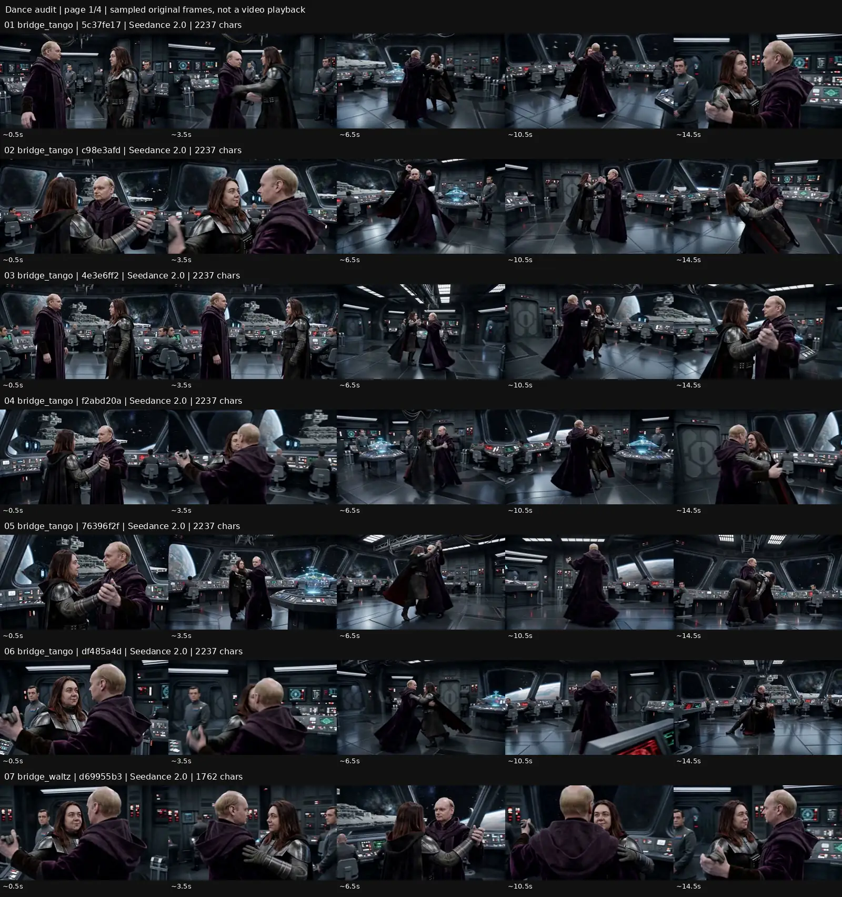
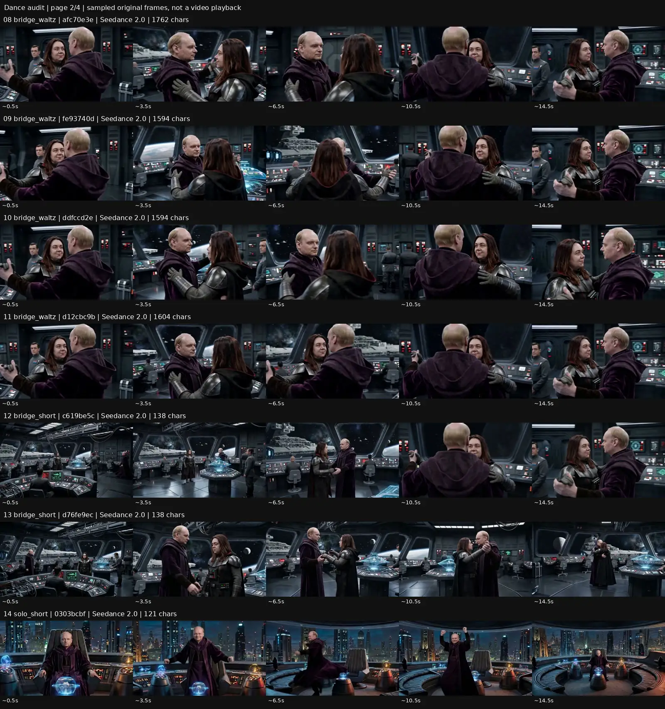
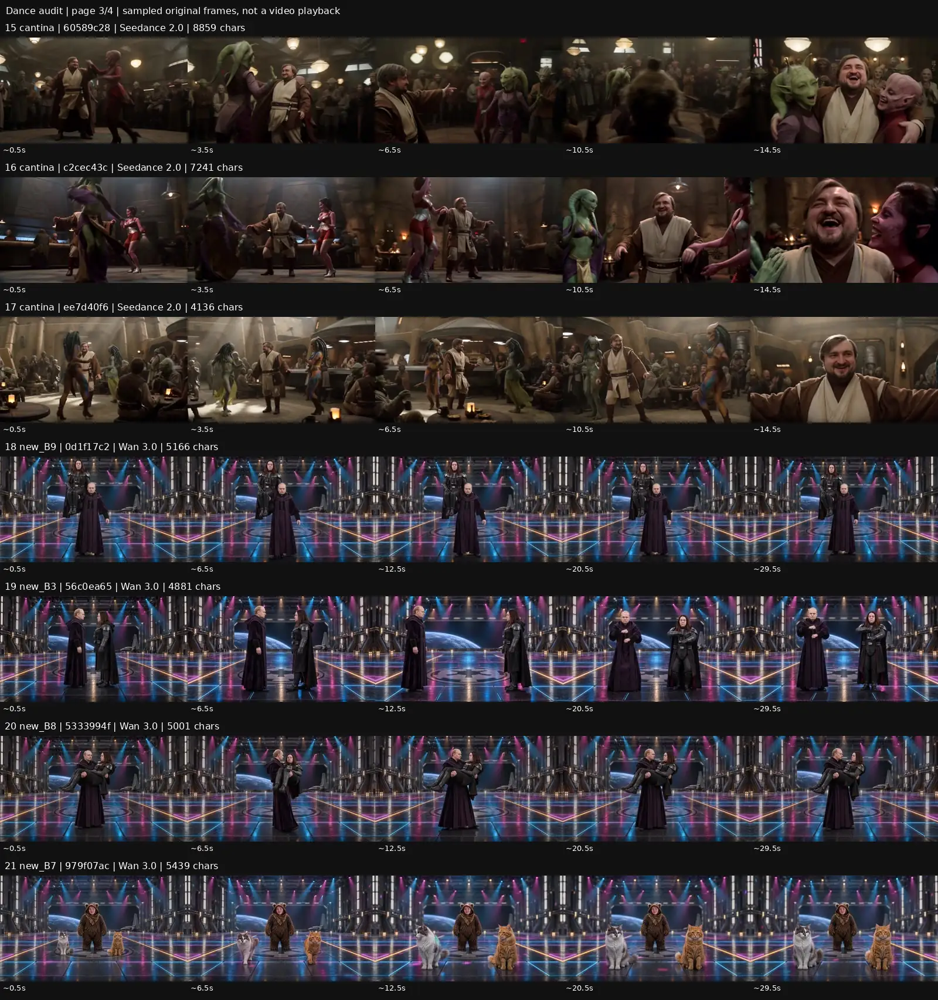
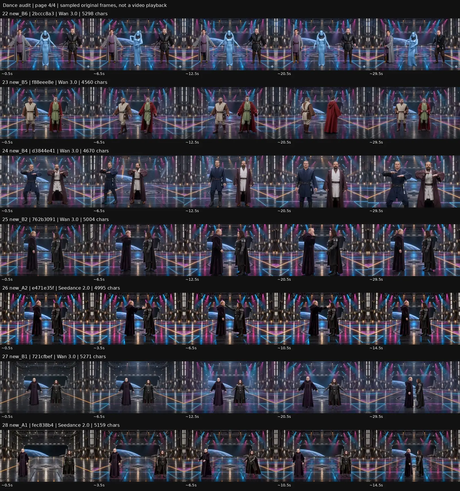

# Танцы: мешает ли слишком подробный промт?

Дата проверки: 25 октября 2026. Проект: Серёгиус, Topview → My First Board.

**Вывод: гипотеза владельца заслуживает проверки. В его архиве есть удачный танец по 121 символу, но и самый длинный кантинный промт дал один из наиболее живых результатов. Для новых неудачных номеров гораздо лучше подтверждена проблема содержания: мы сами потребовали маленьких движений, долгих остановок и запретили разнообразие. Независимое влияние длины пока не доказано.**

## Что проверено

Просканированы все 449 видео-задач доски. Найдены и визуально разобраны 13 старых танцев на корабельном мостике и все 3 танца в кантине. Дополнительно разобраны 1 короткий сольный танец Серёги в кабинете и 11 завершённых вариантов сцены 28 от 14–17 октября. Всего 28 оригинальных MP4. Кандидаты, где танцы лишь запрещены в negative или choreography означает бой, исключены.

Для каждого получен фактически отправленный текст из Topview, а не сегодняшняя редакция master. Сохранены task ID, дата создания, модель, количество входов, точный текст, SHA256 текста/видео, фактическая длительность/размер видео и отдельное наблюдение. [Полный реестр 28 роликов](dance-prompt-audit-2026-10-25/inventory.json).

Метод просмотра: последовательности кадров через 1 секунду по всей длительности каждого скачанного оригинала. Это позволяет судить о стойках, крупных действиях, развитии сцены и композиции. Аудио не прослушивалось; попадание в музыкальный бит, плавность между соседними кадрами, краткие ошибки пальцев и точная пригодность каждого кадра для монтажа не сертифицированы. Таймкоды приблизительные. Оценки энергии — художественное наблюдение, не измеренный универсальный рейтинг модели.

Две задачи A1/A2 от 23 октября (`4b7b972870a44dfbb29bd6c5e330a633`, `8a8eadc809004e318c47201b8a463be0`) в снимке доски ещё `init`; их новая редакция примерно 6 тыс.символов не имеет готового результата для этого разбора. **Не переносить выводы о старых 14–17Oct роликах на ещё не полученную редакцию 20Oct.**

## Что показали старые танцы

| Группа | Количество | Длина фактического текста | Наблюдение |
|---|---:|---:|---|
| Короткий романтический танец на мостике | 2 | 138 символов | Сближение, руки, затем спокойное вращение. Разная камера при одинаковых тексте и записях входов. Короткий текст работает, но не делает романтический танец быстрым. |
| Медленный вальс на мостике | 5 | 1594–1762 | Мягкое вращение в близкой позиции. Медленность прямо заказана; это не провал запроса на энергичный номер. |
| Танго на мостике | 6 | 2237 | После вступления — вращения, раскрытия, шаги и в части вариантов низкий наклон. Серьёзные лица не мешают заметной амплитуде. |
| Сольный танец Серёги в кабинете | 1 | 121 | Встаёт, широко работает руками, вращается с плащом и возвращается к креслу. Прямой пример того, как модель сама достраивает короткую идею. |
| Три танца в кантине | 3 | 4136 / 7241 / 8859 | Все содержат движение; самый длинный вариант особенно активен с первых кадров, с партнёрскими вращениями и сменой взаимодействия. Самый короткий из трёх не самый амплитудный. |

Длина считается как Python `len(positivePrompt)`: с пробелами, переносами строк и маркерами `<<<ImageN>>>`. В старом отчёте 17Oct счёт мог отличаться; здесь все числа получены одним способом.

**Короткий положительный пример** — `0303bcbf852344229391205b4ed992ad`,121 символ:

> The room in <<<Image3>>> . The person in <<<Image2>>> gets up and starts dancing joyfully. At the end, he sits back down.

Около 4–10 с видны широкие руки, поворот и движение плаща. В этой сцене один человек и нет сложной поддержки партнёра, поэтому она не доказывает, что такой же уровень свободы сохранит точную двухчеловечную поддержку.

**Два текста по 138 символов** — `c619be5cd9004d62ad5e7e804748b285` и `d76fe9ecf31647ee9ecea1dda7cb0016`:

> Bridge <<<Image1>>> . Man <<<Image4>>> . Woman <<<Image3>>> . Man approaches woman, takes her hands, and they begin to dance romantically.

Первые примерно 5–6 секунд уходят на подход/руки. Это следует сюжету самого короткого текста. Краткость не устраняет вступление автоматически. Имена входов действительно Image1, Image3, Image4 — разрыв нумерации не объявлен ошибкой.

**Кантина:** `ee7d40f6…`4136 → `c2cec43c…`7241 → `60589c28…`8859. В последнем тексте действия сразу активны, партнёрши вовлечены, персонажи перемещаются; результат это передаёт. Текст очень подробный и местами чрезмерный, но он не «заморозил» танец. При этом три входных файла портрета различаются; это не контролируемый эксперимент с одной лишь длиной.

**Шесть танго:** совпадают полный текст и записи двух картинок/одного Video1. Последовательности всё равно различаются: где-то вступление~3 с, в `4e3e6ff2…`~5 с; наклон и финальные позиции отличаются. Seed в доступных параметрах отсутствует. Один результат нельзя считать надёжной оценкой промта. Совпадение записей входов проверено хешами метаданных, не байтами всех входных медиа.

Все 11 вальсов/танго содержат один и тот же Video1, а два коротких романтических танца созданы с тремя картинками без видеовхода. Часть кадров продолжений визуально очень похожа. Это дополнительная причина не считать всю группу независимым сравнением силы текста и не приписывать результат только длине.

## Что пошло не так в новых номерах

В старых A1/B1 и других отправленных текстах обнаружены не просто большие объёмы описания, а **прямые указания на малую энергию**:

| Ролик | Что реально было заказано | Что видно в результате |
|---|---|---|
| A1 `fec838b4…`, Seedance 2.0,15 с | 0–3 с стойка;3–6 с включение света без танца; затем `two small inward step-touches`, `one restrained shoulder quarter-turn`; в negative `fast spins, high kicks` | Вступление со светом, немного мелких шагов/рук, сближение и остановка. |
| B1 `721cfbef…`, Wan 3.0,30 с | Первые 10 с стойка и свет; далее два маленьких шага и повтор короткого мотива | Почти та же малоподвижная драматургия, растянутая на 30 с. |
| A2/B2 `e471e35f…` / `762b3091…` | Четыре строго поочерёдных прохода руки у щеки; двигается только одна рука; ноги стоят | Контактный гэг с руками, а не развёрнутый танец. У Wan часть жестов проходит перед собственной стороной лица — низкая энергия не единственная проблема. |
| B4/B5 `d3844e41…` / `f88eee8e…` | Малые шаги и повтор одного угловатого мотива; `no new choreography or bigger movements`, `stiff by intention` | Шаги есть, но однообразны и скованны. |
| B8/B9 `5333994f…` / `0d1f17c2…` | Одна поддержка; один медленный поворот либо два маленьких шага, затем долго держать | Один читаемый трюк с большим временем фиксации вместо полноценного 30-секундного номера. |

Остальные новые варианты также имеют отдельные строки в реестре: B3 — отход/фиксация; B6 — тройка с маленькими повторными жестами; B7 — кошки и дирижёр, короткое движение и долгое ожидание. Не всякий такой гэг плох сам по себе; он может работать короткой вставкой. Но как длинный самостоятельный энергичный танец материала в нём недостаточно.

**Моя прежняя постановка перестраховалась:** защита лиц, одежды, света, контактов и монтажных поз постепенно стала ограничивать собственно танец. Идея «серьёзные лица» была слишком часто расширена до «сдержанные движения всего тела». Старое танго показывает, что это не обязательная связь. Исправление 20Oct добавило активности, но стало ещё подробнее; пока готовых результатов этой версии нет, наращивать инструкции дальше по привычке не стоит.

Это не доказательство внутренней «перегрузки внимания» модели: её внутреннее выполнение недоступно. Наблюдаемая причина проще — текст прямо просит то, что затем выглядит вяло. Дополнительные вероятные факторы: постановочная картинка с фиксированной позой,3–4 референса вместо 1–2, маленькие фигуры в огромном ангаре, запрет движения камеры,30 секунд на одно действие. Их отдельный вклад ещё не измерен.

Модель тоже не единственное объяснение: слабое старое A1 сделано той же Seedance 2.0, что короткий сольный номер и все три кантины. Сравнение Wan30 с и Seedance15 с не является чистым тестом моделей. Файлы всех 28 результатов реально 1280×720, несмотря на слова 1080p/4K внутри некоторых текстов; размер подтверждён MP4, а не обещанием в промте.

## Проверка первичных источников

- [Higgsfield: Seedance 2.0 Complete Prompting Guide,13Apr2026](https://higgsfield.ai/blog/seedance-prompting-guide). В собственном руководстве платформы есть и намеренно минимальные концептуальные промты, и длинные постановки с действиями по времени. Это подтверждает пригодность обоих подходов, но не доказывает превосходство коротких текстов для наших танцев.
- [Team Seedance: технический отчёт Seedance 2.0,15Apr2026](https://arxiv.org/abs/2604.14148). Модель принимает текст, картинки, звук и видео. Поэтому наличие Video1 — существенное различие условий, которое нельзя смешивать с эффектом длины текста.
- [BytePlus: Seedance 2.0 prompt guide](https://docs.byteplus.com/en/docs/modelark/seedance-2-0-prompt-guide) найден, но доступная текстовая выдача содержит оболочку страницы без содержимого руководства. Не использовать её как доказательство правила «короче лучше».

## Практический вывод для следующих редакций

Начинать свободный танец с короткого ясного намерения, характера движения и минимальных неизменяемых условий. Хореографию, микротайминги и многочисленные запреты добавлять по конкретному дефекту, который реально появился. Не переписывать длинным текстом то, что уже ясно из картинки. Для поддержки на плече/руках сохранить необходимые точки опоры; свободный танец и сложный трюк требуют разной точности.

Для юмора Серёгиуса полезно разделять два слоя: **тела увлечённо и крупно танцуют, лица сохраняют пафосную серьёзность**. Фраза «они весело танцуют» может сработать, но без этого уточнения способна дать улыбки и другую комедийную интонацию.

Черновой короткий вариант для свободного парного танца, а не замена всем частям 28:

```text
<<<Image1>>> is the hangar. <<<Image2>>> and <<<Image3>>> are the two dancers; keep their faces and clothes.
They are already dancing energetically together, inventing playful partner moves with broad steps and turns. Their faces stay solemn, as if this absurd dance were an important state ceremony. Keep both full bodies visible in one continuous shot.
```

Это вариант для испытания, не утверждённый успешный промт. Настройки задаются отдельно: Seedance 2.0,15 с,16:9,720p; выбранные референсы необходимо сверить перед реальным запуском.

## Как отделить свободу от длины

1. Сначала практическая пара: старый ограничивающий текст против краткого энергичного. Это проверка улучшения постановки **в целом**, а не чистого числа символов.
2. Для проверки именно подробности — короткая и развёрнутая версии **с одинаковой энергией, действиями, камерой и обязательными условиями**. В длинную нельзя возвращать паузы/малую амплитуду, иначе снова сравниваются разные задания.
3. Одинаковые модель,15 с,720p,16:9, входные файлы и режим. В первом сравнении безVideo1; пользу Video1 проверять отдельной парой. По возможности фиксировать seed; если он недоступен, не скрывать разброс. Повторные образцы полезны, но отдельные повторы не входят автоматически в разрешённую очередь.
4. Оценивать не объём движения камеры, а движение тел: сколько времени реально танцуют, разнообразие и амплитуда, работа ног/веса, взаимодействие, узнаваемость, контакт и пригодные монтажные секунды. Затем проверять с выбранной музыкой.

План сохранён как исследовательское предложение внутри существующего плана сравнений. **В этом аудите Create = 0, claim = 0, расход=0. Очередь и master-промты не изменены. Старые неудачные танцы не объявлены принятыми или выполненными.** Действующий порядок 25Oct после сюжетного блока:63 →49 →50 →51 →танцы 28; не возвращать старый порядок из исторических отчётов.

## Кадровые доказательства и индивидуальные наблюдения

Четыре страницы содержат по 5 выборочных кадров каждого из 28 роликов. Для анализа выше просмотрены полные секундные последовательности, а не только эти сокращённые страницы.









| № / задача | Наблюдение | Значение для проверки |
|---|---|---|
| 01 · `5c37fe17a85f4131bbb036465e6a7eb2` · bridge_tango | Начало почти неподвижно до ~3 с; затем раскрытие пары, перемещения и вращение. В конце камера приближается к лицам. По выборке заметного глубокого наклона нет. | Движение пары и камеры оба существенны; не путать один орбитальный проезд с хореографией. |
| 02 · `c98e3afde8ea466d8880c7e664de97ff` · bridge_tango | После ~3 с заметно разнообразнее: раскрытие, поворот женщины, низкое положение около 7.5 с, совместное вращение и наклон к финалу. | Один из выразительных вариантов пары; контакт в наклонах требует просмотра в реальном времени перед монтажом. |
| 03 · `4e3e6ff2ea2d41458d250a44e0cb8aa1` · bridge_tango | Почти 5 с ожидания; далее раскрытие, низкий выпад/наклон около 7.5 с, вращения и смена положения пары. | Движение есть, но вступление длиннее заказанных 3 с. |
| 04 · `f2abd20ae87c437fb498bc1d034beccd` · bridge_tango | После первых 3 с совместное вращение; около 9–13 с раскрытия и повороты, плащ заметно работает. | Преимущественно вращение пары; не вся детальная танго-хореография различима. |
| 05 · `76396f2f5c3243be82eb5a7746564bb5` · bridge_tango | С ~3 с вращения в паре и под поднятой рукой; около 14.5 с низкий наклон. | Серьёзные лица сочетаются с крупным движением тела: deadpan сам по себе не причина вялости. |
| 06 · `df485a4d682a45c7b23f8e252369f1c2` · bridge_tango | С ~3 с смена направлений, шаги в паре, раскрытие; около 13–15 с низкий завершающий наклон. | Выразительный финал. Те же текст и записи входов, что у остальных пяти, но другая последовательность. |
| 07 · `d69955b36bd24abbacd902e62a7240ef` · bridge_waltz | Вся выборка: тесная танцевальная позиция, мягкое вращение, спокойные лица; средний/крупный кадр. | Соответствует явно заказанному медленному вальсу; не считать отсутствием энергичного танца по ошибке. |
| 08 · `afc70e3e4e2d423288e70430ae16a259` · bridge_waltz | Спокойная пара непрерывно меняет ориентацию, камера держит лица; больших фигур не видно. | Медленное движение соответствует запросу. Похож на другие продолжения одного Video1. |
| 09 · `fe93740d3afc44f59aa3a99fcde880a4` · bridge_waltz | Мягкое вращение в закрытой позиции почти весь ролик; крупные лица, небольшие жесты. | Не самостоятельное доказательство способности краткого/длинного текста: тот же видео-вход. |
| 10 · `ddfccd2ea814471faaa23213abc0252d` · bridge_waltz | То же медленное вращение, к концу небольшое раскрытие положения рук/пары. | Низкая амплитуда заказана явно; не провал энергичного номера. |
| 11 · `d12cbc9b858a482dbb10f02896626e6d` · bridge_waltz | Плавный медленный парный поворот, камера близко; повторяющиеся позиции из той же группы. | Видео-референс общий для всех пяти вальсов и шести танго. |
| 12 · `c619be5cd9004d62ad5e7e804748b285` · bridge_short | ~0–6 с мужчина подходит к женщине; затем берутся за руки и вращаются в близкой позиции, камера приближается. | 138 символов достаточно для понятной сцены; половина времени уходит на заказанное сближение, не на быстрый танец. |
| 13 · `d76fe9ecf31647ee9ecea1dda7cb0016` · bridge_short | ~0–5 с сближение и руки; затем спокойное парное вращение. Есть переходы между общим и крупным планом. | Тот же короткий текст и записи трёх картинок, но заметно другая камера; краткость не гарантирует динамичный танец. |
| 14 · `0303bcbf852344229391205b4ed992ad` · solo_short | ~0–3 с встаёт с кресла, ~4–10 с широкие руки, поворот с разлетающимся плащом, затем возвращается к креслу. | 121 символ; самый прямой положительный пример свободной интерпретации joyful dancing. Это кабинет с городом за окном, не корабельный мостик. |
| 15 · `60589c2809624ff8ba1b0050740664d7` · cantina | С первого кадра активная тройка: парное вращение, переходы между партнёршами, широкие жесты, работа плащей, приближение к смеющимся лицам. | 8859 символов — самый длинный и один из наиболее живых результатов. Не все придуманные микроэпизоды выполнены буквально. |
| 16 · `c2cec43cf9044e6ebea82154bbd486b3` · cantina | Танец начинается сразу; женские повороты и активные руки, мужчина делает шаги/поворот, затем общий смех и крупный план. | 7241 символ. Энергия есть; часть впечатления дают партнёрши и камера, не только ноги героя. |
| 17 · `ee7d40f6d3ff42a0a5865b031d06cfbf` · cantina | Персонажи двигаются с начала, у мужчины в основном малые шаги; около 10–12 с поворот, затем раскрытые руки и приближение камеры. | 4136 символов. Самая короткая кантина не самая амплитудная; другой файл входного портрета — дополнительное различие. |
| 18 · `0d1f17c226834bfbb851d76ed32f9877` · new_B9 | Женщина на правом плече; несколько небольших продвижений, почти весь ролик сохраняется один силуэт; большой объём удержания позы. | Промт заказывает ровно два малых шага и длительные остановки. Это короткая поддержка/гэг, не 30 с свободного танца. |
| 19 · `56c0ea656f484b0cb8464233fe097e0d` · new_B3 | Долгое стояние лицом к лицу, затем расхождение, поворот к камере и почти неподвижная угловатая поза во второй половине. | Текст даёт 3 маленьких отхода, один импульс рук и долгие фиксации — недостаточно материала для энергичных 30 с. |
| 20 · `5333994f739f4a8b813a6a36dcb7e140` · new_B8 | Несёт женщину на руках; заметный поворот в первой половине, после ~12 с почти всё время одна поза. | Поддержка читается, но танцевальной последовательности нет. Результат заканчивает активную часть раньше текстового 19 с. |
| 21 · `979f07acffe04750961515f4baf21a3f` · new_B7 | Кошки выходят вперёд, садятся, поворачивают головы; человек делает небольшие движения рук, затем долгое ожидание. | Отдельный кошачий гэг. Посадка кошек отличается от заказанного standing on all fours; не тест человеческой хореографии. |
| 22 · `2bccc8a3521b411cb7bd51f9c8ba1119` · new_B6 | Тройка: небольшие угловатые движения рук, шаги на месте и повороты плеч; заметный простой ритмический рисунок, низкая амплитуда. | Дословно заказаны very small step-touches и повтор одного мотива; запрет новых жестов. |
| 23 · `f88eee8ea93242309b71621e354ccac2` · new_B5 | Пара делает повторные небольшие боковые шаги; позже поворот корпуса/пары, затем официальная стойка. | Движение присутствует, но его диапазон задан узко; слово stiff by intention объясняет часть вида результата. |
| 24 · `d3844e4199d64abebe323be430a5cb35` · new_B4 | Пара повторяет угловатый жест и боковые шаги; позднее поворот друг к другу, камера приближается, финальная поза. | Не полный статичный кадр, но однообразный малый мотив. Камера всё же меняет масштаб вопреки locked. |
| 25 · `762b3091b3e44b8599a0a58b91a253c5` · new_B2 | Руки по очереди поднимаются у лиц, ноги почти неподвижны, много пауз. Часть жестов проходит перед собственной стороной лица. | Это мимический/контактный гэг, не общий танец; просьба только одной движущейся руки и planted feet ограничивает энергию. |
| 26 · `e471e35fc7454fe5a2a89e06fac3f122` · new_A2 | Поочерёдные касания/проходы руки около лица, туловища и ноги почти неподвижны; финал без контакта. | Seedance 2.0 тоже сдержан, но именно такую постановку заказывает промт. Нельзя всю проблему списать на Wan. |
| 27 · `721cfbef2af0479da57f0a52479d2f54` · new_B1 | Долгое вступление с включением света; затем малые шаги и жесты, сближение, остановка лицом к лицу. Персонажи небольшие в огромном ангаре. | Первые 10 с текста посвящены стойке и свету, затем tiny step-touches; мало танца на 30 с. |
| 28 · `fec838b4f63b452c8c76fe50f8e0fdad` · new_A1 | Первые секунды стойка/свет; примерно 5–11 с маленькие шаги и руки, затем разворот друг к другу и остановка. | Промт прямо отводит 0–6 с без танца, запрещает fast spins/high kicks. Это сильнее объясняет слабую энергию, чем длина сама по себе. |

