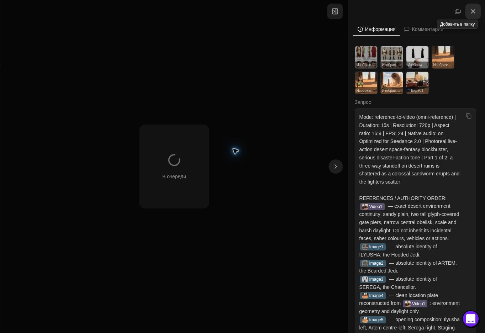

# Активные сцены червя · 20.10.2026

Команда владельца01:32:57МСК: доработать бой и червя, использовать Seedance, поставить следующими. Работа FILM-20261020-WORM-SEEDANCE. Предварительная контрольная точка9ca7e627e64e124eee9b3844d80959afa5d27226.

| Сцена | Что уточнено |
|---|---|
|16| Реакция во время прорыва червя, бег и перенаправление, непрерывный бой/уклонения; нет затяжного любования чудовищем. ПереходP1→P2 в движении. Обе опоры ворот и обелиск сохраняются для42; рушатся второстепенные стены. |
|42| Равнодушие к червю выражено лицом и экономным уклонением, дуэль быстрая. При контакте клинков видны давление, шаги и смена веса; комический неподвижный червь сохранён. Новый входImage6 только из реального16P2. |
|56| Убрана пятисекундная финальная стойка: бой продолжается до короткого контакта клинков. Камера держит ось, энергия в телах. Червь замахивается для48. |
|48| Подхват модуля за1–2сек и немедленная реакция без геройской позы; Илюша отскакивает, Артём остаётся на коленях и затем явно встаёт. Разрушения после56 не восстанавливаются. |

Обновлены12блоков (основные30с и обе15с части), остальные77текущих промптов дословно сохранены. После решения владельца сцена55 штатно удалена из active master, поэтому89промптов/21сцена. Исторический принятый16 сохранён; новая версия не считается принятой. Сюжетное спокойствие других сцен не менялось.

Выбраны8пунктов Seedance2.0:16P1→16P2→42P1→42P2→56P1→56P2→48P1→48P2, приоритет1–4.1 среди готовых. Первый готов по существующим7входам; остальные ждут настоящие результаты иQC. Старый кадр42 сохранён как история, новый стык не подменяется. 30с альтернативы не запускаются. Остальной порядок кнопок сайта сохранён. Существующее задание6acae6ab433481919e88665c520b8ef2 обновлено, HH:55МСК/обслуживание сохранены.

## Кнопки55

Root cause: retire-путь принимал canonical slow (ожидание решения после terminal) за физически активную генерацию. Исправление9e89b5812479a28704bf5a1c10d1f79c1e0c4278 разделяет эти состояния, требует подтверждённый terminal и атомарно снимает slow с retire/ledger.35тестов прошли, включая terminal и отсутствие подтверждения; реальная активная задача по-прежнему блокирует retire. Три исходные строки владельца переотправлены штатному роботу без смены решений. Робот10664f7 применил accept/to_montage/in_film; ledger55 accepted=true,inserted_into_film=true,Scene ID зарезервирован,health=ok. Физическая телеметрия агентом не подделывалась.

## Проверка перед запуском

12/12текстов прочитаны;8выбранных полных SHA/normalizedSHA ислоты совпали с очередью. Seedance<10000символов;15с/720p/16:9/quantity1/maxcredits0. Полная структура§5А. Валидатор master health=ok. 6изображений и исходныйMP4 проверены поSHA;визуально проверены identity/location/wormscale и оригинал пустыни. Браузер подтверждает Seedance2.0 и«Безлимитный режим — бесплатно»; задача ещё не отправлена на момент этой точки. Следующий шаг:свежий глобальныйскан,claim,одинCreate,проверенныйreceipt.

Проверено 2026-10-19T22:49:05.004Z. Энергичность готового видео можно оценить лишь после результата; правки промптов не гарантируют исполнение моделью.

## Запуск подтверждён

2026-10-19T22:54:14.950Z: S16P1 отправлена22:51:48UTC,task30cfaf12ad944cd6944416623397e41c,Seedance2.0/15с/720p/16:9/qty1/Unlimited0. Полный текст и7входов подтверждены. [Receipt](topview-queue-2026-10-16/S16-SEED20-P1-20261020.json). . После отправки6/6занятых;остальные7частей ждут настоящих результатов. Публикация72f3150c/CI/Pages39337702619 подтверждена,healthok.
