# Актуальные видео-сцены и промты

Рабочий мастер-файл. Здесь хранятся только актуальные промты, которые ещё нужны для генерации или доработки. Когда ролик готов и промт больше не нужен, соответствующая сцена удаляется из файла и из оглавления.

**Канонический источник:** `video-prompts.md`. Это единственный редактируемый мастер; `video-prompts.html` генерируется из него автоматически и вручную не редактируется.

## 📌 РЕВИЗИЯ / ТЕКУЩИЙ СТАТУС

**27 сцен к генерации/доработке · 128 полных текстов промта**

- **🛠️ 11** рабочих направлений в блоке **«Сцены в работе»**: W5–W15. Из них W14–W15 — «обдумать», а не отдельные сцены для автоматической генерации.
- **⏳ 8** сцен сейчас в медленной генерации: **16, 28, 42, 48, 52, 56, 57, 58** — **5 активных Topview-задач / 5 занятых слотов из 6**. Редакционная приёмка будущих результатов отдельно. Новые генерации автоматически не запускать.
- **Последняя оформленная активная сцена:** 70 — Татуин: непрерывный пролёт с улицы к столику Серёги в кантине. Связка 52 ч.7 → 66 → 67 → 68 → 69 → 70 → 65 использует настоящие последние3с предыдущего звена; вся уличная цепь и65/70 выбраны Wan3.0,30с,52P1–P6 остаются Seedance2.0. В67–69 одна и та же дыня и сумка;69 убирает оставленную Стичем кучу в лазерный совок. Новые сцены остаются DRAFT, видеостыки ожидаются; приоритет до49→50→51→28, ready-skip сохраняется. Никаких видео этой правкой не запущено.
- **Ревизия Control Center:** дата определяется автоматически по содержательному изменению canonical master; чистая техническая пересинхронизация без изменения содержимого дату ревизии не меняет.
- **Последняя полная синхронизация:** **28.10.2026 · текущая по live Topview/Drive сверке**. Точное техническое время свежей telemetry берётся из `topview-status.json.checked_at`.

**Статусы V3.5 для обсуждения правок:** `NEEDS_FIX` означает, что сцену/промт нужно отдельно обсудить и решить, требуется ли изменение; это не разрешение автоматически переписывать промт или запускать новый рендер. `NEEDS_RERENDER` означает, что предыдущий результат уже признан кандидатом на повторную генерацию, но для slow-сцен повторный запуск всё равно запрещён до результата/ошибки или отдельного решения пользователя.

**Синхронизация контекста:** **28.10.2026**. Точное техническое время зеркала хранится в `project-status.json` и здесь не дублируется. Фактическая карта — `film-analysis.md`, статусы и зависимости — `film-backlog.md`. Новые решения пользователя имеют приоритет над старым Notion. В active master остаются **27 актуальных сцен и 128 полных текстов промта**. Сцены **1, 2, 3, 4, 5, 6, 7, 9, 10, 11, 12, 14, 15, 17, 18, 19, 20, 21, 22, 23, 24, 25, 26, 27, 29, 30, 31, 32, 34, 35, 37, 38, 39, 40, 43, 44, 45, 46, 47, 53, 54 и 55** удалены из active master; их Scene ID зарезервированы и не переиспользуются. Scenes 10, 11, 17, 19, 22, 23, 29 помечены владельцем «🎞 В фильме» 10.10.2026; подтверждение хранится в review-ledger.json, а не означает новую генерацию. По явному решению пользователя Scene 3 и 4 признаны неудачными и больше не дорабатываются, а Scene 5 принята как выбранный монтажный вариант и пойдёт в фильм, поэтому её prompt также больше не нужен в active master. Canonical slow-list сейчас: **16, 28, 42, 48, 52, 56, 57, 58**. Полная live Topview сверка 10.10.2026 (ручная сверка Claude, пока «AI Film — единый монитор» не публикует): 11 boards, 554 video tasks, **1/6 active task slots**, свободно 5. Активна одна Wan 3.0 задача со статусом `init`: Scene 16 — `36e8320e34da4f1b97c35e1e765e3e63`. Scene 20 — `2c28a4161c8f459d8bf0c0460ac21ec5` технически завершена 10.10.2026 17:08:14 UTC (`success`). Технически завершены со статусом `success`: Scene 30 — `e369529cc93d465ba14127e4712f7bbd` (09.10.2026 13:57:32 UTC); Scene 31 — `32a4df3b18714cde9c55f0281cc2dd41` (09.10.2026 21:25:14 UTC); Scene 32 — `9746bfed635c451e97095c35b4e3b2bf` (10.10.2026 07:21:04 UTC); ранее Scene 33 — `e95f1bab9ab24f528b55fa58495d7adb` и Scene 34 — `3fb3d9ee26474b62982ae8ef062afc32`. Результаты требуют отдельной редакционной проверки и не считаются одобренными. Это попытки уже существующих сцен; production/approval state не менялся. Scene 28 здесь не запускалась. Никакие старые промты Notion сюда автоматически не добавлены. Непрерывный аудиовизуальный контроль не выполнялся.

**Новые промты 09.10.2026:** Scene 20 расширена вставками 12–13, добавлены Scenes 29–34 с полными production-промтами и имеющимися референсами: кантина (часть 3), три разрушительных боя, исследование руин и вход в храм. Это новые тексты для запуска, а не уже выполненные/одобренные Topview-результаты. Танцы Scene 28 и их неподтверждённые вспомогательные фото не менялись.

## ⏳ Сейчас в медленной генерации

| Сцена | Статус | Действие |
|---|---|---|
| 16 — Татуин: гигантский пустынный червь и бой на руинах | ✅ Технический результат получен · `success` · Wan 3.0 | task `36e8320e34da4f1b97c35e1e765e3e63`; требуется отдельная редакционная проверка |
| 28 — Финальные титры: имперский строевой танец | ✅ Решение владельца: на переделку · ✅ Технический результат получен · `success` · Wan 3.0 | task `721cfbef2af0479da57f0a52479d2f54`; решение владельца применено в панели сайта |
| 28 — Финальные титры: имперский строевой танец | ✅ Решение владельца: на переделку · ✅ Технический результат получен · `success` · Seedance 2.0 | task `fec838b4f63b452c8c76fe50f8e0fdad`; решение владельца применено в панели сайта |
| 28 — Финальные титры: имперский строевой танец | ✅ Решение владельца: на переделку · ✅ Технический результат получен · `success` · Wan 3.0 | task `762b3091b3e44b8599a0a58b91a253c5`; решение владельца применено в панели сайта |
| 28 — Финальные титры: имперский строевой танец | ✅ Решение владельца: на переделку · ✅ Технический результат получен · `success` · Seedance 2.0 | task `e471e35fc7454fe5a2a89e06fac3f122`; решение владельца применено в панели сайта |
| 28 — Финальные титры: имперский строевой танец | ✅ Решение владельца: на переделку · ✅ Технический результат получен · `success` · Wan 3.0 | task `d3844e4199d64abebe323be430a5cb35`; решение владельца применено в панели сайта |
| 28 — Финальные титры: имперский строевой танец | ✅ Решение владельца: на переделку · ✅ Технический результат получен · `success` · Wan 3.0 | task `f88eee8ea93242309b71621e354ccac2`; решение владельца применено в панели сайта |
| 28 — Финальные титры: имперский строевой танец | ✅ Решение владельца: на переделку · ✅ Технический результат получен · `success` · Wan 3.0 | task `2bccc8a3521b411cb7bd51f9c8ba1119`; решение владельца применено в панели сайта |
| 28 · B7 · Танец 7 — Алеся, Лучик и Рыжик: невозмутимый дирижёр | ✅ Решение владельца: на переделку · ✅ Технический результат получен · `success` · Wan 3.0 | task `979f07acffe04750961515f4baf21a3f`; решение владельца применено в панели сайта |
| 28 · B8 · Танец 8 — Размеренное кружение на руках | ✅ Решение владельца: на переделку · ✅ Технический результат получен · `success` · Wan 3.0 | task `5333994f739f4a8b813a6a36dcb7e140`; решение владельца применено в панели сайта |
| 28 · B9 · Танец 9 — Парадная переноска на плече | ✅ Решение владельца: на переделку · ✅ Технический результат получен · `success` · Wan 3.0 | task `0d1f17c226834bfbb851d76ed32f9877`; решение владельца применено в панели сайта |
| 28 · B3 · Танец 3 — Невозмутимый разъезд | ✅ Решение владельца: на переделку · ✅ Технический результат получен · `success` · Wan 3.0 | task `56c0ea656f484b0cb8464233fe097e0d`; решение владельца применено в панели сайта |
| 41 — Серёга увозит древний ПК с планеты ситхов | ✅ Решение владельца: принято · ✅ Технический результат получен · `success` · Wan 3.0 | task `bf3465e1c4de4a869f4bba5f2eed5acf`; решение владельца применено в панели сайта |
| 36 — После пещеры: Серёга уходит с фрагментом карты | ✅ Решение владельца: в монтаж · ✅ Технический результат получен · `success` · Wan 3.0 | task `e33891d4568a4a90b31ff3c67f5a7100`; решение владельца применено в панели сайта |
| 16 · Seedance 2.0 часть 1 — Татуин: гигантский пустынный червь и бой на руинах | ⏳ В МЕДЛЕННОЙ ГЕНЕРАЦИИ · ✅ Технический результат получен · `success` · Seedance 2.0 | task `30cfaf12ad944cd6944416623397e41c`; ждёт решения владельца в панели сайта |
| 16 · Seedance 2.0 часть 2 — Татуин: гигантский пустынный червь и бой на руинах | ⏳ В МЕДЛЕННОЙ ГЕНЕРАЦИИ · ✅ Технический результат получен · `success` · Seedance 2.0 | task `cd37ab3fd3ab4e1782b295ace2a3b1d4`; ждёт решения владельца в панели сайта |
| 42 · Seedance 2.0 часть 1 — Татуин: бой на фоне червя — червь им не интересен | ⏳ В МЕДЛЕННОЙ ГЕНЕРАЦИИ · ✅ Технический результат получен · `success` · Seedance 2.0 | task `a1ca4c36e31d45c5b4b72df7777d2592`; ждёт решения владельца в панели сайта |
| 57 · Seedance 2.0 часть 1 — РосКОТмос: аварийная посадка котов на планете ситхов | ⏳ В МЕДЛЕННОЙ ГЕНЕРАЦИИ · ✅ Технический результат получен · `success` · Seedance 2.0 | task `20bf2d185da546aa8aba3b1d4508d0d8`; ждёт решения владельца в панели сайта |
| 52 · Seedance 2.0 часть 1 — Серёга пересаживается на свой корабль и прилетает на Татуин | ⏳ В МЕДЛЕННОЙ ГЕНЕРАЦИИ · ✅ Технический результат получен · `success` · Seedance 2.0 | task `34ff1bf7fe9d47f08de5a635d5626c70`; ждёт решения владельца в панели сайта |
| 28 · A1 · Танец 1 — Серёга и Юля задают устав | ⏳ В МЕДЛЕННОЙ ГЕНЕРАЦИИ · ✅ Технический результат получен · `success` · Seedance 2.0 | task `4b7b972870a44dfbb29bd6c5e330a633`; ждёт решения владельца в панели сайта |
| 58 · Seedance 2.0 часть 1 — РосКОТмос: коты выбегают из горящего корабля | ⏳ В МЕДЛЕННОЙ ГЕНЕРАЦИИ · ✅ Технический результат получен · `success` · Seedance 2.0 | task `6598a21c2c684d43b7cede9cfc987107`; ждёт решения владельца в панели сайта |
| 57 · Seedance 2.0 часть 2 — РосКОТмос: аварийная посадка котов на планете ситхов | ⏳ В МЕДЛЕННОЙ ГЕНЕРАЦИИ · ✅ Технический результат получен · `success` · Seedance 2.0 | task `af8e389dc9564607bc6138b408c72da5`; ждёт решения владельца в панели сайта |
| 16 · Seedance 2.0 часть 2 — Татуин: гигантский пустынный червь и бой на руинах | ⏳ В МЕДЛЕННОЙ ГЕНЕРАЦИИ · ✅ Технический результат получен · `success` · Seedance 2.0 | task `bf27bb8615eb4ad5a44a86ec2efcd3be`; ждёт решения владельца в панели сайта |
| 28 · A2 · Танец 2 — Взаимные жесты у лица | ⏳ В МЕДЛЕННОЙ ГЕНЕРАЦИИ · `init` · Seedance 2.0 | task `8a8eadc809004e318c47201b8a463be0`; ждать terminal и проверить результат отдельно |
| 58 · Seedance 2.0 часть 2 — РосКОТмос: коты выбегают из горящего корабля | ⏳ В МЕДЛЕННОЙ ГЕНЕРАЦИИ · `init` · Seedance 2.0 | task `8b6a8ce102ea416e88d3c14fa558c513`; ждать terminal и проверить результат отдельно |
| 56 · Seedance 2.0 часть 1 — Татуин: бой в движении — червь требует внимания | ⏳ В МЕДЛЕННОЙ ГЕНЕРАЦИИ · `init` · Seedance 2.0 | task `b15165813c0848939edbe8b3d3aed182`; ждать terminal и проверить результат отдельно |
| 42 · Seedance 2.0 часть 2 — Татуин: бой на фоне червя — червь им не интересен | ⏳ В МЕДЛЕННОЙ ГЕНЕРАЦИИ · `init` · Seedance 2.0 | task `4a1061e175054da2810ffef8ad9d31cd`; ждать terminal и проверить результат отдельно |
| 48 · Seedance 2.0 часть 1 — Татуин: после боя Канцлер забирает фрагмент карты | ⏳ В МЕДЛЕННОЙ ГЕНЕРАЦИИ · `init` · Seedance 2.0 | task `8d7ff1e2de63478693778de29e0dd56e`; ждать terminal и проверить результат отдельно |

**Правило владельца (11.10.2026):** завершение, ошибка или отмена генерации автоматически меняют только технический статус и число занятых слотов Topview. **Сцена остаётся в canonical slow-списке / ожидании решения до явной кнопки в панели «🔑 Владелец»** и проверенного применения `owner_decisions` в GitHub. Технический `success` не означает одобрение. Новый запуск — только по решению владельца.

| # | Сцена | Референсы | Что происходит |
|---|-------|-----------|-----------------|
| 13 | [Совет джедаев — говорящий кот Лучик](#scene-13) | @image1 = композиция/локация; @image2 = Лучик; @image4 = Black; @image5 = Purple | После решения Совета кот на коленях у Purple спокойно человеческим голосом подтверждает решение. Black с кальяном и Purple воспринимают это как совершенно нормальное событие. |
| 16 | [Татуин — гигантский пустынный червь и бой на руинах](#scene-16) | @video1 = локация/герои Татуина | Огромный червь в духе Dune вырывается из песка в локации @video1 и разносит всё вокруг, пока герои сражаются на его фоне и уворачиваются от атак. Технический результат получен; требуется отдельная редакционная проверка.<br>**⏳ В МЕДЛЕННОЙ ГЕНЕРАЦИИ** |
| 28 | [Финальные титры — имперский строевой танец](#scene-28) | Character sheets из «Персонажей»; H28A/H28B; сохранённые P28/L28/F28; R28A/R28B как композиционные helpers; S28/G28 проверены; C28 только после результата части 2 | Две версии: 10×15 с Seedance 2.0 / 10×30 с Wan 3.0; отдельный короткий дуэт A11–A12 (2×15 с) / B11 (30 с). Церемония → дискотека; жесты у лица, разъезд, кружение на руках и на плече; монтаж около 90 с; `READY` для поэтапного запуска; часть 3 ждёт C28 из части 2. Решение владельца: на переделку; ожидание завершено.<br>**⏳ В МЕДЛЕННОЙ ГЕНЕРАЦИИ** |
| 33 | [Серёга изучает древний город ситхов](#scene-33) | @Image1 Серёга; @Image2 точные руины | Атмосферная проходка Серёги по локации битвы, осмотр каменной архитектуры и обнаружение входа храма. Технический результат получен; требуется отдельная редакционная проверка. |
| 36 | [После пещеры: Серёга уходит с фрагментом карты](#scene-36) | Серёга, Паша, Саша; пещера; модуль карты | Продолжение уже вставленной Scene 17: Серёга прячет модуль и уходит к водяной завесе, Паша и Саша остаются на Набу. READY: настоящий финальный кадр результата Scene 17 сохранён и проверен. Решение владельца: в монтаж; ожидание завершено. |
| 41 | [Серёга увозит древний ПК с планеты ситхов](#scene-41) | Серёга; древний ПК; корабль Канцлера; руины ситхов; крейсер | Сила несёт блок и монитор из храма в кабину, взлёт, полёт к крейсеру — стык с финальным компьютером у окна в космос (01:02:45). READY: настоящий кадр крейсера сохранён. Решение владельца: принято; ожидание завершено. |
| 42 | [Татуин: бой на фоне червя — червь им не интересен](#scene-42) | Серёга, Илюша, Артём; червь; руины Scene 16 | Продолжение принятой Scene 16: дуэль продолжается, червь крушит всё вокруг, герои лениво уворачиваются, не глядя на него. READY: настоящий последний кадр 16 подключён.<br>**⏳ В МЕДЛЕННОЙ ГЕНЕРАЦИИ** |
| 48 | [Татуин: после боя Канцлер забирает фрагмент карты](#scene-48) | Серёга, Илюша, Артём; червь; модуль карты | Развязка 56: червь падает между дуэлянтами, меч Артёма гаснет (модуль у Артёма — владелец 17.10), модуль Силой летит в руку Канцлера, Серёга запрыгивает на червя и уезжает на нём (владелец 18.10, D6). Начинается склейкой, без видео 56 (владелец 23.10).<br>**⏳ В МЕДЛЕННОЙ ГЕНЕРАЦИИ** |
| 49 | [Финальные титры: космическая рок-группа](#scene-49) | Тот же H28B ангар Scene 28; точные герои/костюмы; 6 мини-составов и общий финал | Шесть самостоятельных 15s промтов Seedance 2.0: инопланетные гитары, басы, ударные, синты, коты и общий пафосный джем. DRAFT до QC новых instrument/pose refs, старые неверные AI-фото не использовать. |
| 50 | [Финальные титры: вуки-фанаты и слэм](#scene-50) | Тот же H28B ангар; группа Scene 49 на заднем плане; вуки только фанаты | Две 15s подсцены: синхронный рокерский хедбэнг и дружелюбный слэм вуки. READY: владелец выбрал вариант 2 (вуки с поднятыми руками), подключён в 50A/50B; реакции монтируются с рок-финалом51. |
| 51 | [Финальные титры: каждый разбивает свой инструмент](#scene-51) | Точный H28B; все12 музыкантов в6 отдельных парах, собственные инструменты49 | READY: шесть самостоятельных15s 51A–F; шесть альтернатив30s. Каждому свой контакт и видимая поломка; очередь после50 перед28. |
| 52 | [Татуинская связка 1/7 — прогулка Серёги (часть 7)](#scene-52) | настоящий конец44 Seedance2.5 для P1; реальные концы предыдущих частей для P2–P7; изображения — по локальным слотам каждого блока | Семь отдельных частей: посадка в корабль, взлёт, облёт крейсера, подлёт к Татуину, посадка, выход, прогулка с передачей камеры Алине/Даше/Стичу →66. P1–P6: Seedance2.0 по15с; P7: Wan3.0,30с. Изображения готовы; P1 ждёт слот, P2–P7 — реальные результаты и QC.<br>**⏳ В МЕДЛЕННОЙ ГЕНЕРАЦИИ** |
| 56 | [Татуин: бой в движении — червь требует внимания](#scene-56) | Серёга, Илюша, Артём; червь; руины Scene 16; конец Scene 42 | Мост 42 → 48 (владелец 18.10): дуэль срывается с места — толчок Силой, двое на одного, бой на осыпающемся песке и на поваленном обелиске, Серёга замечает модуль у Артёма; разъярённый червь встаёт над ними. Начинается склейкой, без видео 42 (владелец 23.10).<br>**⏳ В МЕДЛЕННОЙ ГЕНЕРАЦИИ** |
| 57 | [РосКОТмос: аварийная посадка котов на планете ситхов](#scene-57) | корабль РосКОТмоса (первый референс); аллея колонн и статуй (готово); руины ситхов; кабина 24/25; Лучик, Рыжик | Владелец 20.10: подбитый корабль котов падает на окраину руин и сбивает колонны (домино) и статую, её голова катится следом и «клонк» бьёт в хвост. Комично, но реалистично. READY: картинки готовы; часть2 после реального результата части1.<br>**⏳ В МЕДЛЕННОЙ ГЕНЕРАЦИИ** |
| 58 | [РосКОТмос: коты выбегают из горящего корабля](#scene-58) | обломки в аллее (готово); корабль РосКОТмоса; Лучик, Рыжик | Владелец 20.10: люк вышибают изнутри, коты вылетают из дыма, корабль разваливается, небольшой огненный шар; эмблема падает им под лапы; над ними проносится тень корабля Серёги, коты бегут к храму. Дальше 40 → 26. READY: картинки готовы; часть2 после реального результата части1.<br>**⏳ В МЕДЛЕННОЙ ГЕНЕРАЦИИ** |
| 59 | [Кашиик: прибытие и грибная прогулка](#scene-59) | Настоящий финал P1; корабль; лес; Серёга и корзинка из видео владельца | Готовая P1 + три продолжения: P2 — атмосфера и лес; P3 — динамичная посадка; P4 — выход с корзинкой и счастливое предвкушение. P2 ждёт слот; P3/P4 — реальные результаты предыдущих частей и QC. |
| 60 | [Кашиик: Серёга уходит после боя и взлетает](#scene-60) | Серёга — точная внешность; личный корабль; кабина; настоящий последний кадр первого видео; модуль карты; удаляющийся Кашиик | Из настоящего финального кадра Серёга разворачивается, быстро идёт к своему кораблю на соседней поляне и садится в кабину. Корабль поднимает вихрь листьев, уходит крутым виражом над кронами, пробивает облачный слой и выходит в космос. Модуль указывает следующий курс; Кашиик удаляется за боковым окном. P1 готова по входам; P2 после собственной P1. |
| 61 | [Кашиик: ковбойское сближение перед дуэлью](#scene-61) | Серёга — красный меч; Виталик — синий меч; Лёша — фиолетовый меч; точный финал перед вторым видео и лес | Серёга, Виталик и Лёша сосредоточенно сближаются по дугам, оценивают стойки и руки противников. Виталик и Лёша обходят с двух углов, каждый коротко прокручивает свой меч; Серёга отвечает вращением красного клинка. Ложное движение заставляет всех перестроиться, и они занимают точную позицию начала второго видео. Сам бой ещё не начинается. P1 готова по входам; P2 после собственной P1. |
| 62 | [Татуин: после погони — обратно к противостоянию](#scene-62) | Настоящий конец первого видео, начало второго как целевой финал; Серёга, Артём, Илюша, красная машина | Подъём после падения, остановка машины и возвращение Серёги, точная расстановка перед вторым роликом. P1 готова; P2 после собственной P1. |
| 63 | [Храм ситхов: великие люди все на одно лицо](#scene-63) | Серёга, галерея собственных каменных статуй, портрет, тронный зал | Проходит по залам и искренне восхищается.30с Wan3.0, входы готовы; альтернативные2×15с. |
| 64 | [Звёздный разрушитель: Серёга пританцовывает по коридору](#scene-64) | Серёга; коридор разрушителя; офицеры у стены | Серёга в прекрасном настроении пританцовывая идёт по коридору; имперские офицеры жмутся к стенам и провожают его странным, но испуганным взглядом. Владелец 27.10; в очереди после 63, до танцев; изображения готовы; перед запуском — полный preflight. |
| 65 | [Татуинская связка 7/7 — Серёга и Боба Фетт за столом](#scene-65) | настоящий конец70; Серёга; кантина; стол и компания | Продолжает подлёт70 к столику: молчаливый тост, маслёнка IG-11. Wan3.0,30с; после70, до49–51/28. Ждёт настоящий конец70 и QC; DRAFT. |
| 66 | [Татуинская связка 2/7 — Алина, Даша и Стич](#scene-66) | конец 52 ч.7; Алина и Даша (развёртки сохранены); инопланетная собака; улица; прилавок 67 | Продолжение 52 ч.7: собака садится какать посреди улицы, прохожие возмущаются, а девочки как ни в чём не бывало идут дальше — к прилавку 67. Владелец 27.10; в очереди после 63, до танцев; изображения готовы; ждёт настоящий конец 52 ч.7 (Wan3.0) и QC. |
| 67 | [Татуинская связка 3/7 — Маша спорит с торговцем](#scene-67) | конец 66; Маша Р (развёртка сохранена); прилавок; четырёхрукий продавец | Продолжение 66: девушка на рынке Татуина очень бурно ругается с четырёхруким продавцом из-за цены. Владелец 27.10; в очереди после 63, до танцев; изображения готовы; ждёт настоящий конец 66 и QC. |
| 68 | [Татуинская связка 4/7 — Жилищник обметает кучку](#scene-68) | конец 67; бригада в форме «ГБУ Жилищник района Татуина»; световая метла; та же улица; Маша Р | Продолжение 67: трое инопланетян в форме «ГБУ Жилищник района Татуина» бестолково метут песок световыми мётлами; в конце их замечает девушка из 67. Владелец 27.10; в очереди после 67, до танцев; изображения готовы; ждёт настоящий конец 67 и QC. |
| 69 | [Татуинская связка 5/7 — Маша и лазерный совок](#scene-69) | конец68; Маша; бригада; световая метла; улица; лазерный совок; передача дыни и сумки | Маша передаёт бригадиру дыню и сумку, берёт метлу, собирает песок и кучу Стича в лазерный совок, возвращает метлу и забирает покупки. Финал→70. Wan3.0,30с; ждёт настоящий конец68 и QC; DRAFT. |
| 70 | [Татуинская связка 6/7 — пролёт в кантину](#scene-70) | настоящий конец69; Серёга; вход кантины; стол65 | Один непрерывный пролёт улица→открытая дверь→стол; бармен опускает кружку, IG-11 достаёт маслёнку,65 продолжает. Wan3.0,30с; после69 и перед65. Ждёт настоящий конец69 и QC; DRAFT. |

### 🎬 Татуинская связка — единый порядок сцепления и запуска

**Порядок сюжета (не по номерам Scene ID):** [52 ч.7 · 1/7](#scene-52) → [66 · 2/7](#scene-66) → [67 · 3/7](#scene-67) → [68 · 4/7](#scene-68) → [69 · 5/7](#scene-69) → [70 · 6/7](#scene-70) → [65 · 7/7](#scene-65). Выбранные видеоблоки: **Wan 3.0, 30 с**, приоритетнее 49–51 и танцев 28; **52 ч.1–6 остаются Seedance 2.0, 15 с**. Следующий ролик получает только реальные последние 3 с предыдущего после проверки QC. Пока видеорезультата нет, пункт ожидает вход и не занимает слот.

---

## Сцены в работе

Это не финальные промты, а рабочий блок. Сюжетные идеи из «Ближайших направлений», «Сюжетных идей-кандидатов», заметок Саши и отдельной сюжетной логики сведены сюда в одну очередь. Статус **ОБДУМАТЬ** означает монтажную/сюжетную задачу, которую пока не следует превращать в отдельную генерационную сцену без проверки существующего материала.

| ID | Очередь / сцена в работе | Статус | Базовые референсы | Что уже понятно |
|---|---|---|---|---|
| W6 | **Татуин: гигантский червь, карта и побег Канцлера** | В РАБОТЕ: SCENE 42 (READY) → 56 → 48 (DRAFT); SCENE 16 ПРИНЯТА | развязка Татуина; карта; машина; Канцлер | **18.10 владелец:** между 42 и 48 — новая Scene 56 (бой в движении); в 48 Серёга забирает модуль и уезжает на черве. Червь, руины и противостояние — Scene 16, исход не разрешён, обмена картой нет. Открыто: (1) решено 16.10 — «16 надо продолжить» (продолжение — Scene 42); (2) судьба татуинского фрагмента (D6/M1); (3) какую часть погони 46–49 [Р2] заменяет 16; (4) машина: не показывать после разрушения. Отлёт Серёги с Татуина генерировать не нужно — его прибытие на Набу закроет Scene 39. Возможное решение D6 из заметок Саши — 32:51: «меч гасится → карта левитирует в руку Канцлера». **16.10 владелец (D6):** Канцлер забирает татуинский фрагмент после драки на фоне червя; продолжение 16 — **Scene 42** (DRAFT, приём Саши 32:51). **16.10 владелец:** Scene 16 принята; продолжение — бой, в котором червю никто не уделяет внимания (**Scene 42**), фрагмент — **Scene 48**. |
| W5 | **Три фрагмента / артефакта → запретное знание → Warcraft 3** | ЗАКРЫТО 17.10 (D5 закрыт владельцем) | три фрагмента/карты; компьютер/CRT; референс Канцлера | Путь фрагментов к цели виден через приём «модуль светится к цели» (37, решение 14.10; продолжение — 40): Набу → лес → планета ситхов → храм → древний ПК (35/38). Открыто: (1) как соединяются фрагменты и что открывают (D5; рекомендация [Р2] — «А + Д»: доступ, затем бытовой возврат); (2) тот ли это ПК, что в существующем финале, и где тот стоит (D4; по [Р1] §1 — «в космическом окружении», тогда нужна 41). «Диск / провод / мышь» по-прежнему идея. **16.10 владелец:** D4 решён — финальный компьютер стоит на борту у окна в космос, это тот же ПК из храма → **Scene 41** (Сила несёт блок и монитор). Все три фрагмента у Канцлера: Татуин — Scene 48, Набу — 17/36, лес — силовой захват. **17.10 владелец: D5 закрыт** — фрагменты работают как карта: модуль светится к цели (37, 40) и приводит к храму с древним ПК (35/38), ПК увозится (41) и ставится в комнату (54) → Warcraft. Новых сцен не нужно. |
| W11 | **Татуин: кто передал Канцлеру маршрут / координаты** | СНЯТО 17.10 ВЛАДЕЛЬЦЕМ — НЕ НУЖНА | кантина; существующий контакт/бармен/коммуникатор; татуинский блок | Прибытие Канцлера на Татуин не показано, он появляется в кантине 33:50 [Р2]. Посадку не генерировать: отлёт уже есть (уход корабля в гиперпространство, 27:50–28:55 [Р2]), а причину появления даёт только «след». Варианты без новой сцены: реплика у карты 14:05–15:20 «Координаты прислал наш контакт на Татуине» ([Р2] §13) или сигнал/маяк в кантине ([Р1] N4). Бармен отдал модуль герою (31:51–31:52, [Р2] §3) — не противоречить этому. **16.10 владелец:** прилёт на Татуин не генерируем. **17.10 владелец:** W11 не нужна (снята); прилёт на Татуин теперь показывает Scene 52 (посадка на окраине города перед кантиной). |
| W7 | **Переходы между крупными группами / полёт к следующей планете** | В РАБОТЕ: 37, 39, 40, 41, 54 (READY); 53 (READY), 52 (DRAFT до конца44) + монтаж | конечные и начальные кадры соседних блоков; корабль/планета | Линия Серёги: Корусант → крейсер показан (09:20–09:55); крейсер → Татуин — **Scenes 43/44/52** (17.10: пересадка на личный корабль, посадка на окраине города перед кантиной); Татуин → взлёт — **Scene 53**; Татуин → Набу — **Scene 39** (стык ~45:05); Набу → лес — **36 + 37** (решение 14.10, без посадки); лес → планета ситхов — **Scene 40** (стык после 01:02:45 → Scene 26); ПК → финальный CRT — **Scene 41** (D4 решён 16.10). **16.10 владелец:** 39 и 40 нужны, место стыков подтверждено; посадку на Кашиике не генерируем. **17.10:** прилёт на Татуин всё-таки показан (52, решение владельца о сюжетных связках 52–54). Смена групп: T2 и Татуин → Набу — существующая посадка пары (39:25–40:30); идея Саши 37:30 уже есть в этом участке. Корабль везде один — из ч.1 09:20–09:55. |
| W13 | **Финальный Warcraft → callback «хлеб и молоко»** | В РАЗРАБОТКЕ ПОСЛЕ W5 | компьютер/Warcraft; начало фильма с бытовой просьбой; Канцлер | Просьба «хлеб и молоко» есть в начале ([FA] ч.1 01:40–02:30). Промежуточное напоминание — стикер на пульте в 37 (решение 14.10); тот же стикер как continuity в 40/41. **16.10 владелец:** в 40 и 41 в кабине стоит корзинка с грибами из лесного эпизода. Финальный удар («А молоко?» и взгляд на корзинку — [Р2] §12, вариант Д) — 6–10 с после W5. **17.10 владелец:** финальный удар — отдельная Scene 55: Юля заходит в комнату с Warcraft и спрашивает «Дорогой, а ты купил хлеб и молоко?», без вставки; стикер с хлебом и молоком — во всех перелётах (37, 39, 40, 41, 52, 53). |
| W8 | **Недоделанные гонки и транспорт** | В РАЗРАБОТКЕ / СВЕРИТЬ (Татуин) | референсы конкретной машины/экипажа; татуинская линия | Космическая погоня решена (Scene 5); сцены 3 и 4 не возвращать. Транспорт Канцлера между планетами зафиксирован: один корабль из ч.1 09:20–09:55 (37, 39, 40, 41). Открыто: татуинская машина и Scene 16 — машина не появляется после уничтожения; один узнаваемый дизайн машины Канцлера ([Р1] §16, [Р2] §8). |
| W14 | **ОБДУМАТЬ: монтажные и локальные идеи из заметок Саши** | ОБДУМАТЬ, НЕ НОВАЯ СЦЕНА | существующий фильм и точные таймкоды | Пункты Саши разбирать по одному при монтаже. Уточнения: 53:16 («показ спуска на землю») — посадка лесной пары, уже есть (51:52–52:40 [Р2]); 37:30 — прилёт пары на Набу, уже есть (39:25–40:30); 30:01 и 49:26 — сверить с вставленными 17 и 23. |

**Рабочая сюжетная очередь (ревизия 17.10.2026):** W6 (Scenes 42, 48) → W7 (Scenes 37, 39–41, 52–54) → W13 (Scene 55). W5 (D5) закрыт и W11 снята владельцем 17.10.2026. W8 ведётся параллельно как transport-continuity. W9, W10, W12, W15 сняты 16.10.2026 по решению владельца: закрыты Scenes 17/36, связкой 37, рекомендацией [Р2] и Scenes 19–20 (прежний текст — в git-истории и в разборе). W14 — пул «обдумать», а не разрешение на генерацию. Маршрут Серёги и обоснования — `reports/serega-travel-2026-10-14.md`.

### Ближайшие направления

Это рабочие направления для последующего разбора. Они не являются автоматическим разрешением менять существующие промты, снимать slow-lock или запускать новые генерации без отдельного решения пользователя.

1. **Закрыть сюжетную логику карты и Warcraft.** Определить, зачем Канцлеру карта, что дают её части и как это связано с Warcraft 3 / турниром, чтобы уже существующий компьютерный финал стал понятным payoff, а не случайным эпизодом.
2. **Закрыть последствия боя с монстром.** Для монтажного продолжения бывшей Scene 17 / линии W1 определить владельца набусского фрагмента, причину временного перемирия Канцлера и джедаев и понятный выход к следующей сюжетной линии.
3. **Разобраться с Татуином и транспортом.** Согласовать W6/W8 с уже существующей погоней: какую часть материала заменяет эпизод с гигантским червём, когда окончательно исчезает/разрушается машина и у кого остаётся фрагмент карты.
4. **Доделать переходы W7.** Проверить Татуин → Набу, последствия монстра → лесную группу, лесной финал → компьютер и другие слабые стыки. Генерировать новый переход только там, где функцию нельзя закрыть существующим планом, звуком или короткой репликой.
5. **Разбирать существующие NEEDS_FIX / NEEDS_RERENDER по одной сцене.** Текущий кандидат: Scene 13 — NEEDS_RERENDER. Scenes 10, 11 и 17 уже в фильме (выведены из active master); Scenes 3 и 4 выведены по решению пользователя в пользу Scene 5 и не являются кандидатами на доработку. Не переписывать сцены массово и не считать production status разрешением на новый render.
6. **После закрытия новых сцен перейти к финальному монтажному проходу.** Выбрать сокращения повторных боёв, танцев, гиперпрыжков и лесных проходов, пересчитать хронометраж и затем вручную проверить склейки, звук, музыку, continuity и краткие артефакты.
#### Сюжетные идеи-кандидаты для детального разбора

Это предложения соавтора, а не утверждённые сцены и не разрешение на генерацию. Их задача — закрыть уже найденные сюжетные пробелы минимальным количеством нового материала.

- **Три ключа турнира.** Три фрагмента могут складываться не просто в карту сокровищ, а в древний игровой/турнирный ключ: на CRT кратко проявляются пустыня, вода и лес, затем Warcraft. Это связывает реплику про «источник контроля» с уже существующим игровым финалом без отдельной длинной сцены.
- **Долг после монстра.** Продолжить сцену 17 коротким моральным последствием: один джедай признаёт, что Канцлер помог выжить, другой подчёркивает, что это не даёт права забрать карту. Так временное перемирие получает причину.
- **Кто сдал маршрут на Татуине.** Короткий payoff через контакт/бармена/коммуникатор: координаты были проданы или переданы Канцлеру. Его появление становится следствием предыдущей сцены, а не случайностью.
- **Карта в обмен на друга на Кашиике.** Рассмотреть вариант, где фрагмент отдаётся сознательно ради спасения товарища, вместо чистого Force pull. Это делает захват последнего ключа поступком персонажа.
- **Хлеб и молоко в финале.** После запуска Warcraft вернуть бытовую просьбу из начала — «Ты хлеб и молоко купил?». Использовать только если callback усиливает финал и не ломает уже выбранную W5-логику.

#### Идеи от Саши

Распознано с четырёх рукописных листов. Это идеи, монтажные замечания и варианты сюжетной логики от Саши, а не утверждённые сцены и не разрешение автоматически менять master-промты или запускать генерации. Места, которые по фотографии нельзя уверенно разобрать, оставлены как `[неразборчиво]` вместо догадки.

- **Маша / рыбалка / возврат к миссии.** Маша в виде «Лава-лагуны» появляется во время сцены на рыбалке, «лицом к лицу» `[формулировка частично неразборчива]`. Реплика/идея: «Когда наконец сможешь уделять внимание мне, а не своим увлечениям?» → «Ой, у нас же важное поручение» → сцена бегущих ног.
- **13:37 — смена кадров.** Сделать конечный кадр с ~13:47 и начальный с ~13:36; использовать движение/новое видео для перехода к теме. Во время видео — диалог о посещении планеты для поиска карты; рядом есть пометка про кадры с Землёй/картой `[частично неразборчиво]`.
- **14:49 — переход.** Склейка ухода от карты к переходу в коридор.
- **15:18.** «Пилота сверху».
- **16:11.** «Обрезать чуть-чуть Артёма?»
- **16:0x.** Попробовать переозвучить в Wan кадры третьей сцены с `[неразборчиво]`.
- **22:30.** «Мат перезвучить стоит».
- **27:31 — корабль / интерьер.** Начало с корабля и переход к планам Ильи и Артёма внутри.
- **Warcraft → хлеб и молоко.** Отдельно отмечен возврат к шутке/мотиву «хлеб и молоко» рядом с линией Warcraft.
- **Кадр с Землёй на карте.** Отмечен как отдельный переход/вставка; продолжение записи `[неразборчиво]`.
- **29:46.** Моменты Тёмы перед `[неразборчиво]` — попробовать в Wan.
- **30:01 — после монстров.** Переход к танцам после монстров; рядом пометка, что дополнительный переход между кадрами/эпизодами, возможно, не нужен `[частично неразборчиво]`.
- **32:51 — карта.** Меч гасится → карта левитирует/летит в руку к Канцлеру.
- **32:52.** Конечный кадр — момент, когда Серёгиус почти отвернулся.
- **37:30 — полёт к планете.** Полёт к планете Саши/Паши: камера вылетает из корабля, мы видим планету и летим к ней.
- **38:41.** «Закат → рассвет → закат» — ускорить.
- **39:36.** Скрыть пару рук / кадрировать.
- **41:53 — появление Маши.** Вставка на рассвете → появление Маши → «Ой, у нас же важная миссия» → побежали.
- **42:02.** Песня `[неразборчиво]` после исчезновения/погружения в воде.
- **42:07.** После «Лава-лагуны» — кадры погружения.
- **43:07.** Диалог заменить `[продолжение неразборчиво]`.
- **44:47.** Драка после `[неразборчиво]`; рядом пометка «2 Паши».
- **45:20.** «2 Саши из-под воды» — до подводной сцены.
- **45:22.** Связать сцену под водой.
- **45:34.** Кадр со скрещёнными мечами переходит в кадр с `[неразборчиво]` → в кадр 45:44.
- **48:22 — продолжение после монстра.** Вторая сцена с `[неразборчиво]` над/после монстра продолжается. Предложенные реплики: «Спасибо, что не оставил нас сражаться в одиночку против этого гада»; «Вы бы и не справились без меня»; «Помнишь, когда мы в детстве мечтали вместе стать джедаями?» `[дальше часть фразы неразборчива]`; «А зачем тебе эта карта?»; «Почему отдал?» / «Там было…» `[продолжение неразборчиво]`.
- **49:26.** Поставить эпизод с `[неразборчиво]` при отделении/отдалении камеры.
- **50:31 — уход в лес.** Уход Лёхи и Виталика в лес → первый кадр → камера вращается между ними → показ окрестностей с подлётом к лесу (новый кадр).
- **50:44.** Олень с кораблём → `[неразборчиво]` эвоков → приветствует Олега и берёт за руку.
- **52:25.** Вставить речь джедая на озвучке, сделать её эпичной.
- **53:16.** Показ спуска на землю.

**Отдельная сюжетная логика от Саши:**
- Продумать связную логику происходящего **от кантины до попадания в комнату с Канцлером**.
- **Три карты → три артефакта древности.** Рядом пометки: «диск / провод к розетке / мышь» `[частично неразборчиво]`.
- Реплика/смысл: **«Вы получили доступ к запретному знанию»**.
- Предусмотреть заключительный кадр с джедаями, которые потеряли карту `[часть формулировки неразборчива]`.
- Карты/артефакты дают доступ к **координатам заброшенного объекта в космосе** `[точное определение объекта неразборчиво]`; в связанной комнате/объекте есть компьютер/терминал, после чего появляется голограмма/карта с координатами `[частично неразборчиво]`.

---

<a id="scene-13"></a>

## Сцена 13 — Совет джедаев: говорящий кот Лучик

<!-- scene-meta: {"target_engine":"Wan 3","production_state":"NEEDS_RERENDER","duration_s":30,"dialogue":{"enabled":true,"language":"ru"},"tags":["dialogue","comedy","continuous_take","needs_rerender","speaker_ownership"]} -->

**Контекст использования:** Текущий результат отклонён пользователем: в речевом отрезке артикулировал PURPLE, а кот почти не двигал пастью; последующий обмен взглядами BLACK↔PURPLE дополнительно делал сцену похожей на разговор людей. Говорящий кот канонически идентифицирован как **Лучик**. Новый prompt сохраняет композицию и deadpan-комедию, но жёстко закрепляет голос и артикуляцию только за Лучиком. Автоматически не перезапускать: это готовая переработка для следующего пользовательского запуска.

**Правка 16.10.2026:** добавлен `END STATE` по последнему биту таймлайна; механическая чистка по `reports/prompt-audit-2026-10.md` §4, смысл сцены не менялся. Прежние запуски шли по предыдущей редакции, она дословно в истории git.

**Референсы:** @image1 = композиция, кресла, кальяны, панорамный город и общий свет · @image2 = **Лучик**, точный индивидуальный identity reference · @image3 = BLACK, первичный референс лица/телосложения/костюма · @image4 = PURPLE, первичный референс лица/телосложения/костюма

**Используемые identity-референсы на сайте:**
<div class="scene-ref-gallery" style="display:grid;grid-template-columns:repeat(auto-fit,minmax(145px,1fr));gap:10px;margin:10px 0 16px">
<figure style="margin:0"><a href="references/luchik.jpg" target="_blank" rel="noopener"></a><figcaption style="font-size:12px;margin-top:5px">Лучик — identity</figcaption></figure>
<figure style="margin:0"><a href="references/full/vitalik.jpg" target="_blank" rel="noopener"></a><figcaption style="font-size:12px;margin-top:5px">BLACK / Виталик — identity</figcaption></figure>
<figure style="margin:0"><a href="references/full/lesha.jpg" target="_blank" rel="noopener"></a><figcaption style="font-size:12px;margin-top:5px">PURPLE / Лёша — identity</figcaption></figure>
</div>

**Референсы локации, композиции и действия:**
<div class="scene-ref-gallery">
<figure><a href="references/scenes/scene-13/S13-Image1-topview-source.png" target="_blank" rel="noopener"></a><figcaption>@image1 — Совет: локация и композиция</figcaption></figure>
<figure><a href="references/scenes/scene-13/S13-council-lap.png" target="_blank" rel="noopener"></a><figcaption>@image5 — проверенная расстановка: Лучик на коленях у Лёши</figcaption></figure>
<figure><a href="references/scenes/scene-13/S13-luchik-closeup.png" target="_blank" rel="noopener"></a><figcaption>@image6 — крупность Лучика, человеческие рты вне кадра</figcaption></figure>
</div>

**Что происходит:** BLACK спокойно сидит слева и курит кальян. PURPLE сидит справа; **Лучик** всё время естественно лежит поперёк его колен, не садится вертикально. После длинной серьёзной паузы камера одним непрерывным медленным движением приближается к коту и ДО начала реплики приходит в настоящий крупный план его морды. BLACK и PURPLE к этому моменту уходят из читаемой речевой зоны кадра и всё время держат рты полностью закрытыми. Весь текст кот произносит целиком в крупном плане с отчётливым естественным липсинком: «Полностью с вами согласен, коллеги. Так и поступим». Голос серьёзный, спокойный и уверенный — без комедийной интонации. После реплики камера очень мягко освобождает место для реакции: BLACK переводит взгляд именно на кота, PURPLE слегка кивает именно коту, гладит его, кот снова опускает голову.

<div class="engine-tabs" data-scene="13">

<div class="engine-pane" data-engine="wan30" data-main="1">

```text
Mode: reference-to-video | Duration: 30s | Resolution: 1080p | Aspect ratio: 16:9 | FPS: 24 | Native audio: on
Optimized for Wan 3 | Photoreal live-action deadpan comedy | One continuous restrained camera move

REFERENCES:
@image5 — supplemental opening staging only: exact BLACK left, PURPLE right, Luchik on PURPLE lap. @image6 — supplemental cat close-up framing only, with human mouths outside the crop. Individual identities remain locked by images2/3/4.
@image1 — PRIMARY COMPOSITION / ENVIRONMENT reference: two seated Jedi in large armchairs inside the futuristic high-rise council lounge, panoramic golden city skyline, hookahs, furniture placement, camera axis, warm sunset light and the cat resting on the right character's lap.
@image2 — PRIMARY LUCHIK / ЛУЧИК IDENTITY reference: exact recurring fluffy white-and-grey long-haired cat. Preserve his exact face shape, white muzzle/chest/legs, grey crown/facial and back markings, ears, natural eye appearance, long fur, coat pattern and feline anatomy. The blue lightsaber, upright pose and temple background visible in the model sheet are IDENTITY-REFERENCE ARTIFACTS ONLY for this scene: do NOT import the saber, standing pose or temple environment into the Jedi Council shot.
@image3 — PRIMARY BLACK identity reference: heavyset man, short brown hair, black tunic with dark leather vest panels, dark forearm protection, brown trousers and boots. He remains seated on the LEFT.
@image4 — PRIMARY PURPLE identity reference: leaner mustached man with brown hair, purple inner tunic under a long grey hooded outer robe, brown belt and tan boots. He remains seated on the RIGHT with the cat across his lap.

REFERENCE PRIORITY / IDENTITY LOCK:
@image3 and @image4 are absolute identity authorities for BLACK and PURPLE. @image2 is absolute identity authority for LUCHIK / ЛУЧИК. @image1 controls composition, environment, furniture, hookahs, lighting and starting geography only. Never average human faces with incidental faces in @image1. Preserve every character's face, body proportions, costume, left-right position and the cat's coat pattern throughout.

LUCHIK BODY LOCK:
The cat remains a normal realistic domestic cat for the entire shot. It lies naturally HORIZONTALLY ACROSS PURPLE'S LAP. It does NOT sit upright, stand on hind legs, become humanoid, grow human lips, gesture with paws or change body proportions. During the speaking beat only the cat's HEAD and NECK rise slightly. After the line it naturally lowers its head again.

ABSOLUTE SPEAKER OWNERSHIP — CRITICAL:
ONLY LUCHIK / ЛУЧИК SPEAKS.
BLACK and PURPLE NEVER speak, whisper, mutter, mouth words, imitate speech or lip-sync at any point.
During the entire cat line BOTH HUMAN MOUTHS remain fully CLOSED, still and visibly non-speaking.
The Russian voice originates physically from LUCHIK and ONLY LUCHIK'S muzzle/jaw makes small synchronized speech movements.
No ventriloquism. No off-screen human speaker. No voice transfer. No speech animation on BLACK. No speech animation on PURPLE.
If the frame contains a human mouth during the line, it must remain clearly closed and motionless.

START STATE:
Match @image1. BLACK is relaxed on the left with the hookah. PURPLE is relaxed on the right with the cat lying across his lap. The meeting has already reached a calm conclusion. No one is surprised by the cat's presence.

TIMELINE / PERFORMANCE:
[0:00–0:07] — SERIOUS SILENCE
Stable medium-wide composition matching @image1. BLACK slowly inhales from the hookah. PURPLE gently strokes the cat once along its back. The cat lies comfortably, breathes naturally and blinks. Nobody speaks.

[0:07–0:13] — DEADPAN BUILD
BLACK exhales a thin realistic smoke cloud. PURPLE keeps a neutral, serious council expression. The cat becomes attentive: ears adjust slightly and eyes focus forward. It stays lying down. Human mouths remain closed.

[0:13–0:17] — CAMERA PUSHES INTO A TRUE CAT CLOSE-UP
Without cutting, the camera begins a slow, physically continuous push directly toward the cat's face. By the END of this beat, BEFORE any word is spoken, arrive at a TRUE CLOSE-UP of the cat's face/muzzle: eyes, nose and mouth clearly readable, with the cat unmistakably owning the frame. BLACK and PURPLE must be pushed out of the readable speaking area; ideally their faces are outside frame, and if any part of a human face remains visible, the mouth is fully closed and motionless. The cat lifts ONLY its head and neck. No body straightening, no anthropomorphic posture.

[0:17–0:23] — CAT LINE IN CLOSE-UP
HOLD THE TRUE CLOSE-UP for the ENTIRE spoken line. Do not cut away, widen, pan to a human or reduce the cat to a secondary subject while it speaks.
The cat looks forward and says in natural Russian:
LUCHIK: «Полностью с вами согласен, коллеги. Так и поступим».
VOICE / DELIVERY: serious, calm, controlled and confident; mature and authoritative, with no jokey, cute, excited or theatrical intonation. The humor comes only from the absurd fact that a realistic cat is speaking and everyone accepts it as normal.
LIP SYNC: clear, readable and accurately synchronized to every Russian syllable, using restrained natural feline muzzle/jaw motion. The mouth movement must be visible in the close-up without turning into human lips.
BLACK and PURPLE remain absolutely silent with closed mouths for the complete line.

[0:23–0:27] — REACTION TO THE CAT
After the cat finishes, hold the close-up for a short silent beat, then let the camera ease back/reframe only as much as needed to reveal the human reactions. BLACK shifts his eyes first and then turns his head slightly TOWARD THE CAT — not toward PURPLE. PURPLE looks DOWN/TOWARD THE CAT and gives one tiny approving nod. No human-to-human conversational look exchange.

[0:27–0:30] — RETURN TO NORMAL
PURPLE resumes gently stroking the cat. The cat blinks and lowers its head back onto PURPLE's lap. BLACK calmly returns to the hookah. End on the same absurdly serious atmosphere.

END STATE:
PURPLE gently strokes LUCHIK lying across his lap, the cat's head resting down; BLACK back at the hookah; nobody speaks; same chairs, hookahs, panoramic window and skyline.

CAMERA / SPACE:
One continuous unbroken take. The defining camera move is a slow physical PUSH-IN from the established two-shot to a TRUE CLOSE-UP of the cat's face BEFORE the cat begins speaking. HOLD that close-up for the full line so the cat's lip sync is impossible to misread. Only after the final word may the camera ease slightly back/reframe for BLACK and PURPLE's reaction. No reaction cuts during the line. Preserve the established 180-degree axis, chair positions, hookahs, panoramic window and skyline. Camera motion is physically stable with controlled inertia. No digital zoom look, handheld jitter, whip pan, zoom jump or geometry reset.

LIGHTING / MATERIAL REALISM:
Warm sunset backlight through the panoramic windows, realistic skin and fur texture, soft practical interior fill, subtle haze catching the hookah smoke, physically plausible reflections and fabric response. Preserve @image1 color balance. No plastic skin, no glossy fake fur, no fantasy glow on the cat.

AUDIO:
Clear natural Russian LUCHIK dialogue only. LUCHIK VOICE: serious, calm, mature, controlled and confident; no comic delivery, no cute voice, no excitement, no exaggerated bass or villain effect. BLACK and PURPLE produce no spoken sound. Quiet room tone, faint futuristic city ambience, subtle hookah bubbling/inhalation and cloth/fur movement. No subtitles, no narrator, no non-diegetic music. The cat voice must remain spatially centered on the cat's on-screen close-up position.

NEGATIVE PROMPT:
wrong speaker, PURPLE speaking, BLACK speaking, human lip-sync, human mouth movement during cat line, ventriloquism, off-screen speaker, transferred voice, cat voice from human, silent cat mouth during dialogue, exaggerated human lips on cat, cat sitting upright, cat standing, anthropomorphic cat body, cat gesturing with paws, cat anatomy changing, cat leaving PURPLE's lap, human-to-human conversational glance after the line, shocked reaction, slapstick acting, identity drift, face averaging, face swap, costume drift, changed seating, duplicated people, duplicated cat, warped furniture, broken eyelines, random cut, hard cut, camera jitter, micro-shake, subtitles, captions, text, logo, watermark, cartoon, anime, game-render look, black bars, side bars.

FRAME FILL / NO BARS:
Fill the entire generated frame edge-to-edge. No letterboxing, no pillarboxing, no black bars, no side bars, no decorative borders, no empty margins.
```

</div>

<div class="engine-pane" data-engine="sd20x2">

Та же сцена двумя роликами по 15 с: сначала часть 1, часть 2 — после её результата (@Video1 части 2 = последние секунды части 1). Нумерация входов в каждой части своя.

**Входы части 1:** @Image1 — `references/scenes/scene-13/S13-Image1-topview-source.png`; @Image2 — `references/luchik.jpg`; @Image3 — `references/full/vitalik.jpg`; @Image4 — `references/full/lesha.jpg`; @Image5 — `references/scenes/scene-13/S13-council-lap.png`; @Image6 — `references/scenes/scene-13/S13-luchik-closeup.png`.

*Часть 1 без слов: тишина, наезд и крупный план Лучика за мгновение до реплики.*

**Входы части 2:** @Video1 — последние секунды результата части 1 (крупный план Лучика); @Image1 — `references/scenes/scene-13/S13-Image1-topview-source.png`; @Image2 — `references/luchik.jpg`; @Image3 — `references/full/vitalik.jpg`; @Image4 — `references/full/lesha.jpg`; @Image5 — `references/scenes/scene-13/S13-council-lap.png`; @Image6 — `references/scenes/scene-13/S13-luchik-closeup.png`.

*Часть 2: вся реплика Лучика целиком в удержанном крупном плане, затем отъезд на реакцию; входы картинок те же, что в части 1.*

#### 13 · Seedance 2.0 часть 1

```text
Mode: reference-to-video (omni-reference) | Duration: 15s | Resolution: 720p | Aspect ratio: 16:9 | FPS: 24 | Native audio: on
Optimized for Seedance 2.0 | Photoreal live-action deadpan comedy in a Jedi Council lounge | Part 1 of 2: serious silence, then one unbroken push-in that ends in a true close-up of the cat Luchik just before he speaks

REFERENCES / AUTHORITY ORDER:
@Image1 — composition and environment: the futuristic high-rise council lounge, two large armchairs, hookahs, panoramic golden city skyline, camera axis, warm sunset light, the cat on the right character's lap.
@Image2 — absolute identity of LUCHIK / ЛУЧИК. The lightsaber, upright pose and temple background in this sheet are identity-reference artifacts only: never bring them into this shot.
@Image3 — absolute identity of BLACK, seated LEFT.
@Image4 — absolute identity of PURPLE, seated RIGHT with the cat across his lap.
@Image5 — opening staging only: BLACK left, PURPLE right, Luchik on PURPLE's lap.
@Image6 — final framing only: a true close-up of the cat with human mouths outside the crop.
Priority: @Image2–@Image4 control identities; @Image1 the room and light; @Image5 the opening layout; @Image6 the closing framing. Never average faces between images.

CHARACTER APPEARANCE / IDENTITY LOCK:
LUCHIK / ЛУЧИК (@Image2): a real fluffy long-haired domestic cat; white muzzle, chest and paws; grey markings on the crown, around the eyes and along the back; dense natural fur; natural feline eyes; serious, calm gaze.
BLACK (@Image3): heavyset man, round face, short brown hair; black tunic with dark leather vest panels, dark leather forearm guard and glove, dark brown trousers, tall brown boots.
PURPLE (@Image4): leaner man with a brown moustache and brown hair; purple inner tunic and trousers under a long grey hooded robe, brown belt, tan boots.
Exactly two people and one cat; faces, costumes, seating and coat pattern never change.

LUCHIK BODY LOCK:
The cat remains a normal realistic domestic cat for the entire shot. It lies naturally HORIZONTALLY ACROSS PURPLE'S LAP. It does NOT sit upright, stand on hind legs, become humanoid, grow human lips, gesture with paws or change body proportions. During the speaking beat only the cat's HEAD and NECK rise slightly. After the line it naturally lowers its head again.

ABSOLUTE SPEAKER OWNERSHIP — CRITICAL:
ONLY LUCHIK / ЛУЧИК SPEAKS.
BLACK and PURPLE NEVER speak, whisper, mutter, mouth words, imitate speech or lip-sync at any point.
During the entire cat line BOTH HUMAN MOUTHS remain fully CLOSED, still and visibly non-speaking.
The Russian voice originates physically from LUCHIK and ONLY LUCHIK'S muzzle/jaw makes small synchronized speech movements.
No ventriloquism. No off-screen human speaker. No voice transfer. No speech animation on BLACK. No speech animation on PURPLE.
If the frame contains a human mouth during the line, it must remain clearly closed and motionless.

START STATE:
Match @Image1 and @Image5. BLACK relaxed on the left with the hookah hose in his gloved hand; PURPLE relaxed on the right with Luchik lying across his lap. The meeting has already reached its conclusion; nobody is surprised by the cat. In these 15 seconds no word is spoken by anyone: the shot ends on the silent instant before the cat's line.

TIMELINE:
[0:00–0:04] — SERIOUS SILENCE
Medium-wide two-shot matching @Image5, small air traffic drifting past the window. BLACK draws on the hookah. PURPLE strokes the cat once along its back. Luchik breathes and blinks.

[0:04–0:08] — DEADPAN BUILD
BLACK exhales a thin smoke ribbon across the backlight. PURPLE keeps a neutral council face. Luchik becomes attentive: ears turn forward, eyes focus ahead, body still lying flat. The camera starts gliding forward between the armchairs.

[0:08–0:12] — PUSH INTO THE CAT
Without cutting, the camera drives a decisive, smooth push-in past the central hookah straight to Luchik's face. Both men slide out of the frame edges.

[0:12–0:15] — ABOUT TO SPEAK
The camera lands in a TRUE CLOSE-UP matching @Image6: eyes, nose and mouth fill the frame. Luchik lifts only his head and neck, looks straight ahead and draws a small breath, mouth still closed. Hold.

END STATE:
True close-up of Luchik lying across PURPLE's lap, head and neck slightly raised, eyes forward, mouth closed, warm sunset rim light in his fur; no human face in frame.

CAMERA / SPACE:
One continuous take, no cuts: two-shot, then a push-in with real momentum and foreground parallax from the central hookah, ending on the held close-up. Preserve the 180-degree axis, chair positions and window. Stable gimbal motion with controlled inertia; no handheld jitter, whip pan or digital zoom jump.

PERFORMANCE:
Played straight. BLACK stoic, PURPLE serious, both mouths closed. Luchik is a real cat: breathing, blinks, ear twitches, a small attentive head lift. No mugging, no looks into the lens.

LIGHTING / MATERIALS:
Warm sunset backlight through the panoramic windows, soft interior fill on faces, haze catching the hookah smoke, rim light through the cat's long fur. Realistic skin, leather, wool, glass and brass. Preserve the @Image1 colour balance.

AUDIO:
Quiet room tone, faint city ambience behind the glass, hookah water bubbling, soft breaths, cloth and fur movement, the cat's small intake of breath at the end. No speech, narrator, music or subtitles.

NEGATIVE PROMPT:
any spoken words, human mouth movement, cat sitting upright, cat standing, anthropomorphic cat, human lips on cat, cat gesturing with paws, cat leaving PURPLE's lap, lightsaber on the cat, temple background, push-in ending on a human face, identity drift, face averaging, swapped seating, duplicated people, duplicated cat, warped furniture, hard cut, camera jitter, subtitles, text, watermark, cartoon, game-render look, black bars.

FRAME FILL / NO BARS:
Fill the entire generated frame edge-to-edge. No letterboxing, no pillarboxing, no black bars, no side bars, no decorative borders, no empty margins.
```

#### 13 · Seedance 2.0 часть 2

```text
Mode: reference-to-video (omni-reference) | Duration: 15s | Resolution: 720p | Aspect ratio: 16:9 | FPS: 24 | Native audio: on
Optimized for Seedance 2.0 | Photoreal live-action deadpan comedy in a Jedi Council lounge | Part 2 of 2: in a held close-up the cat Luchik delivers the only line, then the camera eases back to the two Jedi quietly accepting it

REFERENCES / AUTHORITY ORDER:
@Video1 — the last seconds of Part 1's result: a true close-up of Luchik on PURPLE's lap, mouth closed. Absolute authority for the START STATE, framing and light.
@Image1 — the council lounge for the reveal: armchairs, hookahs, golden skyline, sunset light.
@Image2 — absolute identity of LUCHIK / ЛУЧИК. Its lightsaber, upright pose and temple background are sheet artifacts only: never bring them into this shot.
@Image3 — absolute identity of BLACK, seated LEFT.
@Image4 — absolute identity of PURPLE, seated RIGHT with the cat across his lap.
@Image5 — layout for the final two-shot: BLACK left, PURPLE right, Luchik on PURPLE's lap.
@Image6 — close-up framing for the line, human mouths outside the crop.
Priority: @Video1 the start; @Image2–@Image4 identities; @Image1 the room; @Image5–@Image6 framing only. Never average faces.

CHARACTER APPEARANCE / IDENTITY LOCK:
LUCHIK / ЛУЧИК (@Image2): a real fluffy long-haired domestic cat; white muzzle, chest and paws; grey markings on the crown, around the eyes and along the back; dense natural fur; natural feline eyes; serious, calm gaze.
BLACK (@Image3): heavyset man, round face, short brown hair; black tunic with dark leather vest panels, dark leather forearm guard and glove, dark brown trousers, tall brown boots.
PURPLE (@Image4): leaner man with a brown moustache and brown hair; purple inner tunic and trousers under a long grey hooded robe, brown belt, tan boots.
Exactly two people and one cat.

LUCHIK BODY LOCK:
The cat remains a normal realistic domestic cat for the entire shot. It lies naturally HORIZONTALLY ACROSS PURPLE'S LAP. It does NOT sit upright, stand on hind legs, become humanoid, grow human lips, gesture with paws or change body proportions. During the speaking beat only the cat's HEAD and NECK rise slightly. After the line it naturally lowers its head again.

ABSOLUTE SPEAKER OWNERSHIP — CRITICAL:
ONLY LUCHIK / ЛУЧИК SPEAKS.
BLACK and PURPLE NEVER speak, whisper, mutter, mouth words, imitate speech or lip-sync at any point.
During the entire cat line BOTH HUMAN MOUTHS remain fully CLOSED, still and visibly non-speaking.
The Russian voice originates physically from LUCHIK and ONLY LUCHIK'S muzzle/jaw makes small synchronized speech movements.
No ventriloquism. No off-screen human speaker. No voice transfer. No speech animation on BLACK. No speech animation on PURPLE.
If the frame contains a human mouth during the line, it must remain clearly closed and motionless.

START STATE:
Exactly the last frame of @Video1: true close-up of Luchik on PURPLE's lap, head and neck slightly raised, eyes forward, mouth closed, no human face in frame.

TIMELINE:
[0:00–0:02] — THE BREATH
Continuing @Video1 without a cut, hold the close-up; Luchik takes a small breath.

[0:02–0:08] — THE LINE IN CLOSE-UP
Hold the true close-up for the entire line. Luchik looks forward and says the line from DIALOGUE / VOCALS with restrained, clearly visible feline jaw motion synchronized to every syllable. No cutaway, no widening, no pan to a human during the line.

[0:08–0:11] — REACTION TO THE CAT
One silent beat, then the camera eases back just enough to reveal both men in a medium two-shot like @Image5. BLACK shifts his eyes first, then turns his head slightly TOWARD THE CAT, not toward PURPLE. PURPLE looks down at the cat and gives one tiny approving nod. No human-to-human look exchange.

[0:11–0:15] — RETURN TO NORMAL
PURPLE resumes stroking Luchik; the cat blinks and lowers his head onto the lap. BLACK returns to the hookah. Hold.

END STATE:
PURPLE gently strokes LUCHIK lying across his lap, the cat's head resting down; BLACK back at the hookah; nobody speaks; same chairs, hookahs, panoramic window and skyline.

CAMERA / SPACE:
One continuous take, no cuts: the held close-up through the whole line, then a short smooth ease-back to a medium two-shot. Preserve the 180-degree axis and chair positions. Stable motion with controlled inertia; no jitter or zoom jump.

PERFORMANCE:
Played straight: a realistic cat speaks and everyone accepts it as normal. BLACK stoic, PURPLE serious. Luchik moves like a real cat apart from his talking jaw. No mugging, no looks into the lens.

LIGHTING / MATERIALS:
Warm sunset backlight, rim light through the cat's fur, soft fill on faces, haze in the hookah smoke. Realistic skin, leather, wool and brass; no glossy fake fur.

AUDIO:
Quiet room tone, faint city ambience, hookah bubbling, fur rustle. The cat voice is spatially centred on the cat's on-screen position. No narrator, music or subtitles.

DIALOGUE / VOCALS:
Language: Russian, natural pronunciation.
[0:02–0:08] LUCHIK, in the true close-up: «Полностью с вами согласен, коллеги. Так и поступим».
Voice: serious, calm, confident, mature and authoritative; no jokey, cute, excited or theatrical intonation, no villain bass.
Lip sync: accurate on every Russian syllable through restrained feline muzzle and jaw motion, never human lips.
This is the only line. BLACK and PURPLE stay silent with closed mouths.

NEGATIVE PROMPT:
wrong speaker, PURPLE speaking, BLACK speaking, human mouth movement, ventriloquism, off-screen voice, silent cat mouth during the line, human lips on cat, cat sitting upright, anthropomorphic cat, cat gesturing with paws, cat leaving the lap, lightsaber, human-to-human glance, extra line, identity drift, face averaging, swapped seating, duplicated cat, hard cut, camera jitter, subtitles, text, cartoon, black bars.

FRAME FILL / NO BARS:
Fill the entire generated frame edge-to-edge. No letterboxing, no pillarboxing, no black bars, no side bars, no decorative borders, no empty margins.
```

</div>

</div>

<a id="scene-16"></a>

## Сцена 16 — Татуин: гигантский пустынный червь и бой на руинах

**⏳ В МЕДЛЕННОЙ ГЕНЕРАЦИИ**

<!-- scene-meta: {"target_engine":"Seedance 2.0","production_state":"READY","duration_s":30,"dialogue":{"enabled":false,"language":null},"tags":["action","continuous_take"]} -->

Seedance 2.0 task `bf27bb8615eb4ad5a44a86ec2efcd3be` технически завершён 23.10.2026 08:33:58 UTC. Результат требует отдельной редакционной проверки; новый Scene ID не создаётся.

Seedance 2.0 task `cd37ab3fd3ab4e1782b295ace2a3b1d4` технически завершён 22.10.2026 22:41:27 UTC. Результат требует отдельной редакционной проверки; новый Scene ID не создаётся.

Seedance 2.0 task `30cfaf12ad944cd6944416623397e41c` технически завершён 22.10.2026 20:53:38 UTC. Результат требует отдельной редакционной проверки; новый Scene ID не создаётся.

Wan 3.0 task `36e8320e34da4f1b97c35e1e765e3e63` технически завершён 11.10.2026 03:00:50 UTC. Результат требует отдельной редакционной проверки; новый Scene ID не создаётся.

**Решение владельца 16.10.2026: принять.** Продолжение боя — Scene 42 (червь никому не интересен), развязка с фрагментом карты — Scene 48. Кнопки сайта «Принять» / «Переделать» по 16 этим решением закрыты по смыслу.

**Решение владельца 20.10.2026:** новая активная версия Seedance 2.0, две части по 15 с, первая в очереди червя 16 → 42 → 56 → 48. Прежняя приёмка относится к историческому результату; новая версия ещё не просмотрена. Часть 2 требует настоящий результат части 1.

**Контекст использования:** Новый активный промт на основе бывшей W6; рабочий пункт W6 получил конкретные референсы и теперь оформлен как активная сцена 16. Большая пустынная сцена (для запуска выбрана Seedance 2.0 · 2 × 15 с): двое татуинных джедаев и Канцлер сталкиваются на руинах, а из-под земли вырывается колоссальный песчаный червь. Сцена должна работать как самостоятельный мощный экшен-блок, из которого потом при желании можно отдельно собрать и более короткий фрагмент.

**Референсы:** @Video1 = пустынная локация, руины, общий масштаб и композиционный дух сцены · @Image1 = Hooded Jedi · @Image2 = Bearded Jedi · @Image3 = Chancellor · @Image4 = чистая локация · @Image5 = стартовая расстановка · @Image6 = масштаб червя

**Используемые identity-референсы на сайте:**
<div class="scene-ref-gallery" style="display:grid;grid-template-columns:repeat(auto-fit,minmax(145px,1fr));gap:10px;margin:10px 0 16px">
<figure style="margin:0"><a href="references/full/ilyusha.jpg" target="_blank" rel="noopener"></a><figcaption style="font-size:12px;margin-top:5px">Hooded Jedi / Илюша</figcaption></figure>
<figure style="margin:0"><a href="references/full/artem.jpg" target="_blank" rel="noopener"></a><figcaption style="font-size:12px;margin-top:5px">Bearded Jedi / Артём</figcaption></figure>
<figure style="margin:0"><a href="references/full/serega.jpg" target="_blank" rel="noopener"></a><figcaption style="font-size:12px;margin-top:5px">Серёга / Chancellor</figcaption></figure>
</div>

**Референсы локации, композиции и действия:**
<div class="scene-ref-gallery">
<figure><a href="references/scenes/scene-16/S16-desert-location-clean.png" target="_blank" rel="noopener"></a><figcaption>@Image4 — чистая локация из Video1, реконструкция</figcaption></figure>
<figure><a href="references/scenes/scene-16/S16-three-character-standoff.png" target="_blank" rel="noopener"></a><figcaption>@Image5 — стартовая расстановка трёх героев</figcaption></figure>
<figure><a href="references/scenes/scene-16/S16-worm-scale.png" target="_blank" rel="noopener"></a><figcaption>@Image6 — масштаб червя после появления</figcaption></figure>
</div>

**Подготовка проверена 09.10.2026:** точный пакет Scene 16 в Google Drive имеет статус `ready`, `remaining: []`, содержит два исходных MP4 (`S16-desert-source-1.mp4` и `S16-desert-source-2.mp4`), три вспомогательных PNG и manifest. Обе исходные Topview-задачи проверены как `success`. Новый тридцатисекундный ролик запущен как бесплатная Wan 3.0 задача `36e8320e34da4f1b97c35e1e765e3e63` и завершён технически; историческая приёмка записана выше; технический результат после завершения потребует отдельной редакционной проверки и не считается заранее одобренным.

**Источник пустыни найден:** @Video1 — [второй указанный ролик Topview](https://www.topview.ai/board/1a6244cf1ae747ef847d949a80d6133c?tool-type=video-edit&boardResultId=9fd93e2905e14c77b616884f1d6962f6). [Первый ролик](https://www.topview.ai/board/1a6244cf1ae747ef847d949a80d6133c?tool-type=video-edit&boardResultId=f1a90e67bfe44c50a31692b905a290f0) — дополнительная проверка той же пустыни. Image4 очищен на основе кадра Video1 около 14 с; это реконструкция пустой площадки, а не найденное исходное фото. Две покрытые знаками опоры и центральный обелиск фиксируют географию. Исторический Topview Image4 со спидером не является локацией.

**Что происходит:** На пустынных руинах двое джедаев и Канцлер находятся в напряжённом противостоянии. Внезапно земля начинает дрожать, и из песка вырывается колоссальный пустынный червь масштаба «гигантское стихийное бедствие». Он рушит окружающие конструкции, вздымает песчаные волны, делает несколько агрессивных заходов и кружит вокруг героев. На протяжении всей сцены герои остаются в кадре на фоне катастрофы, продолжают сражаться и вынуждены постоянно уклоняться от атак чудовища и обрушений.

<div class="engine-tabs" data-scene="16">

<div class="engine-pane" data-engine="wan30" data-main="1">

```text
Mode: reference-to-video (omni-reference) | Duration: 30s | Resolution: 720p | Aspect ratio: 16:9 | FPS: 24 | Native audio: on
Optimized for Wan 3.0 / Seedance 2.5 | Photoreal live-action desert space-fantasy blockbuster, serious disaster-action tone | A colossal eruption breaks a tense standoff into a continuous, weighty fight through falling ruins

REFERENCES / AUTHORITY ORDER:
@Video1 — exact desert environment continuity: sandy plain, two tall glyph-covered gate piers, narrow central obelisk, scale and harsh daylight. Do not inherit its incidental faces, saber colours, vehicles or actions.
@Image1 — absolute identity of ILYUSHA, the Hooded Jedi.
@Image2 — absolute identity of ARTEM, the Bearded Jedi.
@Image3 — absolute identity of SEREGA, the Chancellor.
@Image4 — clean location plate reconstructed from @Video1: environment geometry and daylight only.
@Image5 — opening composition: Ilyusha left, Artem centre-left, Serega right. Staging only.
@Image6 — worm scale and design after emergence, beyond the gate right of the obelisk. NOT the first frame; no worm at 0s.
Priority: @Image1–@Image3 identities; @Video1 and @Image4 the ruins; @Image5 opening staging; @Image6 worm scale. Helpers never override faces or costumes.

CHARACTER APPEARANCE / IDENTITY LOCK:
ILYUSHA (Hooded Jedi), @Image1: moustache, tousled chestnut-brown hair, weathered face, light olive-green layered tunic, deep-red hooded cloak, brown boots; BLUE lightsaber.
ARTEM (Bearded Jedi), @Image2: heavier build, short beard, cream tunic under a brown Jedi over-robe, wide brown belt, brown boots; GREEN lightsaber.
SEREGA (the Chancellor), @Image3: pale older man, thinning light hair with a bald crown, mature serious face, long deep-purple robes; his lightsaber blade is RED when lit.
Exactly three people, each exactly once. No other characters, no vehicles.

WORM / STAGING LOCK — CRITICAL:
The worm is gigantic on the scale of a natural disaster: towering, segmented, immense, with a massive circular maw and rows of teeth, always unmistakably larger than the gate piers and every surrounding structure. The worm's motion must feel massive and heavy, displacing huge volumes of sand. Its attacks are broad environmental threats: eruptions, surges, rears, sweeping passes, partial dives and re-emergence. The three characters must remain readable, keep their identities locked, and react believably to the danger. They are not standing still while the worm performs in the background: they are actively dodging, repositioning and trying to continue their conflict in the middle of the chaos. The worm never swallows, bites or touches anyone.

START STATE:
The clean three-person standoff from @Image5 in the exact @Image4 ruins: Ilyusha frame-left with his blue blade lit, Artem centre-left with his green blade lit, Serega frame-right facing them at medium distance, hilt in hand. The worm is still beneath the sand and invisible. Gate piers and central obelisk stand intact. Wind moves robes and loose sand.

TIMELINE:
[0:00–0:03] — TENSION BREAKS
Begin on the exact three-person standoff. One short breath of stillness, then Serega ignites his red blade; the Jedi adjust their planted feet and close their guards. Sand grains tremble. The worm is not yet visible.

[0:03–0:08] — ERUPTION AND ESCAPE
The ground splits beyond the gate to the right of the obelisk. The immense worm bursts out in an explosive wall of sand. As the ground heaves, all three drive off their rear feet and break laterally out of the eruption's path. The eruption and their escape happen together; no spectators waiting for the worm to finish rising.

[0:08–0:14] — REGROUP UNDER PRESSURE
The worm rears to full scale behind them. Artem pushes through heavy strides back toward Serega; Ilyusha changes angle around a low existing block. Serega meets green with a hard red parry, steps out of the blue line and answers immediately. Cloth whips after the bodies, boots kick sand on every change of direction.

[0:14–0:20] — FIGHT THROUGH THE SWEEP
The worm sweeps through secondary ruined walls behind the fighters. They exchange fast committed strikes, blocks and short retreats; an oncoming slab makes them break contact and drive sideways. Each landing flows into another defensive step rather than a pose. Keep both tall gate piers and the central obelisk standing for the next scene.

[0:20–0:26] — THE WALL FALLS
The worm follows one broad readable arc, partially dives and surges up on the same background side. A secondary low wall collapses. Artem dives clear to frame-left and pushes up; Ilyusha sidesteps and rolls to frame-right; Serega pivots into the centre, all clear of the jaws. Show launch, contact and recovery at normal speed, not floating slow motion.

[0:26–0:30] — LOW AND READY
They recover through two fast grounded steps, blades working as sand drives across them. Only in the final second settle into the low braced arrangement: Artem left, Serega centre, Ilyusha right, facing each other with green/red/blue blades up. Feet grip and shoulders breathe under the wind; the towering worm rears behind them. Conflict unresolved, ready to spring straight into the next exchange.

END STATE:
Artem frame-left, Serega centre, Ilyusha frame-right, all alive and braced low facing each other, green/red/blue blades up, boots gripping sand and shoulders breathing; the colossal worm rears behind them amid dust. Secondary ruin walls damaged; both tall gate piers and the narrow central obelisk remain standing for the next scene. No winner, no visible map, no vehicle.

CAMERA / SPACE:
One continuous unbroken30-second take. A stable lateral travelling medium-wide keeps all three bodies and the towering worm readable; a small arc follows their actual paths without crossing the established axis. Foreground rubble and deep sand layers provide parallax. Do not orbit at running speed around tiny faces. Use only a brief motivated impact vibration on the eruption, no random shake or cuts. The gate piers and obelisk remain standing; secondary walls may fall.

PERFORMANCE:
Serious disaster-action, not comedy. Ilyusha quick and agile, Artem heavy and forceful, Serega cold and precise. Explosive starts, grounded recoveries and real resistance in every saber contact. The initial short tension beat and final low stance are intentional; between them the three keep moving.

LIGHTING / MATERIALS:
Harsh warm desert sun, dry haze, blown sand, long ruin shadows, natural motion blur, real cloth and dust; saber light on faces. Worm hide shedding sand.

AUDIO:
Saber hums, hard crackling contacts, boots scraping and pounding sand, short exertion breaths; then the deep subterranean rumble, eruption, stone impacts, rushing sand and the worm's huge throat resonance. Cloth and falling grit remain audible between impacts. No dialogue, narrator or music.

NEGATIVE PROMPT:
worm visible before eruption, small or floating worm, worm touching anyone, static spectators, extended hero pose, slow motion, hovering jumps, weightless swordplay, blood, map module, vehicles, destroyed gate piers, broken central obelisk, identity drift, extra people, duplicate sabers, wrong saber colours, teleporting camera, hard cuts, cartoon, subtitles, text, watermark, black bars, slow motion, extended hero poses, frozen tableau, feet sliding without steps, weightless landings, repeated mechanical arm loops.

FRAME FILL / NO BARS:
Fill the entire generated frame edge-to-edge,16:9. No letterboxing, pillarboxing, black bars, decorative borders or empty margins.
```

</div>

<div class="engine-pane" data-engine="sd20x2">

Та же сцена двумя роликами по 15 с: сначала часть 1, часть 2 — после её результата (@Video1 части 2 = последние секунды части 1). Нумерация входов в каждой части своя.

**Входы части 1:** @Video1 — исходный ролик пустыни Topview, boardResultId 9fd93e2905e14c77b616884f1d6962f6 (не файл репозитория); @Image1 — `references/full/ilyusha.jpg`; @Image2 — `references/full/artem.jpg`; @Image3 — `references/full/serega.jpg`; @Image4 — `references/scenes/scene-16/S16-desert-location-clean.png`; @Image5 — `references/scenes/scene-16/S16-three-character-standoff.png`; @Image6 — `references/scenes/scene-16/S16-worm-scale.png`.

*Противостояние, извержение червя, подъём в полный рост, разбег героев; конец — червь стоит над руинами, трое врассыпную.*

**Входы части 2:** @Video1 — последние секунды результата части 1 (червь поднялся, трое разбежались); @Image1 — `references/full/ilyusha.jpg`; @Image2 — `references/full/artem.jpg`; @Image3 — `references/full/serega.jpg`; @Image4 — `references/scenes/scene-16/S16-desert-location-clean.png`; @Image5 — `references/scenes/scene-16/S16-worm-scale.png`.

*Бой сквозь хаос, обвал стены, финальная неразрешённая расстановка как в настоящем конце 16 (стык со Scene 42).*

#### 16 · Seedance 2.0 часть 1

```text
Mode: reference-to-video (omni-reference) | Duration: 15s | Resolution: 720p | Aspect ratio: 16:9 | FPS: 24 | Native audio: on
Optimized for Seedance 2.0 | Photoreal live-action desert space-fantasy blockbuster, serious disaster-action tone | Part 1 of 2: a three-way standoff on desert ruins is shattered as a colossal sandworm erupts and the fighters scatter

REFERENCES / AUTHORITY ORDER:
@Video1 — exact desert environment continuity: sandy plain, two tall glyph-covered gate piers, narrow central obelisk, scale and harsh daylight. Do not inherit its incidental faces, saber colours, vehicles or actions.
@Image1 — absolute identity of ILYUSHA, the Hooded Jedi.
@Image2 — absolute identity of ARTEM, the Bearded Jedi.
@Image3 — absolute identity of SEREGA, the Chancellor.
@Image4 — clean location plate reconstructed from @Video1: environment geometry and daylight only.
@Image5 — opening composition: Ilyusha left, Artem centre-left, Serega right. Staging only.
@Image6 — worm scale and design after emergence, beyond the gate right of the obelisk. NOT the first frame; no worm at 0s.
Priority: @Image1–@Image3 identities; @Video1 and @Image4 the ruins; @Image5 opening staging; @Image6 worm scale. Helpers never override faces or costumes.

CHARACTER APPEARANCE / IDENTITY LOCK:
ILYUSHA (Hooded Jedi), @Image1: moustache, tousled chestnut-brown hair, weathered face, light olive-green layered tunic, deep-red hooded cloak, brown boots; BLUE lightsaber.
ARTEM (Bearded Jedi), @Image2: heavier build, short beard, cream tunic under a brown Jedi over-robe, wide brown belt, brown boots; GREEN lightsaber.
SEREGA (the Chancellor), @Image3: pale older man, thinning light hair with a bald crown, mature serious face, long deep-purple robes; his lightsaber blade is RED when lit.
Exactly three people, each exactly once. No other characters, no vehicles.

WORM / STAGING LOCK — CRITICAL:
The worm is gigantic on the scale of a natural disaster: towering, segmented, immense, with a massive circular maw and rows of teeth, always unmistakably larger than the gate piers and every surrounding structure. The worm's motion must feel massive and heavy, displacing huge volumes of sand. Its attacks are broad environmental threats: eruptions, surges, rears, sweeping passes, partial dives and re-emergence. The three characters must remain readable, keep their identities locked, and react believably to the danger. They are not standing still while the worm performs in the background: they are actively dodging, repositioning and trying to continue their conflict in the middle of the chaos. The worm never swallows, bites or touches anyone.

START STATE:
The clean three-person standoff from @Image5 in the exact @Image4 ruins: Ilyusha frame-left with his blue blade lit, Artem centre-left with his green blade lit, Serega frame-right facing them at medium distance, hilt in hand. The worm is still beneath the sand and invisible. Gate piers and central obelisk stand intact. Wind moves robes and loose sand.

TIMELINE:
[0:00–0:03] — STANDOFF
Exact opening composition, one short breath of tense stillness. Serega ignites red; all three adjust planted feet and close their guards as sand grains tremble and a low rumble builds. The camera glides laterally at waist height, no static hero portrait.

[0:03–0:08] — ERUPTION AND FIRST DODGE
The ground splits beyond the gate, right of the obelisk; the colossal worm bursts out in an explosive eruption. As the sand wave reaches them the three push off decisively and break laterally out of its path, robes snapping. They react during the eruption, not after a five-second look at the monster.

[0:08–0:12] — RUN BENEATH THE GIANT
Low wide: the worm rises to its immense full scale and sand pours off its segments. Keep the three sprinting across the foreground, planting and redirecting around existing rubble, each clear of the others. Falling fragments force a short grounded change of direction, no extra acrobatics.

[0:12–0:15] — SCATTER IN MOTION
Fast lateral tracking wide, stable axis. Artem drives toward the left, Serega cuts toward the centre, Ilyusha moves to the right, continuing through the dust with lit blades. End mid-stride, not after stopping to present the worm.

END STATE:
The worm reared at full height beyond the gate, right of the obelisk, sand pouring off it; the three scattered in mid-stride through dust, Artem toward frame-left, Serega toward centre, Ilyusha toward frame-right, all alive, green/red/blue blades lit. Both gate piers and the central obelisk still stand; no winner, no module, no vehicle.

CAMERA / SPACE:
A lateral glide for the standoff, then action cuts on movement: a low wide for the eruption and rise, a fast lateral tracking wide for the scatter; keep screen direction and gate-obelisk geography. Parallax and dust layers sell scale. Speed in wides with whole bodies; faces recognised in the opening medium-wide in even light. Impact vibration only on the eruption; no micro-shake, no teleporting.

PERFORMANCE:
Serious blockbuster tone, no comedy. Cold standoff, sharp reactions, explosive weighty sprints. Ilyusha quick, Artem heavy, Serega cold and precise. No mugging. Full-body action at normal real-time speed: visible planted feet, weight transfer, purposeful travel and immediate recovery into the next action. A held camera composition never freezes the performers. No slow motion, floating steps, extended hero pose or waiting for the next attack. Keep faces recognisable; intensity comes from the bodies and contacts, not frantic camera shake.

LIGHTING / MATERIALS:
Harsh warm desert sun, dry haze, blown sand, long ruin shadows, natural motion blur, real cloth and dust; saber light on faces. Worm hide shedding sand.

AUDIO:
Saber hums, distant wind, then a powerful subterranean rumble, violent sand eruption, debris crashes, rushing sand and a huge monstrous roar with deep throat resonance; footsteps on sand and stone, robe movement, brief exertion breaths. No dialogue, no narrator, no music.

NEGATIVE PROMPT:
worm visible at the start, small or floating worm, worm touching anyone, characters ignoring the worm, static posing, blood, map module, vehicles, identity drift, melting faces, extra or duplicate people, costume changes, red cloak on Artem, wrong saber colours, warping ruins, teleporting camera, cartoon, subtitles, text, watermark, slow motion, extended hero poses, frozen tableau, feet sliding without steps, weightless landings, repeated mechanical arm loops.

FRAME FILL / NO BARS:
Fill the entire generated frame edge-to-edge. No letterboxing, no pillarboxing, no black bars, no side bars, no decorative borders, no empty margins.
```

#### 16 · Seedance 2.0 часть 2

```text
Mode: reference-to-video (omni-reference) | Duration: 15s | Resolution: 720p | Aspect ratio: 16:9 | FPS: 24 | Native audio: on
Optimized for Seedance 2.0 | Photoreal live-action desert space-fantasy blockbuster, serious disaster-action tone | Part 2 of 2: the two Jedi and the Chancellor fight on through the worm's attacks and collapsing ruins, conflict unresolved

REFERENCES / AUTHORITY ORDER:
@Video1 — the last seconds of Part 1's result: the risen worm beyond the gate, the three fighters scattered across the ruins in dust, blades lit. Absolute authority for the START STATE, positions, damage and light.
@Image1 — absolute identity of ILYUSHA, the Hooded Jedi.
@Image2 — absolute identity of ARTEM, the Bearded Jedi.
@Image3 — absolute identity of SEREGA, the Chancellor.
@Image4 — the desert ruins: sandy plain, two tall glyph-covered gate piers, narrow central obelisk, harsh warm daylight. Location geometry only; damage follows @Video1.
@Image5 — worm scale and design: gigantic segmented worm, far larger than people and gate piers.
Priority: @Video1 the start; @Image1–@Image3 identities; @Image4 location; @Image5 worm.

CHARACTER APPEARANCE / IDENTITY LOCK:
ILYUSHA (Hooded Jedi), @Image1: moustache, tousled chestnut-brown hair, weathered face, light olive-green layered tunic, deep-red hooded cloak, brown boots; BLUE lightsaber.
ARTEM (Bearded Jedi), @Image2: heavier build, short beard, cream tunic under a brown Jedi over-robe, wide brown belt, brown boots; GREEN lightsaber.
SEREGA (the Chancellor), @Image3: pale older man, thinning light hair with a bald crown, mature serious face, long deep-purple robes; RED lightsaber.
Exactly three people, each exactly once. No other characters, no vehicles.

WORM / STAGING LOCK — CRITICAL:
The worm is gigantic on the scale of a natural disaster: towering, segmented, immense, with a massive circular maw and rows of teeth, always unmistakably larger than the gate piers and every surrounding structure. The worm's motion must feel massive and heavy, displacing huge volumes of sand. Its attacks are broad environmental threats: eruptions, surges, rears, sweeping passes, partial dives and re-emergence. The three characters must remain readable, keep their identities locked, and react believably to the danger. They are not standing still while the worm performs in the background: they are actively dodging, repositioning and trying to continue their conflict in the middle of the chaos. The worm never swallows, bites or touches anyone. Keep the three people alive and the narrative outcome unresolved; do not add a map exchange, a vehicle explosion or a new ending.

START STATE:
Exactly the last frame of @Video1: the worm risen beyond the gate, right of the obelisk; the three scattered across the ruins in drifting dust, blades lit.

TIMELINE:
[0:00–0:05] — FIGHT THROUGH THE CHAOS
Continue the actual running positions of @Video1 without resetting. Artem plants hard and presses Serega with a green strike; Serega gives ground on two quick steps, blocks and pivots to answer Ilyusha's blue attack. Behind them the worm sweeps through secondary walls. An approaching fragment makes all three break contact and drive sideways, immediately recovering to their feet.

[0:05–0:10] — THE WALL FALLS
The worm partly dives and surges up from the same background side in one readable broad arc. A secondary low ruin wall collapses. Artem dives clear to frame-left and pushes up; Ilyusha sidesteps and rolls to frame-right; Serega pivots into centre, clear of the jaws. Every dodge has a push-off, ground contact and recovery. Both tall gate piers and the central obelisk remain standing.

[0:10–0:14] — RECOVER INTO PRESSURE
They come out of the dodges already closing guards: short hard parry, counter, sideways adjustment through blowing sand. The camera travels laterally with their feet and upper bodies readable; the worm rears behind. No five-second held standoff.

[0:14–0:15] — BRACED FOR THE NEXT EXCHANGE
Only now compress into the required low stance: Artem left, Serega centre, Ilyusha right, green/red/blue blades up, all facing each other. Boots grip sand, shoulders breathe and cloth streams. Conflict still live and unresolved.

END STATE:
Artem frame-left, Serega centre, Ilyusha frame-right, all alive and braced low facing each other, green/red/blue blades up, boots gripping sand and shoulders breathing; the colossal worm rears behind them amid dust. Secondary ruin walls damaged; both tall gate piers and the narrow central obelisk remain standing for the next scene. No winner, no visible map, no vehicle.

CAMERA / SPACE:
First beat continues @Video1 without a cut in a tracking medium-wide, faces readable in even light; then action cuts on movement: a low wide for the dive and collapsing wall, a fast lateral track on the rolls, a final wide on the braced trio with the worm above. Keep screen direction and geography; speed in wides with whole bodies; worm partly in frame in every wide. No handheld chaos, no teleporting.

PERFORMANCE:
Serious blockbuster tone, no comedy. Fierce swordplay with weight, broken by real dives and rolls. Ilyusha quick, Artem heavy, Serega cold and precise. No mugging. Full-body action at normal real-time speed: visible planted feet, weight transfer, purposeful travel and immediate recovery into the next action. A held camera composition never freezes the performers. No slow motion, floating steps, extended hero pose or waiting for the next attack. Keep faces recognisable; intensity comes from the bodies and contacts, not frantic camera shake.

LIGHTING / MATERIALS:
Harsh warm desert sun, dry haze, blown sand, long shadows, natural motion blur, real cloth and dust; saber light flickering on faces. Falling stone, worm hide shedding sand.

AUDIO:
Saber hums and crackling clashes, rushing sand, debris crashes, a collapsing wall, heavy impacts, footsteps on sand and stone, robe movement, wind, and the worm's huge roar with deep throat resonance. Brief exertion grunts only. No dialogue, no narrator, no music.

NEGATIVE PROMPT:
small or floating worm, worm touching anyone, characters ignoring the worm, static posing, winner, blood, map module, vehicles, rebuilt ruins, identity drift, melting faces, extra or duplicate people, costume changes, red cloak on Artem, wrong saber colours, scene reset, teleporting camera, cartoon, subtitles, text, watermark, slow motion, extended hero poses, frozen tableau, feet sliding without steps, weightless landings, repeated mechanical arm loops.

FRAME FILL / NO BARS:
Fill the entire generated frame edge-to-edge. No letterboxing, no pillarboxing, no black bars, no side bars, no decorative borders, no empty margins.
```

</div>

</div>

<a id="scene-28"></a>

## Сцена 28 — Финальные титры: имперский строевой танец

**⏳ В МЕДЛЕННОЙ ГЕНЕРАЦИИ**

**Редакция исполнения · 25.10.2026:** по команде владельца после аудита танцев сокращены повторы и пошаговая хореография; свободное исполнение сочетается с точными гэгами, хватом, опорами и реальными стыками. Обновлены все варианты этой сцены. Это промты будущих разрешённых запусков: уже отправленные задачи используют прежний текст, дословно в git/receipts; их результат оценивается по нему. Качество новой редакции предстоит проверить по роликам. Стандарт — [§5А](PROMPT-STYLE-GUIDE.md); [отчёт о правке](reports/prompt-refresh-2026-10-25.md).

**Общий вариант Claude и ChatGPT · 27.10.2026 (решение владельца «Вносить сейчас»):** в A1–A10/B1–B10 названы 2–3 своих фирменных движения на номер, связки модель придумывает сама; в свободные номера, A10/B10 и A12 вписан темп «быстрая дискотека ~120 BPM, акцент всем телом на каждую долю или через одну» (подсказка энергии, не обещание синхрона; в поддержки A8/A9/A11 и B8/B9/B11 не добавлен); A2/B2 — один обмен, два касания у щеки, остальное танец; небольшие подскоки разрешены только в номерах без поддержек, касаний и котов; монтаж — резка на движении каждые 2–4 с. Wan B1–B11 по-прежнему запас. Уже отправленные A1/A2 идут по своему прежнему тексту; повторные попытки и A3–A12 — по этой редакции. [Предложение и ответ ChatGPT](https://github.com/virudik/ai-film-prompts/blob/main/ops/owner-tasks.json) — задача claude-202610261000-scene28-dance-review.

**Действующее решение владельца ·25.10.2026:** сначала сюжетная очередь и новый храм63, затем49 →50 →51, после них весь выбранный танцевальный комплект A1–A12 на Seedance2.0. Старые неудачные результаты не засчитывать как выполненную работу. A1/A2 уже находятся в активной генерации; не отменять и не дублировать их параллельно. Повторные попытки A1/A2 отдельно стоят после музыки и ждут завершения прежней попытки/проверки, затем выполняются по явному разрешению владельца. Технический success не означает приёмку. Прежний лимит «один тест, затем разрешение владельца» снят этой командой; проверка качества каждого результата и реальные входы A3/A12 обязательны. Wan B1–B11 — альтернативный комплект тех же номеров, не дополнительные танцы и не разрешение удваивать генерации.

<!-- scene-meta: {"target_engine":"Seedance 2.0","production_state":"NEEDS_RERENDER","duration_s":15,"dialogue":{"enabled":false,"language":null},"tags":["end_credits","dance","ensemble","10_part_sequence","two_engine_versions","ceremony_to_disco","character_identity"]} -->

Seedance 2.0 task `4b7b972870a44dfbb29bd6c5e330a633` технически завершён 28.10.2026 05:39:06 UTC. Результат требует отдельной редакционной проверки; новый Scene ID не создаётся.

Wan 3.0 task `0d1f17c226834bfbb851d76ed32f9877` технически завершён 19.10.2026 11:52:11 UTC. Результат требует отдельной редакционной проверки; новый Scene ID не создаётся.

Wan 3.0 task `56c0ea656f484b0cb8464233fe097e0d` технически завершён 19.10.2026 02:04:51 UTC. Результат требует отдельной редакционной проверки; новый Scene ID не создаётся.

Wan 3.0 task `5333994f739f4a8b813a6a36dcb7e140` технически завершён 18.10.2026 16:16:15 UTC. Результат требует отдельной редакционной проверки; новый Scene ID не создаётся.

Wan 3.0 task `979f07acffe04750961515f4baf21a3f` технически завершён 18.10.2026 06:30:02 UTC. Результат требует отдельной редакционной проверки; новый Scene ID не создаётся.

Wan 3.0 task `2bccc8a3521b411cb7bd51f9c8ba1119` технически завершён 17.10.2026 23:05:54 UTC. Результат требует отдельной редакционной проверки; новый Scene ID не создаётся.

Wan 3.0 task `f88eee8ea93242309b71621e354ccac2` технически завершён 17.10.2026 18:07:29 UTC. Результат требует отдельной редакционной проверки; новый Scene ID не создаётся.

Wan 3.0 task `d3844e4199d64abebe323be430a5cb35` технически завершён 17.10.2026 11:19:29 UTC. Результат требует отдельной редакционной проверки; новый Scene ID не создаётся.

Wan 3.0 task `762b3091b3e44b8599a0a58b91a253c5` технически завершён 17.10.2026 06:20:26 UTC. Результат требует отдельной редакционной проверки; новый Scene ID не создаётся.

Seedance 2.0 task `e471e35fc7454fe5a2a89e06fac3f122` технически завершён 17.10.2026 02:36:06 UTC. Результат требует отдельной редакционной проверки; новый Scene ID не создаётся.

Wan 3.0 task `721cfbef2af0479da57f0a52479d2f54` технически завершён 16.10.2026 07:00:16 UTC. Результат требует отдельной редакционной проверки; новый Scene ID не создаётся.

Seedance 2.0 task `fec838b4f63b452c8c76fe50f8e0fdad` технически завершён 15.10.2026 21:11:31 UTC. Результат требует отдельной редакционной проверки; новый Scene ID не создаётся.

**Контекст использования:** отдельная внесюжетная кода ПОСЛЕ сюжетного финала, под финальные титры. Девять людей/гуманоидов, Алеся и два кота из вкладки «Персонажи» исполняют нелепую хореографию с абсолютно серьёзными лицами. Отсылка к заставкам «Миротворца» — серьёзная подача нелепой хореографии. По запросу пользователя добавлены мотивы второй заставки: повторные движения руками у лица, кружение на руках и перенос на плече; здесь они поставлены для наших персонажей и ангара. Центральная пара — Серёга и Юля. Сцена не меняет сюжетный финал, Warcraft или историю карты.

**Редакция 08.10.2026:** по запросу пользователя подготовлены ДВЕ законченные версии одного номера: **Seedance 2.0 — исходные 10×15 с** и **Wan 3.0 — исходные 10×30 с**; после добавления дуэта20.10 текущий состав — A1–A12 и B1–B11, 23 автономных промта. Старый вариант Seedance 2.5 заменён этими версиями. Каждый блок содержит собственные референсы, внешность, действие, свет, начало/конец и ограничения. Это альтернативы: не требуется генерировать оба комплекта.

**Правка 16.10.2026:** из A8–A10 и B8–B10 убраны операторские и монтажные пометки («use only after…», «editorial cut / freeze»); их заменили нейтральным описанием начала и конца клипа. Механическая чистка по `reports/prompt-audit-2026-10.md` §4, смысл сцены не менялся. Прежние запуски шли по предыдущей редакции, она дословно в истории git.

**Готовность:** H28A/H28B сохранены как две версии света одной локации. Существуют 11 ранее утверждённых individual character sheets; 08.10 добавлен проверенный модельный лист Алеси по двум входным фото из указанной пользователем Topview-задачи. Дополнительно сохранены удачные постановочные кадры **P28** (пара лицом к лицу), **L28** (Серёга несёт Юлю) и **F28** (взаимный жест у лица). **R28A/R28B** сохранены отдельно только как вспомогательные кадры композиции/расстановки: individual character sheets всегда имеют приоритет внешности, а ошибки лица/кошачьей пластики из этих helpers нельзя переносить в генерацию. **C28** формируется только из чистого результата части 2; **S28** исправлен и сохранён: Юля сидит боком на правом плече, правая рука Серёги поддерживает бёдра, левая — голени; **G28** собран и проверен по individual sheets: девять людей/гуманоидов, маленькая Алеся и два обычных кота, без дублей. Scene28: входы сохранены; актуальное разрешение25.10 охватывает весь выбранный комплект A1–A12 после49–51. Части 1–2 имеют все входы; часть 3 запускается только после выбора C28 из чистого результата части 2. Видеогенерации прежней редакции уже запускались; фактические задачи и состояния — в очереди и телеметрии. Готовность текстов не означает готовность всех визуальных входов.

**Драматургия:** имперская строевая церемония постепенно превращается в дискотеку, но никто этого не признаёт. Строгая имперская композиция уже освещена H28B-диско с первого кадра; отдельного светового пролога нет. Танец всё нелепее, лица всё так же официальны. В конце все попадают в общий парадный силуэт только на последний короткий акцент. Декорация не превращается в другую комнату: дискотечное оборудование встроено в тот же имперский ангар.

**Правка владельца 17.10.2026, 16:11 МСК:** A1–A10/B1–B10 переработаны на энергичные странные движения и более крупные фигуры. Исторический лимит17.10 «один15с тест A1» отменён прямой командой25.10; качество новых результатов всё равно проверять. Существующие B3/B5–B9 продолжают генерироваться по прежним заданиям; эти правки не изменяют уже отправленные задачи. Старые тексты и хеши сохранены в git и receipts. Для A1/B1 три входа: H28B + Серёга + Юля; свет уже включён, пауза перед танцем убрана.

**Ориентир владельца · 25.10.2026:** [заставка второго сезона «Миротворца», официальный ролик DC](https://www.youtube.com/watch?v=xS11-GIemXY) — основной творческий референс танца. Общий характер: энергичная намеренно нелепая хореография, согласованные акценты и абсолютно серьёзные лица. Парный номер Серёги и Юли ориентирован на взаимодействие Миротворца и блондинки: для этой задачи используются **A11 → A12**, цельная 30-секундная альтернатива — **B11**. Узнаваемые мотивы — вытянутый горизонтальный силуэт Юли с раскрытыми руками и двухручный жест у лица партнёра. Поворот, опоры, ответный жест и расхождение поставлены для наших персонажей; точное покадровое совпадение не заявляется. A8/B8 и A9/B9 — другие самостоятельные переноски, они не заменяют этот дуэт при оценке сходства. Сохраняются наши лица, костюмы и H28B-ангар. Свобода связок из редакции25.10 действует внутри этого замысла. Ссылка — творческий ориентир, не загруженный в Topview видеовход: @Video1 в A12 по-прежнему означает настоящий конец A11. Новых запусков или перестановки очереди это уточнение не добавляет. [Проверка референса и критерии](reports/peacemaker-s2-couple-2026-10-20.md).

**Короткий парный вариант · 20.10.2026:** по просьбе владельца добавлен отдельный дуэт Серёги и Юли: **A11→A12 (Seedance 2.0, 2×15 с)** или **B11 (Wan 3.0 / Seedance 2.5, 30 с)**. Это альтернатива парным вставкам длинного номера, а не обязательные дополнительные 30 секунд. Горизонтальная поддержка с раскрытыми руками → пол-оборота → постановка на ноги → один взаимный двухручный жест у лица → расхождение. Тайминг адаптирован для наших персонажей, не является покадровой копией. Разбор наблюдений и ограничений просмотра: [парный танец](reports/peacemaker-s2-couple-2026-10-20.md). Существующие A1–A10/B1–B10 и история их запусков сохранены; теперь в сцене 23 автономных блока. Для нового дуэта не подключать L28/S28: они закрепляют другую, сидячую/согнутую позу. Три существующих входа A11/B11 проверены; A12 требует настоящий результат A11. Подготовка текста не означает запуск или принятие; A11/A12 включены в выбранную очередь по последующим прямым командам23/25.10; B11 остаётся альтернативой.

### Два состояния одной локации

<div class="scene28-ref-gallery" style="display:grid;grid-template-columns:repeat(auto-fit,minmax(220px,1fr));gap:12px;margin:14px 0 20px">
<figure style="margin:0"><a href="references/scenes/scene-28/H28A-ceremony.png" target="_blank" rel="noopener"></a><figcaption style="font-size:12px;margin-top:5px"><b>H28A</b> — церемония, исходный свет. <a href="references/scenes/scene-28/H28A-ceremony.png" target="_blank" rel="noopener">Открыть PNG</a></figcaption></figure>
<figure style="margin:0"><a href="references/scenes/scene-28/H28B-disco.png" target="_blank" rel="noopener"></a><figcaption style="font-size:12px;margin-top:5px"><b>H28B</b> — дискотека в том же ангаре. <a href="references/scenes/scene-28/H28B-disco.png" target="_blank" rel="noopener">Открыть PNG</a></figcaption></figure>
</div>

### Сохранённые референсные кадры Scene 28

Эти изображения сохранены отдельно для повторного использования; удачные кадры **не перегенерировать без отдельной причины**. Для внешности каждого персонажа абсолютный приоритет остаётся у его individual model sheet. P28/L28/F28/S28/G28 можно использовать как pose/location continuity references. R28A/R28B — только вспомогательная постановка рядов/композиции, не identity authority. Прежние неудачные групповые попытки не используются. Новый G28-full-ensemble-Alesya-v2.png прошёл проверку состава и внешности; J28/T28 — проверенные промежуточные группы для сборки, individual sheets остаются identity authority.

<div class="scene28-ref-gallery" style="display:grid;grid-template-columns:repeat(auto-fit,minmax(220px,1fr));gap:12px;margin:14px 0 20px">
<figure style="margin:0"><a href="references/scenes/scene-28/P28-pair-facing.webp" target="_blank" rel="noopener"></a><figcaption style="font-size:12px;margin-top:5px"><b>P28</b> — пара лицом к лицу; поза, ось и H28B.</figcaption></figure>
<figure style="margin:0"><a href="references/scenes/scene-28/L28-carry.webp" target="_blank" rel="noopener"></a><figcaption style="font-size:12px;margin-top:5px"><b>L28</b> — перенос Юли на руках; pose reference.</figcaption></figure>
<figure style="margin:0"><a href="references/scenes/scene-28/F28-face-gesture.webp" target="_blank" rel="noopener"></a><figcaption style="font-size:12px;margin-top:5px"><b>F28</b> — взаимный жест у лица; staging reference.</figcaption></figure>
<figure style="margin:0"><a href="references/scenes/scene-28/S28-shoulder.png" target="_blank" rel="noopener"></a><figcaption style="font-size:12px;margin-top:5px"><b>S28</b> — исправленная посадка на правом плече; поддержка бёдер и голеней.</figcaption></figure>
<figure style="margin:0"><a href="references/scenes/scene-28/G28-full-ensemble-Alesya-v2.png" target="_blank" rel="noopener"></a><figcaption style="font-size:12px;margin-top:5px"><b>G28</b> — Финальный ансамбль: девять людей/гуманоидов, Алеся и два кота.</figcaption></figure>
<figure style="margin:0"><a href="references/scenes/scene-28/J28-four-jedi.png" target="_blank" rel="noopener"></a><figcaption style="font-size:12px;margin-top:5px"><b>J28</b> — Проверенная группа джедаев для сборки G28; не добавлять четырёх людей в парный дубль.</figcaption></figure>
<figure style="margin:0"><a href="references/scenes/scene-28/T28-trio.png" target="_blank" rel="noopener"></a><figcaption style="font-size:12px;margin-top:5px"><b>T28</b> — Маша, Лёша и Виталик — проверенная группа в H28B.</figcaption></figure>
</div>

**Геометрия:** тёмные металлические рёбра, белые вертикальные световые вставки, две янтарные направляющие на чёрном сатиновом полу, плоская имперская эмблема в центре. В глубине широкий проём с космосом и планетой; справа неподвижный шаттл. H28B сделан как смена света H28A: камера, пол, стены, эмблема, проём и шаттл сохраняются. Нет сцены-подиума, DJ-стойки, барной мебели или новых танцоров. Слабые отражения пола не создают двойников персонажей.

**Световая партитура после правки 17.10:** H28B уже включён с первого кадра; стабильные цветные акценты на фоне и постоянный нейтральный свет на лицах. Световой пролог и длительные ожидания удалены; движение начинается сразу.

**Общий мотив:** широкий шаг с переносом веса → ответ партнёра корпусом и руками → короткий поворот/смена направления → продолжение связки. У каждой пары своя пластика; серьёзные лица сохраняются, финальная фиксация занимает только последний короткий акцент. Никаких улыбок, подмигиваний, эротических жестов, бросков партнёра или оружия. Небольшие подскоки (27.10) разрешены только в номерах без поддержек, касаний и котов — 1, 3, 4, 5 и 6 (кроме Маши); в 2 и 7–12 прыжков нет. Исключение из прежнего запрета поддержек: две отдельные контролируемые парные вставки 8–9, по новой команде пользователя. Маша двигается в пределах своего длинного цельного закрытого костюма; коты остаются обычными четвероногими котами.

**Алеся:** маленький коричневый эвок с точным взрослым человеческим лицом Алеси, мехом, круглыми ушами и коричневым капюшоном. [Развёрнутый Ale28](references/scenes/scene-28/Ale28-Alesya-model-sheet.png). Источник — обе входные фотографии задачи `dd7ccc1b23334ea0b54455a6605e12ea`. В танце без копья: отдельный номер 7 и общий финал 10.

<div class="scene-ref-gallery">
<figure><a href="references/scenes/scene-28/Ale28-Alesya-model-sheet.png" target="_blank" rel="noopener"></a><figcaption>Ale28 — Алеся: повороты тела и крупные планы лица</figcaption></figure>
</div>

### Музыка

**Основная музыкальная рекомендация — Electric Six, “Dance Commander”.** Здесь хорошо работает сочетание рок-гитары, танцевального пульса и комически командного характера: Серёга буквально становится распорядителем парада. Один трек на весь номер; звук генераций в финальной сборке отключить. Рабочее ощущение темпа — около 120–121 BPM, но точную сетку и монтажные точки выставлять по ВЫБРАННОМУ аудиофайлу: каталоговые оценки/версии записи различаются. Не обещать музыкальную синхронизацию одним текстом промта. [Официальное видео](https://www.youtube.com/watch?v=vboGDSUGCyY).

**Отсылка:** в первом сезоне Peacemaker звучит Wig Wam — “Do Ya Wanna Taste It”, во втором — Foxy Shazam — “Oh Lord”. “In My Dreams” и “Killin’ It” из предыдущего обсуждения были предложениями альтернатив, а не названиями тем этих сезонов. Наш выбор — “Dance Commander”; “Oh Lord” можно рассматривать только как альтернативное музыкальное решение с переразметкой монтажа. [Заставка HBO Max, сезон 1](https://www.youtube.com/watch?v=_mrr3UNALww) · [заставка HBO Max, сезон 2](https://www.youtube.com/watch?v=_74zkpM31yw). Для публичного релиза выбранная запись требует отдельного решения по использованию музыки; права этим планом не предоставляются.

### Две версии и общий монтаж примерно на 90 секунд

| Версия | Блоки | Исходный материал | Практическое назначение |
|---|---:|---:|---|
| **A · Seedance 2.0** | **10×15 с** | **150 с** | Основная рекомендация для танца: отдельный короткий дубль каждого действия, проще отбор и замена проблемного жеста. |
| **B · Wan 3.0** | **10×30 с** | **300 с** | Полноценная альтернатива с более длинным вступлением, повтором простого мотива и запасом до/после жеста. Не удваивать скорость или число сложных действий. |

Обе версии рассчитаны на **один итоговый номер около 85–95 секунд**. 150/300 секунд — суммарная длина исходников, а не обязательная длина титров. Одни и те же десять частей сохраняют состав и географию; 30-секундный вариант также разделяет жесты у лица, разъезд и две поддержки на самостоятельные рендеры. `duration_s:15` в scene-meta обозначает основную версию A; в каждом блоке B явно задано 30 секунд.

| Часть | Кто в кадре | Содержание и свет | Ориентир для монтажа |
|---:|---|---|---:|
| 1 | Серёга + Юля | Официальная стойка → танцпол и лучи → сближение. | 8 с |
| 2 | Серёга + Юля | Два взаимных прохода рукой у внешней щеки, по одному у каждого, вокруг них танец; затем обе руки опущены. Свет стабильный. | 10 с |
| 3 | Серёга + Юля | Разъезд скользящими шагами назад в противоположные стороны с сохранением взгляда. | 8 с |
| 4 | Паша + Саша | Зеркальный джедайский устав. | 8 с |
| 5 | Артём + Илюша | Тяжеловесная вариация общего рисунка. | 8 с |
| 6 | Маша + Лёша + Виталик | Маша задаёт фигуру, мужчины отвечают с запаздыванием. | 9 с |
| 7 | Алеся + Лучик + Рыжик | Алеся дирижирует двумя маленькими жестами; коты шагают и поворачивают головы. | 7 с |
| 8 | Серёга + Юля | После склейки он уже держит её на руках; один размеренный полукруг мелкими шагами. | 9 с |
| 9 | Серёга + Юля | Новая склейка: она уже сидит боком на его правом плече; два парадных шага и замер. | 9 с |
| 10 | Все 12 | Общий акцент и торжественно нелепая финальная поза. | 4 с + 10 с стоп-кадра |

Это даёт около 90 секунд. Короткие окна — ориентир: выбирать чистые целые движения и при необходимости расширить монтаж до 95–105 с, не ускорять силой взаимодействия рук/тел. Точные склейки выставить по выбранному аудиофайлу: генерационные 15/30 секунд не обязаны совпадать с музыкальными фразами. При ~120 BPM 15 секунд — примерно 30 долей, не целое число четырёхдольных тактов; обрезать на сильную долю и использовать запас. Касание и ноги не исправлять агрессивным optical flow. **Монтаж (27.10):** резать на движении каждые 2–4 с и чередовать пары/группы, как в заставке «Миротворца», а не держать номер 7–10 с подряд; таблица выше — доля номера в общем хронометраже, не длина одного куска. Каждый исходный клип остаётся одним непрерывным планом. Для финальных 11 персонажей достаточно нескольких чистых секунд; длинный хвост Wan — запас для выбора, не просьба всё время усложнять танец.

### Выбор модели и порядок работы

**Разбор моделей17.10:** [проверка Wan3.0 и Seedance по источникам и нашим роликам](reports/owner-fixes-2026-10-17.md). Влияние модели не исключено; равенство качества не установлено. Первый исправленный тест — A1 Seedance2.0/15с. Он проверяет новую постановку, а не доказывает превосходство модели: для сравнения понадобятся одинаковые15с и одинаковые входы на Wan, после оценки первого теста.

**Рекомендация — Seedance 2.0 по 15 секунд.** Это производственный выбор для коротких взаимодействий, контроля рук и монтажной замены, а не результат уже проведённого A/B-теста наших персонажей. Seedance 2.0 официально заявляет улучшения сложного движения/взаимодействий, но сам разработчик отмечает ограничения согласованности нескольких персонажей. Без сравнения одинакового эпизода нельзя честно объявить его гарантированно лучше Wan 3.0. Для спокойного открытия ангара и простого парного танца 30 секунд Wan могут быть удобны; для касания щеки, трио и общего ансамбля я бы начал с короткой версии.

При подготовке проверен live Topview config: **Seedance 2.0 — 4–15 с; Wan 3.0 — 2–30 с**, обе модели доступны в `omni_reference`, 1080p, 16:9. Подпись Wan 3.0 относится к модели, доступной в Topview; не переносить на неё автоматически сведения о других версиях Wan. Источники: [официальное описание Seedance 2.0](https://seed.bytedance.com/en/blog/seedance-2-0-official-launch) · [страница сравнения Topview](https://www.topview.ai/wan-3-vs-seedance-2).

- Части 1–9: `omni_reference`, 3–4 изображения по конкретной схеме блока. Это выбранный бюджет постановки, не заявление о максимуме модели. Model sheet с несколькими видами описывает одного персонажа.
- Часть 10: `image_to_video`, один заранее собранный и проверенный G28. Перед отправкой сверить текущую доступность режима выбранного движка; не подменять движок молча. При дрейфе лиц ансамбля использовать сам G28 с монтажным стоп-кадром/небольшим наездом.
- В текущем standalone Topview video tool нет входа reference audio. Это ограничение данного интерфейса, не утверждение, что модель нигде не поддерживает аудиореференс. Песню накладывать в CapCut/другом редакторе; `@Audio1` в эти промты не добавлять. Синхронизация ударов музыки — монтажная задача.
- По действующей команде25.10 разрешён весь выбранный комплект A1–A12 после63/49/50/51. Старые активные задачи не отменяются; новые повторные попытки не запускаются параллельно со своим предшественником. Затем оценить руку/щёку, лица, ось и ноги. Другую модель пробовать на том же эпизоде и с теми же входами, если нужен честный A/B. Уточнение владельца 15.10: все готовые сцены запускать постепенно по свободным слотам, максимум шесть активных задач; очередь и защита от повторов — `ops/topview-launch-queue.json`. Новые поддержки сначала отдельно проверить на чистых L28/S28; сложную пересадку с рук на плечо не генерировать одним движением. Existing slow-задачи Scene 20 не отменять и не перезапускать.
- Владелец 17.10 разрешил сначала один исправленный 15s тест A1; остальные новые танцевальные запуски ждут его оценки. Запуск только через проверенный unlimited/zero-credit путь; платный fallback не разрешён. Приёмка: лица и костюмы → рука/щёка → ноги → география и свет → музыкальный акцент. Титры добавляются в редакторе, а не внутри генерации.

### Оставшиеся визуальные входы

**H28A/H28B уже существуют:** в текущих танцевальных заданиях используется только H28B как локация и свет, без копирования дальнего ракурса. A1/B1 имеют три входа: H28B и два individual sheets. H28A остаётся архивным состоянием локации и используется в других сценах.

**P28 — создан и сохранён.** [Открыть WEBP](https://virudik.github.io/ai-film-prompts/references/scenes/scene-28/P28-pair-facing.webp). Парный средний кадр в H28B: Серёга слева в профиль смотрит вправо, Юля справа — влево, лица на расстоянии 55–65 см; обе правые руки опущены. Камера видит внешние щёки и свободный путь каждой руки. P28 задаёт только позу/ось/кадрирование, model sheets сохраняют приоритет внешности.

**C28 — сохранён из настоящего финала B2.** <a href="references/scenes/scene-28/C28-from-B2-result.png">Скачать кадр899/899 (29.967с)</a>; source task`762b3091b3e44b8599a0a58b91a253c5`. Руки полностью опущены, контакта с лицом нет. B3 @Image4 — только поза/ось после жеста; identity по sheets, общий план задаёт промт. Технический QC не означает приёмку результата владельцем.

<div class="scene-ref-gallery"><figure><a href="references/scenes/scene-28/C28-from-B2-result.png" target="_blank" rel="noopener"></a><figcaption>C28 для B3: реальный кадр B2,29.967с; поза и ось, не identity.</figcaption></figure></div>

**L28 — создан и сохранён.** [Открыть WEBP](https://virudik.github.io/ai-film-prompts/references/scenes/scene-28/L28-carry.webp). Чистый общий парный кадр для части 8: Серёга стоит устойчиво и уже держит Юлю поперёк перед собой, левая рука поддерживает её спину, правая — бёдра над коленями. Её голова со стороны его левого плеча, согнутые ноги с правой; обе головы и все опорные конечности различимы. Плащи не переплетены. Это постановочный pose reference, individual sheets выше него по внешности.

**S28 — исправлен, проверен и сохранён 07.10.2026.** [Открыть PNG](https://virudik.github.io/ai-film-prompts/references/scenes/scene-28/S28-shoulder.png). Проверенный общий парный кадр для части 9: Юля сидит прямо боком на правом плече Серёги, обе согнутые ноги перед правой стороной его корпуса; его правая рука держит бёдра, левая стабилизирует голени. Головы разнесены и видны. Не пытаться одновременно развернуть, поднять и пересадить её из L28: переход делается монтажной склейкой. Эта конкретная поза — наша постановка мотива «на плече», а не утверждение о точной позе из сериала.

**G28 v2 — дополнен Алесей, проверен и сохранён 08.10.2026.** [Открыть PNG](https://virudik.github.io/ai-film-prompts/references/scenes/scene-28/G28-full-ensemble-Alesya-v2.png). Общий кадр собран последовательно из проверенных J28/T28, individual sheets Серёги/Юли и двух котов. Состав 9+1+2 проверен, предыдущие неудачные попытки не используются. Передний человеческий ряд: Серёга слева, Юля справа. Второй слева направо: Паша, Саша, Артём, Илюша. Третий: Лёша, Маша, Виталик. Алеся стоит впереди по центру между главной парой и котами; её небольшой рост и лицо взяты из Ale28. Ряды раздвинуты, каждое лицо видно. Лучик на полу впереди слева, Рыжик справа, головы ниже человеческого колена. Низкая угловатая поза, руки не закрывают лица. У Маши гладкий непрозрачный голубой торс и длинный подол. G28 — один first frame части 10 после проверки всех 9+1+2 персонажей по их individual sheets.

Ниже — полные тексты для указанных входов. Нумерация @Image локальна каждому промту. P28/L28/F28 уже сохранены; R28A/R28B — helpers композиции. S28 подготовлен и прошёл проверку позы/внешности; G28 тоже проверен; только C28 ожидает чистого результата части 2. Individual character sheets всегда выше generated pose/composition reference по внешности.

<div class="engine-tabs" data-scene="28">

<div class="engine-pane" data-engine="sd20" data-main="1" data-duration="10 × 15 с">

### Версия A — Seedance 2.0, десять роликов по 15 секунд

#### A1 · Танец 1 — Серёга и Юля задают устав

**Референсы:** @Image1 = H28B (ангар и уже включённый дискотечный свет, без привязки к дальности камеры) · @Image2 = sheet Серёги · @Image3 = sheet Юли.

**Используемые identity-референсы на сайте:**
<div class="scene-ref-gallery" style="display:grid;grid-template-columns:repeat(auto-fit,minmax(145px,1fr));gap:10px;margin:10px 0 16px">
<figure style="margin:0"><a href="references/full/serega.jpg" target="_blank" rel="noopener"></a><figcaption style="font-size:12px;margin-top:5px">Серёга</figcaption></figure>
<figure style="margin:0"><a href="references/full/yulya.jpg" target="_blank" rel="noopener"></a><figcaption style="font-size:12px;margin-top:5px">Юля</figcaption></figure>
<figure style="margin:0"><a href="references/full/pasha.jpg" target="_blank" rel="noopener"></a><figcaption style="font-size:12px;margin-top:5px">Паша</figcaption></figure>
<figure style="margin:0"><a href="references/full/sasha.jpg" target="_blank" rel="noopener"></a><figcaption style="font-size:12px;margin-top:5px">Саша</figcaption></figure>
<figure style="margin:0"><a href="references/full/artem.jpg" target="_blank" rel="noopener"></a><figcaption style="font-size:12px;margin-top:5px">Артём</figcaption></figure>
<figure style="margin:0"><a href="references/full/ilyusha.jpg" target="_blank" rel="noopener"></a><figcaption style="font-size:12px;margin-top:5px">Илюша</figcaption></figure>
<figure style="margin:0"><a href="references/full/lesha.jpg" target="_blank" rel="noopener"></a><figcaption style="font-size:12px;margin-top:5px">Лёша</figcaption></figure>
<figure style="margin:0"><a href="references/full/vitalik.jpg" target="_blank" rel="noopener"></a><figcaption style="font-size:12px;margin-top:5px">Виталик</figcaption></figure>
<figure style="margin:0"><a href="references/masha-laguna.webp" target="_blank" rel="noopener"></a><figcaption style="font-size:12px;margin-top:5px">Маша-Лагуна</figcaption></figure>
<figure style="margin:0"><a href="references/luchik.jpg" target="_blank" rel="noopener"></a><figcaption style="font-size:12px;margin-top:5px">Лучик</figcaption></figure>
<figure style="margin:0"><a href="references/ryzhik.jpg" target="_blank" rel="noopener"></a><figcaption style="font-size:12px;margin-top:5px">Рыжик</figcaption></figure>
</div>

```text
Mode: reference-to-video (omni-reference) | Duration: 15s | Resolution: 720p | Aspect ratio: 16:9 | FPS: 24 | Native audio: on
Optimized for Seedance 2.0 | Photoreal live-action committed partner and ensemble dance, solemn faces and lively full-body motion

REFERENCES / AUTHORITY ORDER:
@Image1: H28B architecture and established disco light only. @Image2: SEREGA exact identity/costume. @Image3: YULIA exact identity/costume. Exactly two adults; each multi-view sheet is one person. Individual sheets control appearance, not the room image.

CHARACTER APPEARANCE / IDENTITY LOCK:
SEREGA: pale older Chancellor, balding crown with sparse light hair, approved build and long deep-purple robe. YULIA: exact adult face and build, long chestnut hair, black-grey armour, shoulder pieces, gloves and long black cloak. Preserve their individual faces, ages and full adult proportions. Empty hands except for the specified partner support; no weapons.

SCENE / LIGHT:
Photoreal live-action in the exact H28B Imperial hangar: graphite ribs, white wall strips, satin dark floor with its Imperial medallion, amber guide lines and cyan/magenta borders. Rear space opening and parked shuttle deep frame-right stay fixed. Existing disco light is on from frame zero; steady neutral-white face fill keeps skin and costume colours readable. Real cloth, metal and faint floor reflections; no new stage or room.

START STATE:
Serega frame-left and Yulia frame-right, about1.4metres apart, facing camera and ready to step. H28B lights already ON. The first foot push and torso accent happen immediately; no lighting or hangar establishing shot.

STORY FLOW:
Serega and Yulia launch straight into an exuberant, deliberately absurd partner dance with utterly official faces. They answer and outdo each other with broad whole-body phrases, lively footwork and flowing arm swings. Let their steps and transitions develop naturally, with real push-offs and robe inertia; keep their left/right lanes. Toward the end they dance inward and turn face-to-face, finishing about 60 cm apart with both hands down. Reach that handoff only on the last beat. Signature moves to recur and vary (link them freely): a sharp synchronized head snap toward camera, a wide double-arm windmill, and a sideways shuffle-slide punctuated by a hip bump; each may add one small two-foot parade hop.

END STATE:
Serega left facing right and Yulia right facing left, approximately 60 cm face separation, both hands lowered. The next editorial shot may be closer on this same axis. H28B disco lighting is established and steady at the last frame.

CAMERA / SPACE:
One continuous smooth full-body view, natural 40–50mm perspective. Keep faces, feet and complete hand arcs readable, bodies filling most of the frame. A short lateral track follows travel without crossing the axis or changing screen sides. Energy comes from the performers; no distant establishing reveal.

PERFORMANCE:
Committed energetic dancing at normal real-time speed with completely serious faces. Partners respond to each other; movement flows through accents without stopping to wait for the next instruction. Facial restraint does not mean a rigid body. The ending is a brief punctuation, not a held tableau. Fast disco pulse around 120 BPM, with a decisive full-body accent every beat or two; this sets the energy, not exact music sync.

AUDIO:
Foot contacts, cloth, breath and quiet hangar room tone. No speech, singing or generated score; the dancing has a brisk internal pulse and does not wait for an audible cue.

NEGATIVE PROMPT:
Identity swaps, extra cast, skating feet, fused limbs, weapons, strobe or coloured face flicker, slow motion, prolonged poses, camera cuts, generated titles or watermark.

FRAME FILL / NO BARS:
Fill the entire generated frame edge-to-edge. No letterboxing, no pillarboxing, no black bars, no side bars, no decorative borders, no empty margins.
```

#### A2 · Танец 2 — Взаимные жесты у лица

**Референсы:** @Image1 = H28B · @Image2 = sheet Серёги · @Image3 = sheet Юли · @Image4 = сохранённый P28 (только постановка пары).

```text
Mode: reference-to-video (omni-reference) | Duration: 15s | Resolution: 720p | Aspect ratio: 16:9 | FPS: 24 | Native audio: on
Optimized for Seedance 2.0 | Photoreal live-action committed partner and ensemble dance, solemn faces and lively full-body motion

REFERENCES / AUTHORITY ORDER:
@Image1: H28B location/light only. @Image2: SEREGA exact identity/costume. @Image3: YULIA exact identity/costume. @Image4: P28 face-to-face pose, axis and framing only; individual sheets override its faces. Exactly two adults.

CHARACTER APPEARANCE / IDENTITY LOCK:
SEREGA: pale older Chancellor, balding crown with sparse light hair, approved build and long deep-purple robe. YULIA: exact adult face and build, long chestnut hair, black-grey armour, shoulder pieces, gloves and long black cloak. Preserve their individual faces, ages and full adult proportions. Empty hands except for the specified partner support; no weapons. Keep Yulia's gloves and separate natural fingers clear during the cheek gesture.

SCENE / LIGHT:
Photoreal live-action in the exact H28B Imperial hangar: graphite ribs, white wall strips, satin dark floor with its Imperial medallion, amber guide lines and cyan/magenta borders. Rear space opening and parked shuttle deep frame-right stay fixed. Existing disco light is on from frame zero; steady neutral-white face fill keeps skin and costume colours readable. Real cloth, metal and faint floor reflections; no new stage or room.

START STATE:
Medium waist-up two-shot, Serega left facing right, Yulia right facing left, about 60 cm face separation. Both right hands begin down. Preserve the P28 pose/axis but give the performers energetic intent.

STORY FLOW:
Keep a lively shared groove while facing one another. Serega passes the backs of his softly grouped right fingers along the OUTSIDE of Yulia's cheek, withdraws completely, then she answers with the same right-hand gesture. One exchange only: two cheek passes total. Before, between and after the passes they keep dancing with full bodies; let the footwork, shoulders and timing flow naturally. Touch is light, never a slap; hands stay outside the eyes, nose and mouth. Finish at the original gap with both hands fully down. Signature moves before, between and after the passes (link them freely): a crisp shoulder shimmy, a quick side chassé and back, and a stiff military salute that melts into a hip sway. No hops during the facing exchange.

END STATE:
The same two people face one another at the original60cm gap, both hands fully lowered and clear of either face. Resolve on the last half-second only, with breath and cloth still moving. H28B lighting and axis unchanged.

CAMERA / SPACE:
One continuous medium two-shot on the established axis, faces and both right-hand paths fully visible. Frame to include torso and knee rhythm; use a small smooth lateral drift, never move between the partners or crop the face gesture.

PERFORMANCE:
Committed energetic dancing at normal real-time speed with completely serious faces. Partners respond to each other; movement flows through accents without stopping to wait for the next instruction. Facial restraint does not mean a rigid body. The ending is a brief punctuation, not a held tableau. Fast disco pulse around 120 BPM, with a decisive full-body accent every beat or two; this sets the energy, not exact music sync.

AUDIO:
Foot contacts, cloth, breath and quiet hangar room tone. No speech, singing or generated score; the dancing has a brisk internal pulse and does not wait for an audible cue.

NEGATIVE PROMPT:
Identity swaps, extra cast, skating feet, fused limbs, weapons, strobe or coloured face flicker, slow motion, prolonged poses, camera cuts, generated titles or watermark.

FRAME FILL / NO BARS:
Fill the entire generated frame edge-to-edge. No letterboxing, no pillarboxing, no black bars, no side bars, no decorative borders, no empty margins.
```

#### A3 · Танец 3 — Невозмутимый разъезд

**Референсы:** @Image1 = H28B · @Image2 = sheet Серёги · @Image3 = sheet Юли · @Image4 = <a href="references/scenes/scene-28/C28-from-B2-result.png">C28, настоящий финал B2 после отхода рук</a> (только поза/ось; общий план шире).

```text
Mode: reference-to-video (omni-reference) | Duration: 15s | Resolution: 720p | Aspect ratio: 16:9 | FPS: 24 | Native audio: on
Optimized for Seedance 2.0 | Photoreal live-action committed partner and ensemble dance, solemn faces and lively full-body motion

REFERENCES / AUTHORITY ORDER:
@Image1: H28B location/light only. @Image2: SEREGA exact identity/costume. @Image3: YULIA exact identity/costume. @Image4: genuine C28 frame from the preceding cheek-gesture result, fixing hands-down pose and left/right orientation only; use the wider camera below. Individual sheets control appearance. Exactly two adults.

CHARACTER APPEARANCE / IDENTITY LOCK:
SEREGA: pale older Chancellor, balding crown with sparse light hair, approved build and long deep-purple robe. YULIA: exact adult face and build, long chestnut hair, black-grey armour, shoulder pieces, gloves and long black cloak. Preserve their individual faces, ages and full adult proportions. Empty hands except for the specified partner support; no weapons.

SCENE / LIGHT:
Photoreal live-action in the exact H28B Imperial hangar: graphite ribs, white wall strips, satin dark floor with its Imperial medallion, amber guide lines and cyan/magenta borders. Rear space opening and parked shuttle deep frame-right stay fixed. Existing disco light is on from frame zero; steady neutral-white face fill keeps skin and costume colours readable. Real cloth, metal and faint floor reflections; no new stage or room.

START STATE:
Start from the genuine C28 orientation only: Serega left facing right, Yulia right facing left, hands already down and faces about 60 cm apart. C28 does not prescribe distant framing or identity.

STORY FLOW:
From the genuine hands-down C28 pose, dance backwards away from one another with springy, weighted footwork until the gap is about two metres. Their inside arms reach toward each other across the empty space, then open into a mock-grand dance exchange. Let lively steps, torso turns and broad low gestures flow naturally in the two separate lanes. In the closing phrase both turn toward camera and land the low angular arm pose for a graphic match-cut. Signature moves to recur and vary (link them freely): springy backward heel-skips, a broad swimming arm stroke across the gap, and a sharp quarter-turn ending in a pointed finger at the partner; each may add one small hop in their own lane.

END STATE:
Serega left, Yulia right, about two metres apart, facing the camera in the same low angular arm pose. This pose supplies the graphic match-cut to the next dancing pair. Keep the established H28B disco palette and unchanged neutral facial fill through the final frame.

CAMERA / SPACE:
One continuous smooth full-body view, natural 40–50mm perspective. Keep faces, feet and complete hand arcs readable, bodies filling most of the frame. A short lateral track follows travel without crossing the axis or changing screen sides. Energy comes from the performers; no distant establishing reveal.

PERFORMANCE:
Committed energetic dancing at normal real-time speed with completely serious faces. Partners respond to each other; movement flows through accents without stopping to wait for the next instruction. Facial restraint does not mean a rigid body. The ending is a brief punctuation, not a held tableau. Fast disco pulse around 120 BPM, with a decisive full-body accent every beat or two; this sets the energy, not exact music sync.

AUDIO:
Foot contacts, cloth, breath and quiet hangar room tone. No speech, singing or generated score; the dancing has a brisk internal pulse and does not wait for an audible cue.

NEGATIVE PROMPT:
Identity swaps, extra cast, skating feet, fused limbs, weapons, strobe or coloured face flicker, slow motion, prolonged poses, camera cuts, generated titles or watermark.

FRAME FILL / NO BARS:
Fill the entire generated frame edge-to-edge. No letterboxing, no pillarboxing, no black bars, no side bars, no decorative borders, no empty margins.
```

#### A4 · Танец 4 — Паша и Саша: джедайский устав

**Референсы:** @Image1 = H28B · @Image2 = sheet Паши · @Image3 = sheet Саши.

```text
Mode: reference-to-video (omni-reference) | Duration: 15s | Resolution: 720p | Aspect ratio: 16:9 | FPS: 24 | Native audio: on
Optimized for Seedance 2.0 | Photoreal live-action committed partner and ensemble dance, solemn faces and lively full-body motion

REFERENCES / AUTHORITY ORDER:
@Image1: H28B location/light only. @Image2: PASHA exact identity/costume. @Image3: SASHA exact identity/costume. Individual sheets outrank environment details; each sheet is one person. Exactly these two Jedi, empty hands, no lightsabers.

CHARACTER APPEARANCE / IDENTITY LOCK:
PASHA has the exact referenced clean-shaven face and build, dark navy Jedi tunic, brown belt, dark trousers and tall boots. SASHA has the exact referenced bearded face, round glasses, cream inner tunic and dark burgundy-brown outer robe. Keep Sasha's glasses stable and present. Do not transfer beard, glasses, hair or costume between them.

SCENE / LIGHT:
Photoreal live-action in the exact H28B Imperial hangar: graphite ribs, white wall strips, satin dark floor with its Imperial medallion, amber guide lines and cyan/magenta borders. Rear space opening and parked shuttle deep frame-right stay fixed. Existing disco light is on from frame zero; steady neutral-white face fill keeps skin and costume colours readable. Real cloth, metal and faint floor reflections; no new stage or room.

START STATE:
Pasha left and Sasha right, front-facing, hands in a low angular pose, individual lanes separated by visible air.

STORY FLOW:
Pasha and Sasha throw themselves into a gloriously overconfident dance duel, faces as solemn as an official ceremony. They trade broad angular phrases, lively travelling footwork and playful body answers, alternately leading and echoing one another. Let the choreography develop naturally; keep Pasha left, Sasha right, visible air between them and glasses stable. End back at their original marks, front-facing in the low angular arm pose, only on the last beat. Signature moves to recur and vary (link them freely): mirrored lunges with flat karate-chop palms like imaginary lightsabers (empty hands), a crisp heel spin, and a pointed-toe side kick; they may land one synchronized small hop.

END STATE:
Pasha remains left and Sasha right on their initial marks, facing camera in the angular low-arm pose, ready for a graphic match-cut to another pair. Keep the established H28B disco palette and unchanged neutral facial fill through the final frame.

CAMERA / SPACE:
One continuous smooth full-body view, natural 40–50mm perspective. Keep faces, feet and complete hand arcs readable, bodies filling most of the frame. A short lateral track follows travel without crossing the axis or changing screen sides. Energy comes from the performers; no distant establishing reveal.

PERFORMANCE:
Committed energetic dancing at normal real-time speed with completely serious faces. Partners respond to each other; movement flows through accents without stopping to wait for the next instruction. Facial restraint does not mean a rigid body. The ending is a brief punctuation, not a held tableau. Fast disco pulse around 120 BPM, with a decisive full-body accent every beat or two; this sets the energy, not exact music sync.

AUDIO:
Foot contacts, cloth, breath and quiet hangar room tone. No speech, singing or generated score; the dancing has a brisk internal pulse and does not wait for an audible cue.

NEGATIVE PROMPT:
Identity swaps, extra cast, skating feet, fused limbs, weapons, strobe or coloured face flicker, slow motion, prolonged poses, camera cuts, generated titles or watermark.

FRAME FILL / NO BARS:
Fill the entire generated frame edge-to-edge. No letterboxing, no pillarboxing, no black bars, no side bars, no decorative borders, no empty margins.
```

#### A5 · Танец 5 — Артём и Илюша: заводные церемониальные фигуры

**Референсы:** @Image1 = H28B · @Image2 = sheet Артёма · @Image3 = sheet Илюши.

```text
Mode: reference-to-video (omni-reference) | Duration: 15s | Resolution: 720p | Aspect ratio: 16:9 | FPS: 24 | Native audio: on
Optimized for Seedance 2.0 | Photoreal live-action committed partner and ensemble dance, solemn faces and lively full-body motion

REFERENCES / AUTHORITY ORDER:
@Image1: H28B location/light only. @Image2: ARTEM exact identity/costume. @Image3: ILYUSHA exact identity/costume. Individual sheets outrank environment details; each sheet is one person. Exactly these two performers, no other cast.

CHARACTER APPEARANCE / IDENTITY LOCK:
ARTEM has the exact referenced heavier build, short beard, cream-beige tunic, brown outer robe, broad belt and brown boots. ILYUSHA has the exact referenced face, moustache, chestnut hair, olive-green tunic, deep-red hooded cloak and brown boots. Preserve the sheet's hood placement and face visibility. Do not swap beard, moustache, colors or builds. Hands empty, no sabers.

SCENE / LIGHT:
Photoreal live-action in the exact H28B Imperial hangar: graphite ribs, white wall strips, satin dark floor with its Imperial medallion, amber guide lines and cyan/magenta borders. Rear space opening and parked shuttle deep frame-right stay fixed. Existing disco light is on from frame zero; steady neutral-white face fill keeps skin and costume colours readable. Real cloth, metal and faint floor reflections; no new stage or room.

START STATE:
Artem left and Ilyusha right, front-facing on separate marks, elbows low and ready for the first sharp beat.

STORY FLOW:
Artem and Ilyusha dance with exuberant whole-body commitment and completely straight faces. Artem's weighty swagger meets Ilyusha's quicker, springier answer; they catch each other's rhythm and briefly fall into absurdly grand unison. Allow natural steps, turns and arm phrases instead of a repeated mechanical loop. Keep their separate left/right lanes and real foot contact. Return to the original front-facing, low-arm marks on the closing beat. Signature moves to recur and vary (link them freely): Artem's heavy stomp-and-clap, a rolling shoulder chug, and a deep bouncing sumo squat; Ilyusha answers with quick springy hops and sharp arm punches to the beat.

END STATE:
Both stand at their original marks, arms low, looking directly at camera. Their posture reads as a solemn ceremonial punctuation to the same dance motif. Keep the established H28B disco palette and unchanged neutral facial fill through the final frame.

CAMERA / SPACE:
One continuous smooth full-body view, natural 40–50mm perspective. Keep faces, feet and complete hand arcs readable, bodies filling most of the frame. A short lateral track follows travel without crossing the axis or changing screen sides. Energy comes from the performers; no distant establishing reveal.

PERFORMANCE:
Committed energetic dancing at normal real-time speed with completely serious faces. Partners respond to each other; movement flows through accents without stopping to wait for the next instruction. Facial restraint does not mean a rigid body. The ending is a brief punctuation, not a held tableau. Fast disco pulse around 120 BPM, with a decisive full-body accent every beat or two; this sets the energy, not exact music sync.

AUDIO:
Foot contacts, cloth, breath and quiet hangar room tone. No speech, singing or generated score; the dancing has a brisk internal pulse and does not wait for an audible cue.

NEGATIVE PROMPT:
Identity swaps, extra cast, skating feet, fused limbs, weapons, strobe or coloured face flicker, slow motion, prolonged poses, camera cuts, generated titles or watermark.

FRAME FILL / NO BARS:
Fill the entire generated frame edge-to-edge. No letterboxing, no pillarboxing, no black bars, no side bars, no decorative borders, no empty margins.
```

#### A6 · Танец 6 — Маша, Лёша и Виталик: торжественный сбой

**Референсы:** @Image1 = H28B · @Image2 = sheet Маши Лагуны · @Image3 = sheet Лёши · @Image4 = sheet Виталика.

```text
Mode: reference-to-video (omni-reference) | Duration: 15s | Resolution: 720p | Aspect ratio: 16:9 | FPS: 24 | Native audio: on
Optimized for Seedance 2.0 | Photoreal live-action committed partner and ensemble dance, solemn faces and lively full-body motion

REFERENCES / AUTHORITY ORDER:
@Image1: H28B location/light only. @Image2: MASHA-LAGUNA exact identity/design. @Image3: LESHA exact identity/costume. @Image4: VITALIK exact identity/costume. Each sheet supplies one distinct performer and controls that person above the room image. Exactly three characters.

CHARACTER APPEARANCE / IDENTITY LOCK:
MASHA-LAGUNA is the tall slender adult aquatic-blue woman with the exact human face, long light-blue tentacle-like head strands and black ornamental crown, neck collar and upper-back structure. Her exact floor-length light-blue costume has an OPAQUE, continuous smooth torso covering the entire chest and abdomen. The torso is costume material, not bare skin: no nipples, areolae, navel, anatomical breast-tip relief, cutouts or transparency. Preserve the reference silhouette without adding new clothing panels or changing the long hem.
LESHA is the exact slimmer moustached man in a purple inner tunic, long grey hooded robe, brown belt and light boots. VITALIK is the exact heavier-built man in a black tunic, dark leather/armor panels, brown trousers and tall boots. Do not blend their faces, builds or costumes. All hands are empty.

SCENE / LIGHT:
Photoreal live-action in the exact H28B Imperial hangar: graphite ribs, white wall strips, satin dark floor with its Imperial medallion, amber guide lines and cyan/magenta borders. Rear space opening and parked shuttle deep frame-right stay fixed. Existing disco light is on from frame zero; steady neutral-white face fill keeps skin and costume colours readable. Real cloth, metal and faint floor reflections; no new stage or room.

START STATE:
Masha centre, Lesha left, Vitalik right, a compact staggered trio with three unobstructed faces. No cast beyond these three.

STORY FLOW:
Masha leads an expansive, absurdly majestic dance phrase; Lesha and Vitalik answer on either side, passing the energy through the trio. Let their shoulders, arms and footwork develop into a lively shared groove with serious faces. Masha's stride stays inside her intact closed hem; her upper body and head strands carry the larger expression. The men move freely in their own lanes, without crossing her silhouette. Return to the same staggered trio, facing camera with low arms on the last beat. Signature moves to recur and vary (link them freely): Masha's flowing double-arm wave with a head-strand toss, the men's late-arriving disco point to the ceiling and down to the floor, and the men's sideways grapevine; the men may add a small hop, Masha never jumps.

END STATE:
Masha centre, Lesha left, Vitalik right, all facing camera, arms held low and faces clear. No new entrants. Keep the established H28B disco palette and unchanged neutral facial fill through the final frame.

CAMERA / SPACE:
One continuous smooth full-body view, natural 40–50mm perspective. Keep faces, feet and complete hand arcs readable, bodies filling most of the frame. A short lateral track follows travel without crossing the axis or changing screen sides. Energy comes from the performers; no distant establishing reveal.

PERFORMANCE:
Committed energetic dancing at normal real-time speed with completely serious faces. Partners respond to each other; movement flows through accents without stopping to wait for the next instruction. Facial restraint does not mean a rigid body. The ending is a brief punctuation, not a held tableau. Fast disco pulse around 120 BPM, with a decisive full-body accent every beat or two; this sets the energy, not exact music sync.

AUDIO:
Foot contacts, cloth, breath and quiet hangar room tone. No speech, singing or generated score; the dancing has a brisk internal pulse and does not wait for an audible cue.

NEGATIVE PROMPT:
Identity swaps, extra cast, skating feet, fused limbs, weapons, strobe or coloured face flicker, slow motion, prolonged poses, camera cuts, generated titles or watermark.

FRAME FILL / NO BARS:
Fill the entire generated frame edge-to-edge. No letterboxing, no pillarboxing, no black bars, no side bars, no decorative borders, no empty margins.
```

#### A7 · Танец 7 — Алеся, Лучик и Рыжик: невозмутимый дирижёр

**Референсы:** @Image1 = H28B · @Image2 = sheet Лучика · @Image3 = sheet Рыжика · @Image4 = Ale28, sheet Алеси. Ровно три персонажа; людей на фон не добавлять.

```text
Mode: reference-to-video (omni-reference) | Duration: 15s | Resolution: 720p | Aspect ratio: 16:9 | FPS: 24 | Native audio: on
Optimized for Seedance 2.0 | Photoreal live-action committed partner and ensemble dance, solemn faces and lively full-body motion

REFERENCES / AUTHORITY ORDER:
@Image1: H28B location/light only. @Image2: LUCHIK exact feline identity. @Image3: RYZHIK exact feline identity. @Image4: ALESYA exact adult face, brown hood and small furry body. Individual references control appearance above the location. Exactly Alesya and two ordinary domestic cats; never mix their species.

CHARACTER APPEARANCE / IDENTITY LOCK:
LUCHIK is the long-haired fluffy white-grey cat with white muzzle, chest and paws, grey crown/back markings and the exact referenced feline face. RYZHIK is the long-haired ginger tabby with darker orange stripes and a paler muzzle/chest. Keep their separate coat patterns, body proportions, ear shapes and natural paws. They remain ordinary domestic-cat scale relative to hangar floor panels: low bodies, four feline legs, no human torso or hands. Alesya is about one metre tall; the cats remain normal house cats well below her waist. Preserve her adult face from Image4, hood and short furry limbs. Alesya has no spear or other weapon. No lightsabers in this dance.

SCENE / LIGHT:
Photoreal live-action in the exact H28B Imperial hangar: graphite ribs, white wall strips, satin dark floor with its Imperial medallion, amber guide lines and cyan/magenta borders. Rear space opening and parked shuttle deep frame-right stay fixed. Existing disco light is on from frame zero; steady neutral-white face fill keeps skin and costume colours readable. Real cloth, metal and faint floor reflections; no new stage or room.

START STATE:
Alesya centre, Luchik left, Ryzhik right, all three fully visible from a low close camera. Cats ordinary house-cat scale; Alesya about one metre tall with her exact adult face.

STORY FLOW:
Alesya conducts with tremendous solemn authority, dancing enthusiastically as the two cats playfully respond around her. Let the cats trot, turn and make short natural pounces in their own floor lanes; tails balance them and every landing is feline. Alesya follows their antics with expressive conducting gestures and buoyant steps. Keep the interplay alive without human choreography for the cats. Finish with Alesya centre, arms low, Luchik left and Ryzhik right naturally on all fours, looking toward camera. Signature moves to recur and vary (link them freely): Alesya's big double-arm conducting downbeat, a fast high-knee march on the spot, and a grand sweeping bow-and-rise. No jumping near the cats.

END STATE:
Alesya remains centre with her original adult face and low arms. Both cats stand naturally on all fours at the closer marks, Luchik left and Ryzhik right, facing camera with stable anatomy. Keep the established H28B disco palette and unchanged neutral facial fill through the final frame.

CAMERA / SPACE:
One continuous low full-body three-subject view. Keep Alesya and both entire cats close and readable, including paws and floor contact. Smooth small lateral tracking; preserve their left/centre/right lanes and real relative scale.

PERFORMANCE:
Committed energetic dancing at normal real-time speed with completely serious faces. Partners respond to each other; movement flows through accents without stopping to wait for the next instruction. Facial restraint does not mean a rigid body. The ending is a brief punctuation, not a held tableau. Fast disco pulse around 120 BPM, with a decisive full-body accent every beat or two; this sets the energy, not exact music sync.

AUDIO:
Foot contacts, cloth, breath and quiet hangar room tone. No speech, singing or generated score; the dancing has a brisk internal pulse and does not wait for an audible cue.

NEGATIVE PROMPT:
Identity swaps, extra cast, skating feet, fused limbs, weapons, strobe or coloured face flicker, slow motion, prolonged poses, camera cuts, generated titles or watermark. Human hands or upright dancing on cats, giant cats, child face or adult-human scale for Alesya.

FRAME FILL / NO BARS:
Fill the entire generated frame edge-to-edge. No letterboxing, no pillarboxing, no black bars, no side bars, no decorative borders, no empty margins.
```

#### A8 · Танец 8 — Ритмичное кружение на руках

**Референсы:** @Image1 = H28B · @Image2 = sheet Серёги · @Image3 = sheet Юли · @Image4 = сохранённый L28, проверенная опорная поза пары.

```text
Mode: reference-to-video (omni-reference) | Duration: 15s | Resolution: 720p | Aspect ratio: 16:9 | FPS: 24 | Native audio: on
Optimized for Seedance 2.0 | Photoreal live-action committed partner and ensemble dance, solemn faces and lively full-body motion

REFERENCES / AUTHORITY ORDER:
@Image1: H28B location/light only. @Image2: SEREGA exact identity/costume. @Image3: YULIA exact identity/costume. @Image4: checked L28 opening cradle pose and support points only, not identity or distant framing. The individual sheets override the helper. Exactly two full-size adults.

CHARACTER APPEARANCE / IDENTITY LOCK:
SEREGA: pale older Chancellor, balding crown with sparse light hair, approved build and long deep-purple robe. YULIA: exact adult face and build, long chestnut hair, black-grey armour, shoulder pieces, gloves and long black cloak. Preserve their individual faces, ages and full adult proportions. Empty hands except for the specified partner support; no weapons.

SCENE / LIGHT:
Photoreal live-action in the exact H28B Imperial hangar: graphite ribs, white wall strips, satin dark floor with its Imperial medallion, amber guide lines and cyan/magenta borders. Rear space opening and parked shuttle deep frame-right stay fixed. Existing disco light is on from frame zero; steady neutral-white face fill keeps skin and costume colours readable. Real cloth, metal and faint floor reflections; no new stage or room.

SUPPORT / PHYSICS — CRITICAL:
Keep the initial two support points fixed through every step. Supporting arms stay visibly outside bodies, no floating partner, fused limbs, grip swap, jump, throw or transition into a different carry. Cloth follows real inertia and remains clear of feet. This is energetic planted movement, not an acrobatic lift.

START STATE:
SEREGA already holds YULIA in a stable two-arm cradle across the front of his torso: his left forearm supports her upper back and his right forearm supports her thighs above the knees. Her head is toward his left shoulder; her bent legs extend to his right. She keeps her torso compact, one gloved hand resting on his upper shoulder, without covering his neck or face. Both heads remain separate and visible. His feet begin shoulder-width apart on the hangar floor.
This clip starts already in the supported pose. Do not show the lift, an on-camera pickup or a transfer from another shot.

STORY FLOW:
Already in the cradle, Serega carries Yulia through buoyant grounded dance steps. She actively balances and answers him with her shoulders and expression while both remain solemn. Include ONE clockwise half-turn viewed from above, made by his planted walking/pivot steps; the supported pair turns together. Continue a lively compact travelling phrase after the turn, preserving both forearm supports. Finish in that same cradle after the half-turn; no pickup, dismount, throw or change of carry. Signature moves within the fixed cradle (link them freely): Serega's grounded stomp-steps with a shoulder bounce, Yulia's free arm opening into a sharp wing flourish, and a synchronized head snap of both toward camera. No hops.

END STATE:
The same pair remains in the cradle hold after ONE half-turn. Keep the support points fixed and faces solemn. The shoulder pose belongs to a separate later shot; do not morph into it here. H28B light and the hangar remain unchanged through the final frame.

CAMERA / SPACE:
One continuous medium-full view showing both faces, complete bodies, feet and support/hand contact. Smooth short lateral following, staying on the same action axis; no orbit that fakes performer rotation and no crop hiding a grip or foot landing.

PERFORMANCE:
Committed energetic dancing at normal real-time speed with completely serious faces. Partners respond to each other; movement flows through accents without stopping to wait for the next instruction. Facial restraint does not mean a rigid body. The ending is a brief punctuation, not a held tableau.

AUDIO:
Foot contacts, cloth, breath and quiet hangar room tone. No speech, singing or generated score; the dancing has a brisk internal pulse and does not wait for an audible cue.

NEGATIVE PROMPT:
Identity swaps, extra cast, skating feet, fused limbs, weapons, strobe or coloured face flicker, slow motion, prolonged poses, camera cuts, generated titles or watermark. Floating partner, hidden or changing supports, merged heads.

FRAME FILL / NO BARS:
Fill the entire generated frame edge-to-edge. No letterboxing, no pillarboxing, no black bars, no side bars, no decorative borders, no empty margins.
```

#### A9 · Танец 9 — Парадная переноска на плече

**Референсы:** @Image1 = H28B · @Image2 = sheet Серёги · @Image3 = sheet Юли · @Image4 = S28-shoulder.png, проверенная опорная поза пары.

```text
Mode: reference-to-video (omni-reference) | Duration: 15s | Resolution: 720p | Aspect ratio: 16:9 | FPS: 24 | Native audio: on
Optimized for Seedance 2.0 | Photoreal live-action committed partner and ensemble dance, solemn faces and lively full-body motion

REFERENCES / AUTHORITY ORDER:
@Image1: H28B location/light only. @Image2: SEREGA exact identity/costume. @Image3: YULIA exact identity/costume. @Image4: checked S28 opening right-shoulder side-saddle pose and support points only, not identity or distant framing. The individual sheets override the helper. Exactly two full-size adults.

CHARACTER APPEARANCE / IDENTITY LOCK:
SEREGA: pale older Chancellor, balding crown with sparse light hair, approved build and long deep-purple robe. YULIA: exact adult face and build, long chestnut hair, black-grey armour, shoulder pieces, gloves and long black cloak. Preserve their individual faces, ages and full adult proportions. Empty hands except for the specified partner support; no weapons.

SCENE / LIGHT:
Photoreal live-action in the exact H28B Imperial hangar: graphite ribs, white wall strips, satin dark floor with its Imperial medallion, amber guide lines and cyan/magenta borders. Rear space opening and parked shuttle deep frame-right stay fixed. Existing disco light is on from frame zero; steady neutral-white face fill keeps skin and costume colours readable. Real cloth, metal and faint floor reflections; no new stage or room.

SUPPORT / PHYSICS — CRITICAL:
Keep the initial two support points fixed through every step. Supporting arms stay visibly outside bodies, no floating partner, fused limbs, grip swap, jump, throw or transition into a different carry. Cloth follows real inertia and remains clear of feet. This is energetic planted movement, not an acrobatic lift.

START STATE:
YULIA is already seated upright SIDE-SADDLE on SEREGA's RIGHT shoulder, exactly as the approved pose reference: both bent legs hang together in front of the right side of his torso. His right forearm supports her thighs, while his left hand stabilizes her lower legs. Her torso stays upright and slightly balanced toward him; one gloved hand lightly rests on his shoulder away from his face. Their heads are separate with an unobstructed outline. His stance is broad and grounded, their cloaks hang separately. She is one full-size adult, not miniaturized.
This clip starts already in the supported pose. Do not show the lift, an on-camera pickup or a transfer from another shot.

STORY FLOW:
Serega dances forward and sideways in a compact, purposeful parade-like groove, carrying Yulia securely on his RIGHT shoulder. Let the footwork vary naturally while his torso and support remain steady. She contributes with her free forearm and shoulders, the other hand staying on his shoulder. Their absurd confidence stays completely serious. End in the same side-saddle support at a clear front three-quarter angle. No pickup, dismount, spin, bouncing her off the shoulder or change of grip. Signature moves within the fixed shoulder support (link them freely): Serega's planted high-knee parade march, Yulia's free-arm royal wave snapping into a crisp salute, and a synchronized head snap of both toward camera. No hops.

END STATE:
Stop in the same right-shoulder pose, both faces visible, with exactly the original supporting arms and legs. Resolve only on the last half-second; do not generate the dismount or extra cast. H28B light and the hangar remain unchanged through the final frame.

CAMERA / SPACE:
One continuous medium-full view showing both faces, complete bodies, feet and support/hand contact. Smooth short lateral following, staying on the same action axis; no orbit that fakes performer rotation and no crop hiding a grip or foot landing.

PERFORMANCE:
Committed energetic dancing at normal real-time speed with completely serious faces. Partners respond to each other; movement flows through accents without stopping to wait for the next instruction. Facial restraint does not mean a rigid body. The ending is a brief punctuation, not a held tableau.

AUDIO:
Foot contacts, cloth, breath and quiet hangar room tone. No speech, singing or generated score; the dancing has a brisk internal pulse and does not wait for an audible cue.

NEGATIVE PROMPT:
Identity swaps, extra cast, skating feet, fused limbs, weapons, strobe or coloured face flicker, slow motion, prolonged poses, camera cuts, generated titles or watermark. Floating partner, hidden or changing supports, merged heads.

FRAME FILL / NO BARS:
Fill the entire generated frame edge-to-edge. No letterboxing, no pillarboxing, no black bars, no side bars, no decorative borders, no empty margins.
```

#### A10 · Танец 10 — Общая финальная печать

**Референсы:** @Image1 = G28-full-ensemble-Alesya-v2.png, проверенный G28 с 9 людьми/гуманоидами, Алесей и 2 котами в свете H28B; единый first frame. Не загружать 12 individual sheets вместо него.

```text
Mode: image-to-video from exact first frame | Duration: 15s | Resolution: 720p | Aspect ratio: 16:9 | FPS: 24 | Native audio: on
Optimized for Seedance 2.0 | Photoreal live-action committed partner and ensemble dance, solemn faces and lively full-body motion

REFERENCES / AUTHORITY ORDER:
@Image1 is the checked G28 GROUP MASTER assembled from the approved individual sheets, and the exact FIRST FRAME: animate its existing twelve subjects, identities, costumes, scale and staggered row positions. It controls this image-to-video shot; do not recast or recompose it. Nine adult humans/humanoids, one small Alesya with her adult face, two ordinary cats. Keep its H28B space and opening camera.

CHARACTER APPEARANCE / IDENTITY LOCK:
Front human row: SEREGA, pale older balding man in deep-purple robe, left; YULIA, long chestnut hair and dark armor/black cloak, right. Second row left to right: PASHA, clean-shaven/navy Jedi; SASHA, beard/round glasses/cream-burgundy robe; ARTEM, heavier bearded man/cream-brown robes; ILYUSHA, moustache/olive tunic/deep-red cloak. Rear row left to right: LESHA, slimmer moustached man/purple inner tunic/grey robe; MASHA-LAGUNA, aquatic-blue woman/long blue head strands/black crown-collar/back ornament/opaque floor-length blue costume; VITALIK, heavier man/black tunic/dark leather panels/brown trousers. Preserve every face exactly as visible in @Image1.
ALESYA stands at front centre: small brown-furred body, brown hood, round ears and exact adult human face from the source sheet; no spear. Keep her distinct from the two cats and smaller than the adults.
LUCHIK, fluffy white-grey cat, is on the floor front-left; RYZHIK, fluffy ginger tabby, is front-right. Both remain on all fours at ordinary domestic-cat scale, their standing heads below a nearby adult knee. Masha's chest and abdomen remain covered by one smooth opaque blue costume surface: no nipples, areolae, navel or anatomical relief. No weapons.

SCENE / LIGHT:
Photoreal live-action in the exact H28B Imperial hangar: graphite ribs, white wall strips, satin dark floor with its Imperial medallion, amber guide lines and cyan/magenta borders. Rear space opening and parked shuttle deep frame-right stay fixed. Existing disco light is on from frame zero; steady neutral-white face fill keeps skin and costume colours readable. Real cloth, metal and faint floor reflections; no new stage or room.

START STATE:
Match the exact group master first frame: same twelve identities, staggered rows, low arms and natural quadruped cats. All faces are visible in the row gaps. Movement starts immediately from that pose; retain upper-corner room for later titles without generating text.

STORY FLOW:
The exact first-frame ensemble bursts into an exuberant deadpan dance together. Let a broad shoulder-and-arm wave pass front to middle to rear while the other rows keep dancing; develop it into lively shared whole-body phrases. Preserve the staggered rows and face gaps. Masha moves within her closed hem; Alesya conducts from front centre; the cats contribute natural steps, head turns and tails on all fours. Build to the original low parade silhouette on the final beat, with all twelve still present. Signature moves to recur and vary (link them freely): the shoulder-and-arm wave rippling through the rows, a shared stomp-clap on the downbeat, and a synchronized head snap to camera. No jumps.

END STATE:
The same twelve visible identities in the same positions and low final pose, no occluded faces and no changed bodies. Resolve into this pose only on the final half-second; cloth, breath and tails settle naturally. H28B disco lighting is established and steady at the last frame.

CAMERA / SPACE:
Begin at the exact @Image1 first frame. One continuous frontal ensemble view with a modest smooth push that keeps all twelve subjects, feet and row gaps in frame. Preserve upper-corner room for later titles without generating any text.

PERFORMANCE:
Committed energetic dancing at normal real-time speed with completely serious faces. Partners respond to each other; movement flows through accents without stopping to wait for the next instruction. Facial restraint does not mean a rigid body. The ending is a brief punctuation, not a held tableau. Fast disco pulse around 120 BPM, with a decisive full-body accent every beat or two; this sets the energy, not exact music sync.

AUDIO:
Foot contacts, cloth, breath and quiet hangar room tone. No speech, singing or generated score; the dancing has a brisk internal pulse and does not wait for an audible cue.

NEGATIVE PROMPT:
Identity swaps, extra cast, skating feet, fused limbs, weapons, strobe or coloured face flicker, slow motion, prolonged poses, camera cuts, generated titles or watermark. Human hands or upright dancing on cats, giant cats, child face or adult-human scale for Alesya.

FRAME FILL / NO BARS:
Fill the entire generated frame edge-to-edge. No letterboxing, no pillarboxing, no black bars, no side bars, no decorative borders, no empty margins.
```

<div class="scene-ref-gallery">
<figure><a href="references/scenes/scene-28/H28-horizontal-lift.png" target="_blank" rel="noopener">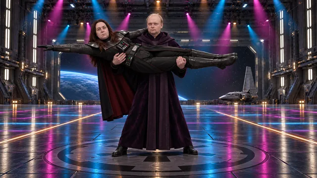</a><figcaption>A11 / B11 — вытянутая поддержка; обе опоры видны</figcaption></figure>
<figure><a href="references/scenes/scene-28/F28-two-hand-face-fan.png" target="_blank" rel="noopener">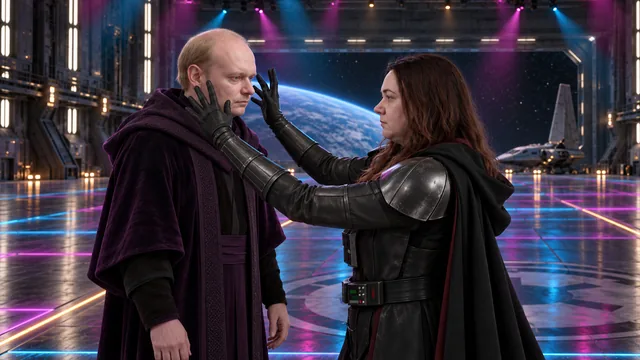</a><figcaption>A12 / B11 — две руки Юли у лица Серёги</figcaption></figure>
</div>

#### A11 · Короткий дуэт — 1/2: горизонтальная поддержка и поворот

**Референсы:** @Image1 = H28B · @Image2 = sheet Серёги · @Image3 = sheet Юли · @Image4 = [вытянутая горизонтальная поддержка](references/scenes/scene-28/H28-horizontal-lift.png); помощник позы, не стартовый кадр.

```text
Mode: reference-to-video (omni-reference) | Duration: 15s | Resolution: 720p | Aspect ratio: 16:9 | FPS: 24 | Native audio: on
Optimized for Seedance 2.0 | Photoreal live-action committed partner and ensemble dance, solemn faces and lively full-body motion

REFERENCES / AUTHORITY ORDER:
@Image1: H28B location/light only. @Image2: SEREGA exact identity/costume. @Image3: YULIA exact identity/costume. Each individual sheet controls only its own person and outranks the environment. Exactly two full-size adults; no extra sheet-view copies. @Image4 is a MID-ACTION horizontal-lift pose helper only, not the first frame. Individual sheets override its facial details; begin standing as START STATE requires.

CHARACTER APPEARANCE / IDENTITY LOCK:
SEREGA: pale older Chancellor, balding crown with sparse light hair, approved build and long deep-purple robe. YULIA: exact adult face and build, long chestnut hair, black-grey armour, shoulder pieces, gloves and long black cloak. Preserve their individual faces, ages and full adult proportions. Empty hands except for the specified partner support; no weapons.

SCENE / LIGHT:
Photoreal live-action in the exact H28B Imperial hangar: graphite ribs, white wall strips, satin dark floor with its Imperial medallion, amber guide lines and cyan/magenta borders. Rear space opening and parked shuttle deep frame-right stay fixed. Existing disco light is on from frame zero; steady neutral-white face fill keeps skin and costume colours readable. Real cloth, metal and faint floor reflections; no new stage or room.

SUPPORT / PHYSICS — CRITICAL:
The lift is a broad, supported horizontal side lift across Serega's upper chest, below his face: his anatomical RIGHT forearm supports Yulia's upper back/ribcage and his anatomical LEFT forearm supports both thighs just above her knees. In the front view of @Image4 her head is screen-left and her feet screen-right; these body-relative supports stay fixed during the turn. Both legs extend together, knees softly unlocked; she opens both arms like wings once stable. Serega supports her throughout, flexing his knees and turning with grounded steps. She is not seated upright on a shoulder, not a limp bundle with tucked knees, not balanced on his neck, not floating independently. Do not throw her or swap support hands during the turn. Her cloak hangs freely behind her, never through his torso.

START STATE:
Both stand on the floor, Serega frame-left facing diagonally right and Yulia frame-right facing diagonally left, about one metre apart. Hands clear, both faces readable, H28B lights already established. Begin the approach immediately, no entrance or light-switching prelude.

TIMELINE:
[0:00–0:05] APPROACH AND SUPPORT. Dance together immediately. Yulia turns her side toward his chest; Serega visibly secures her upper back and thighs before her feet leave the floor. He lifts through his legs; she extends both legs together and opens her arms like wings once stable.

[0:05–0:09] TURN. Carry the broad horizontal wing shape through ONE clockwise half-turn viewed from above, using grounded steps. Their bodies travel as one supported unit; do not fake the turn with the camera.

[0:09–0:15] LOWER AND RECONNECT. Lower her feet to the floor, retaining both supports until she bears her own weight. They dance back onto Serega-left/Yulia-right marks and face one another about 60 cm apart, hands down on the last beat. Natural connecting steps are free; the support sequence is fixed.

END STATE:
Both stand fully on the floor, Serega left facing right and Yulia right facing left, roughly 60 cm apart. Yulia has regained her own balance; both arms are down and no hand is attached to the other person. Unchanged light, costume, action axis and floor marks.

CAMERA / SPACE:
One continuous medium-full view showing both faces, complete bodies, feet and support/hand contact. Smooth short lateral following, staying on the same action axis; no orbit that fakes performer rotation and no crop hiding a grip or foot landing.

PERFORMANCE:
Committed energetic dancing at normal real-time speed with completely serious faces. Partners respond to each other; movement flows through accents without stopping to wait for the next instruction. Facial restraint does not mean a rigid body. The ending is a brief punctuation, not a held tableau.

AUDIO:
Foot contacts, cloth, breath and quiet hangar room tone. No speech, singing or generated score; the dancing has a brisk internal pulse and does not wait for an audible cue.

NEGATIVE PROMPT:
Identity swaps, extra cast, skating feet, fused limbs, weapons, strobe or coloured face flicker, slow motion, prolonged poses, camera cuts, generated titles or watermark. Floating partner, hidden or changing supports, merged heads.

FRAME FILL / NO BARS:
Fill the entire generated frame edge-to-edge. No letterboxing, no pillarboxing, no black bars, no side bars, no decorative borders, no empty margins.
```

#### A12 · Короткий дуэт — 2/2: жест у лица и расхождение

**Референсы:** @Image1 = H28B · @Image2 = sheet Серёги · @Image3 = sheet Юли · @Video1 = настоящий конец нового A11; до его получения эта часть DRAFT · @Image4 = [двухручный жест у лица](references/scenes/scene-28/F28-two-hand-face-fan.png); помощник позы, не замена @Video1.

```text
Mode: reference-to-video (omni-reference) | Duration: 15s | Resolution: 720p | Aspect ratio: 16:9 | FPS: 24 | Native audio: on
Optimized for Seedance 2.0 | Photoreal live-action committed partner and ensemble dance, solemn faces and lively full-body motion

REFERENCES / AUTHORITY ORDER:
@Image1: H28B location/light only. @Image2: SEREGA exact identity/costume. @Image3: YULIA exact identity/costume. @Video1: actual final seconds of A11, controlling the starting pose, movement, framing and floor positions. Continue those same two bodies; individual sheets retain appearance authority. @Image4 shows ONLY the mid-action two-hand fan: Yulia frames Serega's face with both open palms outside his cheeks. It does not replace @Video1 or its standing start; Serega's answering gesture reverses roles, not identities.

CHARACTER APPEARANCE / IDENTITY LOCK:
SEREGA: pale older Chancellor, balding crown with sparse light hair, approved build and long deep-purple robe. YULIA: exact adult face and build, long chestnut hair, black-grey armour, shoulder pieces, gloves and long black cloak. Preserve their individual faces, ages and full adult proportions. Empty hands except for the specified partner support; no weapons.

SCENE / LIGHT:
Photoreal live-action in the exact H28B Imperial hangar: graphite ribs, white wall strips, satin dark floor with its Imperial medallion, amber guide lines and cyan/magenta borders. Rear space opening and parked shuttle deep frame-right stay fixed. Existing disco light is on from frame zero; steady neutral-white face fill keeps skin and costume colours readable. Real cloth, metal and faint floor reflections; no new stage or room.

START STATE:
Both stand fully on the floor, Serega left facing right and Yulia right facing left, roughly 60 cm apart. Yulia has regained her own balance; both arms are down and no hand is attached to the other person. Unchanged light, costume, action axis and floor marks.

STORY FLOW:
Continue the actual A11 ending immediately with a shared rhythmic weight shift. Yulia makes ONE flowing two-hand fan OUTSIDE Serega's jaw and temples, opens outward and lowers both hands. Only after they clear, he answers with ONE matching two-hand fan outside her face and lowers his hands. Keep eyes, nose and mouth visible; hands never pass through a head. They then dance backwards about 70 cm each, opening their shoulders away while their inside hands reach across empty air. At about two metres separation, land opposing low outward lunges on the closing beat, still looking at one another. Keep natural movement between these essential actions.

END STATE:
Both stand two metres apart, Serega left and Yulia right, each in a low outward lunge with their inside hand extended toward the other across an empty air gap. They look at one another with solemn faces; feet planted, hands not touching, cloaks settling.

CAMERA / SPACE:
One continuous medium-full view showing both faces, complete bodies, feet and support/hand contact. Smooth short lateral following, staying on the same action axis; no orbit that fakes performer rotation and no crop hiding a grip or foot landing.

PERFORMANCE:
Committed energetic dancing at normal real-time speed with completely serious faces. Partners respond to each other; movement flows through accents without stopping to wait for the next instruction. Facial restraint does not mean a rigid body. The ending is a brief punctuation, not a held tableau. Fast disco pulse around 120 BPM, with a decisive full-body accent every beat or two; this sets the energy, not exact music sync.

AUDIO:
Foot contacts, cloth, breath and quiet hangar room tone. No speech, singing or generated score; the dancing has a brisk internal pulse and does not wait for an audible cue.

NEGATIVE PROMPT:
Identity swaps, extra cast, skating feet, fused limbs, weapons, strobe or coloured face flicker, slow motion, prolonged poses, camera cuts, generated titles or watermark.

FRAME FILL / NO BARS:
Fill the entire generated frame edge-to-edge. No letterboxing, no pillarboxing, no black bars, no side bars, no decorative borders, no empty margins.
```

</div>

<div class="engine-pane" data-engine="wan30" data-duration="11 × 30 с">

### Версия B — Wan 3.0, одиннадцать роликов по 30 секунд

#### B1 · Танец 1 — Серёга и Юля задают устав

**Референсы:** @Image1 = H28B (ангар и уже включённый дискотечный свет, без привязки к дальности камеры) · @Image2 = sheet Серёги · @Image3 = sheet Юли.

```text
Mode: reference-to-video (omni-reference) | Duration: 30s | Resolution: 720p | Aspect ratio: 16:9 | FPS: 24 | Native audio: on
Optimized for Wan 3.0 | Photoreal live-action committed partner and ensemble dance, solemn faces and lively full-body motion

REFERENCES / AUTHORITY ORDER:
@Image1: H28B architecture and established disco light only. @Image2: SEREGA exact identity/costume. @Image3: YULIA exact identity/costume. Exactly two adults; each multi-view sheet is one person. Individual sheets control appearance, not the room image.

CHARACTER APPEARANCE / IDENTITY LOCK:
SEREGA: pale older Chancellor, balding crown with sparse light hair, approved build and long deep-purple robe. YULIA: exact adult face and build, long chestnut hair, black-grey armour, shoulder pieces, gloves and long black cloak. Preserve their individual faces, ages and full adult proportions. Empty hands except for the specified partner support; no weapons.

SCENE / LIGHT:
Photoreal live-action in the exact H28B Imperial hangar: graphite ribs, white wall strips, satin dark floor with its Imperial medallion, amber guide lines and cyan/magenta borders. Rear space opening and parked shuttle deep frame-right stay fixed. Existing disco light is on from frame zero; steady neutral-white face fill keeps skin and costume colours readable. Real cloth, metal and faint floor reflections; no new stage or room.

START STATE:
Serega frame-left and Yulia frame-right, about1.4metres apart, facing camera and ready to step. H28B lights already ON. The first foot push and torso accent happen immediately; no lighting or hangar establishing shot.

STORY FLOW:
Serega and Yulia launch straight into an exuberant, deliberately absurd partner dance with utterly official faces. They answer and outdo each other with broad whole-body phrases, lively footwork and flowing arm swings. Let their steps and transitions develop naturally, with real push-offs and robe inertia; keep their left/right lanes. Toward the end they dance inward and turn face-to-face, finishing about 60 cm apart with both hands down. Reach that handoff only on the last beat. Sustain the full 30 seconds with evolving variations at the same brisk pace; do not slow or stretch the actions into long holds. Signature moves to recur and vary (link them freely): a sharp synchronized head snap toward camera, a wide double-arm windmill, and a sideways shuffle-slide punctuated by a hip bump; each may add one small two-foot parade hop.

END STATE:
Serega left facing right and Yulia right facing left, approximately 60 cm face separation, both hands lowered. The next editorial shot may be closer on this same axis. H28B disco lighting is established and steady at the last frame.

CAMERA / SPACE:
One continuous smooth full-body view, natural 40–50mm perspective. Keep faces, feet and complete hand arcs readable, bodies filling most of the frame. A short lateral track follows travel without crossing the axis or changing screen sides. Energy comes from the performers; no distant establishing reveal.

PERFORMANCE:
Committed energetic dancing at normal real-time speed with completely serious faces. Partners respond to each other; movement flows through accents without stopping to wait for the next instruction. Facial restraint does not mean a rigid body. The ending is a brief punctuation, not a held tableau. Fast disco pulse around 120 BPM, with a decisive full-body accent every beat or two; this sets the energy, not exact music sync.

AUDIO:
Foot contacts, cloth, breath and quiet hangar room tone. No speech, singing or generated score; the dancing has a brisk internal pulse and does not wait for an audible cue.

NEGATIVE PROMPT:
Identity swaps, extra cast, skating feet, fused limbs, weapons, strobe or coloured face flicker, slow motion, prolonged poses, camera cuts, generated titles or watermark.

FRAME FILL / NO BARS:
Fill the entire generated frame edge-to-edge. No letterboxing, no pillarboxing, no black bars, no side bars, no decorative borders, no empty margins.
```

#### B2 · Танец 2 — Взаимные жесты у лица

**Референсы:** @Image1 = H28B · @Image2 = sheet Серёги · @Image3 = sheet Юли · @Image4 = сохранённый P28 (только постановка пары).

```text
Mode: reference-to-video (omni-reference) | Duration: 30s | Resolution: 720p | Aspect ratio: 16:9 | FPS: 24 | Native audio: on
Optimized for Wan 3.0 | Photoreal live-action committed partner and ensemble dance, solemn faces and lively full-body motion

REFERENCES / AUTHORITY ORDER:
@Image1: H28B location/light only. @Image2: SEREGA exact identity/costume. @Image3: YULIA exact identity/costume. @Image4: P28 face-to-face pose, axis and framing only; individual sheets override its faces. Exactly two adults.

CHARACTER APPEARANCE / IDENTITY LOCK:
SEREGA: pale older Chancellor, balding crown with sparse light hair, approved build and long deep-purple robe. YULIA: exact adult face and build, long chestnut hair, black-grey armour, shoulder pieces, gloves and long black cloak. Preserve their individual faces, ages and full adult proportions. Empty hands except for the specified partner support; no weapons. Keep Yulia's gloves and separate natural fingers clear during the cheek gesture.

SCENE / LIGHT:
Photoreal live-action in the exact H28B Imperial hangar: graphite ribs, white wall strips, satin dark floor with its Imperial medallion, amber guide lines and cyan/magenta borders. Rear space opening and parked shuttle deep frame-right stay fixed. Existing disco light is on from frame zero; steady neutral-white face fill keeps skin and costume colours readable. Real cloth, metal and faint floor reflections; no new stage or room.

START STATE:
Medium waist-up two-shot, Serega left facing right, Yulia right facing left, about 60 cm face separation. Both right hands begin down. Preserve the P28 pose/axis but give the performers energetic intent.

STORY FLOW:
Keep a lively shared groove while facing one another. Serega passes the backs of his softly grouped right fingers along the OUTSIDE of Yulia's cheek, withdraws completely, then she answers with the same right-hand gesture. One exchange only: two cheek passes total. Before, between and after the passes they keep dancing with full bodies; let the footwork, shoulders and timing flow naturally. Touch is light, never a slap; hands stay outside the eyes, nose and mouth. Finish at the original gap with both hands fully down. Sustain the full 30 seconds with evolving variations at the same brisk pace; do not slow or stretch the actions into long holds. Signature moves before, between and after the passes (link them freely): a crisp shoulder shimmy, a quick side chassé and back, and a stiff military salute that melts into a hip sway. No hops during the facing exchange.

END STATE:
The same two people face one another at the original60cm gap, both hands fully lowered and clear of either face. Resolve on the last half-second only, with breath and cloth still moving. H28B lighting and axis unchanged.

CAMERA / SPACE:
One continuous medium two-shot on the established axis, faces and both right-hand paths fully visible. Frame to include torso and knee rhythm; use a small smooth lateral drift, never move between the partners or crop the face gesture.

PERFORMANCE:
Committed energetic dancing at normal real-time speed with completely serious faces. Partners respond to each other; movement flows through accents without stopping to wait for the next instruction. Facial restraint does not mean a rigid body. The ending is a brief punctuation, not a held tableau. Fast disco pulse around 120 BPM, with a decisive full-body accent every beat or two; this sets the energy, not exact music sync.

AUDIO:
Foot contacts, cloth, breath and quiet hangar room tone. No speech, singing or generated score; the dancing has a brisk internal pulse and does not wait for an audible cue.

NEGATIVE PROMPT:
Identity swaps, extra cast, skating feet, fused limbs, weapons, strobe or coloured face flicker, slow motion, prolonged poses, camera cuts, generated titles or watermark.

FRAME FILL / NO BARS:
Fill the entire generated frame edge-to-edge. No letterboxing, no pillarboxing, no black bars, no side bars, no decorative borders, no empty margins.
```

#### B3 · Танец 3 — Невозмутимый разъезд

**Референсы:** @Image1 = H28B · @Image2 = sheet Серёги · @Image3 = sheet Юли · @Image4 = <a href="references/scenes/scene-28/C28-from-B2-result.png">C28, настоящий финал B2 после отхода рук</a> (только поза/ось; общий план шире).

```text
Mode: reference-to-video (omni-reference) | Duration: 30s | Resolution: 720p | Aspect ratio: 16:9 | FPS: 24 | Native audio: on
Optimized for Wan 3.0 | Photoreal live-action committed partner and ensemble dance, solemn faces and lively full-body motion

REFERENCES / AUTHORITY ORDER:
@Image1: H28B location/light only. @Image2: SEREGA exact identity/costume. @Image3: YULIA exact identity/costume. @Image4: genuine C28 frame from the preceding cheek-gesture result, fixing hands-down pose and left/right orientation only; use the wider camera below. Individual sheets control appearance. Exactly two adults.

CHARACTER APPEARANCE / IDENTITY LOCK:
SEREGA: pale older Chancellor, balding crown with sparse light hair, approved build and long deep-purple robe. YULIA: exact adult face and build, long chestnut hair, black-grey armour, shoulder pieces, gloves and long black cloak. Preserve their individual faces, ages and full adult proportions. Empty hands except for the specified partner support; no weapons.

SCENE / LIGHT:
Photoreal live-action in the exact H28B Imperial hangar: graphite ribs, white wall strips, satin dark floor with its Imperial medallion, amber guide lines and cyan/magenta borders. Rear space opening and parked shuttle deep frame-right stay fixed. Existing disco light is on from frame zero; steady neutral-white face fill keeps skin and costume colours readable. Real cloth, metal and faint floor reflections; no new stage or room.

START STATE:
Start from the genuine C28 orientation only: Serega left facing right, Yulia right facing left, hands already down and faces about 60 cm apart. C28 does not prescribe distant framing or identity.

STORY FLOW:
From the genuine hands-down C28 pose, dance backwards away from one another with springy, weighted footwork until the gap is about two metres. Their inside arms reach toward each other across the empty space, then open into a mock-grand dance exchange. Let lively steps, torso turns and broad low gestures flow naturally in the two separate lanes. In the closing phrase both turn toward camera and land the low angular arm pose for a graphic match-cut. Sustain the full 30 seconds with evolving variations at the same brisk pace; do not slow or stretch the actions into long holds. Signature moves to recur and vary (link them freely): springy backward heel-skips, a broad swimming arm stroke across the gap, and a sharp quarter-turn ending in a pointed finger at the partner; each may add one small hop in their own lane.

END STATE:
Serega left, Yulia right, about two metres apart, facing the camera in the same low angular arm pose. This pose supplies the graphic match-cut to the next dancing pair. Keep the established H28B disco palette and unchanged neutral facial fill through the final frame.

CAMERA / SPACE:
One continuous smooth full-body view, natural 40–50mm perspective. Keep faces, feet and complete hand arcs readable, bodies filling most of the frame. A short lateral track follows travel without crossing the axis or changing screen sides. Energy comes from the performers; no distant establishing reveal.

PERFORMANCE:
Committed energetic dancing at normal real-time speed with completely serious faces. Partners respond to each other; movement flows through accents without stopping to wait for the next instruction. Facial restraint does not mean a rigid body. The ending is a brief punctuation, not a held tableau. Fast disco pulse around 120 BPM, with a decisive full-body accent every beat or two; this sets the energy, not exact music sync.

AUDIO:
Foot contacts, cloth, breath and quiet hangar room tone. No speech, singing or generated score; the dancing has a brisk internal pulse and does not wait for an audible cue.

NEGATIVE PROMPT:
Identity swaps, extra cast, skating feet, fused limbs, weapons, strobe or coloured face flicker, slow motion, prolonged poses, camera cuts, generated titles or watermark.

FRAME FILL / NO BARS:
Fill the entire generated frame edge-to-edge. No letterboxing, no pillarboxing, no black bars, no side bars, no decorative borders, no empty margins.
```

#### B4 · Танец 4 — Паша и Саша: джедайский устав

**Референсы:** @Image1 = H28B · @Image2 = sheet Паши · @Image3 = sheet Саши.

```text
Mode: reference-to-video (omni-reference) | Duration: 30s | Resolution: 720p | Aspect ratio: 16:9 | FPS: 24 | Native audio: on
Optimized for Wan 3.0 | Photoreal live-action committed partner and ensemble dance, solemn faces and lively full-body motion

REFERENCES / AUTHORITY ORDER:
@Image1: H28B location/light only. @Image2: PASHA exact identity/costume. @Image3: SASHA exact identity/costume. Individual sheets outrank environment details; each sheet is one person. Exactly these two Jedi, empty hands, no lightsabers.

CHARACTER APPEARANCE / IDENTITY LOCK:
PASHA has the exact referenced clean-shaven face and build, dark navy Jedi tunic, brown belt, dark trousers and tall boots. SASHA has the exact referenced bearded face, round glasses, cream inner tunic and dark burgundy-brown outer robe. Keep Sasha's glasses stable and present. Do not transfer beard, glasses, hair or costume between them.

SCENE / LIGHT:
Photoreal live-action in the exact H28B Imperial hangar: graphite ribs, white wall strips, satin dark floor with its Imperial medallion, amber guide lines and cyan/magenta borders. Rear space opening and parked shuttle deep frame-right stay fixed. Existing disco light is on from frame zero; steady neutral-white face fill keeps skin and costume colours readable. Real cloth, metal and faint floor reflections; no new stage or room.

START STATE:
Pasha left and Sasha right, front-facing, hands in a low angular pose, individual lanes separated by visible air.

STORY FLOW:
Pasha and Sasha throw themselves into a gloriously overconfident dance duel, faces as solemn as an official ceremony. They trade broad angular phrases, lively travelling footwork and playful body answers, alternately leading and echoing one another. Let the choreography develop naturally; keep Pasha left, Sasha right, visible air between them and glasses stable. End back at their original marks, front-facing in the low angular arm pose, only on the last beat. Sustain the full 30 seconds with evolving variations at the same brisk pace; do not slow or stretch the actions into long holds. Signature moves to recur and vary (link them freely): mirrored lunges with flat karate-chop palms like imaginary lightsabers (empty hands), a crisp heel spin, and a pointed-toe side kick; they may land one synchronized small hop.

END STATE:
Pasha remains left and Sasha right on their initial marks, facing camera in the angular low-arm pose, ready for a graphic match-cut to another pair. Keep the established H28B disco palette and unchanged neutral facial fill through the final frame.

CAMERA / SPACE:
One continuous smooth full-body view, natural 40–50mm perspective. Keep faces, feet and complete hand arcs readable, bodies filling most of the frame. A short lateral track follows travel without crossing the axis or changing screen sides. Energy comes from the performers; no distant establishing reveal.

PERFORMANCE:
Committed energetic dancing at normal real-time speed with completely serious faces. Partners respond to each other; movement flows through accents without stopping to wait for the next instruction. Facial restraint does not mean a rigid body. The ending is a brief punctuation, not a held tableau. Fast disco pulse around 120 BPM, with a decisive full-body accent every beat or two; this sets the energy, not exact music sync.

AUDIO:
Foot contacts, cloth, breath and quiet hangar room tone. No speech, singing or generated score; the dancing has a brisk internal pulse and does not wait for an audible cue.

NEGATIVE PROMPT:
Identity swaps, extra cast, skating feet, fused limbs, weapons, strobe or coloured face flicker, slow motion, prolonged poses, camera cuts, generated titles or watermark.

FRAME FILL / NO BARS:
Fill the entire generated frame edge-to-edge. No letterboxing, no pillarboxing, no black bars, no side bars, no decorative borders, no empty margins.
```

#### B5 · Танец 5 — Артём и Илюша: заводные церемониальные фигуры

**Референсы:** @Image1 = H28B · @Image2 = sheet Артёма · @Image3 = sheet Илюши.

```text
Mode: reference-to-video (omni-reference) | Duration: 30s | Resolution: 720p | Aspect ratio: 16:9 | FPS: 24 | Native audio: on
Optimized for Wan 3.0 | Photoreal live-action committed partner and ensemble dance, solemn faces and lively full-body motion

REFERENCES / AUTHORITY ORDER:
@Image1: H28B location/light only. @Image2: ARTEM exact identity/costume. @Image3: ILYUSHA exact identity/costume. Individual sheets outrank environment details; each sheet is one person. Exactly these two performers, no other cast.

CHARACTER APPEARANCE / IDENTITY LOCK:
ARTEM has the exact referenced heavier build, short beard, cream-beige tunic, brown outer robe, broad belt and brown boots. ILYUSHA has the exact referenced face, moustache, chestnut hair, olive-green tunic, deep-red hooded cloak and brown boots. Preserve the sheet's hood placement and face visibility. Do not swap beard, moustache, colors or builds. Hands empty, no sabers.

SCENE / LIGHT:
Photoreal live-action in the exact H28B Imperial hangar: graphite ribs, white wall strips, satin dark floor with its Imperial medallion, amber guide lines and cyan/magenta borders. Rear space opening and parked shuttle deep frame-right stay fixed. Existing disco light is on from frame zero; steady neutral-white face fill keeps skin and costume colours readable. Real cloth, metal and faint floor reflections; no new stage or room.

START STATE:
Artem left and Ilyusha right, front-facing on separate marks, elbows low and ready for the first sharp beat.

STORY FLOW:
Artem and Ilyusha dance with exuberant whole-body commitment and completely straight faces. Artem's weighty swagger meets Ilyusha's quicker, springier answer; they catch each other's rhythm and briefly fall into absurdly grand unison. Allow natural steps, turns and arm phrases instead of a repeated mechanical loop. Keep their separate left/right lanes and real foot contact. Return to the original front-facing, low-arm marks on the closing beat. Sustain the full 30 seconds with evolving variations at the same brisk pace; do not slow or stretch the actions into long holds. Signature moves to recur and vary (link them freely): Artem's heavy stomp-and-clap, a rolling shoulder chug, and a deep bouncing sumo squat; Ilyusha answers with quick springy hops and sharp arm punches to the beat.

END STATE:
Both stand at their original marks, arms low, looking directly at camera. Their posture reads as a solemn ceremonial punctuation to the same dance motif. Keep the established H28B disco palette and unchanged neutral facial fill through the final frame.

CAMERA / SPACE:
One continuous smooth full-body view, natural 40–50mm perspective. Keep faces, feet and complete hand arcs readable, bodies filling most of the frame. A short lateral track follows travel without crossing the axis or changing screen sides. Energy comes from the performers; no distant establishing reveal.

PERFORMANCE:
Committed energetic dancing at normal real-time speed with completely serious faces. Partners respond to each other; movement flows through accents without stopping to wait for the next instruction. Facial restraint does not mean a rigid body. The ending is a brief punctuation, not a held tableau. Fast disco pulse around 120 BPM, with a decisive full-body accent every beat or two; this sets the energy, not exact music sync.

AUDIO:
Foot contacts, cloth, breath and quiet hangar room tone. No speech, singing or generated score; the dancing has a brisk internal pulse and does not wait for an audible cue.

NEGATIVE PROMPT:
Identity swaps, extra cast, skating feet, fused limbs, weapons, strobe or coloured face flicker, slow motion, prolonged poses, camera cuts, generated titles or watermark.

FRAME FILL / NO BARS:
Fill the entire generated frame edge-to-edge. No letterboxing, no pillarboxing, no black bars, no side bars, no decorative borders, no empty margins.
```

#### B6 · Танец 6 — Маша, Лёша и Виталик: торжественный сбой

**Референсы:** @Image1 = H28B · @Image2 = sheet Маши Лагуны · @Image3 = sheet Лёши · @Image4 = sheet Виталика.

```text
Mode: reference-to-video (omni-reference) | Duration: 30s | Resolution: 720p | Aspect ratio: 16:9 | FPS: 24 | Native audio: on
Optimized for Wan 3.0 | Photoreal live-action committed partner and ensemble dance, solemn faces and lively full-body motion

REFERENCES / AUTHORITY ORDER:
@Image1: H28B location/light only. @Image2: MASHA-LAGUNA exact identity/design. @Image3: LESHA exact identity/costume. @Image4: VITALIK exact identity/costume. Each sheet supplies one distinct performer and controls that person above the room image. Exactly three characters.

CHARACTER APPEARANCE / IDENTITY LOCK:
MASHA-LAGUNA is the tall slender adult aquatic-blue woman with the exact human face, long light-blue tentacle-like head strands and black ornamental crown, neck collar and upper-back structure. Her exact floor-length light-blue costume has an OPAQUE, continuous smooth torso covering the entire chest and abdomen. The torso is costume material, not bare skin: no nipples, areolae, navel, anatomical breast-tip relief, cutouts or transparency. Preserve the reference silhouette without adding new clothing panels or changing the long hem.
LESHA is the exact slimmer moustached man in a purple inner tunic, long grey hooded robe, brown belt and light boots. VITALIK is the exact heavier-built man in a black tunic, dark leather/armor panels, brown trousers and tall boots. Do not blend their faces, builds or costumes. All hands are empty.

SCENE / LIGHT:
Photoreal live-action in the exact H28B Imperial hangar: graphite ribs, white wall strips, satin dark floor with its Imperial medallion, amber guide lines and cyan/magenta borders. Rear space opening and parked shuttle deep frame-right stay fixed. Existing disco light is on from frame zero; steady neutral-white face fill keeps skin and costume colours readable. Real cloth, metal and faint floor reflections; no new stage or room.

START STATE:
Masha centre, Lesha left, Vitalik right, a compact staggered trio with three unobstructed faces. No cast beyond these three.

STORY FLOW:
Masha leads an expansive, absurdly majestic dance phrase; Lesha and Vitalik answer on either side, passing the energy through the trio. Let their shoulders, arms and footwork develop into a lively shared groove with serious faces. Masha's stride stays inside her intact closed hem; her upper body and head strands carry the larger expression. The men move freely in their own lanes, without crossing her silhouette. Return to the same staggered trio, facing camera with low arms on the last beat. Sustain the full 30 seconds with evolving variations at the same brisk pace; do not slow or stretch the actions into long holds. Signature moves to recur and vary (link them freely): Masha's flowing double-arm wave with a head-strand toss, the men's late-arriving disco point to the ceiling and down to the floor, and the men's sideways grapevine; the men may add a small hop, Masha never jumps.

END STATE:
Masha centre, Lesha left, Vitalik right, all facing camera, arms held low and faces clear. No new entrants. Keep the established H28B disco palette and unchanged neutral facial fill through the final frame.

CAMERA / SPACE:
One continuous smooth full-body view, natural 40–50mm perspective. Keep faces, feet and complete hand arcs readable, bodies filling most of the frame. A short lateral track follows travel without crossing the axis or changing screen sides. Energy comes from the performers; no distant establishing reveal.

PERFORMANCE:
Committed energetic dancing at normal real-time speed with completely serious faces. Partners respond to each other; movement flows through accents without stopping to wait for the next instruction. Facial restraint does not mean a rigid body. The ending is a brief punctuation, not a held tableau. Fast disco pulse around 120 BPM, with a decisive full-body accent every beat or two; this sets the energy, not exact music sync.

AUDIO:
Foot contacts, cloth, breath and quiet hangar room tone. No speech, singing or generated score; the dancing has a brisk internal pulse and does not wait for an audible cue.

NEGATIVE PROMPT:
Identity swaps, extra cast, skating feet, fused limbs, weapons, strobe or coloured face flicker, slow motion, prolonged poses, camera cuts, generated titles or watermark.

FRAME FILL / NO BARS:
Fill the entire generated frame edge-to-edge. No letterboxing, no pillarboxing, no black bars, no side bars, no decorative borders, no empty margins.
```

#### B7 · Танец 7 — Алеся, Лучик и Рыжик: невозмутимый дирижёр

**Референсы:** @Image1 = H28B · @Image2 = sheet Лучика · @Image3 = sheet Рыжика · @Image4 = Ale28, sheet Алеси. Ровно три персонажа; людей на фон не добавлять.

```text
Mode: reference-to-video (omni-reference) | Duration: 30s | Resolution: 720p | Aspect ratio: 16:9 | FPS: 24 | Native audio: on
Optimized for Wan 3.0 | Photoreal live-action committed partner and ensemble dance, solemn faces and lively full-body motion

REFERENCES / AUTHORITY ORDER:
@Image1: H28B location/light only. @Image2: LUCHIK exact feline identity. @Image3: RYZHIK exact feline identity. @Image4: ALESYA exact adult face, brown hood and small furry body. Individual references control appearance above the location. Exactly Alesya and two ordinary domestic cats; never mix their species.

CHARACTER APPEARANCE / IDENTITY LOCK:
LUCHIK is the long-haired fluffy white-grey cat with white muzzle, chest and paws, grey crown/back markings and the exact referenced feline face. RYZHIK is the long-haired ginger tabby with darker orange stripes and a paler muzzle/chest. Keep their separate coat patterns, body proportions, ear shapes and natural paws. They remain ordinary domestic-cat scale relative to hangar floor panels: low bodies, four feline legs, no human torso or hands. Alesya is about one metre tall; the cats remain normal house cats well below her waist. Preserve her adult face from Image4, hood and short furry limbs. Alesya has no spear or other weapon. No lightsabers in this dance.

SCENE / LIGHT:
Photoreal live-action in the exact H28B Imperial hangar: graphite ribs, white wall strips, satin dark floor with its Imperial medallion, amber guide lines and cyan/magenta borders. Rear space opening and parked shuttle deep frame-right stay fixed. Existing disco light is on from frame zero; steady neutral-white face fill keeps skin and costume colours readable. Real cloth, metal and faint floor reflections; no new stage or room.

START STATE:
Alesya centre, Luchik left, Ryzhik right, all three fully visible from a low close camera. Cats ordinary house-cat scale; Alesya about one metre tall with her exact adult face.

STORY FLOW:
Alesya conducts with tremendous solemn authority, dancing enthusiastically as the two cats playfully respond around her. Let the cats trot, turn and make short natural pounces in their own floor lanes; tails balance them and every landing is feline. Alesya follows their antics with expressive conducting gestures and buoyant steps. Keep the interplay alive without human choreography for the cats. Finish with Alesya centre, arms low, Luchik left and Ryzhik right naturally on all fours, looking toward camera. Sustain the full 30 seconds with evolving variations at the same brisk pace; do not slow or stretch the actions into long holds. Signature moves to recur and vary (link them freely): Alesya's big double-arm conducting downbeat, a fast high-knee march on the spot, and a grand sweeping bow-and-rise. No jumping near the cats.

END STATE:
Alesya remains centre with her original adult face and low arms. Both cats stand naturally on all fours at the closer marks, Luchik left and Ryzhik right, facing camera with stable anatomy. Keep the established H28B disco palette and unchanged neutral facial fill through the final frame.

CAMERA / SPACE:
One continuous low full-body three-subject view. Keep Alesya and both entire cats close and readable, including paws and floor contact. Smooth small lateral tracking; preserve their left/centre/right lanes and real relative scale.

PERFORMANCE:
Committed energetic dancing at normal real-time speed with completely serious faces. Partners respond to each other; movement flows through accents without stopping to wait for the next instruction. Facial restraint does not mean a rigid body. The ending is a brief punctuation, not a held tableau. Fast disco pulse around 120 BPM, with a decisive full-body accent every beat or two; this sets the energy, not exact music sync.

AUDIO:
Foot contacts, cloth, breath and quiet hangar room tone. No speech, singing or generated score; the dancing has a brisk internal pulse and does not wait for an audible cue.

NEGATIVE PROMPT:
Identity swaps, extra cast, skating feet, fused limbs, weapons, strobe or coloured face flicker, slow motion, prolonged poses, camera cuts, generated titles or watermark. Human hands or upright dancing on cats, giant cats, child face or adult-human scale for Alesya.

FRAME FILL / NO BARS:
Fill the entire generated frame edge-to-edge. No letterboxing, no pillarboxing, no black bars, no side bars, no decorative borders, no empty margins.
```

#### B8 · Танец 8 — Ритмичное кружение на руках

**Референсы:** @Image1 = H28B · @Image2 = sheet Серёги · @Image3 = sheet Юли · @Image4 = сохранённый L28, проверенная опорная поза пары.

```text
Mode: reference-to-video (omni-reference) | Duration: 30s | Resolution: 720p | Aspect ratio: 16:9 | FPS: 24 | Native audio: on
Optimized for Wan 3.0 | Photoreal live-action committed partner and ensemble dance, solemn faces and lively full-body motion

REFERENCES / AUTHORITY ORDER:
@Image1: H28B location/light only. @Image2: SEREGA exact identity/costume. @Image3: YULIA exact identity/costume. @Image4: checked L28 opening cradle pose and support points only, not identity or distant framing. The individual sheets override the helper. Exactly two full-size adults.

CHARACTER APPEARANCE / IDENTITY LOCK:
SEREGA: pale older Chancellor, balding crown with sparse light hair, approved build and long deep-purple robe. YULIA: exact adult face and build, long chestnut hair, black-grey armour, shoulder pieces, gloves and long black cloak. Preserve their individual faces, ages and full adult proportions. Empty hands except for the specified partner support; no weapons.

SCENE / LIGHT:
Photoreal live-action in the exact H28B Imperial hangar: graphite ribs, white wall strips, satin dark floor with its Imperial medallion, amber guide lines and cyan/magenta borders. Rear space opening and parked shuttle deep frame-right stay fixed. Existing disco light is on from frame zero; steady neutral-white face fill keeps skin and costume colours readable. Real cloth, metal and faint floor reflections; no new stage or room.

SUPPORT / PHYSICS — CRITICAL:
Keep the initial two support points fixed through every step. Supporting arms stay visibly outside bodies, no floating partner, fused limbs, grip swap, jump, throw or transition into a different carry. Cloth follows real inertia and remains clear of feet. This is energetic planted movement, not an acrobatic lift.

START STATE:
SEREGA already holds YULIA in a stable two-arm cradle across the front of his torso: his left forearm supports her upper back and his right forearm supports her thighs above the knees. Her head is toward his left shoulder; her bent legs extend to his right. She keeps her torso compact, one gloved hand resting on his upper shoulder, without covering his neck or face. Both heads remain separate and visible. His feet begin shoulder-width apart on the hangar floor.
This clip starts already in the supported pose. Do not show the lift, an on-camera pickup or a transfer from another shot.

STORY FLOW:
Already in the cradle, Serega carries Yulia through buoyant grounded dance steps. She actively balances and answers him with her shoulders and expression while both remain solemn. Include ONE clockwise half-turn viewed from above, made by his planted walking/pivot steps; the supported pair turns together. Continue a lively compact travelling phrase after the turn, preserving both forearm supports. Finish in that same cradle after the half-turn; no pickup, dismount, throw or change of carry. Sustain the full 30 seconds with evolving variations at the same brisk pace; do not slow or stretch the actions into long holds. Signature moves within the fixed cradle (link them freely): Serega's grounded stomp-steps with a shoulder bounce, Yulia's free arm opening into a sharp wing flourish, and a synchronized head snap of both toward camera. No hops.

END STATE:
The same pair remains in the cradle hold after ONE half-turn. Keep the support points fixed and faces solemn. The shoulder pose belongs to a separate later shot; do not morph into it here. H28B light and the hangar remain unchanged through the final frame.

CAMERA / SPACE:
One continuous medium-full view showing both faces, complete bodies, feet and support/hand contact. Smooth short lateral following, staying on the same action axis; no orbit that fakes performer rotation and no crop hiding a grip or foot landing.

PERFORMANCE:
Committed energetic dancing at normal real-time speed with completely serious faces. Partners respond to each other; movement flows through accents without stopping to wait for the next instruction. Facial restraint does not mean a rigid body. The ending is a brief punctuation, not a held tableau.

AUDIO:
Foot contacts, cloth, breath and quiet hangar room tone. No speech, singing or generated score; the dancing has a brisk internal pulse and does not wait for an audible cue.

NEGATIVE PROMPT:
Identity swaps, extra cast, skating feet, fused limbs, weapons, strobe or coloured face flicker, slow motion, prolonged poses, camera cuts, generated titles or watermark. Floating partner, hidden or changing supports, merged heads.

FRAME FILL / NO BARS:
Fill the entire generated frame edge-to-edge. No letterboxing, no pillarboxing, no black bars, no side bars, no decorative borders, no empty margins.
```

#### B9 · Танец 9 — Парадная переноска на плече

**Референсы:** @Image1 = H28B · @Image2 = sheet Серёги · @Image3 = sheet Юли · @Image4 = S28-shoulder.png, проверенная опорная поза пары.

```text
Mode: reference-to-video (omni-reference) | Duration: 30s | Resolution: 720p | Aspect ratio: 16:9 | FPS: 24 | Native audio: on
Optimized for Wan 3.0 | Photoreal live-action committed partner and ensemble dance, solemn faces and lively full-body motion

REFERENCES / AUTHORITY ORDER:
@Image1: H28B location/light only. @Image2: SEREGA exact identity/costume. @Image3: YULIA exact identity/costume. @Image4: checked S28 opening right-shoulder side-saddle pose and support points only, not identity or distant framing. The individual sheets override the helper. Exactly two full-size adults.

CHARACTER APPEARANCE / IDENTITY LOCK:
SEREGA: pale older Chancellor, balding crown with sparse light hair, approved build and long deep-purple robe. YULIA: exact adult face and build, long chestnut hair, black-grey armour, shoulder pieces, gloves and long black cloak. Preserve their individual faces, ages and full adult proportions. Empty hands except for the specified partner support; no weapons.

SCENE / LIGHT:
Photoreal live-action in the exact H28B Imperial hangar: graphite ribs, white wall strips, satin dark floor with its Imperial medallion, amber guide lines and cyan/magenta borders. Rear space opening and parked shuttle deep frame-right stay fixed. Existing disco light is on from frame zero; steady neutral-white face fill keeps skin and costume colours readable. Real cloth, metal and faint floor reflections; no new stage or room.

SUPPORT / PHYSICS — CRITICAL:
Keep the initial two support points fixed through every step. Supporting arms stay visibly outside bodies, no floating partner, fused limbs, grip swap, jump, throw or transition into a different carry. Cloth follows real inertia and remains clear of feet. This is energetic planted movement, not an acrobatic lift.

START STATE:
YULIA is already seated upright SIDE-SADDLE on SEREGA's RIGHT shoulder, exactly as the approved pose reference: both bent legs hang together in front of the right side of his torso. His right forearm supports her thighs, while his left hand stabilizes her lower legs. Her torso stays upright and slightly balanced toward him; one gloved hand lightly rests on his shoulder away from his face. Their heads are separate with an unobstructed outline. His stance is broad and grounded, their cloaks hang separately. She is one full-size adult, not miniaturized.
This clip starts already in the supported pose. Do not show the lift, an on-camera pickup or a transfer from another shot.

STORY FLOW:
Serega dances forward and sideways in a compact, purposeful parade-like groove, carrying Yulia securely on his RIGHT shoulder. Let the footwork vary naturally while his torso and support remain steady. She contributes with her free forearm and shoulders, the other hand staying on his shoulder. Their absurd confidence stays completely serious. End in the same side-saddle support at a clear front three-quarter angle. No pickup, dismount, spin, bouncing her off the shoulder or change of grip. Sustain the full 30 seconds with evolving variations at the same brisk pace; do not slow or stretch the actions into long holds. Signature moves within the fixed shoulder support (link them freely): Serega's planted high-knee parade march, Yulia's free-arm royal wave snapping into a crisp salute, and a synchronized head snap of both toward camera. No hops.

END STATE:
Stop in the same right-shoulder pose, both faces visible, with exactly the original supporting arms and legs. Resolve only on the last half-second; do not generate the dismount or extra cast. H28B light and the hangar remain unchanged through the final frame.

CAMERA / SPACE:
One continuous medium-full view showing both faces, complete bodies, feet and support/hand contact. Smooth short lateral following, staying on the same action axis; no orbit that fakes performer rotation and no crop hiding a grip or foot landing.

PERFORMANCE:
Committed energetic dancing at normal real-time speed with completely serious faces. Partners respond to each other; movement flows through accents without stopping to wait for the next instruction. Facial restraint does not mean a rigid body. The ending is a brief punctuation, not a held tableau.

AUDIO:
Foot contacts, cloth, breath and quiet hangar room tone. No speech, singing or generated score; the dancing has a brisk internal pulse and does not wait for an audible cue.

NEGATIVE PROMPT:
Identity swaps, extra cast, skating feet, fused limbs, weapons, strobe or coloured face flicker, slow motion, prolonged poses, camera cuts, generated titles or watermark. Floating partner, hidden or changing supports, merged heads.

FRAME FILL / NO BARS:
Fill the entire generated frame edge-to-edge. No letterboxing, no pillarboxing, no black bars, no side bars, no decorative borders, no empty margins.
```

#### B10 · Танец 10 — Общая финальная печать

**Референсы:** @Image1 = G28-full-ensemble-Alesya-v2.png, проверенный G28 с 9 людьми/гуманоидами, Алесей и 2 котами в свете H28B; единый first frame. Не загружать 12 individual sheets вместо него.

```text
Mode: image-to-video from exact first frame | Duration: 30s | Resolution: 720p | Aspect ratio: 16:9 | FPS: 24 | Native audio: on
Optimized for Wan 3.0 | Photoreal live-action committed partner and ensemble dance, solemn faces and lively full-body motion

REFERENCES / AUTHORITY ORDER:
@Image1 is the checked G28 GROUP MASTER assembled from the approved individual sheets, and the exact FIRST FRAME: animate its existing twelve subjects, identities, costumes, scale and staggered row positions. It controls this image-to-video shot; do not recast or recompose it. Nine adult humans/humanoids, one small Alesya with her adult face, two ordinary cats. Keep its H28B space and opening camera.

CHARACTER APPEARANCE / IDENTITY LOCK:
Front human row: SEREGA, pale older balding man in deep-purple robe, left; YULIA, long chestnut hair and dark armor/black cloak, right. Second row left to right: PASHA, clean-shaven/navy Jedi; SASHA, beard/round glasses/cream-burgundy robe; ARTEM, heavier bearded man/cream-brown robes; ILYUSHA, moustache/olive tunic/deep-red cloak. Rear row left to right: LESHA, slimmer moustached man/purple inner tunic/grey robe; MASHA-LAGUNA, aquatic-blue woman/long blue head strands/black crown-collar/back ornament/opaque floor-length blue costume; VITALIK, heavier man/black tunic/dark leather panels/brown trousers. Preserve every face exactly as visible in @Image1.
ALESYA stands at front centre: small brown-furred body, brown hood, round ears and exact adult human face from the source sheet; no spear. Keep her distinct from the two cats and smaller than the adults.
LUCHIK, fluffy white-grey cat, is on the floor front-left; RYZHIK, fluffy ginger tabby, is front-right. Both remain on all fours at ordinary domestic-cat scale, their standing heads below a nearby adult knee. Masha's chest and abdomen remain covered by one smooth opaque blue costume surface: no nipples, areolae, navel or anatomical relief. No weapons.

SCENE / LIGHT:
Photoreal live-action in the exact H28B Imperial hangar: graphite ribs, white wall strips, satin dark floor with its Imperial medallion, amber guide lines and cyan/magenta borders. Rear space opening and parked shuttle deep frame-right stay fixed. Existing disco light is on from frame zero; steady neutral-white face fill keeps skin and costume colours readable. Real cloth, metal and faint floor reflections; no new stage or room.

START STATE:
Match the exact group master first frame: same twelve identities, staggered rows, low arms and natural quadruped cats. All faces are visible in the row gaps. Movement starts immediately from that pose; retain upper-corner room for later titles without generating text.

STORY FLOW:
The exact first-frame ensemble bursts into an exuberant deadpan dance together. Let a broad shoulder-and-arm wave pass front to middle to rear while the other rows keep dancing; develop it into lively shared whole-body phrases. Preserve the staggered rows and face gaps. Masha moves within her closed hem; Alesya conducts from front centre; the cats contribute natural steps, head turns and tails on all fours. Build to the original low parade silhouette on the final beat, with all twelve still present. Sustain the full 30 seconds with evolving variations at the same brisk pace; do not slow or stretch the actions into long holds. Signature moves to recur and vary (link them freely): the shoulder-and-arm wave rippling through the rows, a shared stomp-clap on the downbeat, and a synchronized head snap to camera. No jumps.

END STATE:
The same twelve visible identities in the same positions and low final pose, no occluded faces and no changed bodies. Resolve into this pose only on the final half-second; cloth, breath and tails settle naturally. H28B disco lighting is established and steady at the last frame.

CAMERA / SPACE:
Begin at the exact @Image1 first frame. One continuous frontal ensemble view with a modest smooth push that keeps all twelve subjects, feet and row gaps in frame. Preserve upper-corner room for later titles without generating any text.

PERFORMANCE:
Committed energetic dancing at normal real-time speed with completely serious faces. Partners respond to each other; movement flows through accents without stopping to wait for the next instruction. Facial restraint does not mean a rigid body. The ending is a brief punctuation, not a held tableau. Fast disco pulse around 120 BPM, with a decisive full-body accent every beat or two; this sets the energy, not exact music sync.

AUDIO:
Foot contacts, cloth, breath and quiet hangar room tone. No speech, singing or generated score; the dancing has a brisk internal pulse and does not wait for an audible cue.

NEGATIVE PROMPT:
Identity swaps, extra cast, skating feet, fused limbs, weapons, strobe or coloured face flicker, slow motion, prolonged poses, camera cuts, generated titles or watermark. Human hands or upright dancing on cats, giant cats, child face or adult-human scale for Alesya.

FRAME FILL / NO BARS:
Fill the entire generated frame edge-to-edge. No letterboxing, no pillarboxing, no black bars, no side bars, no decorative borders, no empty margins.
```

#### B11 · Короткий дуэт — полная версия на 30 секунд

**Референсы:** @Image1 = H28B · @Image2 = sheet Серёги · @Image3 = sheet Юли · @Image4 = [горизонтальная поддержка](references/scenes/scene-28/H28-horizontal-lift.png) · @Image5 = [двухручный жест](references/scenes/scene-28/F28-two-hand-face-fan.png); помощники промежуточных поз.

```text
Mode: reference-to-video (omni-reference) | Duration: 30s | Resolution: 720p | Aspect ratio: 16:9 | FPS: 24 | Native audio: on
Optimized for Wan 3.0 | Photoreal live-action committed partner and ensemble dance, solemn faces and lively full-body motion

REFERENCES / AUTHORITY ORDER:
@Image1: H28B location/light only. @Image2: SEREGA exact identity/costume. @Image3: YULIA exact identity/costume. Each individual sheet controls only its own person and outranks the environment. Exactly two full-size adults; no extra sheet-view copies. @Image4 is a MID-ACTION horizontal-lift pose helper only, not the first frame. Individual sheets override its facial details; begin standing as START STATE requires. @Image5 is the mid-action two-hand face-fan helper: Yulia's palms frame Serega's face; his later answer reverses roles, not identities.

CHARACTER APPEARANCE / IDENTITY LOCK:
SEREGA: pale older Chancellor, balding crown with sparse light hair, approved build and long deep-purple robe. YULIA: exact adult face and build, long chestnut hair, black-grey armour, shoulder pieces, gloves and long black cloak. Preserve their individual faces, ages and full adult proportions. Empty hands except for the specified partner support; no weapons.

SCENE / LIGHT:
Photoreal live-action in the exact H28B Imperial hangar: graphite ribs, white wall strips, satin dark floor with its Imperial medallion, amber guide lines and cyan/magenta borders. Rear space opening and parked shuttle deep frame-right stay fixed. Existing disco light is on from frame zero; steady neutral-white face fill keeps skin and costume colours readable. Real cloth, metal and faint floor reflections; no new stage or room.

SUPPORT / PHYSICS — CRITICAL:
The lift is a broad, supported horizontal side lift across Serega's upper chest, below his face: his anatomical RIGHT forearm supports Yulia's upper back/ribcage and his anatomical LEFT forearm supports both thighs just above her knees. In the front view of @Image4 her head is screen-left and her feet screen-right; these body-relative supports stay fixed during the turn. Both legs extend together, knees softly unlocked; she opens both arms like wings once stable. Serega supports her throughout, flexing his knees and turning with grounded steps. She is not seated upright on a shoulder, not a limp bundle with tucked knees, not balanced on his neck, not floating independently. Do not throw her or swap support hands during the turn. Her cloak hangs freely behind her, never through his torso.

START STATE:
Both stand on the floor, Serega frame-left facing diagonally right and Yulia frame-right facing diagonally left, about one metre apart. Hands clear, both faces readable, H28B lights already established. Begin the approach immediately, no entrance or light-switching prelude.

TIMELINE:
[0:00–0:05] APPROACH AND SUPPORT. Dance together immediately. Yulia turns her side toward his chest; Serega visibly secures her upper back and thighs before her feet leave the floor. He lifts through his legs; she extends both legs together and opens her arms like wings once stable.

[0:05–0:09] TURN. Carry the broad horizontal wing shape through ONE clockwise half-turn viewed from above, using grounded steps. Their bodies travel as one supported unit; do not fake the turn with the camera.

[0:09–0:15] LOWER AND RECONNECT. Lower her feet to the floor, retaining both supports until she bears her own weight. They dance back onto Serega-left/Yulia-right marks and face one another about 60 cm apart, hands down around the midpoint. Natural connecting steps are free; the support sequence is fixed.

[0:15–0:30] FACE EXCHANGE AND RELEASE. Continue directly from that standing position with a shared rhythmic weight shift. Yulia makes ONE flowing two-hand fan OUTSIDE Serega's jaw and temples, opens outward and lowers both hands. Only after they clear, he answers with ONE matching two-hand fan outside her face and lowers his hands. Keep eyes, nose and mouth visible; hands never pass through a head. They then dance backwards about 70 cm each, opening their shoulders away while their inside hands reach across empty air. At about two metres separation, land opposing low outward lunges on the closing beat, still looking at one another. Keep natural movement between these essential actions.

END STATE:
Both stand two metres apart, Serega left and Yulia right, each in a low outward lunge with their inside hand extended toward the other across an empty air gap. They look at one another with solemn faces; feet planted, hands not touching, cloaks settling.

CAMERA / SPACE:
One continuous medium-full view showing both faces, complete bodies, feet and support/hand contact. Smooth short lateral following, staying on the same action axis; no orbit that fakes performer rotation and no crop hiding a grip or foot landing.

PERFORMANCE:
Committed energetic dancing at normal real-time speed with completely serious faces. Partners respond to each other; movement flows through accents without stopping to wait for the next instruction. Facial restraint does not mean a rigid body. The ending is a brief punctuation, not a held tableau.

AUDIO:
Foot contacts, cloth, breath and quiet hangar room tone. No speech, singing or generated score; the dancing has a brisk internal pulse and does not wait for an audible cue.

NEGATIVE PROMPT:
Identity swaps, extra cast, skating feet, fused limbs, weapons, strobe or coloured face flicker, slow motion, prolonged poses, camera cuts, generated titles or watermark. Floating partner, hidden or changing supports, merged heads.

FRAME FILL / NO BARS:
Fill the entire generated frame edge-to-edge. No letterboxing, no pillarboxing, no black bars, no side bars, no decorative borders, no empty margins.
```

</div>

</div>

**Проверка результата:** сверить каждое видимое лицо/костюм с individual sheet; очередность четырёх жестов и обе кисти/щёки в части 2; разрыв контакта и направления разъезда в части 3; закрытый гладкий торс Маши в части 6; масштаб и лапы котов в части 7; контакты рук/тел и опору в частях 8–9; точный состав 9+1+2 в части 10. Свет может меняться только по партитуре, геометрия и внешность остаются теми же. Technical success не равен принятому дублю. Если общий рендер плывёт, использовать проверенный G28 и монтажный стоп-кадр.

---

<a id="scene-33"></a>

## Сцена 33 — Серёга исследует руины на планете ситхов

<!-- scene-meta: {"target_engine":"Wan 3","production_state":"READY","duration_s":30,"dialogue":{"enabled":false,"language":null},"dependencies":[],"tags":["serega","sith_city","exploration","camera"]} -->

Wan 3.0 task `e95f1bab9ab24f528b55fa58495d7adb` технически завершён 09.10.2026 01:24:31 UTC. Результат требует отдельной редакционной проверки; новый Scene ID не создаётся.

**Контекст использования:** Атмосферный самостоятельный проход по локации боя. Место в сюжетной последовательности относительно боёв пока монтажное, не выдумывать утверждённую хронологию.

**Референсы:** @Image1 Серёга; @Image2 та же древняя планета/город-руины

<div class="scene-ref-gallery">
<figure><a href="references/full/serega.jpg" target="_blank" rel="noopener"></a><figcaption>@Image1 — Серёга, exact identity</figcaption></figure>
<figure><a href="references/scenes/scene-27/S27-Image5-topview-source.png" target="_blank" rel="noopener"></a><figcaption>@Image2 — exact ruined city</figcaption></figure></div>

**Что происходит:** Серёга идёт по руинам, внимательно осматривает древний город, замечает вход храма.

**Примечание к редакции (14.10.2026):** формат промта приведён к единому шаблону `PROMPT-STYLE-GUIDE` §5А (секции, START / END STATE, названные beats, `FRAME FILL / NO BARS`); смысл, референсы и тайминги прежние. Готовые ролики по задачам `e95f1bab9ab24f528b55fa58495d7adb` сделаны по прежней редакции текста; её дословная версия — в истории git (коммит перед «Unify prompt format of Scenes 30–34»). Результат сравнивать с фактически запущенным текстом.

<div class="engine-tabs" data-scene="33">

<div class="engine-pane" data-engine="wan30" data-main="1">

```text
Mode: reference-to-video | Duration: 30s | Resolution: 1080p | Aspect ratio: 16:9 | FPS: 24 | Native audio: on
Optimized for Wan 3.0 | Premium photoreal feature-film exploration, smooth camera | Atmospheric reconnaissance of a monumental ruined city

REFERENCES / AUTHORITY ORDER:
@Image1 — EXACT SEREGA identity (see CHARACTER APPEARANCE / IDENTITY LOCK).
@Image2 — EXACT Sith-planet stone city location from Scenes 26/27 (see LOCATION LOCK — CRITICAL).
Priority: @Image2 controls location, architecture and light direction. @Image1 controls identity and costume only.

CHARACTER APPEARANCE / IDENTITY LOCK:
SEREGA (@Image1): older pale Chancellor with a distinct mature face, thinning sparse light hair / bald crown, real human proportions, flowing deep dark-purple robe and fixed costume; do not average with other humans.

LOCATION LOCK — CRITICAL:
@Image2: ochre/red-brown ancient weathered masonry, colossal robed statues, broad stepped terraces, broken columns and tall squared stone towers, distant jagged canyon spires, low orange-gold sunset and dramatic layered clouds. Same planet and direction of light, not lava or a generic black Sith arena.

STORY LOCK — CRITICAL:
Atmospheric reconnaissance / investigation of a monumental place. Only Serega is visually present: no cats or additional figures. He is alive and thoughtfully observant, no spoken dialogue. Show only old architectural decay; no fresh battle damage from the duel.

START STATE:
Serega approaches slowly across a recognizable stepped stone terrace of the same city.

TIMELINE:
[0:00–0:06] — ARRIVAL ON THE TERRACE
Wide 28mm opening from a recognizable stepped stone terrace; one physically continuous lateral dolly reveals Serega approaching slowly through the giant ruin geometry. His robe and the wind are natural; no invisible teleporting.

[0:06–0:12] — SCANNING THE RUINS
Medium side tracking along a cracked carved balustrade as Serega scans ancient columns and far statues. His eyes lead the head turns, then his feet follow. He is wary and interested, not performing exaggerated fear.

[0:12–0:18] — THE EROSION MARK
Motivated over-shoulder view onto the same @Image2 sprawling ruin rooftops, massive temple façade, steps and distant spires. One ancient erosion mark catches his attention; no map, supernatural artifact or unrelated structure is conjured.

[0:18–0:24] — TOUCHING THE STONE
The camera performs a small physically credible quarter orbit as Serega climbs two real visible steps, touches weathered masonry with one hand and wipes off some fine dry dust. The damage and dust stay coherent.

[0:24–0:30] — THE TEMPLE ENTRANCE
From mid-wide over his shoulder the massive half-ruined temple entrance comes into line, still part of the original city. He hesitates, studies the silhouette against the orange light and deliberately starts toward it.

END STATE:
Serega walks toward the temple entrance with a clear approach direction, ready to continue into Scene 34.

CAMERA / SPACE:
One shared navigable stone environment, smooth stable 3D tracking, slow plausible parallax, no jump cuts or impossible speed ramp.

PERFORMANCE:
Wary, interested, thoughtful explorer; eyes lead, body follows. No exaggerated fear, no talking.

LIGHTING / MATERIALS:
High-end live-action face, purple cloth fibers, physically plausible setting sun and long warm shadows; drifting dry ash, thin dust and rare ember-like particles in the Scenes 26/27 mood without heavy volcanic fog.

AUDIO:
Boots crunching grit/stone, dry valley breeze, subtle robe rustle, slight stone crackle, natural breathing. No talk, voiceover or intrusive musical score.

NEGATIVE PROMPT:
wrong Serega, changed purple robe, cats appearing, duplicated humans, lava, black basalt, sudden interior cut, new fantastical building, unstable temple geometry, camera shake, face beauty filter, exaggerated magic, game render, subtitles, logo, watermark, borders.

FRAME FILL / NO BARS:
Fill the entire generated frame edge-to-edge. No letterboxing, no pillarboxing, no black bars, no side bars, no decorative borders, no empty margins.
```

</div>

<div class="engine-pane" data-engine="sd20x2">

Та же сцена двумя роликами по 15 с: сначала часть 1, часть 2 — после её результата (@Video1 части 2 = последние секунды части 1). Нумерация входов в каждой части своя.

**Входы части 1:** @Image1 — `references/full/serega.jpg`; @Image2 — `references/scenes/scene-27/S27-Image5-topview-source.png`.

*Часть 1: приход на террасу, осмотр, раскрытие города и замеченная метка эрозии.*

**Входы части 2:** @Video1 — последние секунды результата части 1; @Image1 — `references/full/serega.jpg`; @Image2 — `references/scenes/scene-27/S27-Image5-topview-source.png`.

*Часть 2: касание камня, вход храма в линию взгляда и решительный шаг к нему.*

#### 33 · Seedance 2.0 часть 1

```text
Mode: reference-to-video (omni-reference) | Duration: 15s | Resolution: 720p | Aspect ratio: 16:9 | FPS: 24 | Native audio: on
Optimized for Seedance 2.0 | Premium photoreal feature-film exploration with a moving, purposeful camera | Part 1 of 2: Serega strides into the monumental ruined Sith city, scans it, and an ancient erosion mark on the temple façade catches his eye

REFERENCES / AUTHORITY ORDER:
@Image1 — EXACT SEREGA identity and costume (see CHARACTER APPEARANCE / IDENTITY LOCK).
@Image2 — EXACT Sith-planet stone city location from Scenes 26/27 (see LOCATION LOCK — CRITICAL).
Priority: @Image2 controls location, architecture and light direction. @Image1 controls identity and costume only.

CHARACTER APPEARANCE / IDENTITY LOCK:
SEREGA (@Image1): older pale Chancellor with a distinct mature, full, round face, blue-grey eyes and a serious closed mouth; thinning sparse light hair at the sides with a bald crown; real human proportions, medium-heavy build. Floor-length deep dark-purple velvet robe with the large hood lying down on his shoulders, darker under-sleeves, dark shoes. Fixed costume; do not average with other humans.

LOCATION LOCK — CRITICAL:
@Image2: ochre/red-brown ancient weathered masonry, colossal robed statues, broad stepped terraces, broken columns and tall squared stone towers, distant jagged canyon spires, low orange-gold sunset and dramatic layered clouds. Same planet and direction of light, not lava or a generic black Sith arena.

STORY LOCK — CRITICAL:
Atmospheric reconnaissance / investigation of a monumental place. Only Serega is visually present: no cats or additional figures. He is alive and thoughtfully observant, no spoken dialogue. Show only old architectural decay; no fresh battle damage from the duel.

START STATE:
Serega approaches across a recognizable stepped stone terrace of the same city at a steady, purposeful walk, the colossal hooded statues and the low sun ahead of him.

TIMELINE:
[0:00–0:04] — ARRIVAL ON THE TERRACE
Wide 28mm low-angle opening: a fast lateral dolly with foreground rubble sliding past reveals Serega striding between the giant robed statues, robe hem sweeping the grit, dust lifting in the wind.

[0:04–0:08] — SCANNING THE RUINS
Cut on his stride to a medium side tracking shot along a cracked carved balustrade. He scans broken columns and distant statues: eyes lead, head follows, then the body turns. Face clearly readable in warm side light.

[0:08–0:12] — THE CITY OPENS UP
The camera cranes up over his shoulder as he reaches the terrace edge: the sprawling ruin rooftops, squared towers and canyon spires open up below in the sunset haze. He stops for one beat.

[0:12–0:15] — THE EROSION MARK
Motivated over-shoulder push toward the massive temple façade. One ancient erosion mark on a carved block a few steps below catches his attention; he turns sharply toward it and holds his gaze. No map or artifact appears.

END STATE:
Serega at the terrace edge, turned toward the temple façade, eyes fixed on one erosion mark on a carved block a few steps below him; sunset light from the same direction.

CAMERA / SPACE:
One shared navigable stone environment. Cuts only on movement, never jump cuts; consistent screen direction toward the temple side. Active but stable camera: low-angle lateral dolly, side tracking, crane-up reveal, over-shoulder push. Strong parallax from foreground columns and rubble; statues and towers never shift between shots. Face shown in medium shots with even light. No handheld shake, no teleporting.

PERFORMANCE:
Wary, interested, thoughtful explorer with energy in his walk: confident strides, decisive turns, focused eyes. Real weight transfer on uneven stone. No exaggerated fear, no talking.

LIGHTING / MATERIALS:
High-end live-action face, purple velvet catching the low sun, setting sun from the @Image2 direction with long warm shadows; drifting dry ash, thin dust and rare ember-like particles without heavy volcanic fog. Weathered ochre stone with chipped edges and sand in the joints.

AUDIO:
Boots crunching grit and stone in rhythm with his stride, dry valley breeze rising as the city opens up, robe rustle, natural breathing, distant wind through the towers. No talk, voiceover or intrusive score.

NEGATIVE PROMPT:
wrong Serega, face drift, changed purple robe, hood raised, cats appearing, other figures, duplicated humans, lightsaber, lava, black basalt, fresh battle damage, interior cut, new fantastical building, map or glowing artifact, statues moving, camera shake, jump cut, slow motion, beauty filter, game render, subtitles, logo, watermark, borders.

FRAME FILL / NO BARS:
Fill the entire generated frame edge-to-edge. No letterboxing, no pillarboxing, no black bars, no side bars, no decorative borders, no empty margins.
```

#### 33 · Seedance 2.0 часть 2

```text
Mode: reference-to-video (omni-reference) | Duration: 15s | Resolution: 720p | Aspect ratio: 16:9 | FPS: 24 | Native audio: on
Optimized for Seedance 2.0 | Premium photoreal feature-film exploration with a moving, purposeful camera | Part 2 of 2: Serega reaches the eroded stone, touches it, finds the half-ruined temple entrance and strides toward it

REFERENCES / AUTHORITY ORDER:
@Video1 — the last seconds of Part 1's result: Serega at the terrace edge looking down at an erosion mark on the temple façade. Absolute authority for the START STATE, his position, the light and the city layout.
@Image1 — EXACT SEREGA identity and costume (see CHARACTER APPEARANCE / IDENTITY LOCK).
@Image2 — EXACT Sith-planet stone city location from Scenes 26/27 (see LOCATION LOCK — CRITICAL).
Priority: @Video1 controls the start; @Image2 controls location, architecture and light direction; @Image1 controls identity and costume only.

CHARACTER APPEARANCE / IDENTITY LOCK:
SEREGA (@Image1): older pale Chancellor with a distinct mature, full, round face, blue-grey eyes and a serious closed mouth; thinning sparse light hair at the sides with a bald crown; real human proportions, medium-heavy build. Floor-length deep dark-purple velvet robe with the large hood lying down on his shoulders, darker under-sleeves, dark shoes. Fixed costume; do not average with other humans.

LOCATION LOCK — CRITICAL:
@Image2: ochre/red-brown ancient weathered masonry, colossal robed statues, broad stepped terraces, broken columns and tall squared stone towers, distant jagged canyon spires, low orange-gold sunset and dramatic layered clouds. Same planet and direction of light, not lava or a generic black Sith arena.

STORY LOCK — CRITICAL:
Atmospheric reconnaissance / investigation of a monumental place. Only Serega is visually present: no cats or additional figures. He is alive and thoughtfully observant, no spoken dialogue. Show only old architectural decay; no fresh battle damage from the duel.

START STATE:
Exactly the last frame of @Video1: Serega at the terrace edge, turned toward the temple façade, eyes on the erosion mark a few steps below.

TIMELINE:
[0:00–0:04] — DOWN TO THE MARK
Continuing @Video1 without a cut, he goes briskly down a short flight of worn steps toward the carved block, robe sweeping the stone; the camera follows at his shoulder.

[0:04–0:09] — TOUCHING THE STONE
Medium quarter orbit as he climbs two real visible steps, presses one hand to the weathered masonry and wipes off fine dry dust that drifts in the low sun. He studies the worn carving closely; damage and dust stay coherent.

[0:09–0:12] — THE TEMPLE ENTRANCE
Cut on his head turn to a mid-wide over his shoulder: the massive half-ruined temple entrance comes into line, part of the same city. He hesitates one breath and studies its dark silhouette against the orange light.

[0:12–0:15] — TOWARD THE TEMPLE
He deliberately strides toward the entrance; the camera follows behind him at walking pace, the dark doorway growing ahead.

END STATE:
Serega walks toward the temple entrance with a clear approach direction, ready to continue into Scene 34.

CAMERA / SPACE:
One shared navigable stone environment. Cuts only on movement, never jump cuts; consistent screen direction toward the temple. Active but stable camera: shoulder follow, quarter orbit, over-shoulder reveal, follow from behind. Strong parallax from foreground columns; temple geometry never shifts. Face shown in medium shots with even light. No handheld shake, no teleporting.

PERFORMANCE:
Wary, interested, thoughtful explorer with energy in his walk: decisive steps, a careful hand on the stone, one breath of hesitation, then resolve. Eyes lead, body follows. No exaggerated fear, no talking.

LIGHTING / MATERIALS:
High-end live-action face and hand, purple velvet catching the low sun, setting sun from the @Image2 direction with long warm shadows; the temple doorway dark against warm stone; drifting dry ash, thin dust and rare ember-like particles without heavy volcanic fog.

AUDIO:
Boots on worn steps and grit, the dry scrape of his palm on stone, a soft puff of dust, robe rustle, natural breathing, dry valley breeze. No talk, voiceover or intrusive score.

NEGATIVE PROMPT:
wrong Serega, face drift, changed purple robe, hood raised, cats appearing, other figures, duplicated humans, lightsaber, lava, black basalt, fresh battle damage, entering the temple, interior shot, new fantastical building, map or glowing artifact, unstable temple geometry, camera shake, jump cut, slow motion, beauty filter, game render, subtitles, logo, watermark, borders.

FRAME FILL / NO BARS:
Fill the entire generated frame edge-to-edge. No letterboxing, no pillarboxing, no black bars, no side bars, no decorative borders, no empty margins.
```

</div>

</div>

---

<a id="scene-36"></a>

## Сцена 36 — После пещеры: Серёга уходит с фрагментом карты

<!-- scene-meta: {"target_engine":"Wan 3","production_state":"READY","duration_s":30,"dialogue":{"enabled":false,"language":null},"dependencies":[],"tags":["serega","pasha","sasha","naboo","cave","map","depart","continuity"]} -->

Wan 3.0 task `e33891d4568a4a90b31ff3c67f5a7100` технически завершён 21.10.2026 03:22:42 UTC. Результат требует отдельной редакционной проверки; новый Scene ID не создаётся.

**Контекст использования:** Прямое продолжение Scene 17, которая уже в фильме (её Scene ID зарезервирован, поэтому связь в `dependencies` не пишется). Место в монтаже — стык около 51:52 после боя с монстром, перед блоком лесной пары. Сцена показывает расставание после вынужденного союза: Серёга молча уходит с единственным набусским фрагментом, Паша и Саша остаются на Набу. Карта — жёсткий светящийся модуль с референса сцены 17, не бумага. Транспорта и внешней местности нет: выход из пещеры — светлая водяная завеса, перелёт показан в Scene 37. Стартовый @Image6 — настоящий последний кадр канонического результата Scene 17 (task 67b8304f8a324b7493af32fd0a0ae5d7), извлечён и визуально проверен 16.10.2026: Паша слева, Серёга в центре держит модуль двумя руками, Саша справа. Это выбранный технический источник продолжения; точка обрезки в авторском монтаже отдельно не подтверждена. Технический результат не равен одобрению; запуск — только по команде владельца. Правка 14.10.2026 по решению владельца (вариант A, `reports/scenes-36-37-proposal-2026-10-14.md`).

**Референсы:** @Image1 — <a href="references/full/serega.jpg">Серёга</a>; @Image2 — <a href="references/full/pasha.jpg">Паша</a>; @Image3 — <a href="references/full/sasha.jpg">Саша</a>; @Image4 — <a href="references/scenes/scene-17/S17-Image4-topview-source.png">фрагмент карты, светящийся модуль</a>; @Image5 — <a href="references/scenes/scene-17/S17-post-battle-seated.png">пещера после боя, рассадка троих</a>; @Image6 — <a href="references/scenes/scene-36/S36-start-from-S17-result.png">настоящий последний кадр результата Scene 17</a>.

<div class="scene-ref-gallery">
<figure><a href="references/full/serega.jpg" target="_blank" rel="noopener"></a><figcaption>@Image1 — Серёга</figcaption></figure>
<figure><a href="references/full/pasha.jpg" target="_blank" rel="noopener"></a><figcaption>@Image2 — Паша</figcaption></figure>
<figure><a href="references/full/sasha.jpg" target="_blank" rel="noopener"></a><figcaption>@Image3 — Саша</figcaption></figure>
<figure><a href="references/scenes/scene-17/S17-Image4-topview-source.png" target="_blank" rel="noopener"></a><figcaption>@Image4 — модуль карты</figcaption></figure>
<figure><a href="references/scenes/scene-17/S17-post-battle-seated.png" target="_blank" rel="noopener"></a><figcaption>@Image5 — пещера после боя</figcaption></figure></div>

**Новые опорные кадры · 14.10.2026:** постановочные helpers проверены ChatGPT; индивидуальные model sheets и фактические монтажные входы имеют приоритет. Это не одобрение владельца и не подмена последних кадров.

<div class="scene-ref-gallery">
<figure><a href="references/scenes/scene-36/S36-waterfall-exit-helper.png" target="_blank" rel="noopener"></a><figcaption>Серёга у водяной завесы, двое остаются сидеть; модуль спрятан.</figcaption></figure>
</div>

<div class="scene-ref-gallery">
<figure><a href="references/scenes/scene-36/S36-start-from-S17-result.png" target="_blank" rel="noopener"></a><figcaption>@Image6 — настоящий финал Scene 17; старт Scene 36</figcaption></figure>
</div>

**Что происходит:** Серёга прячет полученный модуль под робу, молча кивает Паше и Саше и уходит по мокрым камням в глубь пещеры, к светлой водяной завесе. Паша и Саша остаются сидеть на останках монстра и провожают его взглядом.

<div class="engine-tabs" data-scene="36">

<div class="engine-pane" data-engine="wan30" data-main="1">

```text
Mode: reference-to-video | Duration: 30s | Resolution: 1080p | Aspect ratio: 16:9 | FPS: 24 | Native audio: on
Optimized for Wan 3.0 | Photoreal live-action cinema | Deadpan quiet departure: Serega leaves the post-battle cavern with the single map module

REFERENCES / AUTHORITY ORDER:
@Image6 — the genuine final frame of the canonical Scene 17 result in this same cavern. This image is the absolute start authority: positions of the three seated men, which hand holds the map module, camera side, water level, light and the inert monster remains.
@Image5 — the same post-battle cavern and seating arrangement: Pasha seated screen-left, Serega centre, Sasha screen-right, each on a separate severed pale section of the dead monster; wet black rocks and shallow water in front; the huge inert monster carcass lying behind on the right; a bright misty curtain of falling water at the back of the cave. It controls location geometry and composition if @Image6 is ambiguous.
@Image4 — the exact map module prop.
@Image1, @Image2, @Image3 — identity sheets for Serega, Pasha and Sasha.
Priority: @Image6 controls the first frame and positions; @Image5 controls cave geometry; @Image4 controls the prop; @Image1–@Image3 control faces and costumes only. No reference may add a fourth person or revive the monster.

CHARACTER APPEARANCE / IDENTITY LOCK:
@Image1 is the absolute visual authority for SEREGA (the Chancellor): pale older man, sparse light hair with a bald crown, mature serious face, long deep dark-purple robe with hood lowered, soaked and darkened by water.
@Image2 is the absolute visual authority for PASHA: clean-shaven man, dark navy-blue Jedi tunic, brown belt, dark trousers, high boots, leather bracer, soaked and battle-worn.
@Image3 is the absolute visual authority for SASHA: bearded man with round glasses, cream inner tunic, dark burgundy-brown robe, brown boots, soaked and battle-worn.
Three clearly different men; no face blending, no costume swaps, no added armour or jewellery.

PROP LOCK — CRITICAL:
The map is ONE small rigid palm-sized rectangular module from @Image4: rounded grey metal frame, dark-grey face, two vertical warm-amber glowing segmented panels in the upper middle, a black central stripe with a tiny lock-like mark, small dark markings at the corners. It never folds, bends, unrolls, duplicates, becomes paper, a disk or a hologram. Exactly one module exists in this scene.

CAVE / CONTINUITY LOCK:
The monster is dead and stays completely inert; its cut surfaces are dark and cauterized, no fresh blood. Pasha and Sasha stay seated on their own sections for the whole take and do not follow. No exterior landscape, vehicle or sky is revealed: the cave exit is only the bright misty water curtain at the back.

START STATE:
Match @Image6 exactly: all three seated and exhausted, Serega in the centre holding the single module between both hands, Pasha on the left, Sasha on the right, wet clothes, shallow water, mist.

TIMELINE:
[0:00–0:06] — THE MODULE SECURED
Hold the established three-shot. Serega looks down at the module; its amber panels glow softly on his wet fingers. He slides it calmly into an inner fold of his robe at the chest; the glow disappears under the cloth. Pasha and Sasha watch silently.

[0:06–0:12] — SEREGA RISES
Serega plants his boots on the wet stone and stands up from his monster section with tired, careful weight. He gives Pasha a small serious nod, then Sasha the same. Pasha answers with a minimal nod; Sasha glances at Pasha with a restrained "what was that about?" look. No words.

[0:12–0:20] — WALKING AWAY
Serega turns his back to the camera and walks upstage between the two seated men, along the wet rocky edge of the shallow water, past the dead carcass. The camera stays on its established frontal side and slowly pushes forward between Pasha and Sasha, keeping both seated in the foreground.

[0:20–0:26] — TOWARD THE LIGHT
Serega reaches the back of the cave; the bright curtain of falling water fills the background with cool misty light. His dark-purple silhouette becomes smaller and backlit; spray drifts around him.

[0:26–0:30] — THE PARTING IMAGE
Serega stops for one beat at the edge of the water curtain, a dark silhouette in the glow, then steps forward into the bright mist. In the foreground Pasha and Sasha remain seated on the monster sections, looking after him.

END STATE:
Serega is a backlit silhouette entering the bright water curtain at the back of the cave, the single module hidden in his robe; Pasha and Sasha remain seated in the foreground on separate monster sections; the monster stays dead. Clean cut point to a departure scene.

CAMERA / SPACE:
One continuous take, 35 mm natural perspective, slow push-in from the established frontal three-shot between the two seated men; no cuts, no orbit, no camera shake. Stable screen positions: Pasha left, Sasha right, the water curtain at the back. Real cave scale; the walk is a few dozen metres, no new tunnels or staircases.

PERFORMANCE:
Adult, restrained, physically tired after a hard fight. Serega is calm and purposeful, almost formal; Pasha is resigned; Sasha is quietly puzzled. Play it completely straight: nobody comments on sitting on monster pieces, nobody laughs or looks into the camera.

LIGHTING / MATERIALS:
Cool humid bounce light, glistening wet rock and soaked fabric, pale cauterized monster skin, drifting spray and mist. The water curtain is the brightest area of the frame and gradually rims Serega's silhouette. The module's amber glow is small and warm and is visible only before he hides it.

AUDIO:
Steady roar of falling water growing louder as Serega approaches it, dripping, wet footsteps on stone, soft heavy robe rustle, tired breathing. No dialogue, whisper, narrator or music.

NEGATIVE PROMPT:
folded paper map, scroll, second module, glowing hologram, map floating, Pasha or Sasha standing up or following, extra people, cats, resurrected or moving monster, fresh blood, gore, new combat, lightsabers ignited, spaceship, vehicle, exterior landscape, sunny sky, staircase, teleport, jump cut, changed faces, missing glasses on Sasha, dry clothes, comedy mugging, subtitles, text, logo, watermark, black bars.

FRAME FILL / NO BARS:
Fill the entire generated frame edge-to-edge. No letterboxing, no pillarboxing, no black bars, no side bars, no decorative borders, no empty margins.
```

</div>

<div class="engine-pane" data-engine="sd20x2">

Та же сцена двумя роликами по 15 с: сначала часть 1, часть 2 — после её результата (@Video1 части 2 = последние секунды части 1). Нумерация входов в каждой части своя.

**Входы части 1:** @Image1 — `references/full/serega.jpg`; @Image2 — `references/full/pasha.jpg`; @Image3 — `references/full/sasha.jpg`; @Image4 — `references/scenes/scene-17/S17-Image4-topview-source.png`; @Image5 — `references/scenes/scene-17/S17-post-battle-seated.png`; @Image6 — `references/scenes/scene-36/S36-start-from-S17-result.png`.

*Часть 1: модуль спрятан, Серёга встаёт, кивки и реакции, уходит между сидящими; старт — настоящий финал Scene 17 (@Image6).*

**Входы части 2:** @Video1 — последние секунды результата части 1; @Image1 — `references/full/serega.jpg`; @Image2 — `references/full/pasha.jpg`; @Image3 — `references/full/sasha.jpg`; @Image4 — `references/scenes/scene-17/S17-Image4-topview-source.png`; @Image5 — `references/scenes/scene-17/S17-post-battle-seated.png`.

*Часть 2: проход мимо туши к водяной завесе и уход в туман; старт строго от конца части 1.*

#### 36 · Seedance 2.0 часть 1

```text
Mode: reference-to-video (omni-reference) | Duration: 15s | Resolution: 720p | Aspect ratio: 16:9 | FPS: 24 | Native audio: on
Optimized for Seedance 2.0 | Photoreal live-action cinema, deadpan quiet departure | Part 1 of 2: Serega hides the single map module, rises, nods to Pasha and Sasha and strides off between them

REFERENCES / AUTHORITY ORDER:
@Image6 — the genuine final frame of the canonical Scene 17 result in this same cavern. This image is the absolute start authority: positions of the three seated men, which hand holds the map module, camera side, water level, light and the inert monster remains.
@Image5 — the same post-battle cavern and seating arrangement: Pasha seated screen-left, Serega centre, Sasha screen-right, each on a separate severed pale section of the dead monster; wet black rocks and shallow water in front; the huge inert monster carcass lying behind on the right; a bright misty curtain of falling water at the back of the cave. It controls location geometry and composition if @Image6 is ambiguous.
@Image4 — the exact map module prop.
@Image1, @Image2, @Image3 — identity sheets for Serega, Pasha and Sasha.
Priority: @Image6 controls the first frame and positions; @Image5 controls cave geometry; @Image4 controls the prop; @Image1–@Image3 control faces and costumes only. No reference may add a fourth person or revive the monster.

CHARACTER APPEARANCE / IDENTITY LOCK:
@Image1 is the absolute visual authority for SEREGA (the Chancellor): pale older man, sparse light hair with a bald crown, mature serious face, long deep dark-purple robe with hood lowered, soaked and darkened by water.
@Image2 is the absolute visual authority for PASHA: clean-shaven man, dark navy-blue Jedi tunic, brown belt, dark trousers, high boots, leather bracer, soaked and battle-worn.
@Image3 is the absolute visual authority for SASHA: bearded man with round glasses, cream inner tunic, dark burgundy-brown robe, brown boots, soaked and battle-worn.
Three clearly different men; no face blending, no costume swaps, no added armour or jewellery.

PROP LOCK — CRITICAL:
The map is ONE small rigid palm-sized rectangular module from @Image4: rounded grey metal frame, dark-grey face, two vertical warm-amber glowing segmented panels in the upper middle, a black central stripe with a tiny lock-like mark, small dark markings at the corners. It never folds, bends, unrolls, duplicates, becomes paper, a disk or a hologram. Exactly one module exists in this scene.

CAVE / CONTINUITY LOCK:
The monster is dead and stays completely inert; its cut surfaces are dark and cauterized, no fresh blood. Pasha and Sasha stay seated on their own sections for the whole take and do not follow. No exterior landscape, vehicle or sky is revealed: the cave exit is only the bright misty water curtain at the back.

START STATE:
Match @Image6 exactly: all three seated and exhausted, Serega in the centre holding the single module between both hands, Pasha on the left, Sasha on the right, wet clothes, shallow water, mist.

TIMELINE:
[0:00–0:04] — THE MODULE SECURED
The established three-shot from @Image6. Serega looks down at the module; its amber panels glow on his wet fingers. Cut on movement to a close insert: one decisive motion slides it into an inner fold of his robe at the chest; the glow vanishes under the cloth.

[0:04–0:08] — SEREGA RISES
Low medium angle: Serega plants his boots on the wet stone and stands up from his monster section in one tired, firm push, water dripping from the robe hem. He gives Pasha one small serious nod, then Sasha the same. Face readable in even, soft light.

[0:08–0:11] — THE REACTIONS
Quick matched medium shots: Pasha answers with a minimal nod; Sasha glances at Pasha with a restrained "what was that about?" look behind his round glasses. No words.

[0:11–0:15] — HE GOES
Back in the frontal three-shot, Serega turns his back to the camera and strides upstage between the two seated men toward the wet rocky edge of the shallow water. Hold as he walks a few paces past them toward the distant bright water curtain.

END STATE:
Frontal three-shot: Pasha seated screen-left and Sasha seated screen-right in the foreground on their monster sections, both looking after Serega, who walks away from camera a few paces upstage between them, back turned, the single module hidden in his robe; the inert carcass on the right; the bright water curtain at the back.

CAMERA / SPACE:
Start exactly on the @Image6 framing; motivated cuts on movement only: module insert, low medium on Serega rising, matched reaction mediums, then the frontal three-shot for the walk-off. 35 mm, steady glide, no orbit, no handheld shake. Stable geography: Pasha left, Sasha right, the water curtain at the back.

PERFORMANCE:
Restrained and tired after a hard fight; Serega moves with clear purpose and almost formal economy. Pasha is resigned; Sasha is quietly puzzled. Completely straight: nobody laughs or looks into the camera.

LIGHTING / MATERIALS:
Cool humid bounce light, glistening wet rock and soaked fabric, pale cauterized monster skin, drifting spray and mist. The water curtain is the brightest area at the back. The module's small warm amber glow is visible only before he hides it.

AUDIO:
Distant roar of falling water, dripping, wet footsteps on stone, heavy robe rustle, tired breathing. No dialogue, whisper, narrator or music.

NEGATIVE PROMPT:
folded paper map, scroll, second module, glowing hologram, map floating, Pasha or Sasha standing up or following, extra people, cats, resurrected or moving monster, fresh blood, gore, new combat, lightsabers ignited, spaceship, vehicle, exterior landscape, sunny sky, teleport, jump cut, slow motion, changed faces, missing glasses on Sasha, dry clothes, comedy mugging, subtitles, text, logo, watermark, black bars.

FRAME FILL / NO BARS:
Fill the entire generated frame edge-to-edge. No letterboxing, no pillarboxing, no black bars, no side bars, no decorative borders, no empty margins.
```

#### 36 · Seedance 2.0 часть 2

```text
Mode: reference-to-video (omni-reference) | Duration: 15s | Resolution: 720p | Aspect ratio: 16:9 | FPS: 24 | Native audio: on
Optimized for Seedance 2.0 | Photoreal live-action cinema, deadpan quiet departure | Part 2 of 2: Serega crosses the cavern past the dead carcass and disappears into the bright water curtain while Pasha and Sasha stay seated

REFERENCES / AUTHORITY ORDER:
@Video1 — the last seconds of Part 1's result: Serega walking away upstage between Pasha and Sasha, who sit on their monster sections in the foreground. Absolute authority for the START STATE, positions, camera side, water level and light.
@Image5 — the same post-battle cavern: wet black rocks and shallow water, the huge inert monster carcass lying on the right, a bright misty curtain of falling water at the back of the cave. Location geometry only; positions follow @Video1.
@Image4 — the exact map module prop; here it stays hidden inside Serega's robe.
@Image1, @Image2, @Image3 — identity sheets for Serega, Pasha and Sasha.
Priority: @Video1 controls the start and positions; @Image5 controls cave geometry; @Image4 controls the prop; @Image1–@Image3 control faces and costumes only. No reference may add a fourth person or revive the monster.

CHARACTER APPEARANCE / IDENTITY LOCK:
@Image1 is the absolute visual authority for SEREGA (the Chancellor): pale older man, sparse light hair with a bald crown, mature serious face, long deep dark-purple robe with hood lowered, soaked and darkened by water.
@Image2 is the absolute visual authority for PASHA: clean-shaven man, dark navy-blue Jedi tunic, brown belt, dark trousers, high boots, leather bracer, soaked and battle-worn.
@Image3 is the absolute visual authority for SASHA: bearded man with round glasses, cream inner tunic, dark burgundy-brown robe, brown boots, soaked and battle-worn.
Three clearly different men; no face blending, no costume swaps, no added armour or jewellery.

PROP LOCK — CRITICAL:
The map is ONE small rigid palm-sized rectangular module from @Image4: rounded grey metal frame, dark-grey face, two vertical warm-amber glowing segmented panels in the upper middle, a black central stripe with a tiny lock-like mark, small dark markings at the corners. It never folds, bends, unrolls, duplicates, becomes paper, a disk or a hologram. Exactly one module exists in this scene.

CAVE / CONTINUITY LOCK:
The monster is dead and stays completely inert; its cut surfaces are dark and cauterized, no fresh blood. Pasha and Sasha stay seated on their own sections for the whole take and do not follow. No exterior landscape, vehicle or sky is revealed: the cave exit is only the bright misty water curtain at the back.

START STATE:
Exactly the last frame of @Video1: Serega a few paces upstage between the two seated men, back to camera, walking toward the back of the cave; the module already hidden in his robe; Pasha seated left, Sasha seated right in the foreground.

TIMELINE:
[0:00–0:05] — WALKING AWAY
Continuing @Video1 without a cut, Serega strides along the wet rocky edge of the shallow water, past the dead carcass. The camera tracks forward low behind him at boot height, splashes kicking up from each step, then rises as it passes between Pasha and Sasha, keeping both seated in the foreground.

[0:05–0:10] — TOWARD THE LIGHT
Wide from behind: Serega reaches the back of the cave; the bright curtain of falling water fills the background with cool misty light. His dark-purple silhouette shrinks and becomes backlit; spray swirls around him and the roar swells.

[0:10–0:15] — THE PARTING IMAGE
Serega stops for one beat at the edge of the water curtain, a dark silhouette in the glow, then steps forward into the bright mist and is gone. In the foreground Pasha and Sasha remain seated on the monster sections, looking after him. Hold.

END STATE:
Serega is a backlit silhouette entering the bright water curtain at the back of the cave, the single module hidden in his robe; Pasha and Sasha remain seated in the foreground on separate monster sections; the monster stays dead. Clean cut point to a departure scene.

CAMERA / SPACE:
First beat continues @Video1 without a cut as a low forward tracking shot that rises between the seated men; then one cut on movement to the wide backlit view for the finish. 35 mm natural perspective, steady glide, no orbit, no shaky handheld. Stable geography: Pasha left, Sasha right, the water curtain at the back. Real cave scale: the walk is a few dozen metres, no new tunnels or staircases. The two seated men stay recognisable in the foreground; Serega reads as a silhouette at distance.

PERFORMANCE:
Serega walks with clear purpose and almost formal economy, tired but steady. Pasha is resigned; Sasha is quietly puzzled. Completely straight: nobody laughs or looks into the camera.

LIGHTING / MATERIALS:
Cool humid bounce light, glistening wet rock and soaked fabric, pale cauterized monster skin, drifting spray and mist. The water curtain is the brightest area of the frame and gradually rims Serega's silhouette. No module glow in this part.

AUDIO:
Steady roar of falling water swelling as Serega approaches it, dripping, splashing wet footsteps on stone, soft heavy robe rustle. No dialogue, whisper, narrator or music.

NEGATIVE PROMPT:
module visible again, glowing hologram, paper map, Pasha or Sasha standing up or following, extra people, cats, resurrected or moving monster, fresh blood, gore, new combat, lightsabers ignited, spaceship, vehicle, exterior landscape, sunny sky, staircase, tunnel, teleport, jump cut, slow motion, changed faces, missing glasses on Sasha, dry clothes, comedy mugging, subtitles, text, logo, watermark, black bars.

FRAME FILL / NO BARS:
Fill the entire generated frame edge-to-edge. No letterboxing, no pillarboxing, no black bars, no side bars, no decorative borders, no empty margins.
```

</div>

</div>

---

<a id="scene-41"></a>

## Сцена 41 — Серёга увозит древний ПК с планеты ситхов

<!-- scene-meta: {"target_engine":"Wan 3","production_state":"READY","duration_s":30,"dialogue":{"enabled":false,"language":null},"dependencies":[],"tags":["serega","travel","sith_planet","ancient_computer","depart","bread_and_milk","continuity"]} -->

Wan 3.0 task `bf3465e1c4de4a869f4bba5f2eed5acf` технически завершён 20.10.2026 07:32:43 UTC. Результат требует отдельной редакционной проверки; новый Scene ID не создаётся.

**Пустая кабина23.10:** новый очищенный AI-референс сохраняет интерьер исходного кадра, но удаляет обоих людей и меч. Это не настоящий кадр результата. Серёга добавляется только по действию сцены: в движущемся корабле сидит у управления, второе кресло пусто; на крыше никого.

**Контекст использования:**

- **Решение владельца 16.10.2026 (D4):** существующий финальный компьютер (участок 78, 01:02:45 [Р2]) стоит **на борту у окна в космос** и это **тот же ПК**, что найден в храме (35/38). Значит, ПК нужно увезти — эта сцена. ПК несёт Сила (подтверждено владельцем).
- **Стык:** после Scene 38 (и исхода боя D2), перед 01:02:45.
- **Функция** — физически связать находку в храме с уже существующим финалом: Серёга забирает ПК и улетает к флагману.
- **ПК несёт Сила** — бытовая левитация, как в гэге фильма с уборщицей и мокрым полом ([Р1] §2, §16).
- **Корзинка с грибами** из лесного эпизода (57:45) стоит в кабине у кресла пилота — подготовка финального «А молоко?» → взгляд на корзинку (решение владельца 16.10, W13). Если в готовом эпизоде корзинка выглядит иначе, её кадр можно добавить референсом.
- ПК **не включается**, Warcraft не показывается: это payoff существующего финала. Модули не показываются: их активация — W5/D5.
- Котов нет: в 33–38 Серёга один.
- В монтаж 12–20 с.
- **Входы-изображения есть:** ПК — фактический последний кадр результата Scene 35 (@Image2, тот же, что старт 38); корпус и кабина — кадры ч. 1 09:03 / 09:25 из пака Scene 37.
- **READY:** настоящий внешний вид крейсера извлечён из ч. 1, 11:22, сохранён как @Image6. Сцена добавлена в разрешённую очередь после танцев.
- Создана по команде владельца 16.10.2026 (разбор — `reports/serega-travel-2026-10-14.md`).
- Запуск — только по команде владельца.
- **Динамика (владелец 18.10.2026):** сцена переписана активнее — на взлёте рушится каменная голова статуи, корабль уходит от неё креном; резкое торможение в ангаре флагмана, привязанный ПК комично качается. Версии промта — во вкладках над промтом (30 с · Wan 3.0 / Seedance 2.5 и Seedance 2.0 · 2 × 15 с); версию, которую запускает очередь, отмечает «★ в очереди».

**Референсы:**

- @Image1 — <a href="references/full/serega.jpg">Серёга</a>;
- @Image2 — <a href="references/scenes/scene-38/S38-Image3-scene35-last-frame.png">древний ПК в нише храма — последний кадр Scene 35</a> (только ПК: блок, CRT, клавиатура);
- @Image3 — <a href="references/scenes/scene-27/S27-Image5-topview-source.png">руины планеты ситхов</a>;
- @Image4 — <a href="references/scenes/ship-locations/Serega-ship-sith-ruins.png">Планета ситхов: площадка у храма — AI</a> (только корабль);
- @Image5 — <a href="references/scenes/scene-37/S37-cockpit-empty.png">геометрия кабины, ч. 1 09:25</a> (без боя и посторонних);
- @Image6 — <a href="references/scenes/ship-locations/Serega-ship-flagship-space.png">Космос: у имперского флагмана — AI</a>.

<div class="scene-ref-gallery">
<figure><a href="references/full/serega.jpg" target="_blank" rel="noopener"></a><figcaption>@Image1 — Серёга</figcaption></figure>
<figure><a href="references/scenes/scene-38/S38-Image3-scene35-last-frame.png" target="_blank" rel="noopener"></a><figcaption>@Image2 — древний ПК</figcaption></figure>
<figure><a href="references/scenes/scene-27/S27-Image5-topview-source.png" target="_blank" rel="noopener"></a><figcaption>@Image3 — руины планеты ситхов</figcaption></figure>

<figure><a href="references/scenes/scene-37/S37-cockpit-empty.png" target="_blank" rel="noopener">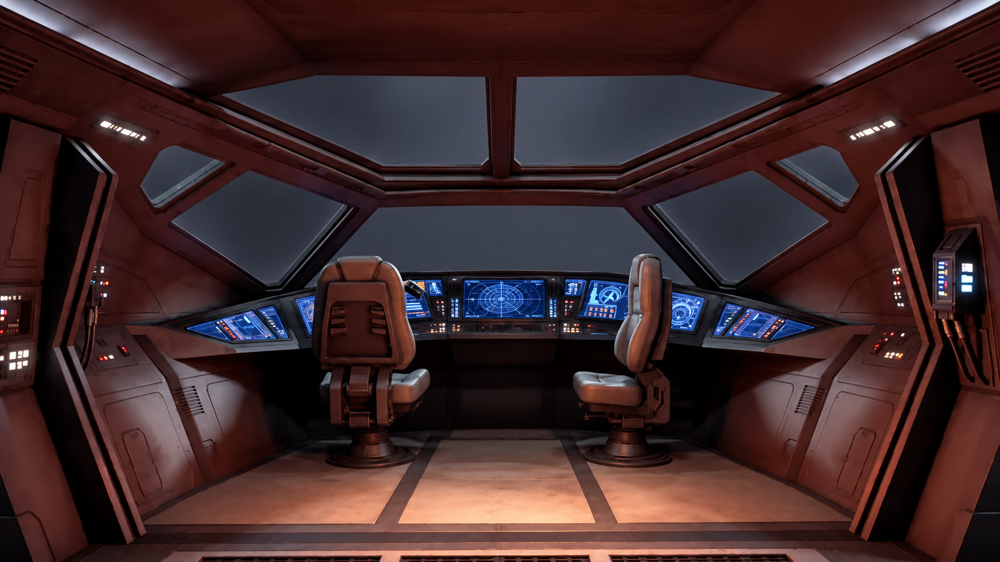</a><figcaption>@Image5 — кабина</figcaption></figure><figure><a href="references/scenes/scene-41/S41-cruiser-film-part1-11m22s.png" target="_blank" rel="noopener"></a><figcaption>@Image6 — крейсер, настоящий кадр ч. 1 11:22</figcaption></figure></div>

**Напоминание «хлеб и молоко» · 17.10,23:03:** один и тот же бледно-жёлтый стикер справа от пилота: чёрный рисунок батона слева и пакета молока справа. В каждом перелёте удержать оба рисунка различимыми примерно2секунды; монтаж должен сохранить этот момент. В52 зритель впервые ясно замечает записку, в37 Серёга сам замечает её и откладывает мысль, в41 она остаётся перед глазами, пока он занят компьютером. Это подводит к уже запущенной55 без новой реплики или вставки в финале.

**Что происходит:** На закате Серёга быстро выходит из арки храма, перед ним Сила несёт бежевый системный блок и CRT-монитор. Он забрасывает их в кабину через боковой люк и одним резким движением пристёгивает монитор к пассажирскому креслу. На взлёте от грохота двигателей с повреждённой в бою статуи откалывается каменная голова и падает на корабль; Серёга уходит креном, и голова разбивается о площадь. В космосе он на полной скорости летит к флагману и резко тормозит у освещённого ангара. Пристёгнутый монитор комично качается, и Серёга не глядя придерживает его ладонью. Корабль входит в свет проёма ангара.

**Корабль в локациях · 23.10.2026:** созданные опорные изображения, не кадры готовых видео. Геометрия исходного корабля сохранена как ориентир; настоящий видеостык важнее композиции, направления и состояния люка на картинке. Крыша всегда пуста.

<div class="scene-ref-gallery">
<figure><a href="references/scenes/ship-locations/Serega-ship-sith-ruins.png" target="_blank" rel="noopener">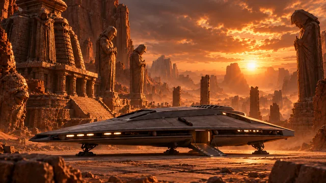</a><figcaption>Планета ситхов: площадка у храма · AI-референс</figcaption></figure>
<figure><a href="references/scenes/ship-locations/Serega-ship-flagship-space.png" target="_blank" rel="noopener">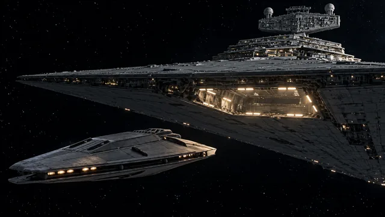</a><figcaption>Космос: у имперского флагмана · AI-референс</figcaption></figure>
</div>

**Входы 30 с — обновлённые изображения корабля:** @Image4 — `references/scenes/ship-locations/Serega-ship-sith-ruins.png`; @Image6 — `references/scenes/ship-locations/Serega-ship-flagship-space.png`. Остальные входы — в списке референсов выше.

<div class="engine-tabs" data-scene="41">

<div class="engine-pane" data-engine="wan30" data-main="1">

```text
Mode: reference-to-video | Duration: 30s | Resolution: 1080p | Aspect ratio: 16:9 | FPS: 24 | Native audio: on
Optimized for Wan 3.0 | Photoreal live-action space-fantasy action, deadpan | Serega Force-carries the ancient 1990s computer aboard, dodges a falling statue head at lift-off and brakes hard into his flagship's hangar

REFERENCES / AUTHORITY ORDER:
@Image2 — genuine frame of the temple niche: the exact yellowed beige 1990s system unit, the heavy beige CRT monitor and the keyboard. Absolute authority for the shape, colour, wear and dust of these three objects; the niche and the kneeling figure are not part of this shot.
@Image3 — the exact ancient ruin city outside the temple: ochre-red carved stone, colossal hooded statues, the wide temple stair, golden-orange sunset haze.
@Image4 — synthetic location reference: the same personal craft on the landing apron below the ochre Sith temple stairs and colossal hooded statues in golden sunset haze. Empty roof; preserve the baseline flat dark-grey wedge hull, cockpit glazing, panel layout and horizontal warm lights.
@Image5 — clean EMPTY cockpit derived from the original film frame: exact brown ribs, two brown seats, glazing and blue consoles; no people or weapons. Geometry only, with the actual scene location outside. Serega is seated at the controls when the timeline calls for him; the second seat stays empty.
@Image6 — synthetic location reference: the same SMALL personal craft beside the ENORMOUS grey imperial flagship in black space; preserve their different silhouettes and extreme scale difference. Empty roof; preserve the baseline flat dark-grey wedge hull, cockpit glazing, panel layout and horizontal warm lights.
@Image1 — absolute identity of SEREGA.
Priority: @Image2 controls the computer objects; @Image3 controls the ruins; @Image4 controls the hull; @Image5 controls the cockpit; @Image6 controls the flagship; @Image1 controls Serega's face and costume.

LOCATION REFERENCE GATE:
These synthetic location stills guide the same craft, setting and lighting, not a literal start frame. Apply each setting, gear and hatch state only at its matching timeline beat; hatches close before flight. Actual @Video1, when supplied, controls the opening position, motion, screen direction and continuity. Multiple views depict ONE personal craft, never duplicates. Keep the roof empty.

SHIP OCCUPANCY — CRITICAL:
The roof, cockpit canopy, wings and upper hull remain completely empty in every shot. Exactly one SEREGA stays fully inside the enclosed cockpit, seated at the pilot controls whenever the craft moves; exterior views may show him only through the cockpit glazing. When landed and stationary, he may walk on the ground and use the single side hatch and boarding ramp. Never place him standing, sitting, riding or balancing on the roof or any exterior hull surface. No external duplicate, body clipping through the canopy, or teleportation between cabin and roof.

CHARACTER APPEARANCE / IDENTITY LOCK:
@Image1 is the absolute visual authority for SEREGA (the Chancellor): pale older man, sparse light hair with a bald crown, mature serious face, long deep dark-purple robe, dusty from the temple. He is the only person in the scene. His face is shown only in medium framing with even light; never a tiny face during the flight action.

PROP LOCK — CRITICAL:
Exactly one beige 1990s system unit, one heavy CRT monitor and one keyboard, identical to @Image2 in every shot: same scratches, dust and dangling cables. Switched OFF throughout: dark screen, no lights, no game, no text. Strapped, it rocks but never breaks loose, falls or cracks. No map modules or holograms.
BREAD-AND-MILK NOTE: exactly one palm-sized pale-yellow square sticky note, with two simple black line drawings: a loaf on the left and a milk carton on the right; no letters, words or numbers. It stays on the same blank sloping console panel immediately to the pilot's right, beside the controls, never on a screen. Preserve its size, colour, drawings and position in every cockpit shot. Keep it unobstructed and in focus long enough to recognise both groceries; no actual bread or milk aboard.
MUSHROOM BASKET: one small round wicker basket of fresh brown forest mushrooms on the cockpit floor beside the pilot seat; never picked up, never spills.

VEHICLE / TRAVEL LOCK — CRITICAL:
One and the same craft from @Image4 in every shot; access only through its single side hatch with a short fold-down boarding ramp. Parked on the plaza at the start, then one lift-off, one dodge, one climb out, one fast approach and hard braking at the flagship from @Image6. Never hit or damaged. No docking interior, no second small ship, no space battle, no hyperspace tunnel.

RUINS / DEBRIS LOCK:
The ruins of @Image3 carry fresh battle damage: scorched stone, deep cracks, smoking rubble. Exactly one falling object: the cracked stone head of one colossal hooded statue; it misses the craft by metres. Nothing else collapses.

START STATE:
Sunset outside the temple from @Image3. Serega's craft stands parked on the dusty plaza at the foot of the stair, side hatch open and short boarding ramp lowered. Serega appears in the dark temple arch at the top of the stair.

TIMELINE:
[0:00–0:05] — OUT OF THE TEMPLE
Low tracking shot backing down the stair ahead of him: Serega strides fast out of the arch and down the stair. Before him the system unit and the CRT float at chest height by the Force, steered by two raised fingers; the keyboard is under his arm, cable swinging. Medium framing, even sunset light on his face.

[0:05–0:10] — STRAPPED IN
Cut inside the cockpit: the two objects sail in through the side hatch and land on the passenger seat. Serega yanks the seat strap across the CRT and clicks it in one sharp move, drops the keyboard on top and drops into the pilot seat. Note on the console, basket on the floor.

[0:10–0:16] — LIFT-OFF AND THE FALLING HEAD
Cut to exterior wide: the craft blasts off the plaza in a storm of dust. The engine thunder shakes the cracked ruins; the stone head of a colossal hooded statue splits free and topples toward the rising craft. The craft snaps into a hard sideways roll and slips past; the head plunges by metres away and smashes onto the plaza in a burst of dust. The craft levels and climbs steeply into the orange sky.

[0:16–0:21] — FLAT OUT TO THE FLAGSHIP
After one clean time-compression cut: exterior from behind in black space, the ochre-red planet curving away below. The craft streaks left to right at full speed toward the huge flagship from @Image6, which grows fast in frame, its hangar a bright rectangle of light.

[0:21–0:26] — HARD BRAKE, WOBBLING CRT
Cut to the cockpit, medium shot, even light: the lit hangar mouth rushes closer in the front window. Retro-thrusters fire and the cockpit lurches; the strapped dark CRT rocks forward against its strap and back, the keyboard skidding on top. Without looking, Serega slaps a flat hand on the monitor to steady it, the other on the controls. The yellow note on the console stays sharp and unobstructed for two seconds, both drawings legible, right in front of him while he deals with the computer.

[0:26–0:30] — INTO THE LIGHT
Cut to exterior from behind and slightly to the side: retro-thrusters flaring, the craft decelerates hard and glides into the lit hangar opening of the flagship, just crossing the threshold into the light as the shot holds. No hangar interior is shown.

END STATE:
The small craft braking into the lit hangar opening of the huge flagship, seen from outside; inside it, the switched-off computer strapped to the passenger seat.

CAMERA / SPACE:
Five motivated cuts (0:05, 0:10, 0:16, 0:21, 0:26); the 0:16 cut compresses the climb out. Screen direction: down the stair to the craft, up and away from the ruins, left to right toward the flagship. The wide keeps the craft and the falling head readable together; fast chase framing in space; a jolting but stable cockpit medium. The statue head is larger than the craft; the flagship dwarfs it. No random handheld chaos.

PERFORMANCE:
Completely serious, like a museum curator moving a priceless relic, but brisk and decisive: the fast stride, the sharp strap click, the reflexive slap on the CRT. The comedy is the care he gives an old beige computer while dodging falling ruins. No smile, no look into the lens, no speech.

LIGHTING / MATERIALS:
Low golden-orange sunset through dust and smoke; weathered, scorched stone; the yellowed plastic and the curved dark CRT glass catch the sunset. Cockpit instrument glow. Hard sunlight and deep black in space; the hangar light floods the cockpit during braking.

AUDIO:
Wind across stone, quick footsteps on grit, a faint low Force hum, the knock of plastic set down, the strap click, engine spin-up, dust roar at lift-off, the crack of the statue head, its whoosh past and the crash, a deep hum in space, engines at full burn, the thump of retro-thrusters, the CRT rattling against its strap and the slap of his palm on it. No dialogue, narrator, music, computer start-up sounds or game sounds.

NEGATIVE PROMPT:
computer switched on, glowing screen, game footage, Warcraft logo, CRT breaking loose, map modules, hologram, cats, Jedi, any other person, crew, droids, craft hit by debris, ship damage, crash, more than one falling object, new ship design, second ship, space battle, hyperspace tunnel, docking interior, hangar interior, lava, vegetation, modern gaming PC, laptop, duplicated monitor or keyboard, objects morphing, readable text on the note, spilled mushrooms, melting or morphing face, changed face or robe, cartoon CGI, subtitles, text, logo, watermark, black bars.

FRAME FILL / NO BARS:
Fill the entire generated frame edge-to-edge. No letterboxing, no pillarboxing, no black bars, no side bars, no decorative borders, no empty margins.
```

</div>

<div class="engine-pane" data-engine="sd20x2">

Та же сцена двумя роликами по 15 с: сначала часть 1, часть 2 — после её результата (@Video1 части 2 = последние секунды части 1). Нумерация входов в каждой части своя.

**Входы части 1:** @Image1 — `references/full/serega.jpg`; @Image2 — `references/scenes/scene-38/S38-Image3-scene35-last-frame.png` (ПК); @Image3 — `references/scenes/scene-27/S27-Image5-topview-source.png` (руины); @Image4 — `references/scenes/ship-locations/Serega-ship-sith-ruins.png` (корпус); @Image5 — `references/scenes/scene-37/S37-cockpit-empty.png` (кабина).

**Входы части 2:** @Video1 — конец части 1; @Image1 — `references/full/serega.jpg`; @Image2 — `references/scenes/scene-38/S38-Image3-scene35-last-frame.png` (ПК); @Image3 — `references/scenes/ship-locations/Serega-ship-flagship-space.png` (корпус); @Image4 — `references/scenes/scene-37/S37-cockpit-empty.png` (кабина); @Image5 — `references/scenes/scene-41/S41-cruiser-film-part1-11m22s.png` (крейсер/флагман).

#### 41 · Seedance 2.0 часть 1

```text
Mode: reference-to-video (omni-reference) | Duration: 15s | Resolution: 720p | Aspect ratio: 16:9 | FPS: 24 | Native audio: on
Optimized for Seedance 2.0 | Photoreal live-action space-fantasy action, deadpan | Part 1 of 2: Serega Force-carries the ancient computer aboard, straps it in and dodges a falling statue head at lift-off

REFERENCES / AUTHORITY ORDER:
@Image1 — absolute identity of SEREGA.
@Image2 — genuine frame of the temple niche: the exact yellowed beige 1990s system unit, the heavy beige CRT monitor and the keyboard. Shape, colour, wear and dust of these three objects only; the niche and the kneeling figure are not part of this shot.
@Image3 — the exact ancient ruin city outside the temple: ochre-red carved stone, colossal hooded statues, the wide temple stair, golden-orange sunset haze.
@Image4 — synthetic location reference: the same personal craft on the landing apron below the ochre Sith temple stairs and colossal hooded statues in golden sunset haze. Empty roof; preserve the baseline flat dark-grey wedge hull, cockpit glazing, panel layout and horizontal warm lights.
@Image5 — clean EMPTY cockpit derived from the original film frame: exact brown ribs, two brown seats, glazing and blue consoles; no people or weapons. Geometry only, with the actual scene location outside. Serega is seated at the controls when the timeline calls for him; the second seat stays empty.
Priority: @Image1 controls Serega's face and costume; @Image2 the computer; @Image3 the ruins; @Image4 the hull; @Image5 the cockpit.

LOCATION REFERENCE GATE:
These synthetic location stills guide the same craft, setting and lighting, not a literal start frame. Apply each setting, gear and hatch state only at its matching timeline beat; hatches close before flight. Actual @Video1, when supplied, controls the opening position, motion, screen direction and continuity. Multiple views depict ONE personal craft, never duplicates. Keep the roof empty.

SHIP OCCUPANCY — CRITICAL:
The roof, cockpit canopy, wings and upper hull remain completely empty in every shot. Exactly one SEREGA stays fully inside the enclosed cockpit, seated at the pilot controls whenever the craft moves; exterior views may show him only through the cockpit glazing. When landed and stationary, he may walk on the ground and use the single side hatch and boarding ramp. Never place him standing, sitting, riding or balancing on the roof or any exterior hull surface. No external duplicate, body clipping through the canopy, or teleportation between cabin and roof.

CHARACTER APPEARANCE / IDENTITY LOCK:
@Image1 is the absolute visual authority for SEREGA (the Chancellor): pale older man, sparse light hair with a bald crown, mature serious face, long deep dark-purple robe, dusty from the temple. He is the only person in the scene. His face is shown in medium framing with even light; never a tiny face during the action.

PROP LOCK — CRITICAL:
Exactly one beige 1990s system unit, one heavy CRT monitor and one keyboard, identical to @Image2: same scratches, dust and dangling cables. Switched OFF throughout: dark screen, no lights, no text. Once strapped it never breaks loose. No map modules or holograms.
BREAD-AND-MILK NOTE: exactly one palm-sized pale-yellow square sticky note, with two simple black line drawings: a loaf on the left and a milk carton on the right; no letters, words or numbers. It stays on the same blank sloping console panel immediately to the pilot's right, beside the controls, never on a screen. Preserve its size, colour, drawings and position in every cockpit shot. Keep it unobstructed and in focus long enough to recognise both groceries; no actual bread or milk aboard.
MUSHROOM BASKET: one small round wicker basket of fresh brown forest mushrooms on the cockpit floor beside the pilot seat; never picked up, never spills.

VEHICLE / DEBRIS LOCK — CRITICAL:
The same craft from @Image4; access only through its single side hatch with a short fold-down boarding ramp. One lift-off and one dodge. The ruins carry fresh battle damage: scorched stone, deep cracks, smoking rubble. Exactly one falling object: the cracked stone head of one colossal hooded statue, larger than the craft; it misses by a few metres and smashes on the plaza. The craft is never hit.

START STATE:
Sunset outside the temple from @Image3. The craft stands parked on the dusty plaza at the foot of the stair, side hatch open, short ramp lowered. Serega appears in the dark temple arch at the top of the stair.

TIMELINE:
[0:00–0:05] — OUT OF THE TEMPLE
Low tracking shot backing down the stair ahead of him: Serega strides fast out of the arch and down the stair. The system unit and the CRT float before him at chest height by the Force; the keyboard is under his arm, cable swinging; two raised fingers steer. Medium framing, even sunset light on his face.

[0:05–0:09] — STRAPPED IN
Cut inside the cockpit: the objects sail in through the side hatch onto the passenger seat. Serega yanks the seat strap across the CRT and clicks it in one sharp move, drops the keyboard on top and drops into the pilot seat. The yellow note on the console readable for two seconds; the basket on the floor.

[0:09–0:15] — LIFT-OFF AND THE FALLING HEAD
Cut to exterior wide: the craft blasts off the plaza in a storm of dust. The engine thunder shakes the cracked ruins; the stone head of a colossal hooded statue splits free and topples toward the rising craft. The craft snaps into a hard sideways roll and slips past; the head plunges by and smashes on the plaza. The craft levels and climbs steeply into the orange sky.

END STATE:
Exterior: the craft climbing steeply away from the dust-shrouded ruins into the orange sky, the fallen statue head shattered on the plaza below.

CAMERA / SPACE:
Two motivated cuts (into 0:05 and 0:09). Direction: down the stair toward the craft, then up and away. The wide keeps the craft and the falling head readable together. Credible scale.

PERFORMANCE:
Completely serious, like a museum curator moving a priceless relic, but brisk and decisive. No smile, no look into the lens, no speech.

LIGHTING / MATERIALS:
Low golden-orange sunset through dust and smoke; scorched stone; the yellowed plastic and dark CRT glass catch the light; cockpit instrument glow.

AUDIO:
Quick footsteps on grit, a faint Force hum, the strap click, engine spin-up, dust roar at lift-off, the deep crack of the statue head, its whoosh past and the crash on the plaza. No dialogue, narrator, music or computer sounds.

NEGATIVE PROMPT:
computer switched on, glowing screen, game footage, text on screen, map modules, hologram, cats, Jedi, any other person, crew, droids, craft hit by debris, ship damage, crash, more than one falling object, new ship design, second ship, flagship, lava, vegetation, modern PC, duplicated monitor or keyboard, objects morphing, readable text on the note, spilled mushrooms, melting or morphing face, changed face or robe, cartoon CGI, subtitles, text, logo, watermark, black bars.

FRAME FILL / NO BARS:
Fill the entire generated frame edge-to-edge. No letterboxing, no pillarboxing, no black bars, no side bars, no decorative borders, no empty margins.
```

#### 41 · Seedance 2.0 часть 2

```text
Mode: reference-to-video (omni-reference) | Duration: 15s | Resolution: 720p | Aspect ratio: 16:9 | FPS: 24 | Native audio: on
Optimized for Seedance 2.0 | Photoreal live-action space-fantasy action, deadpan | Part 2 of 2: Serega races to his flagship and brakes hard into its lit hangar while the strapped CRT wobbles comically

REFERENCES / AUTHORITY ORDER:
@Video1 — the last seconds of Part 1's result: the craft climbing steeply away from the ruins into the orange sky. Absolute authority for the START STATE, the craft and its direction.
@Image1 — absolute identity of SEREGA.
@Image2 — the exact yellowed beige 1990s system unit, heavy beige CRT monitor and keyboard. These objects only; not the niche or the kneeling figure.
@Image3 — synthetic location reference: the same SMALL personal craft beside the ENORMOUS grey imperial flagship in black space; preserve their different silhouettes and extreme scale difference. Empty roof; preserve the baseline flat dark-grey wedge hull, cockpit glazing, panel layout and horizontal warm lights.
@Image4 — clean EMPTY cockpit derived from the original film frame: exact brown ribs, two brown seats, glazing and blue consoles; no people or weapons. Geometry only, with the actual scene location outside. Serega is seated at the controls when the timeline calls for him; the second seat stays empty.
@Image5 — Serega's huge imperial flagship exactly as shown earlier in the film: silhouette, colour, scale and hangar. Use the flagship only.
Priority: @Video1 controls the start; @Image1 Serega's face and costume; @Image2 the computer; @Image3 the hull; @Image4 the cockpit; @Image5 the flagship.

LOCATION REFERENCE GATE:
These synthetic location stills guide the same craft, setting and lighting, not a literal start frame. Apply each setting, gear and hatch state only at its matching timeline beat; hatches close before flight. Actual @Video1, when supplied, controls the opening position, motion, screen direction and continuity. Multiple views depict ONE personal craft, never duplicates. Keep the roof empty.

SHIP OCCUPANCY — CRITICAL:
The roof, cockpit canopy, wings and upper hull remain completely empty in every shot. Exactly one SEREGA stays fully inside the enclosed cockpit, seated at the pilot controls whenever the craft moves; exterior views may show him only through the cockpit glazing. When landed and stationary, he may walk on the ground and use the single side hatch and boarding ramp. Never place him standing, sitting, riding or balancing on the roof or any exterior hull surface. No external duplicate, body clipping through the canopy, or teleportation between cabin and roof.

CHARACTER APPEARANCE / IDENTITY LOCK:
@Image1 is the absolute visual authority for SEREGA (the Chancellor): pale older man, sparse light hair with a bald crown, mature serious face, long deep dark-purple robe, dusty from the temple. He is the only person in the scene. His face appears only in the cockpit, medium framing, even light.

PROP LOCK — CRITICAL:
Exactly one beige 1990s system unit, one heavy CRT monitor and one keyboard, identical to @Image2, strapped to the passenger seat with the keyboard on top. Switched OFF throughout: dark screen, no lights, no text. It rocks against the strap but never breaks loose, falls or cracks. No map modules or holograms.
BREAD-AND-MILK NOTE: exactly one palm-sized pale-yellow square sticky note, with two simple black line drawings: a loaf on the left and a milk carton on the right; no letters, words or numbers. It stays on the same blank sloping console panel immediately to the pilot's right, beside the controls, never on a screen. Preserve its size, colour, drawings and position in every cockpit shot. Keep it unobstructed and in focus long enough to recognise both groceries; no actual bread or milk aboard.
MUSHROOM BASKET: one small round wicker basket of fresh brown forest mushrooms on the cockpit floor beside the pilot seat; never picked up, never spills.

VEHICLE / TRAVEL LOCK — CRITICAL:
The same craft as in @Video1 and @Image3. One climb out of the atmosphere, one fast approach and hard braking at the flagship from @Image5. No docking interior, no hangar interior, no second small ship, no space battle, no hyperspace tunnel.

START STATE:
Exactly the last frame of @Video1: the craft climbing steeply into the orange sky above the dusty ruins.

TIMELINE:
[0:00–0:05] — FLAT OUT TO THE FLAGSHIP
Continuing @Video1, the craft punches out of the haze, then one time-compression cut to black space, the ochre-red planet curving away below. Exterior from behind: the craft streaks left to right at full speed, engines blazing, toward the flagship, which grows fast in frame, its hangar opening a bright rectangle of light.

[0:05–0:11] — HARD BRAKE, WOBBLING CRT
Cut to the cockpit, medium shot, even instrument light: the lit hangar mouth rushes closer through the front window. Retro-thrusters fire and the cockpit lurches; the strapped dark CRT rocks forward against its strap and back, the keyboard skids on top. Without looking, Serega slaps a flat hand on top of the monitor to steady it, the other hand on the controls. The yellow note stays sharp and unobstructed for two seconds, both drawings legible, right in front of him. The basket stays put.

[0:11–0:15] — INTO THE LIGHT
Cut to exterior from behind and slightly to the side: retro-thrusters flaring, the craft brakes hard and glides into the lit hangar opening of the flagship, just crossing the threshold into the light as the shot holds. No interior shown.

END STATE:
The small craft braking into the lit hangar opening of the huge flagship, seen from outside; inside it, the switched-off computer strapped to the passenger seat.

CAMERA / SPACE:
Three motivated cuts (time-compression into space, into 0:05, into 0:11). Left-to-right travel toward the flagship kept consistent. Fast chase framing outside, a jolting but stable cockpit medium; the flagship dwarfs the craft.

PERFORMANCE:
Deadpan, fast reflexes: the slap on the CRT is automatic, eyes on the hangar. No smile, no look into the lens, no speech.

LIGHTING / MATERIALS:
Hard sunlight and deep black in space; the hangar light floods the cockpit during braking; instrument glow on the yellowed plastic and dark CRT glass.

AUDIO:
Wind fading to a deep hum in space, engines at full burn, the thump of retro-thrusters, the rattle of the CRT against its strap and the slap of his palm on it, engines winding down. No dialogue, narrator, music, computer start-up or game sounds.

NEGATIVE PROMPT:
computer switched on, glowing screen, game footage, Warcraft logo, text on screen, CRT breaking loose or falling, map modules, hologram, cats, Jedi, any other person, crew, droids, ship damage, crash, new ship design, second ship, space battle, hyperspace tunnel, docking interior, hangar interior, duplicated monitor or keyboard, objects morphing, readable text on the note, spilled mushrooms, melting or morphing face, changed face or robe, cartoon CGI, subtitles, text, logo, watermark, black bars.

FRAME FILL / NO BARS:
Fill the entire generated frame edge-to-edge. No letterboxing, no pillarboxing, no black bars, no side bars, no decorative borders, no empty margins.
```

</div>

</div>

---

<a id="scene-42"></a>

## Сцена 42 — Татуин: бой на фоне червя — червь им не интересен

**⏳ В МЕДЛЕННОЙ ГЕНЕРАЦИИ**

<!-- scene-meta: {"target_engine":"Seedance 2.0","production_state":"DRAFT","duration_s":30,"dialogue":{"enabled":false,"language":null},"dependencies":[{"type":"continues","scene":16}],"tags":["serega","ilyusha","artem","tatooine","worm","duel","deadpan","continuity"]} -->

Seedance 2.0 task `a1ca4c36e31d45c5b4b72df7777d2592` технически завершён 23.10.2026 01:10:29 UTC. Результат требует отдельной редакционной проверки; новый Scene ID не создаётся.

**Контекст использования:**

- **Решение владельца 16.10.2026:** Scene 16 принята; нужно продолжение битвы на фоне червя, который всё разрушает вокруг. Артём и Илюша дерутся с Серёгой, будто не замечая червя: экономно и мгновенно уклоняются от его атак, сохраняя равнодушное выражение, он не их цель и им не интересен.
- **Стык:** после НОВОЙ Scene 16 · Seedance 2.0 часть 2; исторический task `36e8320e34da4f1b97c35e1e765e3e63` сохранён, но не подставляется в новый стык. Дальше — Scene 56 (бой в движении, владелец 18.10), затем Scene 48: Канцлер забирает татуинский фрагмент (решение владельца 16.10, D6).
- **Тон меняется осознанно:** в 16 червь — катастрофа; здесь комедия в равнодушии. Все трое заняты только дуэлью, от червя отмахиваются как от назойливой помехи. Без гримас и взглядов в камеру — смешно за счёт контраста масштаба и полного спокойствия.
- Цвета мечей — как в 16 и 27: Илюша синий, Артём зелёный, Серёга красный.
- Машина после разрушения не появляется (W8). Модуль карты в этой сцене не показывается — его исход в Scene 48.
- **До READY (20.10):** @Image6 требуется извлечь из настоящего результата НОВОЙ16P2. Сохранённый кадр 899/899 старой16 — история, не вход новой попытки. Приоритет червя:16 → 42 → 56 → 48; Seedance2.0 · 2 × 15с.
- В монтаж 15–25 с. Запуск — только по команде владельца.
- **Динамика (владелец 18.10.2026):** сцена переписана активнее — плита-трамплин, прыжок через движущуюся спину червя, брошенный крутящийся меч Серёги отбит и пойман. Версии промта — во вкладках над промтом (30 с · Wan 3.0 / Seedance 2.5 и Seedance 2.0 · 2 × 15 с); версию, которую запускает очередь, отмечает «★ в очереди».

**Референсы:**

- @Image1 — <a href="references/full/serega.jpg">Серёга</a>;
- @Image2 — <a href="references/full/ilyusha.jpg">Илюша (Hooded Jedi)</a>;
- @Image3 — <a href="references/full/artem.jpg">Артём (Bearded Jedi)</a>;
- @Image4 — <a href="references/scenes/scene-16/S16-desert-location-clean.png">пустынные руины Scene 16</a> (только локация);
- @Image5 — <a href="references/scenes/scene-16/S16-worm-scale.png">масштаб и дизайн червя</a>;
- @Image6 — <a href="references/scenes/scene-42/S42-start-from-S16-result.png">настоящий последний кадр Scene 16</a>; пыль и позы — из результата, лица — по индивидуальным листам.

<div class="scene-ref-gallery">
<figure><a href="references/full/serega.jpg" target="_blank" rel="noopener"></a><figcaption>@Image1 — Серёга</figcaption></figure>
<figure><a href="references/full/ilyusha.jpg" target="_blank" rel="noopener"></a><figcaption>@Image2 — Илюша</figcaption></figure>
<figure><a href="references/full/artem.jpg" target="_blank" rel="noopener"></a><figcaption>@Image3 — Артём</figcaption></figure>
<figure><a href="references/scenes/scene-16/S16-desert-location-clean.png" target="_blank" rel="noopener"></a><figcaption>@Image4 — руины</figcaption></figure>
<figure><a href="references/scenes/scene-16/S16-worm-scale.png" target="_blank" rel="noopener"></a><figcaption>@Image5 — червь</figcaption></figure><figure><a href="references/scenes/scene-42/S42-start-from-S16-result.png" target="_blank" rel="noopener"></a><figcaption>@Image6 — настоящий конец Scene 16, 29.966667 с</figcaption></figure></div>

**Что происходит:** Из пыли последнего кадра 16 все трое тут же снова бросаются в бой — быстрый и жёсткий, а червь за их спинами крушит руины. Червь сносит левую опору ворот: Артём взбегает по падающей плите и обрушивается на Серёгу сверху, Илюша мимоходом перепрыгивает через спину червя, скользящую по песку, Серёга швыряет вращающийся меч, Илюша его отбивает, а Серёга ловит вернувшуюся рукоять. Червь раскалывает обелиск, верхняя половина падает на бок рядом с Артёмом, тот лениво отступает на полшага; с вставшего на дыбы червя льётся песок, они фехтуют прямо сквозь него. В конце три меча скрещены на переднем плане, а пасть червя неподвижно висит над ними — никто даже не поднимает глаз.

<div class="engine-tabs" data-scene="42">

<div class="engine-pane" data-engine="wan30" data-main="1">

```text
Mode: reference-to-video | Duration: 30s | Resolution: 720p | Aspect ratio: 16:9 | FPS: 24 | Native audio: on
Optimized for Wan 3.0 | Photoreal live-action desert space-fantasy, fierce stunt duel with a deadpan running gag | Two Jedi and the Chancellor fight a fast acrobatic duel straight through the ruins a colossal sandworm is wrecking, and none of them cares about the worm

REFERENCES / AUTHORITY ORDER:
@Image6 — the genuine final frame of the new Scene16 Part2 result: exact positions of the three crouching duelists, the worm, the light, the dust and the ruins. Absolute authority for the START STATE.
@Image1 — absolute identity of SEREGA.
@Image2 — absolute identity of ILYUSHA, the Hooded Jedi.
@Image3 — absolute identity of ARTEM, the Bearded Jedi.
@Image4 — the exact desert ruins: sandy plain, two tall glyph-covered gate piers, narrow central obelisk, harsh warm daylight. Location geometry only; any damage in @Image6 takes precedence over the clean plate.
@Image5 — the exact colossal segmented sandworm: scale and design only; it is far larger than people and gate piers.
Priority: @Image6 controls the start; @Image1–@Image3 control the three identities; @Image4 controls the location; @Image5 controls the worm.

CHARACTER APPEARANCE / IDENTITY LOCK:
SEREGA (the Chancellor), @Image1: pale older man, sparse light hair with a bald crown, mature serious face, long deep dark-purple robe, sand in its folds; RED lightsaber.
ILYUSHA, @Image2: moustache, tousled chestnut hair, weathered face, light olive-green layered tunic, deep-red hooded cloak, brown boots; BLUE lightsaber.
ARTEM, @Image3: heavier build, short beard, cream-beige tunic under a brown outer robe, wide brown belt, brown boots; GREEN lightsaber.
Exactly three people. No other characters, no vehicles.

WORM / DESTRUCTION LOCK — CRITICAL:
The same colossal worm from @Image5 for the whole scene, always far larger than the gate piers. It wrecks the ruins of @Image4 around the duel, and the damage only accumulates: it smashes the LEFT gate pier into falling slabs (the right pier stays standing), and it cracks the central obelisk in half so that its top half topples and ends lying on its side on the sand as one long stone block. It strikes near the duelists again and again but never hits, swallows or touches anyone, and nobody touches it. Nobody ever fights the worm or looks at it for more than a glance.

START STATE:
Begin exactly from @Image6: Artem crouched on frame-left, Serega in the centre, Ilyusha on frame-right, all alive with the enormous worm behind them amid dense native dust. Their blades blaze to full brightness through the clearing dust and they spring straight back into the fight; individual sheets preserve faces and costumes.

TIMELINE:
[0:00–0:04] — BACK TO THE DUEL
From the @Image6 composition the three explode out of their crouch: blue and green blades against red in fast, hard, clean exchanges, sparks spitting at every clash. Behind them the worm smashes through the left gate pier; huge slabs start to rain down. Nobody turns around.

[0:04–0:09] — THE FALLING SLAB
A giant slab from the pier crashes down beside the duel and lands tilted like a ramp. Without a glance at it, Artem runs up the slab in three heavy strides, launches off its top edge and drops onto Serega with a two-handed overhead strike. Serega catches it on the red blade in a low crouch; sand bursts out under his boots, and he throws Artem off with one shove of the blade.

[0:09–0:13] — OVER THE WORM
A long stretch of the worm's back slides through the sand between Ilyusha and Serega, only waist-high above the surface, the rest of the colossal body still submerged, like a moving wall. Ilyusha does not stop: he hurdles the moving ridge in one bored, economical leap in mid-attack, without looking down, and lands straight into a slash that Serega parries. Neither touches the worm.

[0:13–0:18] — THE THROWN SABER
Serega hurls his red saber at Ilyusha; it spins through the air like a glowing disc. Ilyusha deflects it upward with the blue blade; it whirls back in a wide arc. Serega ducks under Artem's green swing, catches the returning hilt in one hand and blocks Artem's next strike in the same motion.

[0:18–0:22] — THE OBELISK
In the background the worm cracks the central obelisk in half; the top half topples straight toward Artem. Mid-combination, he takes one lazy half-step aside; the stone crashes down beside him and comes to rest on its side as a long block. He steps over its end as if over a puddle and continues his attack. Serega blocks it with bored precision.

[0:22–0:26] — FENCING IN THE SAND RAIN
The worm rears high above the duel and roars; tons of sand pour off its body in a heavy curtain straight onto the fighting ground. The three fence straight through the falling sand, the blades hissing and flaring in it, and all three duck the same flying debris at the same moment without looking up.

[0:26–0:30] — STILL NOT INTERESTED
Medium shot, faces close and readable in even light: the three lock blades in the foreground, red in the middle, green from frame-left, blue from frame-right, pushing against each other. Behind and above them the worm stops, its gaping maw hanging motionless over the three, sand still trickling from it, as if waiting for attention. None of them looks up. Keep the framing while their forearms drive into the contact, shoulders resist and feet make tiny grounded corrections. This is a live struggle under the deliberately motionless maw, not a freeze-frame.

END STATE:
The three duelists locked blade against blade in the foreground, Artem frame-left, Serega centre, Ilyusha frame-right, ignoring the worm whose gaping maw hangs motionless over them amid falling dust; the left gate pier smashed, the obelisk broken in half with its top half lying on its side as a long block. The fighters maintain live pressure and breathing within this exact arrangement; their feet and weapons do not swap sides.

CAMERA / SPACE:
The first shot begins exactly from the @Image6 framing. Then five motivated action cuts on movement, each matching screen direction and the left/centre/right geography: a low angle on Artem's run up the slab, a fast lateral tracking shot on Ilyusha's leap over the worm's back, a whip-pan that follows the spinning red saber and lands on Serega's catch, a wide for the falling obelisk and sand curtain, then a closer medium for the final lock. Fast action plays in wide and medium-wide shots with whole bodies visible; faces are recognised in medium shots, never tiny during speed. Keep the worm partly in frame in every wide shot for scale. No shaky handheld chaos, no teleporting, no spatial resets.

PERFORMANCE:
The duel is fast, fierce and athletic with real weight: hard strikes, jumps, crouching blocks, a thrown saber. The deadpan gag is the contrast: toward the worm all three are lazy, bored and unimpressed, dodging it with minimal half-steps and casual hops in stride, never panicked, never looking at it. Serega is cool and precise, Ilyusha quick and aggressive, Artem heavy and stubborn. No speech, no mugging, no look into the lens. The apparent boredom belongs only to their attitude toward the worm. The duel itself stays fast: each parry changes foot pressure and immediately leads to the next attack. During a blade lock, hands and shoulders keep pushing and boots replant; the actors never become a frozen tableau. Full-body action at normal real-time speed: visible planted feet, weight transfer, purposeful travel and immediate recovery into the next action. A held camera composition never freezes the performers. No slow motion, floating steps, extended hero pose or waiting for the next attack. Keep faces recognisable; intensity comes from the bodies and contacts, not frantic camera shake.

LIGHTING / MATERIALS:
Harsh warm desert sunlight, dry haze, long ruin shadows, sand sheets and stone debris in the air, realistic cloth and dust interaction, falling sand catching the light; saber light flickers on faces and robes through the dust.

AUDIO:
Saber hums, crackling clashes and whooshes in the foreground, the spinning saber's rising and falling whirr, heavy footsteps on stone and sand; the worm's deep roar, smashing stone and pouring sand behind, a little lower in the mix as if the fighters do not hear it; exertion breaths only. No dialogue, narrator or music.

NEGATIVE PROMPT:
worm swallowing or touching anyone, anyone touching or riding the worm, death, blood, characters fighting or attacking the worm, characters fleeing in panic, screaming, fear, slow motion, static standing duel, Force shove, sliding down a sand slope, standing on the toppled obelisk, both gate piers destroyed, obelisk left intact, car, speeder, vehicle wreck, extra people, duplicated characters, map module, hologram, wrong saber colours, second red saber, teleporting characters, small worm, cartoon CGI, comedy mugging, identity drift, costume changes, red cloak on Artem, subtitles, text, logo, watermark, black bars, slow motion, extended hero poses, frozen tableau, feet sliding without steps, weightless landings, repeated mechanical arm loops.

FRAME FILL / NO BARS:
Fill the entire generated frame edge-to-edge. No letterboxing, no pillarboxing, no black bars, no side bars, no decorative borders, no empty margins.
```

</div>

<div class="engine-pane" data-engine="sd20x2">

Та же сцена двумя роликами по 15 с: сначала часть 1, часть 2 — после её результата (@Video1 части 2 = последние секунды части 1). Нумерация входов в каждой части своя.

**Входы части 1:** @Image1 — `references/full/serega.jpg`; @Image2 — `references/full/ilyusha.jpg`; @Image3 — `references/full/artem.jpg`; @Image4 — `references/scenes/scene-16/S16-desert-location-clean.png`; @Image5 — `references/scenes/scene-16/S16-worm-scale.png`; @Image6 — `references/scenes/scene-42/S42-start-from-S16-result.png` (настоящий конец 16, старт).

**Входы части 2:** @Video1 — конец части 1; @Image1 — `references/full/serega.jpg`; @Image2 — `references/full/ilyusha.jpg`; @Image3 — `references/full/artem.jpg`; @Image4 — `references/scenes/scene-16/S16-desert-location-clean.png`; @Image5 — `references/scenes/scene-16/S16-worm-scale.png`.

#### 42 · Seedance 2.0 часть 1

```text
Mode: reference-to-video (omni-reference) | Duration: 15s | Resolution: 720p | Aspect ratio: 16:9 | FPS: 24 | Native audio: on
Optimized for Seedance 2.0 | Photoreal live-action desert space-fantasy, fierce stunt duel with a deadpan running gag | Part 1 of 2: the duel restarts and turns acrobatic in the ruins the ignored sandworm is wrecking

REFERENCES / AUTHORITY ORDER:
@Image6 — the genuine final frame of the new Scene16 Part2 result: exact positions of the three crouching duelists, the worm, the light, the dust and the ruins. Absolute authority for the START STATE.
@Image1 — absolute identity of SEREGA.
@Image2 — absolute identity of ILYUSHA, the Hooded Jedi.
@Image3 — absolute identity of ARTEM, the Bearded Jedi.
@Image4 — the exact desert ruins: sandy plain, two tall glyph-covered gate piers, narrow central obelisk, harsh warm daylight. Location geometry only; any damage in @Image6 takes precedence over the clean plate.
@Image5 — the exact colossal segmented sandworm: scale and design only; far larger than people and gate piers.
Priority: @Image6 controls the start; @Image1–@Image3 control identities; @Image4 the location; @Image5 the worm.

CHARACTER APPEARANCE / IDENTITY LOCK:
SEREGA (the Chancellor), @Image1: pale older man, sparse light hair with a bald crown, mature serious face, long deep dark-purple robe; RED lightsaber.
ILYUSHA, @Image2: moustache, tousled chestnut hair, weathered face, light olive-green layered tunic, deep-red hooded cloak, brown boots; BLUE lightsaber.
ARTEM, @Image3: heavier build, short beard, cream-beige tunic under a brown outer robe, wide brown belt, brown boots; GREEN lightsaber.
Exactly three people. No other characters, no vehicles.

WORM / DESTRUCTION LOCK — CRITICAL:
The same colossal worm from @Image5, always far larger than the gate piers. In this part it smashes the LEFT gate pier into falling slabs; the right pier and the central obelisk still stand. It never hits, swallows or touches anyone, and nobody touches it. Nobody fights it or looks at it for more than a glance.

START STATE:
Exactly @Image6: Artem crouched frame-left, Serega centre, Ilyusha frame-right, the enormous worm behind them in dense dust. Their blades blaze to full brightness as they spring back into the fight.

TIMELINE:
[0:00–0:04] — BACK TO THE DUEL
From the @Image6 framing all three explode out of the crouch: blue and green against red in fast, hard exchanges, sparks at every clash. Behind them the worm smashes the left gate pier; giant slabs rain down. Nobody turns around.

[0:04–0:08] — THE FALLING SLAB
A slab crashes down beside the duel and lands tilted like a ramp. Artem runs up it in three heavy strides, launches off the top edge and drops onto Serega with a two-handed overhead strike. Serega catches it on the red blade in a low crouch, sand bursting under his boots, and throws him off.

[0:08–0:11] — OVER THE WORM
A long stretch of the worm's back slides through the sand between Ilyusha and Serega, only waist-high above the surface, the rest of its body submerged. Ilyusha hurdles the moving ridge in one bored leap mid-attack, without looking down, and lands straight into a slash that Serega parries.

[0:11–0:15] — THE THROWN SABER
Serega hurls his red saber at Ilyusha, spinning like a glowing disc. Ilyusha deflects it upward with the blue blade; it whirls back in an arc. Serega ducks Artem's green swing, catches the returning hilt in one hand and blocks the next green strike in the same motion. Keep that blade contact for the last second with active pushing, a planted rear foot and Ilyusha still closing; do not freeze the whole body.

END STATE:
Serega in the centre holding his red saber again, blocking Artem's green blade from frame-left while Ilyusha closes in from frame-right; the left gate pier smashed into slabs, the central obelisk still standing, the worm looming behind in drifting dust. The fighters maintain live pressure and breathing within this exact arrangement; their feet and weapons do not swap sides.

CAMERA / SPACE:
Start exactly on the @Image6 framing, then cut on movement: low angle on Artem's run up the slab, fast lateral tracking on Ilyusha's leap, a whip-pan following the spinning saber into Serega's catch in a medium-wide. Keep left/centre/right geography and screen direction across every cut. Whole bodies in the fast shots; faces readable in the medium-wide catch. Worm partly in frame for scale in wide shots. No handheld chaos, no teleporting.

PERFORMANCE:
Fierce, athletic, weighty swordplay. Toward the worm everyone is lazy and unimpressed: casual hops in stride, no glances, no panic. Serega cool and precise, Ilyusha quick and aggressive, Artem heavy and stubborn. No speech, no mugging, no look into the lens. The apparent boredom belongs only to their attitude toward the worm. The duel itself stays fast: each parry changes foot pressure and immediately leads to the next attack. During a blade lock, hands and shoulders keep pushing and boots replant; the actors never become a frozen tableau. Full-body action at normal real-time speed: visible planted feet, weight transfer, purposeful travel and immediate recovery into the next action. A held camera composition never freezes the performers. No slow motion, floating steps, extended hero pose or waiting for the next attack. Keep faces recognisable; intensity comes from the bodies and contacts, not frantic camera shake.

LIGHTING / MATERIALS:
Harsh warm desert sun, dry haze, long ruin shadows, sand and stone debris in the air, real cloth and dust interaction; saber light flickering on faces and robes.

AUDIO:
Saber hums, crackling clashes, whooshes and the whirr of the spinning saber up front; heavy footsteps; the worm's roar and crashing stone behind, lower in the mix; exertion breaths only. No dialogue, narrator or music.

NEGATIVE PROMPT:
worm swallowing or touching anyone, anyone touching the worm, blood, fighting or fleeing the worm, screaming, slow motion, static duel, Force shove, obelisk breaking in this part, both piers destroyed, vehicles, extra people, duplicated characters, map module, wrong saber colours, small worm, cartoon CGI, mugging, identity drift, red cloak on Artem, subtitles, text, watermark, black bars, slow motion, extended hero poses, frozen tableau, feet sliding without steps, weightless landings, repeated mechanical arm loops.

FRAME FILL / NO BARS:
Fill the entire generated frame edge-to-edge. No letterboxing, no pillarboxing, no black bars, no side bars, no decorative borders, no empty margins.
```

#### 42 · Seedance 2.0 часть 2

```text
Mode: reference-to-video (omni-reference) | Duration: 15s | Resolution: 720p | Aspect ratio: 16:9 | FPS: 24 | Native audio: on
Optimized for Seedance 2.0 | Photoreal live-action desert space-fantasy, fierce stunt duel with a deadpan running gag | Part 2 of 2: the worm breaks the obelisk and buries the duel in sand, and the three still lock blades without looking up

REFERENCES / AUTHORITY ORDER:
@Video1 — the last seconds of Part 1's result: the three dueling in the ruins, Serega centre blocking Artem's green blade, the smashed left gate pier, the worm behind. Absolute authority for the START STATE, positions, damage and light.
@Image1 — absolute identity of SEREGA.
@Image2 — absolute identity of ILYUSHA, the Hooded Jedi.
@Image3 — absolute identity of ARTEM, the Bearded Jedi.
@Image4 — the desert ruins: sandy plain, glyph-covered gate piers, narrow central obelisk, harsh warm daylight. Location geometry only; damage follows @Video1.
@Image5 — the exact colossal segmented sandworm: scale and design only; far larger than people and gate piers.
Priority: @Video1 controls the start and the damage already done; @Image1–@Image3 control identities; @Image4 the location; @Image5 the worm.

CHARACTER APPEARANCE / IDENTITY LOCK:
SEREGA (the Chancellor), @Image1: pale older man, sparse light hair with a bald crown, mature serious face, long deep dark-purple robe; RED lightsaber.
ILYUSHA, @Image2: moustache, tousled chestnut hair, weathered face, light olive-green layered tunic, deep-red hooded cloak, brown boots; BLUE lightsaber.
ARTEM, @Image3: heavier build, short beard, cream-beige tunic under a brown outer robe, wide brown belt, brown boots; GREEN lightsaber.
Exactly three people. No other characters, no vehicles.

WORM / DESTRUCTION LOCK — CRITICAL:
The same colossal worm from @Image5, always far larger than the gate piers. The smashed left pier from @Video1 stays broken. In this part the worm cracks the central obelisk in half; its top half topples and ends lying on its side on the sand as one long stone block. It never hits, swallows or touches anyone, and nobody touches it. Nobody fights it or looks at it for more than a glance.

START STATE:
Exactly the last frame of @Video1: Artem frame-left, Serega centre with his red saber, Ilyusha frame-right, mid-duel in the ruins, the worm behind them.

TIMELINE:
[0:00–0:04] — A LAZY HALF-STEP
Continuing @Video1 without a cut: the duel rages on in fast exchanges. The worm's head slams into the sand right beside them; Ilyusha takes one lazy half-step sideways and keeps fencing, Serega leans back an inch to let a flying stone pass and parries Artem.

[0:04–0:08] — THE OBELISK
Wide: the worm cracks the central obelisk in half and the top half topples straight toward Artem. Mid-combination he takes one bored step aside; the stone crashes beside him and comes to rest on its side as a long block. He steps over its end like a puddle and attacks again.

[0:08–0:11] — FENCING IN THE SAND RAIN
The worm rears and roars; tons of sand pour off its body in a heavy curtain onto the duel. The three fence straight through the falling sand, blades hissing and flaring, and all duck the same flying debris at once without looking up.

[0:11–0:15] — STILL NOT INTERESTED
Medium shot, faces close and readable in even light: the three lock blades in the foreground, red in the middle, green from frame-left, blue from frame-right. Behind and above them the worm stops, its gaping maw hanging motionless over the three, sand trickling from it. Nobody looks up. Keep the composition, not a frozen body pose: forearms push against the crossed blades, shoulders resist, boots replant slightly and breathing continues. The motionless worm remains the deliberate joke.

END STATE:
The three duelists locked blade against blade in the foreground, Artem frame-left, Serega centre, Ilyusha frame-right, ignoring the worm whose gaping maw hangs motionless over them amid falling dust; the left gate pier smashed, the obelisk broken with its top half lying on its side as a long block. The fighters maintain live pressure and breathing within this exact arrangement; their feet and weapons do not swap sides.

CAMERA / SPACE:
First beat continues @Video1 without a cut, then cut on movement to a wide for the falling obelisk, a tracking medium-wide through the sand curtain, and a closer medium for the final lock. Keep left/centre/right geography and screen direction. Worm partly in frame for scale in wide shots. Faces only recognisable in medium shots, never tiny during speed. No handheld chaos, no teleporting.

PERFORMANCE:
Fierce, precise swordplay with real weight; toward the worm everyone is lazy, bored and unimpressed, minimal dodges, never panicked. Serega cool, Ilyusha aggressive, Artem stubborn. No speech, no mugging, no look into the lens. The apparent boredom belongs only to their attitude toward the worm. The duel itself stays fast: each parry changes foot pressure and immediately leads to the next attack. During a blade lock, hands and shoulders keep pushing and boots replant; the actors never become a frozen tableau. Full-body action at normal real-time speed: visible planted feet, weight transfer, purposeful travel and immediate recovery into the next action. A held camera composition never freezes the performers. No slow motion, floating steps, extended hero pose or waiting for the next attack. Keep faces recognisable; intensity comes from the bodies and contacts, not frantic camera shake.

LIGHTING / MATERIALS:
Harsh warm desert sun, dry haze, long shadows, pouring sand catching the light, stone debris and dust in the air; saber light flickering on faces and robes.

AUDIO:
Saber hums and crackling clashes up front, footsteps on sand; the worm's roar, cracking stone and pouring sand behind, lower in the mix as if nobody hears it; exertion breaths only. No dialogue, narrator or music.

NEGATIVE PROMPT:
worm swallowing or touching anyone, anyone touching the worm, blood, fighting or fleeing the worm, screaming, looking up at the worm, slow motion, Force shove, sliding down a slope, standing on the obelisk block, rebuilt gate pier, obelisk left intact, vehicles, extra people, duplicated characters, map module, wrong saber colours, small worm, cartoon CGI, mugging, identity drift, red cloak on Artem, subtitles, text, watermark, black bars, slow motion, extended hero poses, frozen tableau, feet sliding without steps, weightless landings, repeated mechanical arm loops.

FRAME FILL / NO BARS:
Fill the entire generated frame edge-to-edge. No letterboxing, no pillarboxing, no black bars, no side bars, no decorative borders, no empty margins.
```

</div>

</div>

---

<a id="scene-48"></a>

## Сцена 48 — Татуин: после боя Канцлер забирает фрагмент карты

**⏳ В МЕДЛЕННОЙ ГЕНЕРАЦИИ**

<!-- scene-meta: {"target_engine":"Seedance 2.0","production_state":"READY","duration_s":30,"dialogue":{"enabled":false,"language":null},"dependencies":[{"type":"continues","scene":56}],"tags":["serega","ilyusha","artem","tatooine","worm","map","force_pull","worm_ride","deadpan","continuity"]} -->

**Обновление 20.10:** бой и перемещения в реальном темпе, без длинных поз. Выбраны две части Seedance2.0 по15с; продолжения только от настоящих финалов предыдущих частей. Приоритет16 → 42 → 56 → 48.

**Обновление 23.10 (владелец):** сцена начинается склейкой — без видео конца 56. Начало задано текстом и картинками, поэтому 48 запускается, не дожидаясь 42 и 56. Часть 2 Seedance-версии по-прежнему продолжает конец части 1.

**Контекст использования:**

- **Решение владельца 16.10.2026 (D6):** Канцлер забирает татуинский фрагмент после драки на фоне червя. Scene 16 принята; бой продолжает Scene 42 («червь им не интересен»), эта сцена — её развязка. Текст перенесён из прежней редакции Scene 42 (16.10), тон приведён к 42: червю по-прежнему никто не уделяет внимания.
- **Функция:** закрыть «первый фрагмент у Канцлера» — высший приоритет [Р2] §19 («показать момент захвата/кражи»). По [Р2] §8: Канцлер использует хаос червя, чтобы уйти с первым фрагментом.
- **Приём** — идея Саши (master, «Идеи от Саши», 32:51–32:52): меч гаснет → карта летит в руку Канцлера.
- **Правка владельца 18.10.2026:** финал другой — Серёга прячет модуль под робу, запрыгивает на червя и лихо уезжает на нём вдаль от джедаев (вместо «почти отвернулся и ушёл в бурю»). Червь по-прежнему никого не трогает; единственный контакт — Серёга сам едет у него на спине. Перед 48 теперь стоит новая Scene 56 (бой в движении); с 23.10 48 идёт после неё склейкой, без её видео. Руины после 42/56 уже разрушены: в промте они не «восстанавливаются».
- **Кто держал фрагмент:** Артём (Bearded Jedi) — ответ владельца 17.10, 23:58. Бармен отдал модуль ему (31:51–31:52 по сборке [Р2]). Меч Илюши после 42 уже горит: он не «зажигает», а поднимает его.
- **Машина** после разрушения не появляется (W8). Отлёт Серёги с Татуина — Scene 53 (с окраины города), прибытие на Набу — Scene 39.
- Модуль того же дизайна, что набусский (@Image6); светится тускло, без голограмм.
- **Вход:** без видео предыдущей сцены (склейка, владелец 23.10) — только @Image1–@Image6.
- В монтаж 15–25 с. Запуск — только по команде владельца.
- **Динамика (владелец 18.10.2026):** сцена переписана активнее — резкий рывок Силой, спринт и прыжок на червя, Серёга уносится на нём как сёрфер; слово «спокойно» убрано. Версии промта — во вкладках над промтом (30 с · Wan 3.0 / Seedance 2.5 и Seedance 2.0 · 2 × 15 с); версию, которую запускает очередь, отмечает «★ в очереди».

**Референсы:**

- @Image1 — <a href="references/full/serega.jpg">Серёга</a>;
- @Image2 — <a href="references/full/ilyusha.jpg">Илюша (Hooded Jedi)</a>;
- @Image3 — <a href="references/full/artem.jpg">Артём (Bearded Jedi)</a>;
- @Image4 — <a href="references/scenes/scene-16/S16-desert-location-clean.png">пустынные руины Scene 16</a> (только локация);
- @Image5 — <a href="references/scenes/scene-16/S16-worm-scale.png">масштаб и дизайн червя</a>;
- @Image6 — <a href="references/scenes/scene-17/S17-Image4-topview-source.png">модуль карты (дизайн-класс фрагментов)</a>;

<div class="scene-ref-gallery">
<figure><a href="references/full/serega.jpg" target="_blank" rel="noopener"></a><figcaption>@Image1 — Серёга</figcaption></figure>
<figure><a href="references/full/ilyusha.jpg" target="_blank" rel="noopener"></a><figcaption>@Image2 — Илюша</figcaption></figure>
<figure><a href="references/full/artem.jpg" target="_blank" rel="noopener"></a><figcaption>@Image3 — Артём</figcaption></figure>
<figure><a href="references/scenes/scene-16/S16-desert-location-clean.png" target="_blank" rel="noopener"></a><figcaption>@Image4 — руины</figcaption></figure>
<figure><a href="references/scenes/scene-16/S16-worm-scale.png" target="_blank" rel="noopener"></a><figcaption>@Image5 — червь</figcaption></figure>
<figure><a href="references/scenes/scene-17/S17-Image4-topview-source.png" target="_blank" rel="noopener"></a><figcaption>@Image6 — модуль карты</figcaption></figure></div>

**Что происходит:** Трое сцепились мечами, червь ревёт над ними. Червь наконец обрушивается прямо между ними, Артёма сбивает волной песка: меч выпадает из руки и гаснет, из-за пояса вылетает светящийся модуль карты. Серёга протягивает руку — модуль летит сквозь пыль ему в ладонь. Илюша с горящим мечом бросается наперерез, но червь снова поднимается между ними и заставляет Илюшу отпрыгнуть; Артём на коленях упирается рукой в песок. Серёга быстро прячет модуль под робу, бросается к червю, запрыгивает на него и лихо уезжает на нём вдаль от джедаев.

<div class="engine-tabs" data-scene="48">

<div class="engine-pane" data-engine="wan30" data-main="1">

```text
Mode: reference-to-video | Duration: 30s | Resolution: 720p | Aspect ratio: 16:9 | FPS: 24 | Native audio: on
Optimized for Wan 3.0 | Photoreal live-action desert space-fantasy, fast dashing action comedy | The ignored sandworm finally crashes between the duelists; the Chancellor rips the Tatooine map module to his hand with the Force, jumps onto the worm and rides it away

REFERENCES / AUTHORITY ORDER:
@Image1 — absolute identity of SEREGA.
@Image2 — absolute identity of ILYUSHA, the Hooded Jedi.
@Image3 — absolute identity of ARTEM, the Bearded Jedi.
@Image4 — the desert ruins: sandy plain, glyph-covered gate piers, central obelisk, harsh warm daylight. Location geometry only; the damage already done is described in START STATE.
@Image5 — the exact colossal segmented sandworm: scale and design only; it is far larger than people and gate piers.
@Image6 — the exact map module prop design.
Priority: @Image1–@Image3 control the three identities; @Image4 controls the location; @Image5 controls the worm; @Image6 controls the prop; the START STATE text controls the positions and the damage already done.

CHARACTER APPEARANCE / IDENTITY LOCK:
SEREGA (the Chancellor), @Image1: pale older man, sparse light hair with a bald crown, mature serious face, long deep dark-purple robe, sand in its folds; red lightsaber.
ILYUSHA, @Image2: moustache, tousled chestnut hair, weathered face, light olive-green layered tunic, deep-red hooded cloak, brown boots; blue lightsaber.
ARTEM, @Image3: heavier build, short beard, cream-beige tunic under a brown outer robe, wide brown belt, brown boots; green lightsaber.
Exactly three people. No other characters, no vehicles.

PROP LOCK — CRITICAL:
Exactly ONE small rigid palm-sized rectangular map module from @Image6: rounded grey metal frame, dark-grey face, two vertical warm-amber glowing segmented panels with a soft steady glow. It starts tucked in Artem's belt, flies through the air once and ends hidden in the inner fold of Serega's robe. It never folds, multiplies, breaks, projects a hologram or shows a map image.

WORM / LOCATION LOCK — CRITICAL:
The same colossal worm from @Image5 and the same ruins for the whole scene; the left gate pier stays smashed, the right pier stays standing, and the long toppled obelisk block, already shattered in the previous scene, remains scattered chunks; nothing rebuilds. The worm never swallows, bites or hurts anyone. Its only contact with a person is Serega deliberately riding its back at the end: he stands braced on one broad segment, gripping a ridge between segments, always far smaller than the worm. No car, speeder or wreck appears.

START STATE:
The scene opens on a hard cut on motion from the previous scene; no previous video is used. The three duelists locked blade against blade in the foreground, Artem frame-left, Serega centre, Ilyusha frame-right, all pushing hard, the map module glowing in Artem's wide belt; the furious worm rears high above them, coiled to strike. The ruins are already damaged: the left gate pier smashed into slabs, the right gate pier standing, the obelisk broken and its toppled top shattered into stone chunks scattered over the sand.

TIMELINE:
[0:00–0:06] — THE WORM CRASHES DOWN
Opening on the locked blades, already in motion: the worm slams its upper body down onto the sand right between Artem and Serega. A heavy wave of sand throws Artem off his feet and pushes Ilyusha back several steps. Serega springs back out of the sand wave and snaps off his red saber in one sharp motion.

[0:06–0:11] — THE SABER GOES OUT
Artem hits the sand hard. His green saber flies out of his hand, its blade switches off in mid-air and the hilt lands half-buried. In the same tumble the glowing map module jerks loose from his belt and lands on the open sand between him and Serega.

[0:11–0:16] — THE MODULE FLIES TO THE CHANCELLOR
A stable travelling medium catches his face and hand: one sharp thrust, a fast direct flight and a dry catch form one continuous action in the first two seconds. No hovering module or slow finger close. He takes his weight onto the rear foot, draws the fist to his chest and immediately tracks Ilyusha with his eyes; Ilyusha loads his front foot to intercept while Artem pushes up to his knees. The worm keeps churning sand behind them.

[0:16–0:21] — CUT OFF BY THE WORM
Ilyusha, his blue blade still lit, sprints at Serega to intercept, but the worm surges up out of the sand between them and forces Ilyusha to leap aside. Artem remains on his knees, braces one hand in the sand against the surge and watches; he does not simultaneously leap and stay kneeling.

[0:21–0:26] — ONTO THE WORM
In one quick move Serega shoves the module into the inner fold of his robe, sprints alongside the worm's long body as it slides past low over the sand, leaps onto its back, lands braced on one broad segment and grabs a ridge with one hand, robe whipping in the wind.

[0:26–0:30] — RIDING AWAY
Wide shot: the worm surges away across the dunes in a great spray of sand, Serega riding its back low and balanced like a surfer, robe streaming behind him, shrinking into the distance. In the foreground the two Jedi stand in the settling dust among the broken ruins and stare after him.

END STATE:
Serega rides the worm away into the far dunes with the module hidden in his robe; both Jedi alive in the foreground among the ruins, Artem's dark saber hilt half-buried in the sand.

CAMERA / SPACE:
The scene opens on a cut on motion into the blade lock; the first two beats play as one take with fast arcing moves; then motivated cuts: a medium on Serega for the Force pull, a fast tracking shot for the jump onto the worm, and a final wide shot from behind the Jedi for the ride. Stable geography: Serega and the worm on frame-right, the Jedi on frame-left. Scale through parallax, dust layers and foreground debris. Only motivated impact vibration.

PERFORMANCE:
Serega is fast, decisive and dashing, his face cold and focused: the Force pull is a sharp, commanding gesture, the sprint and leap onto the worm athletic and bold. Artem is winded and annoyed, not frightened; Ilyusha is fast and determined, then left standing with his blade lowered. Nobody treats the worm as more than an obstacle. No speech, no smile, no look into the lens. Full-body action at normal real-time speed: visible planted feet, weight transfer, purposeful travel and immediate recovery into the next action. A held camera composition never freezes the performers. No slow motion, floating steps, extended hero pose or waiting for the next attack. Keep faces recognisable; intensity comes from the bodies and contacts, not frantic camera shake.

LIGHTING / MATERIALS:
Harsh warm desert sunlight, dry haze, long ruin shadows, blown sand in the air, realistic cloth and dust interaction; the module's soft amber glow reads through the dust; sand pouring off the worm's segments.

AUDIO:
The worm's deep roar and throat resonance, sand crashing down, debris impacts, wind, the hiss of two sabers switching off, the blue saber's hum as Ilyusha charges, a faint low Force hum as the module flies, a soft electronic pulse from it, the heavy grinding rush of the worm surging away and fading into the distance. Exertion breaths only; no dialogue, narrator or music.

NEGATIVE PROMPT:
worm swallowing or biting anyone, death, blood, Serega falling off the worm, worm shrunk to a tame size, saddle or reins, car, speeder, vehicle wreck, extra people, duplicated characters, two or three modules, hologram map, folded paper map, module breaking, Serega fighting with a saber after the crash, map exchange by hand, rebuilt ruins, teleporting camera, small worm, cartoon CGI, comedy mugging, identity drift, costume changes, red cloak on Artem, subtitles, text, logo, watermark, black bars, slow motion, extended hero poses, frozen tableau, feet sliding without steps, weightless landings, repeated mechanical arm loops.

FRAME FILL / NO BARS:
Fill the entire generated frame edge-to-edge. No letterboxing, no pillarboxing, no black bars, no side bars, no decorative borders, no empty margins.
```

</div>

<div class="engine-pane" data-engine="sd20x2">

Та же сцена двумя роликами по 15 с: сначала часть 1, часть 2 — после её результата (@Video1 части 2 = последние секунды части 1). Нумерация входов в каждой части своя.

**Входы части 1:** @Image1 — `references/full/serega.jpg`; @Image2 — `references/full/ilyusha.jpg`; @Image3 — `references/full/artem.jpg`; @Image4 — `references/scenes/scene-16/S16-desert-location-clean.png`; @Image5 — `references/scenes/scene-16/S16-worm-scale.png`; @Image6 — `references/scenes/scene-17/S17-Image4-topview-source.png`.

**Входы части 2:** @Video1 — конец части 1 (её последние секунды); @Image1–@Image6 — те же файлы, что в части 1.

#### 48 · Seedance 2.0 часть 1

```text
Mode: reference-to-video (omni-reference) | Duration: 15s | Resolution: 720p | Aspect ratio: 16:9 | FPS: 24 | Native audio: on
Optimized for Seedance 2.0 | Photoreal live-action desert space-fantasy, fast dashing action comedy | Part 1 of 2: the ignored worm crashes down between the duelists, Artem's saber dies, the Chancellor Force-pulls the map module into his palm

REFERENCES / AUTHORITY ORDER:
@Image1 — absolute identity of SEREGA.
@Image2 — absolute identity of ILYUSHA, the Hooded Jedi.
@Image3 — absolute identity of ARTEM, the Bearded Jedi.
@Image4 — the desert ruins: sandy plain, glyph-covered gate piers, central obelisk, harsh warm daylight. Location geometry only; the damage already done is described in START STATE.
@Image5 — the exact colossal segmented sandworm: scale and design only; it is far larger than people and gate piers.
@Image6 — the exact map module prop design.
Priority: @Image1–@Image3 control the three identities; @Image4 controls the location; @Image5 controls the worm; @Image6 controls the prop; the START STATE text controls the positions and the damage already done.

CHARACTER APPEARANCE / IDENTITY LOCK:
SEREGA (the Chancellor), @Image1: pale older man, sparse light hair with a bald crown, mature serious face, long deep dark-purple robe, sand in its folds; red lightsaber.
ILYUSHA, @Image2: moustache, tousled chestnut hair, weathered face, light olive-green layered tunic, deep-red hooded cloak, brown boots; blue lightsaber.
ARTEM, @Image3: heavier build, short beard, cream-beige tunic under a brown outer robe, wide brown belt, brown boots; green lightsaber.
Exactly three people. No other characters, no vehicles.

PROP LOCK — CRITICAL:
Exactly ONE small rigid palm-sized rectangular map module from @Image6: rounded grey metal frame, dark-grey face, two vertical warm-amber glowing segmented panels with a soft steady glow. It starts tucked in Artem's wide belt, flies through the air once and ends gripped in Serega's closed hand. It never folds, multiplies, breaks, projects a hologram or shows a map image.

WORM / LOCATION LOCK — CRITICAL:
The same colossal worm from @Image5 and the same ruins for the whole clip; the left gate pier stays smashed, the right pier stays standing and the toppled obelisk block, already shattered in the previous scene, remains scattered chunks. The worm never swallows, bites, touches or hurts anyone; it only hits the sand. No car, speeder or wreck appears.

START STATE:
The scene opens on a hard cut on motion from the previous scene; no previous video is used. The three duelists locked blade against blade in the foreground, Artem frame-left, Serega centre, Ilyusha frame-right, all pushing hard, the map module glowing in Artem's wide belt; the furious worm rears high above them, coiled to strike. The ruins are already damaged: the left gate pier smashed into slabs, the right gate pier standing, the obelisk broken and its toppled top shattered into stone chunks scattered over the sand.

TIMELINE:
[0:00–0:04] — THE WORM CRASHES DOWN
Opening on the locked blades, already in motion: the worm slams its upper body down onto the sand right between Artem and Serega. A heavy wave of sand blasts outward; Artem is thrown off his feet, Ilyusha is shoved back on frame-left, and Serega springs backwards out of the sand wave on frame-right, snapping off his red saber in one sharp motion.

[0:04–0:08] — THE SABER GOES OUT
Cut on the impact to a low wide angle: Artem hits the sand hard and rolls. His green saber spins out of his hand, its blade switches off in mid-air and the dark hilt lands half-buried. In the same tumble the glowing map module jerks loose from his belt and skids onto the open sand between him and Serega.

[0:08–0:11] — PULL AND CATCH
Stable travelling medium, Serega's face and hand clearly lit. One sharp open-palm thrust, fast direct module flight and dry catch form a single decisive chain. A short hand insert shows his fingers closing once over the amber glow; the module never hovers and never makes a second flight.

[0:11–0:15] — REACT WITHOUT POSING
Back to the medium-wide: Serega takes his weight onto his rear foot and draws the closed fist to chest height, his eyes immediately tracking Ilyusha. Ilyusha plants and loads his front foot for an intercept; Artem pushes up to his knees beside his dark hilt. The worm continues churning sand behind them. End in that live preparation, module still in Serega's fist; he does not hide it or mount the worm yet.

END STATE:
Serega on frame-right in the settling dust, the module gripped in his closed fist, saber off; the worm half-sunk in the churned sand behind him; Ilyusha on frame-left on his feet, blue blade lit; Artem on his knees beside his dark, half-buried hilt.

CAMERA / SPACE:
The scene opens on a cut on motion into the blade lock, then a small fast arc on the same side of the axis. Then motivated cuts: a low wide for Artem falling and rolling, a stable travelling medium for the pull, one brief hand insert for the catch, back to the same medium-wide for their immediate reactions. Serega and the worm frame-right, the Jedi frame-left. Full bodies in fast action; readable face and hand during the short catch. Keep foreground parallax and deep sand layers. No glamour hold, orbit across the axis or speed ramp.

PERFORMANCE:
Serega is fast and dashing, his face cold: the Force pull is a sharp commanding gesture. Artem is winded and annoyed, not frightened. Ilyusha is determined. Nobody treats the worm as more than an obstacle. No speech, no smile, no look into the lens. Full-body action at normal real-time speed: visible planted feet, weight transfer, purposeful travel and immediate recovery into the next action. A held camera composition never freezes the performers. No slow motion, floating steps, extended hero pose or waiting for the next attack. Keep faces recognisable; intensity comes from the bodies and contacts, not frantic camera shake.

LIGHTING / MATERIALS:
Harsh warm desert sunlight, dry haze, blown sand in the air, realistic cloth and dust interaction; the module's soft amber glow reads through the dust; sand pouring off the worm's segments.

AUDIO:
The worm's deep roar, the thunder of its body hitting the sand, wind, the hiss of two sabers switching off, the hum of Ilyusha's blue saber, a faint low Force hum as the module flies, a soft electronic pulse and a dry slap as it hits the palm. Exertion breaths only; no dialogue, narrator or music.

NEGATIVE PROMPT:
worm swallowing, biting or touching anyone, death, blood, car, speeder, vehicle wreck, extra people, two or three modules, hologram map, module breaking, Serega fighting with a saber after the crash, Artem's saber still lit after the fall, rebuilt ruins, tiny blurred faces, small worm, cartoon CGI, comedy mugging, identity drift, costume changes, red cloak on Artem, subtitles, text, logo, watermark, black bars, slow motion, extended hero poses, frozen tableau, feet sliding without steps, weightless landings, repeated mechanical arm loops.

FRAME FILL / NO BARS:
Fill the entire generated frame edge-to-edge. No letterboxing, no pillarboxing, no black bars, no side bars, no decorative borders, no empty margins.
```

#### 48 · Seedance 2.0 часть 2

```text
Mode: reference-to-video (omni-reference) | Duration: 15s | Resolution: 720p | Aspect ratio: 16:9 | FPS: 24 | Native audio: on
Optimized for Seedance 2.0 | Photoreal live-action desert space-fantasy, fast dashing action comedy | Part 2 of 2: the worm cuts off the charging Jedi; the Chancellor hides the module, leaps onto the worm and rides it away

REFERENCES / AUTHORITY ORDER:
@Video1 — the last seconds of Part 1's result. Absolute authority for the START STATE, screen positions, ruins, dust and light.
@Image1 — absolute identity of SEREGA.
@Image2 — absolute identity of ILYUSHA, the Hooded Jedi.
@Image3 — absolute identity of ARTEM, the Bearded Jedi.
@Image4 — the desert ruins: sandy plain, glyph-covered gate piers, central obelisk, harsh warm daylight. Location geometry only; their damage follows @Video1.
@Image5 — the exact colossal segmented sandworm: scale and design only; it is far larger than people and gate piers.
@Image6 — the exact map module prop design.
Priority: @Video1 controls the start, positions and damage already done; @Image1–@Image3 control the three identities; @Image4 controls the location; @Image5 controls the worm; @Image6 controls the prop.

CHARACTER APPEARANCE / IDENTITY LOCK:
SEREGA (the Chancellor), @Image1: pale older man, sparse light hair with a bald crown, mature serious face, long deep dark-purple robe, sand in its folds; red lightsaber hilt, switched off, at his belt.
ILYUSHA, @Image2: moustache, tousled chestnut hair, weathered face, light olive-green layered tunic, deep-red hooded cloak, brown boots; blue lightsaber, lit.
ARTEM, @Image3: heavier build, short beard, cream-beige tunic under a brown outer robe, wide brown belt, brown boots; his green lightsaber hilt lies dark and half-buried in the sand.
Exactly three people. No other characters, no vehicles.

PROP LOCK — CRITICAL:
Exactly ONE small rigid palm-sized rectangular map module from @Image6: rounded grey metal frame, dark-grey face, two vertical warm-amber glowing segmented panels with a soft steady glow. It starts gripped in Serega's fist and ends hidden in the inner fold of his robe. It never folds, multiplies, breaks, projects a hologram or shows a map image.

WORM / LOCATION LOCK — CRITICAL:
The same colossal worm from @Image5 and the same ruins for the whole clip; the left gate pier stays smashed, the right pier stays standing and the obelisk block shattered in @Video1 remains scattered chunks. The worm never swallows, bites or hurts anyone. Its only contact with a person is Serega deliberately riding its back: he stands braced on one broad segment, gripping a ridge between segments, always far smaller than the worm. No car, speeder or wreck appears.

START STATE:
Exactly the last frame of @Video1: Serega on frame-right, the module in his fist, the worm half-sunk behind him; Ilyusha on frame-left, blue blade lit; Artem on his knees.

TIMELINE:
[0:00–0:04] — CUT OFF BY THE WORM
Continuing @Video1 without a cut: Ilyusha sprints at Serega with his blue blade lit, but the worm surges up out of the sand between them in a towering wall of pouring sand, forcing Ilyusha to leap aside. Artem stays on his knees and braces one hand in the sand against the surge; he never leaps while remaining kneeling.

[0:04–0:07] — HIDE THE MODULE
Cut to a medium shot of Serega, face clearly lit and readable for two seconds: in one quick move he shoves the glowing module into the inner fold of his robe and the amber glow disappears under the purple cloth. Without pausing to display the gesture, his free hand clears the robe and his feet turn into the run; keep his face readable during this movement.

[0:07–0:11] — ONTO THE WORM
Fast low tracking shot at running speed: the worm's long body slides past low over the sand on frame-right; Serega sprints alongside it, leaps onto its back, lands braced on one broad segment and grabs a ridge with one hand, robe whipping in the wind.

[0:11–0:15] — RIDING AWAY
Wide shot from behind the two Jedi: the worm surges away across the dunes in a great spray of sand, Serega riding its back low and balanced like a surfer, robe streaming behind him, shrinking into the distance. In the foreground Ilyusha lowers his blue blade as Artem plants a boot and rises from his knees; both stare after him. Keep the wide composition while the worm and rider continue accelerating away, never freeze the departing silhouette.

END STATE:
Serega rides the worm away into the far dunes with the module hidden in his robe; both Jedi alive in the foreground among the ruins, Ilyusha's blue blade lowered, Artem's dark saber hilt half-buried in the sand.

CAMERA / SPACE:
The first beat continues @Video1 without a cut; then three motivated cuts on action: a medium on Serega hiding the module, a fast low tracking shot for the leap, a final wide from behind the Jedi for the ride. Serega and the worm on frame-right, the Jedi on frame-left. Speed lives in tracking and wide shots; faces medium and evenly lit, never tiny during speed. Scale through parallax, dust layers and foreground debris.

PERFORMANCE:
Serega is fast and dashing, his face cold: the hiding move is quick, the sprint and leap onto the worm athletic and bold. Ilyusha is fast and determined, then left standing with his blade lowered; Artem winded and annoyed. No speech, no smile, no look into the lens. Full-body action at normal real-time speed: visible planted feet, weight transfer, purposeful travel and immediate recovery into the next action. A held camera composition never freezes the performers. No slow motion, floating steps, extended hero pose or waiting for the next attack. Keep faces recognisable; intensity comes from the bodies and contacts, not frantic camera shake.

LIGHTING / MATERIALS:
Harsh warm desert sunlight, dry haze, blown sand in the air, realistic cloth and dust interaction; the module's amber glow vanishing into the robe; sand pouring off the worm's segments.

AUDIO:
The blue saber's hum as Ilyusha charges, the worm's deep roar and the crash of sand as it surges up, wind, Serega's boots pounding sand, the heavy grinding rush of the worm surging away and fading into the distance. Exertion breaths only; no dialogue, narrator or music.

NEGATIVE PROMPT:
worm swallowing or biting anyone, death, blood, Serega falling off the worm, saddle or reins, car, speeder, vehicle wreck, extra people, two modules, hologram map, Serega fighting with a saber, Artem's saber lit, rebuilt ruins, tiny blurred faces, small worm, cartoon CGI, comedy mugging, identity drift, costume changes, red cloak on Artem, subtitles, text, logo, watermark, black bars, slow motion, extended hero poses, frozen tableau, feet sliding without steps, weightless landings, repeated mechanical arm loops.

FRAME FILL / NO BARS:
Fill the entire generated frame edge-to-edge. No letterboxing, no pillarboxing, no black bars, no side bars, no decorative borders, no empty margins.
```

</div>

</div>

---

<a id="scene-49"></a>

## Сцена 49 — Финальные титры: все играют космический рок на инопланетных инструментах

**Редакция исполнения · 25.10.2026:** по команде владельца после аудита танцев сокращены повторы и пошаговая хореография; свободное исполнение сочетается с точными гэгами, хватом, опорами и реальными стыками. Обновлены все варианты этой сцены. Это промты будущих разрешённых запусков: уже отправленные задачи используют прежний текст, дословно в git/receipts; их результат оценивается по нему. Качество новой редакции предстоит проверить по роликам. Стандарт — [§5А](PROMPT-STYLE-GUIDE.md); [отчёт о правке](reports/prompt-refresh-2026-10-25.md).

<!-- scene-meta: {"target_engine":"Seedance 2.0","production_state":"READY","duration_s":15,"dialogue":{"enabled":false,"language":null},"dependencies":[{"type":"related_to","scene":28}],"tags":["dance_credits","alien_rock_band","imperial_hangar","same_H28B","identity_lock","instrument_ensemble","montage_insert"]} -->

**Контекст использования:** По прямому решению владельца 16.10.2026 — отдельная музыкальная сцена для монтажа вперемешку с танцами Scene 28. Это не новый зал: **тот же самый H28B-disco ангар с имперской эмблемой на полу и шаттлом справа**. Пафосные мини-составы по 2–3 человека, каждый музыкальный клип снимается на 15 секунд с монтажно пригодными 3–6-секундными фрагментами. В конце общий ансамбль 9 взрослых людей + Алеся + Лучик и Рыжик (как утверждено в Scene 28). **READY:** пять отдельных фотографий инструментов прошли визуальный QC и сохранены с manifest; каждый состав использует свой набор, общий 49F — все пять. Лица, костюмы и масштабы задают исходные identity-файлы и G28 v2. Запуск — по действующей очереди перед танцами, после сцены63, только безлимит / 0 кредитов. Неверные предыдущие AI-картинки отвергнуты: не использовать их как референсы. Внешность брать только из individual identity-файлов и G28-v2, костюмы не менять. **Музыка (решение владельца 16.10.2026):** трек для блока 28/49–51 — «Flares of the Blazing Sun» (HOYO-MiX, YMIR, 3:33). В промтах только общий темп и энергия (быстрый, драйвовый, героический хард-рок); саму песню Topview не воспроизводит, синхронизация на монтаже. **Правка 16.10.2026:** из промтов убраны монтажные пометки, уточнены приметы героев, 49F сокращена (9 146 → 7 360 знаков).

**Референсы:** @Image1 = <a href="references/scenes/scene-28/H28B-disco.png">H28B, **главная неизменная локация**</a> · персональные @Image2–@Image4 — ссылки в соответствующих подсценах · для общего финала @Image2 = <a href="references/scenes/scene-28/G28-full-ensemble-Alesya-v2.png">утверждённый состав G28 v2</a>. Фотографии инструментов подключены отдельными слотами после визуального QC. Номера @Image локальны каждому copy-paste промту.

<div class="scene-ref-gallery">
<figure><a href="references/scenes/scene-28/H28B-disco.png" target="_blank" rel="noopener"></a><figcaption>H28B — тот же ангар-танцпол, обязательный фон</figcaption></figure>
<figure><a href="references/scenes/scene-28/G28-full-ensemble-Alesya-v2.png" target="_blank" rel="noopener"></a><figcaption>G28 v2 — точный состав и костюмы 9+1+2</figcaption></figure>
</div>

**Что происходит:** В ангаре сначала сталкиваются два гитарных соло, затем играют трое ритмистов, затем ударная и тяжёлая секция, Маша Лагуна и крошечная Алеся исполняют космический синтезаторный пассаж, Лучик с Рыжиком серьёзно колотят лапами по кошачьим контроллерам, и вся компания складывается в чересчур пафосный рок-финал. Камера не создаёт новой площадки. Каждый ролик самостоятельный — можно смонтировать «танец → рок-группа → вуки-фанаты → танец».

<div class="engine-tabs" data-scene="49">

<div class="engine-pane" data-engine="sd20" data-main="1" data-duration="6 × 15 с">

### 49A · Гитарный дуэт — Серёга и Юля · 15 с

**Входы (в этом порядке):** @Image1 = <a href="references/scenes/scene-28/H28B-disco.png">H28B disco</a> · @Image2 = <a href="references/full/serega.jpg">Серёга</a> · @Image3 = <a href="references/full/yulya.jpg">Юля</a> · @Image4 = <a href="references/scenes/scene-49/S49A-lead-and-bass.png">инструменты A</a>.

<div class="scene-ref-gallery">
<figure><a href="references/scenes/scene-28/H28B-disco.png" target="_blank" rel="noopener"></a><figcaption>@Image1 — точная H28B-локация</figcaption></figure>
<figure><a href="references/full/serega.jpg" target="_blank" rel="noopener"></a><figcaption>@Image2 — Серёга</figcaption></figure>
<figure><a href="references/full/yulya.jpg" target="_blank" rel="noopener"></a><figcaption>@Image3 — Юля</figcaption></figure>
<figure><a href="references/scenes/scene-49/S49A-lead-and-bass.png" target="_blank" rel="noopener"></a><figcaption>@Image4 — инструменты</figcaption></figure>
<figure><a href="references/scenes/scene-49/S49A-playing-grip.png" target="_blank" rel="noopener"></a><figcaption>@Image5 — игровой хват дуэта</figcaption></figure></div>

**Дополнительный вход:** @Image5 = <a href="references/scenes/scene-49/S49A-playing-grip.png">игровой хват дуэта</a>.

```text
Mode: reference-to-video (omni-reference) | Duration: 15s | Resolution: 720p | Aspect ratio: 16:9 | FPS: 24 | Native audio: on
Optimized for Seedance 2.0 | Photoreal cinematic alien-rock performance, dramatic and absurdly pompous. A wildly pompous face-to-face melodic alien-guitar duet. The two rivals radiate serious rock-star grandeur.

REFERENCES / AUTHORITY ORDER:
@Image1: exact H28B hangar architecture and established light only, not performer identity.
@Image2 — ABSOLUTE CHARACTER IDENTITY: Серёга; exact face, hair, build and costume as described below.
@Image3 — ABSOLUTE CHARACTER IDENTITY: Юля; exact face, hair, build and costume as described below.
@Image4 — PROP DESIGN ONLY: Serega black/blue six-string lead guitar with blue ring core and Yulya silver/violet four-string bass.
@Image5 — PLAYING GRIP / POSE ONLY: left hand frets the physical neck, right hand picks strings above the body bridge, supported by a strap; do not use a two-handed smash grip. Original identities @Image2–3 and prop design @Image4 retain priority.
Priority: each identity reference controls its own performer; location, prop and pose references control only their stated roles.

CHARACTER APPEARANCE / IDENTITY LOCK:
Серёга (@Image2) — SEREGA, pale older male Chancellor with sparse light hair and a bald crown, reserved mature face, EXACT long dark-purple robe from individual sheet.
Юля (@Image3) — YULYA, long chestnut hair, exact adult female face; charcoal-black fitted armour, shoulder plates, gloves and long dark cape.
Preserve each exact face, age, build and approved outfit; do not blend or recast the performers.

SCENE / LIGHT:
Photoreal live-action in the exact H28B Imperial hangar: graphite ribs, white wall strips, satin dark floor with its Imperial medallion, amber guide lines and cyan/magenta borders. Rear space opening and parked shuttle deep frame-right stay fixed. Existing disco light is on from frame zero; steady neutral-white face fill keeps skin and costume colours readable. Real cloth, metal and faint floor reflections; no new stage or room.

INSTRUMENTS / CONTACT:
One assigned rigid, playable instrument per performer; fixed stands remain planted. Серёга: blue-ringed black-metal alien lead guitar, six clearly defined taut luminous strings, one physical neck and resonant blue energy core
Юля: silver-and-violet four-string alien bass with slim nacelle-like resonator, physical frets and hand-sized body
Playing hands or paws contact the actual strings, keys, membranes or pads; instrument light stays local. No ownership changes.

START STATE:
Exactly Серёга, Юля are already performing in a consistent medium-wide shot within H28B, already in playing position with one distinct instrument apiece. The camera sees enough of floor architecture to register the SAME hangar.

STORY FLOW:
Serega left and Yulya right are already playing an exuberant alien-rock guitar duel. They challenge and answer one another through the music, leaning into riffs, stepping with the groove and turning out and back without swapping sides. Let their performance develop naturally with pompous, utterly serious rock-star faces. Keep the straps supporting the instruments, left hands fretting and right hands picking at the bridges; necks move through separate arcs. Build to a shared closing accent, still visibly playing.

END STATE:
The same performers finish their musical phrase in the established positions, identities and instruments intact. The final accent is brief; breath, cloth/fur and instrumental resonance continue.

CAMERA / SPACE:
One continuous medium-full view of the named players, natural 40–50mm perspective. A short smooth lateral track follows their movement; keep faces, instruments, playing hands and useful footwork visible. Preserve screen sides and the fixed H28B geography.

PERFORMANCE:
Proud, deadpan rock-star grandeur with energetic natural playing at normal speed. Keep the groove alive between accents; improvisation concerns performance, not cast, instrument design or grip.

AUDIO:
Native original instrumental cinematic hard rock, driving and heroic: fast steady four-beat drum pulse, crunchy distorted guitars, deep bass and bright futuristic synth accents, with big dramatic hits on every accent; each note synchronized precisely with the fingers or paws that play it. Original music only, no recognizable published melody. Natural reverb of the large metal hangar. No spoken dialogue, lyrics, stage announcements or human singing. Only natural exertion, breath and faint cheers from any distant existing onlookers if present.

NEGATIVE PROMPT:
Face or costume swaps, added performers, missed hand/paw contacts, liquid or swapped instruments, new concert arena, strobe, slow motion, long pose holds, random cuts, subtitles or watermark.

FRAME FILL / NO BARS:
Fill the entire generated frame edge-to-edge. No letterboxing, no pillarboxing, no black bars, no side bars, no decorative borders, no empty margins.
```

### 49B · Ритм-секция — Паша, Саша и Артём · 15 с

**Входы (в этом порядке):** @Image1 = <a href="references/scenes/scene-28/H28B-disco.png">H28B disco</a> · @Image2 = <a href="references/full/pasha.jpg">Паша</a> · @Image3 = <a href="references/full/sasha.jpg">Саша</a> · @Image4 = <a href="references/full/artem.jpg">Артём</a> · @Image5 = <a href="references/scenes/scene-49/S49B-rhythm-instruments.png">инструменты B</a>.

<div class="scene-ref-gallery">
<figure><a href="references/scenes/scene-28/H28B-disco.png" target="_blank" rel="noopener"></a><figcaption>@Image1 — точная H28B-локация</figcaption></figure>
<figure><a href="references/full/pasha.jpg" target="_blank" rel="noopener"></a><figcaption>@Image2 — Паша</figcaption></figure>
<figure><a href="references/full/sasha.jpg" target="_blank" rel="noopener"></a><figcaption>@Image3 — Саша</figcaption></figure>
<figure><a href="references/full/artem.jpg" target="_blank" rel="noopener"></a><figcaption>@Image4 — Артём</figcaption></figure>
<figure><a href="references/scenes/scene-49/S49B-rhythm-instruments.png" target="_blank" rel="noopener"></a><figcaption>@Image5 — инструменты</figcaption></figure>
<figure><a href="references/scenes/scene-49/S49B-playing-grip.png" target="_blank" rel="noopener"></a><figcaption>@Image6 — игровые позы 49B</figcaption></figure></div>

**Дополнительный вход:** @Image6 = <a href="references/scenes/scene-49/S49B-playing-grip.png">игровые позы 49B</a>.

```text
Mode: reference-to-video (omni-reference) | Duration: 15s | Resolution: 720p | Aspect ratio: 16:9 | FPS: 24 | Native audio: on
Optimized for Seedance 2.0 | Photoreal cinematic alien-rock performance, dramatic and absurdly pompous. A three-person, extremely confident and slightly absurdly majestic rock rhythm break: heavy gravibass, alien electric guitar and orbital-ring percussion.

REFERENCES / AUTHORITY ORDER:
@Image1: exact H28B hangar architecture and established light only, not performer identity.
@Image2 — ABSOLUTE CHARACTER IDENTITY: Паша; exact face, hair, build and costume as described below.
@Image3 — ABSOLUTE CHARACTER IDENTITY: Саша; exact face, hair, build and costume as described below.
@Image4 — ABSOLUTE CHARACTER IDENTITY: Артём; exact face, hair, build and costume as described below.
@Image5 — PROP DESIGN ONLY: Pasha bronze four-amber-string gravibass, Sasha cobalt six-string rhythm guitar and Artem three-ring percussion.
@Image6 — PLAYING GRIP / POSE ONLY: Pasha left and Sasha centre use left hand fretting and right hand picking at the body bridge; Artem right holds one stick in each hand over separate rings. This is not a smash grip. Individual originals and separate prop designs override any helper deviations.
Priority: each identity reference controls its own performer; location, prop and pose references control only their stated roles.

CHARACTER APPEARANCE / IDENTITY LOCK:
Паша (@Image2) — PASHA, adult man in dark navy Jedi tunic with brown belt, dark trousers and high boots; exact adult face and build from his sheet.
Саша (@Image3) — SASHA, bearded adult man with distinctive round glasses, cream under-tunic and burgundy-brown robe; exact face and glasses.
Артём (@Image4) — ARTEM, heavier-built bearded man, cream/beige tunic beneath brown outer robe, wide belt and boots, unmodified facial hair.
Preserve each exact face, age, build and approved outfit; do not blend or recast the performers.

SCENE / LIGHT:
Photoreal live-action in the exact H28B Imperial hangar: graphite ribs, white wall strips, satin dark floor with its Imperial medallion, amber guide lines and cyan/magenta borders. Rear space opening and parked shuttle deep frame-right stay fixed. Existing disco light is on from frame zero; steady neutral-white face fill keeps skin and costume colours readable. Real cloth, metal and faint floor reflections; no new stage or room.

INSTRUMENTS / CONTACT:
One assigned rigid, playable instrument per performer; fixed stands remain planted. Паша: heavy bronze gravibass with four distinct amber light-strings, conventional playable fingerboard and solid body
Саша: compact twin-rail cobalt alien rhythm guitar with glowing pickups and six playable strings
Артём: standing metallic three-ring kinetic-percussion console struck by two short sticks; amber impact halos, solid supporting stand
Playing hands or paws contact the actual strings, keys, membranes or pads; instrument light stays local. No ownership changes.

START STATE:
Exactly Паша, Саша, Артём are already performing in a consistent medium-wide shot within H28B, already in playing position with one distinct instrument apiece. The camera sees enough of floor architecture to register the SAME hangar.

STORY FLOW:
Pasha left drives the gravibass, Sasha centre answers with forceful rhythm-guitar chords, Artem right fires back on the three-ring percussion. They enjoy a vigorous call-and-response groove, bodies naturally following the music. The guitarists can step and lean within their lanes while continuously fretting and picking; Artem keeps one stick in each hand, making visible strikes on the separate fixed rings. Let the interaction and playing gestures vary naturally. Converge on one emphatic closing downbeat.

END STATE:
The same performers finish their musical phrase in the established positions, identities and instruments intact. The final accent is brief; breath, cloth/fur and instrumental resonance continue.

CAMERA / SPACE:
One continuous medium-full view of the named players, natural 40–50mm perspective. A short smooth lateral track follows their movement; keep faces, instruments, playing hands and useful footwork visible. Preserve screen sides and the fixed H28B geography.

PERFORMANCE:
Proud, deadpan rock-star grandeur with energetic natural playing at normal speed. Keep the groove alive between accents; improvisation concerns performance, not cast, instrument design or grip.

AUDIO:
Native original instrumental cinematic hard rock, driving and heroic: fast steady four-beat drum pulse, crunchy distorted guitars, deep bass and bright futuristic synth accents, with big dramatic hits on every accent; each note synchronized precisely with the fingers or paws that play it. Original music only, no recognizable published melody. Natural reverb of the large metal hangar. No spoken dialogue, lyrics, stage announcements or human singing. Only natural exertion, breath and faint cheers from any distant existing onlookers if present.

NEGATIVE PROMPT:
Face or costume swaps, added performers, missed hand/paw contacts, liquid or swapped instruments, new concert arena, strobe, slow motion, long pose holds, random cuts, subtitles or watermark.

FRAME FILL / NO BARS:
Fill the entire generated frame edge-to-edge. No letterboxing, no pillarboxing, no black bars, no side bars, no decorative borders, no empty margins.
```

### 49C · Тяжёлый драйв — Илюша, Лёша и Виталик · 15 с

**Входы (в этом порядке):** @Image1 = <a href="references/scenes/scene-28/H28B-disco.png">H28B disco</a> · @Image2 = <a href="references/full/ilyusha.jpg">Илюша</a> · @Image3 = <a href="references/full/lesha.jpg">Лёша</a> · @Image4 = <a href="references/full/vitalik.jpg">Виталик</a> · @Image5 = <a href="references/scenes/scene-49/S49C-drums-wind-bass.png">инструменты C</a>.

<div class="scene-ref-gallery">
<figure><a href="references/scenes/scene-28/H28B-disco.png" target="_blank" rel="noopener"></a><figcaption>@Image1 — точная H28B-локация</figcaption></figure>
<figure><a href="references/full/ilyusha.jpg" target="_blank" rel="noopener"></a><figcaption>@Image2 — Илюша</figcaption></figure>
<figure><a href="references/full/lesha.jpg" target="_blank" rel="noopener"></a><figcaption>@Image3 — Лёша</figcaption></figure>
<figure><a href="references/full/vitalik.jpg" target="_blank" rel="noopener"></a><figcaption>@Image4 — Виталик</figcaption></figure>
<figure><a href="references/scenes/scene-49/S49C-drums-wind-bass.png" target="_blank" rel="noopener"></a><figcaption>@Image5 — инструменты</figcaption></figure>
<figure><a href="references/scenes/scene-49/S49C-playing-grip.png" target="_blank" rel="noopener"></a><figcaption>@Image6 — игровые позы 49C</figcaption></figure></div>

**Дополнительный вход:** @Image6 = <a href="references/scenes/scene-49/S49C-playing-grip.png">игровые позы 49C</a>.

```text
Mode: reference-to-video (omni-reference) | Duration: 15s | Resolution: 720p | Aspect ratio: 16:9 | FPS: 24 | Native audio: on
Optimized for Seedance 2.0 | Photoreal cinematic alien-rock performance, dramatic and absurdly pompous. Three different alien instruments create a monumental hard-rock break without changing the already established Jedi costumes.

REFERENCES / AUTHORITY ORDER:
@Image1: exact H28B hangar architecture and established light only, not performer identity.
@Image2 — ABSOLUTE CHARACTER IDENTITY: Илюша; exact face, hair, build and costume as described below.
@Image3 — ABSOLUTE CHARACTER IDENTITY: Лёша; exact face, hair, build and costume as described below.
@Image4 — ABSOLUTE CHARACTER IDENTITY: Виталик; exact face, hair, build and costume as described below.
@Image5 — PROP DESIGN ONLY: Lesha curved black/brass wind synth, Ilyusha blue compact drums with two ring cymbals and Vitalik black orange/red bass.
@Image6 — PLAYING GRIP / POSE ONLY: Lesha left has the mouthpiece at his lips, hands on upper/lower keys; Ilyusha rear-centre sits with two sticks and feet at pedal/floor; Vitalik right frets with left hand, picks with right. Individual originals and separate prop designs override any helper deviations.
Priority: each identity reference controls its own performer; location, prop and pose references control only their stated roles.

CHARACTER APPEARANCE / IDENTITY LOCK:
Илюша (@Image2) — ILYUSHA, chestnut tousled hair, moustache, olive-green Jedi tunic and deep-red hooded cloak, brown boots.
Лёша (@Image3) — LESHA, moustache, purple inner tunic under long hooded grey robe, brown belt and pale boots.
Виталик (@Image4) — VITALIK, broad sturdy adult man in black tunic and dark leather/armour panels, brown trousers, tall boots, exact individual face.
Preserve each exact face, age, build and approved outfit; do not blend or recast the performers.

SCENE / LIGHT:
Photoreal live-action in the exact H28B Imperial hangar: graphite ribs, white wall strips, satin dark floor with its Imperial medallion, amber guide lines and cyan/magenta borders. Rear space opening and parked shuttle deep frame-right stay fixed. Existing disco light is on from frame zero; steady neutral-white face fill keeps skin and costume colours readable. Real cloth, metal and faint floor reflections; no new stage or room.

INSTRUMENTS / CONTACT:
One assigned rigid, playable instrument per performer; fixed stands remain planted. Илюша: compact futuristic drum kit with blue-edged rigid drum membranes, one kick drum and two ring-cymbals; real sticks
Лёша: black-brass spiral alien wind synthesizer, real curved tube and mouthpiece, turquoise sound-ring at the bell
Виталик: large black low-frequency bass with orange-red luminous strings and one round sub-bass resonator
Playing hands or paws contact the actual strings, keys, membranes or pads; instrument light stays local. No ownership changes.

START STATE:
Exactly Илюша, Лёша, Виталик are already performing in a consistent medium-wide shot within H28B, already in playing position with one distinct instrument apiece. The camera sees enough of floor architecture to register the SAME hangar.

STORY FLOW:
Ilyusha rear-centre drives the beat from his drum seat, Vitalik right answers with his heavy bass, and Lesha left plays a rising wind-synth phrase. They throw themselves into the groove with solemn rock grandeur, responding naturally to each other. Ilyusha remains seated at the real kit, sticks contacting membranes and ring cymbals; Vitalik frets left-handed and picks right-handed. Lesha keeps the mouthpiece at his lips and hands on upper/lower keys, moving the bell with his torso rather than disconnecting it to headbang. Build into a shared accent.

END STATE:
The same performers finish their musical phrase in the established positions, identities and instruments intact. The final accent is brief; breath, cloth/fur and instrumental resonance continue.

CAMERA / SPACE:
One continuous medium-full view of the named players, natural 40–50mm perspective. A short smooth lateral track follows their movement; keep faces, instruments, playing hands and useful footwork visible. Preserve screen sides and the fixed H28B geography.

PERFORMANCE:
Proud, deadpan rock-star grandeur with energetic natural playing at normal speed. Keep the groove alive between accents; improvisation concerns performance, not cast, instrument design or grip.

AUDIO:
Native original instrumental cinematic hard rock, driving and heroic: fast steady four-beat drum pulse, crunchy distorted guitars, deep bass and bright futuristic synth accents, with big dramatic hits on every accent; each note synchronized precisely with the fingers or paws that play it. Original music only, no recognizable published melody. Natural reverb of the large metal hangar. No spoken dialogue, lyrics, stage announcements or human singing. Only natural exertion, breath and faint cheers from any distant existing onlookers if present.

NEGATIVE PROMPT:
Face or costume swaps, added performers, missed hand/paw contacts, liquid or swapped instruments, new concert arena, strobe, slow motion, long pose holds, random cuts, subtitles or watermark.

FRAME FILL / NO BARS:
Fill the entire generated frame edge-to-edge. No letterboxing, no pillarboxing, no black bars, no side bars, no decorative borders, no empty margins.
```

### 49D · Космические синты — Маша Лагуна и Алеся · 15 с

**Входы (в этом порядке):** @Image1 = <a href="references/scenes/scene-28/H28B-disco.png">H28B disco</a> · @Image2 = <a href="references/masha-laguna.webp">Маша Лагуна</a> · @Image3 = <a href="references/scenes/scene-28/Ale28-Alesya-model-sheet.png">Алеся</a> · @Image4 = <a href="references/scenes/scene-49/S49D-harp-small-synth.png">инструменты D</a>.

<div class="scene-ref-gallery">
<figure><a href="references/scenes/scene-28/H28B-disco.png" target="_blank" rel="noopener"></a><figcaption>@Image1 — точная H28B-локация</figcaption></figure>
<figure><a href="references/masha-laguna.webp" target="_blank" rel="noopener"></a><figcaption>@Image2 — Маша Лагуна</figcaption></figure>
<figure><a href="references/scenes/scene-28/Ale28-Alesya-model-sheet.png" target="_blank" rel="noopener"></a><figcaption>@Image3 — Алеся</figcaption></figure>
<figure><a href="references/scenes/scene-49/S49D-harp-small-synth.png" target="_blank" rel="noopener"></a><figcaption>@Image4 — инструменты</figcaption></figure>
<figure><a href="references/scenes/scene-49/S49D-playing-grip.png" target="_blank" rel="noopener"></a><figcaption>@Image5 — игровые позы 49D</figcaption></figure></div>

**Дополнительный вход:** @Image5 = <a href="references/scenes/scene-49/S49D-playing-grip.png">игровые позы 49D</a>.

```text
Mode: reference-to-video (omni-reference) | Duration: 15s | Resolution: 720p | Aspect ratio: 16:9 | FPS: 24 | Native audio: on
Optimized for Seedance 2.0 | Photoreal cinematic alien-rock performance, dramatic and absurdly pompous. An intentionally overdramatic two-performer instrumental interlude: crystalline resonance harp and small illuminated alien keyboard, preserving the approved Laguna and Ewok designs.

REFERENCES / AUTHORITY ORDER:
@Image1: exact H28B hangar architecture and established light only, not performer identity.
@Image2 — ABSOLUTE CHARACTER IDENTITY: Маша Лагуна; exact face, hair, build and costume as described below.
@Image3 — ABSOLUTE CHARACTER IDENTITY: Алеся; exact face, hair, build and costume as described below.
@Image4 — PROP DESIGN ONLY: Masha silver harp with six blue anchored strings and Alesya small two-tier amber/violet keyboard; preserve her original small scale.
@Image5 — PLAYING HAND CONTACT / SCALE ONLY: Masha plucks separate anchored harp strings with both hands; tiny adult Alesya reaches the two low keyboard tiers naturally. Preserve original small scale. Individual originals and separate prop designs override any helper deviations.
Priority: each identity reference controls its own performer; location, prop and pose references control only their stated roles.

CHARACTER APPEARANCE / IDENTITY LOCK:
Маша Лагуна (@Image2) — MASHA LAGUNA, exact blue humanoid face and long light-blue tentacle-like head strands, completely opaque full-length blue costume with smooth enclosed torso, dark head and back details; no exposed body modifications.
Алеся (@Image3) — ALESYA, very short Ewok-sized character with approved adult human face, brown fur and round ears inside her brown hood, NO spear.
Preserve each exact face, age, build and approved outfit; do not blend or recast the performers. Alesya is about one metre tall, with an adult face; Masha's chest and abdomen stay covered by a smooth opaque costume surface.

SCENE / LIGHT:
Photoreal live-action in the exact H28B Imperial hangar: graphite ribs, white wall strips, satin dark floor with its Imperial medallion, amber guide lines and cyan/magenta borders. Rear space opening and parked shuttle deep frame-right stay fixed. Existing disco light is on from frame zero; steady neutral-white face fill keeps skin and costume colours readable. Real cloth, metal and faint floor reflections; no new stage or room.

INSTRUMENTS / CONTACT:
One assigned rigid, playable instrument per performer; fixed stands remain planted. Маша Лагуна: fixed slender silver-and-blue crystalline string-harp, six physically anchored light-arcs plucked by both hands
Алеся: small stable two-tier amber-violet alien synthesizer on a low stool-height stand, real tactile keys
Playing hands or paws contact the actual strings, keys, membranes or pads; instrument light stays local. No ownership changes.

START STATE:
Exactly Маша Лагуна, Алеся are already performing in a consistent medium-wide shot within H28B, already in playing position with one distinct instrument apiece. The camera sees enough of floor architecture to register the SAME hangar.

STORY FLOW:
Masha and tiny Alesya perform an absurdly majestic, energetic harp-and-synth duet. Masha sweeps through brisk plucked phrases on the six anchored strings; Alesya answers with lively playing across her two low keyboard tiers. Let their shoulders and bodies follow the music with proud serious faces, hands actually contacting strings and keys. Instruments and stands remain fixed. Masha steps within her intact opaque hem; Alesya stays about one metre tall and reaches the keyboard naturally. Build together into a bright closing flourish.

END STATE:
The same performers finish their musical phrase in the established positions, identities and instruments intact. The final accent is brief; breath, cloth/fur and instrumental resonance continue.

CAMERA / SPACE:
One continuous medium-full view of the named players, natural 40–50mm perspective. A short smooth lateral track follows their movement; keep faces, instruments, playing hands and useful footwork visible. Preserve screen sides and the fixed H28B geography.

PERFORMANCE:
Proud, deadpan rock-star grandeur with energetic natural playing at normal speed. Keep the groove alive between accents; improvisation concerns performance, not cast, instrument design or grip.

AUDIO:
Native original instrumental cinematic hard rock, driving and heroic: fast steady four-beat drum pulse, crunchy distorted guitars, deep bass and bright futuristic synth accents, with big dramatic hits on every accent; each note synchronized precisely with the fingers or paws that play it. Original music only, no recognizable published melody. Natural reverb of the large metal hangar. No spoken dialogue, lyrics, stage announcements or human singing. Only natural exertion, breath and faint cheers from any distant existing onlookers if present.

NEGATIVE PROMPT:
Face or costume swaps, added performers, missed hand/paw contacts, liquid or swapped instruments, new concert arena, strobe, slow motion, long pose holds, random cuts, subtitles or watermark.

FRAME FILL / NO BARS:
Fill the entire generated frame edge-to-edge. No letterboxing, no pillarboxing, no black bars, no side bars, no decorative borders, no empty margins.
```

### 49E · Кошачий ударный дуэт — Лучик и Рыжик · 15 с

**Входы (в этом порядке):** @Image1 = <a href="references/scenes/scene-28/H28B-disco.png">H28B disco</a> · @Image2 = <a href="references/luchik.jpg">Лучик</a> · @Image3 = <a href="references/ryzhik.jpg">Рыжик</a> · @Image4 = <a href="references/scenes/scene-49/S49E-cat-paw-controllers.png">инструменты E</a>.

<div class="scene-ref-gallery">
<figure><a href="references/scenes/scene-28/H28B-disco.png" target="_blank" rel="noopener"></a><figcaption>@Image1 — точная H28B-локация</figcaption></figure>
<figure><a href="references/luchik.jpg" target="_blank" rel="noopener"></a><figcaption>@Image2 — Лучик</figcaption></figure>
<figure><a href="references/ryzhik.jpg" target="_blank" rel="noopener"></a><figcaption>@Image3 — Рыжик</figcaption></figure>
<figure><a href="references/scenes/scene-49/S49E-cat-paw-controllers.png" target="_blank" rel="noopener"></a><figcaption>@Image4 — инструменты</figcaption></figure>
<figure><a href="references/scenes/scene-49/S49E-playing-grip.png" target="_blank" rel="noopener"></a><figcaption>@Image5 — игровые позы 49E</figcaption></figure></div>

**Дополнительный вход:** @Image5 = <a href="references/scenes/scene-49/S49E-playing-grip.png">игровые позы 49E</a>.

```text
Mode: reference-to-video (omni-reference) | Duration: 15s | Resolution: 720p | Aspect ratio: 16:9 | FPS: 24 | Native audio: on
Optimized for Seedance 2.0 | Photoreal cinematic alien-rock performance, dramatic and absurdly pompous. Two real unclothed cats become a comically serious percussion duo, while remaining ordinary small domestic cats; no anthropomorphic hands, clothes or standing upright.

REFERENCES / AUTHORITY ORDER:
@Image1: exact H28B hangar architecture and established light only, not performer identity.
@Image2 — ABSOLUTE CHARACTER IDENTITY: Лучик; exact fur pattern, size and natural cat body as described below; no clothes.
@Image3 — ABSOLUTE CHARACTER IDENTITY: Рыжик; exact fur pattern, size and natural cat body as described below; no clothes.
@Image4 — PROP DESIGN ONLY: Luchik four blue floor pads in a 2x2 layout and Ryzhik three amber circular floor pads; ordinary domestic-cat scale.
@Image5 — PLAYING PAW CONTACT ONLY: natural cat bodies, hind paws on real floor; reachable front paws on separate low blue/amber pads. No human hands or upright standing. Individual originals and separate prop designs override any helper deviations.
Priority: each identity reference controls its own performer; location, prop and pose references control only their stated roles.

CHARACTER APPEARANCE / IDENTITY LOCK:
Лучик (@Image2) — LUCHIK, natural small white-and-grey long-haired domestic cat: white muzzle/chest/paws, grey crown and back, exact real fur and cat limbs; no clothes.
Рыжик (@Image3) — RYZHIK, natural small long-haired orange tabby with darker striped fur and paler chest, exact real cat scale and cat paws; no clothes.
Both are real domestic cats: cat-sized, four-legged, natural fur, no clothes, no human hands, no standing upright. No face blending or substitutions.

SCENE / LIGHT:
Photoreal live-action in the exact H28B Imperial hangar: graphite ribs, white wall strips, satin dark floor with its Imperial medallion, amber guide lines and cyan/magenta borders. Rear space opening and parked shuttle deep frame-right stay fixed. Existing disco light is on from frame zero; steady neutral-white face fill keeps skin and costume colours readable. Real cloth, metal and faint floor reflections; no new stage or room.

INSTRUMENTS / CONTACT:
One assigned rigid, playable instrument per performer; fixed stands remain planted. Лучик: low cat-sized broad blue touch-percussion pad, four paw-sized pressure surfaces
Рыжик: low cat-sized amber touch-percussion pad, three separate circular strike zones
Playing hands or paws contact the actual strings, keys, membranes or pads; instrument light stays local. No ownership changes.

START STATE:
Exactly Лучик, Рыжик are already performing in a consistent medium-wide shot within H28B, already in playing position with one distinct instrument apiece. The camera sees enough of floor architecture to register the SAME hangar.

STORY FLOW:
Luchik left and Ryzhik right play a comically serious paw-percussion duet, tapping their own reachable blue and amber pads with lively natural forepaw movements. Let the exchange feel playful and spontaneous: one cat answers the other while ears, heads and tails react. Hindquarters remain supported on the floor, paws visibly lift, contact and release; pads light at contact. They are real small cats, never upright drummers with human hands. End on a joint paw accent with alert heads and natural settling.

END STATE:
The same performers finish their musical phrase in the established positions, identities and instruments intact. The final accent is brief; breath, cloth/fur and instrumental resonance continue.

CAMERA / SPACE:
One continuous low floor-level two-cat view, both entire cats and their own pads visible. A modest smooth push keeps paw contacts and natural body support readable.

PERFORMANCE:
Proud, deadpan rock-star grandeur with energetic natural playing at normal speed. Keep the groove alive between accents; improvisation concerns performance, not cast, instrument design or grip.

AUDIO:
Native original instrumental cinematic hard rock, driving and heroic: fast steady four-beat drum pulse, crunchy distorted guitars, deep bass and bright futuristic synth accents, with big dramatic hits on every accent; each note synchronized precisely with the fingers or paws that play it. Original music only, no recognizable published melody. Natural reverb of the large metal hangar. No spoken dialogue, lyrics, stage announcements or human singing. Natural cat meows and tiny rhythmic growls permitted between distinct percussion hits; no human words from cats.

NEGATIVE PROMPT:
Face or costume swaps, added performers, missed hand/paw contacts, liquid or swapped instruments, new concert arena, strobe, slow motion, long pose holds, random cuts, subtitles or watermark. Human hands or upright bodies on cats, giant cats.

FRAME FILL / NO BARS:
Fill the entire generated frame edge-to-edge. No letterboxing, no pillarboxing, no black bars, no side bars, no decorative borders, no empty margins.
```

### 49F · Все музыканты — общий пафосный финал · 15 с

**Входы (в этом порядке):** @Image1 = <a href="references/scenes/scene-28/H28B-disco.png">H28B disco</a> · @Image2 = <a href="references/scenes/scene-28/G28-full-ensemble-Alesya-v2.png">G28 v2 — полный ансамбль</a> · @Image3 = <a href="references/scenes/scene-49/S49A-lead-and-bass.png">инструменты A</a> · @Image4 = <a href="references/scenes/scene-49/S49B-rhythm-instruments.png">инструменты B</a> · @Image5 = <a href="references/scenes/scene-49/S49C-drums-wind-bass.png">инструменты C</a> · @Image6 = <a href="references/scenes/scene-49/S49D-harp-small-synth.png">инструменты D</a> · @Image7 = <a href="references/scenes/scene-49/S49E-cat-paw-controllers.png">инструменты E</a>.

<div class="scene-ref-gallery">
<figure><a href="references/scenes/scene-28/H28B-disco.png" target="_blank" rel="noopener"></a><figcaption>@Image1 — точная H28B-локация</figcaption></figure>
<figure><a href="references/scenes/scene-28/G28-full-ensemble-Alesya-v2.png" target="_blank" rel="noopener"></a><figcaption>@Image2 — утверждённый G28 v2</figcaption></figure>
<figure><a href="references/scenes/scene-49/S49A-lead-and-bass.png" target="_blank" rel="noopener"></a><figcaption>@Image3 — инструменты</figcaption></figure>
<figure><a href="references/scenes/scene-49/S49B-rhythm-instruments.png" target="_blank" rel="noopener"></a><figcaption>@Image4 — инструменты</figcaption></figure>
<figure><a href="references/scenes/scene-49/S49C-drums-wind-bass.png" target="_blank" rel="noopener"></a><figcaption>@Image5 — инструменты</figcaption></figure>
<figure><a href="references/scenes/scene-49/S49D-harp-small-synth.png" target="_blank" rel="noopener"></a><figcaption>@Image6 — инструменты</figcaption></figure>
<figure><a href="references/scenes/scene-49/S49E-cat-paw-controllers.png" target="_blank" rel="noopener"></a><figcaption>@Image7 — инструменты</figcaption></figure>
<figure><a href="references/scenes/scene-49/S49F-playing-grip.png" target="_blank" rel="noopener"></a><figcaption>@Image8 — игровые позы 49F</figcaption></figure></div>

**Дополнительный вход:** @Image8 = <a href="references/scenes/scene-49/S49F-playing-grip.png">игровые позы 49F</a>.

```text
Mode: reference-to-video (omni-reference) | Duration: 15s | Resolution: 720p | Aspect ratio: 16:9 | FPS: 24 | Native audio: on
Optimized for Seedance 2.0 | Photoreal cinematic alien-rock performance, dramatic and absurdly pompous. A master-wide shot combining the already established 9+1+2 people/Ewok/cats into one deliberately absurdly pompous cosmic rock-band finale, with accurate approved ensemble geography.

REFERENCES / AUTHORITY ORDER:
@Image1: exact H28B hangar architecture and established light only, not performer identity.
@Image2 — approved G28-full-ensemble-Alesya-v2: ABSOLUTE ALL-CAST IDENTITY, original wardrobe, true tiny Ewok and domestic-cat scales, and overall ensemble composition. NOT a reference for new concert props.
@Image3 — PROP DESIGN ONLY: Serega black/blue six-string lead guitar with blue ring core and Yulya silver/violet four-string bass.
@Image4 — PROP DESIGN ONLY: Pasha bronze four-amber-string gravibass, Sasha cobalt six-string rhythm guitar and Artem three-ring percussion.
@Image5 — PROP DESIGN ONLY: Lesha curved black/brass wind synth, Ilyusha blue compact drums with two ring cymbals and Vitalik black orange/red bass.
@Image6 — PROP DESIGN ONLY: Masha silver harp with six blue anchored strings and Alesya small two-tier amber/violet keyboard; preserve her original small scale.
@Image7 — PROP DESIGN ONLY: Luchik four blue floor pads in a 2x2 layout and Ryzhik three amber circular floor pads; ordinary domestic-cat scale.
@Image8 — FULL BAND PLAYING POSES / FIXED POSITIONS ONLY: same complete approved cast and relative scale; keep these instrument assignments and clear spatial arrangement throughout. Original @Image2 retains absolute identity/costume authority, @Image3–7 retain prop authority. Individual originals and separate prop designs override any helper deviations.
Priority: each identity reference controls its own performer; location, prop and pose references control only their stated roles.

CHARACTER APPEARANCE / IDENTITY LOCK:
Серёга — SEREGA, pale older male Chancellor with sparse light hair and a bald crown, reserved mature face, EXACT long dark-purple robe from individual sheet.
Юля — YULYA, long chestnut hair, exact adult female face; charcoal-black fitted armour, shoulder plates, gloves and long dark cape.
Паша — PASHA, adult man in dark navy Jedi tunic with brown belt, dark trousers and high boots; exact adult face and build from his sheet.
Саша — SASHA, bearded adult man with distinctive round glasses, cream under-tunic and burgundy-brown robe; exact face and glasses.
Артём — ARTEM, heavier-built bearded man, cream/beige tunic beneath brown outer robe, wide belt and boots, unmodified facial hair.
Илюша — ILYUSHA, chestnut tousled hair, moustache, olive-green Jedi tunic and deep-red hooded cloak, brown boots.
Лёша — LESHA, moustache, purple inner tunic under long hooded grey robe, brown belt and pale boots.
Виталик — VITALIK, broad sturdy adult man in black tunic and dark leather/armour panels, brown trousers, tall boots, exact individual face.
Маша Лагуна — MASHA LAGUNA, exact blue humanoid face and long light-blue tentacle-like head strands, completely opaque full-length blue costume with smooth enclosed torso, dark head and back details; no exposed body modifications.
Алеся — ALESYA, very short Ewok-sized character with approved adult human face, brown fur and round ears inside her brown hood, NO spear.
Лучик — LUCHIK, natural small white-and-grey long-haired domestic cat: white muzzle/chest/paws, grey crown and back, exact real fur and cat limbs; no clothes.
Рыжик — RYZHIK, natural small long-haired orange tabby with darker striped fur and paler chest, exact real cat scale and cat paws; no clothes.
No face blending, substitutions or extra people. Cats stay small, four-legged and unclothed.

SCENE / LIGHT:
Photoreal live-action in the exact H28B Imperial hangar: graphite ribs, white wall strips, satin dark floor with its Imperial medallion, amber guide lines and cyan/magenta borders. Rear space opening and parked shuttle deep frame-right stay fixed. Existing disco light is on from frame zero; steady neutral-white face fill keeps skin and costume colours readable. Real cloth, metal and faint floor reflections; no new stage or room.

INSTRUMENTS / CONTACT:
One assigned rigid, playable instrument per performer; fixed stands remain planted. Серёга: black-metal lead guitar with six blue luminous strings; Юля: silver-violet four-string bass; Паша: bronze gravibass with four amber strings; Саша: cobalt rhythm guitar; Артём: standing three-ring percussion console with two sticks; Илюша: compact drum kit with blue-edged drums; Лёша: black-brass spiral wind synthesizer with a turquoise bell ring; Виталик: large black bass with orange-red strings; Маша Лагуна: silver-blue crystalline harp; Алеся: small two-tier amber-violet synthesizer on a low stand; Лучик: low blue paw pad; Рыжик: low amber paw pad.
Playing hands or paws contact the actual strings, keys, membranes or pads; instrument light stays local. No ownership changes.

START STATE:
The canonical full Scene 28 ensemble from @Image2 stands in the actual H28B dance-floor positions, already playing their assigned alien instruments. The camera sees enough of floor architecture to register the SAME hangar.

STORY FLOW:
The full twelve-subject band is already performing exuberantly in its approved arrangement. Let musical accents pass naturally between the front guitars, rhythm section and harp/keyboard while the rest keep a simpler supporting groove. Serious rock-star faces contrast with wholehearted body movement. Each musician keeps their assigned instrument and space; the drummer stays seated, wind player keeps mouthpiece contact, Masha moves within her closed hem, Alesya reaches her low keys, and the cats tap floor pads with natural forepaws. Build one collective closing flourish; no twelve simultaneous intricate solos or frozen cast reveal.

END STATE:
The full twelve-subject lineup finishes in its approved H28B arrangement, identities and assigned instruments intact. The final accent is brief, with natural recovery and ringing resonance.

CAMERA / SPACE:
One continuous frontal full-band wide, natural 28–35mm perspective with a modest smooth push. Preserve the @Image8 arrangement, all twelve distinct subjects, visible faces and each instrument; do not crop the cats or invent a closer cast.

PERFORMANCE:
Proud, deadpan rock-star grandeur with energetic natural playing at normal speed. Keep the groove alive between accents; improvisation concerns performance, not cast, instrument design or grip.

AUDIO:
Native original instrumental cinematic hard rock, driving and heroic: fast steady four-beat drum pulse, crunchy distorted guitars, deep bass and bright futuristic synth accents, with big dramatic hits on every accent; each note synchronized precisely with the fingers or paws that play it. Original music only, no recognizable published melody. Natural reverb of the large metal hangar. No spoken dialogue, lyrics, stage announcements or human singing. Only natural exertion, breath and faint cheers from any distant existing onlookers if present.

NEGATIVE PROMPT:
Face or costume swaps, added performers, missed hand/paw contacts, liquid or swapped instruments, new concert arena, strobe, slow motion, long pose holds, random cuts, subtitles or watermark. Human hands or upright bodies on cats, giant cats.

FRAME FILL / NO BARS:
Fill the entire generated frame edge-to-edge. No letterboxing, no pillarboxing, no black bars, no side bars, no decorative borders, no empty margins.
```

</div>

<div class="engine-pane" data-engine="wan30" data-duration="3 × 30 с">

Те же шесть номеров тремя роликами по 30 с на Wan 3.0: часть 1 = 49A + 49B, часть 2 = 49C + 49D, часть 3 = 49E + 49F.

#### 49 · Wan 3.0 часть 1 · 49A + 49B

**Входы:** @Image1 — `references/scenes/scene-28/H28B-disco.png`; @Image2 — `references/full/serega.jpg`; @Image3 — `references/full/yulya.jpg`; @Image4 — `references/full/pasha.jpg`; @Image5 — `references/full/sasha.jpg`; @Image6 — `references/full/artem.jpg`; @Image7 — `references/scenes/scene-49/S49A-lead-and-bass.png`; @Image8 — `references/scenes/scene-49/S49B-rhythm-instruments.png`; @Image9 — `references/scenes/scene-49/S49B-playing-grip.png`.

*49A+49B одним роликом: гитарный дуэт и ритм-секция через одну склейку на сильную долю; из-за лимита 9 картинок опущен хват S49A-playing-grip (хват дуэта описан текстом).*

```text
Mode: reference-to-video | Duration: 30s | Resolution: 720p | Aspect ratio: 16:9 | FPS: 24 | Native audio: on
Optimized for Wan 3.0 | Photoreal cinematic alien-rock performance, dramatic and absurdly pompous | Serega and Yulya's face-to-face guitar duel hands the beat to the heavy rhythm section of Pasha, Sasha and Artem

REFERENCES / AUTHORITY ORDER:
@Image1: exact H28B hangar architecture and established light only, not performer identity.
@Image2 — ABSOLUTE CHARACTER IDENTITY: Серёга; exact face, hair, build, costume.
@Image3 — ABSOLUTE CHARACTER IDENTITY: Юля; exact face, hair, build, costume.
@Image4 — ABSOLUTE CHARACTER IDENTITY: Паша; exact face, hair, build, costume.
@Image5 — ABSOLUTE CHARACTER IDENTITY: Саша; exact face, hair, build, costume.
@Image6 — ABSOLUTE CHARACTER IDENTITY: Артём; exact face, hair, build, costume.
@Image7 — PROP DESIGN ONLY: Serega black/blue six-string lead guitar with blue ring core and Yulya silver/violet four-string bass.
@Image8 — PROP DESIGN ONLY: Pasha bronze four-amber-string gravibass, Sasha cobalt six-string rhythm guitar and Artem three-ring percussion.
@Image9 — PLAYING GRIP / POSE ONLY: left hand frets, right hand picks at the body bridge (Pasha left, Sasha centre; the same strap-supported grip for Serega and Yulya); Artem right holds one stick in each hand over separate rings. Not a smash grip. Originals and prop designs override helper deviations.
Priority: each identity reference controls its own performer; location, prop and pose references control only their stated roles.

CHARACTER APPEARANCE / IDENTITY LOCK:
Серёга (@Image2) — SEREGA, pale older male Chancellor with sparse light hair and a bald crown, reserved mature face, EXACT long dark-purple robe from individual sheet.
Юля (@Image3) — YULYA, long chestnut hair, exact adult female face; charcoal-black fitted armour, shoulder plates, gloves and long dark cape.
Паша (@Image4) — PASHA, adult man in dark navy Jedi tunic with brown belt, dark trousers and high boots; exact adult face and build from his sheet.
Саша (@Image5) — SASHA, bearded adult man with distinctive round glasses, cream under-tunic and burgundy-brown robe; exact face and glasses.
Артём (@Image6) — ARTEM, heavier-built bearded man, cream/beige tunic beneath brown outer robe, wide belt and boots, unmodified facial hair.
Every person retains approved age, face, hair, original outfit and human anatomy. No face blending or substitutions. Exactly these five people.

SCENE / LIGHT:
Photoreal live-action in the exact H28B Imperial hangar: graphite ribs, white wall strips, satin dark floor with its Imperial medallion, amber guide lines and cyan/magenta borders. Rear space opening and parked shuttle deep frame-right stay fixed. Existing disco light is on from frame zero; steady neutral-white face fill keeps skin and costume colours readable. Real cloth, metal and faint floor reflections; no new stage or room.

INSTRUMENTS / CONTACT:
One assigned rigid, playable instrument per performer; fixed stands remain planted. Серёга: blue-ringed black-metal alien lead guitar, six clearly defined taut luminous strings, one physical neck and resonant blue energy core
Юля: silver-and-violet four-string alien bass with slim nacelle-like resonator, physical frets and hand-sized body
Паша: heavy bronze gravibass with four distinct amber light-strings, conventional playable fingerboard and solid body
Саша: compact twin-rail cobalt alien rhythm guitar with glowing pickups and six playable strings
Артём: standing metallic three-ring kinetic-percussion console struck by two short sticks; amber impact halos, solid supporting stand
Playing hands or paws contact the actual strings, keys, membranes or pads; instrument light stays local. No ownership changes.

START STATE:
Serega and Yulya face each other near the imperial floor circle of H28B in a medium-wide shot, already in playing position. Pasha, Sasha and Artem continue playing with their instruments on their own spot of the same floor, outside the opening frame. Enough floor architecture is visible to register the SAME hangar.

STORY FLOW:
[0:00–0:15] Serega left and Yulya right are already playing an exuberant alien-rock guitar duel. They challenge and answer one another through the music, leaning into riffs, stepping with the groove and turning out and back without swapping sides. Let their performance develop naturally with pompous, utterly serious rock-star faces. Keep the straps supporting the instruments, left hands fretting and right hands picking at the bridges; necks move through separate arcs. Build to a shared closing accent, still visibly playing.

[0:15–0:30] On the musical accent, cut once to the other established setup in the SAME hangar. Pasha left drives the gravibass, Sasha centre answers with forceful rhythm-guitar chords, Artem right fires back on the three-ring percussion. They enjoy a vigorous call-and-response groove, bodies naturally following the music. The guitarists can step and lean within their lanes while continuously fretting and picking; Artem keeps one stick in each hand, making visible strikes on the separate fixed rings. Let the interaction and playing gestures vary naturally. Converge on one emphatic closing downbeat.

END STATE:
The same performers finish their musical phrase in the established positions, identities and instruments intact. The final accent is brief; breath, cloth/fur and instrumental resonance continue.

CAMERA / SPACE:
Two setups joined by one motivated hard cut on the 0:15 downbeat. Duet: low-angle medium-wide, a quick sideways slide during the riff duel, a small push keeping both faces and instruments visible. Trio: steady low-angle sideways tracking in the same floor geometry, ending frontal medium-wide on all three still playing. 28–50mm lens feeling; faces in medium shots with even light, speed from tracking and playing hands, never whip pans across faces. No orbit through people, no side switching. Hangar entrance and shuttle fixed at frame-right in both setups; every player keeps a consistent spot.

PERFORMANCE:
Proud, deadpan rock-star grandeur with energetic natural playing at normal speed. Keep the groove alive between accents; improvisation concerns performance, not cast, instrument design or grip.

AUDIO:
Original fast driving hard rock with steady drums, bass, guitars and the assigned alien instruments. Visible contacts match accents; one continuous musical pulse across the shot transition, with natural hangar reverb. No recognizable published melody. No spoken dialogue, lyrics, stage announcements or human singing. Only natural exertion and breath.

NEGATIVE PROMPT:
Face or costume swaps, added performers, missed hand/paw contacts, liquid or swapped instruments, new concert arena, strobe, slow motion, long pose holds, random cuts, subtitles or watermark.

FRAME FILL / NO BARS:
Fill the entire generated frame edge-to-edge. No letterboxing, no pillarboxing, no black bars, no side bars, no decorative borders, no empty margins.
```

#### 49 · Wan 3.0 часть 2 · 49C + 49D

**Входы:** @Image1 — `references/scenes/scene-28/H28B-disco.png`; @Image2 — `references/full/ilyusha.jpg`; @Image3 — `references/full/lesha.jpg`; @Image4 — `references/full/vitalik.jpg`; @Image5 — `references/masha-laguna.webp`; @Image6 — `references/scenes/scene-28/Ale28-Alesya-model-sheet.png`; @Image7 — `references/scenes/scene-49/S49C-drums-wind-bass.png`; @Image8 — `references/scenes/scene-49/S49D-harp-small-synth.png`; @Image9 — `references/scenes/scene-49/S49D-playing-grip.png`.

*49C+49D одним роликом: тяжёлый драйв обрывается двойным ударом в космический пассаж арфы и синта; опущен хват S49C-playing-grip (лимит 9), оставлен S49D из-за масштаба Алеси.*

```text
Mode: reference-to-video | Duration: 30s | Resolution: 720p | Aspect ratio: 16:9 | FPS: 24 | Native audio: on
Optimized for Wan 3.0 | Photoreal cinematic alien-rock performance, dramatic and absurdly pompous | Ilyusha, Lesha and Vitalik's heavy break crashes into a cosmic harp-and-synth passage by Masha Laguna and tiny Alesya

REFERENCES / AUTHORITY ORDER:
@Image1: exact H28B hangar architecture and established light only, not performer identity.
@Image2 — ABSOLUTE CHARACTER IDENTITY: Илюша; exact face, hair, build, costume.
@Image3 — ABSOLUTE CHARACTER IDENTITY: Лёша; exact face, hair, build, costume.
@Image4 — ABSOLUTE CHARACTER IDENTITY: Виталик; exact face, hair, build, costume.
@Image5 — ABSOLUTE CHARACTER IDENTITY: Маша Лагуна; exact face, head strands, build, costume.
@Image6 — ABSOLUTE CHARACTER IDENTITY: Алеся; exact face, fur, tiny Ewok scale, hood.
@Image7 — PROP DESIGN ONLY: Lesha curved black/brass wind synth, Ilyusha blue compact drums with two ring cymbals and Vitalik black orange/red bass.
@Image8 — PROP DESIGN ONLY: Masha silver harp with six blue anchored strings and Alesya small two-tier amber/violet keyboard; preserve her original small scale.
@Image9 — PLAYING HAND CONTACT / SCALE ONLY: Masha plucks separate anchored harp strings with both hands; tiny adult Alesya reaches the two low keyboard tiers naturally. Preserve original small scale. Individual originals and separate prop designs override any helper deviations.
Priority: each identity reference controls its own performer; location, prop and pose references control only their stated roles.

CHARACTER APPEARANCE / IDENTITY LOCK:
Илюша (@Image2) — ILYUSHA, chestnut tousled hair, moustache, olive-green Jedi tunic and deep-red hooded cloak, brown boots.
Лёша (@Image3) — LESHA, moustache, purple inner tunic under long hooded grey robe, brown belt and pale boots.
Виталик (@Image4) — VITALIK, broad sturdy adult man in black tunic and dark leather/armour panels, brown trousers, tall boots, exact individual face.
Маша Лагуна (@Image5) — MASHA LAGUNA, exact blue humanoid face and long light-blue tentacle-like head strands, completely opaque full-length blue costume with smooth enclosed torso, dark head and back details; no exposed body modifications.
Алеся (@Image6) — ALESYA, very short Ewok-sized character with approved adult human face, brown fur and round ears inside her brown hood, NO spear.
Every performer retains approved age, face, hair, original outfit and anatomy. No face blending or substitutions. Exactly these five performers. Alesya is about one metre tall, with an adult face; Masha's chest and abdomen stay covered by a smooth opaque costume surface.

SCENE / LIGHT:
Photoreal live-action in the exact H28B Imperial hangar: graphite ribs, white wall strips, satin dark floor with its Imperial medallion, amber guide lines and cyan/magenta borders. Rear space opening and parked shuttle deep frame-right stay fixed. Existing disco light is on from frame zero; steady neutral-white face fill keeps skin and costume colours readable. Real cloth, metal and faint floor reflections; no new stage or room.

INSTRUMENTS / CONTACT:
One assigned rigid, playable instrument per performer; fixed stands remain planted. Илюша: compact futuristic drum kit with blue-edged rigid drum membranes, one kick drum and two ring-cymbals; real sticks
Лёша: black-brass spiral alien wind synthesizer, real curved tube and mouthpiece, turquoise sound-ring at the bell
Виталик: large black low-frequency bass with orange-red luminous strings and one round sub-bass resonator
Маша Лагуна: fixed slender silver-and-blue crystalline string-harp, six physically anchored light-arcs plucked by both hands
Алеся: small stable two-tier amber-violet alien synthesizer on a low stool-height stand, real tactile keys
Playing contact: Lesha keeps the mouthpiece at his lips, hands on upper/lower keys; Ilyusha sits with two sticks, feet at pedal/floor; Vitalik frets with left hand, picks with right.
Playing hands or paws contact the actual strings, keys, membranes or pads; instrument light stays local. No ownership changes.

START STATE:
Ilyusha, Lesha and Vitalik in a medium-wide shot within H28B, already in playing position; Masha Laguna and Alesya continue playing at their instruments elsewhere on the same floor, outside the opening frame. Enough floor architecture is visible to register the SAME hangar.

STORY FLOW:
[0:00–0:15] Ilyusha rear-centre drives the beat from his drum seat, Vitalik right answers with his heavy bass, and Lesha left plays a rising wind-synth phrase. They throw themselves into the groove with solemn rock grandeur, responding naturally to each other. Ilyusha remains seated at the real kit, sticks contacting membranes and ring cymbals; Vitalik frets left-handed and picks right-handed. Lesha keeps the mouthpiece at his lips and hands on upper/lower keys, moving the bell with his torso rather than disconnecting it to headbang. Build into a shared accent.

[0:15–0:30] On the musical accent, cut once to the other established setup in the SAME hangar. Masha and tiny Alesya perform an absurdly majestic, energetic harp-and-synth duet. Masha sweeps through brisk plucked phrases on the six anchored strings; Alesya answers with lively playing across her two low keyboard tiers. Let their shoulders and bodies follow the music with proud serious faces, hands actually contacting strings and keys. Instruments and stands remain fixed. Masha steps within her intact opaque hem; Alesya stays about one metre tall and reaches the keyboard naturally. Build together into a bright closing flourish.

END STATE:
The same performers finish their musical phrase in the established positions, identities and instruments intact. The final accent is brief; breath, cloth/fur and instrumental resonance continue.

CAMERA / SPACE:
Two setups joined by one motivated hard cut on the 0:15 double impact. Trio: low-angle medium-wide moving closer during the build, always wide enough for all three. Duo: two-shot with a slight push-in that never scales Alesya up to human height. 28–50mm lens feeling; faces in medium shots with even light, speed from hands and sticks, never whip pans across faces. No orbit through people, no side switching. Hangar entrance and shuttle fixed at frame-right; every player keeps a consistent spot.

PERFORMANCE:
Proud, deadpan rock-star grandeur with energetic natural playing at normal speed. Keep the groove alive between accents; improvisation concerns performance, not cast, instrument design or grip.

AUDIO:
Original fast driving hard rock with steady drums, bass, guitars and the assigned alien instruments. Visible contacts match accents; one continuous musical pulse across the shot transition, with natural hangar reverb. No recognizable published melody. No spoken dialogue, lyrics, stage announcements or human singing. Only natural exertion and breath.

NEGATIVE PROMPT:
Face or costume swaps, added performers, missed hand/paw contacts, liquid or swapped instruments, new concert arena, strobe, slow motion, long pose holds, random cuts, subtitles or watermark.

FRAME FILL / NO BARS:
Fill the entire generated frame edge-to-edge. No letterboxing, no pillarboxing, no black bars, no side bars, no decorative borders, no empty margins.
```

#### 49 · Wan 3.0 часть 3 · 49E + 49F

**Входы:** @Image1 — `references/scenes/scene-28/H28B-disco.png`; @Image2 — `references/scenes/scene-28/G28-full-ensemble-Alesya-v2.png`; @Image3 — `references/luchik.jpg`; @Image4 — `references/ryzhik.jpg`; @Image5 — `references/scenes/scene-49/S49E-cat-paw-controllers.png`; @Image6 — `references/scenes/scene-49/S49A-lead-and-bass.png`; @Image7 — `references/scenes/scene-49/S49B-rhythm-instruments.png`; @Image8 — `references/scenes/scene-49/S49C-drums-wind-bass.png`; @Image9 — `references/scenes/scene-49/S49F-playing-grip.png`.

*49E+49F: кошачий дуэт на уровне пола, затем мотивированная склейка на сильную долю к общему плану всей группы; опущены S49E-playing-grip и S49D-harp-small-synth (лимит 9), арфу и синт Алеси держат S49F и текст.*

```text
Mode: reference-to-video | Duration: 30s | Resolution: 720p | Aspect ratio: 16:9 | FPS: 24 | Native audio: on
Optimized for Wan 3.0 | Photoreal cinematic alien-rock performance, dramatic and absurdly pompous | Luchik and Ryzhik's deadly serious paw-drum duet rises into the full 9+1+2 band's grand cosmic rock finale

REFERENCES / AUTHORITY ORDER:
@Image1: exact H28B hangar architecture and established light only, not performer identity.
@Image2 — approved G28-full-ensemble-Alesya-v2: ABSOLUTE ALL-CAST IDENTITY, original wardrobe, true tiny Ewok and domestic-cat scales, and overall ensemble composition. NOT a reference for new concert props.
@Image3 — ABSOLUTE IDENTITY: Лучик; exact fur pattern, size and natural cat body; no clothes.
@Image4 — ABSOLUTE IDENTITY: Рыжик; exact fur pattern, size and natural cat body; no clothes.
@Image5 — PROP DESIGN ONLY: Luchik four blue floor pads in a 2x2 layout and Ryzhik three amber circular floor pads; ordinary domestic-cat scale.
@Image6 — PROP DESIGN ONLY: Serega black/blue six-string lead guitar with blue ring core and Yulya silver/violet four-string bass.
@Image7 — PROP DESIGN ONLY: Pasha bronze four-amber-string gravibass, Sasha cobalt six-string rhythm guitar and Artem three-ring percussion.
@Image8 — PROP DESIGN ONLY: Lesha curved black/brass wind synth, Ilyusha blue compact drums with two ring cymbals and Vitalik black orange/red bass.
@Image9 — FULL BAND PLAYING POSES / FIXED POSITIONS ONLY: cast arrangement, relative scale and instrument assignments, incl. Masha's harp, Alesya's small keyboard and both cats at their pads in the front corners. @Image2–4 keep identity authority, @Image5–8 prop authority.
Priority: each identity reference controls its own performer; location, prop and pose references control only their stated roles.

CHARACTER APPEARANCE / IDENTITY LOCK:
Серёга — SEREGA, pale older male Chancellor with sparse light hair and a bald crown, reserved mature face, long dark-purple robe.
Юля — YULYA, long chestnut hair, exact adult female face; charcoal-black fitted armour, shoulder plates, gloves and long dark cape.
Паша — PASHA, adult man in dark navy Jedi tunic with brown belt, dark trousers and high boots.
Саша — SASHA, bearded adult man with distinctive round glasses, cream under-tunic and burgundy-brown robe.
Артём — ARTEM, heavier-built bearded man, cream/beige tunic beneath brown outer robe, wide belt and boots.
Илюша — ILYUSHA, chestnut tousled hair, moustache, olive-green Jedi tunic and deep-red hooded cloak, brown boots.
Лёша — LESHA, moustache, purple inner tunic under long hooded grey robe, brown belt and pale boots.
Виталик — VITALIK, broad sturdy adult man in black tunic and dark leather/armour panels, brown trousers, tall boots.
Маша Лагуна — MASHA LAGUNA, exact blue humanoid face, long light-blue tentacle-like head strands, completely opaque full-length blue costume with smooth enclosed torso, dark head and back details.
Алеся — ALESYA, very short Ewok-sized character with approved adult human face, brown fur and round ears inside her brown hood, NO spear.
Лучик (@Image3) — LUCHIK, natural small white-and-grey long-haired domestic cat: white muzzle/chest/paws, grey crown and back.
Рыжик (@Image4) — RYZHIK, natural small long-haired orange tabby with darker striped fur and paler chest.
Both are real domestic cats: cat-sized, four-legged, natural fur, no clothes, no human hands, no standing upright. No face blending, substitutions or extra people.

SCENE / LIGHT:
Photoreal live-action in the exact H28B Imperial hangar: graphite ribs, white wall strips, satin dark floor with its Imperial medallion, amber guide lines and cyan/magenta borders. Rear space opening and parked shuttle deep frame-right stay fixed. Existing disco light is on from frame zero; steady neutral-white face fill keeps skin and costume colours readable. Real cloth, metal and faint floor reflections; no new stage or room.

INSTRUMENTS / CONTACT:
One assigned rigid, playable instrument per performer; fixed stands remain planted. Серёга: black-metal lead guitar with six blue luminous strings; Юля: silver-violet four-string bass; Паша: bronze gravibass with four amber strings; Саша: cobalt rhythm guitar; Артём: standing three-ring percussion console with two sticks; Илюша: compact drum kit with blue-edged drums; Лёша: black-brass spiral wind synthesizer with a turquoise bell ring; Виталик: large black bass with orange-red strings; Маша Лагуна: silver-blue crystalline harp; Алеся: small two-tier amber-violet synthesizer on a low stand; Лучик: low blue paw pad; Рыжик: low amber paw pad.
Playing hands or paws contact the actual strings, keys, membranes or pads; instrument light stays local. No ownership changes.

START STATE:
Low camera at FLOOR height near the imperial dance-floor emblem: LUCHIK on the left at his low four-pad blue controller, RYZHIK on the right at his three-pad amber controller, hind paws on the real floor, front paws on reachable pads. The band's boots and stands are soft and out of focus behind them.

STORY FLOW:
[0:00–0:15] Luchik left and Ryzhik right play a comically serious paw-percussion duet, tapping their own reachable blue and amber pads with lively natural forepaw movements. Let the exchange feel playful and spontaneous: one cat answers the other while ears, heads and tails react. Hindquarters remain supported on the floor, paws visibly lift, contact and release; pads light at contact. They are real small cats, never upright drummers with human hands. End on a joint paw accent with alert heads and natural settling.

[0:15–0:30] On the musical accent, cut once to the other established setup in the SAME hangar. The full twelve-subject band is already performing exuberantly in its approved arrangement. Let musical accents pass naturally between the front guitars, rhythm section and harp/keyboard while the rest keep a simpler supporting groove. Serious rock-star faces contrast with wholehearted body movement. Each musician keeps their assigned instrument and space; the drummer stays seated, wind player keeps mouthpiece contact, Masha moves within her closed hem, Alesya reaches her low keys, and the cats tap floor pads with natural forepaws. Build one collective closing flourish; no twelve simultaneous intricate solos or frozen cast reveal.

END STATE:
The full twelve-subject lineup finishes in its approved H28B arrangement, identities and assigned instruments intact. The final accent is brief, with natural recovery and ringing resonance.

CAMERA / SPACE:
Two setups in the same H28B hall joined by one motivated cut on the0:15 musical accent. First a floor-level two-cat view with both bodies and pads visible; then a frontal full-band wide with all twelve subjects and their original positions intact. A smooth modest push in each setup; no instant crane flight or camera through performers. Keep spatial landmarks and screen direction coherent.

PERFORMANCE:
Proud, deadpan rock-star grandeur with energetic natural playing at normal speed. Keep the groove alive between accents; improvisation concerns performance, not cast, instrument design or grip.

AUDIO:
Original fast driving hard rock with steady drums, bass, guitars and the assigned alien instruments. Visible contacts match accents; one continuous musical pulse across the shot transition, with natural hangar reverb. No recognizable published melody. No spoken dialogue, lyrics or human singing. Natural cat meows and tiny rhythmic growls between percussion hits; no human words from cats.

NEGATIVE PROMPT:
Face or costume swaps, added performers, missed hand/paw contacts, liquid or swapped instruments, new concert arena, strobe, slow motion, long pose holds, random cuts, subtitles or watermark. Human hands or upright bodies on cats, giant cats.

FRAME FILL / NO BARS:
Fill the entire generated frame edge-to-edge. No letterboxing, no pillarboxing, no black bars, no side bars, no decorative borders, no empty margins.
```

</div>

</div>

---

<a id="scene-50"></a>

## Сцена 50 — Финальные титры: вуки-фанаты слэмятся и трясут гривами

**Редакция исполнения · 25.10.2026:** по команде владельца после аудита танцев сокращены повторы и пошаговая хореография; свободное исполнение сочетается с точными гэгами, хватом, опорами и реальными стыками. Обновлены все варианты этой сцены. Это промты будущих разрешённых запусков: уже отправленные задачи используют прежний текст, дословно в git/receipts; их результат оценивается по нему. Качество новой редакции предстоит проверить по роликам. Стандарт — [§5А](PROMPT-STYLE-GUIDE.md); [отчёт о правке](reports/prompt-refresh-2026-10-25.md).

<!-- scene-meta: {"target_engine":"Seedance 2.0","production_state":"READY","duration_s":15,"dialogue":{"enabled":false,"language":null},"dependencies":[{"type":"related_to","scene":28},{"type":"related_to","scene":49}],"tags":["dance_credits","wookiee_crowd","rock_headbang","safe_mosh_pit","same_H28B","montage_insert"]} -->

**Контекст использования:** Дополнительная зрительская сцена по прямому решению владельца 16.10.2026. **В той же H28B-ангар-дискотеке** толпа вуки восторженно фанатеет от группы из Scene 49 и энергично трясёт шерстью как хэви-метал фанаты. Два **самостоятельных** коротких 15-секундных монтажа: (50A) волна хедбэнга; (50B) дружелюбный контролируемый слэм в небольшом круге. Для дальнейшего монтажа вместе с танцами Scene 28 и музыкантами Scene 49. **READY (выбор владельца 17.10, 23:58):** из трёх постановочных кадров выбран **вариант 2 — вуки с поднятыми руками** (task `1c48a62d14d14d348a5c49fe5cdb5e70`, «выглядят более подвижно и по-фанатски»). Он подключён как @Image5 в 50A/50B и как @Image8 в 51A/51B, чтобы вуки в 51 совпали с 50. Варианты 1 и 3 остаются в архиве, во входы не идут. Видеоролики 50A/50B ещё не запущены; редакторская приёмка не выполнена. **Музыка (решение владельца 16.10.2026):** трек для блока 28/49–51 — «Flares of the Blazing Sun» (HOYO-MiX, YMIR, 3:33). В промтах только общий темп и энергия (быстрый, драйвовый, героический хард-рок); саму песню Topview не воспроизводит, синхронизация на монтаже. **Правка 16.10.2026:** из промтов убраны монтажные пометки, в звук вписан темп.

**Референсы:** @Image1 = <a href="references/scenes/scene-28/H28B-disco.png">H28B, точная локация</a>; @Image2 = <a href="references/scenes/scene-28/G28-full-ensemble-Alesya-v2.png">G28 v2, только знакомые участники группы на дальнем плане</a>, **не заменять их вуки**. Вуки — отдельные зрители, а не новые члены основной группы.

<div class="scene-ref-gallery">
<figure><a href="references/scenes/scene-28/H28B-disco.png" target="_blank" rel="noopener"></a><figcaption>@Image1 — неизменный ангар-дискотека</figcaption></figure>
<figure><a href="references/scenes/scene-28/G28-full-ensemble-Alesya-v2.png" target="_blank" rel="noopener"></a><figcaption>@Image2 — состав группы, только фоновые участники</figcaption></figure>
</div>

**Референс внешности вуки · 17.10:** @Image3 = <a href="references/scenes/scene-50/S50-wookiees-owner-03m400.jpg">предоставленный владельцем кадр00:03.400</a>. Использовать только морды, шерсть и анатомию вуки; интерьер и людей из кадра не переносить. Локация остаётся H28B. «Аудитория» здесь означает только толпу зрителей-фанатов. Три постановочных кадра толпы готовы и показаны ниже; владелец выбрал вариант2, его точный файл уже подключён во все текущие версии. Дополнительная генерация толпы не требуется. <a href="references/scenes/scene-50/S50-fans-image-prompt.txt">Подготовленный промт изображения для Nano Banana</a>.

<div class="scene-ref-gallery"><figure><a href="references/scenes/scene-50/S50-wookiees-owner-03m400.jpg" target="_blank" rel="noopener"></a><figcaption>@Image3 — внешность вуки из своего ролика, только species reference</figcaption></figure></div>

**Дополнительный вход:** @Image4 = <a href="references/scenes/scene-50/S50-wookiees-owner-14m833.jpg">вуки крупно00:14.833</a>; только внешность.

<div class="scene-ref-gallery"><figure><a href="references/scenes/scene-50/S50-wookiees-owner-14m833.jpg" target="_blank" rel="noopener"></a><figcaption>@Image4 — морда и шерсть вуки, кадр владельца</figcaption></figure></div>

**Готовые кадры фанатов · 17.10.2026:** три бесплатных варианта Nano Banana Pro, оригиналы 2752×1536. Нажмите миниатюру, чтобы открыть полный кадр. Выбран вариант 2 (владелец 17.10): он вход @Image5 для 50A/50B и @Image8 для 51A/51B.

<div class="scene-ref-gallery">
<figure><a href="references/scenes/scene-50/S50-fans-48657a07.png" target="_blank" rel="noopener"></a><figcaption>Вариант 1 — полные фигуры, хлопки · не выбран</figcaption></figure>
<figure><a href="references/scenes/scene-50/S50-fans-1c48a62d.png" target="_blank" rel="noopener"></a><figcaption>Вариант 2 — энергичные позы, поднятые руки · ✅ выбран владельцем 17.10</figcaption></figure>
<figure><a href="references/scenes/scene-50/S50-fans-792d7b8a.png" target="_blank" rel="noopener"></a><figcaption>Вариант 3 — более крупные лица · не выбран</figcaption></figure>
</div>

**Что происходит:** Несколько десятков высоких лохматых вуки на танцполе смотрят на группу и радостно рычат, раскачивают длинную шерсть и головы в тяжёлом рок-ритме, вскидывают лапы, а потом устраивают небольшой дружелюбный слэм-круг без травм и агрессивной драки. Танцы, рок-концерт и кадры фанатов монтируются вперемешку. Только та же просторная площадка и свет Scene 28.

<div class="engine-tabs" data-scene="50">

<div class="engine-pane" data-engine="sd20x2" data-main="1">

### 50A · Стена грив — радостный хедбэнг · 15 с

**Входы:** @Image1 = <a href="references/scenes/scene-28/H28B-disco.png">H28B disco</a> · @Image2 = <a href="references/scenes/scene-28/G28-full-ensemble-Alesya-v2.png">G28 v2, только сценическая группа вдали</a> · @Image3 = <a href="references/scenes/scene-50/S50-wookiees-owner-03m400.jpg">вуки, внешний вид</a> · @Image4 = <a href="references/scenes/scene-50/S50-wookiees-owner-14m833.jpg">вуки крупно</a> · @Image5 = <a href="references/scenes/scene-50/S50-fans-1c48a62d.png">выбранная толпа вуки, вариант 2</a>.

```text
Mode: reference-to-video (omni-reference) | Duration: 15s | Resolution: 720p | Aspect ratio: 16:9 | FPS: 24 | Native audio: on
Optimized for Seedance 2.0 | Photoreal exuberant Wookiee rock fans in the established Imperial hangar

REFERENCES / AUTHORITY ORDER:
@Image1: exact H28B hangar/light and fixed geography. @Image2: approved band identities/costumes only if visible far beyond the crowd; never copy musicians into the audience. @Image3 and @Image4: Wookiee species anatomy, muzzle, eyes, fur and optional bandoliers only; ignore their humans, interiors, framing and black bars. @Image5: the chosen Wookiee fan crowd, fur colours, bandoliers, density and placement. Priority: @Image1 owns location; @Image5 owns crowd staging; @Image3–4 refine Wookiee anatomy; @Image2 owns the distant band.

CHARACTER APPEARANCE / IDENTITY LOCK:
WOOKIEE FANS: convincing tall bipedal fur-covered Wookiee aliens with natural long flowing brown, sandy, dark-chestnut and grey fur, recognizably ape-like elongated muzzles, broad shoulders and strong human-like arm motion; distinct individuals, not identical cloned heads, no costumes or masks. Keep species anatomy and size stable. The band's established exact human/Ewok/cat characters are separate far-back performers when visible, never merged with Wookiees; keep their real costumes unchanged.

SCENE / LIGHT:
Photoreal live-action in the exact H28B Imperial hangar: graphite ribs, white wall strips, satin dark floor with its Imperial medallion, amber guide lines and cyan/magenta borders. Rear space opening and parked shuttle deep frame-right stay fixed. Existing disco light is on from frame zero; steady neutral-white face fill keeps skin and costume colours readable. Real cloth, metal and faint floor reflections; no new stage or room. Audience occupies the open floor in front of the distant band; no raised stage. Real layered fur catches the practical light.

START STATE:
From a camera placed behind/among the Wookiee audience looking toward the established band area in H28B, dozens of tall fur-covered Wookiee rock fans stand in a crowded but traversable dance-floor sector. The front rows are ready to catch a huge downbeat, elbows and claws kept clear.

STORY FLOW:
The Wookiees are already joyfully headbanging to the fast rock music. A broad surge of shaggy manes and raised arms travels across the front rows and spreads through the crowd. Let individual fans stomp, sway, roar and answer their neighbours naturally, slightly offset within the shared beat. Heavy fur follows real neck, shoulder and body motion; faces reappear clearly on upstrokes. Keep the exuberant crowd moving through the final frame.

END STATE:
The same upright crowd continues cheering and moving in H28B, band beyond them. End on a readable living phase, not a frozen cheering pose.

CAMERA / SPACE:
One smooth eye-level tracking shot along the edge of the crowd, looking toward the existing band area. Keep the nearer fans large enough to read muzzles, fur and planted movement. No flight through bodies or camera shake.

AUDIO:
Original fast driving hard rock from the distant band, deep joyful Wookiee roars, claps and heavy footfalls with hangar reverb. No spoken language, lyrics or recognizable published melody.

NEGATIVE PROMPT:
Human audience or human-faced Wookiees, cloned heads, bear suits, morphing fur/limbs, violent attacks, falls or crowd crush, broken equipment, new arena, slow motion, strobe, subtitles or watermark.

FRAME FILL / NO BARS:
Fill the entire generated frame edge-to-edge. No letterboxing, no pillarboxing, no black bars, no side bars, no decorative borders, no empty margins.
```

### 50B · Вуки-слэм — праздничный круг · 15 с

**Входы:** @Image1 = <a href="references/scenes/scene-28/H28B-disco.png">H28B disco</a> · @Image2 = <a href="references/scenes/scene-28/G28-full-ensemble-Alesya-v2.png">G28 v2, только сценическая группа вдали</a> · @Image3 = <a href="references/scenes/scene-50/S50-wookiees-owner-03m400.jpg">вуки, внешний вид</a> · @Image4 = <a href="references/scenes/scene-50/S50-wookiees-owner-14m833.jpg">вуки крупно</a> · @Image5 = <a href="references/scenes/scene-50/S50-fans-1c48a62d.png">выбранная толпа вуки, вариант 2</a>.

```text
Mode: reference-to-video (omni-reference) | Duration: 15s | Resolution: 720p | Aspect ratio: 16:9 | FPS: 24 | Native audio: on
Optimized for Seedance 2.0 | Photoreal exuberant Wookiee rock fans in the established Imperial hangar

REFERENCES / AUTHORITY ORDER:
@Image1: exact H28B hangar/light and fixed geography. @Image2: approved band identities/costumes only if visible far beyond the crowd; never copy musicians into the audience. @Image3 and @Image4: Wookiee species anatomy, muzzle, eyes, fur and optional bandoliers only; ignore their humans, interiors, framing and black bars. @Image5: the chosen Wookiee fan crowd, fur colours, bandoliers, density and placement. Priority: @Image1 owns location; @Image5 owns crowd staging; @Image3–4 refine Wookiee anatomy; @Image2 owns the distant band.

CHARACTER APPEARANCE / IDENTITY LOCK:
WOOKIEE FANS: convincing tall bipedal fur-covered Wookiee aliens with natural long flowing brown, sandy, dark-chestnut and grey fur, recognizably ape-like elongated muzzles, broad shoulders and strong human-like arm motion; distinct individuals, not identical cloned heads, no costumes or masks. Keep species anatomy and size stable. The band's established exact human/Ewok/cat characters are separate far-back performers when visible, never merged with Wookiees; keep their real costumes unchanged.

SCENE / LIGHT:
Photoreal live-action in the exact H28B Imperial hangar: graphite ribs, white wall strips, satin dark floor with its Imperial medallion, amber guide lines and cyan/magenta borders. Rear space opening and parked shuttle deep frame-right stay fixed. Existing disco light is on from frame zero; steady neutral-white face fill keeps skin and costume colours readable. Real cloth, metal and faint floor reflections; no new stage or room. Audience occupies the open floor in front of the distant band; no raised stage. Real layered fur catches the practical light.

START STATE:
From a camera placed behind/among the Wookiee audience looking toward the established band area in H28B, dozens of tall fur-covered Wookiee rock fans stand in a crowded but traversable dance-floor sector. An open circular pocket in the crowd is beginning to form as two safe groups dance toward one another.

STORY FLOW:
Already dancing, fans open a small circular pocket. They move around it in one shared direction with springy steps, playful light shoulder brushes and immediate rebounds into their own paths. Let their reactions, headbanging and raised-arm cheers vary naturally. The perimeter keeps dancing with enough room for everyone; this is delighted concert play, not a fight. Finish with the fans turning their energy toward the band while the circle remains alive.

END STATE:
The same upright crowd continues cheering and moving in H28B, band beyond them. End on a readable living phase, not a frozen cheering pose.

CAMERA / SPACE:
One continuous medium-wide view of the compact circle and its moving perimeter, with a short smooth lateral drift. Keep the whole pocket and actual footwork readable, fixed H28B geography behind.

AUDIO:
Original fast driving hard rock from the distant band, deep joyful Wookiee roars, claps and heavy footfalls with hangar reverb. No spoken language, lyrics or recognizable published melody.

NEGATIVE PROMPT:
Human audience or human-faced Wookiees, cloned heads, bear suits, morphing fur/limbs, violent attacks, falls or crowd crush, broken equipment, new arena, slow motion, strobe, subtitles or watermark.

FRAME FILL / NO BARS:
Fill the entire generated frame edge-to-edge. No letterboxing, no pillarboxing, no black bars, no side bars, no decorative borders, no empty margins.
```

</div>

<div class="engine-pane" data-engine="wan30">

Та же сцена (50A + 50B) одним роликом 30 с на Wan 3.0.

**Входы:** @Image1 — `references/scenes/scene-28/H28B-disco.png`; @Image2 — `references/scenes/scene-28/G28-full-ensemble-Alesya-v2.png`; @Image3 — `references/scenes/scene-50/S50-wookiees-owner-03m400.jpg`; @Image4 — `references/scenes/scene-50/S50-wookiees-owner-14m833.jpg`; @Image5 — `references/scenes/scene-50/S50-fans-1c48a62d.png`.

*50A+50B одним роликом: волна хедбэнга переходит в дружелюбный слэм-круг через одну склейку на сильную долю.*

#### 50 · Wan 3.0 · 30 с

```text
Mode: reference-to-video | Duration: 30s | Resolution: 720p | Aspect ratio: 16:9 | FPS: 24 | Native audio: on
Optimized for Wan 3.0 | Photoreal exuberant Wookiee rock fans in the established Imperial hangar

REFERENCES / AUTHORITY ORDER:
@Image1: exact H28B hangar/light and fixed geography. @Image2: approved band identities/costumes only if visible far beyond the crowd; never copy musicians into the audience. @Image3 and @Image4: Wookiee species anatomy, muzzle, eyes, fur and optional bandoliers only; ignore their humans, interiors, framing and black bars. @Image5: the chosen Wookiee fan crowd, fur colours, bandoliers, density and placement. Priority: @Image1 owns location; @Image5 owns crowd staging; @Image3–4 refine Wookiee anatomy; @Image2 owns the distant band.

CHARACTER APPEARANCE / IDENTITY LOCK:
WOOKIEE FANS: convincing tall bipedal fur-covered Wookiee aliens with natural long flowing brown, sandy, dark-chestnut and grey fur, recognizably ape-like elongated muzzles, broad shoulders and strong human-like arm motion; distinct individuals, not identical cloned heads, no costumes or masks. Keep species anatomy and size stable. The band's established exact human/Ewok/cat characters are separate far-back performers when visible, never merged with Wookiees; keep their real costumes unchanged.

SCENE / LIGHT:
Photoreal live-action in the exact H28B Imperial hangar: graphite ribs, white wall strips, satin dark floor with its Imperial medallion, amber guide lines and cyan/magenta borders. Rear space opening and parked shuttle deep frame-right stay fixed. Existing disco light is on from frame zero; steady neutral-white face fill keeps skin and costume colours readable. Real cloth, metal and faint floor reflections; no new stage or room. Audience occupies the open floor in front of the distant band; no raised stage. Real layered fur catches the practical light.

START STATE:
From a camera placed behind/among the Wookiee audience looking toward the established band area in H28B, dozens of tall fur-covered Wookiee rock fans stand in a crowded but traversable dance-floor sector. The front rows are ready to catch a huge downbeat, elbows and claws kept clear.

STORY FLOW:
[0:00–0:15] The Wookiees are already joyfully headbanging to the fast rock music. A broad surge of shaggy manes and raised arms travels across the front rows and spreads through the crowd. Let individual fans stomp, sway, roar and answer their neighbours naturally, slightly offset within the shared beat. Heavy fur follows real neck, shoulder and body motion; faces reappear clearly on upstrokes. Keep the exuberant crowd moving through the final frame.

[0:15–0:30] Cut once on the downbeat to the small pocket in the same crowd. Already dancing, fans open a small circular pocket. They move around it in one shared direction with springy steps, playful light shoulder brushes and immediate rebounds into their own paths. Let their reactions, headbanging and raised-arm cheers vary naturally. The perimeter keeps dancing with enough room for everyone; this is delighted concert play, not a fight. Finish with the fans turning their energy toward the band while the circle remains alive.

END STATE:
The same upright crowd continues cheering and moving in H28B, band beyond them. End on a readable living phase, not a frozen cheering pose.

CAMERA / SPACE:
Two coherent setups in the same hangar, one cut at the midpoint: eye-level tracking beside the headbanging front rows, then a medium-wide view of the small mosh circle. Natural 35–50mm perspective, readable faces and real footwork; no camera flight through bodies.

AUDIO:
Original fast driving hard rock from the distant band, deep joyful Wookiee roars, claps and heavy footfalls with hangar reverb. No spoken language, lyrics or recognizable published melody.

NEGATIVE PROMPT:
Human audience or human-faced Wookiees, cloned heads, bear suits, morphing fur/limbs, violent attacks, falls or crowd crush, broken equipment, new arena, slow motion, strobe, subtitles or watermark.

FRAME FILL / NO BARS:
Fill the entire generated frame edge-to-edge. No letterboxing, no pillarboxing, no black bars, no side bars, no decorative borders, no empty margins.
```

</div>

</div>

---

<a id="scene-51"></a>

## Сцена 51 — Финальные титры: каждый разбивает свой инструмент

<!-- scene-meta: {"target_engine":"Seedance 2.0","production_state":"READY","duration_s":15,"dialogue":{"enabled":false,"language":null},"dependencies":[{"type":"related_to","scene":28},{"type":"related_to","scene":49},{"type":"related_to","scene":50}],"tags":["dance_credits","alien_rock_band","instrument_smash","same_H28B","montage_insert"]} -->

**Редакция владельца · 25.10.2026:** рок-финал расширен на всех 12 музыкантов. Шесть самостоятельных роликов по 15 секунд, по два исполнителя с последовательными сольными акцентами: каждому видны подготовка, контакт и поломка именно его инструмента. Суммарно 90 секунд исходного материала; в монтаже можно оставить лучшие короткие фрагменты. Для каждой пары есть самостоятельная альтернатива Wan 3.0 на 30 секунд, в очередь она не добавлена. Старый вариант «51A замах троих →51B удар троих» заменён до отправки; его история сохранена в git и отчёте. Теперь **51B не ждёт видео51A**: это другая самостоятельная пара. Все шесть частей ждут только свободный слот по очереди.

**Площадка и порядок:** собственные лица, одежда и ангар H28B. Сюжетные приоритеты →63→49→50→51A–F→танцы28. Реакции выбранных вуки остаются отдельными роликами50 и монтажными перебивками, а не перегружают каждый удар. Коты получают свой финал и не стоят в зоне замаха людей. Музыкальный выбор для28/49–51 прежний: «Flares of the Blazing Sun» (HOYO-MiX, YMIR, 3:33), добавляется на монтаже; генерация не копирует запись.

**Критерий результата:** все12 исполнителей по отдельности ломают своё. Гитары/басы — корпусом о пол при хвате двумя руками за гриф; перкуссия — падение и разрушение рамы; барабаны — порванная мембрана и развал установки; духовой — сломанная труба/раструб; арфа — сломанная рама и ослабшие струны; клавиши — расколотый корпус и выпавшие клавиши; у каждого кота — сломанный собственный контроллер. Погасшие огни, брошенный целый инструмент или облако искр без видимого контакта не засчитываются. Технический успех генерации не означает приёмку владельцем.

<div class="scene-ref-gallery">
<figure><a href="references/scenes/scene-51/S51A-own-instrument-setup.png" target="_blank" rel="noopener">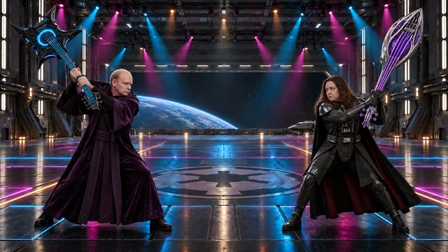</a><figcaption>51A — Серёга и Юля — гитара и бас; целые инструменты перед действием</figcaption></figure>
<figure><a href="references/scenes/scene-51/S51B-own-instrument-setup.png" target="_blank" rel="noopener">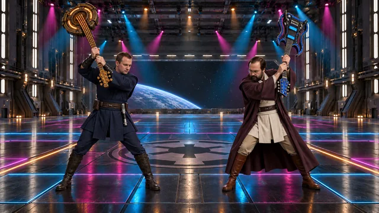</a><figcaption>51B — Паша и Саша — бронзовый бас и кобальтовая гитара; целые инструменты перед действием</figcaption></figure>
<figure><a href="references/scenes/scene-51/S51C-own-instrument-setup.png" target="_blank" rel="noopener">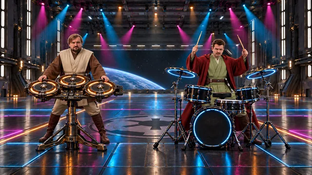</a><figcaption>51C — Артём и Илюша — перкуссия и барабаны; целые инструменты перед действием</figcaption></figure>
<figure><a href="references/scenes/scene-51/S51D-own-instrument-setup.png" target="_blank" rel="noopener">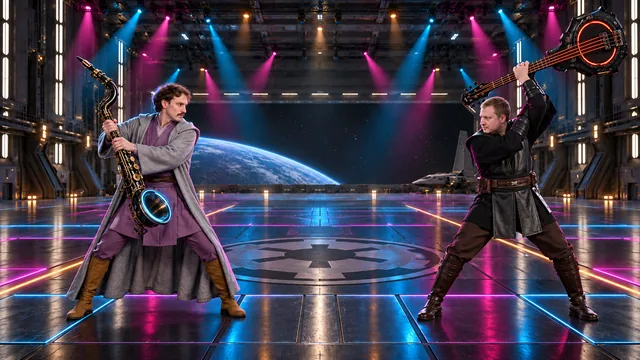</a><figcaption>51D — Лёша и Виталик — духовой синтезатор и тяжёлый бас; целые инструменты перед действием</figcaption></figure>
<figure><a href="references/scenes/scene-51/S51E-own-instrument-setup.png" target="_blank" rel="noopener">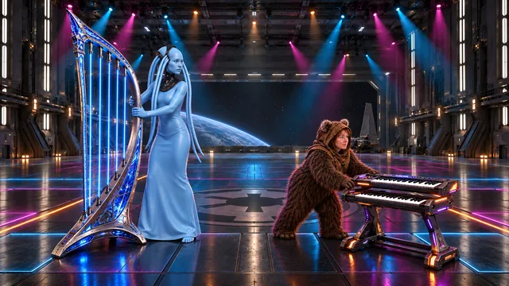</a><figcaption>51E — Маша Лагуна и Алеся — арфа и клавиши; целые инструменты перед действием</figcaption></figure>
<figure><a href="references/scenes/scene-51/S51F-own-instrument-setup.png" target="_blank" rel="noopener">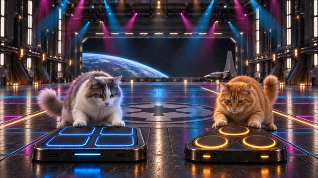</a><figcaption>51F — Лучик и Рыжик — кошачьи музыкальные пэды; целые инструменты перед действием</figcaption></figure>
</div>

<div class="engine-tabs" data-scene="51">

<div class="engine-pane" data-engine="sd20x2" data-main="1" data-duration="6 × 15 с">

### 51A · Серёга и Юля — гитара и бас · 15 с

**Входы:** @Image1 = [H28B-disco](references/scenes/scene-28/H28B-disco.png) · @Image2 = [serega](references/full/serega.jpg) · @Image3 = [yulya](references/full/yulya.jpg) · @Image4 = [S49A-lead-and-bass](references/scenes/scene-49/S49A-lead-and-bass.png) · @Image5 = [S51A-own-instrument-setup](references/scenes/scene-51/S51A-own-instrument-setup.png). Самостоятельная часть; @Video1 не нужен.

```text
Mode: reference-to-video (omni-reference) | Duration: 15s | Resolution: 720p | Aspect ratio: 16:9 | FPS: 24 | Native audio: on
Optimized for Seedance 2.0 | Photoreal live-action rock-concert finale

REFERENCES / IDENTITY:
@Image1 is H28B location/light only. @Image2 controls ONLY the first performer; @Image3 controls ONLY the second. @Image4: assigned instruments only. @Image5 is the intact preparation/ownership pose helper; individual sheets and instrument photos override its facial or prop details. Exactly these two performers, no extra sheet-view copies.
LEFT SEREGA: exact mature face, balding light hair, original build and long deep-purple robe. RIGHT YULIA: exact adult face/build, long chestnut hair, dark armour, gloves and cape.

INSTRUMENT OWNERSHIP:
Serega owns the black spiked SIX-blue-string lead guitar with circular blue core. Yulia owns the slender silver-violet FOUR-string nacelle bass. Keep each prop with its original owner. No exchanges or replacement by a generic guitar.

LOCATION / START:
Exact H28B Imperial disco hangar: graphite ribs, white wall strips, dark satin floor and Imperial medallion, amber guide lanes, cyan/magenta light, rear space opening, parked shuttle deep frame-right. Neutral-white face/fur fill. Start with both performers and their INTACT own instruments in the preparation shown by @Image5; no entrance, replay of the concert or long frozen opening. Separate empty impact lanes with clear space between them; only this pair is foreground. Shoulder straps are already released for swings.

ACTION:
Serega first: both hands wrap the narrow neck near the headstock, headstock below hands, heavy body raised above his shoulder. He drives the BODY in one continuous downward arc into his own empty floor patch; the body visibly splits at contact, blue ring comes loose, strings slacken while the neck stays in his hands. Yulia then performs her own powerful body-first strike with her silver-violet bass, both hands on its narrow neck; its nacelle casing splits and a violet side panel falls. Her bass does not turn into his guitar.
Two successive solo accents: first performer roughly the first six seconds, second performer the next six, then a brief shared reaction. No simultaneous competing impacts. The second performer reacts rhythmically while awaiting their turn; natural connecting movements are free. Committed oversized rock-star energy, solemn concentration rather than mugging. Real-time decisive movement, no slow motion or pauses waiting for an instruction.

CAMERA / PHYSICS:
Medium-wide full-body view showing both performers, their hands/feet, the whole instruments and floor contact zones. A restrained lateral follow can favour the active performer. Keep preparation, contact and resulting breakage visible in one continuous view; no cut or flash conceals the impact. Breakaway stage props fracture only at physical contact, gravity pulls pieces to the floor, persistent debris never reassembles. Separate lanes; no person or animal is struck, no flames or explosion.

END STATE:
Both keep their own broken necks lowered beside them; distinct blue and violet broken bodies remain on their separate floor patches. End after a brief proud deadpan reaction, no long hold.

AUDIO:
Distinct physical impact, casing crack, falling parts and hangar reverb, a short original rock-coda tail. No dialogue, lyrics, recognisable copyrighted melody or crowd cutaway. Final chosen music is added in editing.

NEGATIVE:
Identity drift, swapped props, invisible impact, intact instrument after smash, spontaneous damage, exploding instruments, extra limbs, fused fingers, extra cast, violent fight, slow motion, repeated strikes, fake static zoom, captions or watermark.

FRAME FILL / NO BARS:
Fill the entire generated frame edge-to-edge. No letterboxing, no pillarboxing, no black bars, no side bars, no decorative borders, no empty margins.
```

### 51B · Паша и Саша — бронзовый бас и кобальтовая гитара · 15 с

**Входы:** @Image1 = [H28B-disco](references/scenes/scene-28/H28B-disco.png) · @Image2 = [pasha](references/full/pasha.jpg) · @Image3 = [sasha](references/full/sasha.jpg) · @Image4 = [S49B-rhythm-instruments](references/scenes/scene-49/S49B-rhythm-instruments.png) · @Image5 = [S51B-own-instrument-setup](references/scenes/scene-51/S51B-own-instrument-setup.png). Самостоятельная часть; @Video1 не нужен.

```text
Mode: reference-to-video (omni-reference) | Duration: 15s | Resolution: 720p | Aspect ratio: 16:9 | FPS: 24 | Native audio: on
Optimized for Seedance 2.0 | Photoreal live-action rock-concert finale

REFERENCES / IDENTITY:
@Image1 is H28B location/light only. @Image2 controls ONLY the first performer; @Image3 controls ONLY the second. @Image4: assigned instruments only. @Image5 is the intact preparation/ownership pose helper; individual sheets and instrument photos override its facial or prop details. Exactly these two performers, no extra sheet-view copies.
LEFT PASHA: exact adult face, short hair, navy Jedi tunic and boots. RIGHT SASHA: exact adult face, beard, round spectacles, cream tunic and burgundy-brown robe.

INSTRUMENT OWNERSHIP:
Pasha owns the circular bronze FOUR-amber-string gravibass, LEFT prop in @Image4. Sasha owns the cobalt SIX-string twin-rail rhythm guitar, CENTER prop in @Image4. Do not add its third percussion prop. Keep each prop with its original owner. No exchanges or replacement by a generic guitar.

LOCATION / START:
Exact H28B Imperial disco hangar: graphite ribs, white wall strips, dark satin floor and Imperial medallion, amber guide lanes, cyan/magenta light, rear space opening, parked shuttle deep frame-right. Neutral-white face/fur fill. Start with both performers and their INTACT own instruments in the preparation shown by @Image5; no entrance, replay of the concert or long frozen opening. Separate empty impact lanes with clear space between them; only this pair is foreground. Shoulder straps are already released for swings.

ACTION:
Pasha first: both hands clasp the narrow neck near the headstock, heavy circular body raised above his shoulder. He swings BODY-FIRST into his own empty floor patch; the bronze resonator casing cracks into large connected pieces, the amber strings go slack. Sasha then gives his own cobalt guitar a decisive body-first floor strike using the same two-handed neck grip; its two blue body rails break away from the central body. Each headstock stays below his hands through the wind-up; no strumming grip during a smash.
Two successive solo accents: first performer roughly the first six seconds, second performer the next six, then a brief shared reaction. No simultaneous competing impacts. The second performer reacts rhythmically while awaiting their turn; natural connecting movements are free. Committed oversized rock-star energy, solemn concentration rather than mugging. Real-time decisive movement, no slow motion or pauses waiting for an instruction.

CAMERA / PHYSICS:
Medium-wide full-body view showing both performers, their hands/feet, the whole instruments and floor contact zones. A restrained lateral follow can favour the active performer. Keep preparation, contact and resulting breakage visible in one continuous view; no cut or flash conceals the impact. Breakaway stage props fracture only at physical contact, gravity pulls pieces to the floor, persistent debris never reassembles. Separate lanes; no person or animal is struck, no flames or explosion.

END STATE:
Pasha and Sasha stand over two distinct broken instruments, each retaining only his own neck, with bronze pieces left and cobalt pieces right. End after a brief proud deadpan reaction, no long hold.

AUDIO:
Distinct physical impact, casing crack, falling parts and hangar reverb, a short original rock-coda tail. No dialogue, lyrics, recognisable copyrighted melody or crowd cutaway. Final chosen music is added in editing.

NEGATIVE:
Identity drift, swapped props, invisible impact, intact instrument after smash, spontaneous damage, exploding instruments, extra limbs, fused fingers, extra cast, violent fight, slow motion, repeated strikes, fake static zoom, captions or watermark.

FRAME FILL / NO BARS:
Fill the entire generated frame edge-to-edge. No letterboxing, no pillarboxing, no black bars, no side bars, no decorative borders, no empty margins.
```

### 51C · Артём и Илюша — перкуссия и барабаны · 15 с

**Входы:** @Image1 = [H28B-disco](references/scenes/scene-28/H28B-disco.png) · @Image2 = [artem](references/full/artem.jpg) · @Image3 = [ilyusha](references/full/ilyusha.jpg) · @Image4 = [S49B-rhythm-instruments](references/scenes/scene-49/S49B-rhythm-instruments.png) · @Image5 = [S49C-drums-wind-bass](references/scenes/scene-49/S49C-drums-wind-bass.png) · @Image6 = [S51C-own-instrument-setup](references/scenes/scene-51/S51C-own-instrument-setup.png). Самостоятельная часть; @Video1 не нужен.

```text
Mode: reference-to-video (omni-reference) | Duration: 15s | Resolution: 720p | Aspect ratio: 16:9 | FPS: 24 | Native audio: on
Optimized for Seedance 2.0 | Photoreal live-action rock-concert finale

REFERENCES / IDENTITY:
@Image1 is H28B location/light only. @Image2 controls ONLY the first performer; @Image3 controls ONLY the second. @Image4: assigned instruments only. @Image5: assigned instruments only. @Image6 is the intact preparation/ownership pose helper; individual sheets and instrument photos override its facial or prop details. Exactly these two performers, no extra sheet-view copies.
LEFT ARTEM: exact stocky adult face/build, light-brown hair/beard, beige-and-brown Jedi clothes. RIGHT ILYUSHA: exact adult face, moustache, tousled brown hair, olive-green tunic and deep-red cloak.

INSTRUMENT OWNERSHIP:
Artem owns ONLY the THREE amber-ring percussion console at RIGHT of @Image4, tripod and two short sticks. Ilyusha owns ONLY the compact black/blue drum kit at CENTER of @Image5: kick drum, toms/snare and TWO blue-ring cymbals. Other props in those sheets are not present. Keep each prop with its original owner. No exchanges or replacement by a generic guitar.

LOCATION / START:
Exact H28B Imperial disco hangar: graphite ribs, white wall strips, dark satin floor and Imperial medallion, amber guide lanes, cyan/magenta light, rear space opening, parked shuttle deep frame-right. Neutral-white face/fur fill. Start with both performers and their INTACT own instruments in the preparation shown by @Image6; no entrance, replay of the concert or long frozen opening. Separate empty impact lanes with clear space between them; only this pair is foreground. Shoulder straps are already released for swings.

ACTION:
Artem first: with his sticks already set aside, both hands push the solid outer console frame away from him. Its tripod pivots forward; the ring assembly hits the empty floor visibly, breaking the support frame and dislodging two amber ring pads. Ilyusha then delivers an emphatic two-stick final snare hit that visibly tears the drumhead. He rises into a forward boot shove against his OWN kick-drum shell; the kit falls forward away from him, a drum shell splits and its own cymbal stands fold down. Show the hand/foot contacts that cause the collapse. No guitar appears and no damage happens before contact.
Two successive solo accents: first performer roughly the first six seconds, second performer the next six, then a brief shared reaction. No simultaneous competing impacts. The second performer reacts rhythmically while awaiting their turn; natural connecting movements are free. Committed oversized rock-star energy, solemn concentration rather than mugging. Real-time decisive movement, no slow motion or pauses waiting for an instruction.

CAMERA / PHYSICS:
Medium-wide full-body view showing both performers, their hands/feet, the whole instruments and floor contact zones. A restrained lateral follow can favour the active performer. Keep preparation, contact and resulting breakage visible in one continuous view; no cut or flash conceals the impact. Breakaway stage props fracture only at physical contact, gravity pulls pieces to the floor, persistent debris never reassembles. Separate lanes; no person or animal is struck, no flames or explosion.

END STATE:
The three-ring console is broken on the left; Ilyusha's collapsed drum kit on the right has a torn head, split shell and fallen stands. Both musicians remain upright behind their own equipment. End after a brief proud deadpan reaction, no long hold.

AUDIO:
Distinct physical impact, casing crack, falling parts and hangar reverb, a short original rock-coda tail. No dialogue, lyrics, recognisable copyrighted melody or crowd cutaway. Final chosen music is added in editing.

NEGATIVE:
Identity drift, swapped props, invisible impact, intact instrument after smash, spontaneous damage, exploding instruments, extra limbs, fused fingers, extra cast, violent fight, slow motion, repeated strikes, fake static zoom, captions or watermark.

FRAME FILL / NO BARS:
Fill the entire generated frame edge-to-edge. No letterboxing, no pillarboxing, no black bars, no side bars, no decorative borders, no empty margins.
```

### 51D · Лёша и Виталик — духовой синтезатор и тяжёлый бас · 15 с

**Входы:** @Image1 = [H28B-disco](references/scenes/scene-28/H28B-disco.png) · @Image2 = [lesha](references/full/lesha.jpg) · @Image3 = [vitalik](references/full/vitalik.jpg) · @Image4 = [S49C-drums-wind-bass](references/scenes/scene-49/S49C-drums-wind-bass.png) · @Image5 = [S51D-own-instrument-setup](references/scenes/scene-51/S51D-own-instrument-setup.png). Самостоятельная часть; @Video1 не нужен.

```text
Mode: reference-to-video (omni-reference) | Duration: 15s | Resolution: 720p | Aspect ratio: 16:9 | FPS: 24 | Native audio: on
Optimized for Seedance 2.0 | Photoreal live-action rock-concert finale

REFERENCES / IDENTITY:
@Image1 is H28B location/light only. @Image2 controls ONLY the first performer; @Image3 controls ONLY the second. @Image4: assigned instruments only. @Image5 is the intact preparation/ownership pose helper; individual sheets and instrument photos override its facial or prop details. Exactly these two performers, no extra sheet-view copies.
LEFT LESHA: exact slim adult face, moustache, purple inner tunic, long grey robe and pale boots. RIGHT VITALIK: exact sturdy adult face/build, black tunic/leather panels, brown trousers and tall boots.

INSTRUMENT OWNERSHIP:
Lesha owns the black/brass curved wind synthesizer with turquoise-ring bell, LEFT in @Image4. Vitalik owns the large black bass with FOUR orange-red strings and circular sub-bass resonator, RIGHT in @Image4. The drum kit in the prop sheet is absent. Keep each prop with its original owner. No exchanges or replacement by a generic guitar.

LOCATION / START:
Exact H28B Imperial disco hangar: graphite ribs, white wall strips, dark satin floor and Imperial medallion, amber guide lanes, cyan/magenta light, rear space opening, parked shuttle deep frame-right. Neutral-white face/fur fill. Start with both performers and their INTACT own instruments in the preparation shown by @Image5; no entrance, replay of the concert or long frozen opening. Separate empty impact lanes with clear space between them; only this pair is foreground. Shoulder straps are already released for swings.

ACTION:
Lesha first: mouthpiece is clear of his face and neck strap released. Both hands grip the solid upper tube; he drives its bell end down onto his own empty floor patch. The bell visibly buckles on contact and its tube breaks at the curved joint, leaving a recognisable black/brass wreck and loose turquoise ring. Vitalik then swings his OWN bass body-first into his separate floor patch, both hands around the narrow neck near the headstock. Its heavy black resonator casing splits and an orange-red ring section falls; the neck remains in his hands.
Two successive solo accents: first performer roughly the first six seconds, second performer the next six, then a brief shared reaction. No simultaneous competing impacts. The second performer reacts rhythmically while awaiting their turn; natural connecting movements are free. Committed oversized rock-star energy, solemn concentration rather than mugging. Real-time decisive movement, no slow motion or pauses waiting for an instruction.

CAMERA / PHYSICS:
Medium-wide full-body view showing both performers, their hands/feet, the whole instruments and floor contact zones. A restrained lateral follow can favour the active performer. Keep preparation, contact and resulting breakage visible in one continuous view; no cut or flash conceals the impact. Breakaway stage props fracture only at physical contact, gravity pulls pieces to the floor, persistent debris never reassembles. Separate lanes; no person or animal is struck, no flames or explosion.

END STATE:
Lesha lowers the broken upper tube; Vitalik lowers his broken bass neck. Their differently coloured wrecks stay separate on the floor. End after a brief proud deadpan reaction, no long hold.

AUDIO:
Distinct physical impact, casing crack, falling parts and hangar reverb, a short original rock-coda tail. No dialogue, lyrics, recognisable copyrighted melody or crowd cutaway. Final chosen music is added in editing.

NEGATIVE:
Identity drift, swapped props, invisible impact, intact instrument after smash, spontaneous damage, exploding instruments, extra limbs, fused fingers, extra cast, violent fight, slow motion, repeated strikes, fake static zoom, captions or watermark.

FRAME FILL / NO BARS:
Fill the entire generated frame edge-to-edge. No letterboxing, no pillarboxing, no black bars, no side bars, no decorative borders, no empty margins.
```

### 51E · Маша Лагуна и Алеся — арфа и клавиши · 15 с

**Входы:** @Image1 = [H28B-disco](references/scenes/scene-28/H28B-disco.png) · @Image2 = [masha-laguna](references/masha-laguna.webp) · @Image3 = [Ale28-Alesya-model-sheet](references/scenes/scene-28/Ale28-Alesya-model-sheet.png) · @Image4 = [S49D-harp-small-synth](references/scenes/scene-49/S49D-harp-small-synth.png) · @Image5 = [S51E-own-instrument-setup](references/scenes/scene-51/S51E-own-instrument-setup.png). Самостоятельная часть; @Video1 не нужен.

```text
Mode: reference-to-video (omni-reference) | Duration: 15s | Resolution: 720p | Aspect ratio: 16:9 | FPS: 24 | Native audio: on
Optimized for Seedance 2.0 | Photoreal live-action rock-concert finale

REFERENCES / IDENTITY:
@Image1 is H28B location/light only. @Image2 controls ONLY the first performer; @Image3 controls ONLY the second. @Image4: assigned instruments only. @Image5 is the intact preparation/ownership pose helper; individual sheets and instrument photos override its facial or prop details. Exactly these two performers, no extra sheet-view copies.
LEFT MASHA LAGUNA: exact blue adult humanoid face and long pale-blue head tentacles, dark head/collar details, fully opaque smooth blue full-length costume. RIGHT ALESYA: approximately one-metre-tall brown-furred Ewok body with round ears and hood, exact approved ADULT human female face, no spear. Preserve the adult/one-metre height ratio; no child or full-height Alesya.

INSTRUMENT OWNERSHIP:
Masha owns the tall silver-blue crystalline harp with SIX anchored strings. Alesya owns the SMALL two-tier amber/violet keyboard on its LOW stand; top keys below her chest. No ordinary full-size piano. Keep each prop with its original owner. No exchanges or replacement by a generic guitar.

LOCATION / START:
Exact H28B Imperial disco hangar: graphite ribs, white wall strips, dark satin floor and Imperial medallion, amber guide lanes, cyan/magenta light, rear space opening, parked shuttle deep frame-right. Neutral-white face/fur fill. Start with both performers and their INTACT own instruments in the preparation shown by @Image5; no entrance, replay of the concert or long frozen opening. Separate empty impact lanes with clear space between them; only this pair is foreground. Shoulder straps are already released for swings.

ACTION:
Masha first: both hands grip her harp's solid outer frame, not its strings. She tips and drives the harp sideways AWAY from her into clear floor. Show the curved frame hitting first, cracking into two large pieces and releasing the six strings into slack strands; this is visible breakage, not simply lying an intact harp down. Alesya then plants her furry feet and gives her OWN low keyboard stand a vigorous two-handed forward shove. Both tiers tip together away from her; their housings hit the floor, split open and scatter several keys. She stays one metre tall and never lifts an adult-size piano overhead.
Two successive solo accents: first performer roughly the first six seconds, second performer the next six, then a brief shared reaction. No simultaneous competing impacts. The second performer reacts rhythmically while awaiting their turn; natural connecting movements are free. Committed oversized rock-star energy, solemn concentration rather than mugging. Real-time decisive movement, no slow motion or pauses waiting for an instruction.

CAMERA / PHYSICS:
Medium-wide full-body view showing both performers, their hands/feet, the whole instruments and floor contact zones. A restrained lateral follow can favour the active performer. Keep preparation, contact and resulting breakage visible in one continuous view; no cut or flash conceals the impact. Breakaway stage props fracture only at physical contact, gravity pulls pieces to the floor, persistent debris never reassembles. Separate lanes; no person or animal is struck, no flames or explosion.

END STATE:
Masha and Alesya stand behind their own clearly broken harp and keyboard; loose strings, split cases and fallen keys remain visible. End after a brief proud deadpan reaction, no long hold.

AUDIO:
Distinct physical impact, casing crack, falling parts and hangar reverb, a short original rock-coda tail. No dialogue, lyrics, recognisable copyrighted melody or crowd cutaway. Final chosen music is added in editing.

NEGATIVE:
Identity drift, swapped props, invisible impact, intact instrument after smash, spontaneous damage, exploding instruments, extra limbs, fused fingers, extra cast, violent fight, slow motion, repeated strikes, fake static zoom, captions or watermark.

FRAME FILL / NO BARS:
Fill the entire generated frame edge-to-edge. No letterboxing, no pillarboxing, no black bars, no side bars, no decorative borders, no empty margins.
```

### 51F · Лучик и Рыжик — кошачьи музыкальные пэды · 15 с

**Входы:** @Image1 = [H28B-disco](references/scenes/scene-28/H28B-disco.png) · @Image2 = [luchik](references/luchik.jpg) · @Image3 = [ryzhik](references/ryzhik.jpg) · @Image4 = [S49E-cat-paw-controllers](references/scenes/scene-49/S49E-cat-paw-controllers.png) · @Image5 = [S51F-own-instrument-setup](references/scenes/scene-51/S51F-own-instrument-setup.png). Самостоятельная часть; @Video1 не нужен.

```text
Mode: reference-to-video (omni-reference) | Duration: 15s | Resolution: 720p | Aspect ratio: 16:9 | FPS: 24 | Native audio: on
Optimized for Seedance 2.0 | Photoreal live-action rock-concert finale

REFERENCES / IDENTITY:
@Image1 is H28B location/light only. @Image2 controls ONLY the first performer; @Image3 controls ONLY the second. @Image4: assigned instruments only. @Image5 is the intact preparation/ownership pose helper; individual sheets and instrument photos override its facial or prop details. Exactly these two performers, no extra sheet-view copies.
LEFT LUCHIK: exact long white-grey fur pattern, white muzzle/chest/paws and grey crown/back. RIGHT RYZHIK: exact long orange tabby coat, darker stripes and pale chest. Both real domestic-sized quadruped cats, natural paws and tails, no clothes, human hands, upright humanoid posture or lightsabers. Identity sheets control fur/faces only, not their upright source pose.

INSTRUMENT OWNERSHIP:
Luchik owns ONLY the low black controller with FOUR BLUE square pads in a 2x2 grid. Ryzhik owns ONLY the separate low black controller with THREE AMBER circular pads. Each is about a cat's body length. Lightweight breakaway stage housings, not indestructible metal blocks. Keep each prop with its original owner. No exchanges or replacement by a generic guitar.

LOCATION / START:
Exact H28B Imperial disco hangar: graphite ribs, white wall strips, dark satin floor and Imperial medallion, amber guide lanes, cyan/magenta light, rear space opening, parked shuttle deep frame-right. Neutral-white face/fur fill. Start with both performers and their INTACT own instruments in the preparation shown by @Image5; no entrance, replay of the concert or long frozen opening. Separate empty impact lanes with clear space between them; only this pair is foreground. Shoulder straps are already released for swings.

ACTION:
Luchik first: from a natural four-legged crouch he makes a short forceful forward pounce, both front paws landing on his OWN blue controller. The lid visibly caves and splits along its seam at paw contact; two blue pad plates pop loose to the sides. He steps back onto clear floor. Ryzhik then gives his OWN amber controller a separate short pounce and emphatic two-paw shove; its rim cracks, three-pad lid separates from the housing and one amber pad rolls a short distance. Keep all motion recognisably feline. The broken housings stay visibly broken; merely switching lights off does not fulfil the action.
Two successive solo accents: first performer roughly the first six seconds, second performer the next six, then a brief shared reaction. No simultaneous competing impacts. The second performer reacts rhythmically while awaiting their turn; natural connecting movements are free. Committed oversized rock-star energy, solemn concentration rather than mugging. Real-time decisive movement, no slow motion or pauses waiting for an instruction.

CAMERA / PHYSICS:
Low cat-eye-level medium-wide shot showing all paws and both controllers. A restrained lateral follow can favour the active performer. Keep preparation, contact and resulting breakage visible in one continuous view; no cut or flash conceals the impact. Breakaway stage props fracture only at physical contact, gravity pulls pieces to the floor, persistent debris never reassembles. Separate lanes; no person or animal is struck, no flames or explosion.

END STATE:
Both cats remain unharmed and quadrupedal behind their own visibly broken blue and amber controllers, alert and solemn; a tiny self-satisfied tail flick closes the joke. End after a brief proud deadpan reaction, no long hold.

AUDIO:
Distinct physical impact, casing crack, falling parts and hangar reverb, a short original rock-coda tail. No dialogue, lyrics, recognisable copyrighted melody or crowd cutaway. Final chosen music is added in editing.

NEGATIVE:
Identity drift, swapped props, invisible impact, intact instrument after smash, spontaneous damage, exploding instruments, extra limbs, fused fingers, extra cast, violent fight, slow motion, repeated strikes, fake static zoom, captions or watermark.

FRAME FILL / NO BARS:
Fill the entire generated frame edge-to-edge. No letterboxing, no pillarboxing, no black bars, no side bars, no decorative borders, no empty margins.
```

</div>

<div class="engine-pane" data-engine="wan30" data-duration="6 × 30 с">

**Альтернативы, не дополнительные запуски:** те же пары и те же результаты, больше времени на подготовку и реакцию.

#### 51 · Wan 3.0 часть 1 · Серёга и Юля — гитара и бас · 30 с

**Входы:** @Image1 = [H28B-disco](references/scenes/scene-28/H28B-disco.png) · @Image2 = [serega](references/full/serega.jpg) · @Image3 = [yulya](references/full/yulya.jpg) · @Image4 = [S49A-lead-and-bass](references/scenes/scene-49/S49A-lead-and-bass.png) · @Image5 = [S51A-own-instrument-setup](references/scenes/scene-51/S51A-own-instrument-setup.png).

```text
Mode: reference-to-video (omni-reference) | Duration: 30s | Resolution: 720p | Aspect ratio: 16:9 | FPS: 24 | Native audio: on
Optimized for Wan 3.0 | Photoreal live-action rock-concert finale

REFERENCES / IDENTITY:
@Image1 is H28B location/light only. @Image2 controls ONLY the first performer; @Image3 controls ONLY the second. @Image4: assigned instruments only. @Image5 is the intact preparation/ownership pose helper; individual sheets and instrument photos override its facial or prop details. Exactly these two performers, no extra sheet-view copies.
LEFT SEREGA: exact mature face, balding light hair, original build and long deep-purple robe. RIGHT YULIA: exact adult face/build, long chestnut hair, dark armour, gloves and cape.

INSTRUMENT OWNERSHIP:
Serega owns the black spiked SIX-blue-string lead guitar with circular blue core. Yulia owns the slender silver-violet FOUR-string nacelle bass. Keep each prop with its original owner. No exchanges or replacement by a generic guitar.

LOCATION / START:
Exact H28B Imperial disco hangar: graphite ribs, white wall strips, dark satin floor and Imperial medallion, amber guide lanes, cyan/magenta light, rear space opening, parked shuttle deep frame-right. Neutral-white face/fur fill. Start with both performers and their INTACT own instruments in the preparation shown by @Image5; no entrance, replay of the concert or long frozen opening. Separate empty impact lanes with clear space between them; only this pair is foreground. Shoulder straps are already released for swings.

ACTION:
Serega first: both hands wrap the narrow neck near the headstock, headstock below hands, heavy body raised above his shoulder. He drives the BODY in one continuous downward arc into his own empty floor patch; the body visibly splits at contact, blue ring comes loose, strings slacken while the neck stays in his hands. Yulia then performs her own powerful body-first strike with her silver-violet bass, both hands on its narrow neck; its nacelle casing splits and a violet side panel falls. Her bass does not turn into his guitar.
Give each performer a complete, unhurried but energetic preparation, impact and reaction in turn. Allow roughly twelve seconds each, then a short shared reaction; use extra time for expressive performance, not extra smashes or slow motion. The second performer reacts rhythmically while awaiting their turn; natural connecting movements are free. Committed oversized rock-star energy, solemn concentration rather than mugging. Real-time decisive movement, no slow motion or pauses waiting for an instruction.

CAMERA / PHYSICS:
Medium-wide full-body view showing both performers, their hands/feet, the whole instruments and floor contact zones. A restrained lateral follow can favour the active performer. Keep preparation, contact and resulting breakage visible in one continuous view; no cut or flash conceals the impact. Breakaway stage props fracture only at physical contact, gravity pulls pieces to the floor, persistent debris never reassembles. Separate lanes; no person or animal is struck, no flames or explosion.

END STATE:
Both keep their own broken necks lowered beside them; distinct blue and violet broken bodies remain on their separate floor patches. End after a brief proud deadpan reaction, no long hold.

AUDIO:
Distinct physical impact, casing crack, falling parts and hangar reverb, a short original rock-coda tail. No dialogue, lyrics, recognisable copyrighted melody or crowd cutaway. Final chosen music is added in editing.

NEGATIVE:
Identity drift, swapped props, invisible impact, intact instrument after smash, spontaneous damage, exploding instruments, extra limbs, fused fingers, extra cast, violent fight, slow motion, repeated strikes, fake static zoom, captions or watermark.

FRAME FILL / NO BARS:
Fill the entire generated frame edge-to-edge. No letterboxing, no pillarboxing, no black bars, no side bars, no decorative borders, no empty margins.
```

#### 51 · Wan 3.0 часть 2 · Паша и Саша — бронзовый бас и кобальтовая гитара · 30 с

**Входы:** @Image1 = [H28B-disco](references/scenes/scene-28/H28B-disco.png) · @Image2 = [pasha](references/full/pasha.jpg) · @Image3 = [sasha](references/full/sasha.jpg) · @Image4 = [S49B-rhythm-instruments](references/scenes/scene-49/S49B-rhythm-instruments.png) · @Image5 = [S51B-own-instrument-setup](references/scenes/scene-51/S51B-own-instrument-setup.png).

```text
Mode: reference-to-video (omni-reference) | Duration: 30s | Resolution: 720p | Aspect ratio: 16:9 | FPS: 24 | Native audio: on
Optimized for Wan 3.0 | Photoreal live-action rock-concert finale

REFERENCES / IDENTITY:
@Image1 is H28B location/light only. @Image2 controls ONLY the first performer; @Image3 controls ONLY the second. @Image4: assigned instruments only. @Image5 is the intact preparation/ownership pose helper; individual sheets and instrument photos override its facial or prop details. Exactly these two performers, no extra sheet-view copies.
LEFT PASHA: exact adult face, short hair, navy Jedi tunic and boots. RIGHT SASHA: exact adult face, beard, round spectacles, cream tunic and burgundy-brown robe.

INSTRUMENT OWNERSHIP:
Pasha owns the circular bronze FOUR-amber-string gravibass, LEFT prop in @Image4. Sasha owns the cobalt SIX-string twin-rail rhythm guitar, CENTER prop in @Image4. Do not add its third percussion prop. Keep each prop with its original owner. No exchanges or replacement by a generic guitar.

LOCATION / START:
Exact H28B Imperial disco hangar: graphite ribs, white wall strips, dark satin floor and Imperial medallion, amber guide lanes, cyan/magenta light, rear space opening, parked shuttle deep frame-right. Neutral-white face/fur fill. Start with both performers and their INTACT own instruments in the preparation shown by @Image5; no entrance, replay of the concert or long frozen opening. Separate empty impact lanes with clear space between them; only this pair is foreground. Shoulder straps are already released for swings.

ACTION:
Pasha first: both hands clasp the narrow neck near the headstock, heavy circular body raised above his shoulder. He swings BODY-FIRST into his own empty floor patch; the bronze resonator casing cracks into large connected pieces, the amber strings go slack. Sasha then gives his own cobalt guitar a decisive body-first floor strike using the same two-handed neck grip; its two blue body rails break away from the central body. Each headstock stays below his hands through the wind-up; no strumming grip during a smash.
Give each performer a complete, unhurried but energetic preparation, impact and reaction in turn. Allow roughly twelve seconds each, then a short shared reaction; use extra time for expressive performance, not extra smashes or slow motion. The second performer reacts rhythmically while awaiting their turn; natural connecting movements are free. Committed oversized rock-star energy, solemn concentration rather than mugging. Real-time decisive movement, no slow motion or pauses waiting for an instruction.

CAMERA / PHYSICS:
Medium-wide full-body view showing both performers, their hands/feet, the whole instruments and floor contact zones. A restrained lateral follow can favour the active performer. Keep preparation, contact and resulting breakage visible in one continuous view; no cut or flash conceals the impact. Breakaway stage props fracture only at physical contact, gravity pulls pieces to the floor, persistent debris never reassembles. Separate lanes; no person or animal is struck, no flames or explosion.

END STATE:
Pasha and Sasha stand over two distinct broken instruments, each retaining only his own neck, with bronze pieces left and cobalt pieces right. End after a brief proud deadpan reaction, no long hold.

AUDIO:
Distinct physical impact, casing crack, falling parts and hangar reverb, a short original rock-coda tail. No dialogue, lyrics, recognisable copyrighted melody or crowd cutaway. Final chosen music is added in editing.

NEGATIVE:
Identity drift, swapped props, invisible impact, intact instrument after smash, spontaneous damage, exploding instruments, extra limbs, fused fingers, extra cast, violent fight, slow motion, repeated strikes, fake static zoom, captions or watermark.

FRAME FILL / NO BARS:
Fill the entire generated frame edge-to-edge. No letterboxing, no pillarboxing, no black bars, no side bars, no decorative borders, no empty margins.
```

#### 51 · Wan 3.0 часть 3 · Артём и Илюша — перкуссия и барабаны · 30 с

**Входы:** @Image1 = [H28B-disco](references/scenes/scene-28/H28B-disco.png) · @Image2 = [artem](references/full/artem.jpg) · @Image3 = [ilyusha](references/full/ilyusha.jpg) · @Image4 = [S49B-rhythm-instruments](references/scenes/scene-49/S49B-rhythm-instruments.png) · @Image5 = [S49C-drums-wind-bass](references/scenes/scene-49/S49C-drums-wind-bass.png) · @Image6 = [S51C-own-instrument-setup](references/scenes/scene-51/S51C-own-instrument-setup.png).

```text
Mode: reference-to-video (omni-reference) | Duration: 30s | Resolution: 720p | Aspect ratio: 16:9 | FPS: 24 | Native audio: on
Optimized for Wan 3.0 | Photoreal live-action rock-concert finale

REFERENCES / IDENTITY:
@Image1 is H28B location/light only. @Image2 controls ONLY the first performer; @Image3 controls ONLY the second. @Image4: assigned instruments only. @Image5: assigned instruments only. @Image6 is the intact preparation/ownership pose helper; individual sheets and instrument photos override its facial or prop details. Exactly these two performers, no extra sheet-view copies.
LEFT ARTEM: exact stocky adult face/build, light-brown hair/beard, beige-and-brown Jedi clothes. RIGHT ILYUSHA: exact adult face, moustache, tousled brown hair, olive-green tunic and deep-red cloak.

INSTRUMENT OWNERSHIP:
Artem owns ONLY the THREE amber-ring percussion console at RIGHT of @Image4, tripod and two short sticks. Ilyusha owns ONLY the compact black/blue drum kit at CENTER of @Image5: kick drum, toms/snare and TWO blue-ring cymbals. Other props in those sheets are not present. Keep each prop with its original owner. No exchanges or replacement by a generic guitar.

LOCATION / START:
Exact H28B Imperial disco hangar: graphite ribs, white wall strips, dark satin floor and Imperial medallion, amber guide lanes, cyan/magenta light, rear space opening, parked shuttle deep frame-right. Neutral-white face/fur fill. Start with both performers and their INTACT own instruments in the preparation shown by @Image6; no entrance, replay of the concert or long frozen opening. Separate empty impact lanes with clear space between them; only this pair is foreground. Shoulder straps are already released for swings.

ACTION:
Artem first: with his sticks already set aside, both hands push the solid outer console frame away from him. Its tripod pivots forward; the ring assembly hits the empty floor visibly, breaking the support frame and dislodging two amber ring pads. Ilyusha then delivers an emphatic two-stick final snare hit that visibly tears the drumhead. He rises into a forward boot shove against his OWN kick-drum shell; the kit falls forward away from him, a drum shell splits and its own cymbal stands fold down. Show the hand/foot contacts that cause the collapse. No guitar appears and no damage happens before contact.
Give each performer a complete, unhurried but energetic preparation, impact and reaction in turn. Allow roughly twelve seconds each, then a short shared reaction; use extra time for expressive performance, not extra smashes or slow motion. The second performer reacts rhythmically while awaiting their turn; natural connecting movements are free. Committed oversized rock-star energy, solemn concentration rather than mugging. Real-time decisive movement, no slow motion or pauses waiting for an instruction.

CAMERA / PHYSICS:
Medium-wide full-body view showing both performers, their hands/feet, the whole instruments and floor contact zones. A restrained lateral follow can favour the active performer. Keep preparation, contact and resulting breakage visible in one continuous view; no cut or flash conceals the impact. Breakaway stage props fracture only at physical contact, gravity pulls pieces to the floor, persistent debris never reassembles. Separate lanes; no person or animal is struck, no flames or explosion.

END STATE:
The three-ring console is broken on the left; Ilyusha's collapsed drum kit on the right has a torn head, split shell and fallen stands. Both musicians remain upright behind their own equipment. End after a brief proud deadpan reaction, no long hold.

AUDIO:
Distinct physical impact, casing crack, falling parts and hangar reverb, a short original rock-coda tail. No dialogue, lyrics, recognisable copyrighted melody or crowd cutaway. Final chosen music is added in editing.

NEGATIVE:
Identity drift, swapped props, invisible impact, intact instrument after smash, spontaneous damage, exploding instruments, extra limbs, fused fingers, extra cast, violent fight, slow motion, repeated strikes, fake static zoom, captions or watermark.

FRAME FILL / NO BARS:
Fill the entire generated frame edge-to-edge. No letterboxing, no pillarboxing, no black bars, no side bars, no decorative borders, no empty margins.
```

#### 51 · Wan 3.0 часть 4 · Лёша и Виталик — духовой синтезатор и тяжёлый бас · 30 с

**Входы:** @Image1 = [H28B-disco](references/scenes/scene-28/H28B-disco.png) · @Image2 = [lesha](references/full/lesha.jpg) · @Image3 = [vitalik](references/full/vitalik.jpg) · @Image4 = [S49C-drums-wind-bass](references/scenes/scene-49/S49C-drums-wind-bass.png) · @Image5 = [S51D-own-instrument-setup](references/scenes/scene-51/S51D-own-instrument-setup.png).

```text
Mode: reference-to-video (omni-reference) | Duration: 30s | Resolution: 720p | Aspect ratio: 16:9 | FPS: 24 | Native audio: on
Optimized for Wan 3.0 | Photoreal live-action rock-concert finale

REFERENCES / IDENTITY:
@Image1 is H28B location/light only. @Image2 controls ONLY the first performer; @Image3 controls ONLY the second. @Image4: assigned instruments only. @Image5 is the intact preparation/ownership pose helper; individual sheets and instrument photos override its facial or prop details. Exactly these two performers, no extra sheet-view copies.
LEFT LESHA: exact slim adult face, moustache, purple inner tunic, long grey robe and pale boots. RIGHT VITALIK: exact sturdy adult face/build, black tunic/leather panels, brown trousers and tall boots.

INSTRUMENT OWNERSHIP:
Lesha owns the black/brass curved wind synthesizer with turquoise-ring bell, LEFT in @Image4. Vitalik owns the large black bass with FOUR orange-red strings and circular sub-bass resonator, RIGHT in @Image4. The drum kit in the prop sheet is absent. Keep each prop with its original owner. No exchanges or replacement by a generic guitar.

LOCATION / START:
Exact H28B Imperial disco hangar: graphite ribs, white wall strips, dark satin floor and Imperial medallion, amber guide lanes, cyan/magenta light, rear space opening, parked shuttle deep frame-right. Neutral-white face/fur fill. Start with both performers and their INTACT own instruments in the preparation shown by @Image5; no entrance, replay of the concert or long frozen opening. Separate empty impact lanes with clear space between them; only this pair is foreground. Shoulder straps are already released for swings.

ACTION:
Lesha first: mouthpiece is clear of his face and neck strap released. Both hands grip the solid upper tube; he drives its bell end down onto his own empty floor patch. The bell visibly buckles on contact and its tube breaks at the curved joint, leaving a recognisable black/brass wreck and loose turquoise ring. Vitalik then swings his OWN bass body-first into his separate floor patch, both hands around the narrow neck near the headstock. Its heavy black resonator casing splits and an orange-red ring section falls; the neck remains in his hands.
Give each performer a complete, unhurried but energetic preparation, impact and reaction in turn. Allow roughly twelve seconds each, then a short shared reaction; use extra time for expressive performance, not extra smashes or slow motion. The second performer reacts rhythmically while awaiting their turn; natural connecting movements are free. Committed oversized rock-star energy, solemn concentration rather than mugging. Real-time decisive movement, no slow motion or pauses waiting for an instruction.

CAMERA / PHYSICS:
Medium-wide full-body view showing both performers, their hands/feet, the whole instruments and floor contact zones. A restrained lateral follow can favour the active performer. Keep preparation, contact and resulting breakage visible in one continuous view; no cut or flash conceals the impact. Breakaway stage props fracture only at physical contact, gravity pulls pieces to the floor, persistent debris never reassembles. Separate lanes; no person or animal is struck, no flames or explosion.

END STATE:
Lesha lowers the broken upper tube; Vitalik lowers his broken bass neck. Their differently coloured wrecks stay separate on the floor. End after a brief proud deadpan reaction, no long hold.

AUDIO:
Distinct physical impact, casing crack, falling parts and hangar reverb, a short original rock-coda tail. No dialogue, lyrics, recognisable copyrighted melody or crowd cutaway. Final chosen music is added in editing.

NEGATIVE:
Identity drift, swapped props, invisible impact, intact instrument after smash, spontaneous damage, exploding instruments, extra limbs, fused fingers, extra cast, violent fight, slow motion, repeated strikes, fake static zoom, captions or watermark.

FRAME FILL / NO BARS:
Fill the entire generated frame edge-to-edge. No letterboxing, no pillarboxing, no black bars, no side bars, no decorative borders, no empty margins.
```

#### 51 · Wan 3.0 часть 5 · Маша Лагуна и Алеся — арфа и клавиши · 30 с

**Входы:** @Image1 = [H28B-disco](references/scenes/scene-28/H28B-disco.png) · @Image2 = [masha-laguna](references/masha-laguna.webp) · @Image3 = [Ale28-Alesya-model-sheet](references/scenes/scene-28/Ale28-Alesya-model-sheet.png) · @Image4 = [S49D-harp-small-synth](references/scenes/scene-49/S49D-harp-small-synth.png) · @Image5 = [S51E-own-instrument-setup](references/scenes/scene-51/S51E-own-instrument-setup.png).

```text
Mode: reference-to-video (omni-reference) | Duration: 30s | Resolution: 720p | Aspect ratio: 16:9 | FPS: 24 | Native audio: on
Optimized for Wan 3.0 | Photoreal live-action rock-concert finale

REFERENCES / IDENTITY:
@Image1 is H28B location/light only. @Image2 controls ONLY the first performer; @Image3 controls ONLY the second. @Image4: assigned instruments only. @Image5 is the intact preparation/ownership pose helper; individual sheets and instrument photos override its facial or prop details. Exactly these two performers, no extra sheet-view copies.
LEFT MASHA LAGUNA: exact blue adult humanoid face and long pale-blue head tentacles, dark head/collar details, fully opaque smooth blue full-length costume. RIGHT ALESYA: approximately one-metre-tall brown-furred Ewok body with round ears and hood, exact approved ADULT human female face, no spear. Preserve the adult/one-metre height ratio; no child or full-height Alesya.

INSTRUMENT OWNERSHIP:
Masha owns the tall silver-blue crystalline harp with SIX anchored strings. Alesya owns the SMALL two-tier amber/violet keyboard on its LOW stand; top keys below her chest. No ordinary full-size piano. Keep each prop with its original owner. No exchanges or replacement by a generic guitar.

LOCATION / START:
Exact H28B Imperial disco hangar: graphite ribs, white wall strips, dark satin floor and Imperial medallion, amber guide lanes, cyan/magenta light, rear space opening, parked shuttle deep frame-right. Neutral-white face/fur fill. Start with both performers and their INTACT own instruments in the preparation shown by @Image5; no entrance, replay of the concert or long frozen opening. Separate empty impact lanes with clear space between them; only this pair is foreground. Shoulder straps are already released for swings.

ACTION:
Masha first: both hands grip her harp's solid outer frame, not its strings. She tips and drives the harp sideways AWAY from her into clear floor. Show the curved frame hitting first, cracking into two large pieces and releasing the six strings into slack strands; this is visible breakage, not simply lying an intact harp down. Alesya then plants her furry feet and gives her OWN low keyboard stand a vigorous two-handed forward shove. Both tiers tip together away from her; their housings hit the floor, split open and scatter several keys. She stays one metre tall and never lifts an adult-size piano overhead.
Give each performer a complete, unhurried but energetic preparation, impact and reaction in turn. Allow roughly twelve seconds each, then a short shared reaction; use extra time for expressive performance, not extra smashes or slow motion. The second performer reacts rhythmically while awaiting their turn; natural connecting movements are free. Committed oversized rock-star energy, solemn concentration rather than mugging. Real-time decisive movement, no slow motion or pauses waiting for an instruction.

CAMERA / PHYSICS:
Medium-wide full-body view showing both performers, their hands/feet, the whole instruments and floor contact zones. A restrained lateral follow can favour the active performer. Keep preparation, contact and resulting breakage visible in one continuous view; no cut or flash conceals the impact. Breakaway stage props fracture only at physical contact, gravity pulls pieces to the floor, persistent debris never reassembles. Separate lanes; no person or animal is struck, no flames or explosion.

END STATE:
Masha and Alesya stand behind their own clearly broken harp and keyboard; loose strings, split cases and fallen keys remain visible. End after a brief proud deadpan reaction, no long hold.

AUDIO:
Distinct physical impact, casing crack, falling parts and hangar reverb, a short original rock-coda tail. No dialogue, lyrics, recognisable copyrighted melody or crowd cutaway. Final chosen music is added in editing.

NEGATIVE:
Identity drift, swapped props, invisible impact, intact instrument after smash, spontaneous damage, exploding instruments, extra limbs, fused fingers, extra cast, violent fight, slow motion, repeated strikes, fake static zoom, captions or watermark.

FRAME FILL / NO BARS:
Fill the entire generated frame edge-to-edge. No letterboxing, no pillarboxing, no black bars, no side bars, no decorative borders, no empty margins.
```

#### 51 · Wan 3.0 часть 6 · Лучик и Рыжик — кошачьи музыкальные пэды · 30 с

**Входы:** @Image1 = [H28B-disco](references/scenes/scene-28/H28B-disco.png) · @Image2 = [luchik](references/luchik.jpg) · @Image3 = [ryzhik](references/ryzhik.jpg) · @Image4 = [S49E-cat-paw-controllers](references/scenes/scene-49/S49E-cat-paw-controllers.png) · @Image5 = [S51F-own-instrument-setup](references/scenes/scene-51/S51F-own-instrument-setup.png).

```text
Mode: reference-to-video (omni-reference) | Duration: 30s | Resolution: 720p | Aspect ratio: 16:9 | FPS: 24 | Native audio: on
Optimized for Wan 3.0 | Photoreal live-action rock-concert finale

REFERENCES / IDENTITY:
@Image1 is H28B location/light only. @Image2 controls ONLY the first performer; @Image3 controls ONLY the second. @Image4: assigned instruments only. @Image5 is the intact preparation/ownership pose helper; individual sheets and instrument photos override its facial or prop details. Exactly these two performers, no extra sheet-view copies.
LEFT LUCHIK: exact long white-grey fur pattern, white muzzle/chest/paws and grey crown/back. RIGHT RYZHIK: exact long orange tabby coat, darker stripes and pale chest. Both real domestic-sized quadruped cats, natural paws and tails, no clothes, human hands, upright humanoid posture or lightsabers. Identity sheets control fur/faces only, not their upright source pose.

INSTRUMENT OWNERSHIP:
Luchik owns ONLY the low black controller with FOUR BLUE square pads in a 2x2 grid. Ryzhik owns ONLY the separate low black controller with THREE AMBER circular pads. Each is about a cat's body length. Lightweight breakaway stage housings, not indestructible metal blocks. Keep each prop with its original owner. No exchanges or replacement by a generic guitar.

LOCATION / START:
Exact H28B Imperial disco hangar: graphite ribs, white wall strips, dark satin floor and Imperial medallion, amber guide lanes, cyan/magenta light, rear space opening, parked shuttle deep frame-right. Neutral-white face/fur fill. Start with both performers and their INTACT own instruments in the preparation shown by @Image5; no entrance, replay of the concert or long frozen opening. Separate empty impact lanes with clear space between them; only this pair is foreground. Shoulder straps are already released for swings.

ACTION:
Luchik first: from a natural four-legged crouch he makes a short forceful forward pounce, both front paws landing on his OWN blue controller. The lid visibly caves and splits along its seam at paw contact; two blue pad plates pop loose to the sides. He steps back onto clear floor. Ryzhik then gives his OWN amber controller a separate short pounce and emphatic two-paw shove; its rim cracks, three-pad lid separates from the housing and one amber pad rolls a short distance. Keep all motion recognisably feline. The broken housings stay visibly broken; merely switching lights off does not fulfil the action.
Give each performer a complete, unhurried but energetic preparation, impact and reaction in turn. Allow roughly twelve seconds each, then a short shared reaction; use extra time for expressive performance, not extra smashes or slow motion. The second performer reacts rhythmically while awaiting their turn; natural connecting movements are free. Committed oversized rock-star energy, solemn concentration rather than mugging. Real-time decisive movement, no slow motion or pauses waiting for an instruction.

CAMERA / PHYSICS:
Low cat-eye-level medium-wide shot showing all paws and both controllers. A restrained lateral follow can favour the active performer. Keep preparation, contact and resulting breakage visible in one continuous view; no cut or flash conceals the impact. Breakaway stage props fracture only at physical contact, gravity pulls pieces to the floor, persistent debris never reassembles. Separate lanes; no person or animal is struck, no flames or explosion.

END STATE:
Both cats remain unharmed and quadrupedal behind their own visibly broken blue and amber controllers, alert and solemn; a tiny self-satisfied tail flick closes the joke. End after a brief proud deadpan reaction, no long hold.

AUDIO:
Distinct physical impact, casing crack, falling parts and hangar reverb, a short original rock-coda tail. No dialogue, lyrics, recognisable copyrighted melody or crowd cutaway. Final chosen music is added in editing.

NEGATIVE:
Identity drift, swapped props, invisible impact, intact instrument after smash, spontaneous damage, exploding instruments, extra limbs, fused fingers, extra cast, violent fight, slow motion, repeated strikes, fake static zoom, captions or watermark.

FRAME FILL / NO BARS:
Fill the entire generated frame edge-to-edge. No letterboxing, no pillarboxing, no black bars, no side bars, no decorative borders, no empty margins.
```

</div>

</div>

---

<a id="scene-52"></a>
## Сцена 52 — Татуинская связка 1/7 (начало в части 7) · Серёга пересаживается на свой корабль и прилетает на Татуин

**⏳ В МЕДЛЕННОЙ ГЕНЕРАЦИИ**

<!-- scene-meta: {"target_engine":"Seedance 2.0 (P1–P6); Wan 3.0 (P7)","production_state":"DRAFT","duration_s":120,"dialogue":{"enabled":false,"language":null},"dependencies":[],"tags":["serega","travel","story_bridge","continuity","seven_parts"]} -->
**🎬 Татуинская связка — 1/7 (только часть 7 сцены 52).** [52 ч.7 · 1/7](#scene-52) → [66 · 2/7](#scene-66) → [67 · 3/7](#scene-67) → [68 · 4/7](#scene-68) → [69 · 5/7](#scene-69) → [70 · 6/7](#scene-70) → [65 · 7/7](#scene-65). **Выбранный запуск:** Wan 3.0, 30 с, S52-R2-SEED20-P7; @Video1 — настоящий финал предыдущего звена (до его готовности запуск заблокирован). **Кликабельные референсы:** [@Image1 — Серёга](references/full/serega.jpg) · [@Image2 — городская улица](references/scenes/scene-52/S52-P7-town-walk.jpg) · [@Image3 — Стич — красная шлейка](references/scenes/scene-66/S66-street-outrage.png) · [@Image4 — Алина](references/scenes/scene-66/S66-Alina-tatooine-sheet.png) · [@Image5 — Даша](references/scenes/scene-66/S66-Dasha-tatooine-sheet.png). Изображения не заменяют настоящий видеостык.

**Редакция27.10 — семь отдельных частей.** Владелец добавил обязательные выход из корабля к городу (6) и прогулку (7), потребовал референсы всех действий и динамичные захватывающие полёты/посадку. Выбор владельца28.10: **части1–6 — Seedance2.0,6×15с; часть7 — Wan3.0,30с**, всего120с исходного материала до монтажа. Семь отдельных частей сохраняются; прежние2×15с заменены. Wan-версии1–6 и Seedance-версия7 остаются альтернативами вне очереди. P7 Wan продолжает реальный конец выбранной P6 Seedance2.0; переход между моделями не заменяет видеостык.

**Контекст использования:** после ремонта43–44, до кантины и дальнейшей татуинской ветки16/42/48. Начало — настоящий конец **существующей44 Seedance2.5** task `3c01baad89544304aaa803725f6aae4b`. Затем один и тот же личный корабль: посадка в него →взлёт →облёт нужного крейсера →подлёт к городу →посадка →выход →прогулка. Город — живой космопорт, посадка на окраине; руины с червём сюда не относятся.

**История:** старый52P1 task `34ff1bf7fe9d47f08de5a635d5626c70` дал технический success, но владелец потребовал пересборку. Старое неотправленное продолжение52P2 заменено новой цепочкой. Исходный раздел и отправленные тексты сохранены в `archive/prompts/scene52-before-seven-parts-2026-10-27.md`; старый результат не является входом новойP2. Canonical slow оставлен до решения владельца кнопкой сайта.

**Готовность:** новыеP1–P7 имеют промпты и референсы действий. P1 использует уже сохранённые последние3с выбранной44 и ждёт свободный слот; P2–P7 ждут настоящий результат предыдущей новой части, подготовку конца и QC. Синтетические картинки не заменяют эти видеостыки. Нумерация входов локальна для каждого блока; максимум1видео+5картинок здесь. Референсы личности и конструкции главнее композиционных картинок.

**Очередь:** `S52-R2-SEED20-P1` … `P7`, priority0.00–0.06, на месте прежнего приоритетного52P2. P1–P6 — Seedance2.0,15с; P7 — Wan3.0,30с. ID `S52-R2-SEED20-P7` сохранён как стабильный исторический идентификатор; выбранную модель определяют model и canonical_block_label. Если ранняя часть ждёт свой результат, запускать следующую фактически готовую разрешённую сцену общей очереди. Видеозапуски — только Unlimited0 после полного preflight.

**Улучшения владельца 27.10 (части2–7, обе версии):** у каждого полёта свой фирменный манёвр (2 — вираж с переворотом на выходе из ангара; 3 — бочка под носом крейсера и прыжок в гиперпространство; 4 — выход из гиперпространства, штопор и пролёт через каньон; 5 — разворот на180° перед посадкой); короткие вставки кабины с лицом Серёги и запиской «хлеб и молоко» в3–5; два солнца Татуина в4–7. Часть1 не менялась.

**Связка (владелец 27.10):** часть7 → **66** → **67** идут подряд бесшовно. В конце7 Серёгу обгоняют/встречают Алина и Даша со Стичем, камера переходит на них;66 начинается с настоящих последних3с части7, 67 — с последних3с 66. Алина и Даша привязаны по индивидуальным развёрткам из фото владельца; питомец — Стич. Стич берётся из существующего уличного кадра S66-street-outrage.png; отдельный портрет не требуется. Настоящий видеостык P6→P7 ожидается.

**Монтаж:** 120с исходника — много; брать лучшие6–9с из каждой части (≈50–60с).

**Что происходит:**

|Часть|Действие|Опорный момент|
|---|---|---|
|1|Посадка в личный корабль|Сломанный Lambda и плоский личный корабль остаются разными; физический вход через боковую рампу.|
|2|Взлёт|Запуск, отрыв от пола, уборка шасси, ускорение и проход всего корпуса через проём ангара.|
|3|Облёт крейсера|Нужный крейсер из Topview, масштаб, проход вдоль борта и вираж у носа.|
|4|Подлёт к городу|Спуск, банк над дюнами, бреющий проход и раскрытие города.|
|5|Посадка|Торможение, шасси, пыль, тяжёлое касание, осадка и остановка.|
|6|Выход к городу|После полной остановки — та же боковая рампа и путь к улице.|
|7|Прогулка|Живые улочки, навесы, купола; навстречу Алина и Даша со Стичем, камера переходит на них → бесшовно сцена66.|

**Референсы действий** — синтетические ориентиры композиции; исходник крейсера взят из существующего Topview task `85dab256ad994a72a34946ef70aaaf69`. Все SHA и происхождение: `reports/scene52-reference-pack-2026-10-27.json`.

<div class="scene-ref-gallery">
<figure><a href="references/scenes/scene-52/S52-P1-boarding.jpg" target="_blank" rel="noopener">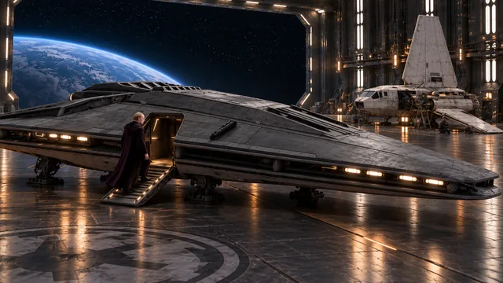</a><figcaption>52.1 · Пересадка в личный корабль · AI-референс</figcaption></figure>
<figure><a href="references/scenes/scene-52/S52-P2-hangar-takeoff.jpg" target="_blank" rel="noopener">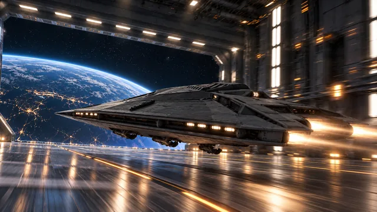</a><figcaption>52.2 · Взлёт из ангара · AI-референс</figcaption></figure>
<figure><a href="references/scenes/scene-52/S52-P3-cruiser-flyby.jpg" target="_blank" rel="noopener">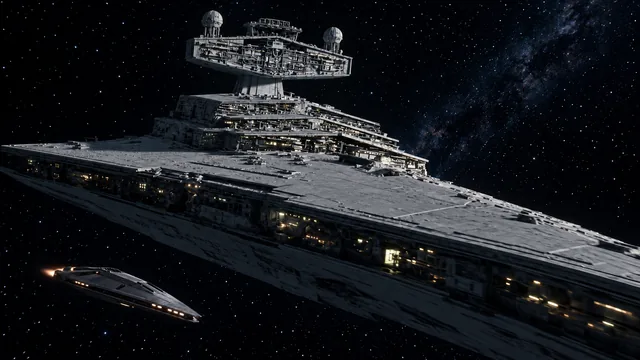</a><figcaption>52.3 · Облёт нужного крейсера · AI-референс</figcaption></figure>
<figure><a href="references/scenes/scene-52/S52-cruiser-topview.jpg" target="_blank" rel="noopener">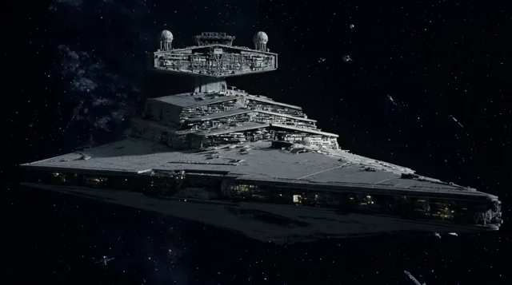</a><figcaption>Исходник крейсера · Topview</figcaption></figure>
<figure><a href="references/scenes/scene-52/S52-P4-tatooine-approach.jpg" target="_blank" rel="noopener">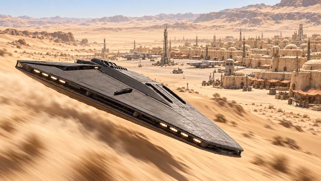</a><figcaption>52.4 · Подлёт к городу на Татуине · AI-референс</figcaption></figure>
<figure><a href="references/scenes/scene-52/S52-P5-tatooine-landing.jpg" target="_blank" rel="noopener">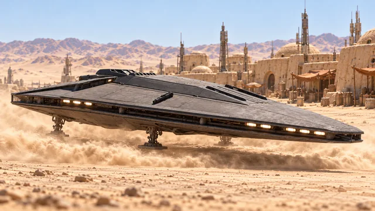</a><figcaption>52.5 · Подробная посадка · AI-референс</figcaption></figure>
<figure><a href="references/scenes/scene-52/S52-P6-disembark.jpg" target="_blank" rel="noopener">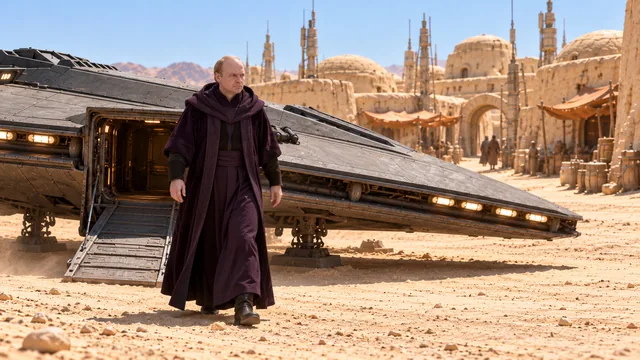</a><figcaption>52.6 · Выход из корабля к городу · AI-референс</figcaption></figure>
<figure><a href="references/scenes/scene-52/S52-P7-town-walk.jpg" target="_blank" rel="noopener">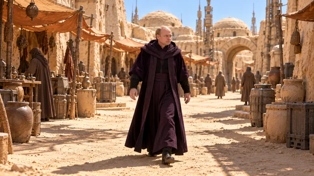</a><figcaption>52.7 · Прогулка по городу Татуина · AI-референс</figcaption></figure>
<figure><a href="references/scenes/scene-66/S66-street-outrage.png" target="_blank" rel="noopener">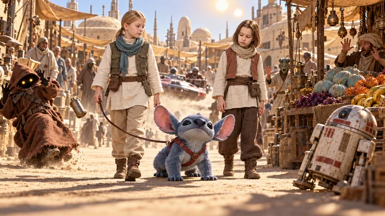</a><figcaption>52.7 · @Image3 — Стич: внешность и красная шлейка из общего уличного кадра</figcaption></figure>
<figure><a href="references/scenes/scene-66/S66-Alina-tatooine-sheet.png" target="_blank" rel="noopener">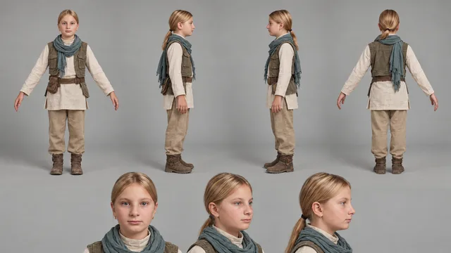</a><figcaption>52.7 · @Image4 — Алина: развёртка в одежде Татуина</figcaption></figure>
<figure><a href="references/scenes/scene-66/S66-Dasha-tatooine-sheet.png" target="_blank" rel="noopener">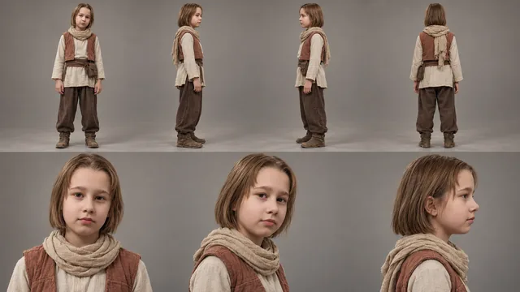</a><figcaption>52.7 · @Image5 — Даша: развёртка в одежде Татуина</figcaption></figure>
</div>

**Постоянные входы:** [Серёга](references/full/serega.jpg) · [личный корабль](references/scenes/scene-37/S37-ship-clean-roof.png) · [пустая кабина](references/scenes/scene-37/S37-cockpit-empty.png) · [рисунок и место записки](references/scenes/scene-37/S37-cockpit-bread-milk-helper.png) · [город и стоянка](references/scenes/ship-locations/Serega-ship-tatooine-town.png) · [реальный конец44 Seedance2.5](references/scenes/scene-52/S52-from-S44-seed25-last3s-20261027.mp4).

<div class="engine-tabs" data-scene="52">

<div class="engine-pane" data-engine="wan30" data-duration="7 × 30 с" data-main="1">

**30-секундные версии:** P7 Wan3.0 выбран в существующей очереди и использует настоящий конец P6 Seedance2.0. P1–P6 Wan3.0/Seedance2.5 остаются альтернативами вне очереди; их запуск требует отдельного выбора владельца и настоящих результатов соответствующей цепочки.

#### 52 · Wan 3.0 часть 1 — Пересадка в личный корабль

**Входы:** @Video1 — `references/scenes/scene-52/S52-from-S44-seed25-last3s-20261027.mp4` — существующий конец44 Seedance2.5; @Image1 — `references/full/serega.jpg`; @Image2 — `references/scenes/scene-37/S37-ship-clean-roof.png`; @Image3 — `references/scenes/scene-52/S52-P1-boarding.jpg`; @Image4 — `references/scenes/scene-37/S37-cockpit-empty.png`; @Image5 — `references/scenes/scene-37/S37-cockpit-bread-milk-helper.png`.

```text
Mode: reference-to-video (omni-reference) | Duration: 30s | Resolution: 720p | Aspect ratio: 16:9 | FPS: 24 | Native audio: on
Optimized for Wan 3.0 | Photoreal live-action space-opera cinema

REFERENCES / AUTHORITY:
@Video1 — actual final3seconds of the OWNER-SELECTED Scene44 Seedance2.5 repair result; establishes only the opening pose, damage, camera and light.
@Image1 — exact Serega identity, face, proportions and costume.
@Image2 — absolute personal-craft design; ignore its old city background.
@Image3 — synthetic action/composition helper for this part; not an actual video start or identity source.
@Image4 — empty cockpit geometry and seats; only Serega occupies the left pilot seat.
@Image5 — ONLY the yellow note design and position: black loaf at left, milk carton at right, on the blank panel to the pilot RIGHT; ignore its Naboo scenery and depicted pose.
Actual video controls the opening motion and physical state. Individual identity and vehicle-design images control their own subjects; action images are composition helpers, never replacement video endings.

CHARACTER APPEARANCE / IDENTITY LOCK:
SEREGA: one pale mature middle-aged man with a balding crown, sparse light-brown hair at the sides, broad familiar face and build. Exact face and proportions from @Image1; long deep-plum robe, thick folded scarf-like collar, black inner clothing and boots, hood down. Understated serious expression, purposeful moving body; do not beautify, age-shift, change the robe or blend his face with background residents.

SHIP / OCCUPANCY LOCK:
One low broad dark-graphite personal wedge craft, shallow angular cockpit glazing, original hull panels, horizontal warm side lights and exactly FOUR original main rear engines. Preserve its exact proportions from @Image2. No tall dorsal fin or folding Lambda wings. One side hatch with a short folding ramp. Whenever the craft moves Serega is fully inside the closed cockpit, hatch/ramp sealed, roof and exterior empty. Gear only deploys for landing and retracts after lift-off.
The damaged pale Lambda and the personal dark craft are TWO DIFFERENT ships in separate service positions. Preserve the repair damage already visible in @Video1; no repeated break or miraculous repair.

COCKPIT NOTE:
One pale-yellow note with simple black loaf-left / milk-carton-right drawings stays flat on the blank console panel to the pilot RIGHT, never on his robe, chest, hands or windshield. It remains attached to that panel in the seated cockpit ending; no text overlay. Second seat remains empty.

START STATE:
Continue the exact terminal pose and camera axis of the selected repair ending: Serega stands foreground left looking toward the technicians and damaged pale Lambda shuttle. Preserve the actual wing/panel position; the accident has already happened.

STORY FLOW:
Begin with the actual repair ending and a brief, readable reaction. Track Serega as he turns away; a widening move reveals his own separate craft and the complete route to its side ramp. Follow his purposeful walk and physical boarding, with one clear view of boots on the ramp and shoulders through the doorway. A motivated interior cut follows him into the cockpit and into the left pilot seat. Brief exterior insert: ramp retracts and side hatch seals. Finish inside with hands by the controls, ship still stationary. Keep the body and camera moving between the key beats; do not stretch the reaction into a long hold.

END STATE:
Serega is seated inside the personal craft at the left pilot station, hands near the controls, second seat empty. The craft is still parked. The side hatch/ramp is closed, ready for engine start.

CAMERA / PERFORMANCE:
Three motivated views: medium reaction, moving wide boarding geography, medium cockpit. Face stays medium-sized when readable; cuts follow turns and passage through the hatch. The Lambda never morphs into the personal craft.

LIGHT / MATERIALS:
Cool hangar practicals, warm doorway light, believable reflective metal, fabric texture and the blue planet beyond the bay.

AUDIO:
Hangar ventilation, distant tools from the repair crew, brisk footsteps, ramp footfalls, a mechanical hatch seal and a soft cockpit startup hum. No spoken lines. No narrator, intelligible extra speech, music or captions.

NEGATIVE PROMPT:
Ship redesign, a person on the roof or exterior, open hatch in flight, duplicated Serega, swapped face/robe, morphing ships, collision, instant in-shot teleport, missing physical boarding/takeoff/touchdown, giant person, impossible scale, melting surfaces, weapon in hand, basket, shopping bags, watermark, subtitles.

FRAME FILL / NO BARS:
Fill the complete frame edge-to-edge. No letterboxing, pillarboxing, black bars, decorative borders or empty margins.
```

#### 52 · Wan 3.0 часть 2 — Взлёт из ангара

**Входы:** @Video1 — настоящие последние3с результата части1 этой выбранной версии; ещё ожидаются; @Image1 — `references/full/serega.jpg`; @Image2 — `references/scenes/scene-37/S37-ship-clean-roof.png`; @Image3 — `references/scenes/scene-52/S52-P2-hangar-takeoff.jpg`; @Image4 — `references/scenes/scene-37/S37-cockpit-empty.png`; @Image5 — `references/scenes/scene-37/S37-cockpit-bread-milk-helper.png`.

```text
Mode: reference-to-video (omni-reference) | Duration: 30s | Resolution: 720p | Aspect ratio: 16:9 | FPS: 24 | Native audio: on
Optimized for Wan 3.0 | Photoreal live-action space-opera cinema

REFERENCES / AUTHORITY:
@Video1 — actual final3seconds of the NEW Scene52 part1 result; establishes the exact starting state, direction, speed, camera and light.
@Image1 — exact Serega identity, face, proportions and costume.
@Image2 — absolute personal-craft design; ignore its old city background.
@Image3 — synthetic action/composition helper for this part; not an actual video start or identity source.
@Image4 — empty cockpit geometry and seats; only Serega occupies the left pilot seat.
@Image5 — ONLY the yellow note design and position: black loaf at left, milk carton at right, on the blank panel to the pilot RIGHT; ignore its Naboo scenery and depicted pose.
Actual video controls the opening motion and physical state. Individual identity and vehicle-design images control their own subjects; action images are composition helpers, never replacement video endings.

CHARACTER APPEARANCE / IDENTITY LOCK:
SEREGA: one pale mature middle-aged man with a balding crown, sparse light-brown hair at the sides, broad familiar face and build. Exact face and proportions from @Image1; long deep-plum robe, thick folded scarf-like collar, black inner clothing and boots, hood down. Understated serious expression, purposeful moving body; do not beautify, age-shift, change the robe or blend his face with background residents.

SHIP / OCCUPANCY LOCK:
One low broad dark-graphite personal wedge craft, shallow angular cockpit glazing, original hull panels, horizontal warm side lights and exactly FOUR original main rear engines. Preserve its exact proportions from @Image2. No tall dorsal fin or folding Lambda wings. One side hatch with a short folding ramp. Whenever the craft moves Serega is fully inside the closed cockpit, hatch/ramp sealed, roof and exterior empty. Gear only deploys for landing and retracts after lift-off.

COCKPIT NOTE:
One pale-yellow note with simple black loaf-left / milk-carton-right drawings stays flat on the blank console panel to the pilot RIGHT, never on his robe, chest, hands or windshield. Keep it legible for about two seconds during this startup view; no text overlay. Second seat remains empty.

START STATE:
Continue the previous real cockpit ending: Serega is seated at the left controls, the personal craft is parked, hatch closed, second seat empty.

STORY FLOW:
Start with a short cockpit action and a clear two-second view of the note on the right panel. The ship lifts from the floor with visible separation, retracts its landing feet and builds forward speed along the hangar centre line. Track it low from the rear-quarter so floor parallax conveys acceleration. Switch to the side as the nose, body and tail cross the aperture in order. An exterior camera continues that same vector, revealing the cruiser hull while the personal craft banks away from the opening. Use the added time for a complete physical departure and changing scale, not slow hovering.

END STATE:
The whole personal craft has physically cleared the hangar aperture into black space and is accelerating along the outside of the cruiser. Gear fully stowed, hatch closed; maintain one readable outbound direction.

CAMERA / PERFORMANCE:
Four motivated camera positions: cockpit, low lift-off, lateral doorway passage, external tracking. Fast parallax and a signature move — a hard banking climb-out through the hangar mouth, then a snap roll back to level — create excitement; no unexplained cut from a stationary ship straight into space.

LIGHT / MATERIALS:
Cool hangar practicals, warm doorway light, believable reflective metal, fabric texture and the blue planet beyond the bay.

AUDIO:
Switch clicks, rising engine whine, bass lift vibration, gear mechanism, accelerating thrust and a cinematic exterior engine whoosh. No dialogue. No narrator, intelligible extra speech, music or captions.

NEGATIVE PROMPT:
Ship redesign, a person on the roof or exterior, open hatch in flight, duplicated Serega, swapped face/robe, morphing ships, collision, instant in-shot teleport, missing physical boarding/takeoff/touchdown, giant person, impossible scale, melting surfaces, weapon in hand, basket, shopping bags, watermark, subtitles.

FRAME FILL / NO BARS:
Fill the complete frame edge-to-edge. No letterboxing, pillarboxing, black bars, decorative borders or empty margins.
```

#### 52 · Wan 3.0 часть 3 — Облёт нужного крейсера

**Входы:** @Video1 — настоящие последние3с результата части2 этой выбранной версии; ещё ожидаются; @Image1 — `references/full/serega.jpg`; @Image2 — `references/scenes/scene-37/S37-ship-clean-roof.png`; @Image3 — `references/scenes/scene-52/S52-P3-cruiser-flyby.jpg`; @Image4 — `references/scenes/scene-52/S52-cruiser-topview.jpg`; @Image5 — `references/scenes/scene-37/S37-cockpit-bread-milk-helper.png`.

```text
Mode: reference-to-video (omni-reference) | Duration: 30s | Resolution: 720p | Aspect ratio: 16:9 | FPS: 24 | Native audio: on
Optimized for Wan 3.0 | Photoreal live-action space-opera cinema

REFERENCES / AUTHORITY:
@Video1 — actual final3seconds of the NEW Scene52 part2 result; establishes the exact starting state, direction, speed, camera and light.
@Image1 — exact Serega identity, face, proportions and costume.
@Image2 — absolute personal-craft design; ignore its old city background.
@Image3 — synthetic action/composition helper for this part; not an actual video start or identity source.
@Image4 — exact large cruiser design from Topview: triangular grey hull, stepped superstructure, raised wide bridge and TWO spherical domes.
@Image5 — ONLY the yellow note design and position: black loaf at left, milk carton at right, on the blank panel to the pilot RIGHT; ignore its Naboo scenery and depicted pose.
Actual video controls the opening motion and physical state. Individual identity and vehicle-design images control their own subjects; action images are composition helpers, never replacement video endings.

CHARACTER APPEARANCE / IDENTITY LOCK:
SEREGA: one pale mature middle-aged man with a balding crown, sparse light-brown hair at the sides, broad familiar face and build. Exact face and proportions from @Image1; long deep-plum robe, thick folded scarf-like collar, black inner clothing and boots, hood down. Understated serious expression, purposeful moving body; do not beautify, age-shift, change the robe or blend his face with background residents.

SHIP / OCCUPANCY LOCK:
One low broad dark-graphite personal wedge craft, shallow angular cockpit glazing, original hull panels, horizontal warm side lights and exactly FOUR original main rear engines. Preserve its exact proportions from @Image2. No tall dorsal fin or folding Lambda wings. One side hatch with a short folding ramp. Whenever the craft moves Serega is fully inside the closed cockpit, hatch/ramp sealed, roof and exterior empty. Gear only deploys for landing and retracts after lift-off.

COCKPIT INSERT:
The brief cockpit cut shows the same cockpit: Serega alone in the left pilot seat, second seat empty, hatch sealed. One pale-yellow note with simple black loaf-left / milk-carton-right drawings stays flat on the blank console panel to the pilot RIGHT and trembles with the vibration; no text overlay.

CRUISER LOCK:
@Image4 is the exact cruiser, not a generic Star Destroyer: preserve the broad grey wedge, layered stepped centre, raised wide bridge with two spherical domes and lit edge trenches. It is vastly larger than the personal craft. Maintain visible safe space between ships and consistent scale through every cut; no battle.

START STATE:
Continue the actual exterior ending after the whole personal craft has cleared the hangar. Keep its direction and momentum against the same cruiser.

STORY FLOW:
Continue departure and establish the cruiser scale in a wide tracking reveal. Follow the smaller craft along the near-side hull trench, changing from a broad silhouette to a closer parallax view of the passing hull. A short cockpit cut shows Serega's face under G-force, hand firm on the throttle, the bread/milk note trembling on the right panel. Signature move: it drops below the bow line and makes a full barrel roll around the forward corner with clear separation, then climbs back into open space. Finish with acceleration away from the receding cruiser as the starfield stretches into a hyperspace jump. Use four motivated views that preserve the route and craft identity; sustain speed, not a slow beauty orbit.

END STATE:
The personal craft rolls out past the cruiser bow, accelerates into clear space and jumps into hyperspace: the starfield stretches into streaks and the craft vanishes forward. The enormous cruiser recedes behind. The small ship remains recognizably the same flat design.

CAMERA / PERFORMANCE:
Wide scale reveal, parallel hull tracking, low bow-clearance view, brief cockpit insert, outward chase angle into the hyperspace jump. Show a real gap between ships. Cruiser windows and hull plates establish scale; the personal craft must never become a second capital ship.

LIGHT / MATERIALS:
Cool raking starlight, readable grey hull detail, deep black space and restrained warm propulsion glow.

AUDIO:
Cinematic thrust pulses, low hull rumble in the opening, dynamic pass-by and departure whoosh; restrained science-fiction sound design, no battle or dialogue. No narrator, intelligible extra speech, music or captions.

NEGATIVE PROMPT:
Ship redesign, a person on the roof or exterior, open hatch in flight, duplicated Serega, swapped face/robe, morphing ships, collision, instant in-shot teleport, missing physical boarding/takeoff/touchdown, giant person, impossible scale, melting surfaces, weapon in hand, basket, shopping bags, watermark, subtitles.

FRAME FILL / NO BARS:
Fill the complete frame edge-to-edge. No letterboxing, pillarboxing, black bars, decorative borders or empty margins.
```

#### 52 · Wan 3.0 часть 4 — Подлёт к городу на Татуине

**Входы:** @Video1 — настоящие последние3с результата части3 этой выбранной версии; ещё ожидаются; @Image1 — `references/full/serega.jpg`; @Image2 — `references/scenes/scene-37/S37-ship-clean-roof.png`; @Image3 — `references/scenes/scene-52/S52-P4-tatooine-approach.jpg`; @Image4 — `references/scenes/ship-locations/Serega-ship-tatooine-town.png`; @Image5 — `references/scenes/scene-37/S37-cockpit-bread-milk-helper.png`.

```text
Mode: reference-to-video (omni-reference) | Duration: 30s | Resolution: 720p | Aspect ratio: 16:9 | FPS: 24 | Native audio: on
Optimized for Wan 3.0 | Photoreal live-action space-opera cinema

REFERENCES / AUTHORITY:
@Video1 — actual final3seconds of the NEW Scene52 part3 result; establishes the exact starting state, direction, speed, camera and light.
@Image1 — exact Serega identity, face, proportions and costume.
@Image2 — absolute personal-craft design; ignore its old city background.
@Image3 — synthetic action/composition helper for this part; not an actual video start or identity source.
@Image4 — same town architecture, grounded ship scale and side doorway; parked gear/hatch state must not leak into flight.
@Image5 — ONLY the yellow note design and position: black loaf at left, milk carton at right, on the blank panel to the pilot RIGHT; ignore its Naboo scenery and depicted pose.
Actual video controls the opening motion and physical state. Individual identity and vehicle-design images control their own subjects; action images are composition helpers, never replacement video endings.

CHARACTER APPEARANCE / IDENTITY LOCK:
SEREGA: one pale mature middle-aged man with a balding crown, sparse light-brown hair at the sides, broad familiar face and build. Exact face and proportions from @Image1; long deep-plum robe, thick folded scarf-like collar, black inner clothing and boots, hood down. Understated serious expression, purposeful moving body; do not beautify, age-shift, change the robe or blend his face with background residents.

SHIP / OCCUPANCY LOCK:
One low broad dark-graphite personal wedge craft, shallow angular cockpit glazing, original hull panels, horizontal warm side lights and exactly FOUR original main rear engines. Preserve its exact proportions from @Image2. No tall dorsal fin or folding Lambda wings. One side hatch with a short folding ramp. Whenever the craft moves Serega is fully inside the closed cockpit, hatch/ramp sealed, roof and exterior empty. Gear only deploys for landing and retracts after lift-off.

COCKPIT INSERT:
The brief cockpit cut shows the same cockpit: Serega alone in the left pilot seat, second seat empty, hatch sealed. One pale-yellow note with simple black loaf-left / milk-carton-right drawings stays flat on the blank console panel to the pilot RIGHT and trembles with the vibration; no text overlay.

TOWN / GEOGRAPHY:
The SAME lived-in Tatooine spaceport across arrival, landing and walking: pale sand, low sand-coloured adobe buildings with rounded thick walls and domed roofs, arched doorways, small round windows, tan fabric awnings, narrow dusty lanes, slim moisture-vaporator towers, dunes and distant dry ridges. Harsh warm daylight from Tatooine's TWIN SUNS: two small suns in the sky, double soft shadows, consistent direction. The landing field is OUTSIDE town. No ancient worm ruins, obelisks or sandworm.

START STATE:
Begin with the actual hyperspace-jump ending of Part 3. The same craft drops out of hyperspace above the desert planet: streaks snap back to stars, the tan planet and its twin suns fill the view.

STORY FLOW:
The craft drops out of hyperspace above the desert planet with its twin suns and dives into the atmosphere. A short cockpit cut shows Serega's calm face as the cockpit shakes, the bread/milk note trembling on the right panel. Signature move: a steep corkscrew descent, levelling out just above the dune crests and slicing through a narrow rock canyon, then a low fast pass above the dunes with a thin sand wake. The town gradually reveals beyond the last crest. Track the ship as it selects the open outskirts field, arcs toward it and begins slowing on a shallow approach. End airborne and aligned; reserve touchdown for the following part. Additional time expands the travel and geographic reveal while preserving speed.

END STATE:
The same craft has revealed the town and aligned with an open sandy landing field on its outskirts. It is still airborne on a shallow controlled approach, hatch closed, landing gear still stowed.

CAMERA / PERFORMANCE:
Hyperspace exit and atmospheric dive, brief cockpit insert, dynamic trailing three-quarter descent, low side tracking over dunes, wider town reveal. One motivated change of travel time, then continuous local geography.

LIGHT / MATERIALS:
Consistent harsh warm light of the twin suns, natural skin and heavy plum fabric, granular sand, low rolling dust and weathered adobe; cooler soft shade under awnings.

AUDIO:
Engine note shifts into atmospheric roar, air rushing over the hull, low-flight doppler and windblown sand; town ambience faint in the distance. No dialogue. No narrator, intelligible extra speech, music or captions.

NEGATIVE PROMPT:
Ship redesign, a person on the roof or exterior, open hatch in flight, duplicated Serega, swapped face/robe, morphing ships, collision, instant in-shot teleport, missing physical boarding/takeoff/touchdown, giant person, impossible scale, melting surfaces, weapon in hand, basket, shopping bags, watermark, subtitles.

FRAME FILL / NO BARS:
Fill the complete frame edge-to-edge. No letterboxing, pillarboxing, black bars, decorative borders or empty margins.
```

#### 52 · Wan 3.0 часть 5 — Подробная посадка

**Входы:** @Video1 — настоящие последние3с результата части4 этой выбранной версии; ещё ожидаются; @Image1 — `references/full/serega.jpg`; @Image2 — `references/scenes/scene-37/S37-ship-clean-roof.png`; @Image3 — `references/scenes/scene-52/S52-P5-tatooine-landing.jpg`; @Image4 — `references/scenes/ship-locations/Serega-ship-tatooine-town.png`; @Image5 — `references/scenes/scene-37/S37-cockpit-bread-milk-helper.png`.

```text
Mode: reference-to-video (omni-reference) | Duration: 30s | Resolution: 720p | Aspect ratio: 16:9 | FPS: 24 | Native audio: on
Optimized for Wan 3.0 | Photoreal live-action space-opera cinema

REFERENCES / AUTHORITY:
@Video1 — actual final3seconds of the NEW Scene52 part4 result; establishes the exact starting state, direction, speed, camera and light.
@Image1 — exact Serega identity, face, proportions and costume.
@Image2 — absolute personal-craft design; ignore its old city background.
@Image3 — synthetic action/composition helper for this part; not an actual video start or identity source.
@Image4 — same town architecture, grounded ship scale and side doorway; parked gear/hatch state must not leak into flight.
@Image5 — ONLY the yellow note design and position: black loaf at left, milk carton at right, on the blank panel to the pilot RIGHT; ignore its Naboo scenery and depicted pose.
Actual video controls the opening motion and physical state. Individual identity and vehicle-design images control their own subjects; action images are composition helpers, never replacement video endings.

CHARACTER APPEARANCE / IDENTITY LOCK:
SEREGA: one pale mature middle-aged man with a balding crown, sparse light-brown hair at the sides, broad familiar face and build. Exact face and proportions from @Image1; long deep-plum robe, thick folded scarf-like collar, black inner clothing and boots, hood down. Understated serious expression, purposeful moving body; do not beautify, age-shift, change the robe or blend his face with background residents.

SHIP / OCCUPANCY LOCK:
One low broad dark-graphite personal wedge craft, shallow angular cockpit glazing, original hull panels, horizontal warm side lights and exactly FOUR original main rear engines. Preserve its exact proportions from @Image2. No tall dorsal fin or folding Lambda wings. One side hatch with a short folding ramp. Whenever the craft moves Serega is fully inside the closed cockpit, hatch/ramp sealed, roof and exterior empty. Gear only deploys for landing and retracts after lift-off.

COCKPIT INSERT:
The brief cockpit cut shows the same cockpit: Serega alone in the left pilot seat, second seat empty, hatch sealed. One pale-yellow note with simple black loaf-left / milk-carton-right drawings stays flat on the blank console panel to the pilot RIGHT and trembles with the vibration; no text overlay.

TOWN / GEOGRAPHY:
The SAME lived-in Tatooine spaceport across arrival, landing and walking: pale sand, low sand-coloured adobe buildings with rounded thick walls and domed roofs, arched doorways, small round windows, tan fabric awnings, narrow dusty lanes, slim moisture-vaporator towers, dunes and distant dry ridges. Harsh warm daylight from Tatooine's TWIN SUNS: two small suns in the sky, double soft shadows, consistent direction. The landing field is OUTSIDE town. No ancient worm ruins, obelisks or sandworm.

START STATE:
Continue the actual approach ending: the same personal craft is airborne toward the chosen open field outside the established town; preserve heading, sun direction and city landmarks.

STORY FLOW:
Signature move: a fast flare with a 180-degree yaw swing, the craft pivoting into position as speed falls; a short cockpit cut shows Serega's hand pulling back the throttle beside the bread/milk note. Deploy the original landing supports while the craft lowers over the open field. Track down toward ground level: repulsor wash pushes dust outward without hiding the whole ship. Show feet, sand contact and weight transfer clearly, then a single heavy settling movement of the hull. Let the engine tone fade while rolling dust gradually reveals the craft and the surrounding outskirts. Keep the approach and touchdown dynamic; use the final seconds for the physical aftermath, hatch still closed.

END STATE:
The craft rests stably on all landing supports on the sandy field, engines settled, dust thinning, hatch/ramp still closed. Town and side doorway remain on the established sides for the exit.

CAMERA / PERFORMANCE:
Moving side approach, low three-quarter braking, close-medium landing-foot contact, wider settled ship. Match the motion at cuts; no cut that skips touchdown. Keep safe clearance from buildings and residents.

LIGHT / MATERIALS:
Consistent harsh warm light of the twin suns, natural skin and heavy plum fabric, granular sand, low rolling dust and weathered adobe; cooler soft shade under awnings.

AUDIO:
Strong braking thrust, gear motors, rolling sand, distinct weighted landing thump, suspension creak and engines winding down into desert wind. No dialogue. No narrator, intelligible extra speech, music or captions.

NEGATIVE PROMPT:
Ship redesign, a person on the roof or exterior, open hatch in flight, duplicated Serega, swapped face/robe, morphing ships, collision, instant in-shot teleport, missing physical boarding/takeoff/touchdown, giant person, impossible scale, melting surfaces, weapon in hand, basket, shopping bags, watermark, subtitles.

FRAME FILL / NO BARS:
Fill the complete frame edge-to-edge. No letterboxing, pillarboxing, black bars, decorative borders or empty margins.
```

#### 52 · Wan 3.0 часть 6 — Выход из корабля к городу

**Входы:** @Video1 — настоящие последние3с результата части5 этой выбранной версии; ещё ожидаются; @Image1 — `references/full/serega.jpg`; @Image2 — `references/scenes/scene-37/S37-ship-clean-roof.png`; @Image3 — `references/scenes/scene-52/S52-P6-disembark.jpg`; @Image4 — `references/scenes/ship-locations/Serega-ship-tatooine-town.png`.

```text
Mode: reference-to-video (omni-reference) | Duration: 30s | Resolution: 720p | Aspect ratio: 16:9 | FPS: 24 | Native audio: on
Optimized for Wan 3.0 | Photoreal live-action space-opera cinema

REFERENCES / AUTHORITY:
@Video1 — actual final3seconds of the NEW Scene52 part5 result; establishes the exact starting state, direction, speed, camera and light.
@Image1 — exact Serega identity, face, proportions and costume.
@Image2 — absolute personal-craft design; ignore its old city background.
@Image3 — synthetic action/composition helper for this part; not an actual video start or identity source.
@Image4 — same town architecture, grounded ship scale and side doorway; parked gear/hatch state must not leak into flight.
Actual video controls the opening motion and physical state. Individual identity and vehicle-design images control their own subjects; action images are composition helpers, never replacement video endings.

CHARACTER APPEARANCE / IDENTITY LOCK:
SEREGA: one pale mature middle-aged man with a balding crown, sparse light-brown hair at the sides, broad familiar face and build. Exact face and proportions from @Image1; long deep-plum robe, thick folded scarf-like collar, black inner clothing and boots, hood down. Understated serious expression, purposeful moving body; do not beautify, age-shift, change the robe or blend his face with background residents.

SHIP / OCCUPANCY LOCK:
One low broad dark-graphite personal wedge craft, shallow angular cockpit glazing, original hull panels, horizontal warm side lights and exactly FOUR original main rear engines. Preserve its exact proportions from @Image2. No tall dorsal fin or folding Lambda wings. One side hatch with a short folding ramp. Whenever the craft moves Serega is fully inside the closed cockpit, hatch/ramp sealed, roof and exterior empty. Gear only deploys for landing and retracts after lift-off.

TOWN / GEOGRAPHY:
The SAME lived-in Tatooine spaceport across arrival, landing and walking: pale sand, low sand-coloured adobe buildings with rounded thick walls and domed roofs, arched doorways, small round windows, tan fabric awnings, narrow dusty lanes, slim moisture-vaporator towers, dunes and distant dry ridges. Harsh warm daylight from Tatooine's TWIN SUNS: two small suns in the sky, double soft shadows, consistent direction. The landing field is OUTSIDE town. No ancient worm ruins, obelisks or sandworm.

START STATE:
Continue the real stationary landing ending: all landing supports bear weight, the side hatch is closed, dust is settling and the town remains in the same direction.

STORY FLOW:
Begin on the settled craft as its single side hatch opens and the ramp lowers to the sand. Serega crosses the doorway, pauses only long enough to register the bright unfamiliar surroundings, then walks down the entire ramp with visible footing. Follow him onto the ground and around the safe side of the ship toward the town entrance. Alternate a readable medium view of his face with a tracking view of the route. Finish as he approaches the first lane, ship parked behind; no shopping or added plot event.

END STATE:
Serega has stepped onto the sand and is walking toward the first town lane. The parked personal craft remains behind him; he carries nothing in either hand.

CAMERA / PERFORMANCE:
Side doorway view, medium three-quarter exit with readable face and feet, tracking departure toward the town. The camera may move around him but never invents a roof exit or cuts him through solid hull.

LIGHT / MATERIALS:
Consistent harsh warm light of the twin suns, natural skin and heavy plum fabric, granular sand, low rolling dust and weathered adobe; cooler soft shade under awnings.

AUDIO:
Hatch seal, ramp motor, boots on metal then sand, robe rustle, dry wind and the first distant market sounds. No dialogue. No narrator, intelligible extra speech, music or captions.

NEGATIVE PROMPT:
Ship redesign, a person on the roof or exterior, open hatch in flight, duplicated Serega, swapped face/robe, morphing ships, collision, instant in-shot teleport, missing physical boarding/takeoff/touchdown, giant person, impossible scale, melting surfaces, weapon in hand, basket, shopping bags, watermark, subtitles.

FRAME FILL / NO BARS:
Fill the complete frame edge-to-edge. No letterboxing, pillarboxing, black bars, decorative borders or empty margins.
```

#### 52 · Wan 3.0 часть 7 — Прогулка по городу Татуина

**Входы:** @Video1 — настоящие последние3с выбранной P6 Seedance2.0 (`references/scenes/scene-52/S52-R2-P6-last3s.mp4`, из результата `S52-R2-SEED20-P6`); ещё ожидаются; @Image1 — `references/full/serega.jpg`; @Image2 — `references/scenes/scene-52/S52-P7-town-walk.jpg`; @Image3 — `references/scenes/scene-66/S66-street-outrage.png` (Стич на переднем плане: внешность, красная шлейка и поводок; общий исходный кадр); @Image4 — `references/scenes/scene-66/S66-Alina-tatooine-sheet.png` (Алина: развёртка в одежде Татуина); @Image5 — `references/scenes/scene-66/S66-Dasha-tatooine-sheet.png` (Даша: развёртка в одежде Татуина).

```text
Mode: reference-to-video (omni-reference) | Duration: 30s | Resolution: 720p | Aspect ratio: 16:9 | FPS: 24 | Native audio: on
Optimized for Wan 3.0 | Photoreal live-action space-opera cinema

REFERENCES / AUTHORITY:
@Video1 — actual final 3 seconds of the selected NEW Scene52 Part6 Seedance 2.0 result (S52-R2-SEED20-P6). File: references/scenes/scene-52/S52-R2-P6-last3s.mp4. This selected Wan 3.0 Part7 continues that real ending; the change of model never resets the exact starting state, direction, speed, camera or light.
@Image1 — exact Serega identity, face, proportions and costume.
@Image2 — synthetic street-walking composition and town lane; individual identity sheet wins.
@Image3 — use only STITCH in the foreground of this existing street image: exact blue fur, broad black nose, large dark eyes, oversized ears, red harness and leash. Do not use the girls in this composition as identity references; individual sheets @Image4 and @Image5 are the highest authority for ALINA and DASHA. File: references/scenes/scene-66/S66-street-outrage.png.
@Image4 — exact ALINA (GIRL A): face, hair, age and Tatooine costume from her individual sheet. File: references/scenes/scene-66/S66-Alina-tatooine-sheet.png.
@Image5 — exact DASHA (GIRL B): face, hair, age and Tatooine costume from her individual sheet. File: references/scenes/scene-66/S66-Dasha-tatooine-sheet.png. Two different girls, never merged.
Actual video controls the opening motion and physical state. Individual identity and vehicle-design images control their own subjects; action images are composition helpers, never replacement video endings.

CHARACTER APPEARANCE / IDENTITY LOCK:
SEREGA: one pale mature middle-aged man with a balding crown, sparse light-brown hair at the sides, broad familiar face and build. Exact face and proportions from @Image1; long deep-plum robe, thick folded scarf-like collar, black inner clothing and boots, hood down. Understated serious expression, purposeful moving body; do not beautify, age-shift, change the robe or blend his face with background residents.
GIRL A (ALINA) and GIRL B (DASHA): exact faces, hair, clothes and ages strictly from @Image4 and @Image5; ALINA holds the leash. STITCH: exactly @Image3, in the red harness.

TOWN / GEOGRAPHY:
The SAME lived-in Tatooine spaceport across arrival, landing and walking: pale sand, low sand-coloured adobe buildings with rounded thick walls and domed roofs, arched doorways, small round windows, tan fabric awnings, narrow dusty lanes, slim moisture-vaporator towers, dunes and distant dry ridges. Harsh warm daylight from Tatooine's TWIN SUNS: two small suns in the sky, double soft shadows, consistent direction. The landing field is OUTSIDE town. No ancient worm ruins, obelisks or sandworm.

START STATE:
Continue the actual end of Serega walking away from the parked ship toward the town entrance, retaining stride, robe, empty hands and direction. The ship stays outside the streets.

STORY FLOW:
Continue his arrival in the first lane, then accompany a purposeful walk through the spaceport town. Move between medium frontal tracking and side views as he briefly observes the unfamiliar shopfronts, awnings, vaporator towers and residents. His expression stays understated but his walk and robe remain alive. He passes ordinary stalls without buying anything. Two girls walking Stitch on a red leash come toward him; he steps aside with one short deadpan glance as they pass. The camera hands off from Serega to the girls and follows them and the dog deeper into the market street while he continues out of frame toward a shaded arch. End mid-stride on the girls and the dog.

END STATE:
The camera now follows the two girls and Stitch walking on down the busy market street; Serega has left frame toward a shaded arch. Continuous motion, no pause or end pose: scene 66 continues from this exact frame. No shopping or interior scene.

CAMERA / PERFORMANCE:
Three motivated walking views: medium frontal tracking, side tracking that opens the street, hand-off move that turns from Serega to follow the girls and the dog. Preserve recognizable face and costume; lively background and camera, not frantic running or a frozen portrait.

LIGHT / MATERIALS:
Consistent harsh warm light of the twin suns, natural skin and heavy plum fabric, granular sand, low rolling dust and weathered adobe; cooler soft shade under awnings.

AUDIO:
Boots on dusty ground, soft cloth movement, desert wind, indistinct market chatter and distant mechanical spaceport hum; no intelligible dialogue, narrator or music. No narrator, intelligible extra speech, music or captions.

NEGATIVE PROMPT:
Duplicated Serega, changed face/robe, frozen body, crowd face blending, spaceship inside the street, ruins, sandworm, shopping or buying bread/milk, basket, weapon, sudden interior cut, unreadable tiny protagonist, watermark, subtitles.

FRAME FILL / NO BARS:
Fill the complete frame edge-to-edge. No letterboxing, pillarboxing, black bars, decorative borders or empty margins.
```

</div>

<div class="engine-pane" data-engine="sd20" data-duration="7 × 15 с">

**15-секундные версии:** в очереди выбраны P1–P6 Seedance2.0. P1 готова по входам, P2–P6 ждут реальные стыки; P7 Seedance2.0 — альтернатива вне очереди, для P7 выбран Wan3.0,30с.

#### 52 · Seedance 2.0 часть 1 — Пересадка в личный корабль

**Входы:** @Video1 — `references/scenes/scene-52/S52-from-S44-seed25-last3s-20261027.mp4` — существующий конец44 Seedance2.5; @Image1 — `references/full/serega.jpg`; @Image2 — `references/scenes/scene-37/S37-ship-clean-roof.png`; @Image3 — `references/scenes/scene-52/S52-P1-boarding.jpg`; @Image4 — `references/scenes/scene-37/S37-cockpit-empty.png`; @Image5 — `references/scenes/scene-37/S37-cockpit-bread-milk-helper.png`.

```text
Mode: reference-to-video (omni-reference) | Duration: 15s | Resolution: 720p | Aspect ratio: 16:9 | FPS: 24 | Native audio: on
Optimized for Seedance 2.0 | Photoreal live-action space-opera cinema

REFERENCES / AUTHORITY:
@Video1 — actual final3seconds of the OWNER-SELECTED Scene44 Seedance2.5 repair result; establishes only the opening pose, damage, camera and light.
@Image1 — exact Serega identity, face, proportions and costume.
@Image2 — absolute personal-craft design; ignore its old city background.
@Image3 — synthetic action/composition helper for this part; not an actual video start or identity source.
@Image4 — empty cockpit geometry and seats; only Serega occupies the left pilot seat.
@Image5 — ONLY the yellow note design and position: black loaf at left, milk carton at right, on the blank panel to the pilot RIGHT; ignore its Naboo scenery and depicted pose.
Actual video controls the opening motion and physical state. Individual identity and vehicle-design images control their own subjects; action images are composition helpers, never replacement video endings.

CHARACTER APPEARANCE / IDENTITY LOCK:
SEREGA: one pale mature middle-aged man with a balding crown, sparse light-brown hair at the sides, broad familiar face and build. Exact face and proportions from @Image1; long deep-plum robe, thick folded scarf-like collar, black inner clothing and boots, hood down. Understated serious expression, purposeful moving body; do not beautify, age-shift, change the robe or blend his face with background residents.

SHIP / OCCUPANCY LOCK:
One low broad dark-graphite personal wedge craft, shallow angular cockpit glazing, original hull panels, horizontal warm side lights and exactly FOUR original main rear engines. Preserve its exact proportions from @Image2. No tall dorsal fin or folding Lambda wings. One side hatch with a short folding ramp. Whenever the craft moves Serega is fully inside the closed cockpit, hatch/ramp sealed, roof and exterior empty. Gear only deploys for landing and retracts after lift-off.
The damaged pale Lambda and the personal dark craft are TWO DIFFERENT ships in separate service positions. Preserve the repair damage already visible in @Video1; no repeated break or miraculous repair.

COCKPIT NOTE:
One pale-yellow note with simple black loaf-left / milk-carton-right drawings stays flat on the blank console panel to the pilot RIGHT, never on his robe, chest, hands or windshield. It remains attached to that panel in the seated cockpit ending; no text overlay. Second seat remains empty.

START STATE:
Continue the exact terminal pose and camera axis of the selected repair ending: Serega stands foreground left looking toward the technicians and damaged pale Lambda shuttle. Preserve the actual wing/panel position; the accident has already happened.

STORY FLOW:
0–3s: Serega gives the repair crew one short deadpan glance, then turns decisively toward his own craft. 3–7s: a motivated wider angle reveals the separate low dark personal ship; he walks briskly to its single side ramp. 7–12s: show his feet climbing the ramp and his body passing THROUGH the doorway; the damaged Lambda remains a different ship behind him. 12–15s: a motivated interior cut follows him settling into the pilot seat; the side hatch seals behind him with a clear mechanical sound. Finish at the controls, ship still parked.

END STATE:
Serega is seated inside the personal craft at the left pilot station, hands near the controls, second seat empty. The craft is still parked. The side hatch/ramp is closed, ready for engine start.

CAMERA / PERFORMANCE:
Three motivated views: medium reaction, moving wide boarding geography, medium cockpit. Face stays medium-sized when readable; cuts follow turns and passage through the hatch. The Lambda never morphs into the personal craft.

LIGHT / MATERIALS:
Cool hangar practicals, warm doorway light, believable reflective metal, fabric texture and the blue planet beyond the bay.

AUDIO:
Hangar ventilation, distant tools from the repair crew, brisk footsteps, ramp footfalls, a mechanical hatch seal and a soft cockpit startup hum. No spoken lines. No narrator, intelligible extra speech, music or captions.

NEGATIVE PROMPT:
Ship redesign, a person on the roof or exterior, open hatch in flight, duplicated Serega, swapped face/robe, morphing ships, collision, instant in-shot teleport, missing physical boarding/takeoff/touchdown, giant person, impossible scale, melting surfaces, weapon in hand, basket, shopping bags, watermark, subtitles.

FRAME FILL / NO BARS:
Fill the complete frame edge-to-edge. No letterboxing, pillarboxing, black bars, decorative borders or empty margins.
```

#### 52 · Seedance 2.0 часть 2 — Взлёт из ангара

**Входы:** @Video1 — настоящие последние3с результата части1 этой выбранной версии; ещё ожидаются; @Image1 — `references/full/serega.jpg`; @Image2 — `references/scenes/scene-37/S37-ship-clean-roof.png`; @Image3 — `references/scenes/scene-52/S52-P2-hangar-takeoff.jpg`; @Image4 — `references/scenes/scene-37/S37-cockpit-empty.png`; @Image5 — `references/scenes/scene-37/S37-cockpit-bread-milk-helper.png`.

```text
Mode: reference-to-video (omni-reference) | Duration: 15s | Resolution: 720p | Aspect ratio: 16:9 | FPS: 24 | Native audio: on
Optimized for Seedance 2.0 | Photoreal live-action space-opera cinema

REFERENCES / AUTHORITY:
@Video1 — actual final3seconds of the NEW Scene52 part1 result; establishes the exact starting state, direction, speed, camera and light.
@Image1 — exact Serega identity, face, proportions and costume.
@Image2 — absolute personal-craft design; ignore its old city background.
@Image3 — synthetic action/composition helper for this part; not an actual video start or identity source.
@Image4 — empty cockpit geometry and seats; only Serega occupies the left pilot seat.
@Image5 — ONLY the yellow note design and position: black loaf at left, milk carton at right, on the blank panel to the pilot RIGHT; ignore its Naboo scenery and depicted pose.
Actual video controls the opening motion and physical state. Individual identity and vehicle-design images control their own subjects; action images are composition helpers, never replacement video endings.

CHARACTER APPEARANCE / IDENTITY LOCK:
SEREGA: one pale mature middle-aged man with a balding crown, sparse light-brown hair at the sides, broad familiar face and build. Exact face and proportions from @Image1; long deep-plum robe, thick folded scarf-like collar, black inner clothing and boots, hood down. Understated serious expression, purposeful moving body; do not beautify, age-shift, change the robe or blend his face with background residents.

SHIP / OCCUPANCY LOCK:
One low broad dark-graphite personal wedge craft, shallow angular cockpit glazing, original hull panels, horizontal warm side lights and exactly FOUR original main rear engines. Preserve its exact proportions from @Image2. No tall dorsal fin or folding Lambda wings. One side hatch with a short folding ramp. Whenever the craft moves Serega is fully inside the closed cockpit, hatch/ramp sealed, roof and exterior empty. Gear only deploys for landing and retracts after lift-off.

COCKPIT NOTE:
One pale-yellow note with simple black loaf-left / milk-carton-right drawings stays flat on the blank console panel to the pilot RIGHT, never on his robe, chest, hands or windshield. Keep it legible for about two seconds during this startup view; no text overlay. Second seat remains empty.

START STATE:
Continue the previous real cockpit ending: Serega is seated at the left controls, the personal craft is parked, hatch closed, second seat empty.

STORY FLOW:
0–2s: medium cockpit start; Serega activates the controls, blue instruments respond, the bread/milk note is clearly visible on the blank panel to his RIGHT. 2–5s: low exterior angle shows the ship lifting a few metres from the floor, shadow separating and landing feet retracting. 5–9s: it accelerates down the hangar axis with floor markings rushing beneath it; nose and body remain controlled. 9–12s: side tracking view follows the entire hull physically crossing the doorway, with believable clearance. 12–15s: an outside camera catches the same ship peeling away from the hangar toward the cruiser flank.

END STATE:
The whole personal craft has physically cleared the hangar aperture into black space and is accelerating along the outside of the cruiser. Gear fully stowed, hatch closed; maintain one readable outbound direction.

CAMERA / PERFORMANCE:
Four motivated camera positions: cockpit, low lift-off, lateral doorway passage, external tracking. Fast parallax and a signature move — a hard banking climb-out through the hangar mouth, then a snap roll back to level — create excitement; no unexplained cut from a stationary ship straight into space.

LIGHT / MATERIALS:
Cool hangar practicals, warm doorway light, believable reflective metal, fabric texture and the blue planet beyond the bay.

AUDIO:
Switch clicks, rising engine whine, bass lift vibration, gear mechanism, accelerating thrust and a cinematic exterior engine whoosh. No dialogue. No narrator, intelligible extra speech, music or captions.

NEGATIVE PROMPT:
Ship redesign, a person on the roof or exterior, open hatch in flight, duplicated Serega, swapped face/robe, morphing ships, collision, instant in-shot teleport, missing physical boarding/takeoff/touchdown, giant person, impossible scale, melting surfaces, weapon in hand, basket, shopping bags, watermark, subtitles.

FRAME FILL / NO BARS:
Fill the complete frame edge-to-edge. No letterboxing, pillarboxing, black bars, decorative borders or empty margins.
```

#### 52 · Seedance 2.0 часть 3 — Облёт нужного крейсера

**Входы:** @Video1 — настоящие последние3с результата части2 этой выбранной версии; ещё ожидаются; @Image1 — `references/full/serega.jpg`; @Image2 — `references/scenes/scene-37/S37-ship-clean-roof.png`; @Image3 — `references/scenes/scene-52/S52-P3-cruiser-flyby.jpg`; @Image4 — `references/scenes/scene-52/S52-cruiser-topview.jpg`; @Image5 — `references/scenes/scene-37/S37-cockpit-bread-milk-helper.png`.

```text
Mode: reference-to-video (omni-reference) | Duration: 15s | Resolution: 720p | Aspect ratio: 16:9 | FPS: 24 | Native audio: on
Optimized for Seedance 2.0 | Photoreal live-action space-opera cinema

REFERENCES / AUTHORITY:
@Video1 — actual final3seconds of the NEW Scene52 part2 result; establishes the exact starting state, direction, speed, camera and light.
@Image1 — exact Serega identity, face, proportions and costume.
@Image2 — absolute personal-craft design; ignore its old city background.
@Image3 — synthetic action/composition helper for this part; not an actual video start or identity source.
@Image4 — exact large cruiser design from Topview: triangular grey hull, stepped superstructure, raised wide bridge and TWO spherical domes.
@Image5 — ONLY the yellow note design and position: black loaf at left, milk carton at right, on the blank panel to the pilot RIGHT; ignore its Naboo scenery and depicted pose.
Actual video controls the opening motion and physical state. Individual identity and vehicle-design images control their own subjects; action images are composition helpers, never replacement video endings.

CHARACTER APPEARANCE / IDENTITY LOCK:
SEREGA: one pale mature middle-aged man with a balding crown, sparse light-brown hair at the sides, broad familiar face and build. Exact face and proportions from @Image1; long deep-plum robe, thick folded scarf-like collar, black inner clothing and boots, hood down. Understated serious expression, purposeful moving body; do not beautify, age-shift, change the robe or blend his face with background residents.

SHIP / OCCUPANCY LOCK:
One low broad dark-graphite personal wedge craft, shallow angular cockpit glazing, original hull panels, horizontal warm side lights and exactly FOUR original main rear engines. Preserve its exact proportions from @Image2. No tall dorsal fin or folding Lambda wings. One side hatch with a short folding ramp. Whenever the craft moves Serega is fully inside the closed cockpit, hatch/ramp sealed, roof and exterior empty. Gear only deploys for landing and retracts after lift-off.

COCKPIT INSERT:
The brief cockpit cut shows the same cockpit: Serega alone in the left pilot seat, second seat empty, hatch sealed. One pale-yellow note with simple black loaf-left / milk-carton-right drawings stays flat on the blank console panel to the pilot RIGHT and trembles with the vibration; no text overlay.

CRUISER LOCK:
@Image4 is the exact cruiser, not a generic Star Destroyer: preserve the broad grey wedge, layered stepped centre, raised wide bridge with two spherical domes and lit edge trenches. It is vastly larger than the personal craft. Maintain visible safe space between ships and consistent scale through every cut; no battle.

START STATE:
Continue the actual exterior ending after the whole personal craft has cleared the hangar. Keep its direction and momentum against the same cruiser.

STORY FLOW:
0–3s: a wide exterior reveal establishes the huge cruiser and much smaller personal craft. 3–6s: tracking pass along the near-side hull trench with window rows and plating racing behind the small ship. 6–8s: brief cockpit cut: Serega's face under G-force, hand firm on the throttle, the bread/milk note trembling on the right panel. 8–11s: signature move — a full barrel roll under the bow, skimming past the hull edge with clear black-space separation. 11–15s: outward acceleration, cruiser shrinking behind; the starfield stretches into hyperspace streaks and the craft jumps to lightspeed. The manoeuvre is one coherent route, not disconnected random spins.

END STATE:
The personal craft rolls out past the cruiser bow, accelerates into clear space and jumps into hyperspace: the starfield stretches into streaks and the craft vanishes forward. The enormous cruiser recedes behind. The small ship remains recognizably the same flat design.

CAMERA / PERFORMANCE:
Wide scale reveal, parallel hull tracking, low bow-clearance view, brief cockpit insert, outward chase angle into the hyperspace jump. Show a real gap between ships. Cruiser windows and hull plates establish scale; the personal craft must never become a second capital ship.

LIGHT / MATERIALS:
Cool raking starlight, readable grey hull detail, deep black space and restrained warm propulsion glow.

AUDIO:
Cinematic thrust pulses, low hull rumble in the opening, dynamic pass-by and departure whoosh; restrained science-fiction sound design, no battle or dialogue. No narrator, intelligible extra speech, music or captions.

NEGATIVE PROMPT:
Ship redesign, a person on the roof or exterior, open hatch in flight, duplicated Serega, swapped face/robe, morphing ships, collision, instant in-shot teleport, missing physical boarding/takeoff/touchdown, giant person, impossible scale, melting surfaces, weapon in hand, basket, shopping bags, watermark, subtitles.

FRAME FILL / NO BARS:
Fill the complete frame edge-to-edge. No letterboxing, pillarboxing, black bars, decorative borders or empty margins.
```

#### 52 · Seedance 2.0 часть 4 — Подлёт к городу на Татуине

**Входы:** @Video1 — настоящие последние3с результата части3 этой выбранной версии; ещё ожидаются; @Image1 — `references/full/serega.jpg`; @Image2 — `references/scenes/scene-37/S37-ship-clean-roof.png`; @Image3 — `references/scenes/scene-52/S52-P4-tatooine-approach.jpg`; @Image4 — `references/scenes/ship-locations/Serega-ship-tatooine-town.png`; @Image5 — `references/scenes/scene-37/S37-cockpit-bread-milk-helper.png`.

```text
Mode: reference-to-video (omni-reference) | Duration: 15s | Resolution: 720p | Aspect ratio: 16:9 | FPS: 24 | Native audio: on
Optimized for Seedance 2.0 | Photoreal live-action space-opera cinema

REFERENCES / AUTHORITY:
@Video1 — actual final3seconds of the NEW Scene52 part3 result; establishes the exact starting state, direction, speed, camera and light.
@Image1 — exact Serega identity, face, proportions and costume.
@Image2 — absolute personal-craft design; ignore its old city background.
@Image3 — synthetic action/composition helper for this part; not an actual video start or identity source.
@Image4 — same town architecture, grounded ship scale and side doorway; parked gear/hatch state must not leak into flight.
@Image5 — ONLY the yellow note design and position: black loaf at left, milk carton at right, on the blank panel to the pilot RIGHT; ignore its Naboo scenery and depicted pose.
Actual video controls the opening motion and physical state. Individual identity and vehicle-design images control their own subjects; action images are composition helpers, never replacement video endings.

CHARACTER APPEARANCE / IDENTITY LOCK:
SEREGA: one pale mature middle-aged man with a balding crown, sparse light-brown hair at the sides, broad familiar face and build. Exact face and proportions from @Image1; long deep-plum robe, thick folded scarf-like collar, black inner clothing and boots, hood down. Understated serious expression, purposeful moving body; do not beautify, age-shift, change the robe or blend his face with background residents.

SHIP / OCCUPANCY LOCK:
One low broad dark-graphite personal wedge craft, shallow angular cockpit glazing, original hull panels, horizontal warm side lights and exactly FOUR original main rear engines. Preserve its exact proportions from @Image2. No tall dorsal fin or folding Lambda wings. One side hatch with a short folding ramp. Whenever the craft moves Serega is fully inside the closed cockpit, hatch/ramp sealed, roof and exterior empty. Gear only deploys for landing and retracts after lift-off.

COCKPIT INSERT:
The brief cockpit cut shows the same cockpit: Serega alone in the left pilot seat, second seat empty, hatch sealed. One pale-yellow note with simple black loaf-left / milk-carton-right drawings stays flat on the blank console panel to the pilot RIGHT and trembles with the vibration; no text overlay.

TOWN / GEOGRAPHY:
The SAME lived-in Tatooine spaceport across arrival, landing and walking: pale sand, low sand-coloured adobe buildings with rounded thick walls and domed roofs, arched doorways, small round windows, tan fabric awnings, narrow dusty lanes, slim moisture-vaporator towers, dunes and distant dry ridges. Harsh warm daylight from Tatooine's TWIN SUNS: two small suns in the sky, double soft shadows, consistent direction. The landing field is OUTSIDE town. No ancient worm ruins, obelisks or sandworm.

START STATE:
Begin with the actual hyperspace-jump ending of Part 3. The same craft drops out of hyperspace above the desert planet: streaks snap back to stars, the tan planet and its twin suns fill the view.

STORY FLOW:
0–2s: the craft drops out of hyperspace above the planet, streaks snapping back to stars. 2–4s: it dives into the atmosphere, heat shimmer on the nose. 4–6s: brief cockpit cut: Serega's calm face as the cockpit shakes, the bread/milk note trembling on the right panel. 6–9s: signature move — a steep corkscrew descent, levelling out just above the dune crests and slicing through a narrow rock canyon with strong parallax and a sand wake. 9–12s: the craft levels into a fast low pass and the dome-roofed spaceport unfolds ahead. 12–15s: swing into a controlled approach toward the clearly visible empty outskirts field. Do not land in this part.

END STATE:
The same craft has revealed the town and aligned with an open sandy landing field on its outskirts. It is still airborne on a shallow controlled approach, hatch closed, landing gear still stowed.

CAMERA / PERFORMANCE:
Hyperspace exit and atmospheric dive, brief cockpit insert, dynamic trailing three-quarter descent, low side tracking over dunes, wider town reveal. One motivated change of travel time, then continuous local geography.

LIGHT / MATERIALS:
Consistent harsh warm light of the twin suns, natural skin and heavy plum fabric, granular sand, low rolling dust and weathered adobe; cooler soft shade under awnings.

AUDIO:
Engine note shifts into atmospheric roar, air rushing over the hull, low-flight doppler and windblown sand; town ambience faint in the distance. No dialogue. No narrator, intelligible extra speech, music or captions.

NEGATIVE PROMPT:
Ship redesign, a person on the roof or exterior, open hatch in flight, duplicated Serega, swapped face/robe, morphing ships, collision, instant in-shot teleport, missing physical boarding/takeoff/touchdown, giant person, impossible scale, melting surfaces, weapon in hand, basket, shopping bags, watermark, subtitles.

FRAME FILL / NO BARS:
Fill the complete frame edge-to-edge. No letterboxing, pillarboxing, black bars, decorative borders or empty margins.
```

#### 52 · Seedance 2.0 часть 5 — Подробная посадка

**Входы:** @Video1 — настоящие последние3с результата части4 этой выбранной версии; ещё ожидаются; @Image1 — `references/full/serega.jpg`; @Image2 — `references/scenes/scene-37/S37-ship-clean-roof.png`; @Image3 — `references/scenes/scene-52/S52-P5-tatooine-landing.jpg`; @Image4 — `references/scenes/ship-locations/Serega-ship-tatooine-town.png`; @Image5 — `references/scenes/scene-37/S37-cockpit-bread-milk-helper.png`.

```text
Mode: reference-to-video (omni-reference) | Duration: 15s | Resolution: 720p | Aspect ratio: 16:9 | FPS: 24 | Native audio: on
Optimized for Seedance 2.0 | Photoreal live-action space-opera cinema

REFERENCES / AUTHORITY:
@Video1 — actual final3seconds of the NEW Scene52 part4 result; establishes the exact starting state, direction, speed, camera and light.
@Image1 — exact Serega identity, face, proportions and costume.
@Image2 — absolute personal-craft design; ignore its old city background.
@Image3 — synthetic action/composition helper for this part; not an actual video start or identity source.
@Image4 — same town architecture, grounded ship scale and side doorway; parked gear/hatch state must not leak into flight.
@Image5 — ONLY the yellow note design and position: black loaf at left, milk carton at right, on the blank panel to the pilot RIGHT; ignore its Naboo scenery and depicted pose.
Actual video controls the opening motion and physical state. Individual identity and vehicle-design images control their own subjects; action images are composition helpers, never replacement video endings.

CHARACTER APPEARANCE / IDENTITY LOCK:
SEREGA: one pale mature middle-aged man with a balding crown, sparse light-brown hair at the sides, broad familiar face and build. Exact face and proportions from @Image1; long deep-plum robe, thick folded scarf-like collar, black inner clothing and boots, hood down. Understated serious expression, purposeful moving body; do not beautify, age-shift, change the robe or blend his face with background residents.

SHIP / OCCUPANCY LOCK:
One low broad dark-graphite personal wedge craft, shallow angular cockpit glazing, original hull panels, horizontal warm side lights and exactly FOUR original main rear engines. Preserve its exact proportions from @Image2. No tall dorsal fin or folding Lambda wings. One side hatch with a short folding ramp. Whenever the craft moves Serega is fully inside the closed cockpit, hatch/ramp sealed, roof and exterior empty. Gear only deploys for landing and retracts after lift-off.

COCKPIT INSERT:
The brief cockpit cut shows the same cockpit: Serega alone in the left pilot seat, second seat empty, hatch sealed. One pale-yellow note with simple black loaf-left / milk-carton-right drawings stays flat on the blank console panel to the pilot RIGHT and trembles with the vibration; no text overlay.

TOWN / GEOGRAPHY:
The SAME lived-in Tatooine spaceport across arrival, landing and walking: pale sand, low sand-coloured adobe buildings with rounded thick walls and domed roofs, arched doorways, small round windows, tan fabric awnings, narrow dusty lanes, slim moisture-vaporator towers, dunes and distant dry ridges. Harsh warm daylight from Tatooine's TWIN SUNS: two small suns in the sky, double soft shadows, consistent direction. The landing field is OUTSIDE town. No ancient worm ruins, obelisks or sandworm.

START STATE:
Continue the actual approach ending: the same personal craft is airborne toward the chosen open field outside the established town; preserve heading, sun direction and city landmarks.

STORY FLOW:
0–3s: signature move — a fast flare with a 180-degree yaw swing, the craft pivoting into position; the original landing supports deploy below the hull. 3–4s: brief cockpit cut: Serega's hand pulling back the throttle beside the bread/milk note on the right panel. 4–8s: the craft descends and repulsor wash drives a low ring of sand outward while the hull remains readable. 8–11s: show the landing feet contacting the ground, suspension taking the weight and the body settling once. 11–15s: thrust dies back and dust reveals the stable ship and the same town backdrop. A heavy controlled touchdown, never a crash or repeated bounce.

END STATE:
The craft rests stably on all landing supports on the sandy field, engines settled, dust thinning, hatch/ramp still closed. Town and side doorway remain on the established sides for the exit.

CAMERA / PERFORMANCE:
Moving side approach, low three-quarter braking, close-medium landing-foot contact, wider settled ship. Match the motion at cuts; no cut that skips touchdown. Keep safe clearance from buildings and residents.

LIGHT / MATERIALS:
Consistent harsh warm light of the twin suns, natural skin and heavy plum fabric, granular sand, low rolling dust and weathered adobe; cooler soft shade under awnings.

AUDIO:
Strong braking thrust, gear motors, rolling sand, distinct weighted landing thump, suspension creak and engines winding down into desert wind. No dialogue. No narrator, intelligible extra speech, music or captions.

NEGATIVE PROMPT:
Ship redesign, a person on the roof or exterior, open hatch in flight, duplicated Serega, swapped face/robe, morphing ships, collision, instant in-shot teleport, missing physical boarding/takeoff/touchdown, giant person, impossible scale, melting surfaces, weapon in hand, basket, shopping bags, watermark, subtitles.

FRAME FILL / NO BARS:
Fill the complete frame edge-to-edge. No letterboxing, pillarboxing, black bars, decorative borders or empty margins.
```

#### 52 · Seedance 2.0 часть 6 — Выход из корабля к городу

**Входы:** @Video1 — настоящие последние3с результата части5 этой выбранной версии; ещё ожидаются; @Image1 — `references/full/serega.jpg`; @Image2 — `references/scenes/scene-37/S37-ship-clean-roof.png`; @Image3 — `references/scenes/scene-52/S52-P6-disembark.jpg`; @Image4 — `references/scenes/ship-locations/Serega-ship-tatooine-town.png`.

```text
Mode: reference-to-video (omni-reference) | Duration: 15s | Resolution: 720p | Aspect ratio: 16:9 | FPS: 24 | Native audio: on
Optimized for Seedance 2.0 | Photoreal live-action space-opera cinema

REFERENCES / AUTHORITY:
@Video1 — actual final3seconds of the NEW Scene52 part5 result; establishes the exact starting state, direction, speed, camera and light.
@Image1 — exact Serega identity, face, proportions and costume.
@Image2 — absolute personal-craft design; ignore its old city background.
@Image3 — synthetic action/composition helper for this part; not an actual video start or identity source.
@Image4 — same town architecture, grounded ship scale and side doorway; parked gear/hatch state must not leak into flight.
Actual video controls the opening motion and physical state. Individual identity and vehicle-design images control their own subjects; action images are composition helpers, never replacement video endings.

CHARACTER APPEARANCE / IDENTITY LOCK:
SEREGA: one pale mature middle-aged man with a balding crown, sparse light-brown hair at the sides, broad familiar face and build. Exact face and proportions from @Image1; long deep-plum robe, thick folded scarf-like collar, black inner clothing and boots, hood down. Understated serious expression, purposeful moving body; do not beautify, age-shift, change the robe or blend his face with background residents.

SHIP / OCCUPANCY LOCK:
One low broad dark-graphite personal wedge craft, shallow angular cockpit glazing, original hull panels, horizontal warm side lights and exactly FOUR original main rear engines. Preserve its exact proportions from @Image2. No tall dorsal fin or folding Lambda wings. One side hatch with a short folding ramp. Whenever the craft moves Serega is fully inside the closed cockpit, hatch/ramp sealed, roof and exterior empty. Gear only deploys for landing and retracts after lift-off.

TOWN / GEOGRAPHY:
The SAME lived-in Tatooine spaceport across arrival, landing and walking: pale sand, low sand-coloured adobe buildings with rounded thick walls and domed roofs, arched doorways, small round windows, tan fabric awnings, narrow dusty lanes, slim moisture-vaporator towers, dunes and distant dry ridges. Harsh warm daylight from Tatooine's TWIN SUNS: two small suns in the sky, double soft shadows, consistent direction. The landing field is OUTSIDE town. No ancient worm ruins, obelisks or sandworm.

START STATE:
Continue the real stationary landing ending: all landing supports bear weight, the side hatch is closed, dust is settling and the town remains in the same direction.

STORY FLOW:
0–4s: the side hatch opens only after the craft is fully still; the same short ramp lowers and meets the sand. 4–9s: Serega appears in the doorway, walks down the ramp and visibly steps from its bottom onto the ground. 9–15s: he turns toward the town and walks purposefully toward the nearest street, robe moving in the dry breeze. Keep the craft stationary throughout.

END STATE:
Serega has stepped onto the sand and is walking toward the first town lane. The parked personal craft remains behind him; he carries nothing in either hand.

CAMERA / PERFORMANCE:
Side doorway view, medium three-quarter exit with readable face and feet, tracking departure toward the town. The camera may move around him but never invents a roof exit or cuts him through solid hull.

LIGHT / MATERIALS:
Consistent harsh warm light of the twin suns, natural skin and heavy plum fabric, granular sand, low rolling dust and weathered adobe; cooler soft shade under awnings.

AUDIO:
Hatch seal, ramp motor, boots on metal then sand, robe rustle, dry wind and the first distant market sounds. No dialogue. No narrator, intelligible extra speech, music or captions.

NEGATIVE PROMPT:
Ship redesign, a person on the roof or exterior, open hatch in flight, duplicated Serega, swapped face/robe, morphing ships, collision, instant in-shot teleport, missing physical boarding/takeoff/touchdown, giant person, impossible scale, melting surfaces, weapon in hand, basket, shopping bags, watermark, subtitles.

FRAME FILL / NO BARS:
Fill the complete frame edge-to-edge. No letterboxing, pillarboxing, black bars, decorative borders or empty margins.
```

#### 52 · Seedance 2.0 часть 7 — Прогулка по городу Татуина

**Входы:** @Video1 — настоящие последние3с результата части6 этой выбранной версии; ещё ожидаются; @Image1 — `references/full/serega.jpg`; @Image2 — `references/scenes/scene-52/S52-P7-town-walk.jpg`; @Image3 — `references/scenes/scene-66/S66-street-outrage.png` (Стич на переднем плане: внешность, красная шлейка и поводок; общий исходный кадр); @Image4 — `references/scenes/scene-66/S66-Alina-tatooine-sheet.png` (Алина: развёртка в одежде Татуина); @Image5 — `references/scenes/scene-66/S66-Dasha-tatooine-sheet.png` (Даша: развёртка в одежде Татуина).

```text
Mode: reference-to-video (omni-reference) | Duration: 15s | Resolution: 720p | Aspect ratio: 16:9 | FPS: 24 | Native audio: on
Optimized for Seedance 2.0 | Photoreal live-action space-opera cinema

REFERENCES / AUTHORITY:
@Video1 — actual final3seconds of the NEW Scene52 part6 result; establishes the exact starting state, direction, speed, camera and light.
@Image1 — exact Serega identity, face, proportions and costume.
@Image2 — synthetic street-walking composition and town lane; individual identity sheet wins.
@Image3 — use only STITCH in the foreground of this existing street image: exact blue fur, broad black nose, large dark eyes, oversized ears, red harness and leash. Do not use the girls in this composition as identity references; individual sheets @Image4 and @Image5 are the highest authority for ALINA and DASHA. File: references/scenes/scene-66/S66-street-outrage.png.
@Image4 — exact ALINA (GIRL A): face, hair, age and Tatooine costume from her individual sheet. File: references/scenes/scene-66/S66-Alina-tatooine-sheet.png.
@Image5 — exact DASHA (GIRL B): face, hair, age and Tatooine costume from her individual sheet. File: references/scenes/scene-66/S66-Dasha-tatooine-sheet.png. Two different girls, never merged.
Actual video controls the opening motion and physical state. Individual identity and vehicle-design images control their own subjects; action images are composition helpers, never replacement video endings.

CHARACTER APPEARANCE / IDENTITY LOCK:
SEREGA: one pale mature middle-aged man with a balding crown, sparse light-brown hair at the sides, broad familiar face and build. Exact face and proportions from @Image1; long deep-plum robe, thick folded scarf-like collar, black inner clothing and boots, hood down. Understated serious expression, purposeful moving body; do not beautify, age-shift, change the robe or blend his face with background residents.
GIRL A (ALINA) and GIRL B (DASHA): exact faces, hair, clothes and ages strictly from @Image4 and @Image5; ALINA holds the leash. STITCH: exactly @Image3, in the red harness.

TOWN / GEOGRAPHY:
The SAME lived-in Tatooine spaceport across arrival, landing and walking: pale sand, low sand-coloured adobe buildings with rounded thick walls and domed roofs, arched doorways, small round windows, tan fabric awnings, narrow dusty lanes, slim moisture-vaporator towers, dunes and distant dry ridges. Harsh warm daylight from Tatooine's TWIN SUNS: two small suns in the sky, double soft shadows, consistent direction. The landing field is OUTSIDE town. No ancient worm ruins, obelisks or sandworm.

START STATE:
Continue the actual end of Serega walking away from the parked ship toward the town entrance, retaining stride, robe, empty hands and direction. The ship stays outside the streets.

STORY FLOW:
0–3s: follow the same stride into the first dusty lane. 3–7s: a medium frontal tracking shot shows Serega walking through the living town, glancing at awnings and unfamiliar surroundings without stopping. 7–11s: ahead, two girls come down the lane walking Stitch on a red leash; Serega steps aside with one short deadpan glance as they pass him. 11–15s: the camera hands off: it turns with the girls and follows them and the dog deeper into the busy market street, while Serega continues out of frame toward a shaded arch. End mid-stride on the girls and the dog.

END STATE:
The camera now follows the two girls and Stitch walking on down the busy market street; Serega has left frame toward a shaded arch. Continuous motion, no pause or end pose: scene 66 continues from this exact frame. No shopping or interior scene.

CAMERA / PERFORMANCE:
Three motivated walking views: medium frontal tracking, side tracking that opens the street, hand-off move that turns from Serega to follow the girls and the dog. Preserve recognizable face and costume; lively background and camera, not frantic running or a frozen portrait.

LIGHT / MATERIALS:
Consistent harsh warm light of the twin suns, natural skin and heavy plum fabric, granular sand, low rolling dust and weathered adobe; cooler soft shade under awnings.

AUDIO:
Boots on dusty ground, soft cloth movement, desert wind, indistinct market chatter and distant mechanical spaceport hum; no intelligible dialogue, narrator or music. No narrator, intelligible extra speech, music or captions.

NEGATIVE PROMPT:
Duplicated Serega, changed face/robe, frozen body, crowd face blending, spaceship inside the street, ruins, sandworm, shopping or buying bread/milk, basket, weapon, sudden interior cut, unreadable tiny protagonist, watermark, subtitles.

FRAME FILL / NO BARS:
Fill the complete frame edge-to-edge. No letterboxing, pillarboxing, black bars, decorative borders or empty margins.
```

</div>

</div>

---

<a id="scene-56"></a>

## Сцена 56 — Татуин: бой в движении — червь требует внимания

**⏳ В МЕДЛЕННОЙ ГЕНЕРАЦИИ**

<!-- scene-meta: {"target_engine":"Seedance 2.0","production_state":"READY","duration_s":30,"dialogue":{"enabled":false,"language":null},"dependencies":[{"type":"continues","scene":42}],"tags":["serega","ilyusha","artem","tatooine","worm","duel","action","deadpan","continuity"]} -->

**Обновление 20.10:** бой и перемещения в реальном темпе, без длинных поз. Выбраны две части Seedance2.0 по15с; продолжения только от настоящих финалов предыдущих частей. Приоритет16 → 42 → 56 → 48.

**Обновление 23.10 (владелец):** сцена начинается склейкой — без видео конца 42. Начало задано текстом и картинками, поэтому 56 запускается, не дожидаясь 42. Часть 2 Seedance-версии по-прежнему продолжает конец части 1.

**Контекст использования:**

- **Команда владельца 18.10.2026:** продолжить и расширить бой 42 промежуточной сценой, которая приводит к 48. Заодно ответ на замечание друга про динамику: здесь больше движения, чем в 42, — толчок Силой, двое на одного, бой на осыпающемся песке, прыжки на поваленный обелиск и с него, мотивированные монтажные склейки вместо одного неподвижного плана.
- **Стык:** склейка на движении (владелец 23.10) сразу после Scene 42 (её конец — три скрещённых меча, червь завис над ними) → эта сцена → Scene 48 (червь обрушивается между ними).
- **Шутка 42 сохраняется:** червю по-прежнему никто не уделяет внимания, но он злится всё сильнее и в конце встаёт над ними для удара — это и есть начало 48.
- **Подводка к 48:** модуль карты всё время за поясом Артёма; в середине Серёга на миг замечает его свечение. Модуль здесь не выпадает.
- Цвета мечей: Илюша синий, Артём зелёный, Серёга красный. Разрушения только копятся: сломанная опора ворот и расколотый обелиск из 42 не восстанавливаются. Машина не появляется (W8).
- **Вход:** без видео предыдущей сцены (склейка, владелец 23.10) — только @Image1–@Image5.
- В монтаж 15–25 с. Запуск — только по команде владельца.
- **Версии промта (владелец 18.10.2026):** во вкладках над промтом — 30 с (Wan 3.0 / Seedance 2.5) и Seedance 2.0 (2 × 15 с); версию, которую запускает очередь, отмечает «★ в очереди».

**Референсы:**

- @Image1 — <a href="references/full/serega.jpg">Серёга</a>;
- @Image2 — <a href="references/full/ilyusha.jpg">Илюша (Hooded Jedi)</a>;
- @Image3 — <a href="references/full/artem.jpg">Артём (Bearded Jedi)</a>;
- @Image4 — <a href="references/scenes/scene-16/S16-desert-location-clean.png">пустынные руины Scene 16</a> (только локация);
- @Image5 — <a href="references/scenes/scene-16/S16-worm-scale.png">масштаб и дизайн червя</a>;

<div class="scene-ref-gallery">
<figure><a href="references/full/serega.jpg" target="_blank" rel="noopener"></a><figcaption>@Image1 — Серёга</figcaption></figure>
<figure><a href="references/full/ilyusha.jpg" target="_blank" rel="noopener"></a><figcaption>@Image2 — Илюша</figcaption></figure>
<figure><a href="references/full/artem.jpg" target="_blank" rel="noopener"></a><figcaption>@Image3 — Артём</figcaption></figure>
<figure><a href="references/scenes/scene-16/S16-desert-location-clean.png" target="_blank" rel="noopener"></a><figcaption>@Image4 — руины</figcaption></figure>
<figure><a href="references/scenes/scene-16/S16-worm-scale.png" target="_blank" rel="noopener"></a><figcaption>@Image5 — червь</figcaption></figure>
</div>

**Что происходит:** Скрещённые мечи разлетаются, Серёга толчком Силы отбрасывает обоих джедаев по песку. Илюша и Артём атакуют с двух сторон, Серёга отбивается от обоих. Червь пропахивает траншею прямо под ними: песок уходит из-под ног, все трое съезжают по осыпи, не прекращая бой, Илюша перепрыгивает траншею. Серёга вскакивает на поваленный обелиск, Артём за ним; в схватке у Артёма за поясом вспыхивает модуль, и Серёга на миг его замечает. Червь сносит камень, все трое спрыгивают, перекатываются и снова скрещивают мечи. Разъярённый червь встаёт над ними во весь рост, готовый ударить.

<div class="engine-tabs" data-scene="56">

<div class="engine-pane" data-engine="wan30" data-main="1">

```text
Mode: reference-to-video | Duration: 30s | Resolution: 720p | Aspect ratio: 16:9 | FPS: 24 | Native audio: on
Optimized for Wan 3.0 | Photoreal live-action desert space-fantasy, fast physical action with a deadpan running gag | The duel breaks loose and races across the collapsing ruins while the ignored sandworm grows ever angrier

REFERENCES / AUTHORITY ORDER:
@Image1 — absolute identity of SEREGA.
@Image2 — absolute identity of ILYUSHA, the Hooded Jedi.
@Image3 — absolute identity of ARTEM, the Bearded Jedi.
@Image4 — the desert ruins: sandy plain, glyph-covered gate piers, central obelisk, harsh warm daylight. Location geometry only; the damage already done is described in START STATE.
@Image5 — the exact colossal segmented sandworm: scale and design only; it is far larger than people and gate piers.
Priority: @Image1–@Image3 control the three identities; @Image4 controls the location; @Image5 controls the worm; the START STATE text controls the positions and the damage already done.

CHARACTER APPEARANCE / IDENTITY LOCK:
SEREGA (the Chancellor), @Image1: pale older man, sparse light hair with a bald crown, mature serious face, long deep dark-purple robe, sand in its folds; RED lightsaber.
ILYUSHA, @Image2: moustache, tousled chestnut hair, weathered face, light olive-green layered tunic, deep-red hooded cloak, brown boots; BLUE lightsaber.
ARTEM, @Image3: heavier build, short beard, cream-beige tunic under a brown outer robe, wide brown belt, brown boots; GREEN lightsaber.
Exactly three people. No other characters, no vehicles.

WORM / DESTRUCTION LOCK — CRITICAL:
The same colossal worm from @Image5 for the whole scene, always far larger than the gate piers. Damage only accumulates: the smashed left gate pier and the broken obelisk from the previous scene stay broken; the toppled obelisk top lies on its side as a long stone block; nothing rebuilds. The worm strikes near the fighters again and again but never hits, swallows or touches anyone. Nobody fights the worm or looks at it for more than a glance.

PROP LOCK:
Exactly ONE small palm-sized map module with two warm-amber glowing strips stays tucked in Artem's wide belt for the whole scene. It never falls out here.

START STATE:
The scene opens on a hard cut on motion from the previous scene; no previous video is used. The three duelists locked blade against blade in the foreground, Artem frame-left, Serega centre, Ilyusha frame-right, all pushing hard; the colossal worm's gaping maw hangs over them in falling dust. The ruins are already damaged: the left gate pier smashed into slabs, the right gate pier standing, the central obelisk broken in half with its top half lying on its side as a long stone block.

TIMELINE:
[0:00–0:04] — BREAK
Opening on the locked blades, already in motion: the three blades spring apart with a bright crackle. Serega thrusts his free palm out and a Force shove sends both Jedi sliding backwards across the sand on their boots. Above them the worm's maw snaps shut on empty air.

[0:04–0:09] — TWO AGAINST ONE
Ilyusha and Artem charge from both sides at once. Serega pivots between them, the red blade blocking blue, then green, then blue in fast, clean, readable exchanges while the camera tracks laterally beside their moving feet and bodies.

[0:09–0:14] — THE GROUND MOVES
The worm ploughs a trench straight through the fighting ground. The sand slides away under their feet; still fencing, all three skid down the collapsing slope, and Ilyusha leaps across the opening trench in mid-swing to land beside Serega.

[0:14–0:19] — ON THE STONE
Serega springs onto the long toppled obelisk block; Artem jumps up after him and they duel along its top, step by step, Ilyusha attacking from the sand below. In one exchange the amber glow of the module in Artem's belt flashes in close view; Serega's eyes flick to it for a single beat.

[0:19–0:25] — THE WORM TRIES AGAIN
The worm sweeps its body across the ruin and shatters the stone block. All three jump down together, roll through the sand and come up already fighting, not one of them looking back.

[0:25–0:28.5] — FIGHT OUT OF THE ROLL
They regain their feet into a hard parry, a short driving counter and a side-step without stopping: Artem left, Serega centre, Ilyusha right. The worm rises behind them as they keep fighting, bodies travelling through real steps rather than arms waving in place.

[0:28.5–0:30] — THE CONTACT BEFORE THE STRIKE
The three blades meet in the required foreground lock only now. Boots grip, elbows drive and shoulders resist; faces readable, no theatrical pose. The furious worm finishes rearing high above them, coiled to strike. Cut before the downward strike; do not play the impact here.

END STATE:
The three duelists locked blade against blade in the foreground, ignoring the furious worm that rears high above them, coiled to strike; the module still in Artem's belt; dust and broken ruins all around. This final contact contains live pushing and breathing, not a held statue pose; the downward worm strike has not begun.

CAMERA / SPACE:
The scene opens on a cut on motion straight into the blade lock, medium-wide at eye level. After it, up to four motivated action cuts on movement, each matching screen direction and the left/centre/right geography; brisk lateral tracking moves with only small arcs on the same side of the axis, low angles during the jumps, one close insert of the module glow. Keep the worm partly in frame for scale in every wide shot. The duel always stays readable; motion blur only on fast blades. No shaky handheld chaos, no teleporting.

PERFORMANCE:
Fast, athletic, fully committed swordplay with real weight: slides, leaps, rolls and Force shoves. The deadpan gag remains: toward the worm everyone is bored and unimpressed, never panicked. Serega is cool and precise, Ilyusha quick and aggressive, Artem heavy and stubborn. No speech, no mugging, no look into the lens. Full-body action at normal real-time speed: visible planted feet, weight transfer, purposeful travel and immediate recovery into the next action. A held camera composition never freezes the performers. No slow motion, floating steps, extended hero pose or waiting for the next attack. Keep faces recognisable; intensity comes from the bodies and contacts, not frantic camera shake.

LIGHTING / MATERIALS:
Harsh warm desert sunlight, dry haze, long ruin shadows, sand sheets and stone debris in the air, realistic cloth and dust interaction; saber light flickers on faces and robes; the module's small amber glow reads through the dust.

AUDIO:
Saber hums, crackling clashes and whooshes in the foreground, footsteps, slides and thuds on sand, a dull Force shove thump; the worm's roars, sliding sand and shattering stone behind, slightly lower in the mix; exertion breaths only. No dialogue, narrator or music.

NEGATIVE PROMPT:
worm swallowing or touching anyone, death, blood, characters attacking or fleeing the worm, screaming, fear, slow motion, static standing duel, repaired ruins, rebuilt obelisk, car, speeder, vehicle wreck, extra people, duplicated characters, module falling out, two modules, hologram, wrong saber colours, small worm, cartoon CGI, comedy mugging, identity drift, costume changes, red cloak on Artem, subtitles, text, logo, watermark, black bars, slow motion, extended hero poses, frozen tableau, feet sliding without steps, weightless landings, repeated mechanical arm loops.

FRAME FILL / NO BARS:
Fill the entire generated frame edge-to-edge. No letterboxing, no pillarboxing, no black bars, no side bars, no decorative borders, no empty margins.
```

</div>

<div class="engine-pane" data-engine="sd20x2">

Та же сцена двумя роликами по 15 с: сначала часть 1, часть 2 — после её результата (@Video1 части 2 = последние секунды части 1). Нумерация входов в каждой части своя.

**Входы части 1:** @Image1 — `references/full/serega.jpg`; @Image2 — `references/full/ilyusha.jpg`; @Image3 — `references/full/artem.jpg`; @Image4 — `references/scenes/scene-16/S16-desert-location-clean.png`; @Image5 — `references/scenes/scene-16/S16-worm-scale.png`.

**Входы части 2:** @Video1 — конец части 1 (её последние секунды); @Image1–@Image5 — те же файлы, что в части 1.

#### 56 · Seedance 2.0 часть 1

```text
Mode: reference-to-video (omni-reference) | Duration: 15s | Resolution: 720p | Aspect ratio: 16:9 | FPS: 24 | Native audio: on
Optimized for Seedance 2.0 | Photoreal live-action desert space-fantasy, fast physical action with a deadpan running gag | Part 1 of 2: the duel breaks loose, two Jedi press the Chancellor and the ground slides away under them while the ignored worm snaps and ploughs past

REFERENCES / AUTHORITY ORDER:
@Image1 — absolute identity of SEREGA.
@Image2 — absolute identity of ILYUSHA, the Hooded Jedi.
@Image3 — absolute identity of ARTEM, the Bearded Jedi.
@Image4 — the desert ruins: sandy plain, glyph-covered gate piers, central obelisk, harsh warm daylight. Location geometry only; the damage already done is described in START STATE.
@Image5 — the exact colossal segmented sandworm: scale and design only; it is far larger than people and gate piers.
Priority: @Image1–@Image3 control the three identities; @Image4 controls the location; @Image5 controls the worm; the START STATE text controls the positions and the damage already done.

CHARACTER APPEARANCE / IDENTITY LOCK:
SEREGA (the Chancellor), @Image1: pale older man, sparse light hair with a bald crown, mature serious face, long deep dark-purple robe, sand in its folds; RED lightsaber.
ILYUSHA, @Image2: moustache, tousled chestnut hair, weathered face, light olive-green layered tunic, deep-red hooded cloak, brown boots; BLUE lightsaber.
ARTEM, @Image3: heavier build, short beard, cream-beige tunic under a brown outer robe, wide brown belt, brown boots; GREEN lightsaber.
Exactly three people. No other characters, no vehicles.

WORM / DESTRUCTION LOCK — CRITICAL:
The same colossal worm from @Image5 for the whole clip, always far larger than the gate piers. Damage only accumulates: the smashed left gate pier and the broken obelisk from the previous scene stay broken; the toppled obelisk top lies on its side as a long stone block; nothing rebuilds. The worm strikes near the fighters but never hits, swallows or touches anyone. Nobody fights the worm or looks at it for more than a glance.

PROP LOCK:
Exactly ONE small palm-sized map module with two warm-amber glowing strips stays tucked in Artem's wide belt for the whole clip. It never falls out.

START STATE:
The scene opens on a hard cut on motion from the previous scene; no previous video is used. The three duelists locked blade against blade in the foreground, Artem frame-left, Serega centre, Ilyusha frame-right, all pushing hard; the colossal worm's gaping maw hangs over them in falling dust. The ruins are already damaged: the left gate pier smashed into slabs, the right gate pier standing, the central obelisk broken in half with its top half lying on its side as a long stone block.

TIMELINE:
[0:00–0:04] — BREAK
Opening on the locked blades, already in motion: the three blades spring apart with a bright crackle. Serega thrusts his free palm out and a Force shove sends both Jedi sliding backwards across the sand on their boots. Above them the worm's maw snaps shut on empty air.

[0:04–0:09] — TWO AGAINST ONE
Cut on motion to a brisk lateral tracking medium-wide on the same side of the axis: Ilyusha and Artem charge from both sides at once. Serega pivots between them, the red blade blocking blue, then green, then blue in fast, clean, readable exchanges; each face gets a clear medium beat as he turns to it.

[0:09–0:13] — THE GROUND MOVES
Cut to a low wide angle: the worm ploughs a trench straight through the fighting ground behind them. The sand slides away under their feet; still fencing, all three skid down the collapsing slope.

[0:13–0:15] — THE LEAP
Low angle as Ilyusha leaps across the opening trench in mid-swing and lands beside Serega, blue meeting red at once. Keep the camera on the three continuously fencing and adjusting their footing at the foot of the slope, the long toppled obelisk block right behind Serega.

END STATE:
The three still fencing at the foot of the fresh collapsed slope, Artem frame-left, Serega centre with the long toppled obelisk block just behind him, Ilyusha frame-right; the worm's body sliding away along its new trench in the background; the module still glowing in Artem's belt.

CAMERA / SPACE:
The scene opens on a cut on motion straight into the blade lock, medium-wide at eye level. Then three motivated action cuts, matching screen direction and the left/centre/right geography: a brisk lateral tracking shot, a low wide angle for the collapsing ground, a low angle for the leap. Keep the worm partly in frame for scale in every wide shot. Faces read in medium shots with even light; never tiny faces during speed. Motion blur only on fast blades. No handheld chaos.

PERFORMANCE:
Fast, athletic, fully committed swordplay with real weight: slides, skids, a leap and a Force shove. The deadpan gag remains: toward the worm everyone is unimpressed, never panicked. Serega is cool and precise, his face serious while his body moves fast; Ilyusha quick and aggressive; Artem heavy and stubborn. No speech, no mugging, no look into the lens. Full-body action at normal real-time speed: visible planted feet, weight transfer, purposeful travel and immediate recovery into the next action. A held camera composition never freezes the performers. No slow motion, floating steps, extended hero pose or waiting for the next attack. Keep faces recognisable; intensity comes from the bodies and contacts, not frantic camera shake.

LIGHTING / MATERIALS:
Harsh warm desert sunlight, dry haze, sand sheets and stone debris in the air, realistic cloth and dust interaction; saber light flickers on faces and robes; the module's small amber glow reads at Artem's belt.

AUDIO:
Saber hums, crackling clashes and whooshes in the foreground, boots sliding and thudding on sand, a dull Force shove thump; the worm's jaws snapping shut, its roar and the hiss of sliding sand behind, slightly lower in the mix; exertion breaths only. No dialogue, narrator or music.

NEGATIVE PROMPT:
worm swallowing or touching anyone, death, blood, characters attacking or fleeing the worm, fear, slow motion, static standing duel, repaired ruins, rebuilt obelisk, car, speeder, vehicle wreck, extra people, module falling out, two modules, wrong saber colours, tiny blurred faces, small worm, cartoon CGI, comedy mugging, identity drift, costume changes, red cloak on Artem, subtitles, text, logo, watermark, black bars, slow motion, extended hero poses, frozen tableau, feet sliding without steps, weightless landings, repeated mechanical arm loops.

FRAME FILL / NO BARS:
Fill the entire generated frame edge-to-edge. No letterboxing, no pillarboxing, no black bars, no side bars, no decorative borders, no empty margins.
```

#### 56 · Seedance 2.0 часть 2

```text
Mode: reference-to-video (omni-reference) | Duration: 15s | Resolution: 720p | Aspect ratio: 16:9 | FPS: 24 | Native audio: on
Optimized for Seedance 2.0 | Photoreal live-action desert space-fantasy, fast physical action with a deadpan running gag | Part 2 of 2: the duel runs along the toppled obelisk, the worm shatters it, and the three lock blades again under the furious rearing worm

REFERENCES / AUTHORITY ORDER:
@Video1 — the last seconds of Part 1's result. Absolute authority for the START STATE, screen positions, ruins, dust and light.
@Image1 — absolute identity of SEREGA.
@Image2 — absolute identity of ILYUSHA, the Hooded Jedi.
@Image3 — absolute identity of ARTEM, the Bearded Jedi.
@Image4 — the desert ruins: sandy plain, glyph-covered gate piers, central obelisk, harsh warm daylight. Location geometry only; their damage follows @Video1.
@Image5 — the exact colossal segmented sandworm: scale and design only; it is far larger than people and gate piers.
Priority: @Video1 controls the start, positions and damage already done; @Image1–@Image3 control the three identities; @Image4 controls the location; @Image5 controls the worm.

CHARACTER APPEARANCE / IDENTITY LOCK:
SEREGA (the Chancellor), @Image1: pale older man, sparse light hair with a bald crown, mature serious face, long deep dark-purple robe, sand in its folds; RED lightsaber.
ILYUSHA, @Image2: moustache, tousled chestnut hair, weathered face, light olive-green layered tunic, deep-red hooded cloak, brown boots; BLUE lightsaber.
ARTEM, @Image3: heavier build, short beard, cream-beige tunic under a brown outer robe, wide brown belt, brown boots; GREEN lightsaber.
Exactly three people. No other characters, no vehicles.

WORM / DESTRUCTION LOCK — CRITICAL:
The same colossal worm from @Image5 for the whole clip, always far larger than the gate piers. Damage only accumulates: the smashed gate pier and the cracked obelisk from @Video1 stay broken; the long toppled obelisk block shatters in this clip and stays shattered; nothing rebuilds. The worm strikes near the fighters but never hits, swallows or touches anyone. Nobody fights the worm or looks at it for more than a glance.

PROP LOCK:
Exactly ONE small palm-sized map module with two warm-amber glowing strips stays tucked in Artem's wide belt for the whole clip. It never falls out.

START STATE:
Exactly the last frame of @Video1: the three fencing at the foot of the collapsed slope, Artem frame-left, Serega centre with the toppled obelisk block behind him, Ilyusha frame-right, the worm in the background.

TIMELINE:
[0:00–0:04] — ON THE STONE
Continuing @Video1 without a cut: Serega springs backwards up onto the long toppled obelisk block; Artem jumps up after him and they duel along its top, step by step, while Ilyusha attacks from the sand below.

[0:04–0:06] — THE GLOW
Close insert in mid-exchange: the amber glow of the module in Artem's belt flashes past the blades. Cut to a medium shot of Serega, face clearly lit: his eyes flick to it for a single beat, then back to the fight.

[0:06–0:10] — THE WORM TRIES AGAIN
Wide low angle: the worm sweeps its body across the ruin and shatters the stone block into tumbling chunks. All three jump down together, roll through the sand and come up already fighting. Nobody looks back.

[0:10–0:13.5] — FIGHT OUT OF THE ROLL
Their grounded recovery flows directly into a hard parry, driving counter and side-step: Artem left, Serega centre, Ilyusha right. No stop after the roll, no five-second pose. The worm rises behind them while all three continue the exchange.

[0:13.5–0:15] — THE CONTACT BEFORE THE STRIKE
The three blades meet in the foreground lock only now. Boots grip, forearms push and shoulders resist, faces clear in even light. The furious worm finishes rearing high above them, coiled to strike straight down. End before the strike, with the module still in Artem's belt.

END STATE:
The three duelists locked blade against blade in the foreground, ignoring the furious worm that rears high above them, coiled to strike; the module still in Artem's belt; the obelisk block shattered; dust and broken ruins all around. This final contact contains live pushing and breathing, not a held statue pose; the downward worm strike has not begun.

CAMERA / SPACE:
The first beat continues @Video1 without a cut, tracking along the stone block at running speed. Then three motivated action cuts, matching screen direction and the left/centre/right geography: a close insert of the module glow with a medium on Serega's eyes, a wide low angle for the shattering block and the roll, a low medium-wide on the locked blades under the worm. Keep the worm in frame for scale in wide shots. Faces read in medium and close shots with even light; never tiny faces during speed. Motion blur only on fast blades. No handheld chaos.

PERFORMANCE:
Fast, athletic, fully committed swordplay with real weight: jumps, footwork along the narrow stone, a roll and an instant return to fencing. The deadpan gag remains: toward the worm everyone is unimpressed, never panicked. Serega is cool and precise, his face serious while his body moves fast; Ilyusha quick and aggressive; Artem heavy and stubborn. No speech, no mugging, no look into the lens. Full-body action at normal real-time speed: visible planted feet, weight transfer, purposeful travel and immediate recovery into the next action. A held camera composition never freezes the performers. No slow motion, floating steps, extended hero pose or waiting for the next attack. Keep faces recognisable; intensity comes from the bodies and contacts, not frantic camera shake.

LIGHTING / MATERIALS:
Harsh warm desert sunlight, dry haze, sand sheets and stone debris in the air, realistic cloth and dust interaction; saber light flickers on faces and robes; the module's small amber glow reads through the dust.

AUDIO:
Saber hums, crackling clashes and whooshes in the foreground, boots on stone, thuds and rolls in sand; the worm's roars, the grinding sweep of its body and the crack of shattering stone behind, slightly lower in the mix; exertion breaths only. No dialogue, narrator or music.

NEGATIVE PROMPT:
worm swallowing or touching anyone, death, blood, characters attacking or fleeing the worm, fear, slow motion, static standing duel, repaired ruins, rebuilt obelisk, worm striking early, car, speeder, vehicle wreck, extra people, module falling out, two modules, wrong saber colours, tiny blurred faces, small worm, cartoon CGI, comedy mugging, identity drift, costume changes, red cloak on Artem, subtitles, text, logo, watermark, black bars, slow motion, extended hero poses, frozen tableau, feet sliding without steps, weightless landings, repeated mechanical arm loops.

FRAME FILL / NO BARS:
Fill the entire generated frame edge-to-edge. No letterboxing, no pillarboxing, no black bars, no side bars, no decorative borders, no empty margins.
```

</div>

</div>

---

<a id="scene-57"></a>

## Сцена 57 — РосКОТмос: аварийная посадка котов на планете ситхов

**⏳ В МЕДЛЕННОЙ ГЕНЕРАЦИИ**

<!-- scene-meta: {"target_engine":"Seedance 2.0","production_state":"READY","duration_s":30,"dialogue":{"enabled":false,"language":null},"dependencies":[],"tags":["cats","luchik","ryzhik","roskotmos","sith_planet","crash","action","comedy"]} -->

Seedance 2.0 task `af8e389dc9564607bc6138b408c72da5` технически завершён 24.10.2026 19:37:04 UTC. Результат требует отдельной редакционной проверки; новый Scene ID не создаётся.

Seedance 2.0 task `20bf2d185da546aa8aba3b1d4508d0d8` технически завершён 23.10.2026 01:04:37 UTC. Результат требует отдельной редакционной проверки; новый Scene ID не создаётся.

**Контекст использования:**

- **Команда владельца 20.10.2026:** корабль РосКОТмоса совершает аварийную посадку на планете ситхов и при посадке сбивает древние колонны и статуи. Максимально комично, но реалистично. Корабль — по самому первому сделанному референсу (`S45-roskotmos-ship-first-option.png`, 16.10.2026; его же владелец выбрал 17.10 03:32).
- **Место в фильме (выбор по умолчанию, владелец может поменять):** кошачий прорыв 24 → 25 вперемешку с 45 → 46 → **57 → 58** → 40 → 26. Корабль котов подбит в бою 45/46 и падает на планету ситхов; коты выбегают (58) и бегут к храму; Серёга садится у храма (40) и слышит их мечи; дальше терраса (26).
- **Место крушения — окраина руин:** длинная аллея колонн и колоссальных статуй в капюшонах, вдали от площади храма, где садится Серёга в 40. Поэтому в кадрах 40 обломков нет и 40 менять не нужно.
- **Комедия без мультяшности:** настоящая физика и вес, смешно за счёт тайминга: колонны падают домино, статуя теряет руку, её голова катится за кораблём и в тишине «клонк» бьёт его в хвост. Коты абсолютно серьёзны. Корабль в этой сцене не взрывается и не разваливается — это в 58.
- **Коты:** Лучик — пилот (в кабине справа в кадре), Рыжик — штурман (слева), как в 24/25; кабина — та же, что в 24/25 (@Image4).
- **Динамика (правило владельца 18.10):** 7 битов, 6 склеек по движению, без «спокойно».
- **Референсы готовы:** аллея и повреждённый первый корабль созданы ChatGPT, проверены и сохранены. Изображения для части 1 готовы; часть 2 требует настоящего окончания части 1. Проверка ассистента не означает приёмку владельца.
- **Версии промта:** во вкладках над промтом — 30 с (Wan 3.0 / Seedance 2.5) и Seedance 2.0 (2 × 15 с). В очередь по умолчанию — Seedance 2.0 (экшен). Без фоновой музыки. Запуск — только по команде владельца.
- В монтаж 20–30 с.

**Референсы:**

- @Image1 — <a href="references/scenes/scene-45/S45-roskotmos-ship-first-option.png">корабль РосКОТмоса, первый референс</a> (дизайн корабля);
- @Image2 — <a href="references/scenes/scene-57/S57-crash-avenue.png">аллея колонн и статуй до аварии</a> (готовый референс ChatGPT);
- @Image3 — <a href="references/scenes/scene-27/S27-Image5-topview-source.png">руины планеты ситхов</a> (палитра, свет, горизонт);
- @Image4 — <a href="references/scenes/scene-24/S24-Image3-topview-source.png">кабина котов из 24/25</a>;
- @Image5 — <a href="references/luchik.jpg">Лучик</a>;
- @Image6 — <a href="references/ryzhik.jpg">Рыжик</a>.

<div class="scene-ref-gallery">
<figure><a href="references/scenes/scene-57/S57-crash-avenue.png" target="_blank" rel="noopener">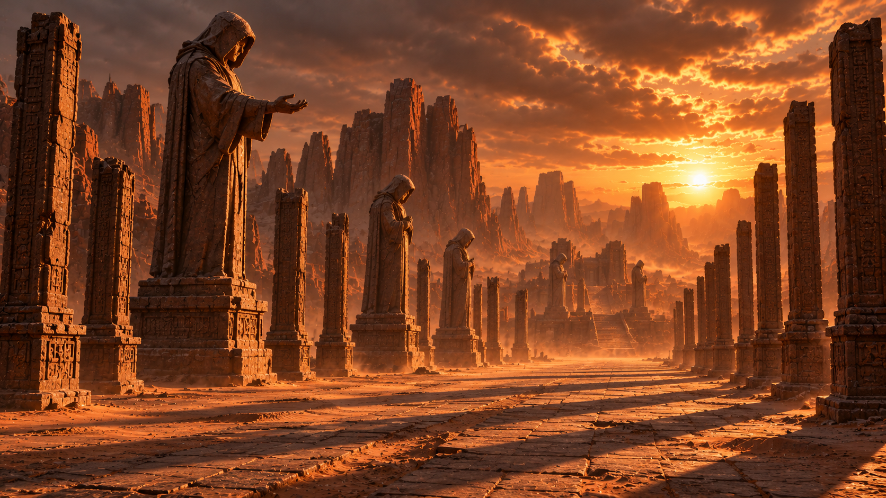</a><figcaption>@Image2 — аллея до аварии</figcaption></figure>
<figure><a href="references/scenes/scene-45/S45-roskotmos-ship-first-option.png" target="_blank" rel="noopener">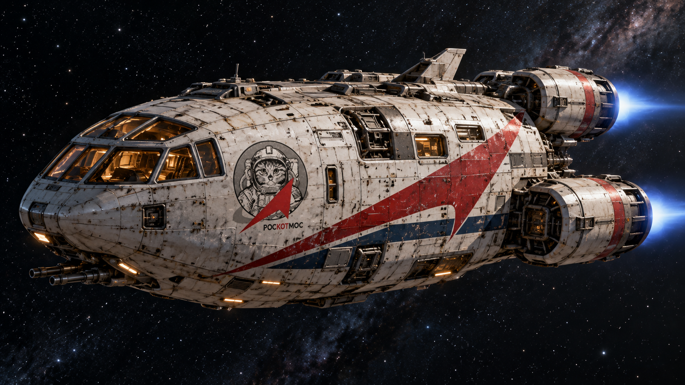</a><figcaption>@Image1 — корабль РосКОТмоса, первый референс</figcaption></figure>
<figure><a href="references/scenes/scene-27/S27-Image5-topview-source.png" target="_blank" rel="noopener"></a><figcaption>@Image3 — руины ситхов</figcaption></figure>
<figure><a href="references/scenes/scene-24/S24-Image3-topview-source.png" target="_blank" rel="noopener">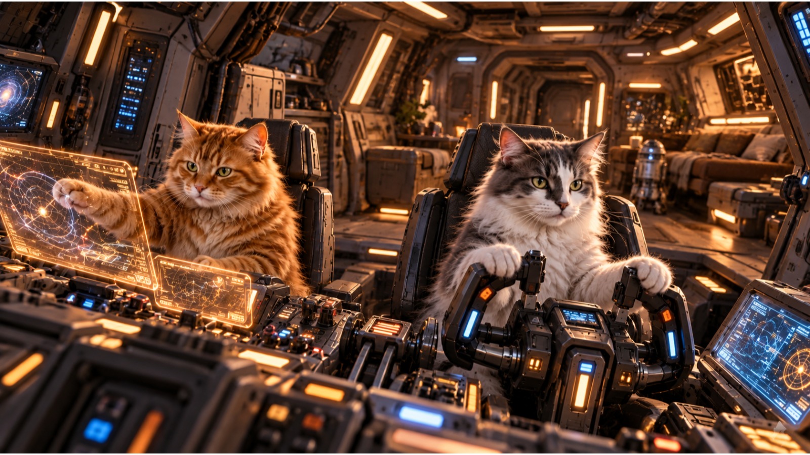</a><figcaption>@Image4 — кабина котов</figcaption></figure>
<figure><a href="references/luchik.jpg" target="_blank" rel="noopener"></a><figcaption>@Image5 — Лучик</figcaption></figure>
<figure><a href="references/ryzhik.jpg" target="_blank" rel="noopener"></a><figcaption>@Image6 — Рыжик</figcaption></figure>
</div>

**Что происходит:** Подбитый корабль котов дымит и падает сквозь оранжевую закатную дымку, от него отлетает панель обшивки, левый двигатель чихает и глохнет. В кабине Лучик изо всех сил тянет штурвал, а распушившийся Рыжик лупит по всем кнопкам сразу и закрывает глаза лапами. Корабль на бреющем задевает брюхом первую колонну аллеи, и колонны валятся одна за другой, как домино. Корабль подпрыгивает на брюхе, килем срезает каменную руку колоссальной статуи, у статуи отваливается голова и катится вслед. Корабль пашет длинную борозду, разворачивается боком, сбивает два обломка колонн, как кегли, и замирает носом в шаге от последней статуи. Тишина. Рыжик медленно убирает лапы с глаз, Лучик поворачивается к нему. Статуя качается… и устояла. Тут докатывается каменная голова и глухо — «клонк» — бьёт корабль в хвост; отваливается крышка двигателя, гнутая антенна медленно никнет.

<div class="engine-tabs" data-scene="57">

<div class="engine-pane" data-engine="wan30" data-main="1">

```text
Mode: reference-to-video | Duration: 30s | Resolution: 720p | Aspect ratio: 16:9 | FPS: 24 | Native audio: on
Optimized for Wan 3.0 | Photoreal live-action space-fantasy action comedy, played completely straight | The battle-damaged RosKOTmos ship crash-lands on the Sith planet and bowls over an avenue of ancient columns and statues

REFERENCES / AUTHORITY ORDER:
@Image1 — the owner-selected RosKOTmos ship design: exact elongated broad hull of worn white and light-grey segmented plating, angular multi-pane forward cockpit with sloped amber-glazed windows, a big red swoosh arrow along the flank, a narrow dark-navy lower band, the round cat-astronaut emblem with the РОСКОТМОС wordmark on the flank behind the cockpit, a small dorsal fin, the rear engine nacelles with blue-white exhausts and twin cannon barrels under the nose. Vehicle design only; ignore the starfield.
@Image2 — the crash site: a long straight processional avenue of tall carved ochre-stone columns and colossal hooded stone statues on flat dusty ground at the outskirts of the ruin city. Absolute authority for the avenue's layout, scale and stone.
@Image3 — the ruin city of the same planet: ochre-red carved stone, colossal hooded statues, a stepped temple, red rock spires, low golden-orange sunset haze. Palette, light and distant skyline only.
@Image4 — the cats' exact warm cockpit: amber practical lights, dense physical consoles, rear-cabin depth, seat and console proportions; RYZHIK's seat on frame-left, LUCHIK's on frame-right in the front view. Interior geometry and light only.
@Image5 — absolute identity of LUCHIK.
@Image6 — absolute identity of RYZHIK.
Priority: @Image1 controls the ship; @Image2 the crash avenue; @Image3 palette and skyline; @Image4 the cockpit; @Image5 and @Image6 the two cats. Never average or swap the cats.

CHARACTER APPEARANCE / IDENTITY LOCK:
LUCHIK (@Image5), the PILOT: fluffy white-and-grey long-haired cat with white muzzle, chest and legs and grey crown, facial and back markings; dense natural fur.
RYZHIK (@Image6), the NAVIGATOR: fluffy ginger long-haired tabby with a warm orange coat, darker tabby stripes and a lighter muzzle and chest.
Both are real photoreal domestic cats at ordinary adult cat scale relative to the seats and consoles: never giant, never half-human, no human hands or faces. Their lightsabers stay stowed and unlit. They appear only in the cockpit shots. No people anywhere.

SHIP / CRASH LOCK — CRITICAL:
One and the same ship from @Image1 in every exterior shot: same silhouette, paint, emblem position and scale. It arrives already damaged from a space battle: the right rear engine nacelle trails orange flame and thick black smoke, the left one coughs and dies. During the crash the hull gets dented, scraped, scorched and dusty, loses one loose hull panel and bends its antenna, but stays in ONE piece: no explosion, no breaking apart; the emblem stays readable. Scale: an ancient column is about as tall as the ship is long; the colossal statues tower over it.

LOCATION LOCK:
A dry, dusty canyon world at golden-orange sunset: the avenue of @Image2 with the ruin city of @Image3 on the horizon. Fine dry dust and a few ember sparks in the air. No lava, vegetation, water, people or other ships.

START STATE:
High above the ruins in orange sunset haze, the damaged ship is already falling at a shallow angle, a black smoke trail behind it.

TIMELINE:
[0:00–0:05] — COMING IN HOT
Fast tracking shot alongside, left to right: the ship plunges through the haze nose-down, wobbling; black smoke pours from the burning right nacelle; one loose hull panel peels off and tumbles past the camera. The left engine coughs twice and dies with a wheeze.

[0:05–0:09] — COCKPIT CHAOS
Cut inside the @Image4 cockpit, front three-quarter view, red warning lights flashing over the warm amber, everything shaking: LUCHIK on frame-right hauls back on the yoke with both front paws, hind legs braced against the console, ears flat; RYZHIK on frame-left, fur fully puffed, slaps three buttons at once, then clamps both front paws over his eyes. A loose cable swings and sparks. Both yowl.

[0:09–0:15] — DOMINOES
Cut to a low wide angle down the avenue: the ship skims in a few metres above the ground and its belly clips the first column, which snaps and falls into the next; tall columns topple one after another like dominoes, each landing with a heavy dusty thud, while the ship bounces once off the ground belly-first in a burst of dust.

[0:15–0:20] — THE STATUE LOSES ITS HAND
Cut to a side tracking shot: still sliding fast, the ship's dorsal fin shears the outstretched stone arm clean off a colossal hooded statue; the arm drops into the dust. A beat later the statue's hooded stone head tips off its shoulders and starts rolling after the ship like a giant bowling ball.

[0:20–0:24] — THE SLIDE
Cut to a high angle: the ship ploughs a long trench, slowly swinging sideways, knocks two short broken pillars flying like skittles, throws a wave of dust and sparks and grinds to a halt with its nose an arm's length from the plinth of the last standing colossal statue.

[0:24–0:27] — DEAD QUIET
Cut inside, the same cockpit view: dust drifts past the windows, one alarm light still blinking. RYZHIK slowly lowers his paws from his eyes; LUCHIK, still gripping the yoke, slowly turns his head toward him.

[0:27–0:30] — ALMOST FINE
Cut to medium-wide exterior, frontal: the last statue sways… and stays standing. The rolling stone head arrives and taps the ship's tail with one dull clonk; a small engine cover falls off with a clang and the bent antenna droops slowly. Hold on the smoking ship, emblem readable through settling dust.

END STATE:
The ship lies tilted on its belly at the end of a long trench in the avenue, turned sideways, nose almost touching a colossal statue's plinth; right nacelle burning with black smoke, hull dented but in one piece, side hatch closed; toppled columns in a line behind it, the statue's stone arm and hooded head beside the tail. Dust settling in sunset light. Nobody comes out yet.

CAMERA / SPACE:
Six motivated cuts on motion or impact (into 0:05, 0:09, 0:15, 0:20, 0:24, 0:27). Screen direction left to right throughout the crash. Fast tracking and low angles give real weight and scale; the comedy comes from timing and real physics, not cartoon squash, speed ramps or wild camera shake. In the cockpit both cats' faces stay readable.

PERFORMANCE:
The cats are deadly serious and fully committed, which is what makes it funny: no winking or mugging, natural feline reactions — flattened ears, puffed fur, wide eyes, bottle-brush tails. The ship moves with real mass and inertia.

LIGHTING / MATERIALS:
Low golden-orange sunset, long shadows of columns and statues, backlit dust; orange firelight and black smoke from the nacelle; red alarm light over warm amber in the cockpit; real painted metal with scratches, scorches and dents; weathered ochre stone breaking into heavy chunks and dust.

AUDIO:
Rising wind howl, an engine cough and wheeze, alarm beeps and sparking in the cockpit, two cats yowling, the crack of each column and heavy thuds in a rhythmic domino sequence, a metallic belly-flop bang, screeching metal on stone, a stone arm thud, the grinding roll of the stone head, then sudden quiet with crackling flames, one dull clonk, a small clang and a creak. No dialogue, narrator or music.

NEGATIVE PROMPT:
explosion, fireball, ship breaking apart, cats outside the ship, people, other ships, space battle, new ship design, ship changing shape or paint, missing or moving emblem, garbled lettering, giant cats, half-human cats, human hands, identity swap, cartoon physics, squash and stretch, slow motion, speed ramps, comedy sound effects, music, lava, vegetation, water, temple interior, subtitles, text overlays, watermark, black bars.

FRAME FILL / NO BARS:
Fill the entire generated frame edge-to-edge. No letterboxing, no pillarboxing, no black bars, no side bars, no decorative borders, no empty margins.
```

</div>

<div class="engine-pane" data-engine="sd20x2">

Та же сцена двумя роликами по 15 с: сначала часть 1, часть 2 — после её результата (@Video1 части 2 = последние секунды части 1). Нумерация входов в каждой части своя.

**Входы части 1:** @Image1 — `references/scenes/scene-45/S45-roskotmos-ship-first-option.png` (корабль); @Image2 — `references/scenes/scene-57/S57-crash-avenue.png` (аллея, готова); @Image3 — `references/scenes/scene-27/S27-Image5-topview-source.png` (руины); @Image4 — `references/scenes/scene-24/S24-Image3-topview-source.png` (кабина); @Image5 — `references/luchik.jpg`; @Image6 — `references/ryzhik.jpg`.

**Входы части 2:** @Video1 — конец части 1; @Image1 — `references/scenes/scene-45/S45-roskotmos-ship-first-option.png` (корабль); @Image2 — `references/scenes/scene-57/S57-crash-avenue.png` (аллея); @Image3 — `references/scenes/scene-24/S24-Image3-topview-source.png` (кабина); @Image4 — `references/luchik.jpg`; @Image5 — `references/ryzhik.jpg`.

#### 57 · Seedance 2.0 часть 1

```text
Mode: reference-to-video (omni-reference) | Duration: 15s | Resolution: 720p | Aspect ratio: 16:9 | FPS: 24 | Native audio: on
Optimized for Seedance 2.0 | Photoreal live-action space-fantasy action comedy, played completely straight | Part 1 of 2: the battle-damaged RosKOTmos ship falls onto the Sith planet, the cats panic in the cockpit, the ship knocks down an avenue of columns like dominoes

REFERENCES / AUTHORITY ORDER:
@Image1 — the owner-selected RosKOTmos ship design: exact elongated broad hull of worn white and light-grey segmented plating, angular multi-pane forward cockpit with sloped amber-glazed windows, a big red swoosh arrow along the flank, a narrow dark-navy lower band, the round cat-astronaut emblem with the РОСКОТМОС wordmark on the flank behind the cockpit, a small dorsal fin, the rear engine nacelles with blue-white exhausts. Vehicle design only; ignore the starfield.
@Image2 — the crash site: a long straight processional avenue of tall carved ochre-stone columns and colossal hooded stone statues on flat dusty ground at the outskirts of the ruin city. Layout, scale and stone of the avenue.
@Image3 — the ruin city of the same planet: ochre-red carved stone, hooded statues, a stepped temple, red rock spires, golden-orange sunset haze. Palette, light and distant skyline only.
@Image4 — the cats' exact warm cockpit: amber practical lights, dense physical consoles, rear-cabin depth; RYZHIK's seat on frame-left, LUCHIK's on frame-right in the front view. Interior geometry and light only.
@Image5 — absolute identity of LUCHIK.
@Image6 — absolute identity of RYZHIK.
Priority: @Image5 and @Image6 control the cats; @Image1 the ship; @Image2 the avenue; @Image4 the cockpit; @Image3 palette and skyline.

CHARACTER APPEARANCE / IDENTITY LOCK:
LUCHIK (@Image5), the PILOT: fluffy white-and-grey long-haired cat with white muzzle, chest and legs and grey crown, facial and back markings.
RYZHIK (@Image6), the NAVIGATOR: fluffy ginger long-haired tabby with a warm orange coat, darker stripes and a lighter muzzle and chest.
Real photoreal domestic cats at ordinary adult cat scale relative to the seats and consoles; never giant or half-human, no human hands. Lightsabers stowed and unlit. No people anywhere.

SHIP / CRASH LOCK — CRITICAL:
One and the same ship from @Image1 in every exterior shot: same silhouette, paint, emblem position and scale. Already damaged from a space battle: the right rear nacelle trails orange flame and black smoke, the left one coughs and dies. It gets dented, scraped and dusty and loses one loose hull panel, but stays in ONE piece: no explosion, no breaking apart. An ancient column is about as tall as the ship is long.

LOCATION LOCK:
A dry, dusty canyon world at golden-orange sunset: the avenue of @Image2 with the ruin city of @Image3 on the horizon. Fine dust and a few ember sparks. No lava, vegetation, water, people or other ships.

START STATE:
High above the ruins in orange sunset haze, the damaged ship is already falling at a shallow angle, a black smoke trail behind it.

TIMELINE:
[0:00–0:04] — COMING IN HOT
Fast tracking shot alongside, left to right: the ship plunges through the haze nose-down, wobbling; black smoke pours from the burning right nacelle; a loose hull panel peels off and tumbles past the camera; the left engine coughs twice and dies.

[0:04–0:08] — COCKPIT CHAOS
Cut inside the @Image4 cockpit, front three-quarter view, red warning lights flashing over the warm amber, everything shaking: LUCHIK on frame-right hauls back on the yoke with both front paws, hind legs braced, ears flat; RYZHIK on frame-left, fur fully puffed, slaps three buttons at once, then clamps both front paws over his eyes. A loose cable sparks. Both yowl.

[0:08–0:15] — DOMINOES
Cut to a low wide angle down the avenue: the ship skims in a few metres above the ground and its belly clips the first column, which snaps and falls into the next; tall columns topple one after another like dominoes, each with a heavy dusty thud. The ship bounces once off the ground belly-first in a burst of dust and keeps sliding fast toward a colossal hooded statue with an outstretched stone arm.

END STATE:
Exterior, low side angle: the ship sliding fast on its belly down the avenue in a cloud of dust, the line of fallen columns behind it, the colossal hooded statue with its outstretched stone arm right ahead. Smoke still pouring from the right nacelle.

CAMERA / SPACE:
Two motivated cuts (into 0:04 and 0:08). Screen direction left to right. Fast tracking and low angles for real weight and scale; comedy from timing and real physics, not cartoon squash or wild shake. In the cockpit both faces readable.

PERFORMANCE:
The cats are deadly serious and fully committed: flattened ears, puffed fur, wide eyes, bottle-brush tails, no mugging. The ship moves with real mass and inertia.

LIGHTING / MATERIALS:
Low golden-orange sunset, long column shadows, backlit dust; orange firelight and black smoke; red alarm light over warm amber in the cockpit; scratched painted metal; ochre stone breaking into heavy chunks.

AUDIO:
Rising wind howl, an engine cough and wheeze, alarm beeps and sparks, two cats yowling, the crack of each column and heavy thuds in a rhythmic domino sequence, a metallic belly-flop bang, screeching metal on stone. No dialogue, narrator or music.

NEGATIVE PROMPT:
explosion, fireball, ship breaking apart, ship stopping in this part, cats outside the ship, people, other ships, new ship design, ship changing shape or paint, missing emblem, garbled lettering, giant cats, human hands, identity swap, cartoon physics, slow motion, speed ramps, comedy sound effects, music, lava, vegetation, water, subtitles, text overlays, watermark, black bars.

FRAME FILL / NO BARS:
Fill the entire generated frame edge-to-edge. No letterboxing, no pillarboxing, no black bars, no side bars, no decorative borders, no empty margins.
```

#### 57 · Seedance 2.0 часть 2

```text
Mode: reference-to-video (omni-reference) | Duration: 15s | Resolution: 720p | Aspect ratio: 16:9 | FPS: 24 | Native audio: on
Optimized for Seedance 2.0 | Photoreal live-action space-fantasy action comedy, played completely straight | Part 2 of 2: the sliding ship beheads a statue, ploughs to a stop, the cats dare to look — and the rolling stone head lands the punchline

REFERENCES / AUTHORITY ORDER:
@Video1 — the last seconds of Part 1: the ship sliding fast on its belly down the avenue toward a colossal hooded statue with an outstretched stone arm. Absolute authority for the START STATE, position, direction, damage and light.
@Image1 — the owner-selected RosKOTmos ship design: elongated worn white hull, amber-glazed multi-pane cockpit, red swoosh, dark-navy band, round cat-astronaut emblem with the РОСКОТМОС wordmark, small dorsal fin, rear engine nacelles. Vehicle design only.
@Image2 — the crash avenue of tall carved ochre-stone columns and colossal hooded statues. Layout, scale and stone.
@Image3 — the cats' exact warm cockpit; RYZHIK's seat on frame-left, LUCHIK's on frame-right in the front view. Interior geometry and light only.
@Image4 — absolute identity of LUCHIK.
@Image5 — absolute identity of RYZHIK.
Priority: @Video1 controls the start; @Image4 and @Image5 the cats; @Image1 the ship; @Image2 the avenue; @Image3 the cockpit.

CHARACTER APPEARANCE / IDENTITY LOCK:
LUCHIK (@Image4), the PILOT: fluffy white-and-grey long-haired cat with white muzzle, chest and legs and grey crown, facial and back markings.
RYZHIK (@Image5), the NAVIGATOR: fluffy ginger long-haired tabby with a warm orange coat, darker stripes and a lighter muzzle and chest.
Real photoreal domestic cats at ordinary adult cat scale relative to the seats; never giant or half-human, no human hands. Lightsabers stowed and unlit. No people anywhere.

SHIP / CRASH LOCK — CRITICAL:
The same ship as in @Video1 and @Image1: same silhouette, paint, emblem and scale, right nacelle burning with black smoke. It gets more dents, scrapes and dust and bends its antenna, but stays in ONE piece: no explosion, no breaking apart; emblem readable.

LOCATION LOCK:
The same dusty avenue at golden-orange sunset, toppled columns behind the ship. Fine dust and ember sparks. No lava, vegetation, water, people or other ships.

START STATE:
Exactly the last frame of @Video1.

TIMELINE:
[0:00–0:04] — THE STATUE LOSES ITS HAND
Continuing @Video1, side tracking shot: the sliding ship's dorsal fin shears the outstretched stone arm clean off the colossal hooded statue; the arm drops into the dust. A beat later the statue's hooded stone head tips off its shoulders and starts rolling after the ship like a giant bowling ball.

[0:04–0:08] — THE SLIDE
Cut to a high angle: the ship ploughs a long trench, slowly swinging sideways, knocks two short broken pillars flying like skittles and grinds to a halt with its nose an arm's length from the plinth of the last standing colossal statue.

[0:08–0:11] — DEAD QUIET
Cut inside the @Image3 cockpit, front three-quarter view: dust drifts past the windows, one alarm light still blinking. RYZHIK on frame-left slowly lowers his paws from his eyes; LUCHIK on frame-right, still gripping the yoke, slowly turns his head toward him.

[0:11–0:15] — ALMOST FINE
Cut to medium-wide exterior, frontal: the last statue sways… and stays standing. The rolling stone head arrives and taps the ship's tail with one dull clonk; a small engine cover falls off with a clang and the bent antenna droops slowly. Hold.

END STATE:
The ship lies tilted on its belly at the end of a long trench, turned sideways, nose almost touching a colossal statue's plinth; right nacelle burning with black smoke, hull dented but in one piece, side hatch closed; toppled columns behind, the statue's stone arm and hooded head beside the tail. Dust settling in sunset light. Nobody comes out yet.

CAMERA / SPACE:
Three motivated cuts (into 0:04, 0:08, 0:11). Screen direction continues @Video1. Real weight and scale; comedy from timing and real physics, not cartoon squash, speed ramps or wild shake. In the cockpit both faces readable.

PERFORMANCE:
The cats are deadly serious: wide eyes, flattened ears, puffed fur, a slow cautious look; no mugging. The ship has real mass.

LIGHTING / MATERIALS:
Low golden-orange sunset, long shadows, backlit settling dust; orange firelight and black smoke; one blinking alarm over warm amber in the cockpit; dented scorched painted metal; heavy ochre stone.

AUDIO:
Screeching metal on stone, a stone arm thud, the grinding roll of the stone head, skittle-like cracks of the pillars, the grinding stop, then sudden quiet with crackling flames and a single alarm beep, the creak of the swaying statue, one dull clonk, a small clang and a creak. No dialogue, narrator or music.

NEGATIVE PROMPT:
explosion, fireball, ship breaking apart, statue falling onto the ship, cats outside the ship, people, other ships, new ship design, ship changing shape or paint, missing emblem, garbled lettering, giant cats, human hands, identity swap, cartoon physics, slow motion, speed ramps, comedy sound effects, music, lava, vegetation, water, subtitles, text overlays, watermark, black bars.

FRAME FILL / NO BARS:
Fill the entire generated frame edge-to-edge. No letterboxing, no pillarboxing, no black bars, no side bars, no decorative borders, no empty margins.
```

</div>

</div>

---

<a id="scene-58"></a>

## Сцена 58 — РосКОТмос: коты выбегают из горящего корабля

**⏳ В МЕДЛЕННОЙ ГЕНЕРАЦИИ**

<!-- scene-meta: {"target_engine":"Seedance 2.0","production_state":"READY","duration_s":30,"dialogue":{"enabled":false,"language":null},"dependencies":[{"type":"continues","scene":57}],"tags":["cats","luchik","ryzhik","roskotmos","sith_planet","crash","escape","action","comedy"]} -->

Seedance 2.0 task `6598a21c2c684d43b7cede9cfc987107` технически завершён 23.10.2026 21:15:48 UTC. Результат требует отдельной редакционной проверки; новый Scene ID не создаётся.

**Контекст использования:**

- **Команда владельца 20.10.2026:** коты выбегают из подбитого, горящего и разваливающегося корабля. Корабль — по самому первому референсу (`S45-roskotmos-ship-first-option.png`).
- **Стык:** сразу после Scene 57 (корабль лёг на брюхо в конце борозды, правый двигатель горит, люк закрыт) → эта сцена → Scene 40 (Серёга садится у храма и слышит зажжённые мечи) → Scene 26 (коты на террасе).
- **Подводка к 40:** в конце над котами с рёвом проносится тень чужого корабля — это Серёга летит к храму; сам корабль не показываем. Коты стряхивают сажу и бегут к храму.
- **Старт — кадр-референс обломков (@Image1), а не видео 57:** так 58 не ждёт результата 57, обе сцены можно запускать по готовности референсов. Если к запуску уже есть принятый конец 57, его можно добавить как @Video1 отдельной правкой.
- **Комедия без мультяшности:** люк заело — его вышибают изнутри с третьего удара; горящая панель падает ровно туда, где только что был Рыжик; Лучик чихает от сажи; эмблема РосКОТмоса падает котам под лапы. Корабль разваливается по частям, огненный шар — небольшой, не на весь кадр.
- **Динамика (правило владельца 18.10):** 6 битов, 5 склеек по движению, без «спокойно».
- **Выбор владельца 20.10, 03:39 МСК:** старт — первый аварийный кадр, где нос упирается в постамент. Добавлены три отдельных помощника: коты у открытого люка на фоне взрыва; разрушение корабля; упавшая эмблема у лап. Изображения готовы; часть 2 требует настоящего окончания части 1. Помощники показывают разные моменты, не одновременный старт.
- **Стык с 57:** при монтаже проверить контакт носа с постаментом; выбранный владельцем старт58 является художественным референсом, а не извлечённым концом57.
- **Версии промта:** во вкладках — 30 с (Wan 3.0 / Seedance 2.5) и Seedance 2.0 (2 × 15 с). В очередь по умолчанию — Seedance 2.0. Без речи и фоновой музыки. Запуск — только по команде владельца.
- В монтаж 20–30 с.

**Референсы:**

- @Image1 — <a href="references/scenes/scene-58/S58-wreck-start-owner-selected.png">первый аварийный кадр — нос в постаменте</a> (созданный стартовый референс, не извлечённый видеокадр);
- @Image2 — <a href="references/scenes/scene-45/S45-roskotmos-ship-first-option.png">корабль РосКОТмоса, первый референс</a> (дизайн, эмблема);
- @Image3 — <a href="references/luchik.jpg">Лучик</a>;
- @Image4 — <a href="references/ryzhik.jpg">Рыжик</a>;
- @Image5 — <a href="references/scenes/scene-57/S57-crash-avenue.png">та же аллея до аварии</a>;

- @Image6 — <a href="references/scenes/scene-58/S58-cats-escape-open-hatch.png">коты бегут от открытого люка</a> (поза/композиция, поздний момент);
- @Image7 — <a href="references/scenes/scene-58/S58-ship-explosion-open-hatch.png">разрушение и локальный взрыв корабля</a>;
- @Image8 — <a href="references/scenes/scene-58/S58-emblem-at-cats-paws.png">эмблема уже лежит у лап котов</a> (результат падения).

<div class="scene-ref-gallery">
<figure><a href="references/scenes/scene-58/S58-cats-escape-open-hatch.png" target="_blank" rel="noopener">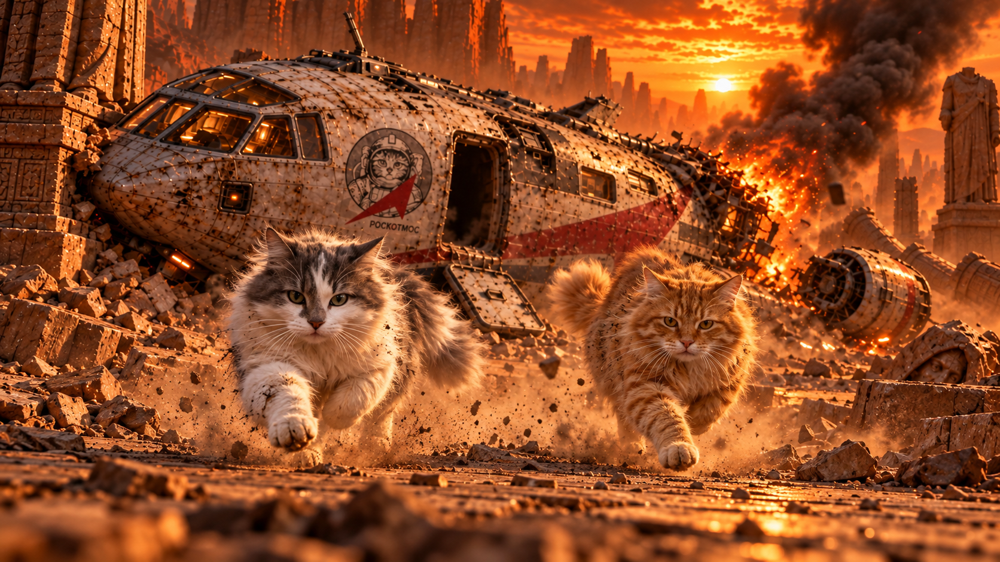</a><figcaption>Коты у открытого люка</figcaption></figure>
<figure><a href="references/scenes/scene-58/S58-ship-explosion-open-hatch.png" target="_blank" rel="noopener">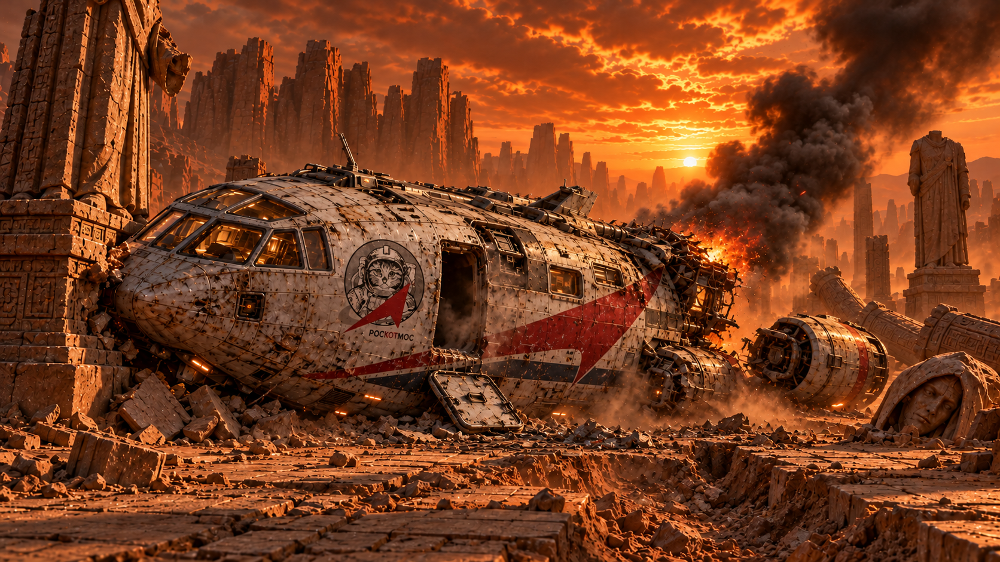</a><figcaption>Разрушение корабля</figcaption></figure>
<figure><a href="references/scenes/scene-58/S58-emblem-at-cats-paws.png" target="_blank" rel="noopener">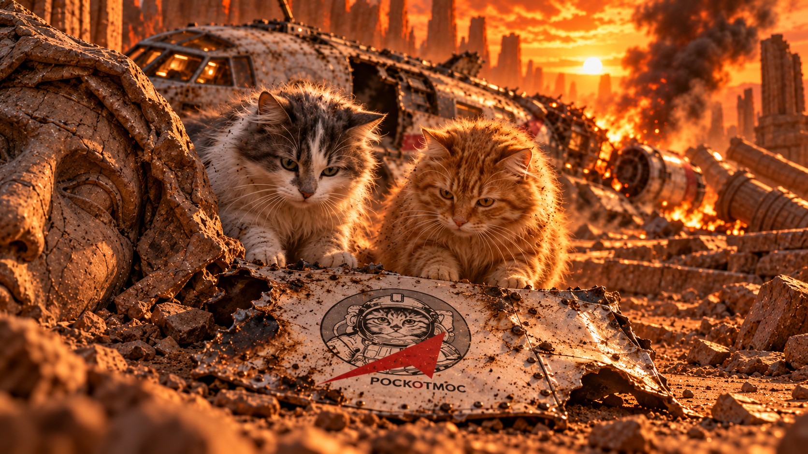</a><figcaption>Эмблема у лап</figcaption></figure>
<figure><a href="references/scenes/scene-58/S58-wreck-start-owner-selected.png" target="_blank" rel="noopener">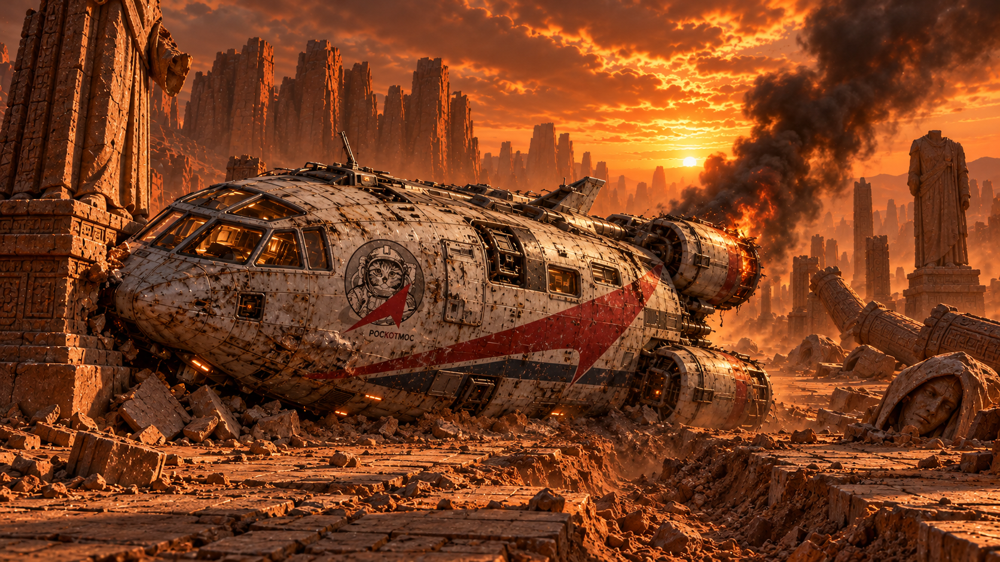</a><figcaption>@Image1 — корабль после аварии</figcaption></figure>
<figure><a href="references/scenes/scene-57/S57-crash-avenue.png" target="_blank" rel="noopener"></a><figcaption>@Image5 — аллея до аварии</figcaption></figure>
<figure><a href="references/scenes/scene-45/S45-roskotmos-ship-first-option.png" target="_blank" rel="noopener"></a><figcaption>@Image2 — корабль РосКОТмоса, первый референс</figcaption></figure>
<figure><a href="references/luchik.jpg" target="_blank" rel="noopener"></a><figcaption>@Image3 — Лучик</figcaption></figure>
<figure><a href="references/ryzhik.jpg" target="_blank" rel="noopener"></a><figcaption>@Image4 — Рыжик</figcaption></figure>
</div>

**Что происходит:** Корабль котов лежит в конце борозды и дымит. Из щелей бокового люка сочится дым, изнутри — глухой удар, второй, люк выгибается, и с третьего удара он слетает с петель и плашмя шлёпается в пыль. Из клубов чёрного дыма на полной скорости вылетает перемазанный сажей Лучик, за ним Рыжик с хвостом-ёршиком; горящая панель обшивки падает ровно туда, где Рыжик был полсекунды назад. Коты бегут на камеру, а за ними корабль разваливается: горящий двигатель отрывается и катится, стойка подламывается, падает киль, по красной полосе идёт трещина. Коты перемахивают через поваленную колонну, позади вспухает небольшой огненный шар, и они ныряют за упавшую каменную голову статуи. Две закопчённые морды медленно выглядывают из-за камня, Лучик чихает. Сверху, кружась, падает обгоревшая панель с эмблемой РосКОТмоса — прямо им под лапы. Рыжик смотрит на неё, потом на Лучика. Тут над ними с рёвом проносится тень чужого корабля к далёкому храму. Коты провожают её взглядом, переглядываются, синхронно стряхивают сажу и срываются вслед.

<div class="engine-tabs" data-scene="58">

<div class="engine-pane" data-engine="wan30" data-main="1">

**Входы 30 с:** @Image1 — `references/scenes/scene-58/S58-wreck-start-owner-selected.png`; @Image2 — `references/scenes/scene-45/S45-roskotmos-ship-first-option.png`; @Image3 — `references/luchik.jpg`; @Image4 — `references/ryzhik.jpg`; @Image5 — `references/scenes/scene-57/S57-crash-avenue.png`; @Image6 — `references/scenes/scene-58/S58-cats-escape-open-hatch.png`; @Image7 — `references/scenes/scene-58/S58-ship-explosion-open-hatch.png`; @Image8 — `references/scenes/scene-58/S58-emblem-at-cats-paws.png`.

```text
Mode: reference-to-video | Duration: 30s | Resolution: 720p | Aspect ratio: 16:9 | FPS: 24 | Native audio: on
Optimized for Wan 3.0 | Photoreal live-action space-fantasy action comedy, played completely straight | Two cats bail out of their crashed, burning, falling-apart RosKOTmos ship on the Sith planet and race off toward the temple

REFERENCES / AUTHORITY ORDER:
@Image1 — START FRAME and crash-site authority: the crashed RosKOTmos ship lying tilted on its belly at the end of a ploughed trench in the dusty avenue, nose pressed into the carved base of a colossal statue, right engine nacelle burning with black smoke, toppled columns behind it, a fallen hooded stone head beside the tail. Absolute authority for the wreck's position, damage, surroundings and light at the start.
@Image2 — the RosKOTmos ship design: elongated worn white hull, amber-glazed multi-pane cockpit, big red swoosh, dark-navy band, round cat-astronaut emblem with the РОСКОТМОС wordmark, small dorsal fin, rear engine nacelles. Vehicle design and emblem only; ignore the starfield.
@Image3 — absolute identity of LUCHIK.
@Image4 — absolute identity of RYZHIK.
@Image5 — the avenue of tall carved ochre-stone columns and colossal hooded statues at the outskirts of the ruin city, the temple and red rock spires far away. Layout and stone of the surroundings.
@Image6 — LATER escape pose/composition helper: exactly two cats galloping away from the visibly open hatch, LUCHIK screen-left and half a stride ahead, RYZHIK screen-right. Individual identity sheets override this helper.
@Image7 — LATER damage/FX helper: open doorway, door on the ground, detached rear nacelle and a localized blast; recognizable hull remains. Not a start frame.
@Image8 — POST-LANDING emblem composition: one scorched panel face-up directly at the cats' front paws beside the fallen hooded head. Original @Image2 controls the emblem artwork; no panel on the ground before its timed fall.
Priority: @Image3 and @Image4 control the cats; @Image1 controls the wreck and start; @Image2 the ship's design and emblem; @Image5 the surroundings. Never average or swap the cats. @Image6–@Image8 are stage-specific helpers, never overrides for the opening or identity.
TEMPORAL REFERENCE GATE: closed hatch/no cats outside at 0:00; open hatch and running cats after 0:05; modest blast only after 0:15; landed emblem only after its fall in 0:20–0:25. Do not combine all reference states into the first frame.

CHARACTER APPEARANCE / IDENTITY LOCK:
LUCHIK (@Image3): fluffy white-and-grey long-haired cat with white muzzle, chest and legs and grey crown, facial and back markings; here his white fur is streaked grey with soot.
RYZHIK (@Image4): fluffy ginger long-haired tabby with a warm orange coat, darker tabby stripes and a lighter muzzle and chest; here dusty, tail bottle-brushed.
Both are real photoreal domestic cats at ordinary adult cat scale (a fallen column drum is taller than they are), running and leaping on four legs with real feline movement; never giant, never half-human, never on hind legs, no human hands or faces. Lightsabers stowed and unlit. Both stay unhurt. No people appear.

SHIP / WRECK LOCK — CRITICAL:
The same ship as @Image1 and @Image2: same paint, red swoosh and emblem. It falls apart in stages, believably and heavily: the burning right nacelle tears loose and rolls away, a landing strut buckles so the hull drops on one side, the dorsal fin topples, a crack opens along the red swoosh, then one modest fireball puffs up from the torn engine mount. The fireball never fills the frame and never reaches the cats; no huge explosion, the hull is not obliterated.

LOCATION LOCK:
The dusty avenue of @Image5 at golden-orange sunset, as in @Image1: trench, toppled columns, the statue's stone arm and hooded head in the dust, the temple far away. Fine dust and ember sparks. No lava, vegetation, water or other people.

START STATE:
Exactly @Image1: the wreck smoking at the end of the trench, side hatch closed, no one outside.

TIMELINE:
[0:00–0:05] — JAMMED HATCH
Medium exterior on the side hatch behind the cockpit: smoke seeps from its seams. A muffled thump from inside, a second thump and the hatch bulges; on the third thump it pops off its hinges and slaps flat into the dust; a thick puff of black smoke rolls out.

[0:05–0:10] — OUT OF THE SMOKE
Cut to a low tracking shot at cat height: LUCHIK bursts out of the smoke at a full sprint, ears back; RYZHIK right behind him. Half a second after RYZHIK passes, a burning hull panel crashes down exactly where he just was; he doesn't even look back.

[0:10–0:15] — IT FALLS APART
Cut to a wide frontal angle, the cats running straight toward camera across the trench; behind them the ship falls apart in stages: the burning right nacelle tears loose and rolls away, a landing strut buckles and the hull drops on one side, the dorsal fin topples, a crack opens along the red swoosh.

[0:15–0:20] — THE JUMP
Cut to a side tracking shot: both cats leap over a fallen column in full stride; behind them a modest fireball puffs up from the torn engine mount and a heat ripple ruffles their fur; they land and dive behind the fallen hooded stone head of the statue.

[0:20–0:25] — PEEK
Cut to a medium close shot from the far side of the stone head: two soot-streaked faces rise slowly over the stone, ears flat, eyes wide. LUCHIK sneezes. A scorched hull panel bearing the round cat-astronaut emblem flutters down and lands face-up in the dust right in front of them with a clank. RYZHIK looks down at it, then at LUCHIK.

[0:25–0:30] — WHAT NOW
A deep engine howl sweeps overhead: a fast dark shadow of another craft flashes across the cats and the ruins toward the distant temple; the craft itself is never shown clearly. Both heads snap up and track it, ears perking. They exchange one glance, shake the soot off their fur in unison and sprint off frame toward the temple. Hold for a second on the burning wreck.

END STATE:
The burning, half-collapsed RosKOTmos wreck at the end of its trench among toppled columns, smoke rising into the sunset; the emblem panel lying face-up in the dust; the cats gone toward the distant temple. Nobody else in sight.

CAMERA / SPACE:
Five motivated cuts on motion or impact (into 0:05, 0:10, 0:15, 0:20, 0:25). The cats run away from the ship toward the camera and the temple; the ship stays behind them. Low cat-height tracking and real-speed movement; comedy from timing and physics, not cartoon squash, speed ramps or wild camera shake. Faces readable in the peek shot.

PERFORMANCE:
The cats act like real cats in an emergency, deadly serious: flattened ears, puffed fur, full-stretch gallops, a precise leap, a cautious peek, one sneeze, an in-sync full-body shake. No mugging, no posing, no human gestures.

LIGHTING / MATERIALS:
Low golden-orange sunset, long shadows of columns and statues; orange firelight and black smoke from the wreck; soot on fur, dented scorched painted metal, sparks, dust kicked up by paws, heavy ochre stone.

AUDIO:
Crackling fire and hissing smoke, three muffled thumps and a metal slap, galloping paws on grit, a burning panel crashing down, groaning and tearing metal, a nacelle rolling with a grinding clatter, a muffled whoomp of the small fireball, a cat sneeze, a light metallic clank, then a deep engine howl passing overhead with a Doppler sweep and fading toward the temple. No dialogue, narrator or music.

NEGATIVE PROMPT:
cats hurt, cats on fire, cats on hind legs, giant cats, half-human cats, human hands, identity swap, extra cats, people, Serega, showing the other craft clearly, huge explosion, frame-filling fireball, ship design change, emblem changed or garbled, lightsabers ignited, cartoon physics, squash and stretch, slow motion, speed ramps, comedy sound effects, music, lava, vegetation, water, subtitles, text overlays, watermark, black bars.

FRAME FILL / NO BARS:
Fill the entire generated frame edge-to-edge. No letterboxing, no pillarboxing, no black bars, no side bars, no decorative borders, no empty margins.
```

</div>

<div class="engine-pane" data-engine="sd20x2">

Та же сцена двумя роликами по 15 с: сначала часть 1, часть 2 — после её результата (@Video1 части 2 = последние секунды части 1). Нумерация входов в каждой части своя.

**Входы части 1:** @Image1 — `references/scenes/scene-58/S58-wreck-start-owner-selected.png`; @Image2 — `references/scenes/scene-45/S45-roskotmos-ship-first-option.png`; @Image3 — `references/luchik.jpg`; @Image4 — `references/ryzhik.jpg`; @Image5 — `references/scenes/scene-57/S57-crash-avenue.png`; @Image6 — `references/scenes/scene-58/S58-cats-escape-open-hatch.png`.

**Входы части 2:** @Video1 — настоящий конец части 1; @Image1 — `references/luchik.jpg`; @Image2 — `references/ryzhik.jpg`; @Image3 — `references/scenes/scene-58/S58-ship-explosion-open-hatch.png`; @Image4 — `references/scenes/scene-45/S45-roskotmos-ship-first-option.png`; @Image5 — `references/scenes/scene-58/S58-cats-escape-open-hatch.png`; @Image6 — `references/scenes/scene-58/S58-emblem-at-cats-paws.png`.

#### 58 · Seedance 2.0 часть 1

```text
Mode: reference-to-video (omni-reference) | Duration: 15s | Resolution: 720p | Aspect ratio: 16:9 | FPS: 24 | Native audio: on
Optimized for Seedance 2.0 | Photoreal live-action space-fantasy action comedy, played completely straight | Part 1 of 2: the jammed hatch is kicked out, two cats burst out of the smoke and run while the crashed RosKOTmos ship falls apart behind them

REFERENCES / AUTHORITY ORDER:
@Image1 — START FRAME and crash-site authority: the crashed RosKOTmos ship lying tilted on its belly at the end of a ploughed trench in the dusty avenue, nose pressed into the carved statue pedestal, right engine nacelle burning with black smoke, toppled columns behind it, a fallen hooded stone head beside the tail. Position, damage, surroundings and light at the start.
@Image2 — the RosKOTmos ship design: elongated worn white hull, amber-glazed multi-pane cockpit, big red swoosh, dark-navy band, round cat-astronaut emblem with the РОСКОТМОС wordmark, small dorsal fin. Design and emblem only.
@Image3 — absolute identity of LUCHIK.
@Image4 — absolute identity of RYZHIK.
@Image5 — the avenue of tall carved ochre-stone columns and colossal hooded statues, temple far away. Surroundings only.
@Image6 — escape pose/composition helper ONLY: LUCHIK screen-left half a stride ahead, RYZHIK screen-right, natural four-legged gallop away from the open doorway. Use only after the hatch opens. IGNORE its later explosion and advanced rear-engine damage in this part; individual @Image3/@Image4 identities override helper faces.
Priority: @Image3 and @Image4 control the cats; @Image1 the wreck and start; @Image2 the design and emblem; @Image5 the surroundings; @Image6 supplies running posture and the doorway, not the start or explosion timing.

CHARACTER APPEARANCE / IDENTITY LOCK:
LUCHIK (@Image3): fluffy white-and-grey long-haired cat with white muzzle, chest and legs and grey crown, facial and back markings; white fur streaked grey with soot.
RYZHIK (@Image4): fluffy ginger long-haired tabby with a warm orange coat, darker stripes and a lighter muzzle and chest; dusty, tail bottle-brushed.
Real photoreal domestic cats at ordinary adult cat scale, running on four legs with real feline movement; never giant, half-human or on hind legs, no human hands. Lightsabers stowed and unlit. Both unhurt. No people.

SHIP / WRECK LOCK — CRITICAL:
The same ship as @Image1 and @Image2: same paint, red swoosh and emblem. It falls apart in heavy believable stages: the burning right nacelle tears loose and rolls away, a landing strut buckles and the hull drops on one side, the dorsal fin topples, a crack opens along the red swoosh. No explosion in this part.

LOCATION LOCK:
The dusty avenue at golden-orange sunset as in @Image1 and @Image5. Fine dust and ember sparks. No lava, vegetation, water or people.

START STATE:
Exactly @Image1: the wreck smoking at the end of the trench, side hatch closed, no one outside. The open-hatch helper is a later beat, never the opening frame.

TIMELINE:
[0:00–0:05] — JAMMED HATCH
Medium exterior on the side hatch behind the cockpit: smoke seeps from its seams. A muffled thump from inside, a second thump and the hatch bulges; on the third thump it pops off its hinges and slaps flat into the dust; a thick puff of black smoke rolls out.

[0:05–0:10] — OUT OF THE SMOKE
Cut to a low tracking shot at cat height: LUCHIK bursts out of the smoke at a full sprint, ears back; RYZHIK right behind him. Half a second after RYZHIK passes, a burning hull panel crashes down exactly where he just was; he doesn't look back.

[0:10–0:15] — IT FALLS APART
Cut to a wide frontal angle, the cats running straight toward camera; behind them the ship falls apart: the burning right nacelle tears loose and rolls away, a landing strut buckles and the hull drops on one side, the dorsal fin topples, a crack opens along the red swoosh.

END STATE:
Wide frontal: both cats in full gallop toward camera, a fallen column just ahead of them; behind them the half-collapsed ship, the loose nacelle rolling, smoke and flames rising.

CAMERA / SPACE:
Two motivated cuts (into 0:05 and 0:10). The cats run away from the ship toward the camera. Low cat-height tracking at real speed; comedy from timing and physics, not cartoon squash or speed ramps.

PERFORMANCE:
Real cats in an emergency, deadly serious: flattened ears, puffed fur, full-stretch gallops. No mugging or human gestures.

LIGHTING / MATERIALS:
Low golden-orange sunset, long shadows; orange firelight and black smoke; soot on fur, dented scorched painted metal, sparks and dust kicked up by paws.

AUDIO:
Crackling fire, three muffled thumps and a metal slap, galloping paws on grit, a burning panel crashing down, groaning and tearing metal, a nacelle rolling with a grinding clatter. No dialogue, narrator or music.

NEGATIVE PROMPT:
cats hurt, cats on fire, cats on hind legs, giant cats, half-human cats, human hands, identity swap, extra cats, people, explosion, fireball, ship design change, emblem changed or garbled, lightsabers ignited, cartoon physics, slow motion, speed ramps, comedy sound effects, music, lava, vegetation, water, subtitles, text overlays, watermark, black bars.

FRAME FILL / NO BARS:
Fill the entire generated frame edge-to-edge. No letterboxing, no pillarboxing, no black bars, no side bars, no decorative borders, no empty margins.
```

#### 58 · Seedance 2.0 часть 2

```text
Mode: reference-to-video (omni-reference) | Duration: 15s | Resolution: 720p | Aspect ratio: 16:9 | FPS: 24 | Native audio: on
Optimized for Seedance 2.0 | Photoreal live-action space-fantasy action comedy, played completely straight | Part 2 of 2: the cats leap to cover from a small fireball, the RosKOTmos emblem lands at their paws, a strange craft howls overhead and they race off toward the temple

REFERENCES / AUTHORITY ORDER:
@Video1 — the last seconds of Part 1: both cats galloping toward camera, a fallen column ahead, the half-collapsed burning ship behind. Absolute authority for the START STATE, positions, damage and light.
@Image1 — absolute identity of LUCHIK.
@Image2 — absolute identity of RYZHIK.
@Image3 — later damage and FX helper: the same nose-to-pedestal ship with its open side doorway and fallen door, detached rear nacelle, a localized blast and black smoke, fallen columns and stone head. The recognizable hull remains. It does not override @Video1 at the opening.
@Image4 — the RosKOTmos ship design: the round cat-astronaut emblem with the РОСКОТМОС wordmark, red swoosh and white worn paint. Emblem and paint only.
@Image5 — two-cat escape helper: LUCHIK screen-left half a stride ahead, RYZHIK screen-right, natural four-legged gallop, exact open doorway behind; composition only, identities from @Image1/@Image2.
@Image6 — POST-LANDING panel helper: one scorched torn hull panel lies face-up directly at both cats' front paws beside the fallen hooded head. Use the composition and panel placement AFTER its fall; @Image4 remains the exact emblem artwork authority.
Priority: @Video1 controls the start; @Image1 and @Image2 the cats; @Image3 the wreck and surroundings; @Image4 the emblem; @Image5/@Image6 are action-beat helpers only.
TEMPORAL REFERENCE GATE: start exactly at the real @Video1 ending; the blast belongs to 0:00–0:04, the panel falls during 0:04–0:10 and only THEN lies at their paws. No grounded duplicate emblem or reset to the still images.

CHARACTER APPEARANCE / IDENTITY LOCK:
LUCHIK (@Image1): fluffy white-and-grey long-haired cat with white muzzle, chest and legs and grey crown, facial and back markings; white fur streaked grey with soot.
RYZHIK (@Image2): fluffy ginger long-haired tabby with a warm orange coat, darker stripes and a lighter muzzle and chest; dusty, tail bottle-brushed.
Real photoreal domestic cats at ordinary adult cat scale, moving on four legs; never giant, half-human or on hind legs, no human hands. Lightsabers stowed and unlit. Both unhurt. No people.

SHIP / WRECK LOCK — CRITICAL:
The same half-collapsed burning ship as in @Video1. One modest fireball puffs up from its torn engine mount; it never fills the frame and never reaches the cats; no huge explosion. The other craft that flies overhead is only a fast dark shadow and a sound, never shown clearly.

LOCATION LOCK:
The same dusty avenue at golden-orange sunset, the temple far away. Fine dust and ember sparks. No lava, vegetation, water or people.

START STATE:
Exactly the last frame of @Video1.

TIMELINE:
[0:00–0:04] — THE JUMP
Continuing @Video1, then a side tracking shot: both cats leap over the fallen column in full stride; behind them a modest fireball puffs up from the torn engine mount and a heat ripple ruffles their fur; they land and dive behind the fallen hooded stone head of the statue.

[0:04–0:10] — PEEK
Cut to a medium close shot from the far side of the stone head: two soot-streaked faces rise slowly over the stone, ears flat, eyes wide. LUCHIK sneezes. A scorched hull panel bearing the round cat-astronaut emblem flutters down and lands face-up directly at their front paws with a clank, matching @Image6 only after contact with the ground. RYZHIK looks down at it, then at LUCHIK.

[0:10–0:15] — WHAT NOW
A deep engine howl sweeps overhead: a fast dark shadow of another craft flashes across the cats and the ruins toward the distant temple. Both heads snap up and track it, ears perking. They exchange one glance, shake the soot off their fur in unison and sprint off frame toward the temple. Hold for a second on the burning wreck.

END STATE:
The burning, half-collapsed RosKOTmos wreck at the end of its trench among toppled columns, smoke rising into the sunset; the emblem panel face-up in the dust; the cats gone toward the distant temple.

CAMERA / SPACE:
Two motivated cuts (into 0:04 and 0:10). Screen direction continues @Video1; the cats move away from the wreck toward the temple. Real-speed movement; comedy from timing, not cartoon squash, speed ramps or wild shake. Faces readable in the peek shot.

PERFORMANCE:
Deadly serious real cats: a precise leap, a cautious peek, one sneeze, a sideways look, an in-sync full-body shake, an instant sprint. No mugging or human gestures.

LIGHTING / MATERIALS:
Low golden-orange sunset, long shadows; orange firelight, black smoke, a brief warm flash from the fireball; soot on fur, scorched painted metal on the emblem panel, heavy ochre stone.

AUDIO:
Galloping paws, a muffled whoomp of the small fireball, crackling fire, a cat sneeze, a light metallic clank, then a deep engine howl passing overhead with a Doppler sweep and fading toward the temple, quick paws on grit. No dialogue, narrator or music.

NEGATIVE PROMPT:
cats hurt, cats on fire, cats on hind legs, giant cats, half-human cats, human hands, identity swap, extra cats, people, Serega, showing the other craft clearly, huge explosion, frame-filling fireball, emblem changed or garbled, lightsabers ignited, cartoon physics, slow motion, speed ramps, comedy sound effects, music, lava, vegetation, water, subtitles, text overlays, watermark, black bars.

FRAME FILL / NO BARS:
Fill the entire generated frame edge-to-edge. No letterboxing, no pillarboxing, no black bars, no side bars, no decorative borders, no empty margins.
```

</div>

</div>

---

<a id="scene-59"></a>

## Сцена 59 — Кашиик: динамичное прибытие и предвкушение грибной прогулки

<!-- scene-meta: {"target_engine":"Seedance 2.0","production_state":"READY","duration_s":60,"dialogue":{"enabled":false,"language":null},"dependencies":[],"tags":["serega","kashyyyk","travel","action","landing","mushrooms","basket","continuity"]} -->

**Решение владельца · 24.10.2026:** готовая первая часть + три новых продолжения по15с: **59P2 — атмосфера и лес; 59P3 — посадка; 59P4 — выход с корзинкой**. Итого около60с с существующей P1, новых генераций —45с. Не уплотнять эти три действия обратно в один15сролик. Посадка59 и вылет60 остаются независимыми.

**Первая часть уже готова:** `d876c99424ff4a24b860a0115ab07173_faststart.mp4`. Повторный59P1 не запускать. Его старый промт убран из активных вариантов и сохранён только в [архиве](archive/scenes/scene-59/retired-P1-before-owner-video.md). Настоящий финал — корабль приближается к планете из космоса; это начало59P2. Источник и сохранённые3с: `references/scenes/scene-59/owner-P1-continuity.json`.

**Новый источник корзинки и настроения:** `260917_0001_video_edit_6252.mp4` (30с). Берём точные лицо, робу, небольшую овальную плетёную корзинку с одной ручкой и левую руку переноса. Корзинка при выходе пустая; грибы ещё не собираются. Прежнее требование «холодное лицо, без улыбки, без корзины» отменено для этого выхода. Прежний янтарный прибор остаётся убранным внутри корабля, а не превращается в корзинку.

**Что происходит:** мощный заход сквозь атмосферу → раскрытие гигантского леса → один читаемый S-вираж вокруг крон → отдельная тормозящая дуга над поляной → волна листьев и тяжёлое касание опор → тихий выход по боковой рампе с корзинкой → светлеющий взгляд, довольная улыбка и первые шаги к грибам. Динамика строится на скорости, масштабе леса, параллаксе и массе корабля; лицо получает отдельное время после посадки.

**Точные статусы:**59P2 готова по входам и ждёт слот.59P3 ждёт результат59P2, затем вырезку последних3с, финальный кадр и проверку стыка.59P4 так же ждёт59P3. Готовые картинки корзинки не снимают эти зависимости. Пока часть ждёт, запускать следующую готовую сцену по очереди; не держать слот пустым. Позиция блока остаётся после червей и62, перед60/61.

**Монтаж:** P1→P2→P3→P4 планируется с непрерывными границами, но качество стыков подтверждается только по реальным результатам. Переход P4→готовый грибной ролик — естественная склейка по шагу и направлению после просмотра результата; покадровое совпадение с началом грибного видео не обещается. Повторять его30с сбора грибов не нужно.

**Корабль и безопасность географии:** один и тот же корпус, крыша всегда пуста; Серёга внутри при любом движении. Посадка на открытой поляне с достаточным запасом для корпуса, без ударов о деревья. P2 заканчивается в воздухе со сложенными шасси; P3 — на земле с закрытым люком; только P4 открывает люк и опускает рампу. Реальное видео определяет направление, свет и геометрию стыка; синтетическая картинка не заменяет результат.

<div class="scene-ref-gallery">
<figure><a href="references/scenes/scene-59/S59-owner-P1-final.jpg" target="_blank" rel="noopener">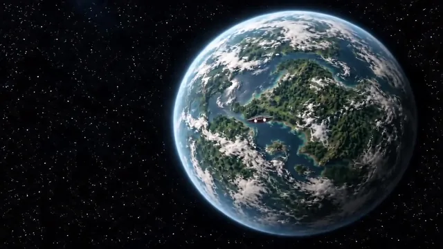</a><figcaption>59P1 · настоящий космический финал</figcaption></figure>
<figure><a href="references/scenes/scene-59/S59-mushroom-basket-body.jpg" target="_blank" rel="noopener">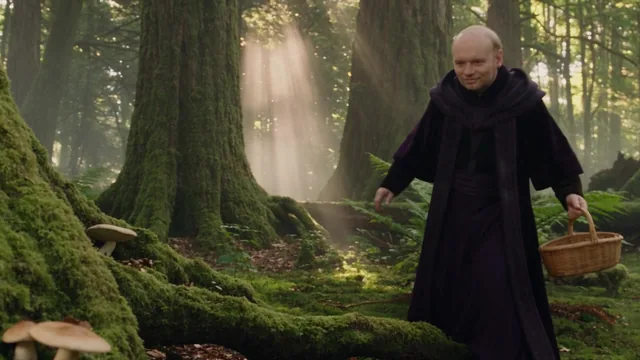</a><figcaption>Серёга, костюм и пустая корзинка в левой руке</figcaption></figure>
<figure><a href="references/scenes/scene-59/S59-mushroom-face-weave.jpg" target="_blank" rel="noopener">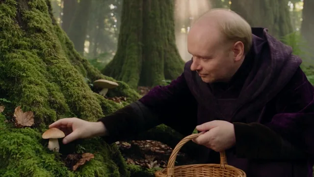</a><figcaption>Лицо, воротник и плетение корзинки; позу сбора не копировать</figcaption></figure>
<figure><a href="references/scenes/scene-59/S59-mushroom-forest-opening.jpg" target="_blank" rel="noopener">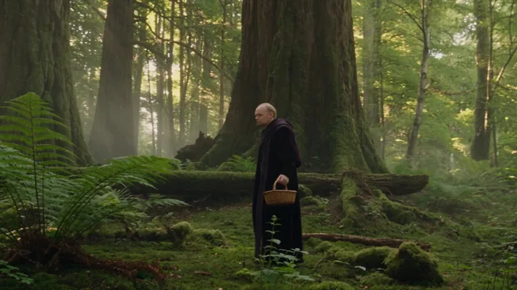</a><figcaption>Лес и контекст следующего готового ролика</figcaption></figure>
<figure><a href="references/scenes/scene-59/S59-mushroom-forest-canopy.jpg" target="_blank" rel="noopener">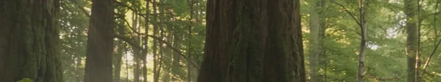</a><figcaption>Кроны и тёплый свет; кроп без персонажа</figcaption></figure>
<figure><a href="references/scenes/ship-locations/Serega-ship-kashyyyk-landing.png" target="_blank" rel="noopener">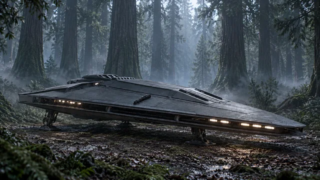</a><figcaption>Корабль на поляне · синтетический ориентир, не видеокадр</figcaption></figure>
</div>

**Референсы по ролям:** космический финал — точный кадр P1; лес/свет — кадры нового грибного видео; корзинка/рука/роба — кадр8,5с; лицо и плетение — кадр18с; каноническая внешность — `references/full/serega.jpg`. Существующая картинка корабля на поляне — только AI-ориентир геометрии и масштаба, не обещание финального кадра. Кроп крон не содержит человека и используется в двух внешних сценах полёта/посадки.

<div class="engine-tabs" data-scene="59">

<div class="engine-pane" data-engine="wan30" data-main="1">

**Сокращённая30с альтернатива — НЕ В ОЧЕРЕДИ.** Та же история и корзинка, с более плотным темпом. Выбранный владельцем вариант — три продолжения по15с во второй вкладке.

**Входы30с:** @Video1 — сохранённые3с готовой59P1; @Image1 — `references/scenes/scene-59/S59-owner-P1-final.jpg`; @Image2 — `references/scenes/ship-locations/Serega-ship-kashyyyk-landing.png`; @Image3 — `references/scenes/scene-59/S59-mushroom-basket-body.jpg`; @Image4 — `references/scenes/scene-59/S59-mushroom-face-weave.jpg`; @Image5 — `references/full/serega.jpg`.

```text
Mode: reference-to-video (omni-reference) | Duration: 30s | Resolution: 720p | Aspect ratio: 16:9 | FPS: 24 | Native audio: on
Optimized for Wan 3.0 | Photoreal live-action space-opera cinema
SHORTENED ALTERNATIVE — SAME OWNER-REQUESTED STORY IN30SECONDS. Not selected for the queue; the selected continuation is three15second Seedance2.0 parts after the existing owner Part1.

REFERENCES / AUTHORITY:
@Video1 — exact final3seconds of the owner's orbital Part1; only its terminal exterior frame and motion are continued, never the earlier cockpit or fly-by.
@Image1 — exact final frame of that Part1; opening camera, ship, planet orientation, clouds and exposure.
@Image2 — synthetic personal craft at a forest clearing; destination scale only. The actual hull in @Video1 wins, and the parked hatch/gear state must not leak into flight.
@Image3 — real8.5s mushroom-film frame: exact low oval honey-brown wicker basket, single arch handle, carried in LEFT hand, plus robe/body appearance. Ignore the picking context.
@Image4 — real18s mushroom-film frame: face, collar texture and basket weave; no copying mushrooms into his hand.
@Image5 — canonical Serega model sheet: exact identity. Both mushroom-film frames guide the warm green forest, natural robe and prop appearance; all depict ONE person.

SHIP / OCCUPANCY LOCK — CRITICAL:
One broad flat dark-grey personal wedge craft, preserving the actual source hull, cockpit glazing, panel seams, proportions, horizontal warm light strips and rear engines. Actual video wins over synthetic ship imagery. No fighter/shuttle redesign or extra craft. Roof, canopy, wings and exterior hull are completely empty: no person, silhouette or reflection of a rider on top. One Serega remains fully inside the closed cockpit at the controls whenever the ship moves. No extra passenger, external duplicate or lightsaber. The one side hatch and ramp stay closed until the craft is stationary on all landing feet. Never open through the roof or teleport a person through glass.

CHARACTER APPEARANCE / IDENTITY LOCK:
SEREGA: pale mature man with balding crown, sparse fair hair at the sides, broad familiar face and build from @Image5. Long dark-purple robe with a layered scarf-like collar, black inner sleeves/clothes and boots, matching @Image3/@Image4. He pilots inside during flight; no cockpit insert is needed. After landing he is relaxed and happily anticipates mushroom gathering. Do not substitute a cold villain stare or exaggerated comic grin.

BASKET / PROP LOCK:
One initially empty low oval honey-brown wicker basket, closely woven sides, reinforced rim, single arched wicker handle, exact design/proportions from @Image3. Already carried in LEFT hand when he appears in the side doorway; right hand empty. Never switch hands, duplicate or fill it before any gathering. The earlier amber-bar device remains stowed inside; it does not turn into the basket. Existing cabin note stays out of view, no new text or weapon.

FOREST / GEOGRAPHY / LOOK:
One Kashyyyk forest: immense old-growth trunks, high layered crowns, broad moss-covered buttress roots, ferns, damp leaf litter and soft haze with warm daylight shafts through green foliage. Match the owner's mushroom-film atmosphere, not a blue night forest. A broad existing corridor opens into a natural glade, comfortably wider than the entire hull and clear of trunks. Flight and landing stay above this open space; no smashing or phasing through branches. The mushroom trail begins at the glade edge, outside the strongest downwash. No lake, city, landing pad, village or battle. Keep a coherent travel axis and sun direction.

START STATE:
Continue the last actual orbital frame without a reset, preserving camera movement, near-level roll, engine colour and planet arrangement. The first2seconds continue the same rear tracking motion. A later cloud occlusion may hide travel-time compression; no direct space-to-ground cut at the opening.

TIMELINE:
[0:00–0:02] Continue the exact orbital motion and composition from @Video1/@Image1.
[0:02–0:07] Descend toward the forest continent, restrained entry ion shimmer fading into flowing vapour. Dense cloud obscures the view briefly, then reveals the immense green canopy under warm shafts of light. No damage or fiery meteor.
[0:07–0:13] Fast, heavy rear-quarter tracking flight; one clean S-bank around a crown and into a broad existing corridor, full-hull clearance on both sides. Establish the open landing glade and frame-right approach. Hatch closed, pilot inside, no tree collision.
[0:13–0:18] One shallow braking arc over the open glade, modest nose-up flare, gear unfolds and locks. Remaining forward speed bleeds away; a low ring of leaves and mist rolls outward under thrust, ferns bow, giant trees remain upright.
[0:18–0:22] Motivated low port-side cut on contact: feet bear weight, suspension compresses once, ship settles fully and engines wind down. No bounce, sliding or hovering after landing.
[0:22–0:27] Side hatch opens and short ramp reaches solid ground. Serega appears carrying the empty basket in his LEFT hand, walks down two or three steps; right hand free. Keep him on the ramp/ground, never the roof. Camera becomes medium front-side for the face and basket.
[0:27–0:30] Eyes brighten toward mushrooms at a mossy root, a small delighted smile and satisfied breath; he turns into the trail with the same basket, right hand empty. Finish before bending or picking. Do not rush into a repeated harvesting montage.

END STATE:
Same intact craft parked, side ramp down; Serega starts the mushroom trail with an empty left-hand basket and happy anticipation. The existing owner's mushroom film may follow on a natural walking cut; exact downstream frame match is not claimed.

CAMERA / LIGHT / AUDIO:
The opening retains the source camera. Later motivated cloud transition, one touchdown cut and a readable medium exit shot. Flight is dynamic through parallax, banking and mass; final emotion gets real screen time. Warm forest daylight develops gradually from source space exposure. Sound moves from source propulsion to atmosphere, turbine braking, gear/contact, hydraulics, boots, wicker creak and forest ambience. No speech, narration or added music. Check actual generated joins and gain after rendering.

NEGATIVE PROMPT:
source replay, opening reset, different ship/planet, roof rider, extra people, tree impacts, crash landing,180degree spin, floating gear, open hatch in flight, duplicated basket, right-hand basket, prefilled basket, device-to-basket morph, mushroom picking montage, evil grin, silent static hero pose, costume/face drift, slow motion, cartoon.

FRAME FILL / NO BARS:
Fill the entire16:9 frame edge-to-edge; no letterboxing, pillarboxing, black bars, decorative borders, captions or watermark.
```

</div>

<div class="engine-pane" data-engine="sd20x2" data-duration="3 × 15 с · продолжение готовой P1">

#### 59 · Seedance 2.0 часть 2

**Атмосфера и лес ·15с.** Готова по входам, ждёт слот. @Video1 — `S59-owner-P1-last3s.mp4`, Library `libfile_7e1093c34c748191b51f2159106da6fa`; @Image1 — `references/scenes/scene-59/S59-owner-P1-final.jpg`; @Image2 — `references/scenes/scene-59/S59-mushroom-forest-canopy.jpg`; @Image3 — `references/scenes/ship-locations/Serega-ship-kashyyyk-landing.png`.

```text
Mode: reference-to-video (omni-reference) | Duration: 15s | Resolution: 720p | Aspect ratio: 16:9 | FPS: 24 | Native audio: on
Optimized for Seedance 2.0 | Photoreal live-action space-opera cinema
PART2 OF4 — ATMOSPHERIC ENTRY AND FOREST FLIGHT ONLY. Part1 is the owner's existing video; landing and exit belong to later parts.

REFERENCES / AUTHORITY:
@Video1 — exact final3seconds of the selected orbital Part1. Continue ONLY its terminal exterior frame and motion; do not replay the earlier cockpit or fly-by inside this reference clip.
@Image1 — exact last frame of that Part1: rear of one ship receding toward the same blue-green planet. Locks opening framing, planet/cloud configuration, ship scale, engine colour and camera roll.
@Image2 — actual cropped forest-canopy frame from the owner's mushroom video: giant trunks, green foliage, warm filtered daylight and haze. Environment/light only; contains no people. Not an opening or endpoint frame.
@Image3 — synthetic ship-at-clearing helper, for broad destination scale and hull proportions only. Actual video controls ship design; @Image2 controls forest light. Its parked gear/hatch state must NOT appear during this flight.
Opening priority: @Video1 motion plus @Image1 terminal composition; later forest is informed by @Image2. All references describe ONE ship and ONE location, not separate simultaneous vessels.

SEAMLESS START:
Frame1 advances naturally from the last source frame, with matching forward velocity, camera-to-ship distance, roll, exposure and rear-engine glow. For the first2seconds continue the rear tracking shot toward the same growing planet. No freeze, replay, fade, opening cut, instant forest or rotated globe. Later, a dense cloud crossing may conceal cinematic travel-time compression, but never a discontinuity at the join itself.

SHIP / OCCUPANCY LOCK — CRITICAL:
One broad flat dark-grey personal wedge craft, preserving the actual source hull, cockpit glazing, panel seams, proportions, horizontal warm light strips and rear engines. Actual video wins over synthetic ship imagery. No fighter/shuttle redesign or extra craft. Roof, canopy, wings and exterior hull are completely empty: no person, silhouette or reflection of a rider on top. One Serega remains fully inside the closed cockpit at the controls whenever the ship moves. No extra passenger, external duplicate or lightsaber. The one side hatch and ramp stay closed until the craft is stationary on all landing feet. Never open through the roof or teleport a person through glass.

CHARACTER APPEARANCE / IDENTITY LOCK:
SEREGA remains off-camera inside: pale mature man, balding crown with sparse fair hair, broad face, heavy dark-purple Chancellor robe and black inner clothes, unchanged from the source. No interior shot or visible human is requested in this exterior-flight part. Keep the small amber-bar device and any existing bread/milk note inside the cabin; no new prop reveal or relocation.

FOREST / GEOGRAPHY / LOOK:
One Kashyyyk forest: immense old-growth trunks, high layered crowns, broad moss-covered buttress roots, ferns, damp leaf litter and soft haze with warm daylight shafts through green foliage. Match the owner's mushroom-film atmosphere, not a blue night forest. A broad existing corridor opens into a natural glade, comfortably wider than the entire hull and clear of trunks. Flight and landing stay above this open space; no smashing or phasing through branches. The mushroom trail begins at the glade edge, outside the strongest downwash. No lake, city, landing pad, village or battle. Keep a coherent travel axis and sun direction.

TIMELINE:
[0:00–0:02] — INHERIT THE ORBITAL SHOT
Continue the actual rear chase composition and existing forward motion. The blue atmospheric rim grows gradually; no abrupt new manoeuvre at the boundary.
[0:02–0:06] — ATMOSPHERIC PRESSURE, THEN CLOUD BREAK
Descend toward the SAME forested continent. A restrained amber-violet ion shimmer briefly traces the leading hull edges and fades as dense vapour flows aft: controlled entry, not damage or a burning meteor. A cloud bank sweeps naturally across the camera, concealing the long-distance compression. Emerge behind the intact ship above immense treetops; sunlight opens into the green forest beneath.
[0:06–0:10] — SCALE AND SPEED
The rear three-quarter tracking camera drops with the ship toward a broad natural gap between emergent crowns. Strong foreground canopy parallax and receding cloud reveal the forest's scale. Ship momentum remains fast and heavy; no time-lapse or speed ramp. The canopy stays safely below the hull.
[0:10–0:13] — ONE READABLE S-BANK
Bank smoothly around one massive crown, counter-bank into the broad clear corridor, then level. There is visibly more clearance than the full wingspan on both sides. Mist streams off the edges; only nearby leaves flutter in the wake. No tree impacts, loop or inverted roll.
[0:13–0:15] — OPEN THE LANDING APPROACH
The camera eases to the port-rear quarter, establishing the nose toward frame-right and the large empty glade ahead. End on steady forward flight above the approach, gear retracted, hatch closed. Keep the final2seconds readable and continuous for the next part; do NOT brake to a hover, land or show Serega outside.

END STATE / NEXT-PART CONTRACT:
Same craft, airborne and level, moving toward frame-right into the open glade. Landing gear retracted, side hatch closed, pilot inside, no ground contact. The real final3seconds and final frame must be extracted after generation for Part3; never invent them from a still.

CAMERA / PERFORMANCE / AUDIO:
Controlled continuous exterior chase; the cloud occlusion is the only hidden time compression. Wide geography, convincing inertia and natural24fps motion blur create speed, without shaky handheld or arbitrary orbiting. Transition gradually from source space exposure to warm forest daylight. Match the source propulsion at the boundary, then build atmospheric pressure, rushing cloud, turbine Doppler and leaf rustle; no dialogue, music or narration. Check the actual audio boundary in edit.

NEGATIVE PROMPT:
opening cockpit insert, source replay, instant planet-to-ground cut, wrong planet, reversed flight, roof rider, visible people, duplicated ship, burning wreck, explosive entry, tree collision, open hatch, extended gear, landing, disembarkation, mushroom basket outside in flight, face drift, cartoon, slow motion, frozen hero pose.

FRAME FILL / NO BARS:
Fill the entire16:9 frame edge-to-edge; no letterboxing, pillarboxing, black bars, decorative borders, captions or watermark.
```

#### 59 · Seedance 2.0 часть 3

**Динамичная посадка ·15с.** Ждёт результат59P2 и QC. @Video1 — реальные последние3с новой59P2; @Image1 — её настоящий последний кадр (оба ещё не существуют, подготовить после результата); @Image2 — `references/scenes/ship-locations/Serega-ship-kashyyyk-landing.png`; @Image3 — `references/scenes/scene-59/S59-mushroom-forest-canopy.jpg`. Нельзя подставить космический финал старойP1.

```text
Mode: reference-to-video (omni-reference) | Duration: 15s | Resolution: 720p | Aspect ratio: 16:9 | FPS: 24 | Native audio: on
Optimized for Seedance 2.0 | Photoreal live-action space-opera cinema
PART3 OF4 — DYNAMIC BRAKING ARC AND WEIGHTED LANDING ONLY. No disembarkation in this part.

REFERENCES / AUTHORITY:
@Video1 — actual final3seconds of the newly generated Part2, after continuity QC. This is mandatory; do not substitute the original orbital clip or a synthetic landing animation.
@Image1 — exact final frame from that SAME Part2. Locks ship pose, direction, glade layout, light and camera position at the opening.
@Image2 — synthetic personal ship at a clearing, hull/landing-space helper only. Preserve the real hull, hatch placement and geometry from @Video1. Do not start already parked or copy its open ramp.
@Image3 — real forest-canopy crop from the owner's mushroom video, for warm light, giant trunks and green atmosphere only; no people.
@Video1 motion and @Image1 actual state outrank all synthetic imagery. If Part2 ends with a crash, roof rider, changed ship or a finished landing, stop preparation and record the defect; do not conceal it by resetting the first frame.

SEAMLESS START:
Start immediately after Part2's actual last frame and inherit speed, heading, height, roll, camera movement and lighting for the first2seconds. The ship is still airborne, approaching the open glade, hatch closed and gear retracted. No replay, dissolve, cut-to-parked-ship or hard direction reversal. Maintain the travel axis that the source establishes; intended approach is nose frame-right.

SHIP / OCCUPANCY LOCK — CRITICAL:
One broad flat dark-grey personal wedge craft, preserving the actual source hull, cockpit glazing, panel seams, proportions, horizontal warm light strips and rear engines. Actual video wins over synthetic ship imagery. No fighter/shuttle redesign or extra craft. Roof, canopy, wings and exterior hull are completely empty: no person, silhouette or reflection of a rider on top. One Serega remains fully inside the closed cockpit at the controls whenever the ship moves. No extra passenger, external duplicate or lightsaber. The one side hatch and ramp stay closed until the craft is stationary on all landing feet. Never open through the roof or teleport a person through glass.

CHARACTER APPEARANCE / IDENTITY LOCK:
SEREGA remains unseen at the controls: pale mature man with sparse fair hair and balding crown, broad face, long dark-purple Chancellor robe over black clothing. No cockpit insert, new facial reference or external body is requested. All personal objects remain inside; nobody exits during this landing shot.

FOREST / GEOGRAPHY / LOOK:
One Kashyyyk forest: immense old-growth trunks, high layered crowns, broad moss-covered buttress roots, ferns, damp leaf litter and soft haze with warm daylight shafts through green foliage. Match the owner's mushroom-film atmosphere, not a blue night forest. A broad existing corridor opens into a natural glade, comfortably wider than the entire hull and clear of trunks. Flight and landing stay above this open space; no smashing or phasing through branches. The mushroom trail begins at the glade edge, outside the strongest downwash. No lake, city, landing pad, village or battle. Keep a coherent travel axis and sun direction.

TIMELINE:
[0:00–0:02] — CARRY THE APPROACH
Continue the source's low forward approach and camera drift. The glade enlarges ahead; do not abruptly halt the craft.
[0:02–0:06] — THE BRAKING ARC
Enter the open glade and describe one shallow curving deceleration, not a180-degree spin or car drift. Bank and yaw only enough to follow the curve; the nose ends toward the same frame-right axis. The camera follows from the port-rear quarter, the distant trunks sweeping by as the near leaf floor becomes legible. A rising reverse-thrust note and a modest nose-up flare convey the craft's weight.
[0:06–0:09] — DOWNWASH AND GEAR
The gear unfolds once and locks BEFORE contact. The ship descends through its last few metres while shedding the remaining forward speed. A low rolling ring of leaves and mist spreads across the glade; ferns bend away, giant trees remain firmly upright. Keep roots, stones and mushrooms outside the landing footprint; no forest demolition or huge dust explosion.
[0:09–0:12] — MAKE THE WEIGHT FELT
One motivated cut to a low port-side three-quarter view preserves the axis. The nearest landing foot touches damp soil, compresses under load, and the remaining feet settle in a single controlled sequence. A brief restrained vibration runs through the hull; leaves continue past after the craft stops. No bounce, sliding feet, sinking hull or hovering after contact.
[0:12–0:15] — SETTLE, THEN HOLD THE DOOR SIDE
Engines spool down to a low idle; landing suspension finishes settling. The camera eases to a stable medium-wide port-side view of the CLOSED side hatch and the ground where its ramp will land. Last2seconds: the entire ship is stationary, gear loaded, no people visible, door still closed. Residual leaves settle and the forest becomes audible.

END STATE / NEXT-PART CONTRACT:
Craft fully parked on solid ground, no translation or yaw. One side hatch CLOSED, ramp stowed, exit area clear. Serega and his basket remain inside. The next part begins from this real stable view and opens the hatch; do not open it prematurely here. Extract the true final3seconds and final frame for Part4 after this result passes QC.

CAMERA / LIGHT / AUDIO:
Use the braking arc, foreground parallax, suspended leaves and suspension compression for energy, not random cuts. Only one motivated ground-contact cut; warm shafts and green forest haze remain stable. Natural motion blur, detailed wet bark and worn metal. Continue Part2 engine sound, deepen braking thrust, gear locks, one damp heavy touchdown and gradual engine rundown into forest ambience. No dialogue, narration or music. The final engine/forest bed continues into Part4.

NEGATIVE PROMPT:
already landed opening, spacecraft redesign, reversed flight, spin turn, stunts, tree collision, tumbling hull, giant exploding dust cloud, roof rider, extra person, open hatch in flight, feet through soil, repeated touchdowns, long hover, Serega exiting, basket floating outside, slow motion, cartoon, text overlays.

FRAME FILL / NO BARS:
Fill the entire16:9 frame edge-to-edge; no letterboxing, pillarboxing, black bars, decorative borders, captions or watermark.
```

#### 59 · Seedance 2.0 часть 4

**Выход с корзинкой ·15с.** Ждёт результат59P3 и QC. @Video1 — реальные последние3с новой59P3; @Image1 — её настоящий последний кадр (оба подготовить после результата); @Image2 — `references/scenes/scene-59/S59-mushroom-basket-body.jpg`; @Image3 — `references/scenes/scene-59/S59-mushroom-face-weave.jpg`; @Image4 — `references/scenes/scene-59/S59-mushroom-forest-opening.jpg`; @Image5 — `references/full/serega.jpg`.

```text
Mode: reference-to-video (omni-reference) | Duration: 15s | Resolution: 720p | Aspect ratio: 16:9 | FPS: 24 | Native audio: on
Optimized for Seedance 2.0 | Photoreal live-action space-opera cinema
PART4 OF4 — SEREGA EXITS WITH HIS MUSHROOM BASKET; QUIET HAPPY ANTICIPATION AFTER THE POWERFUL LANDING.

REFERENCES / AUTHORITY:
@Video1 — real final3seconds of the newly generated Part3 landing, after QC. Mandatory continuity source: parked craft, loaded gear, closed side hatch and stable glade light.
@Image1 — exact terminal frame of THAT Part3, controlling opening composition, ship geometry, ground and door position. Never substitute a predicted landing still.
@Image2 — actual8.5s frame from the owner's mushroom film: Serega's full body, deep-purple robe and wicker basket held in his LEFT hand. Exact basket/body/costume and carry-hand reference; do not copy the already-picked mushrooms or forest-walking action.
@Image3 — actual18s frame from the same mushroom film, for face, hairline, collar texture and basket weave. The picking pose and mushrooms in hand are NOT actions for this part.
@Image4 — opening frame of the same mushroom film: warm old-growth forest and the eventual walking context. One Serega only, never copy its person into the background.
@Image5 — canonical Serega model sheet, the identity authority. Preserve this specific person; the actual film frames establish the matching robe, basket and natural expression. Multiple references depict one man, never a group.
@Video1/@Image1 control the new video's opening; @Image2 controls basket and carry-hand; @Image3/@Image5 preserve the face. @Image4 guides the forest beyond the parked craft, not an instant teleport or exact pre-existing endpoint.

SEAMLESS START / SHIP:
First frame continues the actual settled landing composition and camera drift; retain ground shadows, residual leaf movement, hull, closed door and engine glow. No opening reset, replay or cut directly to a man already walking. The ship remains completely stationary on its gear throughout. Roof, canopy and upper hull stay empty. One side hatch opens, one short folding ramp meets solid ground, and Serega exits through that opening only. No teleport through glass or from the roof. No other people, weapons or additional craft.

CHARACTER APPEARANCE / IDENTITY LOCK:
SEREGA is the pale mature man from @Image5 and the owner's film frames, with a balding crown, sparse short fair hair at the sides, broad familiar face and the same build. Long heavy dark-purple Chancellor robe, soft layered scarf-like collar, black inner sleeves/clothes and boots; exact fabric weight and silhouette of @Image2/@Image3. Do not age-shift, beautify, exaggerate wrinkles or turn him into another actor. Face readable in a medium/medium-close shot, not an extreme wide-angle close-up.

BASKET / PROP CONTINUITY — CRITICAL:
Exactly ONE small honey-brown wicker mushroom basket: low oval open body, closely woven sides, slightly flared reinforced rim, single arched wicker handle spanning the opening; proportions and texture match @Image2. Initially empty, no lid, lining, strap, decoration or oversized picnic-basket redesign. Serega carries its handle naturally in his LEFT hand at left-thigh height from the moment he appears in the doorway; keep the same hand and basket throughout. His RIGHT hand is free, first for balance and then relaxed at his side. Basket swing has small natural inertia; fingers stay wrapped around the handle, handle never clips through his palm.
The amber-bar device from the earlier orbital film has been stowed inside before the door opens; it is not in either hand and does not turn into the basket. Existing cockpit note stays inside, out of view. No sword, map exchange or mushroom already held in his right hand.

FOREST / GEOGRAPHY / LOOK:
One Kashyyyk forest: immense old-growth trunks, high layered crowns, broad moss-covered buttress roots, ferns, damp leaf litter and soft haze with warm daylight shafts through green foliage. Match the owner's mushroom-film atmosphere, not a blue night forest. A broad existing corridor opens into a natural glade, comfortably wider than the entire hull and clear of trunks. Flight and landing stay above this open space; no smashing or phasing through branches. The mushroom trail begins at the glade edge, outside the strongest downwash. No lake, city, landing pad, village or battle. Keep a coherent travel axis and sun direction.

TIMELINE:
[0:00–0:02] — LANDING SETTLES INTO THE FOREST
Inherit the actual Part3 ending. Residual leaves fall, engine idle fades; the side hatch begins opening while the hull stays still. Serega is not yet outside.
[0:02–0:05] — THE BASKET REVEAL
The short ramp lowers all the way onto the ground. Serega appears in the side doorway with the empty basket already in his LEFT hand. A small warm smile is visible as he looks beyond the ramp toward the mossy tree roots, then checks his next step. No dramatic villain pose.
[0:05–0:08] — DOWN THE RAMP
One motivated cut to a medium three-quarter front-side view along the same exit axis. He takes the short ramp in two or three comfortable steps, right hand briefly available for balance; both boots reach the leaf floor. Robe hem clears the steps, basket swings modestly beside his left leg, ship visible behind him.
[0:08–0:12] — HAPPY ANTICIPATION, READABLE IN THE FACE
The camera eases a little closer to a natural medium-close framing. He takes a pleased breath, eyes brighten as he spots a small cluster of mushrooms at a mossy root beyond the glade. Eyebrows lift slightly, cheeks rise and a contained delighted smile grows; a tiny satisfied nod, no spoken line. Let the expression develop continuously and remain readable for at least2seconds. It is simple, sincere pleasure at the coming mushroom hunt, not an evil grin, manic laughter or clown mugging.
[0:12–0:15] — OFF TO THE MUSHROOMS
Without freezing for a pose, he turns toward the forest trail and takes two or three eager but unhurried steps, basket still left, right hand empty. Camera follows at waist/chest height, warm light touching the robe edge. Finish before he bends or picks a mushroom: the existing owner's mushroom-walking/picking video can follow without repeating the harvest.

END STATE / EDIT:
Serega on the forest trail, basket empty in left hand, approaching the mossy mushroom roots with a soft happy expression. Craft stays parked behind at the glade edge, ramp down. The owner's mushroom video is the following editorial context and prop reference, NOT a promise of pixel-perfect match to its opening: use a direction-preserving walking cut after comparing the generated result. Do not recreate the owner's30seconds of picking.

CAMERA / PERFORMANCE / AUDIO:
One motivated exit cut and a gentle face approach; stable eye-level lens, coherent geography. Natural skin, heavy fabric and detailed wicker. Contrast the previous mechanical roar with fading turbines, a quiet hydraulic hatch, boots on ramp then leaves, basket creak and airy forest ambience. No dialogue, voiceover or added music. Warmth comes from gaze, breath and small facial changes, not a long static pose. Preserve the real Part3 sound bed at the boundary; verify gain and the actual visual seam in edit.

NEGATIVE PROMPT:
cold stern face throughout, malicious grin, exaggerated comedy, fixed smile mask, oversized basket, two baskets, hand swap, shopping bag, plastic handle, prefilled harvest, mushroom picking, extra fingers, floating handle, basket morphing from device, lightsaber, extra passenger, copied reference person in background, roof exit, walking through hull, airborne craft, changing robe, face drift, jump cut at opening, slow motion, captions.

FRAME FILL / NO BARS:
Fill the entire16:9 frame edge-to-edge; no letterboxing, pillarboxing, black bars, decorative borders, captions or watermark.
```

</div>

</div>

---

<a id="scene-60"></a>

## Сцена 60 — Кашиик: Серёга уходит после боя и взлетает

<!-- scene-meta: {"target_engine":"Seedance 2.0","production_state":"READY","duration_s":30,"dialogue":{"enabled":false,"language":null},"dependencies":[],"tags":["serega","kashyyyk","travel","action","continuity","bread_and_milk"]} -->

**Пустая кабина23.10:** новый очищенный AI-референс сохраняет интерьер исходного кадра, но удаляет обоих людей и меч. Это не настоящий кадр результата. Серёга добавляется только по действию сцены: в движущемся корабле сидит у управления, второе кресло пусто; на крыше никого.

**Контекст использования:** Прямое продолжение ПЕРВОГО вложения1000014024.mp4, а не результата новой посадки59. Стартовый видеореференс — настоящие27–30с исходника, отдельно сохранён; источник и SHA в source-continuity.json. Лёша слева, Виталик справа, синий меч горит; не повторять удар и не поднимать поверженных. Корабль раскрывается в соседней поляне. Финал совместим с40; корзинка с грибами уже в кабине, как в40/41, новая передача карты не добавляется. Подготовлен видеовход части1; часть2 ждёт именно новый результат60P1.

**Готовность:** картинки и входы части1 подготовлены; часть2 запускается только после сохранения и проверки настоящего конца своей части1. READY относится к началу работы над сценой, не к готовности будущего видеовхода P2. В очереди — по одной бесплатной попытке Seedance2.0 на каждую часть, доска My First Board; после блока с червями и до28/49/50/51. Заблокированные зависимости пропускаются по действующему правилу. 30-секундная вкладка — альтернативный текст, не дополнительный запуск.

**Референсы:** @Image1 — `references/full/serega.jpg` (Серёга — точная внешность); @Image2 — `references/scenes/ship-locations/Serega-ship-kashyyyk-departure.png` (личный корабль); @Image3 — `references/scenes/scene-37/S37-cockpit-empty.png` (кабина); @Image4 — `references/scenes/scene-60/S60-owner-video-final.jpg` (настоящий последний кадр первого видео); @Image5 — `references/scenes/scene-17/S17-Image4-topview-source.png` (модуль карты); @Image6 — `references/scenes/ship-locations/Serega-ship-kashyyyk-space.png` (удаляющийся Кашиик). **Видеореференс:** последние3с сохранены отдельно в исходном проекте; источник/идентификатор/SHA — [source-continuity.json](references/scenes/scene-60/source-continuity.json).

<div class="scene-ref-gallery">
<figure><a href="references/full/serega.jpg" target="_blank" rel="noopener"></a><figcaption>Серёга — точная внешность</figcaption></figure>

<figure><a href="references/scenes/scene-37/S37-cockpit-empty.png" target="_blank" rel="noopener"></a><figcaption>кабина</figcaption></figure>
<figure><a href="references/scenes/scene-60/S60-owner-video-final.jpg" target="_blank" rel="noopener">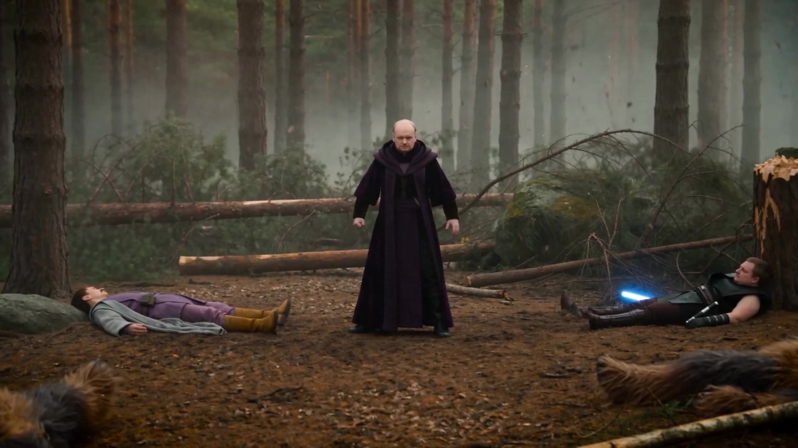</a><figcaption>настоящий последний кадр первого видео</figcaption></figure>
<figure><a href="references/scenes/scene-17/S17-Image4-topview-source.png" target="_blank" rel="noopener"></a><figcaption>модуль карты</figcaption></figure>
<figure><a href="references/scenes/scene-37/S37-forest-planet-reference.png" target="_blank" rel="noopener"></a><figcaption>удаляющийся Кашиик</figcaption></figure>
</div>

**Что происходит:** Из настоящего финального кадра Серёга разворачивается, быстро идёт к своему кораблю на соседней поляне и садится в кабину. Корабль поднимает вихрь листьев, уходит крутым виражом над кронами, пробивает облачный слой и выходит в космос. Модуль указывает следующий курс; Кашиик удаляется за боковым окном.

**Корабль в локациях · 23.10.2026:** созданные опорные изображения, не кадры готовых видео. Геометрия исходного корабля сохранена как ориентир; настоящий видеостык важнее композиции, направления и состояния люка на картинке. Крыша всегда пуста.

<div class="scene-ref-gallery">
<figure><a href="references/scenes/ship-locations/Serega-ship-kashyyyk-departure.png" target="_blank" rel="noopener">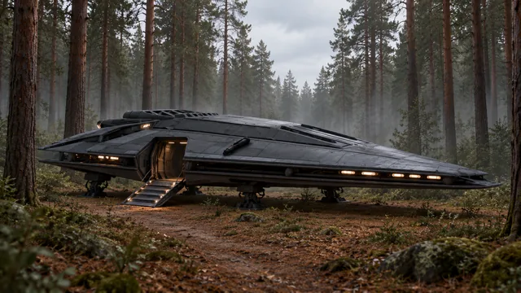</a><figcaption>Кашиик: соседняя поляна после боя · AI-референс</figcaption></figure>
<figure><a href="references/scenes/ship-locations/Serega-ship-kashyyyk-space.png" target="_blank" rel="noopener">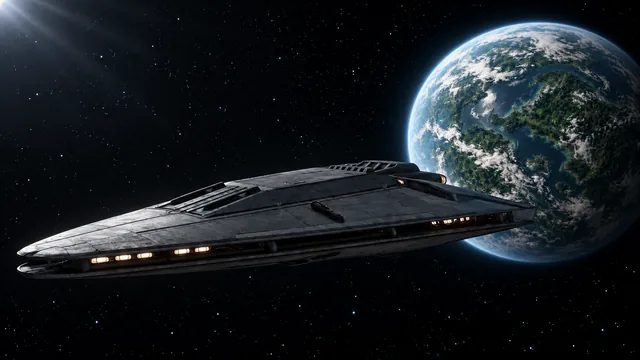</a><figcaption>Космос: корабль и Кашиик · AI-референс</figcaption></figure>
</div>

**Входы 30 с — обновлённые изображения корабля:** @Image2 — `references/scenes/ship-locations/Serega-ship-kashyyyk-departure.png`; @Image6 — `references/scenes/ship-locations/Serega-ship-kashyyyk-space.png`. Остальные входы — в списке референсов выше.

<div class="engine-tabs" data-scene="60">

<div class="engine-pane" data-engine="wan30" data-main="1">

**Входы30с:** @Video1 — настоящий конец первого вложения, `S60-source-ending-27-30s.mp4` (сохранён отдельно; `references/scenes/scene-60/source-continuity.json`); @Image1 — `references/full/serega.jpg` (Серёга — точная внешность); @Image2 — `references/scenes/ship-locations/Serega-ship-kashyyyk-departure.png` (личный корабль); @Image3 — `references/scenes/scene-37/S37-cockpit-empty.png` (кабина); @Image4 — `references/scenes/scene-60/S60-owner-video-final.jpg` (настоящий последний кадр первого видео); @Image5 — `references/scenes/scene-17/S17-Image4-topview-source.png` (модуль карты); @Image6 — `references/scenes/ship-locations/Serega-ship-kashyyyk-space.png` (удаляющийся Кашиик).

```text
Mode: reference-to-video (omni-reference) | Duration: 30s | Resolution: 720p | Aspect ratio: 16:9 | FPS: 24 | Native audio: on
Optimized for Wan 3.0 | Photoreal live-action space-opera cinema | Direct continuation of the owner video: Serega walks out of the battle clearing, boards and launches spectacularly from Kashyyyk

REFERENCES / AUTHORITY ORDER:
@Video1 — the supplied battle video's actual final3seconds: Serega has just thrown the Wookiees, Lesha lies left, Vitalik reclines right with the blue saber still glowing. Begin from its LAST frame, after the hit; never replay the punch, shockwave or fall.
@Image1 — SEREGA exact identity and purple robe; no appearance reset against the opening video.
@Image2 — synthetic location reference: the same personal craft in the adjacent boarding clearing after the battle, straight reddish trunks and warm grey haze; this is NOT the opening battle frame. Empty roof; preserve the baseline flat dark-grey wedge hull, cockpit glazing, panel layout and horizontal warm lights.
@Image3 — clean EMPTY cockpit derived from the original film frame: exact brown ribs, two brown seats, glazing and blue consoles; no people or weapons. Geometry only, with the actual scene location outside. Serega is seated at the controls when the timeline calls for him; the second seat stays empty.
@Image4 — exact final frame of the supplied battle video: initial blocking, fallen bodies, broken trunks and warm grey forest haze. This is an OPENING state, never the later boarding or flight state.
@Image5 — exact map-module prop; only shown during the later cockpit navigation beat, not an extra exchange in the forest.
@Image6 — synthetic location reference: the same personal craft in black space with the blue-green forest planet Kashyyyk, white cloud bands and a thin blue atmosphere; planet framing and flight direction follow the timeline. Empty roof; preserve the baseline flat dark-grey wedge hull, cockpit glazing, panel layout and horizontal warm lights.
Priority: @Video1 controls the opening action state and existing opponents; @Image1 the lead identity; @Image2/@Image3 the craft; @Image4 supports the exact start; @Image5 the prop; @Image6 the planet.

LOCATION REFERENCE GATE:
These synthetic location stills guide the same craft, setting and lighting, not a literal start frame. Apply each setting, gear and hatch state only at its matching timeline beat; hatches close before flight. Actual @Video1, when supplied, controls the opening position, motion, screen direction and continuity. Multiple views depict ONE personal craft, never duplicates. Keep the roof empty.

SHIP OCCUPANCY — CRITICAL:
The roof, cockpit canopy, wings and upper hull remain completely empty in every shot. Exactly one SEREGA stays fully inside the enclosed cockpit, seated at the pilot controls whenever the craft moves; exterior views may show him only through the cockpit glazing. When landed and stationary, he may walk on the ground and use the single side hatch and boarding ramp. Never place him standing, sitting, riding or balancing on the roof or any exterior hull surface. No external duplicate, body clipping through the canopy, or teleportation between cabin and roof.

CHARACTER APPEARANCE / IDENTITY LOCK:
SEREGA: pale mature man with a balding crown, sparse fair hair, the exact broad face and build in @Image1, long heavy deep-purple Chancellor robe with layered collar, black inner clothing and boots. One Serega only; preserve age, face, hairline and robe silhouette through motion. Each model sheet depicts one person, never several.
OPENING BACKGROUND CONTINUITY: LESHA lies frame-left, brown wavy hair and moustache, purple tunic, long grey robe and ochre boots. VITALIK reclines against the stump frame-right, stockier build, short light-brown hair, dark armour and the exact exposed-arm battle costume visible in @Video1. Do not restore sleeves, stand either up or change their faces. Fallen brown-furred Wookiees stay at the foreground edges, as the source shows; they exit the camera's view when it follows Serega.

VEHICLE / SPACE LOCK — CRITICAL:
One personal craft: the broad flat wedge-shaped dark-grey hull, cockpit glazing, inset light strips, proportions and engine layout of @Image2. No redesign into a shuttle, fighter or RosKOTmos vessel. One side hatch with one short folding boarding ramp; the ramp connects visibly to solid ground. Ship movement has mass and bank-to-turn inertia; trees remain solid, with believable clearances wider than the entire hull.
The craft is parked in an adjacent open glade offscreen beyond the battle clearing, not secretly behind a thin trunk. A continuous retreating tracking move along the trail reveals it, without placing it inside the already established clearing. Everyone left behind stays on the ground; no chase or renewed duel.

COCKPIT / STORY PROPS:
BREAD-AND-MILK NOTE: exactly one palm-sized pale-yellow square sticky note on the blank sloping console immediately to the pilot's right, beside the controls, not on a screen. Two simple black line drawings only: bread loaf left, milk carton right; no text. Keep this fixed position, size and artwork, readable in the cockpit shot.
One small round wicker basket with brown forest mushrooms is already secured on the cockpit floor beside the pilot's seat, matching the following travel scene. It is revealed with the cabin, not conjured into his hands. The single map module stays concealed in his robe until the navigation beat; nobody gives him another one here.

START STATE:
Exactly the LAST frame of @Video1 and @Image4: Serega centered, hands lowered, Lesha prone left, Vitalik by the stump right with blue blade glowing; fallen Wookiees near the bottom edges. No red blade is visible. Trees, debris and diffuse warm haze are unchanged.

TIMELINE:
[0:00–0:04] — LEAVE THE AFTERMATH
Continue the final camera and posture without replaying the blow. Serega flicks his eyes once toward the motionless opponents, turns decisively toward the clear trail and strides away. The camera retreats in front of him; the fallen people remain where they were.

[0:04–0:09] — REVEAL AND BOARD
The tracking move reaches the adjacent open glade and reveals his parked dark-grey craft in one coherent space, side ramp down. He accelerates into three quick ramp steps and enters the visible hatch; no jump onto the roof or walking through metal.

[0:09–0:15] — CLOSE AND LIFT
Cut to a medium cockpit angle as he drops into the seat and snaps the controls. Give the yellow grocery note a readable beat; the secured mushroom basket is visible below. The hatch seals before movement. Cut outside as the landing feet unload and the craft rises clear of the glade in a concentrated spiral of leaves.

[0:15–0:20] — BREAK ABOVE THE CROWNS
Continue the lift into a steep climbing turn through a broad existing gap. A crane-like chase shot rises with the hull past enormous trunks, then the ship bursts above the treetops, shedding leaf fragments; no branches are struck.

[0:20–0:25] — PUNCH THROUGH THE CEILING
Cut wide over the forest. The craft pitches up hard, tears through a low cloud shelf and accelerates into the thinning blue atmosphere; the forest falls away beneath it. Sell speed with parallax and Doppler, not a repeated corkscrew or a hyperspace tunnel.

[0:25–0:30] — THE NEXT COURSE
Cut inside, face readable. Serega lifts the small map module and turns it toward the forward window; its glow strengthens toward the offscreen destination. He pockets it and makes one precise course correction. The green forest globe recedes through the side window; engines settle into an accelerating hum.

END STATE:
Serega seated alone in the genuine cockpit in open space, the small green Kashyyyk globe receding through a side window. He has returned the map module inside his robe after finding the onward course toward the Sith planet. Yellow note to his right, mushroom basket on the floor. No hyperjump: an editorial cut can continue directly into Scene40's space opening.

CAMERA / SPACE:
No cut for the first9seconds: preserve the source axis, retreat with Serega and reveal the neighbouring glade. Four motivated cuts thereafter: cockpit9s, lift about13s, high wide20s, cockpit25s. Exterior travel remains coherent; final cockpit framing matches the existing interior design. No camera orbit that swaps the fallen opponents.

PERFORMANCE:
Cold concentrated face, quick purposeful strides and compact decisive hand movements. No victory pose or comic smile. The dynamic contrast is the immobile defeated group behind him against his urgent departure and the craft's accelerating climb.

LIGHTING / MATERIALS:
Opening matches the source's soft warm-grey woodland haze exactly. Natural forest light gradually opens into bright sky, then cold space light; no instant time-of-day change. Heavy robe, rough bark, damp debris, weathered hull; skin remains natural and evenly readable in cockpit close coverage.

AUDIO:
Carry the source forest ambience through the opening, not its preceding impact. Fast boots and robe swish, ramp clangs, hatch seal, switches, turbine build and thruster roar, leaf storm, Doppler climb, muted cockpit engine hum and one quiet module tone. No dialogue, cheering, narration or music.

NEGATIVE PROMPT:
replayed battle, new shockwave, revived opponents, pursuit, new people, replacing defeated faces, restored sleeves on Vitalik at the start, duplicated Wookiees, red saber appearing, teleporting ship, ship inside a tree, wrong spacecraft, craft changes shape, boarding through roof or hull, open hatch during flight, passenger, copied Vader, spilled mushrooms, extra map exchange, hyperspace tunnel, ship already in space at start, face drift, slow motion, static hero pose, cartoon, subtitles, watermark.

FRAME FILL / NO BARS:
Fill the entire generated frame edge-to-edge. No letterboxing, no pillarboxing, no black bars, no side bars, no decorative borders, no empty margins.
```

</div>

<div class="engine-pane" data-engine="sd20x2">

**Входы части1:** @Video1 — настоящий конец первого вложения, `S60-source-ending-27-30s.mp4` (сохранён отдельно; `references/scenes/scene-60/source-continuity.json`); @Image1 — `references/full/serega.jpg` (Серёга); @Image2 — `references/scenes/ship-locations/Serega-ship-kashyyyk-departure.png` (корабль); @Image3 — `references/scenes/scene-37/S37-cockpit-empty.png` (кабина); @Image4 — `references/scenes/scene-60/S60-owner-video-final.jpg` (точный старт).

**Входы части2:** @Video1 — последние3с нового результата60P1, не исходное старое видео; @Image1 — `references/full/serega.jpg` (Серёга); @Image2 — `references/scenes/ship-locations/Serega-ship-kashyyyk-departure.png` (корабль); @Image3 — `references/scenes/scene-37/S37-cockpit-empty.png` (кабина); @Image4 — `references/scenes/scene-17/S17-Image4-topview-source.png` (модуль); @Image5 — `references/scenes/ship-locations/Serega-ship-kashyyyk-space.png` (Кашиик).

#### 60 · Seedance 2.0 часть 1

```text
Mode: reference-to-video (omni-reference) | Duration: 15s | Resolution: 720p | Aspect ratio: 16:9 | FPS: 24 | Native audio: on
Optimized for Seedance 2.0 | Photoreal live-action space-opera cinema | Part1 of2: exact post-battle continuation, boarding and first lift from the glade

REFERENCES / AUTHORITY ORDER:
@Video1 — the supplied battle video's actual final3seconds: Serega has just thrown the Wookiees, Lesha lies left, Vitalik reclines right with the blue saber still glowing. Begin from its LAST frame, after the hit; never replay the punch, shockwave or fall.
@Image1 — SEREGA exact identity and purple robe; no appearance reset against the opening video.
@Image2 — synthetic location reference: the same personal craft in the adjacent boarding clearing after the battle, straight reddish trunks and warm grey haze; this is NOT the opening battle frame. Empty roof; preserve the baseline flat dark-grey wedge hull, cockpit glazing, panel layout and horizontal warm lights.
@Image3 — clean EMPTY cockpit derived from the original film frame: exact brown ribs, two brown seats, glazing and blue consoles; no people or weapons. Geometry only, with the actual scene location outside. Serega is seated at the controls when the timeline calls for him; the second seat stays empty.
@Image4 — exact final frame of the supplied battle video: initial blocking, fallen bodies, broken trunks and warm grey forest haze. This is an OPENING state, never the later boarding or flight state.
Priority: @Video1 fixes the entire opening, @Image1 fixes Serega, @Image2 the hull, @Image3 the cabin, @Image4 the exact first-frame composition.

LOCATION REFERENCE GATE:
These synthetic location stills guide the same craft, setting and lighting, not a literal start frame. Apply each setting, gear and hatch state only at its matching timeline beat; hatches close before flight. Actual @Video1, when supplied, controls the opening position, motion, screen direction and continuity. Multiple views depict ONE personal craft, never duplicates. Keep the roof empty.

SHIP OCCUPANCY — CRITICAL:
The roof, cockpit canopy, wings and upper hull remain completely empty in every shot. Exactly one SEREGA stays fully inside the enclosed cockpit, seated at the pilot controls whenever the craft moves; exterior views may show him only through the cockpit glazing. When landed and stationary, he may walk on the ground and use the single side hatch and boarding ramp. Never place him standing, sitting, riding or balancing on the roof or any exterior hull surface. No external duplicate, body clipping through the canopy, or teleportation between cabin and roof.

CHARACTER APPEARANCE / IDENTITY LOCK:
SEREGA: pale mature man with a balding crown, sparse fair hair, the exact broad face and build in @Image1, long heavy deep-purple Chancellor robe with layered collar, black inner clothing and boots. One Serega only; preserve age, face, hairline and robe silhouette through motion. Each model sheet depicts one person, never several.
OPENING BACKGROUND CONTINUITY: LESHA lies frame-left, brown wavy hair and moustache, purple tunic, long grey robe and ochre boots. VITALIK reclines against the stump frame-right, stockier build, short light-brown hair, dark armour and the exact exposed-arm battle costume visible in @Video1. Do not restore sleeves, stand either up or change their faces. Fallen brown-furred Wookiees stay at the foreground edges, as the source shows; they exit the camera's view when it follows Serega.

VEHICLE / SPACE LOCK — CRITICAL:
One personal craft: the broad flat wedge-shaped dark-grey hull, cockpit glazing, inset light strips, proportions and engine layout of @Image2. No redesign into a shuttle, fighter or RosKOTmos vessel. One side hatch with one short folding boarding ramp; the ramp connects visibly to solid ground. Ship movement has mass and bank-to-turn inertia; trees remain solid, with believable clearances wider than the entire hull.
The craft is parked in an adjacent open glade offscreen beyond the battle clearing, not secretly behind a thin trunk. A continuous retreating tracking move along the trail reveals it, without placing it inside the already established clearing. Everyone left behind stays on the ground; no chase or renewed duel.

COCKPIT / STORY PROPS:
BREAD-AND-MILK NOTE: exactly one palm-sized pale-yellow square sticky note on the blank sloping console immediately to the pilot's right, beside the controls, not on a screen. Two simple black line drawings only: bread loaf left, milk carton right; no text. Keep this fixed position, size and artwork, readable in the cockpit shot.
One small round wicker basket with brown forest mushrooms is already secured on the cockpit floor beside the pilot's seat, matching the following travel scene. It is revealed with the cabin, not conjured into his hands. The single map module stays concealed in his robe until the navigation beat; nobody gives him another one here.

START STATE:
Exactly the LAST frame of @Video1 and @Image4: Serega centered, hands lowered, Lesha prone left, Vitalik by the stump right with blue blade glowing; fallen Wookiees near the bottom edges. No red blade is visible. Trees, debris and diffuse warm haze are unchanged.

TIMELINE:
[0:00–0:04] — LEAVE THE AFTERMATH
Continue the final camera and posture without replaying the blow. Serega flicks his eyes once toward the motionless opponents, turns decisively toward the clear trail and strides away. The camera retreats in front of him; the fallen people remain where they were.

[0:04–0:09] — REVEAL AND BOARD
The tracking move reaches the adjacent open glade and reveals his parked dark-grey craft in one coherent space, side ramp down. He accelerates into three quick ramp steps and enters the visible hatch; no jump onto the roof or walking through metal.

[0:09–0:15] — CLOSE AND LIFT
Cut to a medium cockpit angle as he drops into the seat and snaps the controls. Give the yellow grocery note a readable beat; the secured mushroom basket is visible below. The hatch seals before movement. Cut outside as the landing feet unload and the craft rises clear of the glade in a concentrated spiral of leaves.

END STATE:
Serega is alone in his pilot seat, side hatch sealed; the intact personal craft has lifted just above the glade, nose toward the broad upward exit between the crowns. Basket secured on the floor; note fixed to the right console; module still concealed.

CAMERA / SPACE:
Keep the first9seconds continuous from the source; cut into the cockpit at9s and back outside about13s. End on the first clear lift, leaving the full climb for the next part.

PERFORMANCE:
Cold concentrated face, quick purposeful strides and compact decisive hand movements. No victory pose or comic smile. The dynamic contrast is the immobile defeated group behind him against his urgent departure and the craft's accelerating climb.

LIGHTING / MATERIALS:
Opening matches the source's soft warm-grey woodland haze exactly. Natural forest light gradually opens into bright sky, then cold space light; no instant time-of-day change. Heavy robe, rough bark, damp debris, weathered hull; skin remains natural and evenly readable in cockpit close coverage.

AUDIO:
Carry the source forest ambience through the opening, not its preceding impact. Fast boots and robe swish, ramp clangs, hatch seal, switches, turbine build and thruster roar, leaf storm, Doppler climb, muted cockpit engine hum and one quiet module tone. No dialogue, cheering, narration or music.

NEGATIVE PROMPT:
replayed battle, new shockwave, revived opponents, pursuit, new people, replacing defeated faces, restored sleeves on Vitalik at the start, duplicated Wookiees, red saber appearing, teleporting ship, ship inside a tree, wrong spacecraft, craft changes shape, boarding through roof or hull, open hatch during flight, passenger, copied Vader, spilled mushrooms, extra map exchange, hyperspace tunnel, ship already in space at start, face drift, slow motion, static hero pose, cartoon, subtitles, watermark.

FRAME FILL / NO BARS:
Fill the entire generated frame edge-to-edge. No letterboxing, no pillarboxing, no black bars, no side bars, no decorative borders, no empty margins.
```

#### 60 · Seedance 2.0 часть 2

```text
Mode: reference-to-video (omni-reference) | Duration: 15s | Resolution: 720p | Aspect ratio: 16:9 | FPS: 24 | Native audio: on
Optimized for Seedance 2.0 | Photoreal live-action space-opera cinema | Part2 of2: climbing turn out of the forest, cloud breakthrough and onward navigation in space

REFERENCES / AUTHORITY ORDER:
@Video1 — actual last3seconds of THIS scene's generated Part1, with Serega aboard and the ship first lifting. Continue its last frame; do not use the earlier battle-video ending here.
@Image1 — SEREGA exact identity and purple robe.
@Image2 — synthetic location reference: the same personal craft in the adjacent boarding clearing after the battle, straight reddish trunks and warm grey haze; this is NOT the opening battle frame. Empty roof; preserve the baseline flat dark-grey wedge hull, cockpit glazing, panel layout and horizontal warm lights.
@Image3 — clean EMPTY cockpit derived from the original film frame: exact brown ribs, two brown seats, glazing and blue consoles; no people or weapons. Geometry only, with the actual scene location outside. Serega is seated at the controls when the timeline calls for him; the second seat stays empty.
@Image4 — exact map-module prop for the final navigation beat.
@Image5 — synthetic location reference: the same personal craft in black space with the blue-green forest planet Kashyyyk, white cloud bands and a thin blue atmosphere; planet framing and flight direction follow the timeline. Empty roof; preserve the baseline flat dark-grey wedge hull, cockpit glazing, panel layout and horizontal warm lights.
Priority: @Video1 controls initial state and movement; @Image1 the sole pilot; @Image2/@Image3 the ship; @Image4 the module; @Image5 the planet.

LOCATION REFERENCE GATE:
These synthetic location stills guide the same craft, setting and lighting, not a literal start frame. Apply each setting, gear and hatch state only at its matching timeline beat; hatches close before flight. Actual @Video1, when supplied, controls the opening position, motion, screen direction and continuity. Multiple views depict ONE personal craft, never duplicates. Keep the roof empty.

SHIP OCCUPANCY — CRITICAL:
The roof, cockpit canopy, wings and upper hull remain completely empty in every shot. Exactly one SEREGA stays fully inside the enclosed cockpit, seated at the pilot controls whenever the craft moves; exterior views may show him only through the cockpit glazing. When landed and stationary, he may walk on the ground and use the single side hatch and boarding ramp. Never place him standing, sitting, riding or balancing on the roof or any exterior hull surface. No external duplicate, body clipping through the canopy, or teleportation between cabin and roof.

CHARACTER APPEARANCE / IDENTITY LOCK:
SEREGA: pale mature man with a balding crown, sparse fair hair, the exact broad face and build in @Image1, long heavy deep-purple Chancellor robe with layered collar, black inner clothing and boots. One Serega only; preserve age, face, hairline and robe silhouette through motion. Each model sheet depicts one person, never several.

VEHICLE / SPACE LOCK — CRITICAL:
One personal craft: the broad flat wedge-shaped dark-grey hull, cockpit glazing, inset light strips, proportions and engine layout of @Image2. No redesign into a shuttle, fighter or RosKOTmos vessel. One side hatch with one short folding boarding ramp; the ramp connects visibly to solid ground. Ship movement has mass and bank-to-turn inertia; trees remain solid, with believable clearances wider than the entire hull.
The craft is parked in an adjacent open glade offscreen beyond the battle clearing, not secretly behind a thin trunk. A continuous retreating tracking move along the trail reveals it, without placing it inside the already established clearing. Everyone left behind stays on the ground; no chase or renewed duel.

COCKPIT / STORY PROPS:
BREAD-AND-MILK NOTE: exactly one palm-sized pale-yellow square sticky note on the blank sloping console immediately to the pilot's right, beside the controls, not on a screen. Two simple black line drawings only: bread loaf left, milk carton right; no text. Keep this fixed position, size and artwork, readable in the cockpit shot.
One small round wicker basket with brown forest mushrooms is already secured on the cockpit floor beside the pilot's seat, matching the following travel scene. It is revealed with the cabin, not conjured into his hands. The single map module stays concealed in his robe until the navigation beat; nobody gives him another one here.

START STATE:
Exactly the last frame of @Video1: the intact craft has just lifted from the glade, Serega already aboard and hatch sealed. Continue the real trajectory, never return to boarding.

TIMELINE:
[0:00–0:05] — BREAK ABOVE THE CROWNS
Continue the lift into a steep climbing turn through a broad existing gap. A crane-like chase shot rises with the hull past enormous trunks, then the ship bursts above the treetops, shedding leaf fragments; no branches are struck.

[0:05–0:10] — PUNCH THROUGH THE CEILING
Cut wide over the forest. The craft pitches up hard, tears through a low cloud shelf and accelerates into the thinning blue atmosphere; the forest falls away beneath it. Sell speed with parallax and Doppler, not a repeated corkscrew or a hyperspace tunnel.

[0:10–0:15] — THE NEXT COURSE
Cut inside, face readable. Serega lifts the small map module and turns it toward the forward window; its glow strengthens toward the offscreen destination. He pockets it and makes one precise course correction. The green forest globe recedes through the side window; engines settle into an accelerating hum.

END STATE:
Serega seated alone in the genuine cockpit in open space, the small green Kashyyyk globe receding through a side window. He has returned the map module inside his robe after finding the onward course toward the Sith planet. Yellow note to his right, mushroom basket on the floor. No hyperjump: an editorial cut can continue directly into Scene40's space opening.

CAMERA / SPACE:
Continue the actual Part1 exterior motion, cut wide at5s and to the cockpit at10s. The forest planet recedes on the same side of the ship after the climb; no unmotivated reversal.

PERFORMANCE:
Cold concentrated face, quick purposeful strides and compact decisive hand movements. No victory pose or comic smile. The dynamic contrast is the immobile defeated group behind him against his urgent departure and the craft's accelerating climb.

LIGHTING / MATERIALS:
Opening matches the source's soft warm-grey woodland haze exactly. Natural forest light gradually opens into bright sky, then cold space light; no instant time-of-day change. Heavy robe, rough bark, damp debris, weathered hull; skin remains natural and evenly readable in cockpit close coverage.

AUDIO:
Carry the source forest ambience through the opening, not its preceding impact. Fast boots and robe swish, ramp clangs, hatch seal, switches, turbine build and thruster roar, leaf storm, Doppler climb, muted cockpit engine hum and one quiet module tone. No dialogue, cheering, narration or music.

NEGATIVE PROMPT:
replayed battle, new shockwave, revived opponents, pursuit, new people, replacing defeated faces, restored sleeves on Vitalik at the start, duplicated Wookiees, red saber appearing, teleporting ship, ship inside a tree, wrong spacecraft, craft changes shape, boarding through roof or hull, open hatch during flight, passenger, copied Vader, spilled mushrooms, extra map exchange, hyperspace tunnel, ship already in space at start, face drift, slow motion, static hero pose, cartoon, subtitles, watermark.

FRAME FILL / NO BARS:
Fill the entire generated frame edge-to-edge. No letterboxing, no pillarboxing, no black bars, no side bars, no decorative borders, no empty margins.
```

</div>

</div>

---

<a id="scene-61"></a>

## Сцена 61 — Кашиик: ковбойское сближение перед дуэлью

<!-- scene-meta: {"target_engine":"Seedance 2.0","production_state":"READY","duration_s":30,"dialogue":{"enabled":false,"language":null},"dependencies":[],"tags":["serega","vitalik","lesha","kashyyyk","action","continuity","standoff"]} -->

**Контекст использования:** Предыстория ВТОРОГО вложения1000014023.mp4. В кадре именно трое: Серёга, Виталик, Лёша; вуки не добавляются. Слово «ковбойское» задаёт ритм и напряжение, а не шляпы или оружие. Первый кадр существующего видео сохранён как целевой КОНЕЦ новой сцены, не старт. Сцена независима от новых59/60 по входам; её P2 ждёт собственную P1. Без речи: существующий диалог не повторяется и не заменяется.

**Готовность:** картинки и входы части1 подготовлены; часть2 запускается только после сохранения и проверки настоящего конца своей части1. READY относится к началу работы над сценой, не к готовности будущего видеовхода P2. В очереди — по одной бесплатной попытке Seedance2.0 на каждую часть, доска My First Board; после блока с червями и до28/49/50/51. Заблокированные зависимости пропускаются по действующему правилу. 30-секундная вкладка — альтернативный текст, не дополнительный запуск.

**Референсы:** @Image1 — `references/full/serega.jpg` (Серёга — красный меч); @Image2 — `references/full/vitalik.jpg` (Виталик — синий меч); @Image3 — `references/full/lesha.jpg` (Лёша — фиолетовый меч); @Image4 — `references/scenes/scene-61/S61-owner-video-opening.jpg` (точный финал перед вторым видео и лес).

<div class="scene-ref-gallery">
<figure><a href="references/full/serega.jpg" target="_blank" rel="noopener"></a><figcaption>Серёга — красный меч</figcaption></figure>
<figure><a href="references/full/vitalik.jpg" target="_blank" rel="noopener"></a><figcaption>Виталик — синий меч</figcaption></figure>
<figure><a href="references/full/lesha.jpg" target="_blank" rel="noopener"></a><figcaption>Лёша — фиолетовый меч</figcaption></figure>
<figure><a href="references/scenes/scene-61/S61-owner-video-opening.jpg" target="_blank" rel="noopener">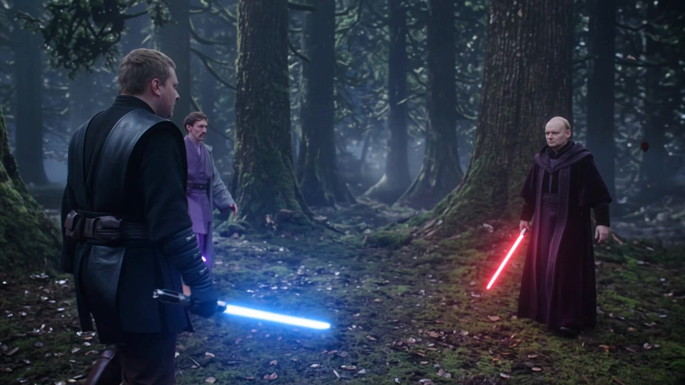</a><figcaption>точный финал перед вторым видео и лес</figcaption></figure>
</div>

**Что происходит:** Серёга, Виталик и Лёша сосредоточенно сближаются по дугам, оценивают стойки и руки противников. Виталик и Лёша обходят с двух углов, каждый коротко прокручивает свой меч; Серёга отвечает вращением красного клинка. Ложное движение заставляет всех перестроиться, и они занимают точную позицию начала второго видео. Сам бой ещё не начинается.

<div class="engine-tabs" data-scene="61">

<div class="engine-pane" data-engine="wan30" data-main="1">

**Входы30с:** @Image1 — `references/full/serega.jpg` (Серёга — красный меч); @Image2 — `references/full/vitalik.jpg` (Виталик — синий меч); @Image3 — `references/full/lesha.jpg` (Лёша — фиолетовый меч); @Image4 — `references/scenes/scene-61/S61-owner-video-opening.jpg` (точный финал перед вторым видео и лес).

```text
Mode: reference-to-video (omni-reference) | Duration: 30s | Resolution: 720p | Aspect ratio: 16:9 | FPS: 24 | Native audio: on
Optimized for Wan 3.0 | Photoreal live-action space-opera cinema | A tense three-person western-style circling approach that leads exactly into the owner's existing forest confrontation

REFERENCES / AUTHORITY ORDER:
@Image1 — absolute SEREGA face, build and purple robe.
@Image2 — absolute VITALIK face, stockier build and black Jedi costume with dark leather panels, belt and boots.
@Image3 — absolute LESHA face, moustache, wavy brown hair, purple tunic, long grey hooded robe and ochre boots.
@Image4 — FIRST frame of the existing duel video, used here as ENDING composition and exact forest/light authority: Vitalik foreground-left, Lesha behind him center-left, Serega right. Do not begin in this final close grouping; reach it through the timed approach.
Priority: individual @Image1–@Image3 control the three identities; @Image4 controls forest, the final camera axis, spacing and sword poses. It represents a later endpoint, never a fourth character.

CHARACTER APPEARANCE / IDENTITY LOCK:
SEREGA: pale mature man with a balding crown, sparse fair hair, the exact broad face and build in @Image1, long heavy deep-purple Chancellor robe with layered collar, black inner clothing and boots. One Serega only; preserve age, face, hairline and robe silhouette through motion. Each model sheet depicts one person, never several.
VITALIK (@Image2): stocky adult man, short light-brown hair, broad clean-shaven face with light stubble, black tunic and dark leather/armour panels, brown belt, brown trousers, tall boots; ONE BLUE lightsaber.
LESHA (@Image3): slim adult man, wavy brown hair and a distinct brown moustache, purple tunic and trousers under a long grey hooded robe, brown belt and ochre boots; ONE PURPLE lightsaber.
Serega carries ONE RED lightsaber. Exactly these three adult humans; never mix faces, bodies, clothes or blade colours.

STANDOFF / GEOGRAPHY LOCK — CRITICAL:
The exact cool, dim Kashyyyk woodland of @Image4: giant rooted trunks, moss, damp dark leaf litter and blue-grey shafts through thin haze. Three men close into a broad triangle; Vitalik and Lesha cooperate against Serega, not against one another. Maintain several metres of clearance during every blade rotation. Each hilt stays in its owner's right hand with a stable grip; one controlled outward wrist roll per performer, not tossed or endlessly spinning blades. No blade contacts a body, trunk or another blade. This is the suspense BEFORE the supplied confrontation, not an alternate fight.

ENDING LOCK:
End at @Image4: Vitalik in foreground-left in three-quarter/back view facing right, his blue blade lowered diagonally toward frame-right; Lesha behind him center-left, purple blade lowered clear of his robe; Serega at frame-right facing the pair, red blade angled down toward frame-left. Reproduce the reference camera height, spacing, giant trunk and haze. Keep slight breathing and cloth motion; no freeze frame.

START STATE:
Wide moving view in the same forest clearing before the supplied video. Serega is right, Vitalik left and closer to camera, Lesha deeper left; they are farther apart than @Image4, about7–9metres across. All three sabers already lit and carried low, all faces focused on their opponents.

TIMELINE:
[0:00–0:05] — BOOTS AND DISTANCE
Begin low, tracking beside three separate sets of boots stepping over wet leaves and roots, then rise into the wide triangle. Serega takes a measured lateral step right; the pair advances from left, spreading slightly. Sabers stay low; the camera reveals everyone clearly.

[0:05–0:10] — VITALIK TESTS THE LINE
Cut to a medium moving three-quarter shot of Vitalik with Serega visible across the gap. Vitalik makes one compact outward wrist roll of his blue blade, regrips firmly and takes two deliberate diagonal steps. His eyes stay on Serega's shoulders and sword hand.

[0:10–0:15] — LESHA CLOSES THE OTHER ANGLE
Cut to Lesha in medium three-quarter. He advances along a short flank arc without crossing Vitalik's path, makes one restrained outward purple-blade rotation clear of his coat and settles into a low guard. Serega tracks both men with a small turn of his torso and one retreating side-step.

[0:15–0:20] — RED ANSWER
Continue the measured motion, then medium coverage of Serega: an unblinking glance from Vitalik to Lesha, one crisp red-blade wrist roll outward, then a low ready guard. He takes two lateral steps around the near edge of the great rooted trunk, forcing both opponents to adjust.

[0:20–0:26] — THE FEINT
Cut to a wide view from the established side. Vitalik abruptly shifts his weight forward as a testing feint, without swinging; Serega turns his blade a few degrees and plants his rear foot. Lesha takes the opening flank step and stops short of striking. All three keep the moving triangle intact, leaves scuffing beneath their boots.

[0:26–0:30] — THE LAST STEP BEFORE WORDS
The wide camera eases into the exact @Image4 axis while the three finish their approach. Vitalik steps into foreground-left, Lesha remains behind center-left, Serega settles right. Their swords lower into the reference angles. Only the last half-second lands on the source composition, with breathing and cloth still alive.

END STATE:
Exact @Image4 blocking, camera height, blade ownership, lowered blade angles, cool haze and spacing, reached on the last step. Vitalik foreground-left, Lesha behind center-left, Serega right. No strike, dialogue, injury or Force attack has occurred; the supplied video can follow as the next shot.

CAMERA / SPACE:
Four motivated cuts at5s,10s,about17s and20s; the last wide move reaches the reference composition without a further cut. Grounded low tracks and medium facial coverage evoke a western standoff; no western costume change. Never cross the triangle's screen axis or use a full orbit that swaps the pair with Serega. No isolated glamour montage that loses the three-person geography.

PERFORMANCE:
Concentrated appraisal, restrained threat: eyes assess sword hand, feet and shoulders; small jaw tension, controlled breathing, actual planted steps and weight transfer. Measured circling with quick weapon accents, not aimless wandering, swagger, grinning or dancing. No spoken line, no wink; suspense comes from shrinking distance and reaction.

LIGHTING / MATERIALS:
Exact cool blue-grey forest light and thin mist of @Image4. Red, blue and purple blades give restrained local spill on hands and wet leaves, never recolour the whole face. Natural skin, real cloth weight, bark, moss and grounded boot contact; no rain or sudden sunset.

AUDIO:
Wet leaf crunches and boot scuffs, short cloth and leather creaks, breath, distinct saber hums and brief Doppler swishes on each of the three controlled rolls, subdued forest wind. A small pause in the footfalls at the feint sharpens the tension. No dialogue, score, whistles, gunshots, narrator or captions.

NEGATIVE PROMPT:
fourth person, Wookiees, cats, crowd, swapped faces, duplicated model-sheet views, changing blade colours, extra swords, double-bladed saber, throwing or releasing a hilt, saber through body or cloth, impact, strike, actual fight, Force push, levitation, injury, dialogue from the following video, cowboy hats, guns, spurs, desert, dancing, repeated mechanical spinning, posing for several seconds, full camera orbit, wrong final formation, mirrored screen positions, slow motion, cartoon, subtitles, watermark.

FRAME FILL / NO BARS:
Fill the entire generated frame edge-to-edge. No letterboxing, no pillarboxing, no black bars, no side bars, no decorative borders, no empty margins.
```

</div>

<div class="engine-pane" data-engine="sd20x2">

**Входы части1:** @Image1 — `references/full/serega.jpg` (Серёга — красный меч); @Image2 — `references/full/vitalik.jpg` (Виталик — синий меч); @Image3 — `references/full/lesha.jpg` (Лёша — фиолетовый меч); @Image4 — `references/scenes/scene-61/S61-owner-video-opening.jpg` (точный финал перед вторым видео и лес).

**Входы части2:** @Video1 — последние3с нового результата61P1, не исходное старое видео; @Image1 — `references/full/serega.jpg` (Серёга — красный меч); @Image2 — `references/full/vitalik.jpg` (Виталик — синий меч); @Image3 — `references/full/lesha.jpg` (Лёша — фиолетовый меч); @Image4 — `references/scenes/scene-61/S61-owner-video-opening.jpg` (точный финал перед вторым видео и лес).

#### 61 · Seedance 2.0 часть 1

```text
Mode: reference-to-video (omni-reference) | Duration: 15s | Resolution: 720p | Aspect ratio: 16:9 | FPS: 24 | Native audio: on
Optimized for Seedance 2.0 | Photoreal live-action space-opera cinema | Part1 of2: the three opponents close into a moving triangle; blue and purple blades make controlled rolls

REFERENCES / AUTHORITY ORDER:
@Image1 — absolute SEREGA face, build and purple robe.
@Image2 — absolute VITALIK face, stockier build and black Jedi costume with dark leather panels, belt and boots.
@Image3 — absolute LESHA face, moustache, wavy brown hair, purple tunic, long grey hooded robe and ochre boots.
@Image4 — FIRST frame of the existing duel video, used here as ENDING composition and exact forest/light authority: Vitalik foreground-left, Lesha behind him center-left, Serega right. Do not begin in this final close grouping; reach it through the timed approach.
Priority: individual @Image1–@Image3 control the three identities; @Image4 controls forest, the final camera axis, spacing and sword poses. It represents a later endpoint, never a fourth character.

CHARACTER APPEARANCE / IDENTITY LOCK:
SEREGA: pale mature man with a balding crown, sparse fair hair, the exact broad face and build in @Image1, long heavy deep-purple Chancellor robe with layered collar, black inner clothing and boots. One Serega only; preserve age, face, hairline and robe silhouette through motion. Each model sheet depicts one person, never several.
VITALIK (@Image2): stocky adult man, short light-brown hair, broad clean-shaven face with light stubble, black tunic and dark leather/armour panels, brown belt, brown trousers, tall boots; ONE BLUE lightsaber.
LESHA (@Image3): slim adult man, wavy brown hair and a distinct brown moustache, purple tunic and trousers under a long grey hooded robe, brown belt and ochre boots; ONE PURPLE lightsaber.
Serega carries ONE RED lightsaber. Exactly these three adult humans; never mix faces, bodies, clothes or blade colours.

STANDOFF / GEOGRAPHY LOCK — CRITICAL:
The exact cool, dim Kashyyyk woodland of @Image4: giant rooted trunks, moss, damp dark leaf litter and blue-grey shafts through thin haze. Three men close into a broad triangle; Vitalik and Lesha cooperate against Serega, not against one another. Maintain several metres of clearance during every blade rotation. Each hilt stays in its owner's right hand with a stable grip; one controlled outward wrist roll per performer, not tossed or endlessly spinning blades. No blade contacts a body, trunk or another blade. This is the suspense BEFORE the supplied confrontation, not an alternate fight.

PART1 TARGET — CRITICAL:
The three close only to a broad4–5metre triangle in this part: Vitalik nearer left, Lesha deeper left, Serega right. @Image4 controls the forest and the eventual confrontation axis, not the distance at the end of this part. Keep the triangle broader than that reference; do not begin the later dialogue or strike. The three are still moving at the last frame.

START STATE:
Wide moving view in the same forest clearing before the supplied video. Serega is right, Vitalik left and closer to camera, Lesha deeper left; they are farther apart than @Image4, about7–9metres across. All three sabers already lit and carried low, all faces focused on their opponents.

TIMELINE:
[0:00–0:05] — BOOTS AND DISTANCE
Begin low, tracking beside three separate sets of boots stepping over wet leaves and roots, then rise into the wide triangle. Serega takes a measured lateral step right; the pair advances from left, spreading slightly. Sabers stay low; the camera reveals everyone clearly.

[0:05–0:10] — VITALIK TESTS THE LINE
Cut to a medium moving three-quarter shot of Vitalik with Serega visible across the gap. Vitalik makes one compact outward wrist roll of his blue blade, regrips firmly and takes two deliberate diagonal steps. His eyes stay on Serega's shoulders and sword hand.

[0:10–0:15] — LESHA CLOSES THE OTHER ANGLE
Cut to Lesha in medium three-quarter. He advances along a short flank arc without crossing Vitalik's path, makes one restrained outward purple-blade rotation clear of his coat and settles into a low guard. Serega tracks both men with a small turn of his torso and one retreating side-step.

END STATE:
The three have closed to a broad triangular standoff about4–5metres across, Vitalik nearer left, Lesha deeper left, Serega right. Vitalik and Lesha have each completed one separate safe outward blade roll; Serega has not yet rolled his red blade. Nobody has attacked; all three still shifting their feet.

CAMERA / SPACE:
Two motivated cuts at5s and10s. Keep Serega on the right and the approaching pair on the left; show their mutual distance. The @Image4 final grouping is not yet reached.

PERFORMANCE:
Concentrated appraisal, restrained threat: eyes assess sword hand, feet and shoulders; small jaw tension, controlled breathing, actual planted steps and weight transfer. Measured circling with quick weapon accents, not aimless wandering, swagger, grinning or dancing. No spoken line, no wink; suspense comes from shrinking distance and reaction.

LIGHTING / MATERIALS:
Exact cool blue-grey forest light and thin mist of @Image4. Red, blue and purple blades give restrained local spill on hands and wet leaves, never recolour the whole face. Natural skin, real cloth weight, bark, moss and grounded boot contact; no rain or sudden sunset.

AUDIO:
Wet leaf crunches and boot scuffs, short cloth and leather creaks, breath, distinct saber hums and brief Doppler swishes on each of the three controlled rolls, subdued forest wind. A small pause in the footfalls at the feint sharpens the tension. No dialogue, score, whistles, gunshots, narrator or captions.

NEGATIVE PROMPT:
fourth person, Wookiees, cats, crowd, swapped faces, duplicated model-sheet views, changing blade colours, extra swords, double-bladed saber, throwing or releasing a hilt, saber through body or cloth, impact, strike, actual fight, Force push, levitation, injury, dialogue from the following video, cowboy hats, guns, spurs, desert, dancing, repeated mechanical spinning, posing for several seconds, full camera orbit, wrong final formation, mirrored screen positions, slow motion, cartoon, subtitles, watermark.

FRAME FILL / NO BARS:
Fill the entire generated frame edge-to-edge. No letterboxing, no pillarboxing, no black bars, no side bars, no decorative borders, no empty margins.
```

#### 61 · Seedance 2.0 часть 2

```text
Mode: reference-to-video (omni-reference) | Duration: 15s | Resolution: 720p | Aspect ratio: 16:9 | FPS: 24 | Native audio: on
Optimized for Seedance 2.0 | Photoreal live-action space-opera cinema | Part2 of2: Serega's red-blade answer, a testing feint and the exact start position of the existing video

REFERENCES / AUTHORITY ORDER:
@Video1 — actual last3seconds of this scene's Part1, fixing current positions, foot motion and light. Begin from its last frame.
@Image1 — absolute SEREGA face, build and purple robe.
@Image2 — absolute VITALIK face, stockier build and black Jedi costume with dark leather panels, belt and boots.
@Image3 — absolute LESHA face, moustache, wavy brown hair, purple tunic, long grey hooded robe and ochre boots.
@Image4 — FIRST frame of the existing duel video, used here as ENDING composition and exact forest/light authority: Vitalik foreground-left, Lesha behind him center-left, Serega right. Do not begin in this final close grouping; reach it through the timed approach.
Priority: individual @Image1–@Image3 control the three identities; @Image4 controls forest, the final camera axis, spacing and sword poses. It represents a later endpoint, never a fourth character.
@Video1 is the opening authority; @Image4 is the ending authority. Do not confuse them.

CHARACTER APPEARANCE / IDENTITY LOCK:
SEREGA: pale mature man with a balding crown, sparse fair hair, the exact broad face and build in @Image1, long heavy deep-purple Chancellor robe with layered collar, black inner clothing and boots. One Serega only; preserve age, face, hairline and robe silhouette through motion. Each model sheet depicts one person, never several.
VITALIK (@Image2): stocky adult man, short light-brown hair, broad clean-shaven face with light stubble, black tunic and dark leather/armour panels, brown belt, brown trousers, tall boots; ONE BLUE lightsaber.
LESHA (@Image3): slim adult man, wavy brown hair and a distinct brown moustache, purple tunic and trousers under a long grey hooded robe, brown belt and ochre boots; ONE PURPLE lightsaber.
Serega carries ONE RED lightsaber. Exactly these three adult humans; never mix faces, bodies, clothes or blade colours.

STANDOFF / GEOGRAPHY LOCK — CRITICAL:
The exact cool, dim Kashyyyk woodland of @Image4: giant rooted trunks, moss, damp dark leaf litter and blue-grey shafts through thin haze. Three men close into a broad triangle; Vitalik and Lesha cooperate against Serega, not against one another. Maintain several metres of clearance during every blade rotation. Each hilt stays in its owner's right hand with a stable grip; one controlled outward wrist roll per performer, not tossed or endlessly spinning blades. No blade contacts a body, trunk or another blade. This is the suspense BEFORE the supplied confrontation, not an alternate fight.

ENDING LOCK:
End at @Image4: Vitalik in foreground-left in three-quarter/back view facing right, his blue blade lowered diagonally toward frame-right; Lesha behind him center-left, purple blade lowered clear of his robe; Serega at frame-right facing the pair, red blade angled down toward frame-left. Reproduce the reference camera height, spacing, giant trunk and haze. Keep slight breathing and cloth motion; no freeze frame.

START STATE:
Exactly the last frame of @Video1: a still-moving triangle, pair left and Serega right, blades lit, no clash yet.

TIMELINE:
[0:00–0:05] — RED ANSWER
Continue the measured motion, then medium coverage of Serega: an unblinking glance from Vitalik to Lesha, one crisp red-blade wrist roll outward, then a low ready guard. He takes two lateral steps around the near edge of the great rooted trunk, forcing both opponents to adjust.

[0:05–0:11] — THE FEINT
Cut to a wide view from the established side. Vitalik abruptly shifts his weight forward as a testing feint, without swinging; Serega turns his blade a few degrees and plants his rear foot. Lesha takes the opening flank step and stops short of striking. All three keep the moving triangle intact, leaves scuffing beneath their boots.

[0:11–0:15] — THE LAST STEP BEFORE WORDS
The wide camera eases into the exact @Image4 axis while the three finish their approach. Vitalik steps into foreground-left, Lesha remains behind center-left, Serega settles right. Their swords lower into the reference angles. Only the last half-second lands on the source composition, with breathing and cloth still alive.

END STATE:
Exact @Image4 blocking, camera height, blade ownership, lowered blade angles, cool haze and spacing, reached on the last step. Vitalik foreground-left, Lesha behind center-left, Serega right. No strike, dialogue, injury or Force attack has occurred; the supplied video can follow as the next shot.

CAMERA / SPACE:
Continue the real Part1 movement; cut to Serega about2s and to the wide at5s. From11s travel into the exact @Image4 composition. Stay on the original side of the confrontation.

PERFORMANCE:
Concentrated appraisal, restrained threat: eyes assess sword hand, feet and shoulders; small jaw tension, controlled breathing, actual planted steps and weight transfer. Measured circling with quick weapon accents, not aimless wandering, swagger, grinning or dancing. No spoken line, no wink; suspense comes from shrinking distance and reaction.

LIGHTING / MATERIALS:
Exact cool blue-grey forest light and thin mist of @Image4. Red, blue and purple blades give restrained local spill on hands and wet leaves, never recolour the whole face. Natural skin, real cloth weight, bark, moss and grounded boot contact; no rain or sudden sunset.

AUDIO:
Wet leaf crunches and boot scuffs, short cloth and leather creaks, breath, distinct saber hums and brief Doppler swishes on each of the three controlled rolls, subdued forest wind. A small pause in the footfalls at the feint sharpens the tension. No dialogue, score, whistles, gunshots, narrator or captions.

NEGATIVE PROMPT:
fourth person, Wookiees, cats, crowd, swapped faces, duplicated model-sheet views, changing blade colours, extra swords, double-bladed saber, throwing or releasing a hilt, saber through body or cloth, impact, strike, actual fight, Force push, levitation, injury, dialogue from the following video, cowboy hats, guns, spurs, desert, dancing, repeated mechanical spinning, posing for several seconds, full camera orbit, wrong final formation, mirrored screen positions, slow motion, cartoon, subtitles, watermark.

FRAME FILL / NO BARS:
Fill the entire generated frame edge-to-edge. No letterboxing, no pillarboxing, no black bars, no side bars, no decorative borders, no empty margins.
```

</div>

</div>

---

<a id="scene-62"></a>

## Сцена 62 — Татуин: после погони — обратно к противостоянию

<!-- scene-meta: {"target_engine":"Seedance 2.0","production_state":"READY","duration_s":30,"dialogue":{"enabled":false,"language":null},"dependencies":[],"tags":["serega","artem","ilyusha","tatooine","worm","continuity","action"]} -->

**Контекст использования:** Прямой мост между двумя вложениями владельца от23.10.2026: `260708_0006_video_edit_3448.mp4` → новая62 → `bf0f20a34cc444f4bdf8c9f3244aac80.mp4`. Артём и Илюша лежат на спине после падения; в начале второго ролика они уже стоят напротив вернувшегося Серёги. Концы сохранены из настоящих видео, не дорисованы. Второй ролик здесь — целевой следующий монтажный фрагмент, его Topview task ID не предполагается по имени файла.

**Что происходит:** Артём и Илюша с усилием поднимаются, отряхивают песок и собираются. За правым обелиском Серёга останавливает ту же красную машину, выходит и возвращается пешком. Илюша проходит на передний левый план, Артём остаётся чуть глубже слева; синий и зелёный мечи загораются. Серёга справа держит рукоять погашенной. Последний шаг точно приводит к первому кадру второго видео. Червь и бой начинаются уже в существующем ролике.

**Готовность и очередь:** P1 готова по входам, ждёт свободный слот. P2 ждёт настоящий результат собственной62P1, затем вырезку и QC стыка. В очереди блока с червями после48 и перед59–61; приоритет52P2/58P2 и правило пропуска заблокированных сохранены. По одной бесплатной попытке Seedance2.0, My First Board. 30с — альтернативный полный текст, без отдельного разрешения на запуск. Порядок генерации не равен порядку монтажа: в фильме62 стоит перед противостоянием с червём.

**Референсы:** @Image1 — `references/full/serega.jpg` (Серёга — лицо и фиолетовая роба); @Image2 — `references/full/artem.jpg` (Артём — бежево-коричневая одежда, зелёный меч); @Image3 — `references/full/ilyusha.jpg` (Илюша — зелёная туника, красный плащ, синий меч); @Image4 — `references/scenes/scene-62/S62-source-A-final.jpg` (Настоящий последний кадр первого видео — старт); @Image5 — `references/scenes/scene-62/S62-target-B-opening.jpg` (Настоящий первый кадр второго видео — целевой финал); @Image6 — `references/scenes/scene-62/S62-car-continuity.jpg` (Та же красная машина из первого видео — только автомобиль).

<div class="scene-ref-gallery">
<figure><a href="references/full/serega.jpg" target="_blank" rel="noopener"></a><figcaption>Серёга — лицо и фиолетовая роба</figcaption></figure>
<figure><a href="references/full/artem.jpg" target="_blank" rel="noopener"></a><figcaption>Артём — бежево-коричневая одежда, зелёный меч</figcaption></figure>
<figure><a href="references/full/ilyusha.jpg" target="_blank" rel="noopener"></a><figcaption>Илюша — зелёная туника, красный плащ, синий меч</figcaption></figure>
<figure><a href="references/scenes/scene-62/S62-source-A-final.jpg" target="_blank" rel="noopener">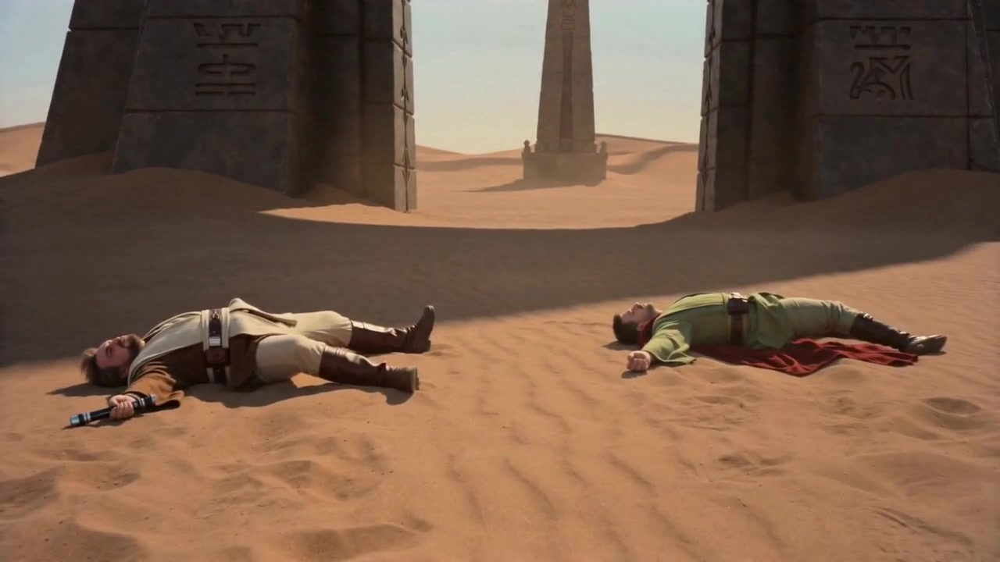</a><figcaption>Настоящий последний кадр первого видео — старт</figcaption></figure>
<figure><a href="references/scenes/scene-62/S62-target-B-opening.jpg" target="_blank" rel="noopener">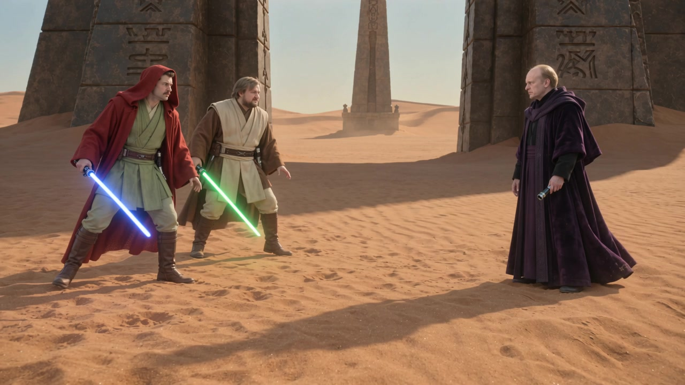</a><figcaption>Настоящий первый кадр второго видео — целевой финал</figcaption></figure>
<figure><a href="references/scenes/scene-62/S62-car-continuity.jpg" target="_blank" rel="noopener">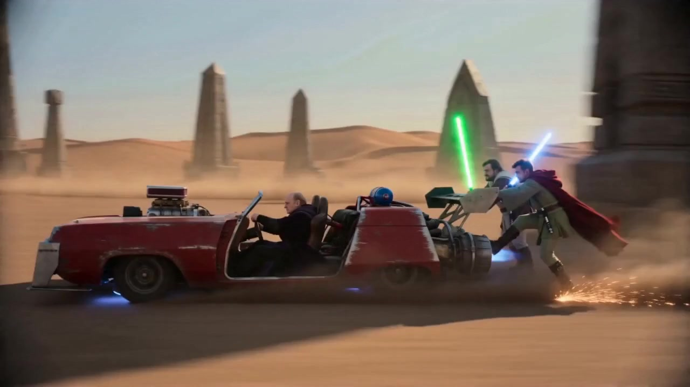</a><figcaption>Та же красная машина из первого видео — только автомобиль</figcaption></figure>
</div>

**Настоящие видеовходы:** `references/scenes/scene-62/source-continuity.json` — точные имена, SHA256, приватные Library ID, вырезка последних3с первого ролика и первые3с второго для сверки. Второй клип не подставлять вместо62P1. Просмотр: контактные листы обоих видео и полные граничные кадры; это не заявление о непрерывном просмотре со звуком.

<div class="engine-tabs" data-scene="62">

<div class="engine-pane" data-engine="wan30" data-main="1">

**Входы30с:** @Video1 — настоящий конец первого вложения; @Image1 — `references/full/serega.jpg` (Серёга — лицо и фиолетовая роба); @Image2 — `references/full/artem.jpg` (Артём — бежево-коричневая одежда, зелёный меч); @Image3 — `references/full/ilyusha.jpg` (Илюша — зелёная туника, красный плащ, синий меч); @Image4 — `references/scenes/scene-62/S62-source-A-final.jpg` (Настоящий последний кадр первого видео — старт); @Image5 — `references/scenes/scene-62/S62-target-B-opening.jpg` (Настоящий первый кадр второго видео — целевой финал); @Image6 — `references/scenes/scene-62/S62-car-continuity.jpg` (Та же красная машина из первого видео — только автомобиль).

```text
Mode: reference-to-video (omni-reference) | Duration: 30s | Resolution: 720p | Aspect ratio: 16:9 | FPS: 24 | Native audio: on
Optimized for Wan 3.0 | Photoreal live-action cinema | Bridge from the fallen Jedi after the hotrod chase to the three-person confrontation before the worm

@Video1 — actual last3seconds of the owner first clip, preserved privately as S62-source-A-last3s.mp4. Opening continuity only.

START STATE:
Continue directly from the LAST frame of @Video1, not from its first frame; do not replay the fall. Artem lies left and Ilyusha right as in @Image4, breathing and moving slightly in settled dust. Serega is still offscreen.

TIMELINE:
[0:00–0:04] — AFTER THE FALL
Continue the exact prone poses. Artem exhales, rolls onto one elbow and plants a knee; Ilyusha turns onto his side, drags his red cape free and braces with a palm. Low forward camera drift keeps both bodies visible. No second impact.
[0:04–0:08] — GET UP
Artem pushes upright first and draws his hilt close; Ilyusha reaches one knee and rises. They brush one handful of sand from their clothes while looking toward the fading engine sound to the right. Show actual effort and weight, not a jump cut from lying to standing.
[0:08–0:12] — HE HAS STOPPED
Cut beside the right obelisk: the same red car completes a short braking slide into the recess beyond it, nose pointed away from the clearing. Serega remains seated until all wheels stop, cuts the engine and turns toward the open driver-side entry. No crash, damage or passenger.
[0:12–0:15] — THE RETURN
Medium moving shot as Serega steps onto the sand, clears the open driver-side entry and starts around the carved stone toward the two men. His robe catches up with his turn; his hilt is unlit and held low. End while he is WALKING, with the stone corner still separating him from the pair; do not reach the final triangle yet.
[0:15–0:19] — A PURPOSEFUL RETURN
Continue Serega's uninterrupted return movement with no reset. Serega finishes walking around the right-hand stone into the clearing, unlit hilt low. Camera tracks his first two steps then opens to show the upright Jedi across the gap. The parked car stays hidden behind the stone.
[0:19–0:23] — THE PAIR REFORMS
In a readable wide shot Ilyusha moves diagonally toward foreground-left, passing in front of Artem without crossing blades; Artem stays a pace deeper centre-left. They draw their hilts clear of their clothes and ignite BLUE and GREEN once. Serega slows his approach, assessing both without lighting his weapon.
[0:23–0:27] — CLOSE THE GAP
The two Jedi take two short planted advance steps, covering each other's angles; Serega steps to his final frame-right mark. Sand scuffs, robe movement and exchanged eyelines build pressure. No circular sword tricks, attack, dialogue or repeated movement.
[0:27–0:30] — EXACT HANDOFF
Ease into the exact @Image5 camera axis and distance. The Jedi lower their blades to the reference diagonals, Serega stops with his unlit hilt down and fixes his gaze on them. Reach the final formation on the last step; leave living breath and cloth movement for the cut into the owner's second clip.

END STATE:
Land on @Image5 only in the last half-second: Ilyusha foreground-left with BLUE blade down-right, Artem deeper centre-left with GREEN blade down-right, Serega frame-right facing them with both hands low and his unlit hilt. Match spacing, camera height, robe folds, daylight and the carved obelisks. Keep breathing and cloth alive. The supplied second clip follows immediately; no strike, worm or red ignition yet.

REFERENCES / AUTHORITY ORDER:
@Image1 — exact SEREGA face, build and purple robe; one person, never duplicate model-sheet views.
@Image2 — exact ARTEM face, beard, build and beige/brown Jedi costume; one GREEN lightsaber.
@Image3 — exact ILYUSHA face, moustache, olive tunic and deep-red hooded cape; one BLUE lightsaber.
@Image4 — genuine final frame of the owner's first clip: ARTEM lies on his back frame-left, ILYUSHA on his back frame-right, unlit hilts, sand and carved stone obelisks. Opening geography only; never resurrect the fallen pose later.
@Image5 — genuine FIRST frame of the owner's second clip; this is the ENDING composition, not the opening: ILYUSHA foreground-left, ARTEM behind him centre-left, SEREGA right; the two Jedi have lit lowered blades, Serega's hilt remains unlit.
@Image6 — the exact red open-top retro hotrod with exposed supercharger and blue cylinder from the chase. Vehicle design only. Do not copy the people or chase action from this still.
Priority: the actual input video fixes the immediate start state and momentum; individual sheets fix identities; @Image4 fixes the original ruins and @Image5 fixes the final composition. Maintain the same warm daylight, etched obelisks, distant central slender spire and orange sand. No new location or time jump.

CHARACTER APPEARANCE / IDENTITY LOCK:
Exactly three adult humans, no background extras. SEREGA: mature pale man, balding crown, sparse fair hair, broad face, heavy deep-purple Chancellor robe over black clothes and boots. ARTEM: stockier bearded man with medium brown hair, cream/beige tunic, brown sleeves and robe, broad belt and tall brown boots. ILYUSHA: slim moustached man, chestnut hair, olive-green tunic, deep-red hooded cape, brown belt and boots. Preserve each exact face and costume through movement. Each owns one hilt; Artem green, Ilyusha blue, Serega red when eventually ignited in the FOLLOWING existing video. Serega does NOT ignite it in this bridge.

GEOGRAPHY / PHYSICAL CONTINUITY:
The chase has just ended beyond the same ruins. The red car brakes on the far side of the right-hand obelisk, outside the central fight area; no additional drive-by across the two fallen men. Serega exits only after it stops. He then walks around that obelisk to enter the clearing from frame-right, making his return visible and motivated. The parked car stays behind the stone and OUTSIDE the final framing. No disappearing car in an open shot, no teleporting driver, no standing on its roof or driving while outside it.
Artem and Ilyusha must recover from the actual lying poses with elbows, knees and planted feet. They never jump directly upright. Keep their hilts in their hands or visibly pick them up from their exact reachable location; never materialize a second saber. Ilyusha can cross toward foreground-left only in a readable wide shot, passing in FRONT of Artem while Artem stays deeper. Maintain the camera on the original side of the trio; do not mirror the ruins or exchange faces.

PERFORMANCE / STYLE:
Fast, purposeful recovery after a humiliating fall, then an increasingly tense approach. Brief breathless disbelief becomes concentrated readiness; Serega returns with controlled, dry menace. Small sand shakes and a single annoyed glance give character without broad slapstick. No dialogue, no new plot revelation, no pose held longer than half a second.

CAMERA / LIGHT / MATERIALS:
Photoreal live-action space opera, grounded low tracking and motivated medium cuts. Warm directional daylight exactly matching both supplied endpoints, textured sand, real cloth weight and skin detail. Track planted footsteps and retain the three-person geography. Camera rises from the opening ground view to @Image5 eye-level wide only at the end. No full orbit, extreme lens distortion or slow motion.

AUDIO:
Dry sand scuffs, short strained breaths, cloth rustle, offscreen engine deceleration followed by ignition-off silence, a seat creak and approaching boots. One blue and one green ignition with restrained hum; quiet desert wind. No spoken words, narrator, music, captions or replayed explosion. A very faint low sand rumble may foreshadow the later worm, without visible eruption.

NEGATIVE PROMPT:
worm emergence, giant mouth, collapsing pillar, sand geyser, repeated fall, replayed chase, attack or saber clash, early duel, red blade lit, injury or blood, fourth person, clones, face swaps, extra hilts, changing blade colours, levitating recovery, teleportation, car through people, driver on roof, car visible in final composition, spaceship, cats, modern city, western costume, static tableau, slow motion, cartoon, subtitles, watermark.

FRAME FILL / NO BARS:
Fill the entire generated frame edge-to-edge. No letterboxing, no pillarboxing, no black bars, no side bars, no decorative borders, no empty margins.
```

</div>

<div class="engine-pane" data-engine="sd20x2">

**Входы части1:** @Video1 — настоящий конец первого вложения; @Image1 — `references/full/serega.jpg` (Серёга — лицо и фиолетовая роба); @Image2 — `references/full/artem.jpg` (Артём — бежево-коричневая одежда, зелёный меч); @Image3 — `references/full/ilyusha.jpg` (Илюша — зелёная туника, красный плащ, синий меч); @Image4 — `references/scenes/scene-62/S62-source-A-final.jpg` (Настоящий последний кадр первого видео — старт); @Image5 — `references/scenes/scene-62/S62-target-B-opening.jpg` (Настоящий первый кадр второго видео — целевой финал); @Image6 — `references/scenes/scene-62/S62-car-continuity.jpg` (Та же красная машина из первого видео — только автомобиль).

**Входы части2:** @Video1 — настоящий конец НОВОЙ62P1; @Image1 — `references/full/serega.jpg` (Серёга — лицо и фиолетовая роба); @Image2 — `references/full/artem.jpg` (Артём — бежево-коричневая одежда, зелёный меч); @Image3 — `references/full/ilyusha.jpg` (Илюша — зелёная туника, красный плащ, синий меч); @Image4 — `references/scenes/scene-62/S62-source-A-final.jpg` (Настоящий последний кадр первого видео — старт); @Image5 — `references/scenes/scene-62/S62-target-B-opening.jpg` (Настоящий первый кадр второго видео — целевой финал); @Image6 — `references/scenes/scene-62/S62-car-continuity.jpg` (Та же красная машина из первого видео — только автомобиль).

#### 62 · Seedance 2.0 часть 1

```text
Mode: reference-to-video (omni-reference) | Duration: 15s | Resolution: 720p | Aspect ratio: 16:9 | FPS: 24 | Native audio: on
Optimized for Seedance 2.0 | Photoreal live-action cinema | Bridge from the fallen Jedi after the hotrod chase to the three-person confrontation before the worm

@Video1 — actual last3seconds of the owner first clip, preserved privately as S62-source-A-last3s.mp4. Opening continuity only.

START STATE:
Continue directly from the LAST frame of @Video1, not from its first frame; do not replay the fall. Artem lies left and Ilyusha right as in @Image4, breathing and moving slightly in settled dust. Serega is still offscreen.

TIMELINE:
[0:00–0:04] — AFTER THE FALL
Continue the exact prone poses. Artem exhales, rolls onto one elbow and plants a knee; Ilyusha turns onto his side, drags his red cape free and braces with a palm. Low forward camera drift keeps both bodies visible. No second impact.
[0:04–0:08] — GET UP
Artem pushes upright first and draws his hilt close; Ilyusha reaches one knee and rises. They brush one handful of sand from their clothes while looking toward the fading engine sound to the right. Show actual effort and weight, not a jump cut from lying to standing.
[0:08–0:12] — HE HAS STOPPED
Cut beside the right obelisk: the same red car completes a short braking slide into the recess beyond it, nose pointed away from the clearing. Serega remains seated until all wheels stop, cuts the engine and turns toward the open driver-side entry. No crash, damage or passenger.
[0:12–0:15] — THE RETURN
Medium moving shot as Serega steps onto the sand, clears the open driver-side entry and starts around the carved stone toward the two men. His robe catches up with his turn; his hilt is unlit and held low. End while he is WALKING, with the stone corner still separating him from the pair; do not reach the final triangle yet.

END STATE:
Serega has exited the fully stopped car and is walking around the right obelisk, hilt unlit; Artem and Ilyusha are upright in the clearing. The final confrontation formation has NOT been reached. Save the real last3s for62P2; part2 continues this precise movement.

REFERENCES / AUTHORITY ORDER:
@Image1 — exact SEREGA face, build and purple robe; one person, never duplicate model-sheet views.
@Image2 — exact ARTEM face, beard, build and beige/brown Jedi costume; one GREEN lightsaber.
@Image3 — exact ILYUSHA face, moustache, olive tunic and deep-red hooded cape; one BLUE lightsaber.
@Image4 — genuine final frame of the owner's first clip: ARTEM lies on his back frame-left, ILYUSHA on his back frame-right, unlit hilts, sand and carved stone obelisks. Opening geography only; never resurrect the fallen pose later.
@Image5 — genuine FIRST frame of the owner's second clip; this is the ENDING composition, not the opening: ILYUSHA foreground-left, ARTEM behind him centre-left, SEREGA right; the two Jedi have lit lowered blades, Serega's hilt remains unlit.
@Image6 — the exact red open-top retro hotrod with exposed supercharger and blue cylinder from the chase. Vehicle design only. Do not copy the people or chase action from this still.
Priority: the actual input video fixes the immediate start state and momentum; individual sheets fix identities; @Image4 fixes the original ruins and @Image5 fixes the final composition. Maintain the same warm daylight, etched obelisks, distant central slender spire and orange sand. No new location or time jump.

CHARACTER APPEARANCE / IDENTITY LOCK:
Exactly three adult humans, no background extras. SEREGA: mature pale man, balding crown, sparse fair hair, broad face, heavy deep-purple Chancellor robe over black clothes and boots. ARTEM: stockier bearded man with medium brown hair, cream/beige tunic, brown sleeves and robe, broad belt and tall brown boots. ILYUSHA: slim moustached man, chestnut hair, olive-green tunic, deep-red hooded cape, brown belt and boots. Preserve each exact face and costume through movement. Each owns one hilt; Artem green, Ilyusha blue, Serega red when eventually ignited in the FOLLOWING existing video. Serega does NOT ignite it in this bridge.

GEOGRAPHY / PHYSICAL CONTINUITY:
The chase has just ended beyond the same ruins. The red car brakes on the far side of the right-hand obelisk, outside the central fight area; no additional drive-by across the two fallen men. Serega exits only after it stops. He then walks around that obelisk to enter the clearing from frame-right, making his return visible and motivated. The parked car stays behind the stone and OUTSIDE the final framing. No disappearing car in an open shot, no teleporting driver, no standing on its roof or driving while outside it.
Artem and Ilyusha must recover from the actual lying poses with elbows, knees and planted feet. They never jump directly upright. Keep their hilts in their hands or visibly pick them up from their exact reachable location; never materialize a second saber. Ilyusha can cross toward foreground-left only in a readable wide shot, passing in FRONT of Artem while Artem stays deeper. Maintain the camera on the original side of the trio; do not mirror the ruins or exchange faces.

PERFORMANCE / STYLE:
Fast, purposeful recovery after a humiliating fall, then an increasingly tense approach. Brief breathless disbelief becomes concentrated readiness; Serega returns with controlled, dry menace. Small sand shakes and a single annoyed glance give character without broad slapstick. No dialogue, no new plot revelation, no pose held longer than half a second.

CAMERA / LIGHT / MATERIALS:
Photoreal live-action space opera, grounded low tracking and motivated medium cuts. Warm directional daylight exactly matching both supplied endpoints, textured sand, real cloth weight and skin detail. Track planted footsteps and retain the three-person geography. Camera rises from the opening ground view to @Image5 eye-level wide only at the end. No full orbit, extreme lens distortion or slow motion.

AUDIO:
Dry sand scuffs, short strained breaths, cloth rustle, offscreen engine deceleration followed by ignition-off silence, a seat creak and approaching boots. One blue and one green ignition with restrained hum; quiet desert wind. No spoken words, narrator, music, captions or replayed explosion. A very faint low sand rumble may foreshadow the later worm, without visible eruption.

NEGATIVE PROMPT:
worm emergence, giant mouth, collapsing pillar, sand geyser, repeated fall, replayed chase, attack or saber clash, early duel, red blade lit, injury or blood, fourth person, clones, face swaps, extra hilts, changing blade colours, levitating recovery, teleportation, car through people, driver on roof, car visible in final composition, spaceship, cats, modern city, western costume, static tableau, slow motion, cartoon, subtitles, watermark.

FRAME FILL / NO BARS:
Fill the entire generated frame edge-to-edge. No letterboxing, no pillarboxing, no black bars, no side bars, no decorative borders, no empty margins.
```

#### 62 · Seedance 2.0 часть 2

```text
Mode: reference-to-video (omni-reference) | Duration: 15s | Resolution: 720p | Aspect ratio: 16:9 | FPS: 24 | Native audio: on
Optimized for Seedance 2.0 | Photoreal live-action cinema | Bridge from the fallen Jedi after the hotrod chase to the three-person confrontation before the worm

@Video1 — actual last3seconds of the NEW S62 part1 result, with recorded task ID, trim, SHA256 and continuity QC. No original chase clip or synthetic still can replace it.

START STATE:
Continue the actual final position and forward motion of NEW62P1. Serega has left the stationary car and is rounding the right obelisk; both Jedi are upright deeper in the clearing. Never return anyone to the sand or replay the car exit.

TIMELINE:
[0:00–0:04] — A PURPOSEFUL RETURN
Continue the actual last frame of part1 with no reset. Serega finishes walking around the right-hand stone into the clearing, unlit hilt low. Camera tracks his first two steps then opens to show the upright Jedi across the gap. The parked car stays hidden behind the stone.
[0:04–0:08] — THE PAIR REFORMS
In a readable wide shot Ilyusha moves diagonally toward foreground-left, passing in front of Artem without crossing blades; Artem stays a pace deeper centre-left. They draw their hilts clear of their clothes and ignite BLUE and GREEN once. Serega slows his approach, assessing both without lighting his weapon.
[0:08–0:12] — CLOSE THE GAP
The two Jedi take two short planted advance steps, covering each other's angles; Serega steps to his final frame-right mark. Sand scuffs, robe movement and exchanged eyelines build pressure. No circular sword tricks, attack, dialogue or repeated movement.
[0:12–0:15] — EXACT HANDOFF
Ease into the exact @Image5 camera axis and distance. The Jedi lower their blades to the reference diagonals, Serega stops with his unlit hilt down and fixes his gaze on them. Reach the final formation on the last step; leave living breath and cloth movement for the cut into the owner's second clip.

END STATE:
Land on @Image5 only in the last half-second: Ilyusha foreground-left with BLUE blade down-right, Artem deeper centre-left with GREEN blade down-right, Serega frame-right facing them with both hands low and his unlit hilt. Match spacing, camera height, robe folds, daylight and the carved obelisks. Keep breathing and cloth alive. The supplied second clip follows immediately; no strike, worm or red ignition yet.

REFERENCES / AUTHORITY ORDER:
@Image1 — exact SEREGA face, build and purple robe; one person, never duplicate model-sheet views.
@Image2 — exact ARTEM face, beard, build and beige/brown Jedi costume; one GREEN lightsaber.
@Image3 — exact ILYUSHA face, moustache, olive tunic and deep-red hooded cape; one BLUE lightsaber.
@Image4 — genuine final frame of the owner's first clip: ARTEM lies on his back frame-left, ILYUSHA on his back frame-right, unlit hilts, sand and carved stone obelisks. Opening geography only; never resurrect the fallen pose later.
@Image5 — genuine FIRST frame of the owner's second clip; this is the ENDING composition, not the opening: ILYUSHA foreground-left, ARTEM behind him centre-left, SEREGA right; the two Jedi have lit lowered blades, Serega's hilt remains unlit.
@Image6 — the exact red open-top retro hotrod with exposed supercharger and blue cylinder from the chase. Vehicle design only. Do not copy the people or chase action from this still.
Priority: the actual input video fixes the immediate start state and momentum; individual sheets fix identities; @Image4 fixes the original ruins and @Image5 fixes the final composition. Maintain the same warm daylight, etched obelisks, distant central slender spire and orange sand. No new location or time jump.

CHARACTER APPEARANCE / IDENTITY LOCK:
Exactly three adult humans, no background extras. SEREGA: mature pale man, balding crown, sparse fair hair, broad face, heavy deep-purple Chancellor robe over black clothes and boots. ARTEM: stockier bearded man with medium brown hair, cream/beige tunic, brown sleeves and robe, broad belt and tall brown boots. ILYUSHA: slim moustached man, chestnut hair, olive-green tunic, deep-red hooded cape, brown belt and boots. Preserve each exact face and costume through movement. Each owns one hilt; Artem green, Ilyusha blue, Serega red when eventually ignited in the FOLLOWING existing video. Serega does NOT ignite it in this bridge.

GEOGRAPHY / PHYSICAL CONTINUITY:
The chase has just ended beyond the same ruins. The red car brakes on the far side of the right-hand obelisk, outside the central fight area; no additional drive-by across the two fallen men. Serega exits only after it stops. He then walks around that obelisk to enter the clearing from frame-right, making his return visible and motivated. The parked car stays behind the stone and OUTSIDE the final framing. No disappearing car in an open shot, no teleporting driver, no standing on its roof or driving while outside it.
Artem and Ilyusha must recover from the actual lying poses with elbows, knees and planted feet. They never jump directly upright. Keep their hilts in their hands or visibly pick them up from their exact reachable location; never materialize a second saber. Ilyusha can cross toward foreground-left only in a readable wide shot, passing in FRONT of Artem while Artem stays deeper. Maintain the camera on the original side of the trio; do not mirror the ruins or exchange faces.

PERFORMANCE / STYLE:
Fast, purposeful recovery after a humiliating fall, then an increasingly tense approach. Brief breathless disbelief becomes concentrated readiness; Serega returns with controlled, dry menace. Small sand shakes and a single annoyed glance give character without broad slapstick. No dialogue, no new plot revelation, no pose held longer than half a second.

CAMERA / LIGHT / MATERIALS:
Photoreal live-action space opera, grounded low tracking and motivated medium cuts. Warm directional daylight exactly matching both supplied endpoints, textured sand, real cloth weight and skin detail. Track planted footsteps and retain the three-person geography. Camera rises from the opening ground view to @Image5 eye-level wide only at the end. No full orbit, extreme lens distortion or slow motion.

AUDIO:
Dry sand scuffs, short strained breaths, cloth rustle, offscreen engine deceleration followed by ignition-off silence, a seat creak and approaching boots. One blue and one green ignition with restrained hum; quiet desert wind. No spoken words, narrator, music, captions or replayed explosion. A very faint low sand rumble may foreshadow the later worm, without visible eruption.

NEGATIVE PROMPT:
worm emergence, giant mouth, collapsing pillar, sand geyser, repeated fall, replayed chase, attack or saber clash, early duel, red blade lit, injury or blood, fourth person, clones, face swaps, extra hilts, changing blade colours, levitating recovery, teleportation, car through people, driver on roof, car visible in final composition, spaceship, cats, modern city, western costume, static tableau, slow motion, cartoon, subtitles, watermark.

FRAME FILL / NO BARS:
Fill the entire generated frame edge-to-edge. No letterboxing, no pillarboxing, no black bars, no side bars, no decorative borders, no empty margins.
```

</div>

</div>

---

<a id="scene-63"></a>

## Сцена 63 — Храм ситхов: великие люди все на одно лицо

<!-- scene-meta: {"target_engine":"Wan 3","production_state":"READY","duration_s":30,"dialogue":{"enabled":false,"language":null},"dependencies":[],"tags":["serega","sith_temple","statues","admiration","visual_comedy"]} -->

**Контекст использования:** самостоятельная внутренняя сцена на планете ситхов. Предлагаемое монтажное место — после наружного исследования33, перед дальнейшими событиями в храме; это не требование получить кадр33. Место запуска отдельно: после текущего сюжетного блока59–61, затем63 →49 →50 →51 → все танцы28. Только одна выбранная30с попытка Wan3.0 в My First Board; альтернативные15с части не означают ещё два запуска.

**Что происходит:** Серёга идёт по огромному заброшенному храму. На постаментах древние ситхи в разных пафосных властных позах, но у каждого его лицо и точная копия его одежды, высеченная в камне. Он искренне любуется скульптурами, чуть улыбается и одобрительно кивает. Через арку попадает в соседний зал: там самый величественный «он» восседает на троне. Серёга с ещё большим удовольствием рассматривает шедевр и идёт дальше. Ни реплики, ни подмигивания: смешно от его серьёзного восхищения собой.

**Готовность:** четыре изображения доступны. Выбранная30с версия и P1 альтернативы не ждут предыдущего видео. Только P2 альтернативы требует настоящий конец собственной63P1. Статуи неподвижны; единственный живой человек — Серёга. Одежда статуй повторяет крой его робы, но целиком каменная.

**Референсы:** @Image1 — `references/full/serega.jpg` (Точный модельный лист Серёги: лицо и одежда); @Image2 — `references/scenes/scene-63/S63-temple-gallery.png` (Первый зал: четыре древние статуи Серёги); @Image3 — `references/scenes/scene-63/S63-admiring-portrait.png` (Сходство живого лица и каменного портрета; восхищение); @Image4 — `references/scenes/scene-63/S63-throne-hall.png` (Второй зал: властная статуя Серёги на троне).

<div class="scene-ref-gallery">
<figure><a href="references/full/serega.jpg" target="_blank" rel="noopener"></a><figcaption>@Image1 — Точный модельный лист Серёги: лицо и одежда</figcaption></figure>
<figure><a href="references/scenes/scene-63/S63-temple-gallery.png" target="_blank" rel="noopener">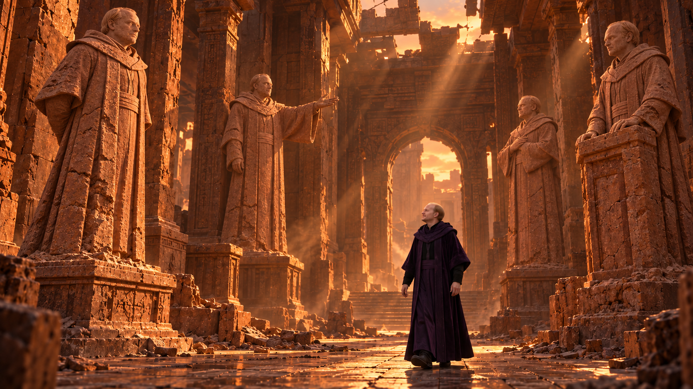</a><figcaption>@Image2 — Первый зал: четыре древние статуи Серёги</figcaption></figure>
<figure><a href="references/scenes/scene-63/S63-admiring-portrait.png" target="_blank" rel="noopener">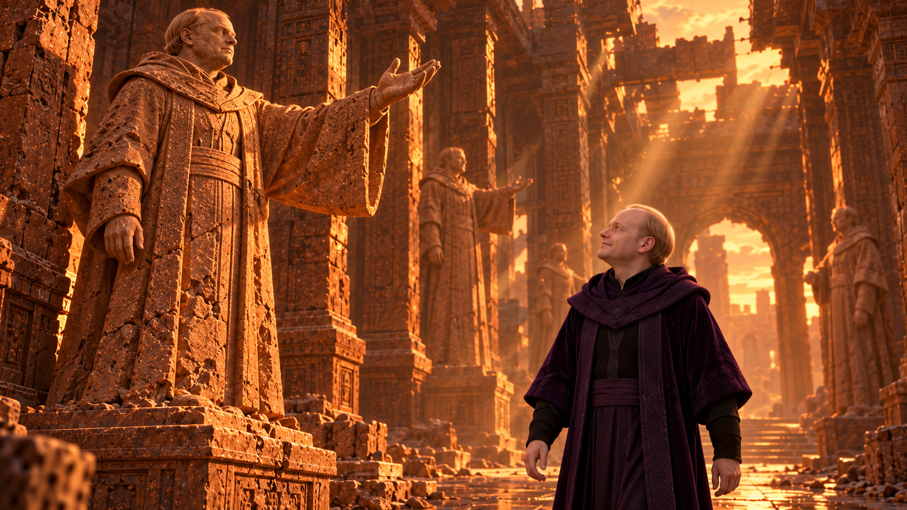</a><figcaption>@Image3 — Сходство живого лица и каменного портрета; восхищение</figcaption></figure>
<figure><a href="references/scenes/scene-63/S63-throne-hall.png" target="_blank" rel="noopener">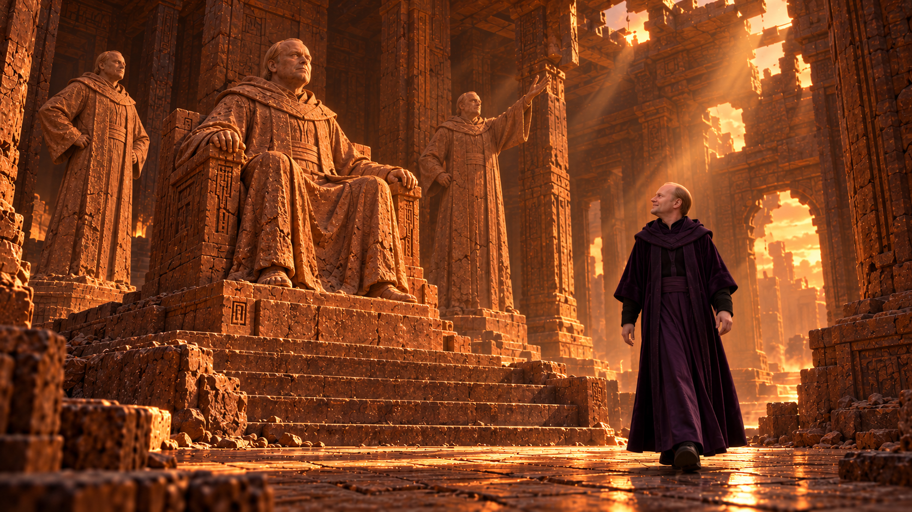</a><figcaption>@Image4 — Второй зал: властная статуя Серёги на троне</figcaption></figure>
</div>

<div class="engine-tabs" data-scene="63">

<div class="engine-pane" data-engine="wan30" data-main="1">

**30с · Wan3.0 / Seedance2.5 — один общий текст.** В очереди выбран Wan3.0.

```text
Mode: reference-to-video | Duration: 30s | Resolution: 720p | Aspect ratio: 16:9 | FPS: 24 | Native audio: on
Optimized for Wan 3.0 / Seedance 2.5 | Photoreal solemn temple exploration with understated visual comedy

REFERENCES / AUTHORITY ORDER:
@Image1 — exact individual Serega model sheet; highest authority for the living face and clothing AND the sculpted likeness/costume of every statue.
@Image2 — first gallery layout, monumental scale, weathered stone material and warm sunset direction.
@Image3 — medium admiration/likeness framing only; never overrides @Image1 identity.
@Image4 — connected inner throne hall and fixed seated-statue end composition.
These are reference photographs for staging, not frames to display in sequence. Generate real movement between them. The statues remain stone throughout.

CHARACTER APPEARANCE / IDENTITY LOCK:
SEREGA: exactly the man in @Image1, mature pale face with its real proportions, bald crown and sparse light hair at the sides, faint short stubble. Same floor-length deep dark-purple robe, broad folded collar with hood down, wide outer sleeves, black undersleeves, broad waist sash and dark boots. One living person only. No anonymous emperor face, added beard, beauty filter or caricature. His natural skin and moving cloth are distinct from the sculptures.

LOCATION / STATUE LOCK — CRITICAL:
Two connected interior halls of the same abandoned Sith temple: ochre/red-brown sandstone, square columns, cracked tiled floor, eroded carvings, rubble confined to edges, damaged high roof and gold evening light through openings. No outdoor city detour. The first gallery has four monumental standing statues on bases, in different proud commanding poses: hands behind back, one imperious outstretched arm, crossed arms, hands on a pedestal. The inner hall has a huge seated ruler on a stone throne, flanked by two standing statues. EVERY statue has Serega's exact face, bald crown/sparse hair pattern and the SAME robe, folded collar, sleeves and sash silhouette as @Image1. Their heads are uncovered. Faces, blank eyes, hair, hands and clothes are ALL rigid homogeneous weathered ochre stone: pits, chisel marks and old cracks; no skin or actual purple cloth on statues. They are entirely inanimate and never blink, breathe, turn, smile or move. Preserve distinct poses and fixed bases; never clone the living man or transform him into stone.

PROPS / STORY LOCK — CRITICAL:
Empty hands; no drawn saber, basket, map, computer, ship, companions or summoned objects in this gallery passage. This is an autonomous interior insert, not a replay of the exterior exploration. His admiration is sincere; the film never explains the resemblance in dialogue. Do not stage a supernatural encounter or battle.

START STATE:
Serega is already inside the first gallery, entering from the left side of the aisle. He is mid-step, looking ahead; the nearest statue is just coming into his eye line.

TIMELINE:
[0:00–0:06] — THE GALLERY
A low eye-level 28mm lateral dolly travels beside Serega as he walks steadily between immense bases. Parallax reveals the first commanding statue above him, its carved face unmistakably his own. He lifts his eyes and slows only slightly, never freezes.
[0:06–0:12] — EXCELLENT TASTE
Cut on his upward glance to a 50mm medium three-quarter view like @Image3. Real Serega and his huge stone likeness share the frame. His mouth corners lift into a small sincerely pleased smile. He makes one quiet approving nod and keeps walking; the statue does nothing.
[0:12–0:18] — AN ENTIRE DYNASTY
Resume a moving 35mm side view. Two successive column gaps reveal different fixed sovereign poses with the same face and carved robe. He looks from the crossed-arm statue to the imperious outstretched-hand statue with growing appreciation, then crosses the visible connecting arch into the next hall.
[0:18–0:24] — THE THRONE
Camera follows through the arch and widens with him, revealing @Image4: the largest self-portrait seated imperiously on a throne between two standing portraits. He takes two more steps along the open aisle, raises his chin and visibly savours this discovery.
[0:24–0:30] — A CONNOISSEUR MOVES ON
Medium tracking reaction: an unforced admiring smile, one last appreciative look up at the seated face. He turns his eyes toward the next doorway and continues out toward frame right while the camera glides slightly wider, leaving the mighty stone ruler behind. No final freeze or statue movement.

END STATE:
He is moving toward the next interior doorway at frame right, smiling faintly; the throne sculpture and its two attendants remain immobile in the inner hall. No new story object is discovered.

CAMERA / SPACE:
Keep the living man progressing left-to-right through the gallery and arch into the inner hall. Eye-line cuts connect his look to the fixed sculpture he is actually passing. Use 28–35mm moving architecture shots and a 50mm medium reaction with readable face; camera remains physically outside stone. One coherent connected floor plan, visible foot contact and natural walking speed. No fast orbit, wide-angle face distortion, montage of still photographs or slideshow transitions.

PERFORMANCE:
Natural continuous walking, real weight transfer and robe response. He admires the sculptures as magnificent works of art: eyes lead the upward gaze, eyebrows soften and rise slightly, then a restrained delighted smile and one small approving nod. His dignity and the solemn framing make the resemblance funny. No mugging, wink at camera, pointing gag, belly laugh, fear, overacting or copying every statue pose. Only living Serega changes expression.

LIGHTING / MATERIALS:
Warm low sunset through the broken high roof; gold shafts and drifting dust, ochre stone in deep brown shadow, soft reflected light keeps Serega's eyes readable. Pitted matte stone with old erosion; purple cloth folds move on the living man only. Photoreal feature-film skin and material detail, stable light direction across cuts.

AUDIO:
Measured bootfalls on grit and tile with long temple reverberation, soft cloth movement, breathing, faint wind through the broken roof. Quiet solemn atmosphere. No speech, narrator, chanting, laughter track, vocals or generated music; no subtitles or written explanations.

NEGATIVE PROMPT:
living statues, statue blink, moving stone lips or cloth, flesh on sculptures, coloured pupils on statues, purple fabric on statues, anonymous hooded Sith faces, different portrait identities, extra living Seregas, twins, face swap, costume change, stone transformation, ghosts, monsters, battle, red glowing eyes, lava, black basalt arena, modern museum, display labels, computer, ship, basket, ignited weapon, extra limbs, sliding feet, teleportation, frozen living actor, slideshow, comic exaggeration, cartoon, subtitles, logo, watermark.

FRAME FILL / NO BARS:
Fill the entire generated frame edge-to-edge. No letterboxing, no pillarboxing, no black bars, no side bars, no decorative borders, no empty margins.
```

</div>

<div class="engine-pane" data-engine="sd20x2">

**Альтернатива2×15с:** P1 использует те же4 картинки; P2 дополнительно настоящий конец своей P1, с проверкой стыка. Сейчас эти две части не выбраны к отдельному запуску.

#### 63 · Seedance 2.0 часть 1

```text
Mode: reference-to-video | Duration: 15s | Resolution: 720p | Aspect ratio: 16:9 | FPS: 24 | Native audio: on
Optimized for Seedance 2.0 | Photoreal solemn temple exploration with understated visual comedy

REFERENCES / AUTHORITY ORDER:
@Image1 — exact individual Serega model sheet; highest authority for the living face and clothing AND the sculpted likeness/costume of every statue.
@Image2 — first gallery layout, monumental scale, weathered stone material and warm sunset direction.
@Image3 — medium admiration/likeness framing only; never overrides @Image1 identity.
@Image4 — connected inner throne hall and fixed seated-statue end composition.
These are reference photographs for staging, not frames to display in sequence. Generate real movement between them. The statues remain stone throughout.

CHARACTER APPEARANCE / IDENTITY LOCK:
SEREGA: exactly the man in @Image1, mature pale face with its real proportions, bald crown and sparse light hair at the sides, faint short stubble. Same floor-length deep dark-purple robe, broad folded collar with hood down, wide outer sleeves, black undersleeves, broad waist sash and dark boots. One living person only. No anonymous emperor face, added beard, beauty filter or caricature. His natural skin and moving cloth are distinct from the sculptures.

LOCATION / STATUE LOCK — CRITICAL:
Two connected interior halls of the same abandoned Sith temple: ochre/red-brown sandstone, square columns, cracked tiled floor, eroded carvings, rubble confined to edges, damaged high roof and gold evening light through openings. No outdoor city detour. The first gallery has four monumental standing statues on bases, in different proud commanding poses: hands behind back, one imperious outstretched arm, crossed arms, hands on a pedestal. The inner hall has a huge seated ruler on a stone throne, flanked by two standing statues. EVERY statue has Serega's exact face, bald crown/sparse hair pattern and the SAME robe, folded collar, sleeves and sash silhouette as @Image1. Their heads are uncovered. Faces, blank eyes, hair, hands and clothes are ALL rigid homogeneous weathered ochre stone: pits, chisel marks and old cracks; no skin or actual purple cloth on statues. They are entirely inanimate and never blink, breathe, turn, smile or move. Preserve distinct poses and fixed bases; never clone the living man or transform him into stone.

PROPS / STORY LOCK — CRITICAL:
Empty hands; no drawn saber, basket, map, computer, ship, companions or summoned objects in this gallery passage. This is an autonomous interior insert, not a replay of the exterior exploration. His admiration is sincere; the film never explains the resemblance in dialogue. Do not stage a supernatural encounter or battle.

START STATE:
Serega is already inside the first gallery at the left side of the aisle, mid-step, approaching the first statue in @Image2.

TIMELINE:
[0:00–0:05] — FIRST PORTRAIT
28mm lateral track beside his continuous left-to-right walk. A column clears the commanding statue on its base; the face and carved collar are unmistakably his. He looks up, eyebrows rising with interest.
[0:05–0:10] — SINCERE ADMIRATION
Cut on his gaze to the medium 50mm two-subject framing of @Image3. Living face and huge stone portrait are visible together. A small sincerely delighted smile develops; he gives one restrained approving nod while continuing forward, not posing for camera.
[0:10–0:15] — ANOTHER GREAT RULER
Return to a moving 35mm side view. He passes the next differently posed self-portrait and approaches the visible arch between halls. End mid-stride just before crossing the arch, head beginning to turn toward the room beyond. No throne reveal yet.

END STATE:
Serega is mid-stride immediately before the connecting arch, body moving right, head beginning its turn into the inner hall. Preserve this actual moving state for Part2.

CAMERA / SPACE:
Keep the living man progressing left-to-right through the gallery and arch into the inner hall. Eye-line cuts connect his look to the fixed sculpture he is actually passing. Use 28–35mm moving architecture shots and a 50mm medium reaction with readable face; camera remains physically outside stone. One coherent connected floor plan, visible foot contact and natural walking speed. No fast orbit, wide-angle face distortion, montage of still photographs or slideshow transitions.

PERFORMANCE:
Natural continuous walking, real weight transfer and robe response. He admires the sculptures as magnificent works of art: eyes lead the upward gaze, eyebrows soften and rise slightly, then a restrained delighted smile and one small approving nod. His dignity and the solemn framing make the resemblance funny. No mugging, wink at camera, pointing gag, belly laugh, fear, overacting or copying every statue pose. Only living Serega changes expression.

LIGHTING / MATERIALS:
Warm low sunset through the broken high roof; gold shafts and drifting dust, ochre stone in deep brown shadow, soft reflected light keeps Serega's eyes readable. Pitted matte stone with old erosion; purple cloth folds move on the living man only. Photoreal feature-film skin and material detail, stable light direction across cuts.

AUDIO:
Measured bootfalls on grit and tile with long temple reverberation, soft cloth movement, breathing, faint wind through the broken roof. Quiet solemn atmosphere. No speech, narrator, chanting, laughter track, vocals or generated music; no subtitles or written explanations.

NEGATIVE PROMPT:
living statues, statue blink, moving stone lips or cloth, flesh on sculptures, coloured pupils on statues, purple fabric on statues, anonymous hooded Sith faces, different portrait identities, extra living Seregas, twins, face swap, costume change, stone transformation, ghosts, monsters, battle, red glowing eyes, lava, black basalt arena, modern museum, display labels, computer, ship, basket, ignited weapon, extra limbs, sliding feet, teleportation, frozen living actor, slideshow, comic exaggeration, cartoon, subtitles, logo, watermark.

FRAME FILL / NO BARS:
Fill the entire generated frame edge-to-edge. No letterboxing, no pillarboxing, no black bars, no side bars, no decorative borders, no empty margins.
```

#### 63 · Seedance 2.0 часть 2

```text
Mode: reference-to-video | Duration: 15s | Resolution: 720p | Aspect ratio: 16:9 | FPS: 24 | Native audio: on
Optimized for Seedance 2.0 | Photoreal solemn temple exploration with understated visual comedy

REFERENCES / AUTHORITY ORDER:
@Video1 — actual last 3 seconds of THIS scene63 Part1, fixing the moving start state, geography and light. Continue its final frame; do not substitute a generated still or an unrelated scene.
@Image1 — exact individual Serega model sheet; highest authority for the living face and clothing AND the sculpted likeness/costume of every statue.
@Image2 — first gallery layout, monumental scale, weathered stone material and warm sunset direction.
@Image3 — medium admiration/likeness framing only; never overrides @Image1 identity.
@Image4 — connected inner throne hall and fixed seated-statue end composition.
These are reference photographs for staging, not frames to display in sequence. Generate real movement between them. The statues remain stone throughout.

CHARACTER APPEARANCE / IDENTITY LOCK:
SEREGA: exactly the man in @Image1, mature pale face with its real proportions, bald crown and sparse light hair at the sides, faint short stubble. Same floor-length deep dark-purple robe, broad folded collar with hood down, wide outer sleeves, black undersleeves, broad waist sash and dark boots. One living person only. No anonymous emperor face, added beard, beauty filter or caricature. His natural skin and moving cloth are distinct from the sculptures.

LOCATION / STATUE LOCK — CRITICAL:
Two connected interior halls of the same abandoned Sith temple: ochre/red-brown sandstone, square columns, cracked tiled floor, eroded carvings, rubble confined to edges, damaged high roof and gold evening light through openings. No outdoor city detour. The first gallery has four monumental standing statues on bases, in different proud commanding poses: hands behind back, one imperious outstretched arm, crossed arms, hands on a pedestal. The inner hall has a huge seated ruler on a stone throne, flanked by two standing statues. EVERY statue has Serega's exact face, bald crown/sparse hair pattern and the SAME robe, folded collar, sleeves and sash silhouette as @Image1. Their heads are uncovered. Faces, blank eyes, hair, hands and clothes are ALL rigid homogeneous weathered ochre stone: pits, chisel marks and old cracks; no skin or actual purple cloth on statues. They are entirely inanimate and never blink, breathe, turn, smile or move. Preserve distinct poses and fixed bases; never clone the living man or transform him into stone.

PROPS / STORY LOCK — CRITICAL:
Empty hands; no drawn saber, basket, map, computer, ship, companions or summoned objects in this gallery passage. This is an autonomous interior insert, not a replay of the exterior exploration. His admiration is sincere; the film never explains the resemblance in dialogue. Do not stage a supernatural encounter or battle.

START STATE:
Begin on the exact final frame of @Video1. Continue the existing step, camera direction, robe motion and head turn at the connecting arch with no restart or opening tableau.

TIMELINE:
[0:00–0:04] — THROUGH THE ARCH
Continue the previous moving shot seamlessly. He completes the step through the arch; camera follows beside him with physically continuous parallax and no replay of the nod or first gallery.
[0:04–0:09] — THE GREATEST PORTRAIT
The new angle opens to the throne hall in @Image4. Reveal the huge seated self-portrait with rigid hands on its armrests and its two differently posed attendants. He takes two steps, looks up at the seated face, and his restrained pleased smile grows with unmistakable admiration.
[0:09–0:15] — SATISFIED VISITOR
A motivated medium 50mm reaction shows the approving eyes and small smile; then the camera glides wider as he resumes his purposeful walk toward the next doorway at frame right. The giant seated sculpture stays completely motionless. End in movement, with the temple continuing beyond frame.

END STATE:
Serega moves toward the next doorway at frame right with a faint satisfied smile. The seated statue and two attendants remain fixed in the inner hall; no supernatural event or new prop.

CAMERA / SPACE:
Keep the living man progressing left-to-right through the gallery and arch into the inner hall. Eye-line cuts connect his look to the fixed sculpture he is actually passing. Use 28–35mm moving architecture shots and a 50mm medium reaction with readable face; camera remains physically outside stone. One coherent connected floor plan, visible foot contact and natural walking speed. No fast orbit, wide-angle face distortion, montage of still photographs or slideshow transitions.

PERFORMANCE:
Natural continuous walking, real weight transfer and robe response. He admires the sculptures as magnificent works of art: eyes lead the upward gaze, eyebrows soften and rise slightly, then a restrained delighted smile and one small approving nod. His dignity and the solemn framing make the resemblance funny. No mugging, wink at camera, pointing gag, belly laugh, fear, overacting or copying every statue pose. Only living Serega changes expression.

LIGHTING / MATERIALS:
Warm low sunset through the broken high roof; gold shafts and drifting dust, ochre stone in deep brown shadow, soft reflected light keeps Serega's eyes readable. Pitted matte stone with old erosion; purple cloth folds move on the living man only. Photoreal feature-film skin and material detail, stable light direction across cuts.

AUDIO:
Measured bootfalls on grit and tile with long temple reverberation, soft cloth movement, breathing, faint wind through the broken roof. Quiet solemn atmosphere. No speech, narrator, chanting, laughter track, vocals or generated music; no subtitles or written explanations.

NEGATIVE PROMPT:
living statues, statue blink, moving stone lips or cloth, flesh on sculptures, coloured pupils on statues, purple fabric on statues, anonymous hooded Sith faces, different portrait identities, extra living Seregas, twins, face swap, costume change, stone transformation, ghosts, monsters, battle, red glowing eyes, lava, black basalt arena, modern museum, display labels, computer, ship, basket, ignited weapon, extra limbs, sliding feet, teleportation, frozen living actor, slideshow, comic exaggeration, cartoon, subtitles, logo, watermark.

FRAME FILL / NO BARS:
Fill the entire generated frame edge-to-edge. No letterboxing, no pillarboxing, no black bars, no side bars, no decorative borders, no empty margins.
```

</div>

</div>

<a id="scene-64"></a>
## Сцена 64 — Звёздный разрушитель: Серёга пританцовывает по коридору

<!-- scene-meta: {"target_engine":"Wan 3","production_state":"DRAFT","duration_s":30,"dialogue":{"enabled":false,"language":null},"dependencies":[],"tags":["serega","star_destroyer","visual_comedy","dance_walk","owner_requested"]} -->

**Контекст использования:** владелец 27.10.2026. Самостоятельная комедийная вставка на борту имперского крейсера. Предлагаемое место в монтаже — перед ремонтом в ангаре 43–44 и пересадкой 52 (Серёга идёт к ангару в хорошем настроении). Место — предложение, окончательно решает владелец.

**Что происходит:** Серёга в отличном настроении идёт по длинному коридору звёздного разрушителя и пританцовывает: щёлкает пальцами, покачивает плечами, делает скользящий шаг, крутится на каблуке и подпрыгивает на ходу. Имперские офицеры и штурмовик впереди замирают, прижимаются к стене и смотрят на него странно, но со страхом: никто не смеет ни остановить его, ни улыбнуться. Один офицер роняет планшет и не решается его поднять. Серёга не замечает произведённого эффекта и уходит в раздвижные двери; офицеры за его спиной переглядываются и выдыхают.

**Готовность:** DRAFT. Все обязательные изображения сохранены; технический QC референсов подтверждён манифестами. Главная версия — Wan 3.0 (30 с), по выбору владельца. В существующей очереди — после 63, до музыкальных и танцевальных номеров 49–51 и 28. Текущий проход OPEN-WORK-REFS-RELAY-20261027 ограничен референсами и инструкциями: видео не запускать. Исходное состояние очереди blocked_inputs сохранено; автоматически снимать блокер запуска в этом проходе нельзя. Художественное одобрение не выставлено.

**Референсы:** @Image1 — `references/full/serega.jpg` (Точный модельный лист Серёги: лицо и одежда); @Image2 — `references/scenes/scene-64/S64-corridor.png` (Коридор звёздного разрушителя: геометрия и свет); @Image3 — `references/scenes/scene-64/S64-officers-reaction.png` (Офицеры у стены: странный и испуганный взгляд).

<div class="scene-ref-gallery">
<figure><a href="references/full/serega.jpg" target="_blank" rel="noopener">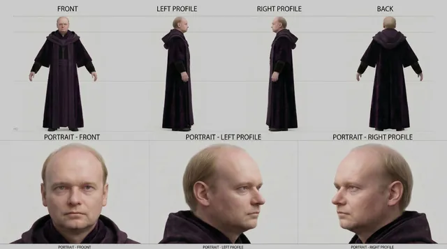</a><figcaption>@Image1 — Точный модельный лист Серёги: лицо и одежда</figcaption></figure>
<figure><a href="references/scenes/scene-64/S64-corridor.png" target="_blank" rel="noopener">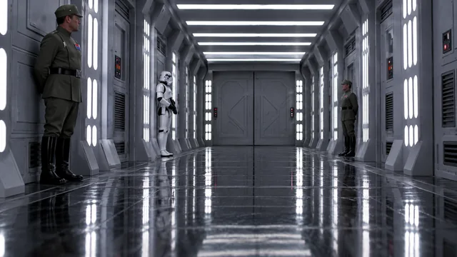</a><figcaption>@Image2 — Коридор звёздного разрушителя</figcaption></figure>
<figure><a href="references/scenes/scene-64/S64-officers-reaction.png" target="_blank" rel="noopener">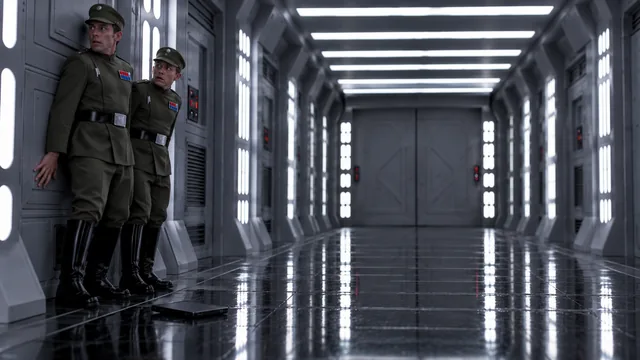</a><figcaption>@Image3 — Офицеры: испуг и недоумение</figcaption></figure>
</div>

**Режиссёрский контроль:** Офицеры боятся, а не смеются; танец на ходу, без остановки и без «сценического номера»; в конце двери закрываются за Серёгой.

<div class="engine-tabs" data-scene="64">

<div class="engine-pane" data-engine="wan30" data-main="1">

**30с · Wan3.0 / Seedance2.5 — один общий текст.** Главная версия — Wan3.0.

**Входы:** @Image1 — `references/full/serega.jpg`; @Image2 — `references/scenes/scene-64/S64-corridor.png`; @Image3 — `references/scenes/scene-64/S64-officers-reaction.png`.

```text
Mode: reference-to-video | Duration: 30s | Resolution: 720p | Aspect ratio: 16:9 | FPS: 24 | Native audio: on
Optimized for Wan 3.0 / Seedance 2.5 | Photoreal live-action space-opera cinema, dynamic comedy

REFERENCES / AUTHORITY ORDER:
@Image1 — exact individual Serega model sheet; highest authority for his face, proportions and clothing. File: references/full/serega.jpg.
@Image2 — Imperial Star Destroyer corridor geometry, glossy black floor, grey wall panels, ceiling light strips and blast doors; location and light only. File: references/scenes/scene-64/S64-corridor.png.
@Image3 — reaction composition: officers pressed to the wall, wide eyes, stiff posture; never overrides Serega identity. File: references/scenes/scene-64/S64-officers-reaction.png.
Images are references for identity, design and staging, not frames to show in sequence. Generate real movement between them.

CHARACTER APPEARANCE / IDENTITY LOCK:
SEREGA: exactly the man in the Serega model sheet: mature pale face with its real proportions, balding crown and sparse light-brown hair at the sides, faint short stubble, broad familiar build. Floor-length deep dark-plum robe, broad folded collar with hood down, wide outer sleeves, black undersleeves, broad waist sash and dark boots. One Serega only. No beautifying, age shift, added beard, costume change or face blending with extras.
IMPERIAL OFFICERS: three or four Imperial officers in classic olive-grey Imperial uniforms with rank plaques, caps and black boots, plus one white-armoured stormtrooper. Ordinary human faces, all distinct, none resembles Serega.

LOCATION / STORY LOCK — CRITICAL:
One long straight Imperial Star Destroyer corridor from @Image2: glossy black floor, grey panels, ceiling light strips, sliding blast doors at the far end. Serega dances while walking forward along the centre; officers and the stormtrooper stay against the side walls. Officers are frightened of him: they never block, touch, salute mockingly, laugh or smile. No weapons drawn, no lightsaber, no Force effects, no battle. His hands are empty. The dance is joyful walking dance, not a stage show.

START STATE:
Serega enters the corridor from the near end in mid-stride, already in a cheerful mood, snapping his fingers; the officers ahead are still at their posts along the walls.

TIMELINE:
[0:00–0:06] HAPPY STRIDE — Low 28mm tracking shot moving backwards ahead of him. Serega walks with a bouncy step, snapping his fingers on the beat, shoulders rolling, a small satisfied smile. Ahead the first officer turns from a wall console, sees him and straightens rigidly against the panel.
[0:06–0:12] THE MOVES — Cut on motion to a side tracking 35mm view. He does a sliding side step, a quick heel spin with the robe flaring out, and a little hop-skip without breaking forward motion. Two officers flatten against the wall as he passes; their heads turn to follow him, eyes wide.
[0:12–0:18] FEAR AND CONFUSION — Medium 50mm reaction from the officers' side: one officer drops his datapad with a clatter, looks down at it and does not dare to bend for it; the stormtrooper freezes mid-step and slowly shifts back to the wall. Serega's shimmying back recedes past them.
[0:18–0:24] FINALE PASS — Frontal medium shot of Serega: a shoulder shimmy, two quick finger-point beats to nobody in particular, a final spin as the blast doors ahead slide open for him. He never looks at the frightened crew.
[0:24–0:30] EXHALE — Wide shot from behind the officers: Serega dances through the open doors, which slide shut behind him. In the sudden quiet the officers slowly peel off the wall, exchange one long baffled, frightened look; one finally picks up the datapad. End on their silent exchange.

END STATE:
The blast doors are closed behind Serega. Officers stand away from the wall, baffled and uneasy; datapad back in hand. Serega is gone.

CAMERA / SPACE:
Keep one corridor axis: Serega moves away from the near end toward the far blast doors. Alternate 28mm backward tracking, side tracking, 50mm reactions of officers and a wide finale. Faces readable in medium shots; cut on spins and steps.

PERFORMANCE:
Serega dances happily but in character: dignified, absorbed in his own good mood, body loose and rhythmic, no mugging to camera. Officers: rigid, frightened, puzzled; tiny reactions (swallow, eyes following, step back), never laughter. Bodies stay purposefully in motion; cut on movement every 2–5 seconds; brief readable reactions. No dead slideshow, repeated action loop or premature final pose.

LIGHTING / MATERIALS:
Cool white ceiling strips, reflections in the glossy black floor, grey panel texture, warm plum fabric reading clearly against grey; photoreal feature-film skin and material detail.

AUDIO:
Bootfalls tapping in rhythm, finger snaps, robe swish, Serega quietly humming a cheerful wordless tune, ship hum, a datapad clatter, blast-door hiss. No speech, no narrator, no generated music track, no subtitles.

NEGATIVE PROMPT:
officers laughing, smiling or dancing along, salute, arrest, blasters drawn, lightsaber, Force lightning, battle, extra Seregas, face swap, robe change, cartoon, sliding feet, frozen pose, slideshow, logo, watermark, subtitles.

FRAME FILL / NO BARS:
Fill the entire generated frame edge-to-edge. No letterboxing, no pillarboxing, no black bars, no side bars, no decorative borders, no empty margins.
```

</div>

<div class="engine-pane" data-engine="sd20x2">

**Альтернатива2×15с.** P2 требует настоящие последние3с своей P1; не выбрана к запуску.

#### 64 · Seedance 2.0 часть 1

**Входы:** @Image1 — `references/full/serega.jpg`; @Image2 — `references/scenes/scene-64/S64-corridor.png`; @Image3 — `references/scenes/scene-64/S64-officers-reaction.png`.

```text
Mode: reference-to-video | Duration: 15s | Resolution: 720p | Aspect ratio: 16:9 | FPS: 24 | Native audio: on
Optimized for Seedance 2.0 | Photoreal live-action space-opera cinema, dynamic comedy

REFERENCES / AUTHORITY ORDER:
@Image1 — exact individual Serega model sheet; highest authority for his face, proportions and clothing. File: references/full/serega.jpg.
@Image2 — Imperial Star Destroyer corridor geometry, glossy black floor, grey wall panels, ceiling light strips and blast doors; location and light only. File: references/scenes/scene-64/S64-corridor.png.
@Image3 — reaction composition: officers pressed to the wall, wide eyes, stiff posture; never overrides Serega identity. File: references/scenes/scene-64/S64-officers-reaction.png.
Images are references for identity, design and staging, not frames to show in sequence. Generate real movement between them.

CHARACTER APPEARANCE / IDENTITY LOCK:
SEREGA: exactly the man in the Serega model sheet: mature pale face with its real proportions, balding crown and sparse light-brown hair at the sides, faint short stubble, broad familiar build. Floor-length deep dark-plum robe, broad folded collar with hood down, wide outer sleeves, black undersleeves, broad waist sash and dark boots. One Serega only. No beautifying, age shift, added beard, costume change or face blending with extras.
IMPERIAL OFFICERS: three or four Imperial officers in classic olive-grey Imperial uniforms with rank plaques, caps and black boots, plus one white-armoured stormtrooper. Ordinary human faces, all distinct, none resembles Serega.

LOCATION / STORY LOCK — CRITICAL:
One long straight Imperial Star Destroyer corridor from @Image2: glossy black floor, grey panels, ceiling light strips, sliding blast doors at the far end. Serega dances while walking forward along the centre; officers and the stormtrooper stay against the side walls. Officers are frightened of him: they never block, touch, salute mockingly, laugh or smile. No weapons drawn, no lightsaber, no Force effects, no battle. His hands are empty. The dance is joyful walking dance, not a stage show.

START STATE:
Serega enters the corridor from the near end in mid-stride, already in a cheerful mood, snapping his fingers; the officers ahead are still at their posts along the walls.

TIMELINE:
[0:00–0:06] HAPPY STRIDE — Low 28mm tracking shot moving backwards ahead of him. Serega walks with a bouncy step, snapping his fingers on the beat, shoulders rolling, a small satisfied smile. Ahead the first officer turns from a wall console, sees him and straightens rigidly against the panel.
[0:06–0:12] THE MOVES — Cut on motion to a side tracking 35mm view. He does a sliding side step, a quick heel spin with the robe flaring out, and a little hop-skip without breaking forward motion. Two officers flatten against the wall as he passes; their heads turn to follow him, eyes wide.
[0:12–0:18] FEAR AND CONFUSION — Medium 50mm reaction from the officers' side: one officer drops his datapad with a clatter, looks down at it and does not dare to bend for it; the stormtrooper freezes mid-step and slowly shifts back to the wall. Serega's shimmying back recedes past them.

END STATE:
Serega mid-move in the corridor centre with officers pressed against the walls; one datapad on the floor; he is still dancing forward toward the blast doors. Keep the motion going through the final 3 seconds for Part 2; no fade or end pose.

CAMERA / SPACE:
Keep one corridor axis: Serega moves away from the near end toward the far blast doors. Alternate 28mm backward tracking, side tracking, 50mm reactions of officers and a wide finale. Faces readable in medium shots; cut on spins and steps. Execute only the beats of this part.

PERFORMANCE:
Serega dances happily but in character: dignified, absorbed in his own good mood, body loose and rhythmic, no mugging to camera. Officers: rigid, frightened, puzzled; tiny reactions (swallow, eyes following, step back), never laughter. Bodies stay purposefully in motion; cut on movement every 2–5 seconds; brief readable reactions. No dead slideshow, repeated action loop or premature final pose.

LIGHTING / MATERIALS:
Cool white ceiling strips, reflections in the glossy black floor, grey panel texture, warm plum fabric reading clearly against grey; photoreal feature-film skin and material detail.

AUDIO:
Bootfalls tapping in rhythm, finger snaps, robe swish, Serega quietly humming a cheerful wordless tune, ship hum, a datapad clatter, blast-door hiss. No speech, no narrator, no generated music track, no subtitles.

NEGATIVE PROMPT:
officers laughing, smiling or dancing along, salute, arrest, blasters drawn, lightsaber, Force lightning, battle, extra Seregas, face swap, robe change, cartoon, sliding feet, frozen pose, slideshow, logo, watermark, subtitles.

FRAME FILL / NO BARS:
Fill the entire generated frame edge-to-edge. No letterboxing, no pillarboxing, no black bars, no side bars, no decorative borders, no empty margins.
```

#### 64 · Seedance 2.0 часть 2

**Входы:** @Video1 — последние 3 с настоящей части 1 этой сцены; @Image1 — `references/full/serega.jpg`; @Image2 — `references/scenes/scene-64/S64-corridor.png`; @Image3 — `references/scenes/scene-64/S64-officers-reaction.png`.

```text
Mode: reference-to-video | Duration: 15s | Resolution: 720p | Aspect ratio: 16:9 | FPS: 24 | Native audio: on
Optimized for Seedance 2.0 | Photoreal live-action space-opera cinema, dynamic comedy

REFERENCES / AUTHORITY ORDER:
@Video1 — actual last 3 seconds of THIS scene 64 Part 1 result; absolute authority for the starting frame, positions, camera, light and ongoing motion. Continue it; never restart.
@Image1 — exact individual Serega model sheet; highest authority for his face, proportions and clothing. File: references/full/serega.jpg.
@Image2 — Imperial Star Destroyer corridor geometry, glossy black floor, grey wall panels, ceiling light strips and blast doors; location and light only. File: references/scenes/scene-64/S64-corridor.png.
@Image3 — reaction composition: officers pressed to the wall, wide eyes, stiff posture; never overrides Serega identity. File: references/scenes/scene-64/S64-officers-reaction.png.
Images are references for identity, design and staging, not frames to show in sequence. Generate real movement between them.

CHARACTER APPEARANCE / IDENTITY LOCK:
SEREGA: exactly the man in the Serega model sheet: mature pale face with its real proportions, balding crown and sparse light-brown hair at the sides, faint short stubble, broad familiar build. Floor-length deep dark-plum robe, broad folded collar with hood down, wide outer sleeves, black undersleeves, broad waist sash and dark boots. One Serega only. No beautifying, age shift, added beard, costume change or face blending with extras.
IMPERIAL OFFICERS: three or four Imperial officers in classic olive-grey Imperial uniforms with rank plaques, caps and black boots, plus one white-armoured stormtrooper. Ordinary human faces, all distinct, none resembles Serega.

LOCATION / STORY LOCK — CRITICAL:
One long straight Imperial Star Destroyer corridor from @Image2: glossy black floor, grey panels, ceiling light strips, sliding blast doors at the far end. Serega dances while walking forward along the centre; officers and the stormtrooper stay against the side walls. Officers are frightened of him: they never block, touch, salute mockingly, laugh or smile. No weapons drawn, no lightsaber, no Force effects, no battle. His hands are empty. The dance is joyful walking dance, not a stage show.

START STATE:
Begin on the exact final frame of @Video1 and continue its motion with no replay or reset. Expected handoff (subordinate to the actual video): Serega mid-move in the corridor centre with officers pressed against the walls; one datapad on the floor; he is still dancing forward toward the blast doors.

TIMELINE:
[0:00–0:07] FINALE PASS — Frontal medium shot of Serega: a shoulder shimmy, two quick finger-point beats to nobody in particular, a final spin as the blast doors ahead slide open for him. He never looks at the frightened crew.
[0:07–0:15] EXHALE — Wide shot from behind the officers: Serega dances through the open doors, which slide shut behind him. In the sudden quiet the officers slowly peel off the wall, exchange one long baffled, frightened look; one finally picks up the datapad. End on their silent exchange.

END STATE:
The blast doors are closed behind Serega. Officers stand away from the wall, baffled and uneasy; datapad back in hand. Serega is gone.

CAMERA / SPACE:
Keep one corridor axis: Serega moves away from the near end toward the far blast doors. Alternate 28mm backward tracking, side tracking, 50mm reactions of officers and a wide finale. Faces readable in medium shots; cut on spins and steps. Execute only the beats of this part.

PERFORMANCE:
Serega dances happily but in character: dignified, absorbed in his own good mood, body loose and rhythmic, no mugging to camera. Officers: rigid, frightened, puzzled; tiny reactions (swallow, eyes following, step back), never laughter. Bodies stay purposefully in motion; cut on movement every 2–5 seconds; brief readable reactions. No dead slideshow, repeated action loop or premature final pose.

LIGHTING / MATERIALS:
Cool white ceiling strips, reflections in the glossy black floor, grey panel texture, warm plum fabric reading clearly against grey; photoreal feature-film skin and material detail.

AUDIO:
Bootfalls tapping in rhythm, finger snaps, robe swish, Serega quietly humming a cheerful wordless tune, ship hum, a datapad clatter, blast-door hiss. No speech, no narrator, no generated music track, no subtitles.

NEGATIVE PROMPT:
officers laughing, smiling or dancing along, salute, arrest, blasters drawn, lightsaber, Force lightning, battle, extra Seregas, face swap, robe change, cartoon, sliding feet, frozen pose, slideshow, logo, watermark, subtitles.

FRAME FILL / NO BARS:
Fill the entire generated frame edge-to-edge. No letterboxing, no pillarboxing, no black bars, no side bars, no decorative borders, no empty margins.
```

</div>

</div>

<a id="scene-65"></a>
## Сцена 65 — Татуинская связка 7/7 · Серёга молча выпивает в баре с Бобой Феттом и компанией

<!-- scene-meta: {"target_engine":"Wan 3","production_state":"DRAFT","duration_s":30,"dialogue":{"enabled":false,"language":null},"dependencies":[{"type":"continues","scene":70}],"tags":["serega","tatooine","cantina","visual_comedy","copyright_characters","owner_requested"]} -->
**🎬 Татуинская связка — 7/7.** [52 ч.7 · 1/7](#scene-52) → [66 · 2/7](#scene-66) → [67 · 3/7](#scene-67) → [68 · 4/7](#scene-68) → [69 · 5/7](#scene-69) → [70 · 6/7](#scene-70) → [65 · 7/7](#scene-65). **Выбранный запуск:** Wan 3.0, 30 с, S65-WAN30; @Video1 — настоящий финал предыдущего звена (до его готовности запуск заблокирован). **Кликабельные референсы:** [@Image1 — Серёга](references/full/serega.jpg) · [@Image2 — кантина](references/scenes/scene-10/S10-Image1-cantina-source.png) · [@Image3 — компания за столом](references/scenes/scene-65/S65-bar-table.png) · [@Image4 — тост и маслёнка](references/scenes/scene-65/S65-toast-closeup.png). Изображения не заменяют настоящий видеостык.

**Контекст использования:** владелец 28.10.2026. Финал связки 52 ч.7 → 66 → 67 → 68 → 69 → 70 → 65: камера из улицы непрерывным пролётом70 приходит к столику Серёги;65 продолжает настоящий конец70. Тост и маслёнка начинаются здесь, без повторного входа в кантину.

**Что происходит:** Серёга сидит за круглым столом в татуинской кантине с Бобой Феттом, гаморреанцем, наёмником-тви'леком и дроидом IG-11. Бармен ставит кружки. Серёга не говорит ни слова: молча поднимает кружку на пару сантиметров, все чокаются. Гаморреанец осушает кружку залпом и грохает ею по столу. Боба Фетт чуть приподнимает низ шлема и пьёт, не показывая лица. IG-11 достаёт маленькую маслёнку и с довольным жужжанием капает маслом себе на локоть и шейный шарнир. Тви'лек смеётся и хлопает Серёгу по плечу. Серёга невозмутимо допивает и молча показывает бармену два пальца — ещё раунд. Гаморреанец с любопытством нюхает маслёнку, IG-11 отодвигает её.

**Готовность:** DRAFT. Главная версия — Wan3.0,30с. Изображения и их роли закреплены в манифесте; запуск ждёт настоящие последние3с результата70 и QC стыка. Связка 52 ч.7 → 66 → 67 → 68 → 69 → 70 → 65 идёт до музыкальных и танцевальных номеров49–51/28 по приоритету; правило следующей фактически готовой сцены сохраняется. Новые видеозапуски и художественная приёмка этой правкой не выполняются.

**Референсы:** @Video1 — последние3с настоящего70 (`references/scenes/scene-70/S70-last3s.mp4`); @Image1 — `references/full/serega.jpg` (Точный модельный лист Серёги: лицо и одежда); @Image2 — `references/scenes/scene-10/S10-Image1-cantina-source.png` (Кантина: арки, лампа, столы (только локация)); @Image3 — `references/scenes/scene-65/S65-bar-table.png` (Стол: Серёга, Боба Фетт, гаморреанец, тви'лек, IG-11); @Image4 — `references/scenes/scene-65/S65-toast-closeup.png` (Тост и маслёнка IG-11).

<div class="scene-ref-gallery">
<figure><a href="references/full/serega.jpg" target="_blank" rel="noopener"></a><figcaption>@Image1 — Точный модельный лист Серёги: лицо и одежда</figcaption></figure>
<figure><a href="references/scenes/scene-10/S10-Image1-cantina-source.png" target="_blank" rel="noopener">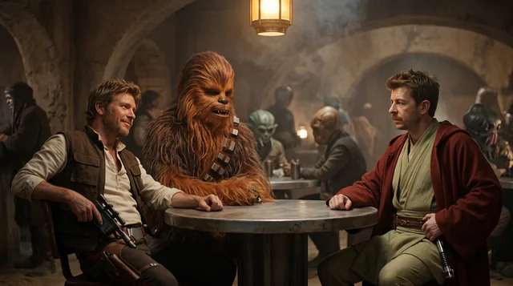</a><figcaption>@Image2 — Кантина: арки, лампа, столы (только локация)</figcaption></figure>
<figure><a href="references/scenes/scene-65/S65-bar-table.png" target="_blank" rel="noopener">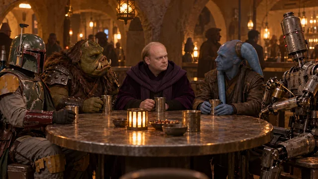</a><figcaption>@Image3 — Серёга и компания за столом кантины</figcaption></figure>
<figure><a href="references/scenes/scene-65/S65-toast-closeup.png" target="_blank" rel="noopener"></a><figcaption>@Image4 — Молчаливый тост и маслёнка IG-11</figcaption></figure>
</div>

**Режиссёрский контроль:** Серёга не говорит ни слова; Боба Фетт не снимает шлем; IG-11 не пьёт, а смазывает себя из маслёнки; трое из исходника кантины (S10) в кадр не попадают.

<div class="engine-tabs" data-scene="65">

<div class="engine-pane" data-engine="wan30" data-main="1">

**30с · Wan3.0 / Seedance2.5 — один общий текст.** Главная версия — Wan3.0.

**Входы:** @Video1 — последние3с настоящего70 (`references/scenes/scene-70/S70-last3s.mp4`); @Image1 — `references/full/serega.jpg`; @Image2 — `references/scenes/scene-10/S10-Image1-cantina-source.png`; @Image3 — `references/scenes/scene-65/S65-bar-table.png`; @Image4 — `references/scenes/scene-65/S65-toast-closeup.png`.

```text
Mode: reference-to-video | Duration: 30s | Resolution: 720p | Aspect ratio: 16:9 | FPS: 24 | Native audio: on
Optimized for Wan 3.0 / Seedance 2.5 | Photoreal live-action space-opera cinema, dynamic comedy

REFERENCES / AUTHORITY ORDER:
@Video1 — actual last 3 seconds of scene 70 (S70-WAN30). File: references/scenes/scene-70/S70-last3s.mp4. Absolute authority for the exact starting frame, camera, lighting, positions and ongoing gestures. Continue that real approach and action seamlessly; no restart or replay.
@Image1 — exact individual Serega model sheet; highest authority for his face, proportions and clothing. File: references/full/serega.jpg.
@Image2 — cantina location only: sandstone arches, hanging lamp, round metal tables, alien patrons in background; ignore and exclude all three people at its table. File: references/scenes/scene-10/S10-Image1-cantina-source.png.
@Image3 — group seating composition at one round table; each character's own design lock below wins over this helper. File: references/scenes/scene-65/S65-bar-table.png.
@Image4 — medium composition: raised mugs meeting over the table centre, the droid's oil can among them; staging helper only. File: references/scenes/scene-65/S65-toast-closeup.png.
Images are references for identity, design and staging, not frames to show in sequence. Generate real movement between them.

CHARACTER APPEARANCE / IDENTITY LOCK:
SEREGA: exactly the man in the Serega model sheet: mature pale face with its real proportions, balding crown and sparse light-brown hair at the sides, faint short stubble, broad familiar build. Floor-length deep dark-plum robe, broad folded collar with hood down, wide outer sleeves, black undersleeves, broad waist sash and dark boots. One Serega only. No beautifying, age shift, added beard, costume change or face blending with extras.
BOBA FETT: the famous Mandalorian bounty hunter in dented green-and-grey Mandalorian armour, T-visor helmet with rangefinder, jetpack, cape; helmet always on, face never shown.
GAMORREAN: hulking green pig-faced Gamorrean guard with tusks, small eyes, leather and fur harness.
TWI'LEK MERCENARY: male blue-skinned Twi'lek with two long head-tails, worn leather jacket and blaster holster, sly grin.
IG-11: the tall thin silver-grey assassin droid with a cylindrical sensor-ring head, long arms, bandolier; mechanical precise moves; holds a small old-fashioned metal oil can.

LOCATION / STORY LOCK — CRITICAL:
One round metal table in the Tatooine cantina from @Image2 (location only). Seating stays fixed: Boba Fett, Gamorrean, Serega in the centre, Twi'lek, IG-11. Exactly five at the table; the bartender only brings mugs. Friendly drinking, no fight, no blasters drawn. Serega says NOTHING the whole scene. Boba Fett never removes the helmet. IG-11 never drinks: it only drips oil from its oil can onto its own joints.

START STATE:
Continue the exact last frame of @Video1 (scene 70), preserving the arriving camera, fixed seating and every hand/prop position. Expected handoff, subordinate to the actual video: the five are already seated; the bartender is lowering the last mug in front of Serega, and IG-11 has begun drawing its small oil can from its bandolier. Finish these ongoing actions without repeating the approach or delivery.

TIMELINE:
[0:00–0:05] FINISH THE ARRIVAL — Continue the real camera move from scene 70 toward the same table, with no new establishing approach. The bartender finishes lowering the last mug already in motion; the Gamorrean takes his own mug, and IG-11 completes drawing its small oil can and sets it down instead of a mug.
[0:05–0:10] SILENT TOAST — Medium on Serega: without a word he lifts his mug a couple of centimetres and gives one small nod. Cut on motion to the over-table view: four mugs and the oil can clink in the centre, foam splashes.
[0:10–0:16] DRINKING GAGS — Quick motivated cuts: the Gamorrean downs the whole mug in one go, grunts and slams it so all mugs jump; Boba Fett lifts the lower edge of his helmet just enough to sip, face hidden; IG-11 tilts the oil can and drips oil onto its own elbow and neck joints, servos whirring contentedly, head ring blinking.
[0:16–0:23] COMPANY — The Twi'lek laughs and slaps Serega on the shoulder; Serega, still silent, finishes his drink in one steady deadpan motion; the Gamorrean bangs the table again, roaring with laughter.
[0:23–0:30] ANOTHER ROUND — Wider shot: Serega silently raises two fingers toward the bar without looking; Boba Fett gives one slow approving nod; the Gamorrean leans over and curiously sniffs IG-11's oil can, and IG-11 calmly slides it out of his reach. Cantina life continues behind.

END STATE:
Serega silently signals for another round; IG-11 keeps its oil can out of the Gamorrean's reach; the company is relaxed and amused.

CAMERA / SPACE:
Table geography fixed (Boba left of Serega, Twi'lek and IG-11 right). Continue scene 70's arriving lens and camera direction through the first three seconds, then use medium singles with readable faces, an over-table toast angle, a close insert of oil dripping on the droid joint and a wider closing shot. Cut on gestures: lift, clink, slam, drip, slap.

PERFORMANCE:
Serega: completely silent, calm, deadpan; the comedy comes from his composure amid wild company. Gamorrean loud and physical; Twi'lek laughing; Boba Fett minimal, deliberate; IG-11 precise, mechanical, quietly pleased with its oil. Bodies stay purposefully in motion; cut on movement every 2–5 seconds; brief readable reactions. No dead slideshow, repeated action loop or premature final pose.

LIGHTING / MATERIALS:
Dim amber cantina, hanging lamp pool over the table, haze, warm reflections on metal mugs, armour and the droid's oily joints, cool rim light from the arches; photoreal skin, armour scratches and droid metal.

AUDIO:
Cantina chatter in alien languages, clinking mugs, Gamorrean grunts and laughter, droid servo whirr, oil-can squeak, table thumps. Serega says nothing. No intelligible speech, no narrator, no subtitles; no generated music.

NEGATIVE PROMPT:
Serega speaking, Boba Fett unmasked, IG-11 drinking from a glass or mug, extra people at the table, fight, blasters drawn, Han Solo, Chewbacca, Obi-Wan, people from the location source image, extra Seregas, face swap, robe change, cartoon, subtitles, logo, watermark.

FRAME FILL / NO BARS:
Fill the entire generated frame edge-to-edge. No letterboxing, no pillarboxing, no black bars, no side bars, no decorative borders, no empty margins.
```

</div>

<div class="engine-pane" data-engine="sd20x2">

**Альтернатива2×15с.** P2 требует настоящие последние3с своей P1; не выбрана к запуску.

#### 65 · Seedance 2.0 часть 1

**Входы:** @Video1 — последние3с настоящего70 (`references/scenes/scene-70/S70-last3s.mp4`); @Image1 — `references/full/serega.jpg`; @Image2 — `references/scenes/scene-10/S10-Image1-cantina-source.png`; @Image3 — `references/scenes/scene-65/S65-bar-table.png`; @Image4 — `references/scenes/scene-65/S65-toast-closeup.png`.

```text
Mode: reference-to-video | Duration: 15s | Resolution: 720p | Aspect ratio: 16:9 | FPS: 24 | Native audio: on
Optimized for Seedance 2.0 | Photoreal live-action space-opera cinema, dynamic comedy

REFERENCES / AUTHORITY ORDER:
@Video1 — actual last 3 seconds of scene 70 (S70-WAN30). File: references/scenes/scene-70/S70-last3s.mp4. Absolute authority for the exact starting frame, camera, lighting, positions and ongoing gestures. Continue that real approach and action seamlessly; no restart or replay.
@Image1 — exact individual Serega model sheet; highest authority for his face, proportions and clothing. File: references/full/serega.jpg.
@Image2 — cantina location only: sandstone arches, hanging lamp, round metal tables, alien patrons in background; ignore and exclude all three people at its table. File: references/scenes/scene-10/S10-Image1-cantina-source.png.
@Image3 — group seating composition at one round table; each character's own design lock below wins over this helper. File: references/scenes/scene-65/S65-bar-table.png.
@Image4 — medium composition: raised mugs meeting over the table centre, the droid's oil can among them; staging helper only. File: references/scenes/scene-65/S65-toast-closeup.png.
Images are references for identity, design and staging, not frames to show in sequence. Generate real movement between them.

CHARACTER APPEARANCE / IDENTITY LOCK:
SEREGA: exactly the man in the Serega model sheet: mature pale face with its real proportions, balding crown and sparse light-brown hair at the sides, faint short stubble, broad familiar build. Floor-length deep dark-plum robe, broad folded collar with hood down, wide outer sleeves, black undersleeves, broad waist sash and dark boots. One Serega only. No beautifying, age shift, added beard, costume change or face blending with extras.
BOBA FETT: the famous Mandalorian bounty hunter in dented green-and-grey Mandalorian armour, T-visor helmet with rangefinder, jetpack, cape; helmet always on, face never shown.
GAMORREAN: hulking green pig-faced Gamorrean guard with tusks, small eyes, leather and fur harness.
TWI'LEK MERCENARY: male blue-skinned Twi'lek with two long head-tails, worn leather jacket and blaster holster, sly grin.
IG-11: the tall thin silver-grey assassin droid with a cylindrical sensor-ring head, long arms, bandolier; mechanical precise moves; holds a small old-fashioned metal oil can.

LOCATION / STORY LOCK — CRITICAL:
One round metal table in the Tatooine cantina from @Image2 (location only). Seating stays fixed: Boba Fett, Gamorrean, Serega in the centre, Twi'lek, IG-11. Exactly five at the table; the bartender only brings mugs. Friendly drinking, no fight, no blasters drawn. Serega says NOTHING the whole scene. Boba Fett never removes the helmet. IG-11 never drinks: it only drips oil from its oil can onto its own joints.

START STATE:
Continue the exact last frame of @Video1 (scene 70), preserving the arriving camera, fixed seating and every hand/prop position. Expected handoff, subordinate to the actual video: the five are already seated; the bartender is lowering the last mug in front of Serega, and IG-11 has begun drawing its small oil can from its bandolier. Finish these ongoing actions without repeating the approach or delivery.

TIMELINE:
[0:00–0:05] FINISH THE ARRIVAL — Continue the real camera move from scene 70 toward the same table, with no new establishing approach. The bartender finishes lowering the last mug already in motion; the Gamorrean takes his own mug, and IG-11 completes drawing its small oil can and sets it down instead of a mug.
[0:05–0:10] SILENT TOAST — Medium on Serega: without a word he lifts his mug a couple of centimetres and gives one small nod. Cut on motion to the over-table view: four mugs and the oil can clink in the centre, foam splashes.
[0:10–0:15] DRINKING GAGS — Quick motivated cuts: the Gamorrean downs the whole mug in one go, grunts and slams it so all mugs jump; Boba Fett lifts the lower edge of his helmet just enough to sip, face hidden; IG-11 starts tilting its oil can toward its elbow, servos humming; continue this unfinished motion into Part 2.

END STATE:
Mugs and the oil can just clinked over the table centre; the Gamorrean has slammed his empty mug down; IG-11 starts tilting the oil can toward its elbow. Keep the motion going through the final 3 seconds for Part 2; no fade or end pose.

CAMERA / SPACE:
Table geography fixed (Boba left of Serega, Twi'lek and IG-11 right). Continue scene 70's arriving lens and camera direction through the first three seconds, then use medium singles with readable faces, an over-table toast angle, a close insert of the oil can beginning to tilt toward the droid's elbow and a wider closing shot. Cut on gestures: lift, clink, slam, drip, slap. Execute only the beats of this part.

PERFORMANCE:
Serega: completely silent, calm, deadpan; the comedy comes from his composure amid wild company. Gamorrean loud and physical; Twi'lek laughing; Boba Fett minimal, deliberate; IG-11 precise, mechanical, quietly pleased with its oil. Bodies stay purposefully in motion; cut on movement every 2–5 seconds; brief readable reactions. No dead slideshow, repeated action loop or premature final pose.

LIGHTING / MATERIALS:
Dim amber cantina, hanging lamp pool over the table, haze, warm reflections on metal mugs, armour and the droid's oily joints, cool rim light from the arches; photoreal skin, armour scratches and droid metal.

AUDIO:
Cantina chatter in alien languages, clinking mugs, Gamorrean grunts and laughter, droid servo whirr, oil-can squeak, table thumps. Serega says nothing. No intelligible speech, no narrator, no subtitles; no generated music.

NEGATIVE PROMPT:
Serega speaking, Boba Fett unmasked, IG-11 drinking from a glass or mug, extra people at the table, fight, blasters drawn, Han Solo, Chewbacca, Obi-Wan, people from the location source image, extra Seregas, face swap, robe change, cartoon, subtitles, logo, watermark.

FRAME FILL / NO BARS:
Fill the entire generated frame edge-to-edge. No letterboxing, no pillarboxing, no black bars, no side bars, no decorative borders, no empty margins.
```

#### 65 · Seedance 2.0 часть 2

**Входы:** @Video1 — последние 3 с настоящей части 1 этой сцены; @Image1 — `references/full/serega.jpg`; @Image2 — `references/scenes/scene-10/S10-Image1-cantina-source.png`; @Image3 — `references/scenes/scene-65/S65-bar-table.png`; @Image4 — `references/scenes/scene-65/S65-toast-closeup.png`.

```text
Mode: reference-to-video | Duration: 15s | Resolution: 720p | Aspect ratio: 16:9 | FPS: 24 | Native audio: on
Optimized for Seedance 2.0 | Photoreal live-action space-opera cinema, dynamic comedy

REFERENCES / AUTHORITY ORDER:
@Video1 — actual last 3 seconds of THIS scene 65 Part 1 result; absolute authority for the starting frame, positions, camera, light and ongoing motion. Continue it; never restart.
@Image1 — exact individual Serega model sheet; highest authority for his face, proportions and clothing. File: references/full/serega.jpg.
@Image2 — cantina location only: sandstone arches, hanging lamp, round metal tables, alien patrons in background; ignore and exclude all three people at its table. File: references/scenes/scene-10/S10-Image1-cantina-source.png.
@Image3 — group seating composition at one round table; each character's own design lock below wins over this helper. File: references/scenes/scene-65/S65-bar-table.png.
@Image4 — medium composition: raised mugs meeting over the table centre, the droid's oil can among them; staging helper only. File: references/scenes/scene-65/S65-toast-closeup.png.
Images are references for identity, design and staging, not frames to show in sequence. Generate real movement between them.

CHARACTER APPEARANCE / IDENTITY LOCK:
SEREGA: exactly the man in the Serega model sheet: mature pale face with its real proportions, balding crown and sparse light-brown hair at the sides, faint short stubble, broad familiar build. Floor-length deep dark-plum robe, broad folded collar with hood down, wide outer sleeves, black undersleeves, broad waist sash and dark boots. One Serega only. No beautifying, age shift, added beard, costume change or face blending with extras.
BOBA FETT: the famous Mandalorian bounty hunter in dented green-and-grey Mandalorian armour, T-visor helmet with rangefinder, jetpack, cape; helmet always on, face never shown.
GAMORREAN: hulking green pig-faced Gamorrean guard with tusks, small eyes, leather and fur harness.
TWI'LEK MERCENARY: male blue-skinned Twi'lek with two long head-tails, worn leather jacket and blaster holster, sly grin.
IG-11: the tall thin silver-grey assassin droid with a cylindrical sensor-ring head, long arms, bandolier; mechanical precise moves; holds a small old-fashioned metal oil can.

LOCATION / STORY LOCK — CRITICAL:
One round metal table in the Tatooine cantina from @Image2 (location only). Seating stays fixed: Boba Fett, Gamorrean, Serega in the centre, Twi'lek, IG-11. Exactly five at the table; the bartender only brings mugs. Friendly drinking, no fight, no blasters drawn. Serega says NOTHING the whole scene. Boba Fett never removes the helmet. IG-11 never drinks: it only drips oil from its oil can onto its own joints.

START STATE:
Begin on the exact final frame of @Video1 and continue its motion with no replay or reset. Expected handoff (subordinate to the actual video): Mugs and the oil can just clinked over the table centre; the Gamorrean has slammed his empty mug down; IG-11 starts tilting the oil can toward its elbow.

TIMELINE:
[0:00–0:07] COMPANY — Continuing the actual incoming gesture, IG-11 drips oil onto its elbow and neck joints with a pleased servo whirr; the Twi'lek laughs and slaps Serega on the shoulder; Serega, still silent, finishes his drink in one steady deadpan motion; the Gamorrean bangs the table again, roaring with laughter.
[0:07–0:15] ANOTHER ROUND — Wider shot: Serega silently raises two fingers toward the bar without looking; Boba Fett gives one slow approving nod; the Gamorrean leans over and curiously sniffs IG-11's oil can, and IG-11 calmly slides it out of his reach. Cantina life continues behind.

END STATE:
Serega silently signals for another round; IG-11 keeps its oil can out of the Gamorrean's reach; the company is relaxed and amused.

CAMERA / SPACE:
Table geography fixed (Boba left of Serega, Twi'lek and IG-11 right). Alternate 35mm push-in, medium singles with readable faces, an over-table toast angle, a close insert of oil dripping on the droid joint and a wider closing shot. Cut on gestures: lift, clink, slam, drip, slap. Execute only the beats of this part.

PERFORMANCE:
Serega: completely silent, calm, deadpan; the comedy comes from his composure amid wild company. Gamorrean loud and physical; Twi'lek laughing; Boba Fett minimal, deliberate; IG-11 precise, mechanical, quietly pleased with its oil. Bodies stay purposefully in motion; cut on movement every 2–5 seconds; brief readable reactions. No dead slideshow, repeated action loop or premature final pose.

LIGHTING / MATERIALS:
Dim amber cantina, hanging lamp pool over the table, haze, warm reflections on metal mugs, armour and the droid's oily joints, cool rim light from the arches; photoreal skin, armour scratches and droid metal.

AUDIO:
Cantina chatter in alien languages, clinking mugs, Gamorrean grunts and laughter, droid servo whirr, oil-can squeak, table thumps. Serega says nothing. No intelligible speech, no narrator, no subtitles; no generated music.

NEGATIVE PROMPT:
Serega speaking, Boba Fett unmasked, IG-11 drinking from a glass or mug, extra people at the table, fight, blasters drawn, Han Solo, Chewbacca, Obi-Wan, people from the location source image, extra Seregas, face swap, robe change, cartoon, subtitles, logo, watermark.

FRAME FILL / NO BARS:
Fill the entire generated frame edge-to-edge. No letterboxing, no pillarboxing, no black bars, no side bars, no decorative borders, no empty margins.
```

</div>

</div>

<a id="scene-66"></a>
## Сцена 66 — Татуинская связка 2/7 · Алина, Даша и Стич

<!-- scene-meta: {"target_engine":"Wan 3","production_state":"DRAFT","duration_s":30,"dialogue":{"enabled":false,"language":null},"dependencies":[{"type":"continues","scene":52}],"tags":["tatooine","street","visual_comedy","creature","owner_requested","chain_52_66_67"]} -->
**🎬 Татуинская связка — 2/7.** [52 ч.7 · 1/7](#scene-52) → [66 · 2/7](#scene-66) → [67 · 3/7](#scene-67) → [68 · 4/7](#scene-68) → [69 · 5/7](#scene-69) → [70 · 6/7](#scene-70) → [65 · 7/7](#scene-65). **Выбранный запуск:** Wan 3.0, 30 с, S66-WAN30; @Video1 — настоящий финал предыдущего звена (до его готовности запуск заблокирован). **Кликабельные референсы:** [@Image1 — Алина](references/scenes/scene-66/S66-Alina-tatooine-sheet.png) · [@Image2 — Даша](references/scenes/scene-66/S66-Dasha-tatooine-sheet.png) · [@Image3 — Стич и улица](references/scenes/scene-66/S66-street-outrage.png) · [@Image4 — фруктовый прилавок](references/scenes/scene-67/S67-fruit-stall.png) · [@Image5 — Маша](references/scenes/scene-67/S67-Masha-R-tatooine-sheet.png). Изображения не заменяют настоящий видеостык.

**Контекст использования:** владелец 27.10.2026. **Связка 52 ч.7 → 66 → 67 → 68 → 69, бесшовно:** начинается с настоящих последних 3 с части 7 сцены 52 (камера уже ведёт девочек с собакой), заканчивается у фруктового прилавка, где начинается 67. Алина и Даша — по индивидуальным татуинским развёрткам, созданным по фото владельца.

**Что происходит:** Камера продолжает вести Алину и Дашу со Стичем по оживлённой улице Татуина (Серёга только что ушёл из кадра). Посреди улицы собака резко упирается, садится и делает свои дела. Вокруг поднимается возмущение: джава визжит, торговец машет руками и кричит на своём языке, дроид неодобрительно пищит, спидер тормозит и объезжает. Девочки не обращают на это никакого внимания: никто не извиняется и ничего не убирает. Собака заканчивает, девочки спокойно идут дальше, будто так и должно быть, мимо фруктового прилавка, где девушка начинает спорить с четырёхруким продавцом.

**Готовность:** DRAFT. Промпты и доступные референсы сохранены. Главная версия — Wan 3.0 (30 с). Запуск ждёт настоящие последние 3 с результата 52 части 7 и проверку стыка. Все роли изображений обеспечены сохранёнными референсами; Стич и улица используют один существующий кадр, отдельный портрет не требуется. Порядок существующей цепочки 52 ч.7 → 66 → 67 → 68 → 69 сохранён, до музыкальных и танцевальных номеров 49–51 и 28. Художественное одобрение не выставлено.

**Референсы:** @Video1 — последние 3 с 52 часть 7 (`references/scenes/scene-52/S52-R2-P7-last3s.mp4`, вырезать из настоящего результата); @Image1 — `references/scenes/scene-66/S66-Alina-tatooine-sheet.png` (Алина: индивидуальная развёртка, высший приоритет внешности); @Image2 — `references/scenes/scene-66/S66-Dasha-tatooine-sheet.png` (Даша: индивидуальная развёртка, высший приоритет внешности); @Image3 — `references/scenes/scene-66/S66-street-outrage.png` (Стич на переднем плане: внешность, красная шлейка и поводок; этот же кадр задаёт улицу и реакции прохожих); @Image4 — `references/scenes/scene-67/S67-fruit-stall.png` (Фруктовый прилавок из 67, конец сцены); @Image5 — `references/scenes/scene-67/S67-Masha-R-tatooine-sheet.png` (Маша Р в финале, переход к 67).

**Режиссёрский контроль:** Связка: начало — конец 52 ч.7, финал — прилавок 67. Девочки не извиняются и не убирают. Внешность Алины, Даши и Маши Р — по их индивидуальным развёрткам из фото владельца. Момент «какания» без крупного плана.

<div class="scene-ref-gallery">
<figure><a href="references/scenes/scene-66/S66-street-outrage.png" target="_blank" rel="noopener"></a><figcaption>@Image3 — Стич: внешность и красная шлейка; улица и реакции прохожих из того же кадра</figcaption></figure>
<figure><a href="references/scenes/scene-66/S66-Alina-tatooine-sheet.png" target="_blank" rel="noopener"></a><figcaption>@Image1 — Алина: развёртка в одежде Татуина</figcaption></figure>
<figure><a href="references/scenes/scene-66/S66-Dasha-tatooine-sheet.png" target="_blank" rel="noopener"></a><figcaption>@Image2 — Даша: развёртка в одежде Татуина</figcaption></figure>
<figure><a href="references/scenes/scene-67/S67-fruit-stall.png" target="_blank" rel="noopener"></a><figcaption>@Image4 — Татуин: прилавок с инопланетными фруктами</figcaption></figure>
<figure><a href="references/scenes/scene-67/S67-Masha-R-tatooine-sheet.png" target="_blank" rel="noopener"></a><figcaption>@Image5 — Маша Р: развёртка в одежде Татуина</figcaption></figure>
</div>

<div class="engine-tabs" data-scene="66">

<div class="engine-pane" data-engine="wan30" data-main="1">

**30с · Wan3.0 / Seedance2.5 — один общий текст.** Главная версия — Wan3.0.

**Входы:** @Video1 — последние 3 с настоящего результата 52 часть 7 (`references/scenes/scene-52/S52-R2-P7-last3s.mp4`, вырезать при запуске); @Image1 — `references/scenes/scene-66/S66-Alina-tatooine-sheet.png` (Алина: индивидуальная развёртка, высший приоритет внешности); @Image2 — `references/scenes/scene-66/S66-Dasha-tatooine-sheet.png` (Даша: индивидуальная развёртка, высший приоритет внешности); @Image3 — `references/scenes/scene-66/S66-street-outrage.png` (Стич на переднем плане: внешность, красная шлейка и поводок; этот же кадр задаёт улицу и реакции прохожих); @Image4 — `references/scenes/scene-67/S67-fruit-stall.png` (Фруктовый прилавок из 67, конец сцены); @Image5 — `references/scenes/scene-67/S67-Masha-R-tatooine-sheet.png` (Маша Р в финале, переход к 67).

```text
Mode: reference-to-video | Duration: 30s | Resolution: 720p | Aspect ratio: 16:9 | FPS: 24 | Native audio: on
Optimized for Wan 3.0 / Seedance 2.5 | Photoreal live-action space-opera cinema, dynamic comedy

REFERENCES / AUTHORITY ORDER:
@Video1 — THIS chain's previous shot: the actual last 3 seconds of scene 52 Part 7 (Wan 3.0), where the camera has just turned to follow the girls and the dog. File: references/scenes/scene-52/S52-R2-P7-last3s.mp4 (cut from the real result at launch). Absolute authority for the starting frame, positions, camera, light and ongoing motion. Continue it seamlessly; never restart or replay.
@Image1 — exact ALINA (GIRL A): face, hair, age and Tatooine costume from her individual sheet; highest identity authority. File: references/scenes/scene-66/S66-Alina-tatooine-sheet.png.
@Image2 — exact DASHA (GIRL B): face, hair, age and Tatooine costume from her individual sheet; highest identity authority. File: references/scenes/scene-66/S66-Dasha-tatooine-sheet.png.
@Image3 — exact STITCH from the foreground of this existing street image: blue fur, broad black nose, large dark eyes, oversized ears, red harness and leash; highest authority for the creature. This same image also supplies street geography and crowd-reaction composition in the same town as scene 52. Individual sheets @Image1 and @Image2 are the highest authority for ALINA and DASHA and override their faces in this composition. File: references/scenes/scene-66/S66-street-outrage.png.
@Image4 — the fruit stall of scene 67 for the closing shot only; same stall geography. File: references/scenes/scene-67/S67-fruit-stall.png.
@Image5 — exact MASHA R: face, hair, age and Tatooine costume from her individual sheet; only the woman at the fruit stall in the closing shot. File: references/scenes/scene-67/S67-Masha-R-tatooine-sheet.png.
Images are references for identity, design and staging, not frames to show in sequence. Generate real movement between them.

CHARACTER APPEARANCE / IDENTITY LOCK:
GIRL A (ALINA) and GIRL B (DASHA): exact appearance strictly from @Image1 and @Image2: faces, hair, clothes and ages as shown there; two different girls, never merged.
STITCH: recognisable Stitch from Lilo & Stitch, blue fur, broad black nose, huge dark eyes and oversized ears, short sturdy body; exact design from @Image3, with the red harness and leash. Keep the owner's selected character; no orange skin, scales or horns.
MASHA R (closing shot only): exactly the woman in @Image5, with her individual face, hair, age and costume; she is the same person as in scene 67.

LOCATION / STORY LOCK — CRITICAL:
The same lived-in Tatooine town as scene 52: sand-coloured adobe, domes, awnings, vaporators, harsh light of twin suns, dusty street. One leash from the dog to GIRL A's hand. Serega is not in this scene. The poop moment is comic and non-graphic: the dog squats, a small dark pile, a puff of steam; no close-up of it. Passers-by are outraged; the girls ignore it completely: NO apology, NO cleanup, no embarrassment — they behave as if this is perfectly normal. The pile stays; passers-by step around it. End at the fruit stall from @Image4, where Masha R stands at the counter holding a pale-blue ribbed melon and facing a four-armed vendor; the argument of scene 67 is only just beginning.

START STATE:
Begin on the exact final frame of @Video1 (scene 52 Part 7): the camera is following the two girls and Stitch down the market street mid-stride. Continue that motion with no reset; Serega is already out of frame.

TIMELINE:
[0:00–0:05] THE WALK — Continue the tracking shot: the girls chat casually as Stitch trots proudly ahead, sniffing a fruit crate and a passing droid. Busy street life all around.
[0:05–0:10] SUDDEN STOP — The dog plants its feet in the middle of the street, the leash snaps taut, GIRL A stops without surprise. The dog turns once and squats, looking straight ahead with total dignity.
[0:10–0:17] OUTRAGE — Quick reaction cuts: a Jawa shrieks and leaps back, a stall vendor shouts in an alien language and waves his arms, a domed droid bleeps angrily, a landspeeder brakes hard and swerves around them in a burst of dust.
[0:17–0:24] TOTAL INDIFFERENCE — Medium on the girls: they do not react at all. GIRL A waits with bored calm, glancing at the stalls; GIRL B keeps chatting. No apology, no cleanup. The dog finishes and kicks a little sand backward.
[0:24–0:30] MOVING ON — The girls walk on as if nothing happened, the dog trotting proudly ahead; passers-by step around the pile, grumbling. The camera follows them past a fruit stall and settles on it as they continue out of frame: Masha R holds a pale-blue ribbed melon at the counter, facing a four-armed vendor raising fingers on all his hands. End on the stall, the argument about to start.

END STATE:
The girls and the dog have walked on out of frame without looking back; the camera rests on the fruit stall where Masha R holds a pale-blue ribbed melon, facing the four-armed vendor. Scene 67 continues from this exact frame.

CAMERA / SPACE:
One street axis continuing scene 52 Part 7. Alternate 35mm tracking, a low dog-level shot for the stop, quick 50mm reaction cuts of passers-by, a medium on the indifferent girls, and a final move that leaves the girls and settles on the fruit stall. Faces readable; cut on the stop, the jumps back and the speeder swerve.

PERFORMANCE:
Girls: casual, unbothered, as if this happens every day; the dog proud and oblivious; the crowd overreacts comically. Bodies stay purposefully in motion; cut on movement every 2–5 seconds; brief readable reactions. No dead slideshow, repeated action loop or premature final pose.

LIGHTING / MATERIALS:
Harsh warm light of Tatooine's twin suns, double soft shadows, consistent direction, dust in the air, cool shade under awnings; photoreal skin, fabric and creature texture.

AUDIO:
Street hubbub, alien shouting, Jawa shriek, droid angry bleeps, speeder brakes and whoosh, dog snuffles, the girls' indistinct casual chatter. No apology, no intelligible speech, no narrator, no subtitles, no generated music.

NEGATIVE PROMPT:
apology, cleaning up, scoop, bag, embarrassed girls, graphic close-up of excrement, gore, dog attacking, crowd hitting the girls, Serega, extra girls, merged faces, girls' clothes changing, creature redesign, real Earth dog, cartoon, subtitles, logo, watermark.

FRAME FILL / NO BARS:
Fill the entire generated frame edge-to-edge. No letterboxing, no pillarboxing, no black bars, no side bars, no decorative borders, no empty margins.
```

</div>

<div class="engine-pane" data-engine="sd20x2">

**Альтернатива2×15с.** P2 требует настоящие последние3с своей P1; не выбрана к запуску.

#### 66 · Seedance 2.0 часть 1

**Входы:** @Video1 — последние 3 с настоящего результата 52 часть 7 (`references/scenes/scene-52/S52-R2-P7-last3s.mp4`, вырезать при запуске); @Image1 — `references/scenes/scene-66/S66-Alina-tatooine-sheet.png` (Алина: индивидуальная развёртка, высший приоритет внешности); @Image2 — `references/scenes/scene-66/S66-Dasha-tatooine-sheet.png` (Даша: индивидуальная развёртка, высший приоритет внешности); @Image3 — `references/scenes/scene-66/S66-street-outrage.png` (Стич на переднем плане: внешность, красная шлейка и поводок; этот же кадр задаёт улицу и реакции прохожих); @Image4 — `references/scenes/scene-67/S67-fruit-stall.png` (Фруктовый прилавок из 67, конец сцены); @Image5 — `references/scenes/scene-67/S67-Masha-R-tatooine-sheet.png` (Маша Р в финале, переход к 67).

```text
Mode: reference-to-video | Duration: 15s | Resolution: 720p | Aspect ratio: 16:9 | FPS: 24 | Native audio: on
Optimized for Seedance 2.0 | Photoreal live-action space-opera cinema, dynamic comedy

REFERENCES / AUTHORITY ORDER:
@Video1 — THIS chain's previous shot: the actual last 3 seconds of scene 52 Part 7 (Wan 3.0), where the camera has just turned to follow the girls and the dog. File: references/scenes/scene-52/S52-R2-P7-last3s.mp4 (cut from the real result at launch). Absolute authority for the starting frame, positions, camera, light and ongoing motion. Continue it seamlessly; never restart or replay.
@Image1 — exact ALINA (GIRL A): face, hair, age and Tatooine costume from her individual sheet; highest identity authority. File: references/scenes/scene-66/S66-Alina-tatooine-sheet.png.
@Image2 — exact DASHA (GIRL B): face, hair, age and Tatooine costume from her individual sheet; highest identity authority. File: references/scenes/scene-66/S66-Dasha-tatooine-sheet.png.
@Image3 — exact STITCH from the foreground of this existing street image: blue fur, broad black nose, large dark eyes, oversized ears, red harness and leash; highest authority for the creature. This same image also supplies street geography and crowd-reaction composition in the same town as scene 52. Individual sheets @Image1 and @Image2 are the highest authority for ALINA and DASHA and override their faces in this composition. File: references/scenes/scene-66/S66-street-outrage.png.
@Image4 — the fruit stall of scene 67 for the closing shot only; same stall geography. File: references/scenes/scene-67/S67-fruit-stall.png.
@Image5 — exact MASHA R: face, hair, age and Tatooine costume from her individual sheet; only the woman at the fruit stall in the closing shot. File: references/scenes/scene-67/S67-Masha-R-tatooine-sheet.png.
Images are references for identity, design and staging, not frames to show in sequence. Generate real movement between them.

CHARACTER APPEARANCE / IDENTITY LOCK:
GIRL A (ALINA) and GIRL B (DASHA): exact appearance strictly from @Image1 and @Image2: faces, hair, clothes and ages as shown there; two different girls, never merged.
STITCH: recognisable Stitch from Lilo & Stitch, blue fur, broad black nose, huge dark eyes and oversized ears, short sturdy body; exact design from @Image3, with the red harness and leash. Keep the owner's selected character; no orange skin, scales or horns.
MASHA R (closing shot only): exactly the woman in @Image5, with her individual face, hair, age and costume; she is the same person as in scene 67.

LOCATION / STORY LOCK — CRITICAL:
The same lived-in Tatooine town as scene 52: sand-coloured adobe, domes, awnings, vaporators, harsh light of twin suns, dusty street. One leash from the dog to GIRL A's hand. Serega is not in this scene. The poop moment is comic and non-graphic: the dog squats, a small dark pile, a puff of steam; no close-up of it. Passers-by are outraged; the girls ignore it completely: NO apology, NO cleanup, no embarrassment — they behave as if this is perfectly normal. The pile stays; passers-by step around it. End at the fruit stall from @Image4, where Masha R stands at the counter holding a pale-blue ribbed melon and facing a four-armed vendor; the argument of scene 67 is only just beginning.

START STATE:
Begin on the exact final frame of @Video1 (scene 52 Part 7): the camera is following the two girls and Stitch down the market street mid-stride. Continue that motion with no reset; Serega is already out of frame.

TIMELINE:
[0:00–0:05] THE WALK — Continue the tracking shot: the girls chat casually as Stitch trots proudly ahead, sniffing a fruit crate and a passing droid. Busy street life all around.
[0:05–0:10] SUDDEN STOP — The dog plants its feet in the middle of the street, the leash snaps taut, GIRL A stops without surprise. The dog turns once and squats, looking straight ahead with total dignity.
[0:10–0:17] OUTRAGE — Quick reaction cuts: a Jawa shrieks and leaps back, a stall vendor shouts in an alien language and waves his arms, a domed droid bleeps angrily, a landspeeder brakes hard and swerves around them in a burst of dust.

END STATE:
The dog sits squatting in the middle of the street, the crowd mid-outrage, the landspeeder swerving past; GIRL A stands calmly holding the taut leash. Keep the motion going through the final 3 seconds for Part 2; no fade or end pose.

CAMERA / SPACE:
One street axis continuing scene 52 Part 7. Alternate 35mm tracking, a low dog-level shot for the stop, quick 50mm reaction cuts of passers-by, a medium on the indifferent girls, and a final move that leaves the girls and settles on the fruit stall. Faces readable; cut on the stop, the jumps back and the speeder swerve. Execute only the beats of this part.

PERFORMANCE:
Girls: casual, unbothered, as if this happens every day; the dog proud and oblivious; the crowd overreacts comically. Bodies stay purposefully in motion; cut on movement every 2–5 seconds; brief readable reactions. No dead slideshow, repeated action loop or premature final pose.

LIGHTING / MATERIALS:
Harsh warm light of Tatooine's twin suns, double soft shadows, consistent direction, dust in the air, cool shade under awnings; photoreal skin, fabric and creature texture.

AUDIO:
Street hubbub, alien shouting, Jawa shriek, droid angry bleeps, speeder brakes and whoosh, dog snuffles, the girls' indistinct casual chatter. No apology, no intelligible speech, no narrator, no subtitles, no generated music.

NEGATIVE PROMPT:
apology, cleaning up, scoop, bag, embarrassed girls, graphic close-up of excrement, gore, dog attacking, crowd hitting the girls, Serega, extra girls, merged faces, girls' clothes changing, creature redesign, real Earth dog, cartoon, subtitles, logo, watermark.

FRAME FILL / NO BARS:
Fill the entire generated frame edge-to-edge. No letterboxing, no pillarboxing, no black bars, no side bars, no decorative borders, no empty margins.
```

#### 66 · Seedance 2.0 часть 2

**Входы:** @Video1 — последние 3 с настоящей части 1 этой сцены; @Image1 — `references/scenes/scene-66/S66-Alina-tatooine-sheet.png` (Алина: индивидуальная развёртка, высший приоритет внешности); @Image2 — `references/scenes/scene-66/S66-Dasha-tatooine-sheet.png` (Даша: индивидуальная развёртка, высший приоритет внешности); @Image3 — `references/scenes/scene-66/S66-street-outrage.png` (Стич на переднем плане: внешность, красная шлейка и поводок; этот же кадр задаёт улицу и реакции прохожих); @Image4 — `references/scenes/scene-67/S67-fruit-stall.png` (Фруктовый прилавок из 67, конец сцены); @Image5 — `references/scenes/scene-67/S67-Masha-R-tatooine-sheet.png` (Маша Р в финале, переход к 67).

```text
Mode: reference-to-video | Duration: 15s | Resolution: 720p | Aspect ratio: 16:9 | FPS: 24 | Native audio: on
Optimized for Seedance 2.0 | Photoreal live-action space-opera cinema, dynamic comedy

REFERENCES / AUTHORITY ORDER:
@Video1 — actual last 3 seconds of THIS scene 66 Part 1 result; absolute authority for the starting frame, positions, camera, light and ongoing motion. Continue it; never restart.
@Image1 — exact ALINA (GIRL A): face, hair, age and Tatooine costume from her individual sheet; highest identity authority. File: references/scenes/scene-66/S66-Alina-tatooine-sheet.png.
@Image2 — exact DASHA (GIRL B): face, hair, age and Tatooine costume from her individual sheet; highest identity authority. File: references/scenes/scene-66/S66-Dasha-tatooine-sheet.png.
@Image3 — exact STITCH from the foreground of this existing street image: blue fur, broad black nose, large dark eyes, oversized ears, red harness and leash; highest authority for the creature. This same image also supplies street geography and crowd-reaction composition in the same town as scene 52. Individual sheets @Image1 and @Image2 are the highest authority for ALINA and DASHA and override their faces in this composition. File: references/scenes/scene-66/S66-street-outrage.png.
@Image4 — the fruit stall of scene 67 for the closing shot only; same stall geography. File: references/scenes/scene-67/S67-fruit-stall.png.
@Image5 — exact MASHA R: face, hair, age and Tatooine costume from her individual sheet; only the woman at the fruit stall in the closing shot. File: references/scenes/scene-67/S67-Masha-R-tatooine-sheet.png.
Images are references for identity, design and staging, not frames to show in sequence. Generate real movement between them.

CHARACTER APPEARANCE / IDENTITY LOCK:
GIRL A (ALINA) and GIRL B (DASHA): exact appearance strictly from @Image1 and @Image2: faces, hair, clothes and ages as shown there; two different girls, never merged.
STITCH: recognisable Stitch from Lilo & Stitch, blue fur, broad black nose, huge dark eyes and oversized ears, short sturdy body; exact design from @Image3, with the red harness and leash. Keep the owner's selected character; no orange skin, scales or horns.
MASHA R (closing shot only): exactly the woman in @Image5, with her individual face, hair, age and costume; she is the same person as in scene 67.

LOCATION / STORY LOCK — CRITICAL:
The same lived-in Tatooine town as scene 52: sand-coloured adobe, domes, awnings, vaporators, harsh light of twin suns, dusty street. One leash from the dog to GIRL A's hand. Serega is not in this scene. The poop moment is comic and non-graphic: the dog squats, a small dark pile, a puff of steam; no close-up of it. Passers-by are outraged; the girls ignore it completely: NO apology, NO cleanup, no embarrassment — they behave as if this is perfectly normal. The pile stays; passers-by step around it. End at the fruit stall from @Image4, where Masha R stands at the counter holding a pale-blue ribbed melon and facing a four-armed vendor; the argument of scene 67 is only just beginning.

START STATE:
Begin on the exact final frame of @Video1 and continue its motion with no replay or reset. Expected handoff (subordinate to the actual video): The dog sits squatting in the middle of the street, the crowd mid-outrage, the landspeeder swerving past; GIRL A stands calmly holding the taut leash.

TIMELINE:
[0:00–0:07] TOTAL INDIFFERENCE — Medium on the girls: they do not react at all. GIRL A waits with bored calm, glancing at the stalls; GIRL B keeps chatting. No apology, no cleanup. The dog finishes and kicks a little sand backward.
[0:07–0:15] MOVING ON — The girls walk on as if nothing happened, the dog trotting proudly ahead; passers-by step around the pile, grumbling. The camera follows them past a fruit stall and settles on it as they continue out of frame: Masha R holds a pale-blue ribbed melon at the counter, facing a four-armed vendor raising fingers on all his hands. End on the stall, the argument about to start.

END STATE:
The girls and the dog have walked on out of frame without looking back; the camera rests on the fruit stall where Masha R holds a pale-blue ribbed melon, facing the four-armed vendor. Scene 67 continues from this exact frame.

CAMERA / SPACE:
One street axis continuing scene 52 Part 7. Alternate 35mm tracking, a low dog-level shot for the stop, quick 50mm reaction cuts of passers-by, a medium on the indifferent girls, and a final move that leaves the girls and settles on the fruit stall. Faces readable; cut on the stop, the jumps back and the speeder swerve. Execute only the beats of this part.

PERFORMANCE:
Girls: casual, unbothered, as if this happens every day; the dog proud and oblivious; the crowd overreacts comically. Bodies stay purposefully in motion; cut on movement every 2–5 seconds; brief readable reactions. No dead slideshow, repeated action loop or premature final pose.

LIGHTING / MATERIALS:
Harsh warm light of Tatooine's twin suns, double soft shadows, consistent direction, dust in the air, cool shade under awnings; photoreal skin, fabric and creature texture.

AUDIO:
Street hubbub, alien shouting, Jawa shriek, droid angry bleeps, speeder brakes and whoosh, dog snuffles, the girls' indistinct casual chatter. No apology, no intelligible speech, no narrator, no subtitles, no generated music.

NEGATIVE PROMPT:
apology, cleaning up, scoop, bag, embarrassed girls, graphic close-up of excrement, gore, dog attacking, crowd hitting the girls, Serega, extra girls, merged faces, girls' clothes changing, creature redesign, real Earth dog, cartoon, subtitles, logo, watermark.

FRAME FILL / NO BARS:
Fill the entire generated frame edge-to-edge. No letterboxing, no pillarboxing, no black bars, no side bars, no decorative borders, no empty margins.
```

</div>

</div>

<a id="scene-67"></a>
## Сцена 67 — Татуинская связка 3/7 · девушка яростно ругается с продавцом фруктов

<!-- scene-meta: {"target_engine":"Wan 3","production_state":"DRAFT","duration_s":30,"dialogue":{"enabled":true,"language":"ru"},"dependencies":[{"type":"continues","scene":66}],"tags":["tatooine","market","visual_comedy","dialogue_ru","owner_requested","chain_52_66_67"]} -->
**🎬 Татуинская связка — 3/7.** [52 ч.7 · 1/7](#scene-52) → [66 · 2/7](#scene-66) → [67 · 3/7](#scene-67) → [68 · 4/7](#scene-68) → [69 · 5/7](#scene-69) → [70 · 6/7](#scene-70) → [65 · 7/7](#scene-65). **Выбранный запуск:** Wan 3.0, 30 с, S67-WAN30; @Video1 — настоящий финал предыдущего звена (до его готовности запуск заблокирован). **Кликабельные референсы:** [@Image1 — Маша](references/scenes/scene-67/S67-Masha-R-tatooine-sheet.png) · [@Image2 — продавец](references/scenes/scene-67/S67-vendor.png) · [@Image3 — фруктовый прилавок](references/scenes/scene-67/S67-fruit-stall.png). Изображения не заменяют настоящий видеостык.

**Контекст использования:** владелец 27.10.2026. **Связка 52 ч.7 → 66 → 67 → 68 → 69 → 70 → 65, бесшовно:** начинается с настоящих последних 3 с сцены 66, где камера остановилась на прилавке. Маша Р — по индивидуальной татуинской развёртке, созданной по фото владельца.

**Что происходит:** Девушка у прилавка с инопланетными фруктами держит голубую дыню. Четырёхрукий продавец называет цену, показывая пальцы на всех руках. Девушка взрывается: «Сколько?! Да это грабёж! Вчера было в два раза дешевле!» и грохает дыню на прилавок. Начинается настоящий скандал: продавец орёт на своём языке и лупит по весам, она тычет в помятый бок дыни: «Они же мятые! Ты сам посмотри!», оба кричат друг на друга нос к носу, прохожие останавливаются поглазеть. Девушка хватает сумку: «Всё, к соседу пойду!» — продавец двумя руками закидывает ей в сумку лишние фрукты, двумя другими умоляет остаться. Она швыряет на прилавок меньше монет: «И то много!» — забирает ту же голубую ребристую дыню с прилавка, поддерживает её у корпуса одной рукой, надевает длинную лямку сумки на левое плечо и уходит, продолжая ругаться через плечо; продавец орёт ей вслед, потом расплывается в улыбке перед следующим покупателем.

**Реплика:** «Сколько?! Да это грабёж! Вчера было в два раза дешевле!» · «Они же мятые! Ты сам посмотри!» · «Всё, к соседу пойду!» · «И то много!» — девушка, на русском; продавец отвечает на инопланетном языке.

**Готовность:** DRAFT. Главная версия — Wan3.0,30с. Изображения и их роли закреплены в манифесте; запуск ждёт настоящие последние3с результата66 и QC стыка. Связка 52 ч.7 → 66 → 67 → 68 → 69 → 70 → 65 идёт до музыкальных и танцевальных номеров49–51/28 по приоритету; правило следующей фактически готовой сцены сохраняется. Новые видеозапуски и художественная приёмка этой правкой не выполняются.

**Референсы:** @Video1 — последние 3 с 66 (`references/scenes/scene-66/S66-last3s.mp4`, вырезать из настоящего результата); @Image1 — `references/scenes/scene-67/S67-Masha-R-tatooine-sheet.png` (Маша Р: развёртка в одежде Татуина); @Image2 — `references/scenes/scene-67/S67-vendor.png` (Продавец: четырёхрукий инопланетянин); @Image3 — `references/scenes/scene-67/S67-fruit-stall.png` (Прилавок с инопланетными фруктами).

**Режиссёрский контроль:** Связка: начало — конец 66 (прилавок). Ругань очень бурная, но без насилия. Маша Р — строго по её индивидуальной развёртке из фото владельца, с сохранением возраста.

<div class="scene-ref-gallery">
<figure><a href="references/scenes/scene-67/S67-fruit-stall.png" target="_blank" rel="noopener"></a><figcaption>@Image3 — Татуин: прилавок с инопланетными фруктами</figcaption></figure>
<figure><a href="references/scenes/scene-67/S67-vendor.png" target="_blank" rel="noopener"></a><figcaption>@Image2 — Четырёхрукий торговец фруктами</figcaption></figure>
<figure><a href="references/scenes/scene-67/S67-Masha-R-tatooine-sheet.png" target="_blank" rel="noopener"></a><figcaption>@Image1 — Маша Р: развёртка в одежде Татуина</figcaption></figure>
<figure><a href="references/scenes/scene-67/S67-Masha-R-market-quarrel.png" target="_blank" rel="noopener"></a><figcaption>Композиция сцены, дополнительный образец — Маша Р спорит о цене с четырёхруким продавцом</figcaption></figure>
</div>

<div class="engine-tabs" data-scene="67">

<div class="engine-pane" data-engine="wan30" data-main="1">

**30с · Wan3.0 / Seedance2.5 — один общий текст.** Главная версия — Wan3.0.

**Входы:** @Video1 — последние 3 с настоящего результата 66 (`references/scenes/scene-66/S66-last3s.mp4`, вырезать при запуске); @Image1 — `references/scenes/scene-67/S67-Masha-R-tatooine-sheet.png` (Маша Р: развёртка в одежде Татуина); @Image2 — `references/scenes/scene-67/S67-vendor.png`; @Image3 — `references/scenes/scene-67/S67-fruit-stall.png`.

```text
Mode: reference-to-video | Duration: 30s | Resolution: 720p | Aspect ratio: 16:9 | FPS: 24 | Native audio: on
Optimized for Wan 3.0 / Seedance 2.5 | Photoreal live-action space-opera cinema, dynamic comedy

REFERENCES / AUTHORITY ORDER:
@Video1 — THIS chain's previous shot: the actual last 3 seconds of scene 66, ending on this fruit stall. File: references/scenes/scene-66/S66-last3s.mp4 (cut from the real result at launch). Absolute authority for the starting frame, positions, camera, light and ongoing motion. Continue it seamlessly; never restart or replay.
@Image1 — exact MASHA R: face, long wavy auburn hair with bangs, age and Tatooine costume from her individual sheet; highest identity authority. File: references/scenes/scene-67/S67-Masha-R-tatooine-sheet.png.
@Image2 — exact alien vendor design: four arms, face, skin, apron; highest authority for the vendor. File: references/scenes/scene-67/S67-vendor.png.
@Image3 — market stall geography, fruit designs and light; same town as scene 52. File: references/scenes/scene-67/S67-fruit-stall.png.
Images are references for identity, design and staging, not frames to show in sequence. Generate real movement between them.

CHARACTER APPEARANCE / IDENTITY LOCK:
MASHA R (the woman at the stall): exact appearance strictly from @Image1: face, hair, clothes and adult age as shown there; no beautifying, age shift or face blending.
VENDOR: exactly the alien in @Image2: stout, FOUR arms, wrinkled grey-green skin, wide toad-like mouth, small yellow eyes, two curled horns, striped tan apron.

LOCATION / STORY LOCK — CRITICAL:
One fruit stall from @Image3 in the same Tatooine town as scene 52, harsh light of twin suns. The counter stays between them the whole time. The argument is loud, fast and furious but harmless: shouting, slapping the counter, waving arms; no hitting, no throwing things at each other, no weapons. Coins change hands once. The vendor always has exactly four arms. The girls with the dog from scene 66 are already gone.

START STATE:
Begin on the exact final frame of @Video1 (end of scene 66): the camera rests on the fruit stall; the young woman holds a pale-blue ribbed melon; the vendor raises fingers on all four hands. Continue with no reset.

TIMELINE:
[0:00–0:04] THE PRICE — 35mm over-shoulder on the counter: the vendor proudly shows the price on all four hands; her eyes go wide.
[0:04–0:09] EXPLOSION — Medium on her: she shouts in Russian, furious: «Сколько?! Да это грабёж! Вчера было в два раза дешевле!» and slams the melon onto the counter so the fruit bounces.
[0:09–0:15] SHOUTING MATCH — Fast shot/reverse cuts on every line: the vendor yells back in an alien language, bangs the scale with one hand and waves the other three; she jabs at the bruised melon: «Они же мятые! Ты сам посмотри!»; both lean across the counter nose to nose, shouting over each other; passers-by stop to stare.
[0:15–0:22] THE WALK-OUT BLUFF — She grabs her bag: «Всё, к соседу пойду!»; the vendor panics, two hands throwing extra spiky orange pods into her bag, two hands pleading.
[0:22–0:30] STILL FURIOUS — She slaps down fewer coins than he wanted: «И то много!», takes the SAME pale-blue ribbed melon from the counter, cradles it in one arm and puts the shopping bag's long strap over her left shoulder, then marches off still yelling over her shoulder; the vendor shouts after her, counts the coins, then instantly switches to a wide welcoming smile for the next shopper.

END STATE:
She marches off still yelling over her shoulder, carrying the same pale-blue ribbed melon in one arm and her shopping bag by its long strap on her left shoulder; the vendor greets the next shopper with a wide smile. She carries both through scene 68 and into scene 69. Scene 68 continues from this exact frame.

CAMERA / SPACE:
Fixed counter geography: she on the street side, he behind the counter. Alternate 35mm over-shoulder, punchy medium singles, very fast shot/reverse during the argument (a cut on every shout) and a wider exit shot. Cut on slaps, gestures and the toss.

PERFORMANCE:
Both extremely animated and loud: big gestures, leaning in, shouting over each other; she is sharp, furious and relentless, he theatrical and desperate; comic, never violent. Bodies stay purposefully in motion; cut on movement every 2–5 seconds; brief readable reactions. No dead slideshow, repeated action loop or premature final pose.

LIGHTING / MATERIALS:
Harsh warm light of Tatooine's twin suns filtered through the tan awning, vivid colours of alien fruit, dust motes, consistent direction; photoreal skin, fabric, fruit and creature texture.

AUDIO:
Market hubbub, the vendor's loud alien-language ranting, coins clinking, slaps on the wooden counter, scale chains. Russian lines by the young woman only: «Сколько?! Да это грабёж! Вчера было в два раза дешевле!», «Они же мятые! Ты сам посмотри!», «Всё, к соседу пойду!», «И то много!» plus angry muttering at the end. No narrator, no subtitles, no generated music.

NEGATIVE PROMPT:
calm polite conversation, hitting, throwing fruit at each other, weapons, vendor with two or six arms, extra women, the girls with the dog, face swap, clothes change, Earth supermarket, price tags with text, cartoon, subtitles, logo, watermark.

FRAME FILL / NO BARS:
Fill the entire generated frame edge-to-edge. No letterboxing, no pillarboxing, no black bars, no side bars, no decorative borders, no empty margins.
```

</div>

<div class="engine-pane" data-engine="sd20x2">

**Альтернатива2×15с.** P2 требует настоящие последние3с своей P1; не выбрана к запуску.

#### 67 · Seedance 2.0 часть 1

**Входы:** @Video1 — последние 3 с настоящего результата 66 (`references/scenes/scene-66/S66-last3s.mp4`, вырезать при запуске); @Image1 — `references/scenes/scene-67/S67-Masha-R-tatooine-sheet.png` (Маша Р: развёртка в одежде Татуина); @Image2 — `references/scenes/scene-67/S67-vendor.png`; @Image3 — `references/scenes/scene-67/S67-fruit-stall.png`.

```text
Mode: reference-to-video | Duration: 15s | Resolution: 720p | Aspect ratio: 16:9 | FPS: 24 | Native audio: on
Optimized for Seedance 2.0 | Photoreal live-action space-opera cinema, dynamic comedy

REFERENCES / AUTHORITY ORDER:
@Video1 — THIS chain's previous shot: the actual last 3 seconds of scene 66, ending on this fruit stall. File: references/scenes/scene-66/S66-last3s.mp4 (cut from the real result at launch). Absolute authority for the starting frame, positions, camera, light and ongoing motion. Continue it seamlessly; never restart or replay.
@Image1 — exact MASHA R: face, long wavy auburn hair with bangs, age and Tatooine costume from her individual sheet; highest identity authority. File: references/scenes/scene-67/S67-Masha-R-tatooine-sheet.png.
@Image2 — exact alien vendor design: four arms, face, skin, apron; highest authority for the vendor. File: references/scenes/scene-67/S67-vendor.png.
@Image3 — market stall geography, fruit designs and light; same town as scene 52. File: references/scenes/scene-67/S67-fruit-stall.png.
Images are references for identity, design and staging, not frames to show in sequence. Generate real movement between them.

CHARACTER APPEARANCE / IDENTITY LOCK:
MASHA R (the woman at the stall): exact appearance strictly from @Image1: face, hair, clothes and adult age as shown there; no beautifying, age shift or face blending.
VENDOR: exactly the alien in @Image2: stout, FOUR arms, wrinkled grey-green skin, wide toad-like mouth, small yellow eyes, two curled horns, striped tan apron.

LOCATION / STORY LOCK — CRITICAL:
One fruit stall from @Image3 in the same Tatooine town as scene 52, harsh light of twin suns. The counter stays between them the whole time. The argument is loud, fast and furious but harmless: shouting, slapping the counter, waving arms; no hitting, no throwing things at each other, no weapons. Coins change hands once. The vendor always has exactly four arms. The girls with the dog from scene 66 are already gone.

START STATE:
Begin on the exact final frame of @Video1 (end of scene 66): the camera rests on the fruit stall; the young woman holds a pale-blue ribbed melon; the vendor raises fingers on all four hands. Continue with no reset.

TIMELINE:
[0:00–0:04] THE PRICE — 35mm over-shoulder on the counter: the vendor proudly shows the price on all four hands; her eyes go wide.
[0:04–0:09] EXPLOSION — Medium on her: she shouts in Russian, furious: «Сколько?! Да это грабёж! Вчера было в два раза дешевле!» and slams the melon onto the counter so the fruit bounces.
[0:09–0:15] SHOUTING MATCH — Fast shot/reverse cuts on every line: the vendor yells back in an alien language, bangs the scale with one hand and waves the other three; she jabs at the bruised melon: «Они же мятые! Ты сам посмотри!»; both lean across the counter nose to nose, shouting over each other; passers-by stop to stare.

END STATE:
Both lean across the counter nose to nose, shouting; she points at the bruised melon; his hand slams the scale; passers-by staring. Keep the motion going through the final 3 seconds for Part 2; no fade or end pose.

CAMERA / SPACE:
Fixed counter geography: she on the street side, he behind the counter. Alternate 35mm over-shoulder, punchy medium singles, very fast shot/reverse during the argument (a cut on every shout) and a wider exit shot. Cut on slaps, gestures and the toss. Execute only the beats of this part.

PERFORMANCE:
Both extremely animated and loud: big gestures, leaning in, shouting over each other; she is sharp, furious and relentless, he theatrical and desperate; comic, never violent. Bodies stay purposefully in motion; cut on movement every 2–5 seconds; brief readable reactions. No dead slideshow, repeated action loop or premature final pose.

LIGHTING / MATERIALS:
Harsh warm light of Tatooine's twin suns filtered through the tan awning, vivid colours of alien fruit, dust motes, consistent direction; photoreal skin, fabric, fruit and creature texture.

AUDIO:
Market hubbub, the vendor's loud alien-language ranting, coins clinking, slaps on the wooden counter, scale chains. Russian lines by the young woman only: «Сколько?! Да это грабёж! Вчера было в два раза дешевле!», «Они же мятые! Ты сам посмотри!», «Всё, к соседу пойду!», «И то много!» plus angry muttering at the end. No narrator, no subtitles, no generated music.

NEGATIVE PROMPT:
calm polite conversation, hitting, throwing fruit at each other, weapons, vendor with two or six arms, extra women, the girls with the dog, face swap, clothes change, Earth supermarket, price tags with text, cartoon, subtitles, logo, watermark.

FRAME FILL / NO BARS:
Fill the entire generated frame edge-to-edge. No letterboxing, no pillarboxing, no black bars, no side bars, no decorative borders, no empty margins.
```

#### 67 · Seedance 2.0 часть 2

**Входы:** @Video1 — последние 3 с настоящей части 1 этой сцены; @Image1 — `references/scenes/scene-67/S67-Masha-R-tatooine-sheet.png` (Маша Р: развёртка в одежде Татуина); @Image2 — `references/scenes/scene-67/S67-vendor.png`; @Image3 — `references/scenes/scene-67/S67-fruit-stall.png`.

```text
Mode: reference-to-video | Duration: 15s | Resolution: 720p | Aspect ratio: 16:9 | FPS: 24 | Native audio: on
Optimized for Seedance 2.0 | Photoreal live-action space-opera cinema, dynamic comedy

REFERENCES / AUTHORITY ORDER:
@Video1 — actual last 3 seconds of THIS scene 67 Part 1 result; absolute authority for the starting frame, positions, camera, light and ongoing motion. Continue it; never restart.
@Image1 — exact MASHA R: face, long wavy auburn hair with bangs, age and Tatooine costume from her individual sheet; highest identity authority. File: references/scenes/scene-67/S67-Masha-R-tatooine-sheet.png.
@Image2 — exact alien vendor design: four arms, face, skin, apron; highest authority for the vendor. File: references/scenes/scene-67/S67-vendor.png.
@Image3 — market stall geography, fruit designs and light; same town as scene 52. File: references/scenes/scene-67/S67-fruit-stall.png.
Images are references for identity, design and staging, not frames to show in sequence. Generate real movement between them.

CHARACTER APPEARANCE / IDENTITY LOCK:
MASHA R (the woman at the stall): exact appearance strictly from @Image1: face, hair, clothes and adult age as shown there; no beautifying, age shift or face blending.
VENDOR: exactly the alien in @Image2: stout, FOUR arms, wrinkled grey-green skin, wide toad-like mouth, small yellow eyes, two curled horns, striped tan apron.

LOCATION / STORY LOCK — CRITICAL:
One fruit stall from @Image3 in the same Tatooine town as scene 52, harsh light of twin suns. The counter stays between them the whole time. The argument is loud, fast and furious but harmless: shouting, slapping the counter, waving arms; no hitting, no throwing things at each other, no weapons. Coins change hands once. The vendor always has exactly four arms. The girls with the dog from scene 66 are already gone.

START STATE:
Begin on the exact final frame of @Video1 and continue its motion with no replay or reset. Expected handoff (subordinate to the actual video): Both lean across the counter nose to nose, shouting; she points at the bruised melon; his hand slams the scale; passers-by staring.

TIMELINE:
[0:00–0:07] THE WALK-OUT BLUFF — She grabs her bag: «Всё, к соседу пойду!»; the vendor panics, two hands throwing extra spiky orange pods into her bag, two hands pleading.
[0:07–0:15] STILL FURIOUS — She slaps down fewer coins than he wanted: «И то много!», takes the SAME pale-blue ribbed melon from the counter, cradles it in one arm and puts the shopping bag's long strap over her left shoulder, then marches off still yelling over her shoulder; the vendor shouts after her, counts the coins, then instantly switches to a wide welcoming smile for the next shopper.

END STATE:
She marches off still yelling over her shoulder, carrying the same pale-blue ribbed melon in one arm and her shopping bag by its long strap on her left shoulder; the vendor greets the next shopper with a wide smile. She carries both through scene 68 and into scene 69. Scene 68 continues from this exact frame.

CAMERA / SPACE:
Fixed counter geography: she on the street side, he behind the counter. Alternate 35mm over-shoulder, punchy medium singles, very fast shot/reverse during the argument (a cut on every shout) and a wider exit shot. Cut on slaps, gestures and the toss. Execute only the beats of this part.

PERFORMANCE:
Both extremely animated and loud: big gestures, leaning in, shouting over each other; she is sharp, furious and relentless, he theatrical and desperate; comic, never violent. Bodies stay purposefully in motion; cut on movement every 2–5 seconds; brief readable reactions. No dead slideshow, repeated action loop or premature final pose.

LIGHTING / MATERIALS:
Harsh warm light of Tatooine's twin suns filtered through the tan awning, vivid colours of alien fruit, dust motes, consistent direction; photoreal skin, fabric, fruit and creature texture.

AUDIO:
Market hubbub, the vendor's loud alien-language ranting, coins clinking, slaps on the wooden counter, scale chains. Russian lines by the young woman only: «Сколько?! Да это грабёж! Вчера было в два раза дешевле!», «Они же мятые! Ты сам посмотри!», «Всё, к соседу пойду!», «И то много!» plus angry muttering at the end. No narrator, no subtitles, no generated music.

NEGATIVE PROMPT:
calm polite conversation, hitting, throwing fruit at each other, weapons, vendor with two or six arms, extra women, the girls with the dog, face swap, clothes change, Earth supermarket, price tags with text, cartoon, subtitles, logo, watermark.

FRAME FILL / NO BARS:
Fill the entire generated frame edge-to-edge. No letterboxing, no pillarboxing, no black bars, no side bars, no decorative borders, no empty margins.
```

</div>

</div>

<a id="scene-68"></a>
## Сцена 68 — Татуинская связка 4/7 · «ГБУ Жилищник района Татуина» метёт улицу световыми мётлами

<!-- scene-meta: {"target_engine":"Wan 3","production_state":"DRAFT","duration_s":30,"dialogue":{"enabled":false,"language":null},"dependencies":[{"type":"continues","scene":67}],"tags":["tatooine","street","visual_comedy","owner_requested","chain_52_66_67"]} -->
**🎬 Татуинская связка — 4/7.** [52 ч.7 · 1/7](#scene-52) → [66 · 2/7](#scene-66) → [67 · 3/7](#scene-67) → [68 · 4/7](#scene-68) → [69 · 5/7](#scene-69) → [70 · 6/7](#scene-70) → [65 · 7/7](#scene-65). **Выбранный запуск:** Wan 3.0, 30 с, S68-WAN30; @Video1 — настоящий финал предыдущего звена (до его готовности запуск заблокирован). **Кликабельные референсы:** [@Image1 — бригада](references/scenes/scene-68/S68-sweepers-crew.png) · [@Image2 — световые метлы](references/scenes/scene-68/S68-light-broom.png) · [@Image3 — Стич и улица](references/scenes/scene-66/S66-street-outrage.png) · [@Image4 — Маша](references/scenes/scene-67/S67-Masha-R-tatooine-sheet.png) · [@Image5 — лазерный совок](references/scenes/scene-69/S69-light-dustpan.png). Изображения не заменяют настоящий видеостык.

**Контекст использования:** владелец 27.10.2026. **Связка 52 ч.7 → 66 → 67 → 68 → 69 → 70 → 65, бесшовно:** начинается с настоящих последних 3 с сцены 67 (продавец встречает следующего покупателя), кончается тем, что девушка из 67 замечает бригаду и идёт к ней; 69 продолжает с этого кадра.

**Что происходит:** Камера поднимается над навесом фруктового прилавка и плывёт по улице к бригаде из трёх инопланетян в форме «ГБУ Жилищник района Татуина». Они разом включают световые мётлы и с важным видом «убирают» улицу: один метёт песок вправо, другой тут же гонит его обратно, кучку сдувает пролетающий спидер, ветер насыпает новый песок, кучу собаки из 66 они старательно обметают стороной. Бригадир крутит метлу, как световой меч, пыль летит прямо на джаву. Бригада гордо застывает над улицей, которая стала грязнее, чем была, а вдали Маша из 67 с той же голубой ребристой дыней у корпуса и сумкой на левом плече останавливается, видит это, мрачнеет и решительно идёт к ним. У ног четырёхглазого стоит выключенный лазерный совок; в этой сцене им не пользуются и кучу Стича не убирают.

**Готовность:** DRAFT. Главная версия — Wan3.0,30с. Изображения и их роли закреплены в манифесте; запуск ждёт настоящие последние3с результата67 и QC стыка. Связка 52 ч.7 → 66 → 67 → 68 → 69 → 70 → 65 идёт до музыкальных и танцевальных номеров49–51/28 по приоритету; правило следующей фактически готовой сцены сохраняется. В68 совок только стоит выключенным; в69 вся уборка идёт в него. Новые видеозапуски и художественная приёмка этой правкой не выполняются.

**Референсы:** @Video1 — последние 3 с 67 (`references/scenes/scene-67/S67-last3s.mp4`, вырезать из настоящего результата); @Image1 — `references/scenes/scene-68/S68-sweepers-crew.png` (Бригада «ГБУ Жилищник района Татуина»: трое инопланетян в форме); @Image2 — `references/scenes/scene-68/S68-light-broom.png` (Световая метла: реквизит); @Image3 — `references/scenes/scene-66/S66-street-outrage.png` (Та же улица Татуина (из 66)); @Image4 — `references/scenes/scene-67/S67-Masha-R-tatooine-sheet.png` (Маша Р (девушка из 67): развёртка в одежде Татуина); @Image5 — `references/scenes/scene-69/S69-light-dustpan.png` (лазерный совок, пока выключен и стоит у ног четырёхглазого).

<div class="scene-ref-gallery">
<figure><a href="references/scenes/scene-69/S69-light-dustpan.png" target="_blank" rel="noopener"></a><figcaption>@Image5 — Лазерный совок: в 68 лежит выключенным рядом с четырёхглазым</figcaption></figure>
<figure><a href="references/scenes/scene-68/S68-crew-sweeping-street.png" target="_blank" rel="noopener"></a><figcaption>Композиция сцены, дополнительный образец — Жилищник обметает кучку; Маша подходит с дыней и сумкой</figcaption></figure>
<figure><a href="references/scenes/scene-68/S68-light-broom.png" target="_blank" rel="noopener"></a><figcaption>@Image2 — Световая метла: реквизит</figcaption></figure>
<figure><a href="references/scenes/scene-68/S68-sweepers-crew.png" target="_blank" rel="noopener"></a><figcaption>@Image1 — Бригада «ГБУ Жилищник района Татуина»: трое инопланетян</figcaption></figure>
<figure><a href="references/scenes/scene-67/S67-Masha-R-tatooine-sheet.png" target="_blank" rel="noopener"></a><figcaption>@Image4 — Маша Р: развёртка в одежде Татуина</figcaption></figure>
<figure><a href="references/scenes/scene-66/S66-street-outrage.png" target="_blank" rel="noopener"></a><figcaption>@Image3 — Улица Татуина: Алина, Даша, Стич и реакции прохожих</figcaption></figure>
</div>

**Режиссёрский контроль:** Связка: начало — конец 67 (продавец у прилавка), финал — девушка идёт к бригаде, 69 продолжает. Ровно трое в одинаковой форме, надпись на спине «ГБУ ЖИЛИЩНИК РАЙОНА ТАТУИНА». Мётлы — инструмент, не оружие. Маша Р — строго по развёртке S67-Masha-R-tatooine-sheet.

<div class="engine-tabs" data-scene="68">

<div class="engine-pane" data-engine="wan30" data-main="1">

**30с · Wan3.0 / Seedance2.5 — один общий текст.** Главная версия — Wan3.0.

**Входы:** @Video1 — последние 3 с настоящего результата 67 (`references/scenes/scene-67/S67-last3s.mp4`, вырезать при запуске); @Image1 — `references/scenes/scene-68/S68-sweepers-crew.png`; @Image2 — `references/scenes/scene-68/S68-light-broom.png`; @Image3 — `references/scenes/scene-66/S66-street-outrage.png`; @Image4 — `references/scenes/scene-67/S67-Masha-R-tatooine-sheet.png`; @Image5 — `references/scenes/scene-69/S69-light-dustpan.png`.

```text
Mode: reference-to-video | Duration: 30s | Resolution: 720p | Aspect ratio: 16:9 | FPS: 24 | Native audio: on
Optimized for Wan 3.0 / Seedance 2.5 | Photoreal live-action space-opera cinema, dynamic comedy

REFERENCES / AUTHORITY ORDER:
@Video1 — THIS chain's previous shot: the actual last 3 seconds of scene 67, the vendor greeting the next shopper while the young woman marches off. File: references/scenes/scene-67/S67-last3s.mp4 (cut from the real result at launch). Absolute authority for the starting frame, positions, camera, light and ongoing motion. Continue it seamlessly; never restart or replay.
@Image1 — exact sweeper crew: three alien bodies, identical uniform and the Cyrillic back print «ГБУ ЖИЛИЩНИК РАЙОНА ТАТУИНА»; highest authority for the crew. File: references/scenes/scene-68/S68-sweepers-crew.png.
@Image2 — exact light broom prop: black handle, chrome emitter, fan of glowing cyan energy bristles. File: references/scenes/scene-68/S68-light-broom.png.
@Image3 — street geography only, the same street as scenes 66–67; ignore the girls and the dog in it. File: references/scenes/scene-66/S66-street-outrage.png.
@Image4 — exact MASHA R, the young woman of scene 67 (model sheet from the owner's photo): face, hair and Tatooine costume; highest authority for her. File: references/scenes/scene-67/S67-Masha-R-tatooine-sheet.png.
@Image5 — exact laser dustpan design, inactive in this scene: the same cleaning prop later used in scene 69. File: references/scenes/scene-69/S69-light-dustpan.png.
Images are references for identity, design and staging, not frames to show in sequence. Generate real movement between them.

CHARACTER APPEARANCE / IDENTITY LOCK:
SWEEPER CREW: exactly the three aliens in the crew reference: FOREMAN tall thin blue-grey with long neck and drooping antennae; a short stocky green reptilian with a thick tail; a round purple four-eyed alien with tiny legs. Identical uniform: bright orange vests with silver reflective stripes over dark-blue overalls, dark-blue caps, gloves; the white Cyrillic back print «ГБУ ЖИЛИЩНИК РАЙОНА ТАТУИНА» exactly as in the reference. Exactly three crew members.
LIGHT BROOMS: exactly the prop reference: matte-black handle, chrome emitter, a fan of glowing cyan energy bristles that hum and leave short light trails; a harmless cleaning tool, never a weapon.
MASHA R (the young woman of scene 67, only in the background at the end): exactly the woman in her model sheet @Image4: face, hair and Tatooine costume; the SAME pale-blue ribbed melon from scene 67 cradled in one arm, her shopping bag's long strap on her left shoulder.

LOCATION / STORY LOCK — CRITICAL:
The same Tatooine town street as scenes 66–67 (@Image3 geography), harsh light of twin suns, dusty adobe, awnings, passers-by and droids. Comedy of pointless municipal work: sand moved back and forth, piles blown away, the wind adding new sand; the dog's pile from scene 66 stays exactly where it was and the crew carefully sweep around it. The laser dustpan from @Image5 stands inactive on the ground beside the purple four-eyed worker's feet, within reach; nobody uses it in scene 68. No dialogue in Russian; the crew mutter in an alien language. The back print stays readable whenever a back is to camera. The young woman appears only at the very end, far in the background.

START STATE:
Begin on the exact final frame of @Video1 (end of scene 67): the four-armed vendor smiling at the next shopper at the fruit stall. Continue with no reset: the camera immediately rises over the awning and glides back along the same street to the exact spot where Stitch left the pile in scene 66.

TIMELINE:
[0:00–0:05] HANDOFF — Crane up over the fruit-stall awning and glide back along the same street, over heads and a droid, to the exact spot where Stitch left the pile in scene 66, discovering the three-alien crew in orange vests standing in a row.
[0:05–0:11] IGNITION — Low heroic angle: all three ignite their light brooms in unison, cyan bristles snap on with a hum; they turn their backs and the print «ГБУ ЖИЛИЩНИК РАЙОНА ТАТУИНА» reads for a beat; they start sweeping with pompous energy.
[0:11–0:18] POINTLESS WORK — Fast cuts: the foreman sweeps sand to the right, the reptilian sweeps the same sand straight back; the four-eyed one builds a neat pile and a landspeeder roars past and blows it away; a desert gust pours fresh sand over the swept spot; all three carefully sweep AROUND the dog's pile from scene 66.
[0:18–0:24] SHOW-OFF — The foreman twirls his broom like a lightsaber with cyan light trails, the reptilian leans on his broom and yawns, the four-eyed one sweeps a dust cloud straight onto a passing Jawa, who coughs and shakes his fist.
[0:24–0:30] SHE SEES THEM — The crew strike a proud pose over the street, now sandier than before. Rack focus to the background: the young woman from scene 67, the same pale-blue ribbed melon cradled in one arm and her shopping bag on her left shoulder, stops dead, takes it in, her face darkens, and she starts striding toward them fast. End on her charging closer, the crew still oblivious.

END STATE:
The crew stand proudly on the sandy street, unaware; the young woman from scene 67 strides toward them from the background, furious, with the same pale-blue ribbed melon in one arm and the shopping bag on her left shoulder. The inactive laser dustpan remains beside the purple worker; Stitch's pile is untouched. Scene 69 continues from this exact frame.

CAMERA / SPACE:
Continuous street axis from the fruit stall of scene 67. Crane-up and glide, a low heroic ignition shot, quick 35mm cuts on each sweep and gust, a 50mm on the foreman's twirl, and a final rack focus to the young woman in the background. Cut on motion; keep the uniforms and back print readable.

PERFORMANCE:
The crew are pompous and proud of useless work; the foreman showy, the reptilian lazy, the four-eyed one diligent but clumsy; the young woman only reacts in the distance. Bodies stay purposefully in motion; cut on movement every 2–5 seconds; brief readable reactions. No dead slideshow, repeated action loop or premature final pose.

LIGHTING / MATERIALS:
Harsh warm light of Tatooine's twin suns, double soft shadows, blowing sand and dust, cyan glow of the brooms reflecting on vests and sand; photoreal skin, fabric, reflective stripes and creature texture.

AUDIO:
Light-broom hum and swish like lightsabers, sand hiss, wind gusts, speeder roar, the crew's pompous alien muttering, Jawa coughing, street hubbub. No intelligible speech, no narrator, no subtitles, no generated music.

NEGATIVE PROMPT:
brooms used as weapons, cutting or burning anyone, extra crew members, missing or misspelled back print, Latin letters on vests, clean efficient sweeping, the dog's pile removed, the young woman in the foreground before the end, Serega, the girls with the dog, cartoon, subtitles, watermark.

FRAME FILL / NO BARS:
Fill the entire generated frame edge-to-edge. No letterboxing, no pillarboxing, no black bars, no side bars, no decorative borders, no empty margins.
```

</div>

<div class="engine-pane" data-engine="sd20x2">

**Альтернатива2×15с.** P2 требует настоящие последние3с своей P1; не выбрана к запуску.

#### 68 · Seedance 2.0 часть 1

**Входы:** @Video1 — последние 3 с настоящего результата 67 (`references/scenes/scene-67/S67-last3s.mp4`, вырезать при запуске); @Image1 — `references/scenes/scene-68/S68-sweepers-crew.png`; @Image2 — `references/scenes/scene-68/S68-light-broom.png`; @Image3 — `references/scenes/scene-66/S66-street-outrage.png`; @Image4 — `references/scenes/scene-67/S67-Masha-R-tatooine-sheet.png`; @Image5 — `references/scenes/scene-69/S69-light-dustpan.png`.

```text
Mode: reference-to-video | Duration: 15s | Resolution: 720p | Aspect ratio: 16:9 | FPS: 24 | Native audio: on
Optimized for Seedance 2.0 | Photoreal live-action space-opera cinema, dynamic comedy

REFERENCES / AUTHORITY ORDER:
@Video1 — THIS chain's previous shot: the actual last 3 seconds of scene 67, the vendor greeting the next shopper while the young woman marches off. File: references/scenes/scene-67/S67-last3s.mp4 (cut from the real result at launch). Absolute authority for the starting frame, positions, camera, light and ongoing motion. Continue it seamlessly; never restart or replay.
@Image1 — exact sweeper crew: three alien bodies, identical uniform and the Cyrillic back print «ГБУ ЖИЛИЩНИК РАЙОНА ТАТУИНА»; highest authority for the crew. File: references/scenes/scene-68/S68-sweepers-crew.png.
@Image2 — exact light broom prop: black handle, chrome emitter, fan of glowing cyan energy bristles. File: references/scenes/scene-68/S68-light-broom.png.
@Image3 — street geography only, the same street as scenes 66–67; ignore the girls and the dog in it. File: references/scenes/scene-66/S66-street-outrage.png.
@Image4 — exact MASHA R, the young woman of scene 67 (model sheet from the owner's photo): face, hair and Tatooine costume; highest authority for her. File: references/scenes/scene-67/S67-Masha-R-tatooine-sheet.png.
@Image5 — exact laser dustpan design, inactive in this scene: the same cleaning prop later used in scene 69. File: references/scenes/scene-69/S69-light-dustpan.png.
Images are references for identity, design and staging, not frames to show in sequence. Generate real movement between them.

CHARACTER APPEARANCE / IDENTITY LOCK:
SWEEPER CREW: exactly the three aliens in the crew reference: FOREMAN tall thin blue-grey with long neck and drooping antennae; a short stocky green reptilian with a thick tail; a round purple four-eyed alien with tiny legs. Identical uniform: bright orange vests with silver reflective stripes over dark-blue overalls, dark-blue caps, gloves; the white Cyrillic back print «ГБУ ЖИЛИЩНИК РАЙОНА ТАТУИНА» exactly as in the reference. Exactly three crew members.
LIGHT BROOMS: exactly the prop reference: matte-black handle, chrome emitter, a fan of glowing cyan energy bristles that hum and leave short light trails; a harmless cleaning tool, never a weapon.
MASHA R (the young woman of scene 67, only in the background at the end): exactly the woman in her model sheet @Image4: face, hair and Tatooine costume; the SAME pale-blue ribbed melon from scene 67 cradled in one arm, her shopping bag's long strap on her left shoulder.

LOCATION / STORY LOCK — CRITICAL:
The same Tatooine town street as scenes 66–67 (@Image3 geography), harsh light of twin suns, dusty adobe, awnings, passers-by and droids. Comedy of pointless municipal work: sand moved back and forth, piles blown away, the wind adding new sand; the dog's pile from scene 66 stays exactly where it was and the crew carefully sweep around it. The laser dustpan from @Image5 stands inactive on the ground beside the purple four-eyed worker's feet, within reach; nobody uses it in scene 68. No dialogue in Russian; the crew mutter in an alien language. The back print stays readable whenever a back is to camera. The young woman appears only at the very end, far in the background.

START STATE:
Begin on the exact final frame of @Video1 (end of scene 67): the four-armed vendor smiling at the next shopper at the fruit stall. Continue with no reset: the camera immediately rises over the awning and glides back along the same street to the exact spot where Stitch left the pile in scene 66.

TIMELINE:
[0:00–0:05] HANDOFF — Crane up over the fruit-stall awning and glide back along the same street, over heads and a droid, to the exact spot where Stitch left the pile in scene 66, discovering the three-alien crew in orange vests standing in a row.
[0:05–0:09] IGNITION — Low heroic angle: all three ignite their light brooms in unison, cyan bristles snap on with a hum; they turn their backs and the print «ГБУ ЖИЛИЩНИК РАЙОНА ТАТУИНА» reads for a beat; they start sweeping with pompous energy.
[0:09–0:15] POINTLESS WORK — Fast cuts: the foreman sweeps sand to the right, the reptilian sweeps the same sand straight back; the four-eyed one builds a neat pile and a landspeeder roars past and blows it away; a desert gust pours fresh sand over the swept spot; all three carefully sweep AROUND the dog's pile from scene 66.

END STATE:
The landspeeder has just blown the four-eyed alien's pile away and a gust pours fresh sand over the swept spot; the crew sweep around the dog's pile. Keep the motion going through the final 3 seconds for Part 2; no fade or end pose.

CAMERA / SPACE:
Continuous street axis from the fruit stall of scene 67. Crane-up and glide, a low heroic ignition shot, quick 35mm cuts on each sweep and gust, a 50mm on the foreman's twirl, and a final rack focus to the young woman in the background. Cut on motion; keep the uniforms and back print readable. Execute only the beats of this part.

PERFORMANCE:
The crew are pompous and proud of useless work; the foreman showy, the reptilian lazy, the four-eyed one diligent but clumsy; the young woman only reacts in the distance. Bodies stay purposefully in motion; cut on movement every 2–5 seconds; brief readable reactions. No dead slideshow, repeated action loop or premature final pose.

LIGHTING / MATERIALS:
Harsh warm light of Tatooine's twin suns, double soft shadows, blowing sand and dust, cyan glow of the brooms reflecting on vests and sand; photoreal skin, fabric, reflective stripes and creature texture.

AUDIO:
Light-broom hum and swish like lightsabers, sand hiss, wind gusts, speeder roar, the crew's pompous alien muttering, Jawa coughing, street hubbub. No intelligible speech, no narrator, no subtitles, no generated music.

NEGATIVE PROMPT:
brooms used as weapons, cutting or burning anyone, extra crew members, missing or misspelled back print, Latin letters on vests, clean efficient sweeping, the dog's pile removed, the young woman in the foreground before the end, Serega, the girls with the dog, cartoon, subtitles, watermark.

FRAME FILL / NO BARS:
Fill the entire generated frame edge-to-edge. No letterboxing, no pillarboxing, no black bars, no side bars, no decorative borders, no empty margins.
```

#### 68 · Seedance 2.0 часть 2

**Входы:** @Video1 — последние 3 с настоящей части 1 этой сцены; @Image1 — `references/scenes/scene-68/S68-sweepers-crew.png`; @Image2 — `references/scenes/scene-68/S68-light-broom.png`; @Image3 — `references/scenes/scene-66/S66-street-outrage.png`; @Image4 — `references/scenes/scene-67/S67-Masha-R-tatooine-sheet.png`; @Image5 — `references/scenes/scene-69/S69-light-dustpan.png`.

```text
Mode: reference-to-video | Duration: 15s | Resolution: 720p | Aspect ratio: 16:9 | FPS: 24 | Native audio: on
Optimized for Seedance 2.0 | Photoreal live-action space-opera cinema, dynamic comedy

REFERENCES / AUTHORITY ORDER:
@Video1 — actual last 3 seconds of THIS scene 68 Part 1 result; absolute authority for the starting frame, positions, camera, light and ongoing motion. Continue it; never restart.
@Image1 — exact sweeper crew: three alien bodies, identical uniform and the Cyrillic back print «ГБУ ЖИЛИЩНИК РАЙОНА ТАТУИНА»; highest authority for the crew. File: references/scenes/scene-68/S68-sweepers-crew.png.
@Image2 — exact light broom prop: black handle, chrome emitter, fan of glowing cyan energy bristles. File: references/scenes/scene-68/S68-light-broom.png.
@Image3 — street geography only, the same street as scenes 66–67; ignore the girls and the dog in it. File: references/scenes/scene-66/S66-street-outrage.png.
@Image4 — exact MASHA R, the young woman of scene 67 (model sheet from the owner's photo): face, hair and Tatooine costume; highest authority for her. File: references/scenes/scene-67/S67-Masha-R-tatooine-sheet.png.
@Image5 — exact laser dustpan design, inactive in this scene: the same cleaning prop later used in scene 69. File: references/scenes/scene-69/S69-light-dustpan.png.
Images are references for identity, design and staging, not frames to show in sequence. Generate real movement between them.

CHARACTER APPEARANCE / IDENTITY LOCK:
SWEEPER CREW: exactly the three aliens in the crew reference: FOREMAN tall thin blue-grey with long neck and drooping antennae; a short stocky green reptilian with a thick tail; a round purple four-eyed alien with tiny legs. Identical uniform: bright orange vests with silver reflective stripes over dark-blue overalls, dark-blue caps, gloves; the white Cyrillic back print «ГБУ ЖИЛИЩНИК РАЙОНА ТАТУИНА» exactly as in the reference. Exactly three crew members.
LIGHT BROOMS: exactly the prop reference: matte-black handle, chrome emitter, a fan of glowing cyan energy bristles that hum and leave short light trails; a harmless cleaning tool, never a weapon.
MASHA R (the young woman of scene 67, only in the background at the end): exactly the woman in her model sheet @Image4: face, hair and Tatooine costume; the SAME pale-blue ribbed melon from scene 67 cradled in one arm, her shopping bag's long strap on her left shoulder.

LOCATION / STORY LOCK — CRITICAL:
The same Tatooine town street as scenes 66–67 (@Image3 geography), harsh light of twin suns, dusty adobe, awnings, passers-by and droids. Comedy of pointless municipal work: sand moved back and forth, piles blown away, the wind adding new sand; the dog's pile from scene 66 stays exactly where it was and the crew carefully sweep around it. The laser dustpan from @Image5 stands inactive on the ground beside the purple four-eyed worker's feet, within reach; nobody uses it in scene 68. No dialogue in Russian; the crew mutter in an alien language. The back print stays readable whenever a back is to camera. The young woman appears only at the very end, far in the background.

START STATE:
Begin on the exact final frame of @Video1 and continue its motion with no replay or reset. Expected handoff (subordinate to the actual video): The landspeeder has just blown the four-eyed alien's pile away and a gust pours fresh sand over the swept spot; the crew sweep around the dog's pile.

TIMELINE:
[0:00–0:07] SHOW-OFF — The foreman twirls his broom like a lightsaber with cyan light trails, the reptilian leans on his broom and yawns, the four-eyed one sweeps a dust cloud straight onto a passing Jawa, who coughs and shakes his fist.
[0:07–0:15] SHE SEES THEM — The crew strike a proud pose over the street, now sandier than before. Rack focus to the background: the young woman from scene 67, the same pale-blue ribbed melon cradled in one arm and her shopping bag on her left shoulder, stops dead, takes it in, her face darkens, and she starts striding toward them fast. End on her charging closer, the crew still oblivious.

END STATE:
The crew stand proudly on the sandy street, unaware; the young woman from scene 67 strides toward them from the background, furious, with the same pale-blue ribbed melon in one arm and the shopping bag on her left shoulder. The inactive laser dustpan remains beside the purple worker; Stitch's pile is untouched. Scene 69 continues from this exact frame.

CAMERA / SPACE:
Continuous street axis from the fruit stall of scene 67. Crane-up and glide, a low heroic ignition shot, quick 35mm cuts on each sweep and gust, a 50mm on the foreman's twirl, and a final rack focus to the young woman in the background. Cut on motion; keep the uniforms and back print readable. Execute only the beats of this part.

PERFORMANCE:
The crew are pompous and proud of useless work; the foreman showy, the reptilian lazy, the four-eyed one diligent but clumsy; the young woman only reacts in the distance. Bodies stay purposefully in motion; cut on movement every 2–5 seconds; brief readable reactions. No dead slideshow, repeated action loop or premature final pose.

LIGHTING / MATERIALS:
Harsh warm light of Tatooine's twin suns, double soft shadows, blowing sand and dust, cyan glow of the brooms reflecting on vests and sand; photoreal skin, fabric, reflective stripes and creature texture.

AUDIO:
Light-broom hum and swish like lightsabers, sand hiss, wind gusts, speeder roar, the crew's pompous alien muttering, Jawa coughing, street hubbub. No intelligible speech, no narrator, no subtitles, no generated music.

NEGATIVE PROMPT:
brooms used as weapons, cutting or burning anyone, extra crew members, missing or misspelled back print, Latin letters on vests, clean efficient sweeping, the dog's pile removed, the young woman in the foreground before the end, Serega, the girls with the dog, cartoon, subtitles, watermark.

FRAME FILL / NO BARS:
Fill the entire generated frame edge-to-edge. No letterboxing, no pillarboxing, no black bars, no side bars, no decorative borders, no empty margins.
```

</div>

</div>

<a id="scene-69"></a>
## Сцена 69 — Татуинская связка 5/7 · девушка отнимает метлу и показывает «Жилищнику», как надо мести

<!-- scene-meta: {"target_engine":"Wan 3","production_state":"DRAFT","duration_s":30,"dialogue":{"enabled":true,"language":"ru"},"dependencies":[{"type":"continues","scene":68}],"tags":["tatooine","street","visual_comedy","dialogue_ru","owner_requested","chain_52_66_67"]} -->
**🎬 Татуинская связка — 5/7.** [52 ч.7 · 1/7](#scene-52) → [66 · 2/7](#scene-66) → [67 · 3/7](#scene-67) → [68 · 4/7](#scene-68) → [69 · 5/7](#scene-69) → [70 · 6/7](#scene-70) → [65 · 7/7](#scene-65). **Выбранный запуск:** Wan 3.0, 30 с, S69-WAN30; @Video1 — настоящий финал предыдущего звена (до его готовности запуск заблокирован). **Кликабельные референсы:** [@Image1 — Маша](references/scenes/scene-67/S67-Masha-R-tatooine-sheet.png) · [@Image2 — бригада](references/scenes/scene-68/S68-sweepers-crew.png) · [@Image3 — световая метла](references/scenes/scene-68/S68-light-broom.png) · [@Image4 — улица Стича](references/scenes/scene-66/S66-street-outrage.png) · [@Image5 — лазерный совок](references/scenes/scene-69/S69-light-dustpan.png) · [@Image6 — передача дыни и сумки](references/scenes/scene-69/S69-melon-bag-handoff.png). Изображения не заменяют настоящий видеостык.

**Контекст использования:** владелец 28.10.2026. **Связка 52 ч.7 → 66 → 67 → 68 → 69 → 70 → 65, бесшовно:** настоящий конец 68 → уборка Маши → пролёт 70 к кантине. Дыня и сумка непрерывно идут из 67 через 68; лазерный совок появляется выключенным в 68 и используется здесь.

**Что происходит:** Маша с той же голубой ребристой дыней и сумкой подлетает к бригаде: «Вы что творите?! Кто так метёт?! Вы же песок туда-сюда гоняете!» На «Дай сюда!» сначала вешает длинную лямку сумки на правое предплечье бригадира, потом кладёт дыню в его правую ладонь у корпуса и забирает метлу из его левой руки. Бригадир поддерживает дыню обеими руками, сумка остаётся на предплечье. Четырёхглазый паркует свою метлу и обеими руками ставит включённый лазерный совок к земле. Маша ловко сметает песок и оставленную Стичем кучу в этот совок: «Вот так надо! Учитесь!» Последовательно возвращает метлу, забирает дыню и сумку и уходит. Четырёхглазый сначала ставит наполненный совок, затем берёт свою метлу; бригада пытается повторить её движения. Финальное движение камеры продолжает70.

**Реплика:** «Вы что творите?! Кто так метёт?!» · «Вы же песок туда-сюда гоняете!» · «Дай сюда!» · «Вот так надо! Учитесь!» — девушка, на русском; бригадир отвечает на инопланетном языке.

**Готовность:** DRAFT. Главная версия — Wan3.0,30с. Изображения и их роли закреплены в манифесте; запуск ждёт настоящие последние3с результата68 и QC стыка. Связка 52 ч.7 → 66 → 67 → 68 → 69 → 70 → 65 идёт до музыкальных и танцевальных номеров49–51/28 по приоритету; правило следующей фактически готовой сцены сохраняется. В68 совок только стоит выключенным; в69 вся уборка идёт в него. Новые видеозапуски и художественная приёмка этой правкой не выполняются.

**Референсы:** @Video1 — последние 3 с 68 (`references/scenes/scene-68/S68-last3s.mp4`, вырезать из настоящего результата); @Image1 — `references/scenes/scene-67/S67-Masha-R-tatooine-sheet.png` (Маша Р (девушка из 67): развёртка в одежде Татуина); @Image2 — `references/scenes/scene-68/S68-sweepers-crew.png` (Бригада «ГБУ Жилищник района Татуина»: трое инопланетян в форме); @Image3 — `references/scenes/scene-68/S68-light-broom.png` (Световая метла: реквизит); @Image4 — `references/scenes/scene-66/S66-street-outrage.png` (Та же улица Татуина (из 66)); @Image5 — `references/scenes/scene-69/S69-light-dustpan.png` (лазерный совок); @Image6 — `references/scenes/scene-69/S69-melon-bag-handoff.png` (физика передачи дыни, сумки и метлы).

<div class="scene-ref-gallery">
<figure><a href="references/scenes/scene-69/S69-melon-bag-handoff.png" target="_blank" rel="noopener"></a><figcaption>@Image6 — Передача покупок: дыня и сумка у бригадира, метла переходит Маше</figcaption></figure>
<figure><a href="references/scenes/scene-69/S69-light-dustpan.png" target="_blank" rel="noopener"></a><figcaption>@Image5 — Лазерный совок — открытый лоток с голубой кромкой</figcaption></figure>
<figure><a href="references/scenes/scene-69/S69-masha-masterclass.png" target="_blank" rel="noopener"></a><figcaption>Композиция сцены, дополнительный образец — Маша убирает кучку и песок в лазерный совок; покупки держит бригадир</figcaption></figure>
<figure><a href="references/scenes/scene-67/S67-Masha-R-tatooine-sheet.png" target="_blank" rel="noopener"></a><figcaption>@Image1 — Маша Р: развёртка в одежде Татуина</figcaption></figure>
<figure><a href="references/scenes/scene-68/S68-sweepers-crew.png" target="_blank" rel="noopener"></a><figcaption>@Image2 — Бригада «ГБУ Жилищник района Татуина»: трое инопланетян</figcaption></figure>
<figure><a href="references/scenes/scene-68/S68-light-broom.png" target="_blank" rel="noopener"></a><figcaption>@Image3 — Световая метла: реквизит</figcaption></figure>
<figure><a href="references/scenes/scene-66/S66-street-outrage.png" target="_blank" rel="noopener"></a><figcaption>@Image4 — Улица Татуина: Алина, Даша, Стич и реакции прохожих</figcaption></figure>
</div>

**Режиссёрский контроль:** ровно одна Маша, одна дыня, одна сумка, три дворника, три метлы и один лазерный совок. Передача с физической опорой и свободной ладонью; Маша убирает всю локальную кучу песка и кучу Стича в совок, никого не бьёт. Покупки возвращаются к ней перед уходом. Настоящий финал69 →70; технический QC референсов не означает художественную приёмку видео.

<div class="engine-tabs" data-scene="69">

<div class="engine-pane" data-engine="wan30" data-main="1">

**30с · Wan3.0 / Seedance2.5 — один общий текст.** Главная версия — Wan3.0.

**Входы:** @Video1 — последние 3 с настоящего результата 68 (`references/scenes/scene-68/S68-last3s.mp4`, вырезать при запуске); @Image1 — `references/scenes/scene-67/S67-Masha-R-tatooine-sheet.png`; @Image2 — `references/scenes/scene-68/S68-sweepers-crew.png`; @Image3 — `references/scenes/scene-68/S68-light-broom.png`; @Image4 — `references/scenes/scene-66/S66-street-outrage.png`; @Image5 — `references/scenes/scene-69/S69-light-dustpan.png`; @Image6 — `references/scenes/scene-69/S69-melon-bag-handoff.png`.

```text
Mode: reference-to-video | Duration: 30s | Resolution: 720p | Aspect ratio: 16:9 | FPS: 24 | Native audio: on
Optimized for Wan 3.0 / Seedance 2.5 | Photoreal live-action space-opera comedy

REFERENCES / AUTHORITY ORDER:
@Video1 — the actual last 3 seconds of scene 68 (S68-WAN30). File: references/scenes/scene-68/S68-last3s.mp4. The exact final frame, camera, light, positions and ongoing motion control the start; continue seamlessly, never replay or reset.
@Image1 — exact Masha R individual sheet: her face, hair, age and Tatooine costume; highest identity authority for her. File: references/scenes/scene-67/S67-Masha-R-tatooine-sheet.png.
@Image2 — exact three-worker crew and uniforms; highest authority for their separate bodies and designs. File: references/scenes/scene-68/S68-sweepers-crew.png.
@Image3 — exact light broom: matte-black handle, chrome emitter, fan of cyan energy bristles. File: references/scenes/scene-68/S68-light-broom.png.
@Image4 — the same street geography only; exclude its girls and dog. File: references/scenes/scene-66/S66-street-outrage.png.
@Image5 — exact laser dustpan design: handle, collecting lip and cyan energy collecting surface; a cleaning tool, never a weapon. File: references/scenes/scene-69/S69-light-dustpan.png.
@Image6 — successive handoff staging for melon, bag and broom only; individual sheets and separate prop references outrank its faces, costumes and designs. File: references/scenes/scene-69/S69-melon-bag-handoff.png.
These are visual references, not a slideshow. The real previous video controls the start; identity sheets control likeness; prop references control tools; the handoff image explains support and grip only.

CHARACTER APPEARANCE / IDENTITY LOCK:
MASHA R: the same adult woman as @Image1, with long wavy copper-red hair and bangs, her exact face and age, terracotta long tunic, light-sand scarf, dark trousers and brown boots. One woman only; no beautifying or face blending. The shopping bag has one long strap, and the SAME pale-blue ribbed melon from scene 67 remains a separate, single fruit.
SWEEPER CREW: exactly three aliens from @Image2: a tall thin blue-grey FOREMAN with a long neck and drooping antennae; a short stocky green reptilian with a thick tail; a round purple FOUR-EYED worker with tiny legs. Orange vests with silver reflective stripes over dark-blue overalls, dark-blue caps and gloves; preserve the exact Cyrillic back print «ГБУ ЖИЛИЩНИК РАЙОНА ТАТУИНА».
TOOLS: the light broom and laser dustpan match their separate prop references. The cyan glow belongs to harmless cleaning tools; solid tool geometry and real hand contact. Hold the dustpan steady with both hands; its dedicated prop reference controls the design. Exactly one bag, one melon, one dustpan and three crew brooms.

LOCATION / STORY LOCK:
The same dusty Tatooine street and twin-sun lighting as scene 68. Masha scolds, takes over and cleans skilfully; she never hits or pushes anyone. The dog and girls remain absent. Scene 69 collects Stitch's pile after scene 68 left it untouched. At every exchange, release follows secure support; the bag's long strap can hang on a forearm without occupying the palm.

START STATE:
Begin on the exact last frame of @Video1: Masha approaches the crew with the same pale-blue ribbed melon cradled in one arm and the shopping bag's strap on her left shoulder. The crew still pose with their brooms; the inactive laser dustpan is beside the purple worker's feet. Stitch's pile remains untouched. The actual previous result takes priority over this expected composition.

TIMELINE:
[0:00–0:04] CHARGE — She strides up and shouts naturally in Russian: «Вы что творите?! Кто так метёт?!» The crew freeze, brooms humming.
[0:04–0:08] SCOLDING — She gestures at the sand: «Вы же песок туда-сюда гоняете!» The foreman starts a short alien explanation; she cuts him off.
[0:08–0:15] HANDOFF — «Дай сюда!» Without hitting anyone, Masha first lifts her bag's long strap from her shoulder onto the foreman's right forearm, leaving his palm free. She then transfers the melon onto his right palm against his torso. Only after he supports both purchases does he release his broom from his left hand into hers; she takes its handle in both hands. His newly freed left hand joins his right under the melon while the bag stays on his forearm. Beside them, the purple worker parks his own broom, lifts the laser dustpan with both hands, activates its cyan collecting surface and places its lip against the ground. Show these successive transfers clearly, with no duplicate fruit, bag, broom or extra hands.
[0:15–0:21] MASTERCLASS — She sweeps with fast, precise strokes in one direction, drawing the local sand into one neat pile. The purple worker holds the laser dustpan steady with both hands, its lip flush with the ground. She sweeps the sand and then Stitch's untouched pile over that lip into the SAME pan with a clean non-graphic flick. The material visibly crosses the lip and remains collected; no vaporizing, teleporting, burning or second waste pile. Passers-by stop; the crew stare at her skill.
[0:21–0:30] RETURN AND EXIT — «Вот так надо! Учитесь!» The foreman cradles the melon on his right palm against his torso again, freeing his left hand. Masha returns the broom into that left hand, then takes the melon, settles it in one arm, and with her free hand lifts the bag strap off his right forearm onto her own left shoulder. She marches away still grumbling. The purple worker first parks the filled dustpan upright without spilling it, then retrieves his own broom; the three start to imitate her strokes and clack their brooms once. The final wide view gently begins to rise, continuing toward the next scene without a cut or freeze in the last three seconds.

END STATE:
Masha walks away still grumbling, the SAME pale-blue ribbed melon cradled in one arm and her shopping bag back on her left shoulder. The foreman has his broom again; the purple worker has parked the filled laser dustpan upright without spilling it and recovered his broom. The small street patch and Stitch's former pile location are clean; the crew begin their clumsy imitation. The camera widens and begins a gentle rising move, keeping the actual street direction and motion alive for scene 70.

CAMERA / PERFORMANCE:
Preserve the incoming camera and street direction. Use clear medium coverage for the sequential transfers, a brief readable insert of the forearm strap and palm support, and a dynamic low tracking move for the actual sweeping. Cut only on motivated action; never hide a prop transfer in a jump cut. Masha is furious and precise, the crew pompous then stunned; keep physical weight, breathing and natural reactions. Russian lines belong only to Masha, with natural pronunciation and accurate lip sync. Do not rush the transfers or multiply hands to complete them.

LIGHTING / AUDIO:
Harsh warm twin-sun light, dusty air, cyan glow on sand and gloves, photoreal skin, fabric and alien textures. Broom swishes, laser-tool hum, sand hiss into the pan, brief alien muttering, street footsteps and the final broom clack. Preserve incoming ambience; Masha's supplied lines and indistinct grumbling only. No narration, subtitles or generated music.

NEGATIVE PROMPT:
extra hands, duplicated or vanishing bag or melon, simultaneous unsupported exchanges, extra crew, ordinary non-laser dustpan, spilled collected waste, graphic excrement close-up, weapon use, cutting, burning, Serega, the girls or dog returning, face blending, costume changes, cartoon, misspelled vest print, watermark.

FRAME FILL / NO BARS:
Fill the entire generated frame edge-to-edge. No letterboxing, no pillarboxing, no black bars, no side bars, no decorative borders, no empty margins.
```

</div>

<div class="engine-pane" data-engine="sd20x2">

**Альтернатива2×15с.** P2 требует настоящие последние3с своей P1; не выбрана к запуску.

#### 69 · Seedance 2.0 часть 1

**Входы:** @Video1 — последние 3 с настоящего результата 68 (`references/scenes/scene-68/S68-last3s.mp4`, вырезать при запуске); @Image1 — `references/scenes/scene-67/S67-Masha-R-tatooine-sheet.png`; @Image2 — `references/scenes/scene-68/S68-sweepers-crew.png`; @Image3 — `references/scenes/scene-68/S68-light-broom.png`; @Image4 — `references/scenes/scene-66/S66-street-outrage.png`; @Image5 — `references/scenes/scene-69/S69-light-dustpan.png`; @Image6 — `references/scenes/scene-69/S69-melon-bag-handoff.png`.

```text
Mode: reference-to-video | Duration: 15s | Resolution: 720p | Aspect ratio: 16:9 | FPS: 24 | Native audio: on
Optimized for Seedance 2.0 | Photoreal live-action space-opera comedy

REFERENCES / AUTHORITY ORDER:
@Video1 — the actual last 3 seconds of scene 68 (S68-WAN30). File: references/scenes/scene-68/S68-last3s.mp4. The exact final frame, camera, light, positions and ongoing motion control the start; continue seamlessly, never replay or reset.
@Image1 — exact Masha R individual sheet: her face, hair, age and Tatooine costume; highest identity authority for her. File: references/scenes/scene-67/S67-Masha-R-tatooine-sheet.png.
@Image2 — exact three-worker crew and uniforms; highest authority for their separate bodies and designs. File: references/scenes/scene-68/S68-sweepers-crew.png.
@Image3 — exact light broom: matte-black handle, chrome emitter, fan of cyan energy bristles. File: references/scenes/scene-68/S68-light-broom.png.
@Image4 — the same street geography only; exclude its girls and dog. File: references/scenes/scene-66/S66-street-outrage.png.
@Image5 — exact laser dustpan design: handle, collecting lip and cyan energy collecting surface; a cleaning tool, never a weapon. File: references/scenes/scene-69/S69-light-dustpan.png.
@Image6 — successive handoff staging for melon, bag and broom only; individual sheets and separate prop references outrank its faces, costumes and designs. File: references/scenes/scene-69/S69-melon-bag-handoff.png.
These are visual references, not a slideshow. The real previous video controls the start; identity sheets control likeness; prop references control tools; the handoff image explains support and grip only.

CHARACTER APPEARANCE / IDENTITY LOCK:
MASHA R: the same adult woman as @Image1, with long wavy copper-red hair and bangs, her exact face and age, terracotta long tunic, light-sand scarf, dark trousers and brown boots. One woman only; no beautifying or face blending. The shopping bag has one long strap, and the SAME pale-blue ribbed melon from scene 67 remains a separate, single fruit.
SWEEPER CREW: exactly three aliens from @Image2: a tall thin blue-grey FOREMAN with a long neck and drooping antennae; a short stocky green reptilian with a thick tail; a round purple FOUR-EYED worker with tiny legs. Orange vests with silver reflective stripes over dark-blue overalls, dark-blue caps and gloves; preserve the exact Cyrillic back print «ГБУ ЖИЛИЩНИК РАЙОНА ТАТУИНА».
TOOLS: the light broom and laser dustpan match their separate prop references. The cyan glow belongs to harmless cleaning tools; solid tool geometry and real hand contact. Hold the dustpan steady with both hands; its dedicated prop reference controls the design. Exactly one bag, one melon, one dustpan and three crew brooms.

LOCATION / STORY LOCK:
The same dusty Tatooine street and twin-sun lighting as scene 68. Masha scolds, takes over and cleans skilfully; she never hits or pushes anyone. The dog and girls remain absent. Scene 69 collects Stitch's pile after scene 68 left it untouched. This first part ends with the handoff complete and the pile still untouched; the sweeping happens in Part 2. At every exchange, release follows secure support; the bag's long strap can hang on a forearm without occupying the palm.

START STATE:
Begin on the exact last frame of @Video1: Masha approaches the crew with the same pale-blue ribbed melon cradled in one arm and the shopping bag's strap on her left shoulder. The crew still pose with their brooms; the inactive laser dustpan is beside the purple worker's feet. Stitch's pile remains untouched. The actual previous result takes priority over this expected composition.

TIMELINE:
[0:00–0:04] CHARGE — She strides up and shouts naturally in Russian: «Вы что творите?! Кто так метёт?!» The crew freeze, brooms humming.
[0:04–0:08] SCOLDING — She gestures at the sand: «Вы же песок туда-сюда гоняете!» The foreman starts a short alien explanation; she cuts him off.
[0:08–0:15] HANDOFF — «Дай сюда!» Without hitting anyone, Masha first lifts her bag's long strap from her shoulder onto the foreman's right forearm, leaving his palm free. She then transfers the melon onto his right palm against his torso. Only after he supports both purchases does he release his broom from his left hand into hers; she takes its handle in both hands. His newly freed left hand joins his right under the melon while the bag stays on his forearm. Beside them, the purple worker parks his own broom, lifts the laser dustpan with both hands, activates its cyan collecting surface and places its lip against the ground. Show these successive transfers clearly, with no duplicate fruit, bag, broom or extra hands.

END STATE:
Masha holds the foreman's one light broom in both hands. The foreman supports the SAME pale-blue ribbed melon with both hands against his torso; the shopping bag hangs by its long strap over his right forearm, not in his palms. The purple four-eyed worker has parked his own broom securely beside him and holds the activated laser dustpan with both hands, its open collecting lip flat on the ground facing Masha. The reptilian retains his own broom. Stitch's pile is still on the ground. Continue natural movement through the final three seconds for Part 2; no freeze or fade.

CAMERA / PERFORMANCE:
Preserve the incoming camera and street direction. Use clear medium coverage of the scolding and sequential handoff, a brief readable insert of the forearm strap and palm support, then the purple worker setting the activated pan against the ground. End with all ownership fixed and the tools ready; the cleaning has not begun. Cut only on motivated action; never hide a prop transfer in a jump cut. Masha is furious and precise, the crew pompous then stunned; keep physical weight, breathing and natural reactions. Russian lines belong only to Masha, with natural pronunciation and accurate lip sync. Do not rush the transfers or multiply hands to complete them.

LIGHTING / AUDIO:
Harsh warm twin-sun light, dusty air, cyan glow on sand and gloves, photoreal skin, fabric and alien textures. Low broom hum, bag-strap and clothing movement, the dustpan activating with a soft cyan-tool hum, brief alien muttering and street footsteps. Preserve incoming ambience; Masha's supplied lines and indistinct grumbling only. No narration, subtitles or generated music.

NEGATIVE PROMPT:
extra hands, duplicated or vanishing bag or melon, simultaneous unsupported exchanges, extra crew, ordinary non-laser dustpan, spilled collected waste, graphic excrement close-up, weapon use, cutting, burning, Serega, the girls or dog returning, face blending, costume changes, cartoon, misspelled vest print, watermark.

FRAME FILL / NO BARS:
Fill the entire generated frame edge-to-edge. No letterboxing, no pillarboxing, no black bars, no side bars, no decorative borders, no empty margins.
```

#### 69 · Seedance 2.0 часть 2

**Входы:** @Video1 — последние 3 с настоящей части 1 этой сцены; @Image1 — `references/scenes/scene-67/S67-Masha-R-tatooine-sheet.png`; @Image2 — `references/scenes/scene-68/S68-sweepers-crew.png`; @Image3 — `references/scenes/scene-68/S68-light-broom.png`; @Image4 — `references/scenes/scene-66/S66-street-outrage.png`; @Image5 — `references/scenes/scene-69/S69-light-dustpan.png`; @Image6 — `references/scenes/scene-69/S69-melon-bag-handoff.png`.

```text
Mode: reference-to-video | Duration: 15s | Resolution: 720p | Aspect ratio: 16:9 | FPS: 24 | Native audio: on
Optimized for Seedance 2.0 | Photoreal live-action space-opera comedy

REFERENCES / AUTHORITY ORDER:
@Video1 — the actual last 3 seconds of THIS scene 69 Seedance 2.0 Part 1. Its exact last frame, camera, light, positions and ongoing motion control the start; continue seamlessly, never replay or reset.
@Image1 — exact Masha R individual sheet: her face, hair, age and Tatooine costume; highest identity authority for her. File: references/scenes/scene-67/S67-Masha-R-tatooine-sheet.png.
@Image2 — exact three-worker crew and uniforms; highest authority for their separate bodies and designs. File: references/scenes/scene-68/S68-sweepers-crew.png.
@Image3 — exact light broom: matte-black handle, chrome emitter, fan of cyan energy bristles. File: references/scenes/scene-68/S68-light-broom.png.
@Image4 — the same street geography only; exclude its girls and dog. File: references/scenes/scene-66/S66-street-outrage.png.
@Image5 — exact laser dustpan design: handle, collecting lip and cyan energy collecting surface; a cleaning tool, never a weapon. File: references/scenes/scene-69/S69-light-dustpan.png.
@Image6 — successive handoff staging for melon, bag and broom only; individual sheets and separate prop references outrank its faces, costumes and designs. File: references/scenes/scene-69/S69-melon-bag-handoff.png.
These are visual references, not a slideshow. The real previous video controls the start; identity sheets control likeness; prop references control tools; the handoff image explains support and grip only.

CHARACTER APPEARANCE / IDENTITY LOCK:
MASHA R: the same adult woman as @Image1, with long wavy copper-red hair and bangs, her exact face and age, terracotta long tunic, light-sand scarf, dark trousers and brown boots. One woman only; no beautifying or face blending. The shopping bag has one long strap, and the SAME pale-blue ribbed melon from scene 67 remains a separate, single fruit.
SWEEPER CREW: exactly three aliens from @Image2: a tall thin blue-grey FOREMAN with a long neck and drooping antennae; a short stocky green reptilian with a thick tail; a round purple FOUR-EYED worker with tiny legs. Orange vests with silver reflective stripes over dark-blue overalls, dark-blue caps and gloves; preserve the exact Cyrillic back print «ГБУ ЖИЛИЩНИК РАЙОНА ТАТУИНА».
TOOLS: the light broom and laser dustpan match their separate prop references. The cyan glow belongs to harmless cleaning tools; solid tool geometry and real hand contact. Hold the dustpan steady with both hands; its dedicated prop reference controls the design. Exactly one bag, one melon, one dustpan and three crew brooms.

LOCATION / STORY LOCK:
The same dusty Tatooine street and twin-sun lighting as scene 68. Masha scolds, takes over and cleans skilfully; she never hits or pushes anyone. The dog and girls remain absent. Scene 69 collects Stitch's pile after scene 68 left it untouched. The initial handoff has already happened in the real input; do not repeat it. At every exchange, release follows secure support; the bag's long strap can hang on a forearm without occupying the palm.

START STATE:
Continue the exact final frame of @Video1 without reset. Expected handoff, subordinate to the actual video: Masha holds the foreman's one light broom in both hands. The foreman supports the SAME pale-blue ribbed melon with both hands against his torso; the shopping bag hangs by its long strap over his right forearm, not in his palms. The purple four-eyed worker has parked his own broom securely beside him and holds the activated laser dustpan with both hands, its open collecting lip flat on the ground facing Masha. The reptilian retains his own broom. Stitch's pile is still on the ground.

TIMELINE:
[0:00–0:06] MASTERCLASS — She sweeps with fast, precise strokes in one direction, drawing the local sand into one neat pile. The purple worker holds the laser dustpan steady with both hands, its lip flush with the ground. She sweeps the sand and then Stitch's untouched pile over that lip into the SAME pan with a clean non-graphic flick. The material visibly crosses the lip and remains collected; no vaporizing, teleporting, burning or second waste pile. Passers-by stop; the crew stare at her skill.
[0:06–0:15] RETURN AND EXIT — «Вот так надо! Учитесь!» The foreman cradles the melon on his right palm against his torso again, freeing his left hand. Masha returns the broom into that left hand, then takes the melon, settles it in one arm, and with her free hand lifts the bag strap off his right forearm onto her own left shoulder. She marches away still grumbling. The purple worker first parks the filled dustpan upright without spilling it, then retrieves his own broom; the three start to imitate her strokes and clack their brooms once. The final wide view gently begins to rise, continuing toward the next scene without a cut or freeze in the last three seconds.

END STATE:
Masha walks away still grumbling, the SAME pale-blue ribbed melon cradled in one arm and her shopping bag back on her left shoulder. The foreman has his broom again; the purple worker has parked the filled laser dustpan upright without spilling it and recovered his broom. The small street patch and Stitch's former pile location are clean; the crew begin their clumsy imitation. The camera widens and begins a gentle rising move, keeping the actual street direction and motion alive for scene 70.

CAMERA / PERFORMANCE:
Preserve the incoming camera and street direction. Use clear medium coverage for the sequential transfers, a brief readable insert of the forearm strap and palm support, and a dynamic low tracking move for the actual sweeping. Cut only on motivated action; never hide a prop transfer in a jump cut. Masha is furious and precise, the crew pompous then stunned; keep physical weight, breathing and natural reactions. Russian lines belong only to Masha, with natural pronunciation and accurate lip sync. Do not rush the transfers or multiply hands to complete them.

LIGHTING / AUDIO:
Harsh warm twin-sun light, dusty air, cyan glow on sand and gloves, photoreal skin, fabric and alien textures. Broom swishes, laser-tool hum, sand hiss into the pan, brief alien muttering, street footsteps and the final broom clack. Preserve incoming ambience; Masha's supplied lines and indistinct grumbling only. No narration, subtitles or generated music.

NEGATIVE PROMPT:
extra hands, duplicated or vanishing bag or melon, simultaneous unsupported exchanges, extra crew, ordinary non-laser dustpan, spilled collected waste, graphic excrement close-up, weapon use, cutting, burning, Serega, the girls or dog returning, face blending, costume changes, cartoon, misspelled vest print, watermark.

FRAME FILL / NO BARS:
Fill the entire generated frame edge-to-edge. No letterboxing, no pillarboxing, no black bars, no side bars, no decorative borders, no empty margins.
```

</div>

</div>

<a id="scene-70"></a>

## Сцена 70 — Татуинская связка 6/7 · бесшовный пролёт с улицы к столику Серёги в кантине

<!-- scene-meta: {"target_engine":"Wan 3","production_state":"DRAFT","duration_s":30,"dialogue":{"enabled":false,"language":null},"dependencies":[{"type":"continues","scene":69}],"tags":["serega","tatooine","cantina","story_bridge","continuous_take","owner_requested"]} -->
**🎬 Татуинская связка — 6/7.** [52 ч.7 · 1/7](#scene-52) → [66 · 2/7](#scene-66) → [67 · 3/7](#scene-67) → [68 · 4/7](#scene-68) → [69 · 5/7](#scene-69) → [70 · 6/7](#scene-70) → [65 · 7/7](#scene-65). **Выбранный запуск:** Wan 3.0, 30 с, S70-WAN30; @Video1 — настоящий финал предыдущего звена (до его готовности запуск заблокирован). **Кликабельные референсы:** [@Image1 — Серёга](references/full/serega.jpg) · [@Image2 — вход в кантину](references/scenes/scene-70/S70-cantina-entrance.png) · [@Image3 — стол с Бобой Феттом](references/scenes/scene-65/S65-bar-table.png). Изображения не заменяют настоящий видеостык.

**Контекст использования:** владелец 28.10.2026. Связка 52 ч.7 → 66 → 67 → 68 → 69 → 70 → 65. Отдельный непрерывный пролёт возвращает камеру от законченного уличного гега к Серёге в той же татуинской кантине. Scene ID65 сохраняется;70 в монтаже и очереди идёт перед ней.

**Референсы:** @Video1 — последние3с настоящего69 (`references/scenes/scene-69/S69-last3s.mp4`); @Image1 — `references/full/serega.jpg`; @Image2 — `references/scenes/scene-70/S70-cantina-entrance.png`; @Image3 — `references/scenes/scene-65/S65-bar-table.png`.

**Что происходит:** Из настоящего финала69 камера плавно поднимается над убранной улицей, проходит по той же короткой рыночной улочке к открытой арке кантины, снижается и физически входит через дверь. Янтарный интерьер раскрывается непрерывно; камера подлетает к круглому столику, где Серёга уже сидит с Бобой Феттом, гаморреанцем, синим твилеком и IG-11. Бармен начинает опускать последнюю кружку перед Серёгой, дроид достаёт маслёнку.65 продолжает это движение и сам тост.

**Готовность:** DRAFT. Выбрана Wan3.0,30с; Seedance2.0,2×15с — подготовленная альтернатива вне очереди. Для запуска нужны настоящий конец69 и проверка непрерывного стыка; для65 — настоящий конец70. Никакое изображение не заменяет ожидаемые видеовходы. Художественная приёмка и новый видеозапуск этой правкой не выполняются.

**Режиссёрский контроль:** один непрерывный пролёт по связному пространству и через открытый дверной проём, без монтажной маскировки и прохода сквозь стены. За столом ровно пятеро; Серёга молчит, Боба в шлеме, IG-11 с маслёнкой. Тост остаётся65. Последние3с70 сохраняют движение камеры и рук.

<div class="scene-ref-gallery">
<figure><a href="references/full/serega.jpg" target="_blank" rel="noopener"></a><figcaption>@Image1 — Серёга — точная внешность и фиолетовая роба</figcaption></figure>
<figure><a href="references/scenes/scene-70/S70-cantina-entrance.png" target="_blank" rel="noopener"></a><figcaption>@Image2 — Открытый вход в кантину: непрерывный путь камеры к столу Серёги</figcaption></figure>
<figure><a href="references/scenes/scene-65/S65-bar-table.png" target="_blank" rel="noopener"></a><figcaption>@Image3 — Кантина и неизменная рассадка компании</figcaption></figure>
</div>

<div class="engine-tabs" data-scene="70">

<div class="engine-pane" data-engine="wan30" data-main="1">

**30с · Wan3.0 / Seedance2.5 — один общий текст.** Выбрана Wan3.0.

**Входы:** @Video1 — последние3с настоящего69 (`references/scenes/scene-69/S69-last3s.mp4`); @Image1 — `references/full/serega.jpg`; @Image2 — `references/scenes/scene-70/S70-cantina-entrance.png`; @Image3 — `references/scenes/scene-65/S65-bar-table.png`.

```text
Mode: reference-to-video | Duration: 30s | Resolution: 720p | Aspect ratio: 16:9 | FPS: 24 | Native audio: on
Optimized for Wan 3.0 / Seedance 2.5 | Photoreal live-action space-opera cinema, one continuous travelling shot

REFERENCES / AUTHORITY ORDER:
@Video1 — actual final 3 seconds of scene 69 (S69-WAN30). File: references/scenes/scene-69/S69-last3s.mp4. Absolute authority for the start: exact framing, movement, light, street geography, people and prop state. Continue the final frame; do not replay the cleanup or substitute a generated still.
@Image1 — exact Serega identity and robe; highest authority for his face, proportions and costume. File: references/full/serega.jpg.
@Image2 — architecture and street approach of the open cantina entrance only; it cannot change people or reset the actual video. File: references/scenes/scene-70/S70-cantina-entrance.png.
@Image3 — cantina interior, round table and fixed five-person seating only; Serega's individual sheet outranks the group helper. Use tableware and oil can as designs, not a demand to copy their already-completed gestures. File: references/scenes/scene-65/S65-bar-table.png.
The real video owns the starting frame and motion; the entrance establishes a reachable doorway; the table image establishes the destination. Create one coherent connecting space, not three still images or a dissolve between them.

CHARACTER APPEARANCE / IDENTITY LOCK:
STREET HANDOFF: Masha is the departing copper-red-haired woman in a terracotta tunic and sand scarf from the real video; the same melon is in one arm and her bag on her left shoulder. The three orange-vest workers retain the actual video's blue-grey long-necked, green reptilian and purple four-eyed designs. They remain on the street and leave the frame as the camera moves away; the collected waste remains in the parked laser dustpan.
SEREGA: the exact mature pale man in @Image1, balding crown with sparse light-brown side hair, faint short stubble and broad familiar build; floor-length deep dark-plum robe, folded collar and hood down, wide sleeves, black undersleeves, broad waist sash and dark boots. One Serega, already seated inside; no age shift, face blending or costume change.
BOBA FETT: dented green-grey Mandalorian armour, T-visor helmet with rangefinder, jetpack and cape; helmet on, face hidden. GAMORREAN: hulking green pig-faced guard, tusks and leather/fur harness. TWI'LEK: blue-skinned male mercenary, two long head-tails, worn leather jacket and holster. IG-11: tall thin silver-grey droid, cylindrical sensor-ring head, long mechanical arms and bandolier with a small metal oil can. Exactly these five at the table; a bartender may serve them but never joins the seating.

START STATE:
Begin on the exact last frame and rising movement of @Video1. The cleaned patch and departing Masha remain where the real video left them; the crew and filled laser dustpan stay behind. Continue the existing camera direction before gently lifting above pedestrian height. The actual frame, not an imagined matching composition, determines the start.

STORY FLOW:
[0:00–0:15] STREET TO DOOR — Continue the final rising move from the cleaned street, glide above pedestrians and awnings along the SAME short connected market lane, then descend smoothly to the open cantina doorway from @Image2. Reveal the entrance by real camera movement; keep visible street-to-doorway geography and avoid a large aerial detour.
[0:15–0:25] THROUGH THE CANTINA — Travel physically through the open doorway, staying below the lintel and between the jambs. Adapt exposure smoothly from warm twin-sun daylight to dim amber lamps, then glide through a clear aisle toward the round table from @Image3. Pass patrons naturally without crossing bodies, walls or furniture. Reveal Serega already seated with his four companions; keep their seating fixed and decelerate into a gentle seated-eye-level approach.
[0:25–0:30] TABLE HANDOFF — At the table, the bartender begins lowering the last mug toward Serega while IG-11 begins pulling the oil can from its bandolier. The company breathes, glances and shifts naturally; Serega remains silently composed. Keep the final camera and hand movements alive for the continuation, without beginning the toast.

END STATE:
The continuous camera approaches the same round table at seated eye level, still gently moving. Boba Fett and the Gamorrean are left of Serega, Serega central, the blue Twi'lek and IG-11 to his right. The bartender is lowering the final mug in front of Serega; IG-11 starts drawing the small oil can from its bandolier. Hands and props remain in motion through the last three seconds, ready for scene 65 to continue the actual final frame. No toast, drinking gag, oil application, freeze or fade yet.

CAMERA / GEOGRAPHY:
One physically continuous, smoothly stabilized travelling shot with controlled inertia and the incoming lens character. Rise, travel, descend, pass through the OPEN door, cross the aisle and approach the table in that causal order. Keep a clear collision-free route; no roof/wall pass-through, teleportation, hidden cut, whip transition, sudden scale change or unexplained relocation. Do not send Masha or the crew into the cantina. Serega is discovered already seated, never walking in or duplicated outside. The actual camera direction at each real-video handoff wins over any helper image.

LIGHT / PERFORMANCE / AUDIO:
Street daylight, dusty sandstone and awnings become warm practical lantern light, haze and metallic table reflections inside; make the exposure shift gradual through the doorway. Natural background movement, weight shifts and breathing, not a frozen tableau. Street footsteps, broom noise and indistinct grumbling recede behind; alien cantina chatter, room tone and a quiet mug contact grow with the camera's approach. Preserve continuous ambience; no intelligible dialogue, narration, subtitles or generated music. Serega is silent, Boba stays masked and IG-11 does not drink.

NEGATIVE PROMPT:
hard cuts, fades, slideshow, camera through solid surfaces, impossible doorway, changing table layout, extra table guests, duplicated Serega, face blending, costume drift, Boba unmasked, IG-11 drinking, replayed cleanup, toast before scene 65, cartoon, readable signs, logo, watermark.

FRAME FILL / NO BARS:
Fill the entire generated frame edge-to-edge. No letterboxing, no pillarboxing, no black bars, no side bars, no decorative borders, no empty margins.
```

</div>

<div class="engine-pane" data-engine="sd20x2">

**Seedance2.0 · 2×15с — альтернатива вне очереди.** Обе части сохраняют те же крайние состояния.

#### 70 · Seedance 2.0 часть 1

**Входы:** @Video1 — последние3с настоящего69 (`references/scenes/scene-69/S69-last3s.mp4`); @Image1 — `references/full/serega.jpg`; @Image2 — `references/scenes/scene-70/S70-cantina-entrance.png`; @Image3 — `references/scenes/scene-65/S65-bar-table.png`.

```text
Mode: reference-to-video | Duration: 15s | Resolution: 720p | Aspect ratio: 16:9 | FPS: 24 | Native audio: on
Optimized for Seedance 2.0 | Photoreal live-action space-opera cinema, one continuous travelling shot

REFERENCES / AUTHORITY ORDER:
@Video1 — actual final 3 seconds of scene 69 (S69-WAN30). File: references/scenes/scene-69/S69-last3s.mp4. Absolute authority for the start: exact framing, movement, light, street geography, people and prop state. Continue the final frame; do not replay the cleanup or substitute a generated still.
@Image1 — exact Serega identity and robe; highest authority for his face, proportions and costume. File: references/full/serega.jpg.
@Image2 — architecture and street approach of the open cantina entrance only; it cannot change people or reset the actual video. File: references/scenes/scene-70/S70-cantina-entrance.png.
@Image3 — cantina interior, round table and fixed five-person seating only; Serega's individual sheet outranks the group helper. Use tableware and oil can as designs, not a demand to copy their already-completed gestures. File: references/scenes/scene-65/S65-bar-table.png.
The real video owns the starting frame and motion; the entrance establishes a reachable doorway; the table image establishes the destination. Create one coherent connecting space, not three still images or a dissolve between them.

CHARACTER APPEARANCE / IDENTITY LOCK:
STREET HANDOFF: Masha is the departing copper-red-haired woman in a terracotta tunic and sand scarf from the real video; the same melon is in one arm and her bag on her left shoulder. The three orange-vest workers retain the actual video's blue-grey long-necked, green reptilian and purple four-eyed designs. They remain on the street and leave the frame as the camera moves away; the collected waste remains in the parked laser dustpan.
SEREGA: the exact mature pale man in @Image1, balding crown with sparse light-brown side hair, faint short stubble and broad familiar build; floor-length deep dark-plum robe, folded collar and hood down, wide sleeves, black undersleeves, broad waist sash and dark boots. One Serega, already seated inside; no age shift, face blending or costume change.
BOBA FETT: dented green-grey Mandalorian armour, T-visor helmet with rangefinder, jetpack and cape; helmet on, face hidden. GAMORREAN: hulking green pig-faced guard, tusks and leather/fur harness. TWI'LEK: blue-skinned male mercenary, two long head-tails, worn leather jacket and holster. IG-11: tall thin silver-grey droid, cylindrical sensor-ring head, long mechanical arms and bandolier with a small metal oil can. Exactly these five at the table; a bartender may serve them but never joins the seating.

START STATE:
Begin on the exact last frame and rising movement of @Video1. The cleaned patch and departing Masha remain where the real video left them; the crew and filled laser dustpan stay behind. Continue the existing camera direction before gently lifting above pedestrian height. The actual frame, not an imagined matching composition, determines the start.

STORY FLOW:
[0:00–0:15] STREET TO DOOR — Continue the final rising move from the cleaned street, glide above pedestrians and awnings along the SAME short connected market lane, then descend smoothly to the open cantina doorway from @Image2. Reveal the entrance by real camera movement; keep visible street-to-doorway geography and avoid a large aerial detour. End just outside the open threshold, still moving forward, for the next part to enter.

END STATE:
The moving camera has descended from the same street to eye level just outside the open sandstone cantina doorway; warm amber interior and a clear route through the threshold are visible ahead. It is still advancing toward the opening, without crossing solid architecture, cutting or stopping. Continue the move through the last three seconds for Part 2; no fade or frozen ending.

CAMERA / GEOGRAPHY:
One physically continuous, smoothly stabilized travelling shot with controlled inertia and the incoming lens character. Rise, travel along the same short street and descend to the open doorway; finish just outside its threshold. The interior/table references establish the destination for the next part, not an instruction to reach the table early. Keep a clear collision-free route; no roof/wall pass-through, teleportation, hidden cut, whip transition, sudden scale change or unexplained relocation. Do not send Masha or the crew into the cantina. Serega is discovered already seated, never walking in or duplicated outside. The actual camera direction at each real-video handoff wins over any helper image.

LIGHT / PERFORMANCE / AUDIO:
Street daylight, dusty sandstone and awnings become warm practical lantern light, haze and metallic table reflections inside; make the exposure shift gradual through the doorway. Natural background movement, weight shifts and breathing, not a frozen tableau. Street footsteps, broom noise and indistinct grumbling recede behind; alien cantina chatter, room tone and a quiet mug contact grow with the camera's approach. Preserve continuous ambience; no intelligible dialogue, narration, subtitles or generated music. Serega is silent, Boba stays masked and IG-11 does not drink.

NEGATIVE PROMPT:
hard cuts, fades, slideshow, camera through solid surfaces, impossible doorway, changing table layout, extra table guests, duplicated Serega, face blending, costume drift, Boba unmasked, IG-11 drinking, replayed cleanup, toast before scene 65, cartoon, readable signs, logo, watermark.

FRAME FILL / NO BARS:
Fill the entire generated frame edge-to-edge. No letterboxing, no pillarboxing, no black bars, no side bars, no decorative borders, no empty margins.
```

#### 70 · Seedance 2.0 часть 2

**Входы:** @Video1 — последние3с настоящего результата70 Seedance2.0 части1; @Image1 — `references/full/serega.jpg`; @Image2 — `references/scenes/scene-70/S70-cantina-entrance.png`; @Image3 — `references/scenes/scene-65/S65-bar-table.png`.

```text
Mode: reference-to-video | Duration: 15s | Resolution: 720p | Aspect ratio: 16:9 | FPS: 24 | Native audio: on
Optimized for Seedance 2.0 | Photoreal live-action space-opera cinema, one continuous travelling shot

REFERENCES / AUTHORITY ORDER:
@Video1 — actual final 3 seconds of THIS scene 70 Seedance 2.0 Part 1. Absolute authority for the exact framing, forward motion, light and doorway geometry. Continue its final frame without reset or replay.
@Image1 — exact Serega identity and robe; highest authority for his face, proportions and costume. File: references/full/serega.jpg.
@Image2 — architecture and street approach of the open cantina entrance only; it cannot change people or reset the actual video. File: references/scenes/scene-70/S70-cantina-entrance.png.
@Image3 — cantina interior, round table and fixed five-person seating only; Serega's individual sheet outranks the group helper. Use tableware and oil can as designs, not a demand to copy their already-completed gestures. File: references/scenes/scene-65/S65-bar-table.png.
The real video owns the starting frame and motion; the entrance establishes a reachable doorway; the table image establishes the destination. Create one coherent connecting space, not three still images or a dissolve between them.

CHARACTER APPEARANCE / IDENTITY LOCK:
SEREGA: the exact mature pale man in @Image1, balding crown with sparse light-brown side hair, faint short stubble and broad familiar build; floor-length deep dark-plum robe, folded collar and hood down, wide sleeves, black undersleeves, broad waist sash and dark boots. One Serega, already seated inside; no age shift, face blending or costume change.
BOBA FETT: dented green-grey Mandalorian armour, T-visor helmet with rangefinder, jetpack and cape; helmet on, face hidden. GAMORREAN: hulking green pig-faced guard, tusks and leather/fur harness. TWI'LEK: blue-skinned male mercenary, two long head-tails, worn leather jacket and holster. IG-11: tall thin silver-grey droid, cylindrical sensor-ring head, long mechanical arms and bandolier with a small metal oil can. Exactly these five at the table; a bartender may serve them but never joins the seating.

START STATE:
Continue the exact final frame of @Video1. Expected handoff, subordinate to the actual video: The moving camera has descended from the same street to eye level just outside the open sandstone cantina doorway; warm amber interior and a clear route through the threshold are visible ahead. It is still advancing toward the opening, without crossing solid architecture, cutting or stopping.

STORY FLOW:
[0:00–0:10] THROUGH THE CANTINA — Travel physically through the open doorway, staying below the lintel and between the jambs. Adapt exposure smoothly from warm twin-sun daylight to dim amber lamps, then glide through a clear aisle toward the round table from @Image3. Pass patrons naturally without crossing bodies, walls or furniture. Reveal Serega already seated with his four companions; keep their seating fixed and decelerate into a gentle seated-eye-level approach.
[0:10–0:15] TABLE HANDOFF — At the table, the bartender begins lowering the last mug toward Serega while IG-11 begins pulling the oil can from its bandolier. The company breathes, glances and shifts naturally; Serega remains silently composed. Keep the final camera and hand movements alive for the continuation, without beginning the toast.

END STATE:
The continuous camera approaches the same round table at seated eye level, still gently moving. Boba Fett and the Gamorrean are left of Serega, Serega central, the blue Twi'lek and IG-11 to his right. The bartender is lowering the final mug in front of Serega; IG-11 starts drawing the small oil can from its bandolier. Hands and props remain in motion through the last three seconds, ready for scene 65 to continue the actual final frame. No toast, drinking gag, oil application, freeze or fade yet.

CAMERA / GEOGRAPHY:
One physically continuous, smoothly stabilized travelling shot with controlled inertia and the incoming lens character. Continue forward through the OPEN doorway, cross the clear aisle and approach the table in that causal order; do not repeat the street rise or exterior approach. Keep a clear collision-free route; no roof/wall pass-through, teleportation, hidden cut, whip transition, sudden scale change or unexplained relocation. Do not send Masha or the crew into the cantina. Serega is discovered already seated, never walking in or duplicated outside. The actual camera direction at each real-video handoff wins over any helper image.

LIGHT / PERFORMANCE / AUDIO:
Street daylight, dusty sandstone and awnings become warm practical lantern light, haze and metallic table reflections inside; make the exposure shift gradual through the doorway. Natural background movement, weight shifts and breathing, not a frozen tableau. Street footsteps, broom noise and indistinct grumbling recede behind; alien cantina chatter, room tone and a quiet mug contact grow with the camera's approach. Preserve continuous ambience; no intelligible dialogue, narration, subtitles or generated music. Serega is silent, Boba stays masked and IG-11 does not drink.

NEGATIVE PROMPT:
hard cuts, fades, slideshow, camera through solid surfaces, impossible doorway, changing table layout, extra table guests, duplicated Serega, face blending, costume drift, Boba unmasked, IG-11 drinking, replayed cleanup, toast before scene 65, cartoon, readable signs, logo, watermark.

FRAME FILL / NO BARS:
Fill the entire generated frame edge-to-edge. No letterboxing, no pillarboxing, no black bars, no side bars, no decorative borders, no empty margins.
```

</div>

</div>
