# Актуальные видео-сцены и промты

Рабочий мастер-файл. Здесь хранятся только актуальные промты, которые ещё нужны для генерации или доработки. Когда ролик готов и промт больше не нужен, соответствующая сцена удаляется из файла и из оглавления.

**Канонический источник:** `video-prompts.md`. Это единственный редактируемый мастер; `video-prompts.html` генерируется из него автоматически и вручную не редактируется.

## 📌 РЕВИЗИЯ / ТЕКУЩИЙ СТАТУС

**22 сцены к генерации/доработке · 89 полных текстов промта**

- **🛠️ 11** рабочих направлений в блоке **«Сцены в работе»**: W5–W15. Из них W14–W15 — «обдумать», а не отдельные сцены для автоматической генерации.
- **⏳ 6** сцен сейчас в медленной генерации: **28, 36, 41, 43, 54, 55** — **6 активных Topview-задач / 6 занятых слотов из 6**. Редакционная приёмка будущих результатов отдельно. Новые генерации автоматически не запускать.
- **Последняя оформленная активная сцена:** 56 — Татуин: бой в движении между 42 и 48 (18.10.2026, DRAFT до результата 42, 30s Wan 3.0, без речи). Предыдущая: 55 — «А молоко?»: Юля заходит в комнату, где Серёга играет в Warcraft, финальная шутка W13 (17.10.2026, READY, 30s Wan 3.0, в очереди сразу после картинки вуки). Предыдущая: 54 — доставка ПК в комнату перед существующим Warcraft-финалом; 53 — взлёт с Татуина; 52 — пересадка на личный корабль, разрушитель→Татуин (17.10.2026, READY по входам, разрешены бесплатные запуски). Предыдущая: 51 — пафосный рок-финал с разбиванием инструментов, подсцены 51A и 51B, DRAFT до QC фото (16.10.2026). Предыдущая: 50 — толпа вуки-фанатов группы устраивает хедбэнг и дружелюбный слэм в том же H28B-ангаре; 49 — космическая рок-группа с точными героями Scene 28 и чужеродными инструментами (обе DRAFT до QC новых инструментов и постановочных кадров, 16.10.2026). Предыдущая: 48 — после боя Канцлер забирает татуинский фрагмент (DRAFT, 16.10.2026, развязка Scene 42; Scene 16 принята владельцем, 42 — продолжение боя, в котором червь никому не интересен). Предыдущие: 47 — «красная точка»: Серёга уходит от котов хитростью, развязка дуэли 27–32 (DRAFT, 16.10.2026, решение владельца). Предыдущие: 46 — спутники РосКОТмоса сбиты в сражении (DRAFT, 16.10.2026, команда владельца); 45 — корабль котов в стиле РосКОТмоса снаружи в космическом сражении (DRAFT, ждёт референса корабля снаружи); 43–44 — у шаттла Канцлера в ангаре крейсера заело крыло, ремонтники чинят, и оно отваливается (DRAFT, русская речь, Wan 3.0). Предыдущие: 42 — после червя Канцлер забирает татуинский фрагмент (DRAFT, 16.10.2026, продолжение Scene 16); 41 — Серёга увозит древний ПК на борт (DRAFT). Предыдущие: 40 — Серёга прилетает на планету ситхов и садится у руин (DRAFT, 16.10.2026); вместе с 39 (прибытие на Набу) закрывает недостающие перелёты Серёги между планетами. Предыдущие: 38 — Серёга внимательно изучает древний ПК после его обнаружения в Scene 35. Scenes 35–38 — новые полные промты-продолжения без автоматических генераций; 35 продолжает Scene 34 (древний ПК), 36–37 — последствия уже вставленной в фильм Scene 17. Scene 28 — финальный имперский танец: 10×15 с Seedance 2.0 и 10×30 с Wan 3.0, 20 самостоятельных промтов. Референсы ангара H28A/H28B и сохранённые постановочные кадры P28/L28/F28 созданы; R28A/R28B сохранены как вспомогательные композиционные кадры, S28 проверен и сохранён; G28 v2 с Алесей и точным составом 9+1+2 проверен и сохранён; сцена готова к поэтапному запуску (`READY`), C28 будет выбран из результата части 2. Правки кошачьей ветки 23–27 сохранены. Scene 20 получила защиту закрытого голубого дизайна Маши для будущих запусков.
- **Ревизия Control Center:** дата определяется автоматически по содержательному изменению canonical master; чистая техническая пересинхронизация без изменения содержимого дату ревизии не меняет.
- **Последняя полная синхронизация:** **19.10.2026 · текущая по live Topview/Drive сверке**. Точное техническое время свежей telemetry берётся из `topview-status.json.checked_at`.

**Статусы V3.5 для обсуждения правок:** `NEEDS_FIX` означает, что сцену/промт нужно отдельно обсудить и решить, требуется ли изменение; это не разрешение автоматически переписывать промт или запускать новый рендер. `NEEDS_RERENDER` означает, что предыдущий результат уже признан кандидатом на повторную генерацию, но для slow-сцен повторный запуск всё равно запрещён до результата/ошибки или отдельного решения пользователя.

**Синхронизация контекста:** **19.10.2026**. Точное техническое время зеркала хранится в `project-status.json` и здесь не дублируется. Фактическая карта — `film-analysis.md`, статусы и зависимости — `film-backlog.md`. Новые решения пользователя имеют приоритет над старым Notion. В active master остаются **22 актуальные сцены и 89 полных текстов промта**. Сцены **1, 2, 3, 4, 5, 6, 7, 9, 10, 11, 12, 14, 15, 17, 18, 19, 20, 21, 22, 23, 24, 25, 26, 27, 29, 30, 31, 32, 34, 35, 38, 45 и 46** удалены из active master; их Scene ID зарезервированы и не переиспользуются. Scenes 10, 11, 17, 19, 22, 23, 29 помечены владельцем «🎞 В фильме» 10.10.2026; подтверждение хранится в review-ledger.json, а не означает новую генерацию. По явному решению пользователя Scene 3 и 4 признаны неудачными и больше не дорабатываются, а Scene 5 принята как выбранный монтажный вариант и пойдёт в фильм, поэтому её prompt также больше не нужен в active master. Canonical slow-list сейчас: **28, 36, 41, 43, 54, 55**. Полная live Topview сверка 10.10.2026 (ручная сверка Claude, пока «AI Film — единый монитор» не публикует): 11 boards, 554 video tasks, **1/6 active task slots**, свободно 5. Активна одна Wan 3.0 задача со статусом `init`: Scene 16 — `36e8320e34da4f1b97c35e1e765e3e63`. Scene 20 — `2c28a4161c8f459d8bf0c0460ac21ec5` технически завершена 10.10.2026 17:08:14 UTC (`success`). Технически завершены со статусом `success`: Scene 30 — `e369529cc93d465ba14127e4712f7bbd` (09.10.2026 13:57:32 UTC); Scene 31 — `32a4df3b18714cde9c55f0281cc2dd41` (09.10.2026 21:25:14 UTC); Scene 32 — `9746bfed635c451e97095c35b4e3b2bf` (10.10.2026 07:21:04 UTC); ранее Scene 33 — `e95f1bab9ab24f528b55fa58495d7adb` и Scene 34 — `3fb3d9ee26474b62982ae8ef062afc32`. Результаты требуют отдельной редакционной проверки и не считаются одобренными. Это попытки уже существующих сцен; production/approval state не менялся. Scene 28 здесь не запускалась. Никакие старые промты Notion сюда автоматически не добавлены. Непрерывный аудиовизуальный контроль не выполнялся.

**Новые промты 09.10.2026:** Scene 20 расширена вставками 12–13, добавлены Scenes 29–34 с полными production-промтами и имеющимися референсами: кантина (часть 3), три разрушительных боя, исследование руин и вход в храм. Это новые тексты для запуска, а не уже выполненные/одобренные Topview-результаты. Танцы Scene 28 и их неподтверждённые вспомогательные фото не менялись.

## ⏳ Сейчас в медленной генерации

| Сцена | Статус | Действие |
|---|---|---|
| 16 — Татуин: гигантский пустынный червь и бой на руинах | ✅ Технический результат получен · `success` · Wan 3.0 | task `36e8320e34da4f1b97c35e1e765e3e63`; требуется отдельная редакционная проверка |
| 28 — Финальные титры: имперский строевой танец | ⏳ В МЕДЛЕННОЙ ГЕНЕРАЦИИ · ✅ Технический результат получен · `success` · Wan 3.0 | task `721cfbef2af0479da57f0a52479d2f54`; ждёт решения владельца в панели сайта |
| 28 — Финальные титры: имперский строевой танец | ⏳ В МЕДЛЕННОЙ ГЕНЕРАЦИИ · ✅ Технический результат получен · `success` · Seedance 2.0 | task `fec838b4f63b452c8c76fe50f8e0fdad`; ждёт решения владельца в панели сайта |
| 28 — Финальные титры: имперский строевой танец | ⏳ В МЕДЛЕННОЙ ГЕНЕРАЦИИ · ✅ Технический результат получен · `success` · Wan 3.0 | task `762b3091b3e44b8599a0a58b91a253c5`; ждёт решения владельца в панели сайта |
| 28 — Финальные титры: имперский строевой танец | ⏳ В МЕДЛЕННОЙ ГЕНЕРАЦИИ · ✅ Технический результат получен · `success` · Seedance 2.0 | task `e471e35fc7454fe5a2a89e06fac3f122`; ждёт решения владельца в панели сайта |
| 28 — Финальные титры: имперский строевой танец | ⏳ В МЕДЛЕННОЙ ГЕНЕРАЦИИ · ✅ Технический результат получен · `success` · Wan 3.0 | task `d3844e4199d64abebe323be430a5cb35`; ждёт решения владельца в панели сайта |
| 28 — Финальные титры: имперский строевой танец | ⏳ В МЕДЛЕННОЙ ГЕНЕРАЦИИ · ✅ Технический результат получен · `success` · Wan 3.0 | task `f88eee8ea93242309b71621e354ccac2`; ждёт решения владельца в панели сайта |
| 28 — Финальные титры: имперский строевой танец | ⏳ В МЕДЛЕННОЙ ГЕНЕРАЦИИ · ✅ Технический результат получен · `success` · Wan 3.0 | task `2bccc8a3521b411cb7bd51f9c8ba1119`; ждёт решения владельца в панели сайта |
| 28 · B7 · Танец 7 — Алеся, Лучик и Рыжик: невозмутимый дирижёр | ⏳ В МЕДЛЕННОЙ ГЕНЕРАЦИИ · ✅ Технический результат получен · `success` · Wan 3.0 | task `979f07acffe04750961515f4baf21a3f`; ждёт решения владельца в панели сайта |
| 28 · B8 · Танец 8 — Размеренное кружение на руках | ⏳ В МЕДЛЕННОЙ ГЕНЕРАЦИИ · ✅ Технический результат получен · `success` · Wan 3.0 | task `5333994f739f4a8b813a6a36dcb7e140`; ждёт решения владельца в панели сайта |
| 28 · B9 · Танец 9 — Парадная переноска на плече | ⏳ В МЕДЛЕННОЙ ГЕНЕРАЦИИ · `init` · Wan 3.0 | task `0d1f17c226834bfbb851d76ed32f9877`; ждать terminal и проверить результат отдельно |
| 28 · B3 · Танец 3 — Невозмутимый разъезд | ⏳ В МЕДЛЕННОЙ ГЕНЕРАЦИИ · ✅ Технический результат получен · `success` · Wan 3.0 | task `56c0ea656f484b0cb8464233fe097e0d`; ждёт решения владельца в панели сайта |
| 55 — «А молоко?»: Юля заходит, пока Серёга играет в Warcraft | ⏳ В МЕДЛЕННОЙ ГЕНЕРАЦИИ · `init` · Wan 3.0 | task `86741d99f7634e3b97e8b139996b83b0`; ждать terminal и проверить результат отдельно |
| 41 — Серёга увозит древний ПК с планеты ситхов | ⏳ В МЕДЛЕННОЙ ГЕНЕРАЦИИ · `init` · Wan 3.0 | task `bf3465e1c4de4a869f4bba5f2eed5acf`; ждать terminal и проверить результат отдельно |
| 43 — Ангар крейсера: у шаттла Канцлера заело крыло | ⏳ В МЕДЛЕННОЙ ГЕНЕРАЦИИ · `init` · Wan 3.0 | task `70ba69f8c44e4898ab587fbffeaeca01`; ждать terminal и проверить результат отдельно |
| 54 — Доставка древнего компьютера в комнату: стык к Warcraft | ⏳ В МЕДЛЕННОЙ ГЕНЕРАЦИИ · `init` · Wan 3.0 | task `1e4928fa04ed4a0396d1d2ea4f5934bb`; ждать terminal и проверить результат отдельно |
| 36 — После пещеры: Серёга уходит с фрагментом карты | ⏳ В МЕДЛЕННОЙ ГЕНЕРАЦИИ · `init` · Wan 3.0 | task `e33891d4568a4a90b31ff3c67f5a7100`; ждать terminal и проверить результат отдельно |

**Правило владельца (11.10.2026):** завершение, ошибка или отмена генерации автоматически меняют только технический статус и число занятых слотов Topview. **Сцена остаётся в canonical slow-списке / ожидании решения до явной кнопки в панели «🔑 Владелец»** и проверенного применения `owner_decisions` в GitHub. Технический `success` не означает одобрение. Новый запуск — только по решению владельца.

| # | Сцена | Референсы | Что происходит |
|---|-------|-----------|-----------------|
| 13 | [Совет джедаев — говорящий кот Лучик](#scene-13) | @image1 = композиция/локация; @image2 = Лучик; @image4 = Black; @image5 = Purple | После решения Совета кот на коленях у Purple спокойно человеческим голосом подтверждает решение. Black с кальяном и Purple воспринимают это как совершенно нормальное событие. |
| 16 | [Татуин — гигантский пустынный червь и бой на руинах](#scene-16) | @video1 = локация/герои Татуина | Огромный червь в духе Dune вырывается из песка в локации @video1 и разносит всё вокруг, пока герои сражаются на его фоне и уворачиваются от атак. Технический результат получен; требуется отдельная редакционная проверка. |
| 28 | [Финальные титры — имперский строевой танец](#scene-28) | Character sheets из «Персонажей»; H28A/H28B; сохранённые P28/L28/F28; R28A/R28B как композиционные helpers; S28/G28 проверены; C28 только после результата части 2 | Две версии: 10×15 с Seedance 2.0 / 10×30 с Wan 3.0. Церемония → дискотека; жесты у лица, разъезд, кружение на руках и на плече; монтаж около 90 с; `READY` для поэтапного запуска; часть 3 ждёт C28 из части 2.<br>**⏳ В МЕДЛЕННОЙ ГЕНЕРАЦИИ** |
| 33 | [Серёга изучает древний город ситхов](#scene-33) | @Image1 Серёга; @Image2 точные руины | Атмосферная проходка Серёги по локации битвы, осмотр каменной архитектуры и обнаружение входа храма. Технический результат получен; требуется отдельная редакционная проверка. |
| 36 | [После пещеры: Серёга уходит с фрагментом карты](#scene-36) | Серёга, Паша, Саша; пещера; модуль карты | Продолжение уже вставленной Scene 17: Серёга прячет модуль и уходит к водяной завесе, Паша и Саша остаются на Набу. READY: настоящий финальный кадр результата Scene 17 сохранён и проверен.<br>**⏳ В МЕДЛЕННОЙ ГЕНЕРАЦИИ** |
| 37 | [Отлёт Серёги с Набу к лесной планете](#scene-37) | Серёга; корабль Канцлера; модуль карты; берег Набу из 39; лесная планета | Взлёт с того же берега у брошенной стоянки, где сел в 39, стикер «хлеб и молоко», модуль указывает на лесную планету; без посадки, стык перед лесной парой. READY: реальные кадры корабля и новый референс лесной планеты сохранены. |
| 39 | [Серёга прибывает на Набу: посадка у брошенной стоянки рыбаков](#scene-39) | Серёга; корабль Канцлера; озеро и луг Набу; стоянка пары после прыжка | Посадка корабля Канцлера на луг у озера и спокойный вход в воду по следу пары; ставит корабль, с которого взлетает 37. Стык ~45:05 по сборке. READY: настоящие кадры берега и стоянки сохранены. |
| 40 | [Серёга прилетает на планету ситхов: посадка у руин](#scene-40) | Серёга; корабль Канцлера; модуль карты; стикер «хлеб и молоко»; руины ситхов | Модуль светится к цели, посадка у руин, зажигание меча за кадром — стык с котами Scene 26. После лесного блока (D1). READY 16.10: все входы в репозитории. |
| 41 | [Серёга увозит древний ПК с планеты ситхов](#scene-41) | Серёга; древний ПК; корабль Канцлера; руины ситхов; крейсер | Сила несёт блок и монитор из храма в кабину, взлёт, полёт к крейсеру — стык с финальным компьютером у окна в космос (01:02:45). READY: настоящий кадр крейсера сохранён.<br>**⏳ В МЕДЛЕННОЙ ГЕНЕРАЦИИ** |
| 42 | [Татуин: бой на фоне червя — червь им не интересен](#scene-42) | Серёга, Илюша, Артём; червь; руины Scene 16 | Продолжение принятой Scene 16: дуэль продолжается, червь крушит всё вокруг, герои лениво уворачиваются, не глядя на него. READY: настоящий последний кадр 16 подключён. |
| 43 | [Ангар крейсера: у шаттла Канцлера заело крыло](#scene-43) | Серёга; имперский ангар H28A с шаттлом | Шаттл не может взлететь: левое крыло застряло на полпути. «Владыка… крыло заело». — «Я заметил». Серёга выходит по рампе. READY, русская речь, Wan 3.0.<br>**⏳ В МЕДЛЕННОЙ ГЕНЕРАЦИИ** |
| 44 | [Ангар крейсера: ремонт крыла, и оно отваливается](#scene-44) | Серёга; ангар H28A; конец Scene 43 | Серёга ворчит на переднем плане, трое техников за спиной чинят крыло, и оно отваливается целиком. DRAFT до результата 43. |
| 47 | [Красная точка: Серёга уходит от котов хитростью](#scene-47) | Серёга, Лучик, Рыжик; те же руины 27–32; конец Scene 32 | Развязка дуэли (решение владельца 16.10): Серёга гасит меч, пускает рукоятью красную точку, коты бросаются её ловить, он уходит к храму. READY: настоящий последний кадр 32 подключён. |
| 48 | [Татуин: после боя Канцлер забирает фрагмент карты](#scene-48) | Серёга, Илюша, Артём; червь; модуль карты | Развязка 56: червь падает между дуэлянтами, меч Артёма гаснет (модуль у Артёма — владелец 17.10), модуль Силой летит в руку Канцлера, Серёга запрыгивает на червя и уезжает на нём (владелец 18.10, D6). DRAFT до результата 56. |
| 49 | [Финальные титры: космическая рок-группа](#scene-49) | Тот же H28B ангар Scene 28; точные герои/костюмы; 6 мини-составов и общий финал | Шесть самостоятельных 15s промтов Seedance 2.0: инопланетные гитары, басы, ударные, синты, коты и общий пафосный джем. DRAFT до QC новых instrument/pose refs, старые неверные AI-фото не использовать. |
| 50 | [Финальные титры: вуки-фанаты и слэм](#scene-50) | Тот же H28B ангар; группа Scene 49 на заднем плане; вуки только фанаты | Две 15s подсцены: синхронный рокерский хедбэнг и дружелюбный слэм вуки. READY: владелец выбрал вариант 2 (вуки с поднятыми руками), подключён в 50A/50B и 51A/51B. |
| 51 | [Финальные титры: рок-финал с разбиванием инструментов](#scene-51) | Точный H28B-ангар, Серёга, Юля и Паша, те же инструменты 49, выбранные вуки-фанаты 50 (вариант 2) | Два 15s промта: 51A пафосный аккорд/замах без разрушений; 51B по одному удару каждым инструментом, обломки и восторг вуки. DRAFT до QC постановочных фото. |
| 52 | [Серёга пересаживается на свой корабль и прилетает на Татуин](#scene-52) | @Video1 = настоящий конец44; @Image1 = Серёга; @Image2 = личный корабль; @Image3 = H28A; @Image4 = разрушитель; @Image5 = кабина | Продолжая44, Серёга видит упавшее крыло, решает пересесть, идёт к личному кораблю. В кабине ясно виден стикер с хлебом и молоком; вылет и посадка на окраине татуинского города, откуда он идёт к кантине. DRAFT до настоящего конца44, город — по описанию, 30s Wan 3.0. |
| 53 | [Взлёт Серёги с Татуина: курс на Набу](#scene-53) | @Image1 = Серёга, @Image2 = личный корабль, @Image3 = настоящая кабина, @Image4 = один модуль карты; город — по описанию | Серёга уже в кабине, проверяет единственный модуль и прячет его. Личный корабль взлетает с окраины города, уходит над городом и дюнами и выходит из атмосферы. Серёга задаёт курс; корабль ускоряется в открытом космосе. READY, 30s Wan 3.0. |
| 54 | [Доставка древнего компьютера в комнату: стык к Warcraft](#scene-54) | @Image1 = Серёга, @Image2 = древний ПК, настоящий финал 35, @Image3 = комната, настоящий кадр старого финала, @Image4 = стол и посадка, настоящий боковой кадр | Серёга приносит компьютер в свою корабельную комнату с помощью Силы. Ставит горизонтальный блок, опускает сверху CRT, кладёт клавиатуру, подключает провод и садится. Рука тянется к кнопке — дальше существующий игровой финал. READY, 30s Wan 3.0.<br>**⏳ В МЕДЛЕННОЙ ГЕНЕРАЦИИ** |
| 55 | [«А молоко?»: Юля заходит, пока Серёга играет в Warcraft](#scene-55) | @Image1 = Серёга, @Image2 = Юля, @Image3/@Image4 = комната финала, настоящие кадры | Серёга играет; Юля заходит и спокойно спрашивает «Дорогой, а ты купил хлеб и молоко?». Он замирает и виновато молчит. Пасхалка к просьбе из начала фильма и стикеру в перелётах. READY, 30s Wan 3.0, в очереди сразу после картинки вуки.<br>**⏳ В МЕДЛЕННОЙ ГЕНЕРАЦИИ** |
| 56 | [Татуин: бой в движении — червь требует внимания](#scene-56) | Серёга, Илюша, Артём; червь; руины Scene 16; конец Scene 42 | Мост 42 → 48 (владелец 18.10): дуэль срывается с места — толчок Силой, двое на одного, бой на осыпающемся песке и на поваленном обелиске, Серёга замечает модуль у Артёма; разъярённый червь встаёт над ними. DRAFT до результата 42. |

---

## Сцены в работе

Это не финальные промты, а рабочий блок. Сюжетные идеи из «Ближайших направлений», «Сюжетных идей-кандидатов», заметок Саши и отдельной сюжетной логики сведены сюда в одну очередь. Статус **ОБДУМАТЬ** означает монтажную/сюжетную задачу, которую пока не следует превращать в отдельную генерационную сцену без проверки существующего материала.

| ID | Очередь / сцена в работе | Статус | Базовые референсы | Что уже понятно |
|---|---|---|---|---|
| W6 | **Татуин: гигантский червь, карта и побег Канцлера** | В РАБОТЕ: SCENE 42 (READY) → 56 → 48 (DRAFT); SCENE 16 ПРИНЯТА | развязка Татуина; карта; машина; Канцлер | **18.10 владелец:** между 42 и 48 — новая Scene 56 (бой в движении); в 48 Серёга забирает модуль и уезжает на черве. Червь, руины и противостояние — Scene 16, исход не разрешён, обмена картой нет. Открыто: (1) решено 16.10 — «16 надо продолжить» (продолжение — Scene 42); (2) судьба татуинского фрагмента (D6/M1); (3) какую часть погони 46–49 [Р2] заменяет 16; (4) машина: не показывать после разрушения. Отлёт Серёги с Татуина генерировать не нужно — его прибытие на Набу закроет Scene 39. Возможное решение D6 из заметок Саши — 32:51: «меч гасится → карта левитирует в руку Канцлера». **16.10 владелец (D6):** Канцлер забирает татуинский фрагмент после драки на фоне червя; продолжение 16 — **Scene 42** (DRAFT, приём Саши 32:51). **16.10 владелец:** Scene 16 принята; продолжение — бой, в котором червю никто не уделяет внимания (**Scene 42**), фрагмент — **Scene 48**. |
| W5 | **Три фрагмента / артефакта → запретное знание → Warcraft 3** | ЗАКРЫТО 17.10 (D5 закрыт владельцем) | три фрагмента/карты; компьютер/CRT; референс Канцлера | Путь фрагментов к цели виден через приём «модуль светится к цели» (37, решение 14.10; продолжение — 40): Набу → лес → планета ситхов → храм → древний ПК (35/38). Открыто: (1) как соединяются фрагменты и что открывают (D5; рекомендация [Р2] — «А + Д»: доступ, затем бытовой возврат); (2) тот ли это ПК, что в существующем финале, и где тот стоит (D4; по [Р1] §1 — «в космическом окружении», тогда нужна 41). «Диск / провод / мышь» по-прежнему идея. **16.10 владелец:** D4 решён — финальный компьютер стоит на борту у окна в космос, это тот же ПК из храма → **Scene 41** (Сила несёт блок и монитор). Все три фрагмента у Канцлера: Татуин — Scene 48, Набу — 17/36, лес — силовой захват. **17.10 владелец: D5 закрыт** — фрагменты работают как карта: модуль светится к цели (37, 40) и приводит к храму с древним ПК (35/38), ПК увозится (41) и ставится в комнату (54) → Warcraft. Новых сцен не нужно. |
| W11 | **Татуин: кто передал Канцлеру маршрут / координаты** | СНЯТО 17.10 ВЛАДЕЛЬЦЕМ — НЕ НУЖНА | кантина; существующий контакт/бармен/коммуникатор; татуинский блок | Прибытие Канцлера на Татуин не показано, он появляется в кантине 33:50 [Р2]. Посадку не генерировать: отлёт уже есть (уход корабля в гиперпространство, 27:50–28:55 [Р2]), а причину появления даёт только «след». Варианты без новой сцены: реплика у карты 14:05–15:20 «Координаты прислал наш контакт на Татуине» ([Р2] §13) или сигнал/маяк в кантине ([Р1] N4). Бармен отдал модуль герою (31:51–31:52, [Р2] §3) — не противоречить этому. **16.10 владелец:** прилёт на Татуин не генерируем. **17.10 владелец:** W11 не нужна (снята); прилёт на Татуин теперь показывает Scene 52 (посадка на окраине города перед кантиной). |
| W7 | **Переходы между крупными группами / полёт к следующей планете** | В РАБОТЕ: 37, 39, 40, 41, 54 (READY); 53 (READY), 52 (DRAFT до конца44) + монтаж | конечные и начальные кадры соседних блоков; корабль/планета | Линия Серёги: Корусант → крейсер показан (09:20–09:55); крейсер → Татуин — **Scenes 43/44/52** (17.10: пересадка на личный корабль, посадка на окраине города перед кантиной); Татуин → взлёт — **Scene 53**; Татуин → Набу — **Scene 39** (стык ~45:05); Набу → лес — **36 + 37** (решение 14.10, без посадки); лес → планета ситхов — **Scene 40** (стык после 01:02:45 → Scene 26); ПК → финальный CRT — **Scene 41** (D4 решён 16.10). **16.10 владелец:** 39 и 40 нужны, место стыков подтверждено; посадку на Кашиике не генерируем. **17.10:** прилёт на Татуин всё-таки показан (52, решение владельца о сюжетных связках 52–54). Смена групп: T2 и Татуин → Набу — существующая посадка пары (39:25–40:30); идея Саши 37:30 уже есть в этом участке. Корабль везде один — из ч.1 09:20–09:55. |
| W13 | **Финальный Warcraft → callback «хлеб и молоко»** | В РАЗРАБОТКЕ ПОСЛЕ W5 | компьютер/Warcraft; начало фильма с бытовой просьбой; Канцлер | Просьба «хлеб и молоко» есть в начале ([FA] ч.1 01:40–02:30). Промежуточное напоминание — стикер на пульте в 37 (решение 14.10); тот же стикер как continuity в 40/41. **16.10 владелец:** в 40 и 41 в кабине стоит корзинка с грибами из лесного эпизода. Финальный удар («А молоко?» и взгляд на корзинку — [Р2] §12, вариант Д) — 6–10 с после W5. **17.10 владелец:** финальный удар — отдельная Scene 55: Юля заходит в комнату с Warcraft и спрашивает «Дорогой, а ты купил хлеб и молоко?», без вставки; стикер с хлебом и молоком — во всех перелётах (37, 39, 40, 41, 52, 53). |
| W8 | **Недоделанные гонки и транспорт** | В РАЗРАБОТКЕ / СВЕРИТЬ (Татуин) | референсы конкретной машины/экипажа; татуинская линия | Космическая погоня решена (Scene 5); сцены 3 и 4 не возвращать. Транспорт Канцлера между планетами зафиксирован: один корабль из ч.1 09:20–09:55 (37, 39, 40, 41). Открыто: татуинская машина и Scene 16 — машина не появляется после уничтожения; один узнаваемый дизайн машины Канцлера ([Р1] §16, [Р2] §8). |
| W14 | **ОБДУМАТЬ: монтажные и локальные идеи из заметок Саши** | ОБДУМАТЬ, НЕ НОВАЯ СЦЕНА | существующий фильм и точные таймкоды | Пункты Саши разбирать по одному при монтаже. Уточнения: 53:16 («показ спуска на землю») — посадка лесной пары, уже есть (51:52–52:40 [Р2]); 37:30 — прилёт пары на Набу, уже есть (39:25–40:30); 30:01 и 49:26 — сверить с вставленными 17 и 23. |

**Рабочая сюжетная очередь (ревизия 17.10.2026):** W6 (Scenes 42, 48) → W7 (Scenes 37, 39–41, 52–54) → W13 (Scene 55). W5 (D5) закрыт и W11 снята владельцем 17.10.2026. W8 ведётся параллельно как transport-continuity. W9, W10, W12, W15 сняты 16.10.2026 по решению владельца: закрыты Scenes 17/36, связкой 37, рекомендацией [Р2] и Scenes 19–20 (прежний текст — в git-истории и в разборе). W14 — пул «обдумать», а не разрешение на генерацию. Маршрут Серёги и обоснования — `reports/serega-travel-2026-10-14.md`.

### Ближайшие направления

Это рабочие направления для последующего разбора. Они не являются автоматическим разрешением менять существующие промты, снимать slow-lock или запускать новые генерации без отдельного решения пользователя.

1. **Закрыть сюжетную логику карты и Warcraft.** Определить, зачем Канцлеру карта, что дают её части и как это связано с Warcraft 3 / турниром, чтобы уже существующий компьютерный финал стал понятным payoff, а не случайным эпизодом.
2. **Закрыть последствия боя с монстром.** Для монтажного продолжения бывшей Scene 17 / линии W1 определить владельца набусского фрагмента, причину временного перемирия Канцлера и джедаев и понятный выход к следующей сюжетной линии.
3. **Разобраться с Татуином и транспортом.** Согласовать W6/W8 с уже существующей погоней: какую часть материала заменяет эпизод с гигантским червём, когда окончательно исчезает/разрушается машина и у кого остаётся фрагмент карты.
4. **Доделать переходы W7.** Проверить Татуин → Набу, последствия монстра → лесную группу, лесной финал → компьютер и другие слабые стыки. Генерировать новый переход только там, где функцию нельзя закрыть существующим планом, звуком или короткой репликой.
5. **Разбирать существующие NEEDS_FIX / NEEDS_RERENDER по одной сцене.** Текущий кандидат: Scene 13 — NEEDS_RERENDER. Scenes 10, 11 и 17 уже в фильме (выведены из active master); Scenes 3 и 4 выведены по решению пользователя в пользу Scene 5 и не являются кандидатами на доработку. Не переписывать сцены массово и не считать production status разрешением на новый render.
6. **После закрытия новых сцен перейти к финальному монтажному проходу.** Выбрать сокращения повторных боёв, танцев, гиперпрыжков и лесных проходов, пересчитать хронометраж и затем вручную проверить склейки, звук, музыку, continuity и краткие артефакты.
#### Сюжетные идеи-кандидаты для детального разбора

Это предложения соавтора, а не утверждённые сцены и не разрешение на генерацию. Их задача — закрыть уже найденные сюжетные пробелы минимальным количеством нового материала.

- **Три ключа турнира.** Три фрагмента могут складываться не просто в карту сокровищ, а в древний игровой/турнирный ключ: на CRT кратко проявляются пустыня, вода и лес, затем Warcraft. Это связывает реплику про «источник контроля» с уже существующим игровым финалом без отдельной длинной сцены.
- **Долг после монстра.** Продолжить сцену 17 коротким моральным последствием: один джедай признаёт, что Канцлер помог выжить, другой подчёркивает, что это не даёт права забрать карту. Так временное перемирие получает причину.
- **Кто сдал маршрут на Татуине.** Короткий payoff через контакт/бармена/коммуникатор: координаты были проданы или переданы Канцлеру. Его появление становится следствием предыдущей сцены, а не случайностью.
- **Карта в обмен на друга на Кашиике.** Рассмотреть вариант, где фрагмент отдаётся сознательно ради спасения товарища, вместо чистого Force pull. Это делает захват последнего ключа поступком персонажа.
- **Хлеб и молоко в финале.** После запуска Warcraft вернуть бытовую просьбу из начала — «Ты хлеб и молоко купил?». Использовать только если callback усиливает финал и не ломает уже выбранную W5-логику.

#### Идеи от Саши

Распознано с четырёх рукописных листов. Это идеи, монтажные замечания и варианты сюжетной логики от Саши, а не утверждённые сцены и не разрешение автоматически менять master-промты или запускать генерации. Места, которые по фотографии нельзя уверенно разобрать, оставлены как `[неразборчиво]` вместо догадки.

- **Маша / рыбалка / возврат к миссии.** Маша в виде «Лава-лагуны» появляется во время сцены на рыбалке, «лицом к лицу» `[формулировка частично неразборчива]`. Реплика/идея: «Когда наконец сможешь уделять внимание мне, а не своим увлечениям?» → «Ой, у нас же важное поручение» → сцена бегущих ног.
- **13:37 — смена кадров.** Сделать конечный кадр с ~13:47 и начальный с ~13:36; использовать движение/новое видео для перехода к теме. Во время видео — диалог о посещении планеты для поиска карты; рядом есть пометка про кадры с Землёй/картой `[частично неразборчиво]`.
- **14:49 — переход.** Склейка ухода от карты к переходу в коридор.
- **15:18.** «Пилота сверху».
- **16:11.** «Обрезать чуть-чуть Артёма?»
- **16:0x.** Попробовать переозвучить в Wan кадры третьей сцены с `[неразборчиво]`.
- **22:30.** «Мат перезвучить стоит».
- **27:31 — корабль / интерьер.** Начало с корабля и переход к планам Ильи и Артёма внутри.
- **Warcraft → хлеб и молоко.** Отдельно отмечен возврат к шутке/мотиву «хлеб и молоко» рядом с линией Warcraft.
- **Кадр с Землёй на карте.** Отмечен как отдельный переход/вставка; продолжение записи `[неразборчиво]`.
- **29:46.** Моменты Тёмы перед `[неразборчиво]` — попробовать в Wan.
- **30:01 — после монстров.** Переход к танцам после монстров; рядом пометка, что дополнительный переход между кадрами/эпизодами, возможно, не нужен `[частично неразборчиво]`.
- **32:51 — карта.** Меч гасится → карта левитирует/летит в руку к Канцлеру.
- **32:52.** Конечный кадр — момент, когда Серёгиус почти отвернулся.
- **37:30 — полёт к планете.** Полёт к планете Саши/Паши: камера вылетает из корабля, мы видим планету и летим к ней.
- **38:41.** «Закат → рассвет → закат» — ускорить.
- **39:36.** Скрыть пару рук / кадрировать.
- **41:53 — появление Маши.** Вставка на рассвете → появление Маши → «Ой, у нас же важная миссия» → побежали.
- **42:02.** Песня `[неразборчиво]` после исчезновения/погружения в воде.
- **42:07.** После «Лава-лагуны» — кадры погружения.
- **43:07.** Диалог заменить `[продолжение неразборчиво]`.
- **44:47.** Драка после `[неразборчиво]`; рядом пометка «2 Паши».
- **45:20.** «2 Саши из-под воды» — до подводной сцены.
- **45:22.** Связать сцену под водой.
- **45:34.** Кадр со скрещёнными мечами переходит в кадр с `[неразборчиво]` → в кадр 45:44.
- **48:22 — продолжение после монстра.** Вторая сцена с `[неразборчиво]` над/после монстра продолжается. Предложенные реплики: «Спасибо, что не оставил нас сражаться в одиночку против этого гада»; «Вы бы и не справились без меня»; «Помнишь, когда мы в детстве мечтали вместе стать джедаями?» `[дальше часть фразы неразборчива]`; «А зачем тебе эта карта?»; «Почему отдал?» / «Там было…» `[продолжение неразборчиво]`.
- **49:26.** Поставить эпизод с `[неразборчиво]` при отделении/отдалении камеры.
- **50:31 — уход в лес.** Уход Лёхи и Виталика в лес → первый кадр → камера вращается между ними → показ окрестностей с подлётом к лесу (новый кадр).
- **50:44.** Олень с кораблём → `[неразборчиво]` эвоков → приветствует Олега и берёт за руку.
- **52:25.** Вставить речь джедая на озвучке, сделать её эпичной.
- **53:16.** Показ спуска на землю.

**Отдельная сюжетная логика от Саши:**
- Продумать связную логику происходящего **от кантины до попадания в комнату с Канцлером**.
- **Три карты → три артефакта древности.** Рядом пометки: «диск / провод к розетке / мышь» `[частично неразборчиво]`.
- Реплика/смысл: **«Вы получили доступ к запретному знанию»**.
- Предусмотреть заключительный кадр с джедаями, которые потеряли карту `[часть формулировки неразборчива]`.
- Карты/артефакты дают доступ к **координатам заброшенного объекта в космосе** `[точное определение объекта неразборчиво]`; в связанной комнате/объекте есть компьютер/терминал, после чего появляется голограмма/карта с координатами `[частично неразборчиво]`.

---

<a id="scene-13"></a>

## Сцена 13 — Совет джедаев: говорящий кот Лучик

<!-- scene-meta: {"target_engine":"Wan 3","production_state":"NEEDS_RERENDER","duration_s":30,"dialogue":{"enabled":true,"language":"ru"},"tags":["dialogue","comedy","continuous_take","needs_rerender","speaker_ownership"]} -->

**Контекст использования:** Текущий результат отклонён пользователем: в речевом отрезке артикулировал PURPLE, а кот почти не двигал пастью; последующий обмен взглядами BLACK↔PURPLE дополнительно делал сцену похожей на разговор людей. Говорящий кот канонически идентифицирован как **Лучик**. Новый prompt сохраняет композицию и deadpan-комедию, но жёстко закрепляет голос и артикуляцию только за Лучиком. Автоматически не перезапускать: это готовая переработка для следующего пользовательского запуска.

**Правка 16.10.2026:** добавлен `END STATE` по последнему биту таймлайна; механическая чистка по `reports/prompt-audit-2026-10.md` §4, смысл сцены не менялся. Прежние запуски шли по предыдущей редакции, она дословно в истории git.

**Референсы:** @image1 = композиция, кресла, кальяны, панорамный город и общий свет · @image2 = **Лучик**, точный индивидуальный identity reference · @image3 = BLACK, первичный референс лица/телосложения/костюма · @image4 = PURPLE, первичный референс лица/телосложения/костюма

**Используемые identity-референсы на сайте:**
<div class="scene-ref-gallery" style="display:grid;grid-template-columns:repeat(auto-fit,minmax(145px,1fr));gap:10px;margin:10px 0 16px">
<figure style="margin:0"><a href="references/luchik.jpg" target="_blank" rel="noopener">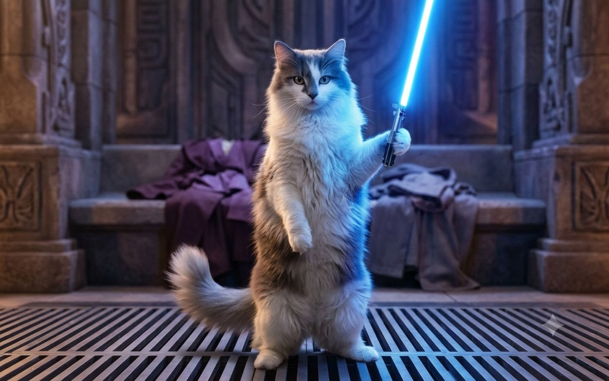</a><figcaption style="font-size:12px;margin-top:5px">Лучик — identity</figcaption></figure>
<figure style="margin:0"><a href="references/full/vitalik.jpg" target="_blank" rel="noopener">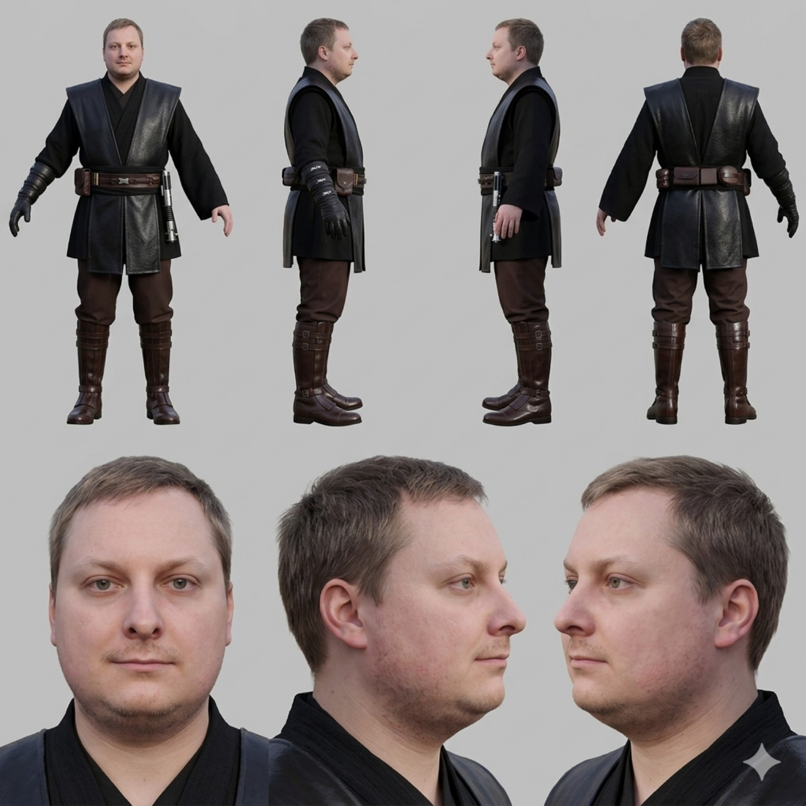</a><figcaption style="font-size:12px;margin-top:5px">BLACK / Виталик — identity</figcaption></figure>
<figure style="margin:0"><a href="references/full/lesha.jpg" target="_blank" rel="noopener">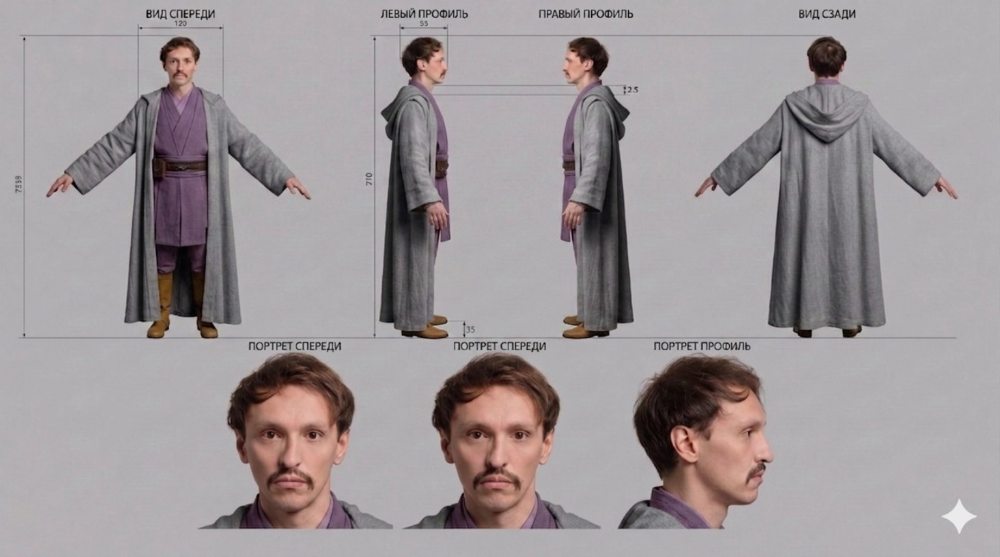</a><figcaption style="font-size:12px;margin-top:5px">PURPLE / Лёша — identity</figcaption></figure>
</div>

**Референсы локации, композиции и действия:**
<div class="scene-ref-gallery">
<figure><a href="references/scenes/scene-13/S13-Image1-topview-source.png" target="_blank" rel="noopener">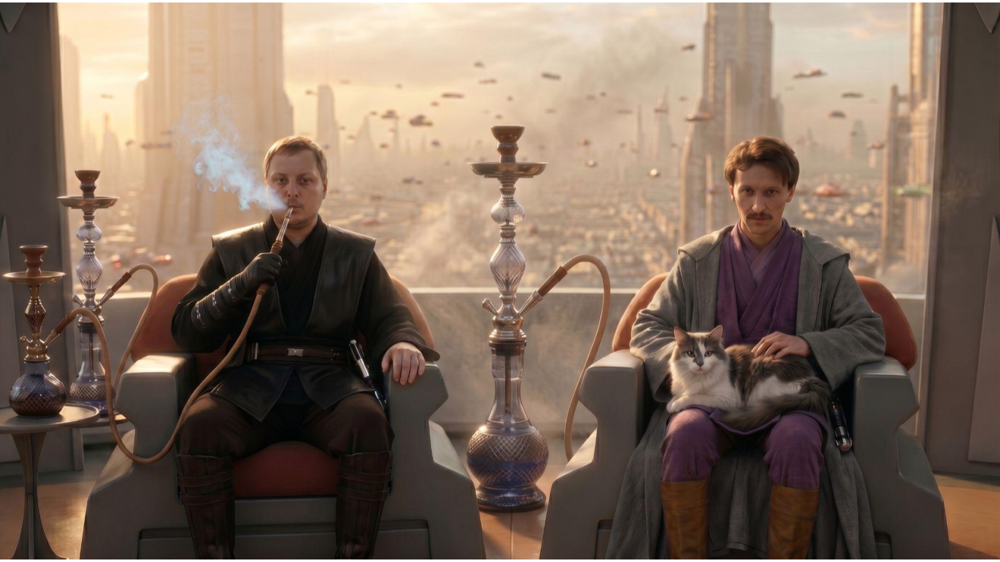</a><figcaption>@image1 — Совет: локация и композиция</figcaption></figure>
<figure><a href="references/scenes/scene-13/S13-council-lap.png" target="_blank" rel="noopener">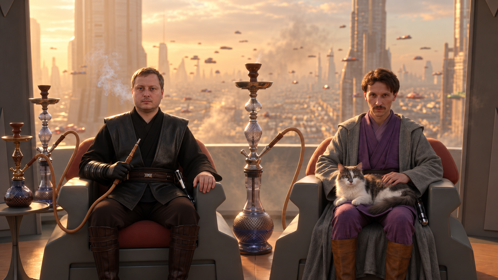</a><figcaption>@image5 — проверенная расстановка: Лучик на коленях у Лёши</figcaption></figure>
<figure><a href="references/scenes/scene-13/S13-luchik-closeup.png" target="_blank" rel="noopener">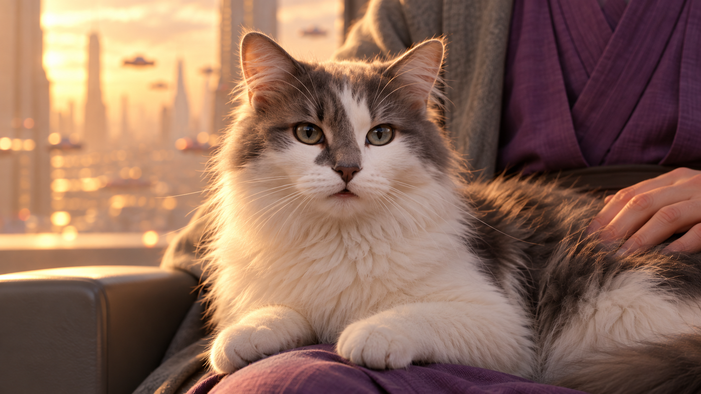</a><figcaption>@image6 — крупность Лучика, человеческие рты вне кадра</figcaption></figure>
</div>

**Что происходит:** BLACK спокойно сидит слева и курит кальян. PURPLE сидит справа; **Лучик** всё время естественно лежит поперёк его колен, не садится вертикально. После длинной серьёзной паузы камера одним непрерывным медленным движением приближается к коту и ДО начала реплики приходит в настоящий крупный план его морды. BLACK и PURPLE к этому моменту уходят из читаемой речевой зоны кадра и всё время держат рты полностью закрытыми. Весь текст кот произносит целиком в крупном плане с отчётливым естественным липсинком: «Полностью с вами согласен, коллеги. Так и поступим». Голос серьёзный, спокойный и уверенный — без комедийной интонации. После реплики камера очень мягко освобождает место для реакции: BLACK переводит взгляд именно на кота, PURPLE слегка кивает именно коту, гладит его, кот снова опускает голову.

<div class="engine-tabs" data-scene="13">

<div class="engine-pane" data-engine="wan30" data-main="1">

```text
Mode: reference-to-video | Duration: 30s | Resolution: 1080p | Aspect ratio: 16:9 | FPS: 24 | Native audio: on
Optimized for Wan 3 | Photoreal live-action deadpan comedy | One continuous restrained camera move

REFERENCES:
@image5 — supplemental opening staging only: exact BLACK left, PURPLE right, Luchik on PURPLE lap. @image6 — supplemental cat close-up framing only, with human mouths outside the crop. Individual identities remain locked by images2/3/4.
@image1 — PRIMARY COMPOSITION / ENVIRONMENT reference: two seated Jedi in large armchairs inside the futuristic high-rise council lounge, panoramic golden city skyline, hookahs, furniture placement, camera axis, warm sunset light and the cat resting on the right character's lap.
@image2 — PRIMARY LUCHIK / ЛУЧИК IDENTITY reference: exact recurring fluffy white-and-grey long-haired cat. Preserve his exact face shape, white muzzle/chest/legs, grey crown/facial and back markings, ears, natural eye appearance, long fur, coat pattern and feline anatomy. The blue lightsaber, upright pose and temple background visible in the model sheet are IDENTITY-REFERENCE ARTIFACTS ONLY for this scene: do NOT import the saber, standing pose or temple environment into the Jedi Council shot.
@image3 — PRIMARY BLACK identity reference: heavyset man, short brown hair, black tunic with dark leather vest panels, dark forearm protection, brown trousers and boots. He remains seated on the LEFT.
@image4 — PRIMARY PURPLE identity reference: leaner mustached man with brown hair, purple inner tunic under a long grey hooded outer robe, brown belt and tan boots. He remains seated on the RIGHT with the cat across his lap.

REFERENCE PRIORITY / IDENTITY LOCK:
@image3 and @image4 are absolute identity authorities for BLACK and PURPLE. @image2 is absolute identity authority for LUCHIK / ЛУЧИК. @image1 controls composition, environment, furniture, hookahs, lighting and starting geography only. Never average human faces with incidental faces in @image1. Preserve every character's face, body proportions, costume, left-right position and the cat's coat pattern throughout.

LUCHIK BODY LOCK:
The cat remains a normal realistic domestic cat for the entire shot. It lies naturally HORIZONTALLY ACROSS PURPLE'S LAP. It does NOT sit upright, stand on hind legs, become humanoid, grow human lips, gesture with paws or change body proportions. During the speaking beat only the cat's HEAD and NECK rise slightly. After the line it naturally lowers its head again.

ABSOLUTE SPEAKER OWNERSHIP — CRITICAL:
ONLY LUCHIK / ЛУЧИК SPEAKS.
BLACK and PURPLE NEVER speak, whisper, mutter, mouth words, imitate speech or lip-sync at any point.
During the entire cat line BOTH HUMAN MOUTHS remain fully CLOSED, still and visibly non-speaking.
The Russian voice originates physically from LUCHIK and ONLY LUCHIK'S muzzle/jaw makes small synchronized speech movements.
No ventriloquism. No off-screen human speaker. No voice transfer. No speech animation on BLACK. No speech animation on PURPLE.
If the frame contains a human mouth during the line, it must remain clearly closed and motionless.

START STATE:
Match @image1. BLACK is relaxed on the left with the hookah. PURPLE is relaxed on the right with the cat lying across his lap. The meeting has already reached a calm conclusion. No one is surprised by the cat's presence.

TIMELINE / PERFORMANCE:
[0:00–0:07] — SERIOUS SILENCE
Stable medium-wide composition matching @image1. BLACK slowly inhales from the hookah. PURPLE gently strokes the cat once along its back. The cat lies comfortably, breathes naturally and blinks. Nobody speaks.

[0:07–0:13] — DEADPAN BUILD
BLACK exhales a thin realistic smoke cloud. PURPLE keeps a neutral, serious council expression. The cat becomes attentive: ears adjust slightly and eyes focus forward. It stays lying down. Human mouths remain closed.

[0:13–0:17] — CAMERA PUSHES INTO A TRUE CAT CLOSE-UP
Without cutting, the camera begins a slow, physically continuous push directly toward the cat's face. By the END of this beat, BEFORE any word is spoken, arrive at a TRUE CLOSE-UP of the cat's face/muzzle: eyes, nose and mouth clearly readable, with the cat unmistakably owning the frame. BLACK and PURPLE must be pushed out of the readable speaking area; ideally their faces are outside frame, and if any part of a human face remains visible, the mouth is fully closed and motionless. The cat lifts ONLY its head and neck. No body straightening, no anthropomorphic posture.

[0:17–0:23] — CAT LINE IN CLOSE-UP
HOLD THE TRUE CLOSE-UP for the ENTIRE spoken line. Do not cut away, widen, pan to a human or reduce the cat to a secondary subject while it speaks.
The cat looks forward and says in natural Russian:
LUCHIK: «Полностью с вами согласен, коллеги. Так и поступим».
VOICE / DELIVERY: serious, calm, controlled and confident; mature and authoritative, with no jokey, cute, excited or theatrical intonation. The humor comes only from the absurd fact that a realistic cat is speaking and everyone accepts it as normal.
LIP SYNC: clear, readable and accurately synchronized to every Russian syllable, using restrained natural feline muzzle/jaw motion. The mouth movement must be visible in the close-up without turning into human lips.
BLACK and PURPLE remain absolutely silent with closed mouths for the complete line.

[0:23–0:27] — REACTION TO THE CAT
After the cat finishes, hold the close-up for a short silent beat, then let the camera ease back/reframe only as much as needed to reveal the human reactions. BLACK shifts his eyes first and then turns his head slightly TOWARD THE CAT — not toward PURPLE. PURPLE looks DOWN/TOWARD THE CAT and gives one tiny approving nod. No human-to-human conversational look exchange.

[0:27–0:30] — RETURN TO NORMAL
PURPLE resumes gently stroking the cat. The cat blinks and lowers its head back onto PURPLE's lap. BLACK calmly returns to the hookah. End on the same absurdly serious atmosphere.

END STATE:
PURPLE gently strokes LUCHIK lying across his lap, the cat's head resting down; BLACK back at the hookah; nobody speaks; same chairs, hookahs, panoramic window and skyline.

CAMERA / SPACE:
One continuous unbroken take. The defining camera move is a slow physical PUSH-IN from the established two-shot to a TRUE CLOSE-UP of the cat's face BEFORE the cat begins speaking. HOLD that close-up for the full line so the cat's lip sync is impossible to misread. Only after the final word may the camera ease slightly back/reframe for BLACK and PURPLE's reaction. No reaction cuts during the line. Preserve the established 180-degree axis, chair positions, hookahs, panoramic window and skyline. Camera motion is physically stable with controlled inertia. No digital zoom look, handheld jitter, whip pan, zoom jump or geometry reset.

LIGHTING / MATERIAL REALISM:
Warm sunset backlight through the panoramic windows, realistic skin and fur texture, soft practical interior fill, subtle haze catching the hookah smoke, physically plausible reflections and fabric response. Preserve @image1 color balance. No plastic skin, no glossy fake fur, no fantasy glow on the cat.

AUDIO:
Clear natural Russian LUCHIK dialogue only. LUCHIK VOICE: serious, calm, mature, controlled and confident; no comic delivery, no cute voice, no excitement, no exaggerated bass or villain effect. BLACK and PURPLE produce no spoken sound. Quiet room tone, faint futuristic city ambience, subtle hookah bubbling/inhalation and cloth/fur movement. No subtitles, no narrator, no non-diegetic music. The cat voice must remain spatially centered on the cat's on-screen close-up position.

NEGATIVE PROMPT:
wrong speaker, PURPLE speaking, BLACK speaking, human lip-sync, human mouth movement during cat line, ventriloquism, off-screen speaker, transferred voice, cat voice from human, silent cat mouth during dialogue, exaggerated human lips on cat, cat sitting upright, cat standing, anthropomorphic cat body, cat gesturing with paws, cat anatomy changing, cat leaving PURPLE's lap, human-to-human conversational glance after the line, shocked reaction, slapstick acting, identity drift, face averaging, face swap, costume drift, changed seating, duplicated people, duplicated cat, warped furniture, broken eyelines, random cut, hard cut, camera jitter, micro-shake, subtitles, captions, text, logo, watermark, cartoon, anime, game-render look, black bars, side bars.

FRAME FILL / NO BARS:
Fill the entire generated frame edge-to-edge. No letterboxing, no pillarboxing, no black bars, no side bars, no decorative borders, no empty margins.
```

</div>

<div class="engine-pane" data-engine="sd20x2">

Та же сцена двумя роликами по 15 с: сначала часть 1, часть 2 — после её результата (@Video1 части 2 = последние секунды части 1). Нумерация входов в каждой части своя.

**Входы части 1:** @Image1 — `references/scenes/scene-13/S13-Image1-topview-source.png`; @Image2 — `references/luchik.jpg`; @Image3 — `references/full/vitalik.jpg`; @Image4 — `references/full/lesha.jpg`; @Image5 — `references/scenes/scene-13/S13-council-lap.png`; @Image6 — `references/scenes/scene-13/S13-luchik-closeup.png`.

*Часть 1 без слов: тишина, наезд и крупный план Лучика за мгновение до реплики.*

**Входы части 2:** @Video1 — последние секунды результата части 1 (крупный план Лучика); @Image1 — `references/scenes/scene-13/S13-Image1-topview-source.png`; @Image2 — `references/luchik.jpg`; @Image3 — `references/full/vitalik.jpg`; @Image4 — `references/full/lesha.jpg`; @Image5 — `references/scenes/scene-13/S13-council-lap.png`; @Image6 — `references/scenes/scene-13/S13-luchik-closeup.png`.

*Часть 2: вся реплика Лучика целиком в удержанном крупном плане, затем отъезд на реакцию; входы картинок те же, что в части 1.*

#### 13 · Seedance 2.0 часть 1

```text
Mode: reference-to-video (omni-reference) | Duration: 15s | Resolution: 720p | Aspect ratio: 16:9 | FPS: 24 | Native audio: on
Optimized for Seedance 2.0 | Photoreal live-action deadpan comedy in a Jedi Council lounge | Part 1 of 2: serious silence, then one unbroken push-in that ends in a true close-up of the cat Luchik just before he speaks

REFERENCES / AUTHORITY ORDER:
@Image1 — composition and environment: the futuristic high-rise council lounge, two large armchairs, hookahs, panoramic golden city skyline, camera axis, warm sunset light, the cat on the right character's lap.
@Image2 — absolute identity of LUCHIK / ЛУЧИК. The lightsaber, upright pose and temple background in this sheet are identity-reference artifacts only: never bring them into this shot.
@Image3 — absolute identity of BLACK, seated LEFT.
@Image4 — absolute identity of PURPLE, seated RIGHT with the cat across his lap.
@Image5 — opening staging only: BLACK left, PURPLE right, Luchik on PURPLE's lap.
@Image6 — final framing only: a true close-up of the cat with human mouths outside the crop.
Priority: @Image2–@Image4 control identities; @Image1 the room and light; @Image5 the opening layout; @Image6 the closing framing. Never average faces between images.

CHARACTER APPEARANCE / IDENTITY LOCK:
LUCHIK / ЛУЧИК (@Image2): a real fluffy long-haired domestic cat; white muzzle, chest and paws; grey markings on the crown, around the eyes and along the back; dense natural fur; natural feline eyes; serious, calm gaze.
BLACK (@Image3): heavyset man, round face, short brown hair; black tunic with dark leather vest panels, dark leather forearm guard and glove, dark brown trousers, tall brown boots.
PURPLE (@Image4): leaner man with a brown moustache and brown hair; purple inner tunic and trousers under a long grey hooded robe, brown belt, tan boots.
Exactly two people and one cat; faces, costumes, seating and coat pattern never change.

LUCHIK BODY LOCK:
The cat remains a normal realistic domestic cat for the entire shot. It lies naturally HORIZONTALLY ACROSS PURPLE'S LAP. It does NOT sit upright, stand on hind legs, become humanoid, grow human lips, gesture with paws or change body proportions. During the speaking beat only the cat's HEAD and NECK rise slightly. After the line it naturally lowers its head again.

ABSOLUTE SPEAKER OWNERSHIP — CRITICAL:
ONLY LUCHIK / ЛУЧИК SPEAKS.
BLACK and PURPLE NEVER speak, whisper, mutter, mouth words, imitate speech or lip-sync at any point.
During the entire cat line BOTH HUMAN MOUTHS remain fully CLOSED, still and visibly non-speaking.
The Russian voice originates physically from LUCHIK and ONLY LUCHIK'S muzzle/jaw makes small synchronized speech movements.
No ventriloquism. No off-screen human speaker. No voice transfer. No speech animation on BLACK. No speech animation on PURPLE.
If the frame contains a human mouth during the line, it must remain clearly closed and motionless.

START STATE:
Match @Image1 and @Image5. BLACK relaxed on the left with the hookah hose in his gloved hand; PURPLE relaxed on the right with Luchik lying across his lap. The meeting has already reached its conclusion; nobody is surprised by the cat. In these 15 seconds no word is spoken by anyone: the shot ends on the silent instant before the cat's line.

TIMELINE:
[0:00–0:04] — SERIOUS SILENCE
Medium-wide two-shot matching @Image5, small air traffic drifting past the window. BLACK draws on the hookah. PURPLE strokes the cat once along its back. Luchik breathes and blinks.

[0:04–0:08] — DEADPAN BUILD
BLACK exhales a thin smoke ribbon across the backlight. PURPLE keeps a neutral council face. Luchik becomes attentive: ears turn forward, eyes focus ahead, body still lying flat. The camera starts gliding forward between the armchairs.

[0:08–0:12] — PUSH INTO THE CAT
Without cutting, the camera drives a decisive, smooth push-in past the central hookah straight to Luchik's face. Both men slide out of the frame edges.

[0:12–0:15] — ABOUT TO SPEAK
The camera lands in a TRUE CLOSE-UP matching @Image6: eyes, nose and mouth fill the frame. Luchik lifts only his head and neck, looks straight ahead and draws a small breath, mouth still closed. Hold.

END STATE:
True close-up of Luchik lying across PURPLE's lap, head and neck slightly raised, eyes forward, mouth closed, warm sunset rim light in his fur; no human face in frame.

CAMERA / SPACE:
One continuous take, no cuts: two-shot, then a push-in with real momentum and foreground parallax from the central hookah, ending on the held close-up. Preserve the 180-degree axis, chair positions and window. Stable gimbal motion with controlled inertia; no handheld jitter, whip pan or digital zoom jump.

PERFORMANCE:
Played straight. BLACK stoic, PURPLE serious, both mouths closed. Luchik is a real cat: breathing, blinks, ear twitches, a small attentive head lift. No mugging, no looks into the lens.

LIGHTING / MATERIALS:
Warm sunset backlight through the panoramic windows, soft interior fill on faces, haze catching the hookah smoke, rim light through the cat's long fur. Realistic skin, leather, wool, glass and brass. Preserve the @Image1 colour balance.

AUDIO:
Quiet room tone, faint city ambience behind the glass, hookah water bubbling, soft breaths, cloth and fur movement, the cat's small intake of breath at the end. No speech, narrator, music or subtitles.

NEGATIVE PROMPT:
any spoken words, human mouth movement, cat sitting upright, cat standing, anthropomorphic cat, human lips on cat, cat gesturing with paws, cat leaving PURPLE's lap, lightsaber on the cat, temple background, push-in ending on a human face, identity drift, face averaging, swapped seating, duplicated people, duplicated cat, warped furniture, hard cut, camera jitter, subtitles, text, watermark, cartoon, game-render look, black bars.

FRAME FILL / NO BARS:
Fill the entire generated frame edge-to-edge. No letterboxing, no pillarboxing, no black bars, no side bars, no decorative borders, no empty margins.
```

#### 13 · Seedance 2.0 часть 2

```text
Mode: reference-to-video (omni-reference) | Duration: 15s | Resolution: 720p | Aspect ratio: 16:9 | FPS: 24 | Native audio: on
Optimized for Seedance 2.0 | Photoreal live-action deadpan comedy in a Jedi Council lounge | Part 2 of 2: in a held close-up the cat Luchik delivers the only line, then the camera eases back to the two Jedi quietly accepting it

REFERENCES / AUTHORITY ORDER:
@Video1 — the last seconds of Part 1's result: a true close-up of Luchik on PURPLE's lap, mouth closed. Absolute authority for the START STATE, framing and light.
@Image1 — the council lounge for the reveal: armchairs, hookahs, golden skyline, sunset light.
@Image2 — absolute identity of LUCHIK / ЛУЧИК. Its lightsaber, upright pose and temple background are sheet artifacts only: never bring them into this shot.
@Image3 — absolute identity of BLACK, seated LEFT.
@Image4 — absolute identity of PURPLE, seated RIGHT with the cat across his lap.
@Image5 — layout for the final two-shot: BLACK left, PURPLE right, Luchik on PURPLE's lap.
@Image6 — close-up framing for the line, human mouths outside the crop.
Priority: @Video1 the start; @Image2–@Image4 identities; @Image1 the room; @Image5–@Image6 framing only. Never average faces.

CHARACTER APPEARANCE / IDENTITY LOCK:
LUCHIK / ЛУЧИК (@Image2): a real fluffy long-haired domestic cat; white muzzle, chest and paws; grey markings on the crown, around the eyes and along the back; dense natural fur; natural feline eyes; serious, calm gaze.
BLACK (@Image3): heavyset man, round face, short brown hair; black tunic with dark leather vest panels, dark leather forearm guard and glove, dark brown trousers, tall brown boots.
PURPLE (@Image4): leaner man with a brown moustache and brown hair; purple inner tunic and trousers under a long grey hooded robe, brown belt, tan boots.
Exactly two people and one cat.

LUCHIK BODY LOCK:
The cat remains a normal realistic domestic cat for the entire shot. It lies naturally HORIZONTALLY ACROSS PURPLE'S LAP. It does NOT sit upright, stand on hind legs, become humanoid, grow human lips, gesture with paws or change body proportions. During the speaking beat only the cat's HEAD and NECK rise slightly. After the line it naturally lowers its head again.

ABSOLUTE SPEAKER OWNERSHIP — CRITICAL:
ONLY LUCHIK / ЛУЧИК SPEAKS.
BLACK and PURPLE NEVER speak, whisper, mutter, mouth words, imitate speech or lip-sync at any point.
During the entire cat line BOTH HUMAN MOUTHS remain fully CLOSED, still and visibly non-speaking.
The Russian voice originates physically from LUCHIK and ONLY LUCHIK'S muzzle/jaw makes small synchronized speech movements.
No ventriloquism. No off-screen human speaker. No voice transfer. No speech animation on BLACK. No speech animation on PURPLE.
If the frame contains a human mouth during the line, it must remain clearly closed and motionless.

START STATE:
Exactly the last frame of @Video1: true close-up of Luchik on PURPLE's lap, head and neck slightly raised, eyes forward, mouth closed, no human face in frame.

TIMELINE:
[0:00–0:02] — THE BREATH
Continuing @Video1 without a cut, hold the close-up; Luchik takes a small breath.

[0:02–0:08] — THE LINE IN CLOSE-UP
Hold the true close-up for the entire line. Luchik looks forward and says the line from DIALOGUE / VOCALS with restrained, clearly visible feline jaw motion synchronized to every syllable. No cutaway, no widening, no pan to a human during the line.

[0:08–0:11] — REACTION TO THE CAT
One silent beat, then the camera eases back just enough to reveal both men in a medium two-shot like @Image5. BLACK shifts his eyes first, then turns his head slightly TOWARD THE CAT, not toward PURPLE. PURPLE looks down at the cat and gives one tiny approving nod. No human-to-human look exchange.

[0:11–0:15] — RETURN TO NORMAL
PURPLE resumes stroking Luchik; the cat blinks and lowers his head onto the lap. BLACK returns to the hookah. Hold.

END STATE:
PURPLE gently strokes LUCHIK lying across his lap, the cat's head resting down; BLACK back at the hookah; nobody speaks; same chairs, hookahs, panoramic window and skyline.

CAMERA / SPACE:
One continuous take, no cuts: the held close-up through the whole line, then a short smooth ease-back to a medium two-shot. Preserve the 180-degree axis and chair positions. Stable motion with controlled inertia; no jitter or zoom jump.

PERFORMANCE:
Played straight: a realistic cat speaks and everyone accepts it as normal. BLACK stoic, PURPLE serious. Luchik moves like a real cat apart from his talking jaw. No mugging, no looks into the lens.

LIGHTING / MATERIALS:
Warm sunset backlight, rim light through the cat's fur, soft fill on faces, haze in the hookah smoke. Realistic skin, leather, wool and brass; no glossy fake fur.

AUDIO:
Quiet room tone, faint city ambience, hookah bubbling, fur rustle. The cat voice is spatially centred on the cat's on-screen position. No narrator, music or subtitles.

DIALOGUE / VOCALS:
Language: Russian, natural pronunciation.
[0:02–0:08] LUCHIK, in the true close-up: «Полностью с вами согласен, коллеги. Так и поступим».
Voice: serious, calm, confident, mature and authoritative; no jokey, cute, excited or theatrical intonation, no villain bass.
Lip sync: accurate on every Russian syllable through restrained feline muzzle and jaw motion, never human lips.
This is the only line. BLACK and PURPLE stay silent with closed mouths.

NEGATIVE PROMPT:
wrong speaker, PURPLE speaking, BLACK speaking, human mouth movement, ventriloquism, off-screen voice, silent cat mouth during the line, human lips on cat, cat sitting upright, anthropomorphic cat, cat gesturing with paws, cat leaving the lap, lightsaber, human-to-human glance, extra line, identity drift, face averaging, swapped seating, duplicated cat, hard cut, camera jitter, subtitles, text, cartoon, black bars.

FRAME FILL / NO BARS:
Fill the entire generated frame edge-to-edge. No letterboxing, no pillarboxing, no black bars, no side bars, no decorative borders, no empty margins.
```

</div>

</div>

<a id="scene-16"></a>

## Сцена 16 — Татуин: гигантский пустынный червь и бой на руинах

<!-- scene-meta: {"target_engine":"Seedance 2.5","production_state":"READY","duration_s":30,"dialogue":{"enabled":false,"language":null},"tags":["action","continuous_take"]} -->

Wan 3.0 task `36e8320e34da4f1b97c35e1e765e3e63` технически завершён 11.10.2026 03:00:50 UTC. Результат требует отдельной редакционной проверки; новый Scene ID не создаётся.

**Решение владельца 16.10.2026: принять.** Продолжение боя — Scene 42 (червь никому не интересен), развязка с фрагментом карты — Scene 48. Кнопки сайта «Принять» / «Переделать» по 16 этим решением закрыты по смыслу.

**Контекст использования:** Новый активный промт на основе бывшей W6; рабочий пункт W6 получил конкретные референсы и теперь оформлен как активная сцена 16. 30-секундная большая пустынная сцена для Seedance 2.5: двое татуинных джедаев и Канцлер сталкиваются на руинах, а из-под земли вырывается колоссальный песчаный червь. Сцена должна работать как самостоятельный мощный экшен-блок, из которого потом при желании можно отдельно собрать и более короткий фрагмент.

**Референсы:** @Video1 = пустынная локация, руины, общий масштаб и композиционный дух сцены · @Image1 = Hooded Jedi · @Image2 = Bearded Jedi · @Image3 = Chancellor · @Image4 = чистая локация · @Image5 = стартовая расстановка · @Image6 = масштаб червя

**Используемые identity-референсы на сайте:**
<div class="scene-ref-gallery" style="display:grid;grid-template-columns:repeat(auto-fit,minmax(145px,1fr));gap:10px;margin:10px 0 16px">
<figure style="margin:0"><a href="references/full/ilyusha.jpg" target="_blank" rel="noopener">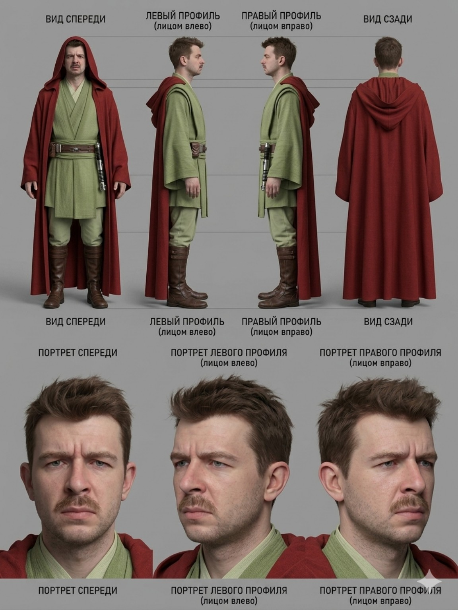</a><figcaption style="font-size:12px;margin-top:5px">Hooded Jedi / Илюша</figcaption></figure>
<figure style="margin:0"><a href="references/full/artem.jpg" target="_blank" rel="noopener">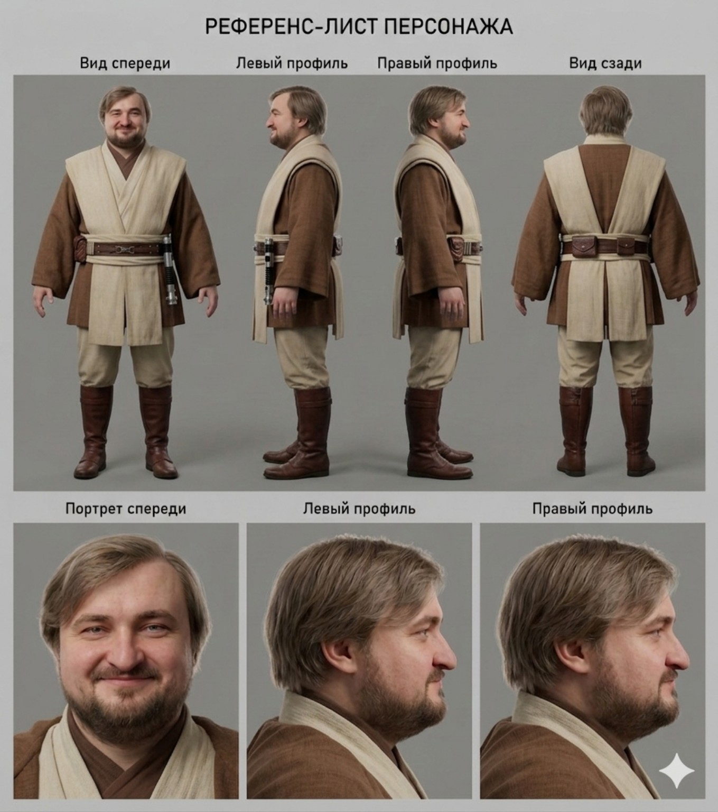</a><figcaption style="font-size:12px;margin-top:5px">Bearded Jedi / Артём</figcaption></figure>
<figure style="margin:0"><a href="references/full/serega.jpg" target="_blank" rel="noopener">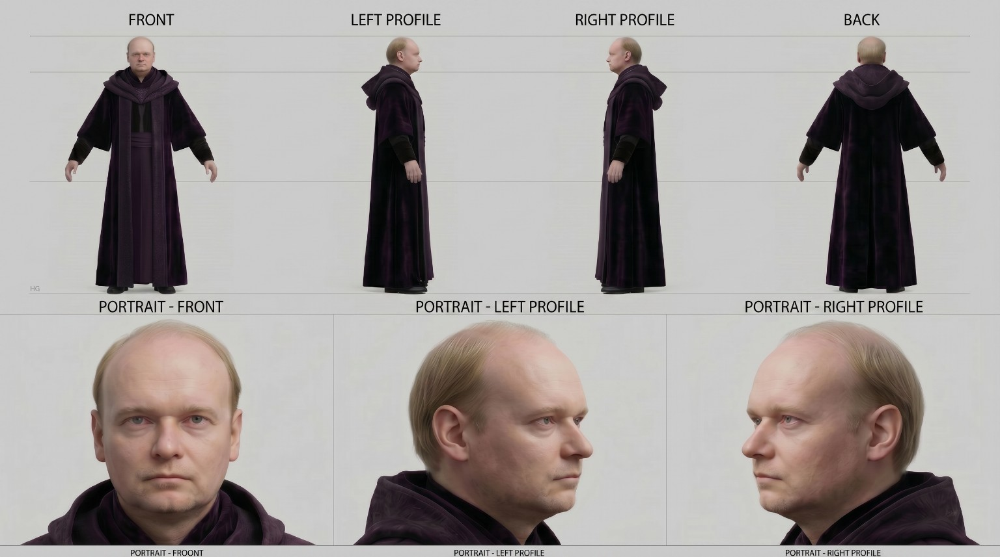</a><figcaption style="font-size:12px;margin-top:5px">Серёга / Chancellor</figcaption></figure>
</div>

**Референсы локации, композиции и действия:**
<div class="scene-ref-gallery">
<figure><a href="references/scenes/scene-16/S16-desert-location-clean.png" target="_blank" rel="noopener">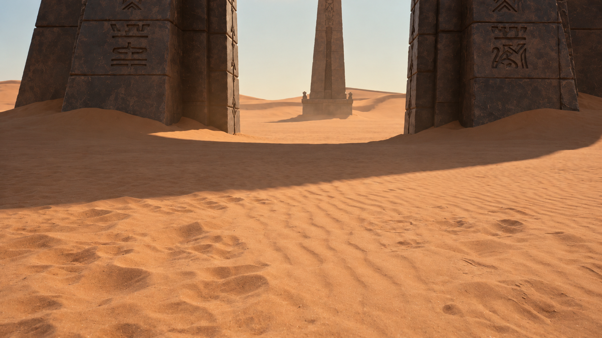</a><figcaption>@Image4 — чистая локация из Video1, реконструкция</figcaption></figure>
<figure><a href="references/scenes/scene-16/S16-three-character-standoff.png" target="_blank" rel="noopener">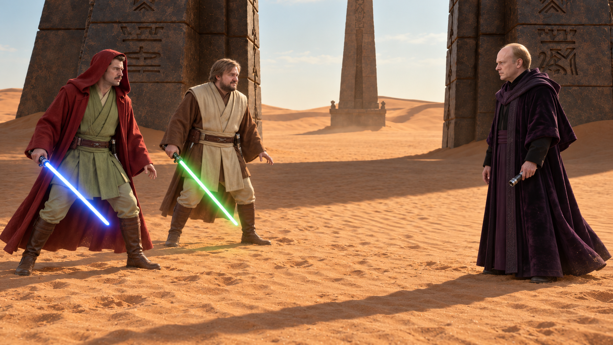</a><figcaption>@Image5 — стартовая расстановка трёх героев</figcaption></figure>
<figure><a href="references/scenes/scene-16/S16-worm-scale.png" target="_blank" rel="noopener">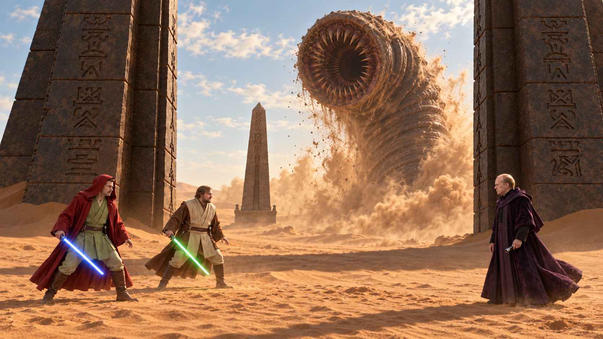</a><figcaption>@Image6 — масштаб червя после появления</figcaption></figure>
</div>

**Подготовка проверена 09.10.2026:** точный пакет Scene 16 в Google Drive имеет статус `ready`, `remaining: []`, содержит два исходных MP4 (`S16-desert-source-1.mp4` и `S16-desert-source-2.mp4`), три вспомогательных PNG и manifest. Обе исходные Topview-задачи проверены как `success`. Новый тридцатисекундный ролик запущен как бесплатная Wan 3.0 задача `36e8320e34da4f1b97c35e1e765e3e63` и находится в статусе `init`; технический результат после завершения потребует отдельной редакционной проверки и не считается заранее одобренным.

**Источник пустыни найден:** @Video1 — [второй указанный ролик Topview](https://www.topview.ai/board/1a6244cf1ae747ef847d949a80d6133c?tool-type=video-edit&boardResultId=9fd93e2905e14c77b616884f1d6962f6). [Первый ролик](https://www.topview.ai/board/1a6244cf1ae747ef847d949a80d6133c?tool-type=video-edit&boardResultId=f1a90e67bfe44c50a31692b905a290f0) — дополнительная проверка той же пустыни. Image4 очищен на основе кадра Video1 около 14 с; это реконструкция пустой площадки, а не найденное исходное фото. Две покрытые знаками опоры и центральный обелиск фиксируют географию. Исторический Topview Image4 со спидером не является локацией.

**Что происходит:** На пустынных руинах двое джедаев и Канцлер находятся в напряжённом противостоянии. Внезапно земля начинает дрожать, и из песка вырывается колоссальный пустынный червь масштаба «гигантское стихийное бедствие». Он рушит окружающие конструкции, вздымает песчаные волны, делает несколько агрессивных заходов и кружит вокруг героев. На протяжении всей сцены герои остаются в кадре на фоне катастрофы, продолжают сражаться и вынуждены постоянно уклоняться от атак чудовища и обрушений.

<div class="engine-tabs" data-scene="16">

<div class="engine-pane" data-engine="wan30" data-main="1">

```text
Mode: reference-to-video | Duration: 30s | Resolution: 1080p | Aspect ratio: 16:9 | FPS: 24 | Native audio: on

REFERENCES:
@Video1 — PRIMARY exact desert environment continuity: the supplied Topview desert-car video (source task 9fd93e2905e14c77b616884f1d6962f6). Preserve its sandy plain, two tall glyph-covered gate piers and narrow central obelisk. Do not inherit incidental character faces, saber-color errors or previous video actions.
@Image1 — PRIMARY identity reference for the Hooded Jedi: mustached man, tousled brown hair, weathered face, light-green layered tunic, deep-red hooded cloak, brown boots, lightsaber hilt on belt. Preserve face, costume, proportions and overall identity exactly.
@Image2 — PRIMARY identity reference for the Bearded Jedi: heavier build, short beard, cream tunic under a brown Jedi over-robe, wide brown belt, brown boots, lightsaber hilt on belt. Preserve face, build, costume and identity exactly.
@Image3 — PRIMARY identity reference for the Chancellor: pale man with thinning hair / bald crown and deep purple robes. Preserve face, body type, robe silhouette and identity exactly.

@Image4 — CLEAN LOCATION plate reconstructed from Video1 at about 14s; environment geometry and daylight only.
@Image5 — OPENING COMPOSITION: Ilyusha frame-left with blue blade, Artem centre-left with green blade, Serega frame-right. Three exact identities still come from Images1–3.
@Image6 — WORM SCALE/DESIGN after emergence: gigantic segmented worm beyond the gate, right of the central obelisk, much larger than people and gate piers. This is NOT the first frame; the worm must be absent at 0s.

REFERENCE PRIORITY:
Use @Image1, @Image2 and @Image3 as the absolute identity lock for the three characters. Use @Video1 and @Image4 for the exact desert environment; @Image5 locks initial staging and @Image6 locks the later worm scale. Helpers never override individual identities. Do not let the environment reference overwrite the character identities.

SCENE OVERVIEW:
A photorealistic cinematic desert action scene on ruined Tatooine-like wasteland terrain. The Hooded Jedi and the Bearded Jedi are confronting the Chancellor among weathered ruins when a colossal subterranean sandworm erupts from beneath the ground and turns the entire location into chaos. The worm is gigantic on the scale of a natural disaster — towering, segmented, immense, powerful, with a massive circular maw and rows of terrifying teeth. It is not a small monster; it feels like an unstoppable force of nature. Throughout the scene, the three characters stay grounded in the same battle space and must keep fighting and dodging while the worm attacks the environment around them.

ACTION TIMELINE — SINGLE CONTINUOUS 30-SECOND TAKE:
[0:00–0:05]
Begin with the clean three-person standoff from @Image5 in the exact @Image4 ruins. The worm is still beneath the sand and invisible. Ilyusha is left, Artem centre-left, Serega right; keep the gate and central obelisk as stable orientation landmarks. The Hooded Jedi and the Bearded Jedi face the Chancellor at medium distance. Wind moves robes and loose sand. The camera glides laterally through the ruins, keeping all three readable in the same frame. Small grains of sand begin to tremble across the ground and a low subterranean rumble builds beneath the dialogue-free tension.

[0:05–0:09]
The rumble intensifies violently. Sand ripples outward in fast concentric waves. Broken beams, rocks and debris start to shake loose. All three characters instinctively shift their stance and glance toward the source of the vibration. Then the ground splits beyond the gate, behind the group and right of the central obelisk, at the location established by @Image6. A colossal sandworm bursts out of the earth in an explosive eruption of sand and debris, instantly dominating the background.

[0:09–0:14]
The worm rises to full terrifying scale, rearing high above the ruins with its gigantic circular mouth open. Sand cascades off its ridged body. The shockwave throws dust through the air and knocks loose pieces of the surrounding structures. The heroes break their positions and sprint in different directions to avoid the collapse and the worm's initial surge. The camera keeps moving fluidly, holding spatial continuity so the audience clearly understands where each person is relative to the worm.

[0:14–0:20]
The Hooded Jedi and the Bearded Jedi attempt to regroup while the Chancellor uses the chaos to press his advantage. The three continue their live-action fight in short fast exchanges — evasive footwork, quick defensive movements, robe motion, physical urgency — but the worm remains the dominant threat in the background. It sweeps across the ruins, slamming its body through structures and sending dust clouds and fragments outward. Everyone is forced to interrupt combat and dodge a second aggressive pass from the worm.

[0:20–0:25]
The worm follows one readable broad arc behind the group, dives partially beneath the sand and surges up from the same background side, its massive head and upper body carving through the location. One ruin wall collapses, sending debris and sand down around the fighters. The Bearded Jedi dives clear. The Hooded Jedi uses a fast sidestep and roll. The Chancellor pivots away with dangerous precision, barely avoiding the jaws. Keep the worm huge in frame and unmistakably larger than every surrounding structure.

[0:25–0:30]
Final escalation. Keep the three people alive and the narrative outcome unresolved; do not add a map exchange, a vehicle explosion or a new ending.  The worm rears behind the three combatants while they continue the standoff in the foreground, battered by wind and sand. The scene ends on a powerful wide action composition: the two Jedi and the Chancellor still alive and in motion on the ruined desert ground, the colossal sandworm towering behind them amid collapsing debris and swirling dust, with the conflict still unresolved and continuing beyond the cut.

CAMERA:
Single continuous unbroken shot for the full 30 seconds. High-end cinematic motion with controlled inertia and stable spatial continuity. The camera may drift, arc and reframe to preserve all three characters and the worm, but there are no cuts, jump cuts or teleporting viewpoints. Emphasize scale through parallax, dust layers, foreground debris and wide-to-medium re-framing within the same take. No random micro-shake; only motivated impact vibration during the biggest eruptions.

MOVEMENT / STAGING RULES:
The worm's motion must feel massive and heavy, displacing huge volumes of sand. Its attacks are broad environmental threats: eruptions, surges, rears, sweeping passes, partial dives and re-emergence. The three characters must remain readable, keep their identities locked, and react believably to the danger. They are not standing still while the worm performs in the background: they are actively dodging, repositioning and trying to continue their conflict in the middle of the chaos.

STYLE / LIGHTING:
Photorealistic cinematic sci-fi/fantasy. Harsh warm desert light, dry haze, blown sand, long ruin shadows, strong scale cues, natural motion blur, realistic cloth and dust interaction. Serious blockbuster tone. No comedy.

AUDIO (native):
Powerful subterranean rumble, violent sand eruption, debris crashes, heavy impacts, rushing sand, distant wind, robe movement, footsteps on sand and stone, and huge monstrous roar / throat resonance from the worm. Optional brief exertion grunts from the characters, but no dialogue and no music.

NEGATIVE PROMPT:
small worm, tiny creature, comedic monster, cartoon, anime, stylized rendering, game-render look, floating worm, worm flying in the air without sand displacement, characters ignoring the worm, static posing, identity drift, face swap, extra characters, costume changes, missing robe colors, duplicate Chancellor, duplicate Jedi, warping ruins, popping geometry, sudden scene reset, teleporting camera, hard cuts, subtitles, on-screen text, logo, watermark.

FRAME FILL / NO BARS: Fill the entire generated frame edge-to-edge. No letterboxing, no pillarboxing, no black bars, no side bars, no decorative borders, no empty margins.
```

</div>

<div class="engine-pane" data-engine="sd20x2">

Та же сцена двумя роликами по 15 с: сначала часть 1, часть 2 — после её результата (@Video1 части 2 = последние секунды части 1). Нумерация входов в каждой части своя.

**Входы части 1:** @Video1 — исходный ролик пустыни Topview, boardResultId 9fd93e2905e14c77b616884f1d6962f6 (не файл репозитория); @Image1 — `references/full/ilyusha.jpg`; @Image2 — `references/full/artem.jpg`; @Image3 — `references/full/serega.jpg`; @Image4 — `references/scenes/scene-16/S16-desert-location-clean.png`; @Image5 — `references/scenes/scene-16/S16-three-character-standoff.png`; @Image6 — `references/scenes/scene-16/S16-worm-scale.png`.

*Противостояние, извержение червя, подъём в полный рост, разбег героев; конец — червь стоит над руинами, трое врассыпную.*

**Входы части 2:** @Video1 — последние секунды результата части 1 (червь поднялся, трое разбежались); @Image1 — `references/full/ilyusha.jpg`; @Image2 — `references/full/artem.jpg`; @Image3 — `references/full/serega.jpg`; @Image4 — `references/scenes/scene-16/S16-desert-location-clean.png`; @Image5 — `references/scenes/scene-16/S16-worm-scale.png`.

*Бой сквозь хаос, обвал стены, финальная неразрешённая расстановка как в настоящем конце 16 (стык со Scene 42).*

#### 16 · Seedance 2.0 часть 1

```text
Mode: reference-to-video (omni-reference) | Duration: 15s | Resolution: 720p | Aspect ratio: 16:9 | FPS: 24 | Native audio: on
Optimized for Seedance 2.0 | Photoreal live-action desert space-fantasy blockbuster, serious disaster-action tone | Part 1 of 2: a three-way standoff on desert ruins is shattered as a colossal sandworm erupts and the fighters scatter

REFERENCES / AUTHORITY ORDER:
@Video1 — exact desert environment continuity: sandy plain, two tall glyph-covered gate piers, narrow central obelisk, scale and harsh daylight. Do not inherit its incidental faces, saber colours, vehicles or actions.
@Image1 — absolute identity of ILYUSHA, the Hooded Jedi.
@Image2 — absolute identity of ARTEM, the Bearded Jedi.
@Image3 — absolute identity of SEREGA, the Chancellor.
@Image4 — clean location plate reconstructed from @Video1: environment geometry and daylight only.
@Image5 — opening composition: Ilyusha left, Artem centre-left, Serega right. Staging only.
@Image6 — worm scale and design after emergence, beyond the gate right of the obelisk. NOT the first frame; no worm at 0s.
Priority: @Image1–@Image3 identities; @Video1 and @Image4 the ruins; @Image5 opening staging; @Image6 worm scale. Helpers never override faces or costumes.

CHARACTER APPEARANCE / IDENTITY LOCK:
ILYUSHA (Hooded Jedi), @Image1: moustache, tousled chestnut-brown hair, weathered face, light olive-green layered tunic, deep-red hooded cloak, brown boots; BLUE lightsaber.
ARTEM (Bearded Jedi), @Image2: heavier build, short beard, cream tunic under a brown Jedi over-robe, wide brown belt, brown boots; GREEN lightsaber.
SEREGA (the Chancellor), @Image3: pale older man, thinning light hair with a bald crown, mature serious face, long deep-purple robes; his lightsaber blade is RED when lit.
Exactly three people, each exactly once. No other characters, no vehicles.

WORM / STAGING LOCK — CRITICAL:
The worm is gigantic on the scale of a natural disaster: towering, segmented, immense, with a massive circular maw and rows of teeth, always unmistakably larger than the gate piers and every surrounding structure. The worm's motion must feel massive and heavy, displacing huge volumes of sand. Its attacks are broad environmental threats: eruptions, surges, rears, sweeping passes, partial dives and re-emergence. The three characters must remain readable, keep their identities locked, and react believably to the danger. They are not standing still while the worm performs in the background: they are actively dodging, repositioning and trying to continue their conflict in the middle of the chaos. The worm never swallows, bites or touches anyone.

START STATE:
The clean three-person standoff from @Image5 in the exact @Image4 ruins: Ilyusha frame-left with his blue blade lit, Artem centre-left with his green blade lit, Serega frame-right facing them at medium distance, hilt in hand. The worm is still beneath the sand and invisible. Gate piers and central obelisk stand intact. Wind moves robes and loose sand.

TIMELINE:
[0:00–0:04] — STANDOFF
The camera glides laterally at waist height through the ruins, all three readable in one frame. Blades humming, tense stillness. Sand grains begin to tremble on the ground; a low subterranean rumble builds. Serega's blade ignites red.

[0:04–0:08] — ERUPTION
The rumble turns violent; sand ripples outward in fast concentric waves, rocks and debris shake loose. All three shift stance and glance toward the source. The ground splits beyond the gate, behind the group and right of the central obelisk, and the colossal worm bursts out in an explosive eruption of sand and debris.

[0:08–0:12] — FULL HEIGHT
Low wide angle: the worm rears to full terrifying scale high above the ruins, circular maw open, sand cascading off its ridged body. The shockwave throws dust through the air and knocks loose pieces of the ruins.

[0:12–0:15] — SCATTER
The three break their positions and sprint in different directions to escape the collapse and the worm's first surge; the camera tracks fast alongside, keeping clear where each one is relative to the worm. Hold on them running through the dust with the worm towering behind.

END STATE:
The worm reared at full height beyond the gate, right of the obelisk, sand pouring off it; the three scattered across the ruins in mid-sprint through drifting dust, all alive, blades lit — blue, green and red — the standoff broken but not resolved.

CAMERA / SPACE:
A lateral glide for the standoff, then action cuts on movement: a low wide for the eruption and rise, a fast lateral tracking wide for the scatter; keep screen direction and gate-obelisk geography. Parallax and dust layers sell scale. Speed in wides with whole bodies; faces recognised in the opening medium-wide in even light. Impact vibration only on the eruption; no micro-shake, no teleporting.

PERFORMANCE:
Serious blockbuster tone, no comedy. Cold standoff, sharp reactions, explosive weighty sprints. Ilyusha quick, Artem heavy, Serega cold and precise. No mugging.

LIGHTING / MATERIALS:
Harsh warm desert sun, dry haze, blown sand, long ruin shadows, natural motion blur, real cloth and dust; saber light on faces. Worm hide shedding sand.

AUDIO:
Saber hums, distant wind, then a powerful subterranean rumble, violent sand eruption, debris crashes, rushing sand and a huge monstrous roar with deep throat resonance; footsteps on sand and stone, robe movement, brief exertion breaths. No dialogue, no narrator, no music.

NEGATIVE PROMPT:
worm visible at the start, small or floating worm, worm touching anyone, characters ignoring the worm, static posing, blood, map module, vehicles, identity drift, melting faces, extra or duplicate people, costume changes, red cloak on Artem, wrong saber colours, warping ruins, teleporting camera, cartoon, subtitles, text, watermark.

FRAME FILL / NO BARS:
Fill the entire generated frame edge-to-edge. No letterboxing, no pillarboxing, no black bars, no side bars, no decorative borders, no empty margins.
```

#### 16 · Seedance 2.0 часть 2

```text
Mode: reference-to-video (omni-reference) | Duration: 15s | Resolution: 720p | Aspect ratio: 16:9 | FPS: 24 | Native audio: on
Optimized for Seedance 2.0 | Photoreal live-action desert space-fantasy blockbuster, serious disaster-action tone | Part 2 of 2: the two Jedi and the Chancellor fight on through the worm's attacks and collapsing ruins, conflict unresolved

REFERENCES / AUTHORITY ORDER:
@Video1 — the last seconds of Part 1's result: the risen worm beyond the gate, the three fighters scattered across the ruins in dust, blades lit. Absolute authority for the START STATE, positions, damage and light.
@Image1 — absolute identity of ILYUSHA, the Hooded Jedi.
@Image2 — absolute identity of ARTEM, the Bearded Jedi.
@Image3 — absolute identity of SEREGA, the Chancellor.
@Image4 — the desert ruins: sandy plain, two tall glyph-covered gate piers, narrow central obelisk, harsh warm daylight. Location geometry only; damage follows @Video1.
@Image5 — worm scale and design: gigantic segmented worm, far larger than people and gate piers.
Priority: @Video1 the start; @Image1–@Image3 identities; @Image4 location; @Image5 worm.

CHARACTER APPEARANCE / IDENTITY LOCK:
ILYUSHA (Hooded Jedi), @Image1: moustache, tousled chestnut-brown hair, weathered face, light olive-green layered tunic, deep-red hooded cloak, brown boots; BLUE lightsaber.
ARTEM (Bearded Jedi), @Image2: heavier build, short beard, cream tunic under a brown Jedi over-robe, wide brown belt, brown boots; GREEN lightsaber.
SEREGA (the Chancellor), @Image3: pale older man, thinning light hair with a bald crown, mature serious face, long deep-purple robes; RED lightsaber.
Exactly three people, each exactly once. No other characters, no vehicles.

WORM / STAGING LOCK — CRITICAL:
The worm is gigantic on the scale of a natural disaster: towering, segmented, immense, with a massive circular maw and rows of teeth, always unmistakably larger than the gate piers and every surrounding structure. The worm's motion must feel massive and heavy, displacing huge volumes of sand. Its attacks are broad environmental threats: eruptions, surges, rears, sweeping passes, partial dives and re-emergence. The three characters must remain readable, keep their identities locked, and react believably to the danger. They are not standing still while the worm performs in the background: they are actively dodging, repositioning and trying to continue their conflict in the middle of the chaos. The worm never swallows, bites or touches anyone. Keep the three people alive and the narrative outcome unresolved; do not add a map exchange, a vehicle explosion or a new ending.

START STATE:
Exactly the last frame of @Video1: the worm risen beyond the gate, right of the obelisk; the three scattered across the ruins in drifting dust, blades lit.

TIMELINE:
[0:00–0:05] — FIGHT THROUGH THE CHAOS
Continuing @Video1 without a reset: the two Jedi regroup while the Chancellor uses the chaos to press his advantage. Short, fast saber exchanges, red against blue and green: evasive footwork, quick defensive moves, robes whipping. Behind them the worm sweeps across the ruins, slamming through structures; a second aggressive pass forces everyone to break off and dodge.

[0:05–0:10] — THE WALL FALLS
The worm follows one readable broad arc behind the group, dives partially beneath the sand and surges up from the same background side, head and upper body carving through the location. One ruin wall collapses, debris and sand raining around the fighters. Artem dives clear. Ilyusha sidesteps and rolls to the right side. Serega pivots away into the centre with dangerous precision, barely avoiding the jaws.

[0:10–0:15] — UNRESOLVED
The worm rears behind the three while they hold their standoff in the foreground, braced low against a wall of wind and blown sand: Artem frame-left, Serega centre, Ilyusha frame-right, blades still up. Powerful wide action composition, the colossal worm towering behind them amid collapsing debris and swirling dust, the conflict continuing beyond the cut.

END STATE:
Artem frame-left, Serega centre, Ilyusha frame-right, all three alive and braced low in the foreground amid dense swirling dust, the colossal worm towering behind them over the damaged ruins; the duel unresolved, no winner, no map, no vehicle.

CAMERA / SPACE:
First beat continues @Video1 without a cut in a tracking medium-wide, faces readable in even light; then action cuts on movement: a low wide for the dive and collapsing wall, a fast lateral track on the rolls, a final wide on the braced trio with the worm above. Keep screen direction and geography; speed in wides with whole bodies; worm partly in frame in every wide. No handheld chaos, no teleporting.

PERFORMANCE:
Serious blockbuster tone, no comedy. Fierce swordplay with weight, broken by real dives and rolls. Ilyusha quick, Artem heavy, Serega cold and precise. No mugging.

LIGHTING / MATERIALS:
Harsh warm desert sun, dry haze, blown sand, long shadows, natural motion blur, real cloth and dust; saber light flickering on faces. Falling stone, worm hide shedding sand.

AUDIO:
Saber hums and crackling clashes, rushing sand, debris crashes, a collapsing wall, heavy impacts, footsteps on sand and stone, robe movement, wind, and the worm's huge roar with deep throat resonance. Brief exertion grunts only. No dialogue, no narrator, no music.

NEGATIVE PROMPT:
small or floating worm, worm touching anyone, characters ignoring the worm, static posing, winner, blood, map module, vehicles, rebuilt ruins, identity drift, melting faces, extra or duplicate people, costume changes, red cloak on Artem, wrong saber colours, scene reset, teleporting camera, cartoon, subtitles, text, watermark.

FRAME FILL / NO BARS:
Fill the entire generated frame edge-to-edge. No letterboxing, no pillarboxing, no black bars, no side bars, no decorative borders, no empty margins.
```

</div>

</div>

<a id="scene-28"></a>

## Сцена 28 — Финальные титры: имперский строевой танец

**⏳ В МЕДЛЕННОЙ ГЕНЕРАЦИИ**

<!-- scene-meta: {"target_engine":"Seedance 2.0","production_state":"READY","duration_s":15,"dialogue":{"enabled":false,"language":null},"tags":["end_credits","dance","ensemble","10_part_sequence","two_engine_versions","ceremony_to_disco","character_identity"]} -->

Wan 3.0 task `56c0ea656f484b0cb8464233fe097e0d` технически завершён 19.10.2026 02:04:51 UTC. Результат требует отдельной редакционной проверки; новый Scene ID не создаётся.

Wan 3.0 task `5333994f739f4a8b813a6a36dcb7e140` технически завершён 18.10.2026 16:16:15 UTC. Результат требует отдельной редакционной проверки; новый Scene ID не создаётся.

Wan 3.0 task `979f07acffe04750961515f4baf21a3f` технически завершён 18.10.2026 06:30:02 UTC. Результат требует отдельной редакционной проверки; новый Scene ID не создаётся.

Wan 3.0 task `2bccc8a3521b411cb7bd51f9c8ba1119` технически завершён 17.10.2026 23:05:54 UTC. Результат требует отдельной редакционной проверки; новый Scene ID не создаётся.

Wan 3.0 task `f88eee8ea93242309b71621e354ccac2` технически завершён 17.10.2026 18:07:29 UTC. Результат требует отдельной редакционной проверки; новый Scene ID не создаётся.

Wan 3.0 task `d3844e4199d64abebe323be430a5cb35` технически завершён 17.10.2026 11:19:29 UTC. Результат требует отдельной редакционной проверки; новый Scene ID не создаётся.

Wan 3.0 task `762b3091b3e44b8599a0a58b91a253c5` технически завершён 17.10.2026 06:20:26 UTC. Результат требует отдельной редакционной проверки; новый Scene ID не создаётся.

Seedance 2.0 task `e471e35fc7454fe5a2a89e06fac3f122` технически завершён 17.10.2026 02:36:06 UTC. Результат требует отдельной редакционной проверки; новый Scene ID не создаётся.

Wan 3.0 task `721cfbef2af0479da57f0a52479d2f54` технически завершён 16.10.2026 07:00:16 UTC. Результат требует отдельной редакционной проверки; новый Scene ID не создаётся.

Seedance 2.0 task `fec838b4f63b452c8c76fe50f8e0fdad` технически завершён 15.10.2026 21:11:31 UTC. Результат требует отдельной редакционной проверки; новый Scene ID не создаётся.

**Контекст использования:** отдельная внесюжетная кода ПОСЛЕ сюжетного финала, под финальные титры. Девять людей/гуманоидов, Алеся и два кота из вкладки «Персонажи» исполняют нелепую хореографию с абсолютно серьёзными лицами. Отсылка к заставкам «Миротворца» — серьёзная подача нелепой хореографии. По запросу пользователя добавлены мотивы второй заставки: повторные движения руками у лица, кружение на руках и перенос на плече; здесь они поставлены для наших персонажей и ангара. Центральная пара — Серёга и Юля. Сцена не меняет сюжетный финал, Warcraft или историю карты.

**Редакция 08.10.2026:** по запросу пользователя подготовлены ДВЕ законченные версии одного номера: **Seedance 2.0 — 10×15 с** и **Wan 3.0 — 10×30 с**, всего 20 автономных промтов. Старый вариант Seedance 2.5 заменён этими версиями. Каждый блок содержит собственные референсы, внешность, действие, свет, начало/конец и ограничения. Это альтернативы: не требуется генерировать оба комплекта.

**Правка 16.10.2026:** из A8–A10 и B8–B10 убраны операторские и монтажные пометки («use only after…», «editorial cut / freeze»); их заменили нейтральным описанием начала и конца клипа. Механическая чистка по `reports/prompt-audit-2026-10.md` §4, смысл сцены не менялся. Прежние запуски шли по предыдущей редакции, она дословно в истории git.

**Готовность:** H28A/H28B сохранены как две версии света одной локации. Существуют 11 ранее утверждённых individual character sheets; 08.10 добавлен проверенный модельный лист Алеси по двум входным фото из указанной пользователем Topview-задачи. Дополнительно сохранены удачные постановочные кадры **P28** (пара лицом к лицу), **L28** (Серёга несёт Юлю) и **F28** (взаимный жест у лица). **R28A/R28B** сохранены отдельно только как вспомогательные кадры композиции/расстановки: individual character sheets всегда имеют приоритет внешности, а ошибки лица/кошачьей пластики из этих helpers нельзя переносить в генерацию. **C28** формируется только из чистого результата части 2; **S28** исправлен и сохранён: Юля сидит боком на правом плече, правая рука Серёги поддерживает бёдра, левая — голени; **G28** собран и проверен по individual sheets: девять людей/гуманоидов, маленькая Алеся и два обычных кота, без дублей. Scene 28: входы сохранены; новые танцы после команды 17.10 ограничены одним тестом A1, остальное ждёт его оценки. Части 1–2 имеют все входы; часть 3 запускается только после выбора C28 из чистого результата части 2. Видеогенерации прежней редакции уже запускались; фактические задачи и состояния — в очереди и телеметрии. Готовность текстов не означает готовность всех визуальных входов.

**Драматургия:** имперская строевая церемония постепенно превращается в дискотеку, но никто этого не признаёт. Сначала строгая симметрия и бело-янтарный свет. На полу оживает геометрическая сетка cyan/magenta, затем включаются потолочные лучи. Танец всё нелепее, лица всё так же официальны. В конце все замирают как на парадном портрете. Декорация не превращается в другую комнату: дискотечное оборудование встроено в тот же имперский ангар.

**Правка владельца 17.10.2026, 16:11 МСК:** A1–A10/B1–B10 переработаны на энергичные странные движения и более крупные фигуры. Сначала разрешён ровно один 15-секундный тест A1 на Seedance 2.0; остальные новые танцевальные запуски ждут оценки теста. Существующие B3/B5–B9 продолжают генерироваться по прежним заданиям; эти правки не изменяют уже отправленные задачи. Старые тексты и хеши сохранены в git и receipts. Для A1/B1 три входа: H28B + Серёга + Юля; свет уже включён, пауза перед танцем убрана.

### Два состояния одной локации

<div class="scene28-ref-gallery" style="display:grid;grid-template-columns:repeat(auto-fit,minmax(220px,1fr));gap:12px;margin:14px 0 20px">
<figure style="margin:0"><a href="references/scenes/scene-28/H28A-ceremony.png" target="_blank" rel="noopener">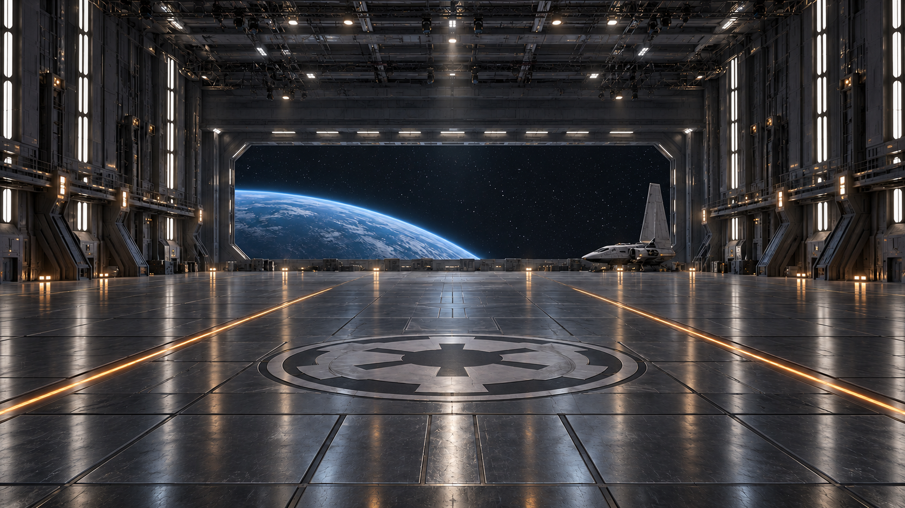</a><figcaption style="font-size:12px;margin-top:5px"><b>H28A</b> — церемония, исходный свет. <a href="references/scenes/scene-28/H28A-ceremony.png" target="_blank" rel="noopener">Открыть PNG</a></figcaption></figure>
<figure style="margin:0"><a href="references/scenes/scene-28/H28B-disco.png" target="_blank" rel="noopener">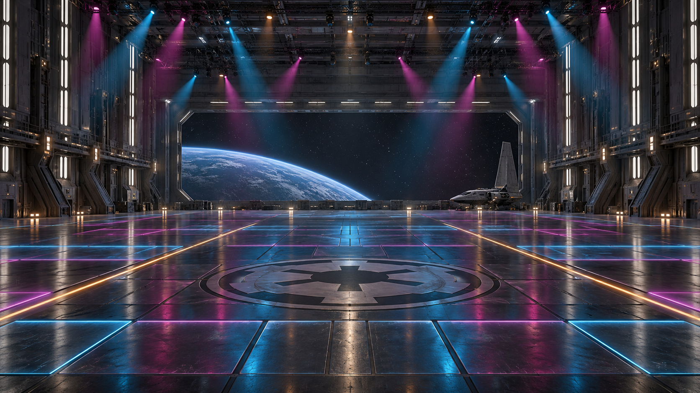</a><figcaption style="font-size:12px;margin-top:5px"><b>H28B</b> — дискотека в том же ангаре. <a href="references/scenes/scene-28/H28B-disco.png" target="_blank" rel="noopener">Открыть PNG</a></figcaption></figure>
</div>

### Сохранённые референсные кадры Scene 28

Эти изображения сохранены отдельно для повторного использования; удачные кадры **не перегенерировать без отдельной причины**. Для внешности каждого персонажа абсолютный приоритет остаётся у его individual model sheet. P28/L28/F28/S28/G28 можно использовать как pose/location continuity references. R28A/R28B — только вспомогательная постановка рядов/композиции, не identity authority. Прежние неудачные групповые попытки не используются. Новый G28-full-ensemble-Alesya-v2.png прошёл проверку состава и внешности; J28/T28 — проверенные промежуточные группы для сборки, individual sheets остаются identity authority.

<div class="scene28-ref-gallery" style="display:grid;grid-template-columns:repeat(auto-fit,minmax(220px,1fr));gap:12px;margin:14px 0 20px">
<figure style="margin:0"><a href="references/scenes/scene-28/P28-pair-facing.webp" target="_blank" rel="noopener">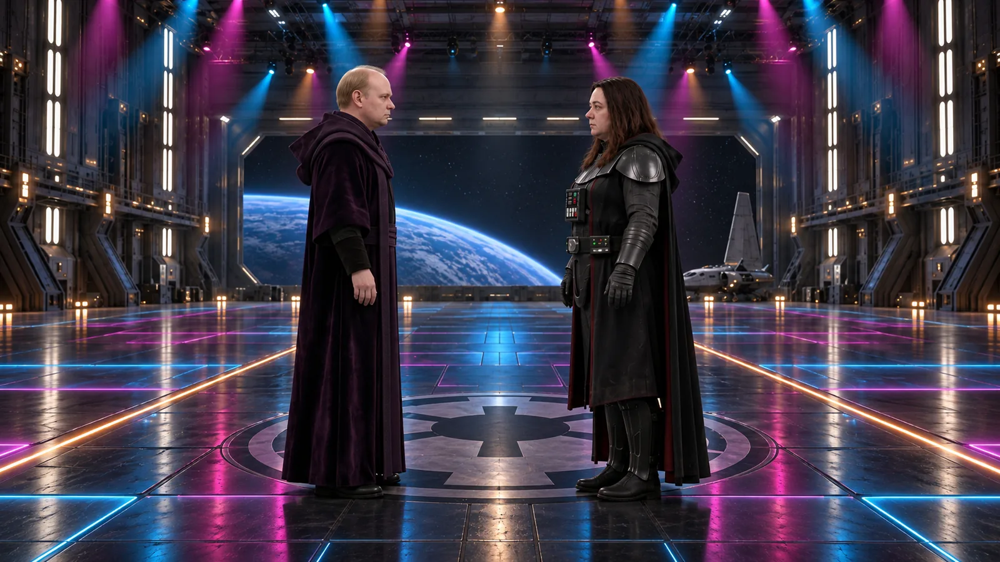</a><figcaption style="font-size:12px;margin-top:5px"><b>P28</b> — пара лицом к лицу; поза, ось и H28B.</figcaption></figure>
<figure style="margin:0"><a href="references/scenes/scene-28/L28-carry.webp" target="_blank" rel="noopener">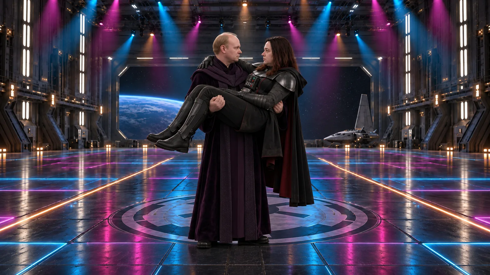</a><figcaption style="font-size:12px;margin-top:5px"><b>L28</b> — перенос Юли на руках; pose reference.</figcaption></figure>
<figure style="margin:0"><a href="references/scenes/scene-28/F28-face-gesture.webp" target="_blank" rel="noopener">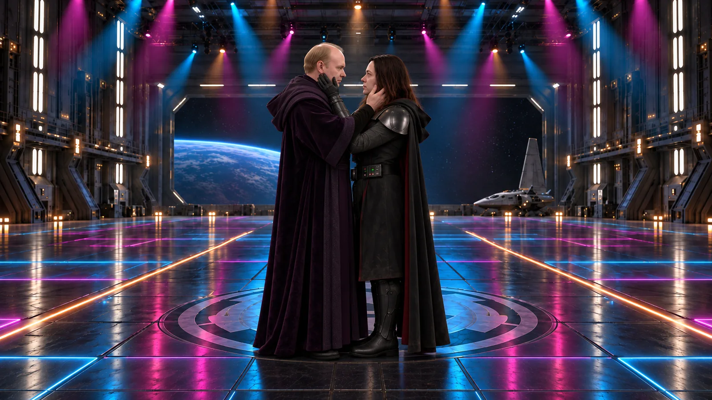</a><figcaption style="font-size:12px;margin-top:5px"><b>F28</b> — взаимный жест у лица; staging reference.</figcaption></figure>
<figure style="margin:0"><a href="references/scenes/scene-28/S28-shoulder.png" target="_blank" rel="noopener">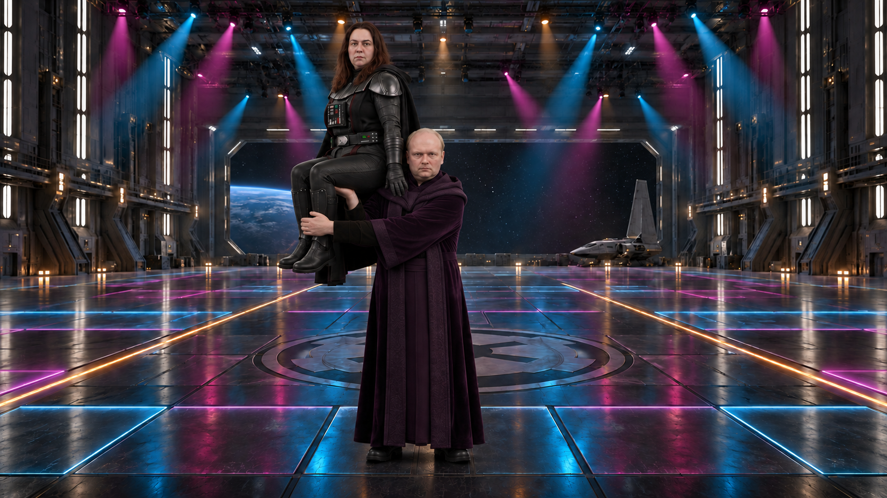</a><figcaption style="font-size:12px;margin-top:5px"><b>S28</b> — исправленная посадка на правом плече; поддержка бёдер и голеней.</figcaption></figure>
<figure style="margin:0"><a href="references/scenes/scene-28/G28-full-ensemble-Alesya-v2.png" target="_blank" rel="noopener">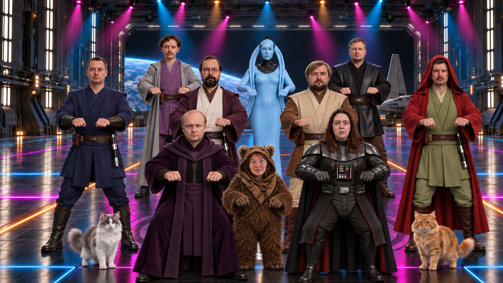</a><figcaption style="font-size:12px;margin-top:5px"><b>G28</b> — Финальный ансамбль: девять людей/гуманоидов, Алеся и два кота.</figcaption></figure>
<figure style="margin:0"><a href="references/scenes/scene-28/J28-four-jedi.png" target="_blank" rel="noopener">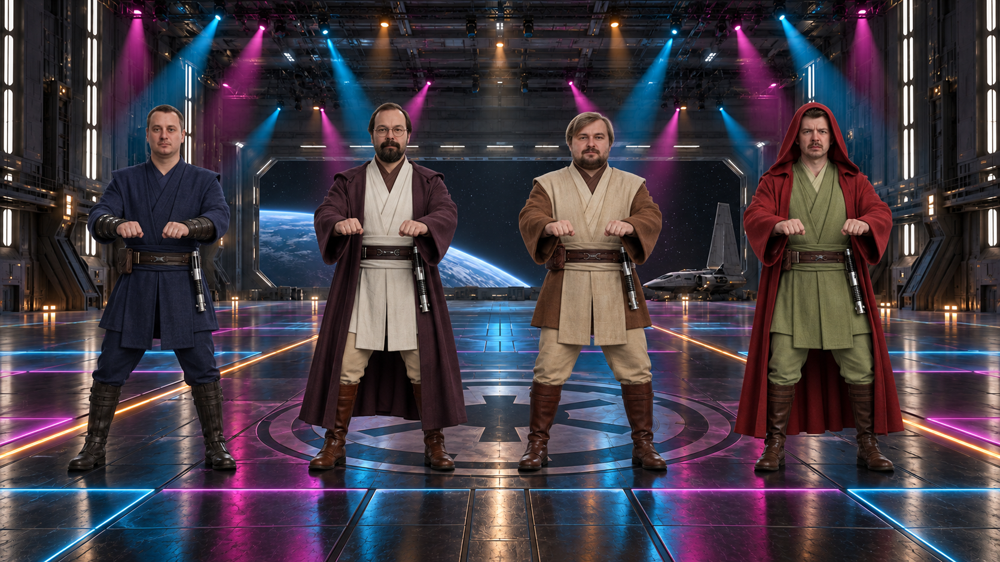</a><figcaption style="font-size:12px;margin-top:5px"><b>J28</b> — Проверенная группа джедаев для сборки G28; не добавлять четырёх людей в парный дубль.</figcaption></figure>
<figure style="margin:0"><a href="references/scenes/scene-28/T28-trio.png" target="_blank" rel="noopener">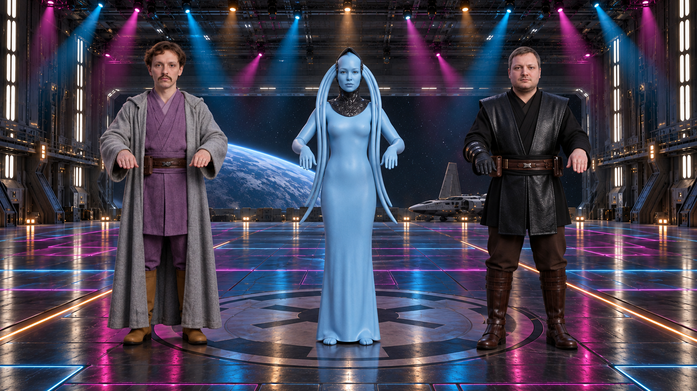</a><figcaption style="font-size:12px;margin-top:5px"><b>T28</b> — Маша, Лёша и Виталик — проверенная группа в H28B.</figcaption></figure>
</div>

**Геометрия:** тёмные металлические рёбра, белые вертикальные световые вставки, две янтарные направляющие на чёрном сатиновом полу, плоская имперская эмблема в центре. В глубине широкий проём с космосом и планетой; справа неподвижный шаттл. H28B сделан как смена света H28A: камера, пол, стены, эмблема, проём и шаттл сохраняются. Нет сцены-подиума, DJ-стойки, барной мебели или новых танцоров. Слабые отражения пола не создают двойников персонажей.

**Световая партитура после правки 17.10:** H28B уже включён с первого кадра; стабильные цветные акценты на фоне и постоянный нейтральный свет на лицах. Световой пролог и длительные ожидания удалены; движение начинается сразу.

**Общий мотив:** два коротких боковых шага → низкие угловатые предплечья → небольшой поворот плеч → внезапная торжественная остановка. Вариации сохраняют один танец. Никаких улыбок, подмигиваний, эротических жестов, прыжков, бросков партнёра или оружия. Исключение из прежнего запрета поддержек: две отдельные контролируемые парные вставки 8–9, по новой команде пользователя. Маша двигается в пределах своего длинного цельного закрытого костюма; коты остаются обычными четвероногими котами.

**Алеся:** маленький коричневый эвок с точным взрослым человеческим лицом Алеси, мехом, круглыми ушами и коричневым капюшоном. [Развёрнутый Ale28](references/scenes/scene-28/Ale28-Alesya-model-sheet.png). Источник — обе входные фотографии задачи `dd7ccc1b23334ea0b54455a6605e12ea`. В танце без копья: отдельный номер 7 и общий финал 10.

<div class="scene-ref-gallery">
<figure><a href="references/scenes/scene-28/Ale28-Alesya-model-sheet.png" target="_blank" rel="noopener">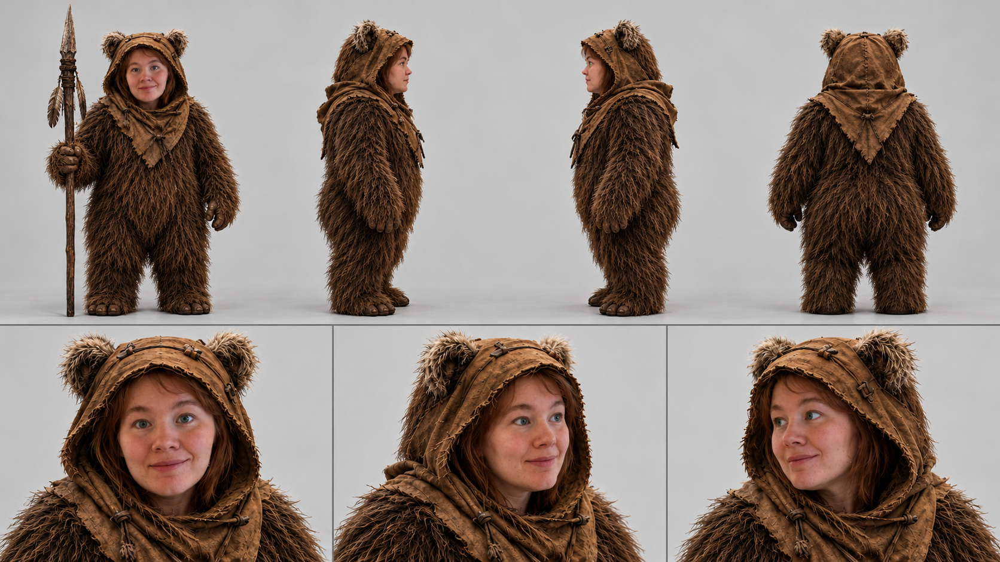</a><figcaption>Ale28 — Алеся: повороты тела и крупные планы лица</figcaption></figure>
</div>

### Музыка

**Основная музыкальная рекомендация — Electric Six, “Dance Commander”.** Здесь хорошо работает сочетание рок-гитары, танцевального пульса и комически командного характера: Серёга буквально становится распорядителем парада. Один трек на весь номер; звук генераций в финальной сборке отключить. Рабочее ощущение темпа — около 120–121 BPM, но точную сетку и монтажные точки выставлять по ВЫБРАННОМУ аудиофайлу: каталоговые оценки/версии записи различаются. Не обещать музыкальную синхронизацию одним текстом промта. [Официальное видео](https://www.youtube.com/watch?v=vboGDSUGCyY).

**Отсылка:** в первом сезоне Peacemaker звучит Wig Wam — “Do Ya Wanna Taste It”, во втором — Foxy Shazam — “Oh Lord”. “In My Dreams” и “Killin’ It” из предыдущего обсуждения были предложениями альтернатив, а не названиями тем этих сезонов. Наш выбор — “Dance Commander”; “Oh Lord” можно рассматривать только как альтернативное музыкальное решение с переразметкой монтажа. [Заставка HBO Max, сезон 1](https://www.youtube.com/watch?v=_mrr3UNALww) · [заставка HBO Max, сезон 2](https://www.youtube.com/watch?v=_74zkpM31yw). Для публичного релиза выбранная запись требует отдельного решения по использованию музыки; права этим планом не предоставляются.

### Две версии и общий монтаж примерно на 90 секунд

| Версия | Блоки | Исходный материал | Практическое назначение |
|---|---:|---:|---|
| **A · Seedance 2.0** | **10×15 с** | **150 с** | Основная рекомендация для танца: отдельный короткий дубль каждого действия, проще отбор и замена проблемного жеста. |
| **B · Wan 3.0** | **10×30 с** | **300 с** | Полноценная альтернатива с более длинным вступлением, повтором простого мотива и запасом до/после жеста. Не удваивать скорость или число сложных действий. |

Обе версии рассчитаны на **один итоговый номер около 85–95 секунд**. 150/300 секунд — суммарная длина исходников, а не обязательная длина титров. Одни и те же десять частей сохраняют состав и географию; 30-секундный вариант также разделяет жесты у лица, разъезд и две поддержки на самостоятельные рендеры. `duration_s:15` в scene-meta обозначает основную версию A; в каждом блоке B явно задано 30 секунд.

| Часть | Кто в кадре | Содержание и свет | Ориентир для монтажа |
|---:|---|---|---:|
| 1 | Серёга + Юля | Официальная стойка → танцпол и лучи → сближение. | 8 с |
| 2 | Серёга + Юля | Четыре взаимных прохода рукой у внешней щеки, строго по очереди; затем обе руки опущены. Свет стабильный. | 10 с |
| 3 | Серёга + Юля | Разъезд скользящими шагами назад в противоположные стороны с сохранением взгляда. | 8 с |
| 4 | Паша + Саша | Зеркальный джедайский устав. | 8 с |
| 5 | Артём + Илюша | Тяжеловесная вариация общего рисунка. | 8 с |
| 6 | Маша + Лёша + Виталик | Маша задаёт фигуру, мужчины отвечают с запаздыванием. | 9 с |
| 7 | Алеся + Лучик + Рыжик | Алеся дирижирует двумя маленькими жестами; коты шагают и поворачивают головы. | 7 с |
| 8 | Серёга + Юля | После склейки он уже держит её на руках; один размеренный полукруг мелкими шагами. | 9 с |
| 9 | Серёга + Юля | Новая склейка: она уже сидит боком на его правом плече; два парадных шага и замер. | 9 с |
| 10 | Все 12 | Общий акцент и торжественно нелепая финальная поза. | 4 с + 10 с стоп-кадра |

Это даёт около 90 секунд. Короткие окна — ориентир: выбирать чистые целые движения и при необходимости расширить монтаж до 95–105 с, не ускорять силой взаимодействия рук/тел. Точные склейки выставить по выбранному аудиофайлу: генерационные 15/30 секунд не обязаны совпадать с музыкальными фразами. При ~120 BPM 15 секунд — примерно 30 долей, не целое число четырёхдольных тактов; обрезать на сильную долю и использовать запас. Касание и ноги не исправлять агрессивным optical flow. Для финальных 11 персонажей достаточно нескольких чистых секунд; длинный хвост Wan — запас для выбора, не просьба всё время усложнять танец.

### Выбор модели и порядок работы

**Разбор моделей17.10:** [проверка Wan3.0 и Seedance по источникам и нашим роликам](reports/owner-fixes-2026-10-17.md). Влияние модели не исключено; равенство качества не установлено. Первый исправленный тест — A1 Seedance2.0/15с. Он проверяет новую постановку, а не доказывает превосходство модели: для сравнения понадобятся одинаковые15с и одинаковые входы на Wan, после оценки первого теста.

**Рекомендация — Seedance 2.0 по 15 секунд.** Это производственный выбор для коротких взаимодействий, контроля рук и монтажной замены, а не результат уже проведённого A/B-теста наших персонажей. Seedance 2.0 официально заявляет улучшения сложного движения/взаимодействий, но сам разработчик отмечает ограничения согласованности нескольких персонажей. Без сравнения одинакового эпизода нельзя честно объявить его гарантированно лучше Wan 3.0. Для спокойного открытия ангара и простого парного танца 30 секунд Wan могут быть удобны; для касания щеки, трио и общего ансамбля я бы начал с короткой версии.

При подготовке проверен live Topview config: **Seedance 2.0 — 4–15 с; Wan 3.0 — 2–30 с**, обе модели доступны в `omni_reference`, 1080p, 16:9. Подпись Wan 3.0 относится к модели, доступной в Topview; не переносить на неё автоматически сведения о других версиях Wan. Источники: [официальное описание Seedance 2.0](https://seed.bytedance.com/en/blog/seedance-2-0-official-launch) · [страница сравнения Topview](https://www.topview.ai/wan-3-vs-seedance-2).

- Части 1–9: `omni_reference`, 3–4 изображения по конкретной схеме блока. Это выбранный бюджет постановки, не заявление о максимуме модели. Model sheet с несколькими видами описывает одного персонажа.
- Часть 10: `image_to_video`, один заранее собранный и проверенный G28. Перед отправкой сверить текущую доступность режима выбранного движка; не подменять движок молча. При дрейфе лиц ансамбля использовать сам G28 с монтажным стоп-кадром/небольшим наездом.
- В текущем standalone Topview video tool нет входа reference audio. Это ограничение данного интерфейса, не утверждение, что модель нигде не поддерживает аудиореференс. Песню накладывать в CapCut/другом редакторе; `@Audio1` в эти промты не добавлять. Синхронизация ударов музыки — монтажная задача.
- По последней команде владельца сначала один исправленный 15-секундный тест A1 Seedance 2.0. Остальные новые танцевальные запуски ждут оценки этого теста; старые активные задачи не отменяются. Затем оценить руку/щёку, лица, ось и ноги. Другую модель пробовать на том же эпизоде и с теми же входами, если нужен честный A/B. Уточнение владельца 15.10: все готовые сцены запускать постепенно по свободным слотам, максимум шесть активных задач; очередь и защита от повторов — `ops/topview-launch-queue.json`. Новые поддержки сначала отдельно проверить на чистых L28/S28; сложную пересадку с рук на плечо не генерировать одним движением. Existing slow-задачи Scene 20 не отменять и не перезапускать.
- Владелец 17.10 разрешил сначала один исправленный 15s тест A1; остальные новые танцевальные запуски ждут его оценки. Запуск только через проверенный unlimited/zero-credit путь; платный fallback не разрешён. Приёмка: лица и костюмы → рука/щёка → ноги → география и свет → музыкальный акцент. Титры добавляются в редакторе, а не внутри генерации.

### Оставшиеся визуальные входы

**H28A/H28B уже существуют:** в текущих танцевальных заданиях используется только H28B как локация и свет, без копирования дальнего ракурса. A1/B1 имеют три входа: H28B и два individual sheets. H28A остаётся архивным состоянием локации и используется в других сценах.

**P28 — создан и сохранён.** [Открыть WEBP](https://virudik.github.io/ai-film-prompts/references/scenes/scene-28/P28-pair-facing.webp). Парный средний кадр в H28B: Серёга слева в профиль смотрит вправо, Юля справа — влево, лица на расстоянии 55–65 см; обе правые руки опущены. Камера видит внешние щёки и свободный путь каждой руки. P28 задаёт только позу/ось/кадрирование, model sheets сохраняют приоритет внешности.

**C28 — сохранён из настоящего финала B2.** <a href="references/scenes/scene-28/C28-from-B2-result.png">Скачать кадр899/899 (29.967с)</a>; source task`762b3091b3e44b8599a0a58b91a253c5`. Руки полностью опущены, контакта с лицом нет. B3 @Image4 — только поза/ось после жеста; identity по sheets, общий план задаёт промт. Технический QC не означает приёмку результата владельцем.

<div class="scene-ref-gallery"><figure><a href="references/scenes/scene-28/C28-from-B2-result.png" target="_blank" rel="noopener">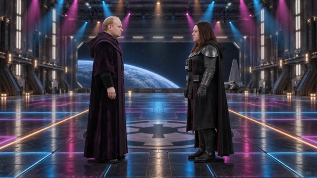</a><figcaption>C28 для B3: реальный кадр B2,29.967с; поза и ось, не identity.</figcaption></figure></div>

**L28 — создан и сохранён.** [Открыть WEBP](https://virudik.github.io/ai-film-prompts/references/scenes/scene-28/L28-carry.webp). Чистый общий парный кадр для части 8: Серёга стоит устойчиво и уже держит Юлю поперёк перед собой, левая рука поддерживает её спину, правая — бёдра над коленями. Её голова со стороны его левого плеча, согнутые ноги с правой; обе головы и все опорные конечности различимы. Плащи не переплетены. Это постановочный pose reference, individual sheets выше него по внешности.

**S28 — исправлен, проверен и сохранён 07.10.2026.** [Открыть PNG](https://virudik.github.io/ai-film-prompts/references/scenes/scene-28/S28-shoulder.png). Проверенный общий парный кадр для части 9: Юля сидит прямо боком на правом плече Серёги, обе согнутые ноги перед правой стороной его корпуса; его правая рука держит бёдра, левая стабилизирует голени. Головы разнесены и видны. Не пытаться одновременно развернуть, поднять и пересадить её из L28: переход делается монтажной склейкой. Эта конкретная поза — наша постановка мотива «на плече», а не утверждение о точной позе из сериала.

**G28 v2 — дополнен Алесей, проверен и сохранён 08.10.2026.** [Открыть PNG](https://virudik.github.io/ai-film-prompts/references/scenes/scene-28/G28-full-ensemble-Alesya-v2.png). Общий кадр собран последовательно из проверенных J28/T28, individual sheets Серёги/Юли и двух котов. Состав 9+1+2 проверен, предыдущие неудачные попытки не используются. Передний человеческий ряд: Серёга слева, Юля справа. Второй слева направо: Паша, Саша, Артём, Илюша. Третий: Лёша, Маша, Виталик. Алеся стоит впереди по центру между главной парой и котами; её небольшой рост и лицо взяты из Ale28. Ряды раздвинуты, каждое лицо видно. Лучик на полу впереди слева, Рыжик справа, головы ниже человеческого колена. Низкая угловатая поза, руки не закрывают лица. У Маши гладкий непрозрачный голубой торс и длинный подол. G28 — один first frame части 10 после проверки всех 9+1+2 персонажей по их individual sheets.

Ниже — полные тексты для указанных входов. Нумерация @Image локальна каждому промту. P28/L28/F28 уже сохранены; R28A/R28B — helpers композиции. S28 подготовлен и прошёл проверку позы/внешности; G28 тоже проверен; только C28 ожидает чистого результата части 2. Individual character sheets всегда выше generated pose/composition reference по внешности.

<div class="engine-tabs" data-scene="28">

<div class="engine-pane" data-engine="sd20" data-main="1" data-duration="10 × 15 с">

### Версия A — Seedance 2.0, десять роликов по 15 секунд

#### A1 · Танец 1 — Серёга и Юля задают устав

**Референсы:** @Image1 = H28B (ангар и уже включённый дискотечный свет, без привязки к дальности камеры) · @Image2 = sheet Серёги · @Image3 = sheet Юли.

**Используемые identity-референсы на сайте:**
<div class="scene-ref-gallery" style="display:grid;grid-template-columns:repeat(auto-fit,minmax(145px,1fr));gap:10px;margin:10px 0 16px">
<figure style="margin:0"><a href="references/full/serega.jpg" target="_blank" rel="noopener"></a><figcaption style="font-size:12px;margin-top:5px">Серёга</figcaption></figure>
<figure style="margin:0"><a href="references/full/yulya.jpg" target="_blank" rel="noopener">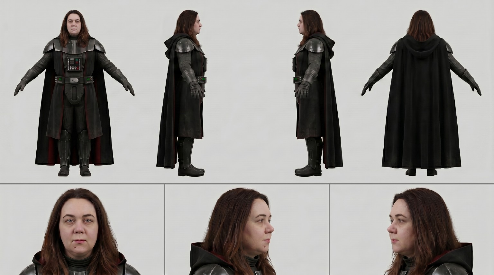</a><figcaption style="font-size:12px;margin-top:5px">Юля</figcaption></figure>
<figure style="margin:0"><a href="references/full/pasha.jpg" target="_blank" rel="noopener">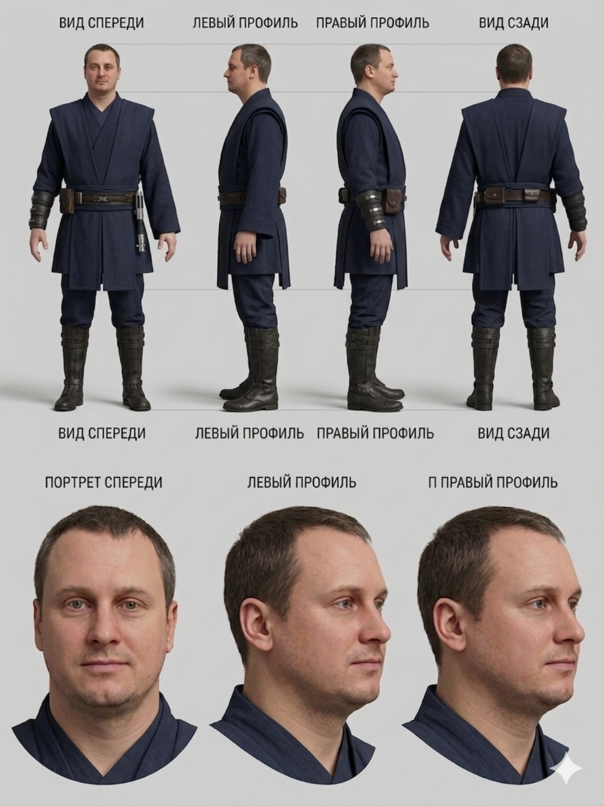</a><figcaption style="font-size:12px;margin-top:5px">Паша</figcaption></figure>
<figure style="margin:0"><a href="references/full/sasha.jpg" target="_blank" rel="noopener">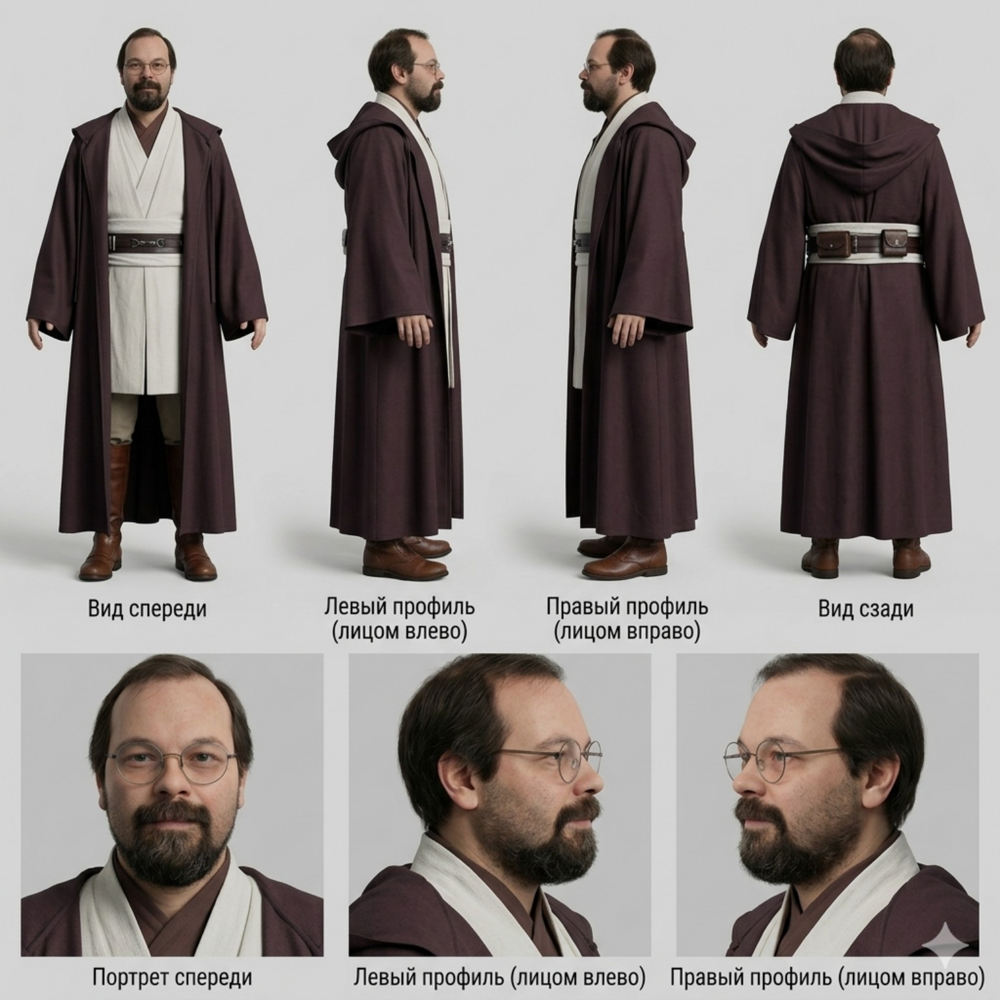</a><figcaption style="font-size:12px;margin-top:5px">Саша</figcaption></figure>
<figure style="margin:0"><a href="references/full/artem.jpg" target="_blank" rel="noopener"></a><figcaption style="font-size:12px;margin-top:5px">Артём</figcaption></figure>
<figure style="margin:0"><a href="references/full/ilyusha.jpg" target="_blank" rel="noopener"></a><figcaption style="font-size:12px;margin-top:5px">Илюша</figcaption></figure>
<figure style="margin:0"><a href="references/full/lesha.jpg" target="_blank" rel="noopener"></a><figcaption style="font-size:12px;margin-top:5px">Лёша</figcaption></figure>
<figure style="margin:0"><a href="references/full/vitalik.jpg" target="_blank" rel="noopener"></a><figcaption style="font-size:12px;margin-top:5px">Виталик</figcaption></figure>
<figure style="margin:0"><a href="references/masha-laguna.webp" target="_blank" rel="noopener">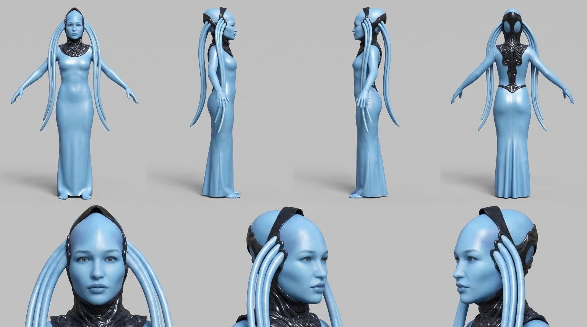</a><figcaption style="font-size:12px;margin-top:5px">Маша-Лагуна</figcaption></figure>
<figure style="margin:0"><a href="references/luchik.jpg" target="_blank" rel="noopener"></a><figcaption style="font-size:12px;margin-top:5px">Лучик</figcaption></figure>
<figure style="margin:0"><a href="references/ryzhik.jpg" target="_blank" rel="noopener">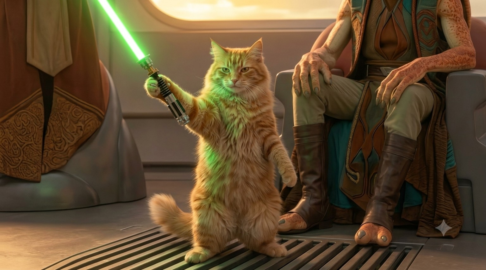</a><figcaption style="font-size:12px;margin-top:5px">Рыжик</figcaption></figure>
</div>

```text
Mode: omni-reference video | Target model: Seedance 2.0 | Duration: 15s | Resolution: 1080p | Aspect ratio: 16:9 | FPS: 24
Audio intent: silent dance plate for externally added music; no dialogue, singing or generated score.

REFERENCES / PRIORITY:
@Image1 is H28B: exact hangar geometry and already active disco lighting ONLY, not its distant empty-room framing. @Image2 is absolute SEREGA face/body/costume identity; @Image3 is absolute YULIA face/body/costume identity. Individual sheets override all location details for appearance. Exactly two adults, one person per sheet. No other cast.

CHARACTER APPEARANCE / IDENTITY LOCK:
SEREGA is the pale older Chancellor with a balding crown, sparse light hair and a long deep-purple robe. YULIA has the exact referenced face, long chestnut hair, dark black-grey armor, shoulder pieces, gloves and a long black cloak. Preserve both faces and builds; no beautification or costume redesign. Hands stay empty; no lightsabers.

SCENE / STYLE:
Photoreal live-action Imperial space-cruiser ceremonial hangar. Match the supplied location geometry: tall graphite ribs and white wall strips, satin dark floor with a flush Imperial starburst medallion, two amber guide lines and embedded cyan/magenta tile borders. A huge rear opening frames stationary space and a planet; one shuttle stays parked deep frame-right. The dance floor is the original hangar floor, not a newly appearing stage. Reflections stay faint and never create duplicate performers. No traffic, extra furniture, DJ booth or crowd.

START STATE:
Serega frame-left and Yulia frame-right, about 1.4 metres apart, already dancing toward camera. Begin waist-up on both faces and shoulders; H28B lights already ON. No lighting or hangar establishing shot.

LIGHTING / MATERIALS:
H28B disco lighting is fully established at frame zero. Existing cyan/magenta floor borders and ceiling accents remain steady; the hangar geometry does not move. Constant soft neutral-white key and fill illuminate faces; keep skin texture, eyes, age and costume colour readable throughout movement. Real heavy cloth, metal armour and grounded foot contact, faint floor reflections. No lighting prelude, strobe or coloured facial flicker.

TIMELINE / ACTIVE CHOREOGRAPHY:
0–3s: Immediately alternate four hard shoulder pops with angular elbows, then two grounded heel stamps. Both face camera, Serega left and Yulia right; hands stay below chins.
3–7s: Each drives one knee up to waist level and plants the foot firmly, alternating twice while pumping stiff bent arms like an absurd malfunctioning parade robot. Robes trail naturally; they do not cross paths.
7–11s: Two quick heel-toe shuffles inward, then a sharp outward quarter-turn and immediate return toward the partner. Add a decisive chest isolation; keep heads steady enough to recognise faces.
11–14s: They finish with two emphatic inward steps and turn face-to-face, Serega left facing right and Yulia right facing left, stopping about 60 cm apart. Hands drop to their own sides.
14–15s: One crisp ending beat in that hands-down face-to-face position, eyes visible, breathing naturally.

CAMERA / SPACE:
One continuous smooth shot, natural 50mm perspective. 0–3s waist-up two-shot with both faces large; 3–11s smoothly ease back only enough to show knees and planted feet, keeping standing people at least 80% of frame height; 11–15s move closer to a waist-up face-to-face ending. Same screen axis and separate silhouettes throughout. Hangar stays a softly readable background, not the subject. No orbit, wide establishing shot or face-obscuring motion blur.

PERFORMANCE:
Wildly committed, energetic, oddly mechanical dance performed with completely serious faces. The absurdity comes from decisive body motion, sharp rhythmic accents and unexpected reversals, not facial grimacing. No waiting for music: movement begins immediately. Maintain exact identities through turns; distinct eyes, noses and mouths remain stable, no motion-smear mask. One readable choreographic phrase at a time, then a different phrase; no long idle holds or endless tiny step-touch loop.

END STATE:
Serega left facing right and Yulia right facing left, approximately 60 cm face separation, both hands lowered. The next editorial shot may be closer on this same axis. H28B disco lighting is established and steady at the last frame.

NEGATIVE PROMPT:
Rapid strobing, facial color flicker, magenta skin, costume recoloring, lighting-driven identity drift, new room geometry, DJ booth, generated text, Extra dancers, duplicated sheet views, swapped identities, reversed screen positions, face drift, new hairstyle, wardrobe change, extra arms or fingers, skating without weight transfer, tangled cloak, weapons, heavy floor mirror images, moving architecture, abrupt light flashes, exaggerated facial comedy, singing, subtitles, credits, logos, watermark, camera shake or cuts. No tiny distant human faces, empty-hangar establishing shot, slow-motion movement, prolonged idle pose, motion-blurred identity or frozen facial mask.

FRAME FILL / NO BARS:
Fill the entire generated frame edge-to-edge. No letterboxing, pillarboxing, black bars, decorative borders or empty margins.
```

#### A2 · Танец 2 — Четыре взаимных жеста у лица

**Референсы:** @Image1 = H28B · @Image2 = sheet Серёги · @Image3 = sheet Юли · @Image4 = сохранённый P28 (только постановка пары).

```text
Mode: omni-reference video | Target model: Seedance 2.0 | Duration: 15s | Resolution: 1080p | Aspect ratio: 16:9 | FPS: 24
Audio intent: silent dance plate for externally added music; no dialogue, singing or generated score.

REFERENCES / PRIORITY:
@Image1 is the supplied H28B hangar location/H28B light design only. @Image2 is the absolute SEREGA face/body/costume reference. @Image3 is the absolute YULIA face/body/costume reference. @Image4 controls this two-person pose, camera angle and framing only. Identity sheets override the pair composition for individual appearance. Exactly two people; each multi-view sheet represents one person.

CHARACTER APPEARANCE / IDENTITY LOCK:
SEREGA: exact pale older face, balding crown with sparse light hair, long deep-purple Chancellor robe. YULIA: exact face and build, long chestnut hair, black-grey armor and shoulder pieces, gloves, long black cloak. Do not restyle either person or obscure their eyes. Each person's right hand has five stable fingers; Yulia keeps her approved glove. Never merge a glove or fingers into skin.

SCENE / STYLE:
Photoreal live-action Imperial space-cruiser ceremonial hangar. Match the supplied location geometry: tall graphite ribs and white wall strips, satin dark floor with a flush Imperial starburst medallion, two amber guide lines and embedded cyan/magenta tile borders. A huge rear opening frames stationary space and a planet; one shuttle stays parked deep frame-right. The dance floor is the original hangar floor, not a newly appearing stage. Reflections stay faint and never create duplicate performers. No traffic, extra furniture, DJ booth or crowd.

START STATE:
Medium waist-up two-shot, Serega left facing right, Yulia right facing left, about 60 cm face separation. Both right hands begin down. Preserve the P28 pose/axis but give the performers energetic intent.

LIGHTING / MATERIALS:
H28B disco lighting is fully established at frame zero. Existing cyan/magenta floor borders and ceiling accents remain steady; the hangar geometry does not move. Constant soft neutral-white key and fill illuminate faces; keep skin texture, eyes, age and costume colour readable throughout movement. Real heavy cloth, metal armour and grounded foot contact, faint floor reflections. No lighting prelude, strobe or coloured facial flicker.

TIMELINE / ACTIVE CHOREOGRAPHY:
0–1s: Begin an immediate sharp shoulder accent, facing one another at 60 cm separation; hands still clear of faces.
1–4s: Serega performs one decisive outside-cheek pass with the backs of softly grouped right fingers, from cheekbone toward jaw, then fully withdraws. Yulia answers only after his hand is down. Keep eyes, nose and mouth uncovered.
4–8s: Both execute a synchronous elbow-out chest pop with hands below their own chins, then return to the face-to-face position. Bodies bounce through knees without closing the gap.
8–12s: Repeat one outside-cheek pass each in order Serega then Yulia, with visible air between passes. Exactly four passes in the clip. Snappy decisive intent, soft contact, no slap and no simultaneous touching.
12–14s: Withdraw both hands fully, deliver two rapid shoulder isolations in place while holding eye contact.
14–15s: Return to the clean face-to-face hands-down end pose for the following separation.

CAMERA / SPACE:
Close waist-up two-shot, natural 50mm perspective, both faces and entire hand arcs readable at all times. A very small smooth push follows the energy without changing the left/right axis. No hand-only cut or background wide shot.

PERFORMANCE:
Wildly committed, energetic, oddly mechanical dance performed with completely serious faces. The absurdity comes from decisive body motion, sharp rhythmic accents and unexpected reversals, not facial grimacing. No waiting for music: movement begins immediately. Maintain exact identities through turns; distinct eyes, noses and mouths remain stable, no motion-smear mask. One readable choreographic phrase at a time, then a different phrase; no long idle holds or endless tiny step-touch loop.

END STATE:
The same two people face one another on the same axis, stationary, both right hands fully lowered and a visible air gap between every hand and either face. A later wide shot starts from this no-contact state. H28B disco lighting is established and steady at the last frame.

NEGATIVE PROMPT:
Rapid strobing, facial color flicker, magenta skin, costume recoloring, lighting-driven identity drift, new room geometry, DJ booth, generated text, Hand covering eyes, grabbing face, palm wipe across nose, cheek stretching, melted fingers, fingers fused to skin, extra hand, left-hand substitutions, simultaneous face-touching, a fifth pass, changing face, changed hair, incorrect costume, kiss, embrace, sliding separation, extra person, weapons, shake, cuts, subtitles, text, logos, watermark. No tiny distant human faces, empty-hangar establishing shot, slow-motion movement, prolonged idle pose, motion-blurred identity or frozen facial mask.

FRAME FILL / NO BARS:
Fill the entire generated frame edge-to-edge. No letterboxing, pillarboxing, black bars, decorative borders or empty margins.
```

#### A3 · Танец 3 — Невозмутимый разъезд

**Референсы:** @Image1 = H28B · @Image2 = sheet Серёги · @Image3 = sheet Юли · @Image4 = <a href="references/scenes/scene-28/C28-from-B2-result.png">C28, настоящий финал B2 после отхода рук</a> (только поза/ось; общий план шире).

```text
Mode: omni-reference video | Target model: Seedance 2.0 | Duration: 15s | Resolution: 1080p | Aspect ratio: 16:9 | FPS: 24
Audio intent: silent dance plate for externally added music; no dialogue, singing or generated score.

REFERENCES / PRIORITY:
@Image1 defines the supplied H28B hangar architecture, floor and light. @Image2 is the exact SEREGA identity/costume sheet. @Image3 is the exact YULIA identity/costume sheet. @Image4 defines only the face-to-face orientation and the arms-down pose AFTER the cheek gesture; it does not set this wider framing. Preserve the individual identities above all other image information. Exactly two people.

CHARACTER APPEARANCE / IDENTITY LOCK:
SEREGA: pale older Chancellor, balding crown, sparse light hair, long deep-purple robe and the exact referenced face/build. YULIA: exact face/build, long chestnut hair, black-grey armor with shoulder pieces and gloves, long black cloak. Empty hands, unchanged clothing; both feet remain grounded and anatomically correct.

SCENE / STYLE:
Photoreal live-action Imperial space-cruiser ceremonial hangar. Match the supplied location geometry: tall graphite ribs and white wall strips, satin dark floor with a flush Imperial starburst medallion, two amber guide lines and embedded cyan/magenta tile borders. A huge rear opening frames stationary space and a planet; one shuttle stays parked deep frame-right. The dance floor is the original hangar floor, not a newly appearing stage. Reflections stay faint and never create duplicate performers. No traffic, extra furniture, DJ booth or crowd.

START STATE:
Start from the genuine C28 orientation only: Serega left facing right, Yulia right facing left, hands already down and faces about 60 cm apart. C28 does not prescribe distant framing or identity.

LIGHTING / MATERIALS:
H28B disco lighting is fully established at frame zero. Existing cyan/magenta floor borders and ceiling accents remain steady; the hangar geometry does not move. Constant soft neutral-white key and fill illuminate faces; keep skin texture, eyes, age and costume colour readable throughout movement. Real heavy cloth, metal armour and grounded foot contact, faint floor reflections. No lighting prelude, strobe or coloured facial flicker.

TIMELINE / ACTIVE CHOREOGRAPHY:
0–3s: From the genuine hands-down facing pose, start immediately with a sharp knee pulse and two decisive backward heel-toe shuffles, preserving left/right positions.
3–7s: Retreat from one another with lively heel-toe footwork and alternating elbow pumps, each travelling about 0.7 metres along the same line. Feet press and release the floor; no levitation or sliding platform.
7–11s: Stop translation while continuing sharp shoulder pops and a deliberately odd chest-forward/chest-back robot isolation. Keep the faces angled toward each other.
11–14s: Both pivot to face camera and stamp twice, throwing bent elbows outward below shoulder level; do not cross or overlap.
14–15s: Hit the same angular front-facing low-arm end pose, Serega left, Yulia right, about two metres apart.

CAMERA / SPACE:
One smooth medium-full pair/trio shot, natural 50mm perspective. Standing performers occupy 80–90% of frame height while feet are needed; move to a waist-up two/three-shot for upper-body accents, then return only enough for the final pose. Preserve left/right order and unobstructed faces. Short controlled camera tracking, no wide establishing view, excessive headroom, orbit or blur hiding identity.

PERFORMANCE:
Wildly committed, energetic, oddly mechanical dance performed with completely serious faces. The absurdity comes from decisive body motion, sharp rhythmic accents and unexpected reversals, not facial grimacing. No waiting for music: movement begins immediately. Maintain exact identities through turns; distinct eyes, noses and mouths remain stable, no motion-smear mask. One readable choreographic phrase at a time, then a different phrase; no long idle holds or endless tiny step-touch loop.

END STATE:
Serega left, Yulia right, about two metres apart, facing the camera in the same low angular arm pose. This pose supplies the graphic match-cut to the next dancing pair. Keep the established H28B disco palette and unchanged neutral facial fill through the final frame.

NEGATIVE PROMPT:
Rapid strobing, facial color flicker, magenta skin, costume recoloring, lighting-driven identity drift, new room geometry, DJ booth, generated text, Hands touching face, attached hands during separation, stretched arms, pulled skin, reversed directions, crossing positions, sliding into each other, floating, ice-skating blades, wheels, conveyor belts, teleportation, foot distortion, identity swap, duplicate bodies, heavy mirrored doubles, weapons, slapstick faces, cuts, generated credits, text, logos or watermark. No tiny distant human faces, empty-hangar establishing shot, slow-motion movement, prolonged idle pose, motion-blurred identity or frozen facial mask.

FRAME FILL / NO BARS:
Fill the entire generated frame edge-to-edge. No letterboxing, pillarboxing, black bars, decorative borders or empty margins.
```

#### A4 · Танец 4 — Паша и Саша: джедайский устав

**Референсы:** @Image1 = H28B · @Image2 = sheet Паши · @Image3 = sheet Саши.

```text
Mode: omni-reference video | Target model: Seedance 2.0 | Duration: 15s | Resolution: 1080p | Aspect ratio: 16:9 | FPS: 24
Audio intent: silent dance plate for externally added music; no dialogue, singing or generated score.

REFERENCES / PRIORITY:
@Image1 is the supplied empty hangar environment, framing family and the H28B lighting design only. @Image2 is the exact PASHA identity/costume sheet. @Image3 is the exact SASHA identity/costume sheet. Each sheet supplies one person, not a cast of its multiple views. Individual sheets control faces and clothes above all environment information. Exactly two Jedi, empty hands and no lightsabers.

CHARACTER APPEARANCE / IDENTITY LOCK:
PASHA has the exact referenced clean-shaven face and build, dark navy Jedi tunic, brown belt, dark trousers and tall boots. SASHA has the exact referenced bearded face, round glasses, cream inner tunic and dark burgundy-brown outer robe. Keep Sasha's glasses stable and present. Do not transfer beard, glasses, hair or costume between them.

SCENE / STYLE:
Photoreal live-action Imperial space-cruiser ceremonial hangar. Match the supplied location geometry: tall graphite ribs and white wall strips, satin dark floor with a flush Imperial starburst medallion, two amber guide lines and embedded cyan/magenta tile borders. A huge rear opening frames stationary space and a planet; one shuttle stays parked deep frame-right. The dance floor is the original hangar floor, not a newly appearing stage. Reflections stay faint and never create duplicate performers. No traffic, extra furniture, DJ booth or crowd.

START STATE:
Pasha left and Sasha right, front-facing, hands in a low angular pose, individual lanes separated by visible air.

LIGHTING / MATERIALS:
H28B disco lighting is fully established at frame zero. Existing cyan/magenta floor borders and ceiling accents remain steady; the hangar geometry does not move. Constant soft neutral-white key and fill illuminate faces; keep skin texture, eyes, age and costume colour readable throughout movement. Real heavy cloth, metal armour and grounded foot contact, faint floor reflections. No lighting prelude, strobe or coloured facial flicker.

TIMELINE / ACTIVE CHOREOGRAPHY:
0–3s: Pasha and Sasha immediately stamp alternately and snap their elbows outward like over-serious wind-up officers. No opening stillness.
3–7s: Two forceful side-steps left with deep knee flexion, then two right; make a clear shoulder pop on each landing. Faces remain front-facing and glasses stable.
7–11s: Alternating knee drives and low angular arm pumps, followed by a sharp quarter-turn toward each other and back. Neither enters the other silhouette.
11–14s: A rapid heel-toe shuffle on the spot and two chest isolations with hands below chin level.
14–15s: Land on the original marks, Pasha left and Sasha right, facing camera in the low angular pose.

CAMERA / SPACE:
One smooth medium-full pair/trio shot, natural 50mm perspective. Standing performers occupy 80–90% of frame height while feet are needed; move to a waist-up two/three-shot for upper-body accents, then return only enough for the final pose. Preserve left/right order and unobstructed faces. Short controlled camera tracking, no wide establishing view, excessive headroom, orbit or blur hiding identity.

PERFORMANCE:
Wildly committed, energetic, oddly mechanical dance performed with completely serious faces. The absurdity comes from decisive body motion, sharp rhythmic accents and unexpected reversals, not facial grimacing. No waiting for music: movement begins immediately. Maintain exact identities through turns; distinct eyes, noses and mouths remain stable, no motion-smear mask. One readable choreographic phrase at a time, then a different phrase; no long idle holds or endless tiny step-touch loop.

END STATE:
Pasha remains left and Sasha right on their initial marks, facing camera in the angular low-arm pose, ready for a graphic match-cut to another pair. Keep the established H28B disco palette and unchanged neutral facial fill through the final frame.

NEGATIVE PROMPT:
Rapid strobing, facial color flicker, magenta skin, costume recoloring, lighting-driven identity drift, new room geometry, DJ booth, generated text, Four Jedi, background dancers, duplicated people, identity blending, missing glasses, glasses deformation, beard transfer, navy/burgundy clothing swap, extra fingers, arms through robes, acrobatics, weapons, smiling, mugging, glossy game render, changing hangar geometry, abrupt unplanned light changes, strong mirrored doubles, camera shake, edits, text, credits, logos, watermark. No tiny distant human faces, empty-hangar establishing shot, slow-motion movement, prolonged idle pose, motion-blurred identity or frozen facial mask.

FRAME FILL / NO BARS:
Fill the entire generated frame edge-to-edge. No letterboxing, pillarboxing, black bars, decorative borders or empty margins.
```

#### A5 · Танец 5 — Артём и Илюша: заводные церемониальные фигуры

**Референсы:** @Image1 = H28B · @Image2 = sheet Артёма · @Image3 = sheet Илюши.

```text
Mode: omni-reference video | Target model: Seedance 2.0 | Duration: 15s | Resolution: 1080p | Aspect ratio: 16:9 | FPS: 24
Audio intent: silent dance plate for externally added music; no dialogue, singing or generated score.

REFERENCES / PRIORITY:
@Image1 defines only the supplied H28B hangar architecture, floor markings, lighting and background. @Image2 is the exact ARTEM identity/costume model sheet. @Image3 is the exact ILYUSHA identity/costume model sheet. Individual sheets override all other appearance information. Each multi-view sheet describes one person. Exactly these two performers, no other people or animals.

CHARACTER APPEARANCE / IDENTITY LOCK:
ARTEM has the exact referenced heavier build, short beard, cream-beige tunic, brown outer robe, broad belt and brown boots. ILYUSHA has the exact referenced face, moustache, chestnut hair, olive-green tunic, deep-red hooded cloak and brown boots. Preserve the sheet's hood placement and face visibility. Do not swap beard, moustache, colors or builds. Hands empty, no sabers.

SCENE / STYLE:
Photoreal live-action Imperial space-cruiser ceremonial hangar. Match the supplied location geometry: tall graphite ribs and white wall strips, satin dark floor with a flush Imperial starburst medallion, two amber guide lines and embedded cyan/magenta tile borders. A huge rear opening frames stationary space and a planet; one shuttle stays parked deep frame-right. The dance floor is the original hangar floor, not a newly appearing stage. Reflections stay faint and never create duplicate performers. No traffic, extra furniture, DJ booth or crowd.

START STATE:
Artem left and Ilyusha right, front-facing on separate marks, elbows low and ready for the first sharp beat.

LIGHTING / MATERIALS:
H28B disco lighting is fully established at frame zero. Existing cyan/magenta floor borders and ceiling accents remain steady; the hangar geometry does not move. Constant soft neutral-white key and fill illuminate faces; keep skin texture, eyes, age and costume colour readable throughout movement. Real heavy cloth, metal armour and grounded foot contact, faint floor reflections. No lighting prelude, strobe or coloured facial flicker.

TIMELINE / ACTIVE CHOREOGRAPHY:
0–3s: Artem and Ilyusha start with two emphatic knee dips and shoulder hits, as if an absurd mechanical dance has just been switched on.
3–7s: March diagonally in place with alternating knee drives, stiff bent-arm pumps and weighted robe swings. Keep each face visible in three-quarter view.
7–11s: Reverse the arm rhythm into exaggerated elbow-out chicken-like pulses, then heel-toe shuffle back onto the initial marks. Human anatomy remains normal.
11–14s: One brisk outward quarter-turn and return, then two deliberate chest pops. Hands stay away from faces.
14–15s: Stop in the original front-facing low-hand inspection stance, utterly convinced of its dignity.

CAMERA / SPACE:
One smooth medium-full pair/trio shot, natural 50mm perspective. Standing performers occupy 80–90% of frame height while feet are needed; move to a waist-up two/three-shot for upper-body accents, then return only enough for the final pose. Preserve left/right order and unobstructed faces. Short controlled camera tracking, no wide establishing view, excessive headroom, orbit or blur hiding identity.

PERFORMANCE:
Wildly committed, energetic, oddly mechanical dance performed with completely serious faces. The absurdity comes from decisive body motion, sharp rhythmic accents and unexpected reversals, not facial grimacing. No waiting for music: movement begins immediately. Maintain exact identities through turns; distinct eyes, noses and mouths remain stable, no motion-smear mask. One readable choreographic phrase at a time, then a different phrase; no long idle holds or endless tiny step-touch loop.

END STATE:
Both stand at their original marks, arms low, looking directly at camera. Their posture reads as a solemn ceremonial punctuation to the same dance motif. Keep the established H28B disco palette and unchanged neutral facial fill through the final frame.

NEGATIVE PROMPT:
Rapid strobing, facial color flicker, magenta skin, costume recoloring, lighting-driven identity drift, new room geometry, DJ booth, generated text, Extra performers, identity change, beard/moustache swapping, red cloak on Artem, brown robe replacing Ilyusha's cloak, giant shoulders, human duplication from sheets, tangled limbs, fused hands, cloak morphing, acrobatics, weapons, facial mugging, changing location, moving shuttle, mirrored doubles, cartoon motion, unstable camera, cuts, titles, logos, watermark. No tiny distant human faces, empty-hangar establishing shot, slow-motion movement, prolonged idle pose, motion-blurred identity or frozen facial mask.

FRAME FILL / NO BARS:
Fill the entire generated frame edge-to-edge. No letterboxing, pillarboxing, black bars, decorative borders or empty margins.
```

#### A6 · Танец 6 — Маша, Лёша и Виталик: торжественный сбой

**Референсы:** @Image1 = H28B · @Image2 = sheet Маши Лагуны · @Image3 = sheet Лёши · @Image4 = sheet Виталика.

```text
Mode: omni-reference video | Target model: Seedance 2.0 | Duration: 15s | Resolution: 1080p | Aspect ratio: 16:9 | FPS: 24
Audio intent: silent dance plate for externally added music; no dialogue, singing or generated score.

REFERENCES / PRIORITY:
@Image1 is the supplied H28B hangar architecture/H28B light design only. @Image2 is the absolute MASHA-LAGUNA identity/design sheet. @Image3 is the absolute LESHA identity/costume sheet. @Image4 is the absolute VITALIK identity/costume sheet. Preserve these three separate identities; multiple sheet views never create extra performers. Exactly three characters.

CHARACTER APPEARANCE / IDENTITY LOCK:
MASHA-LAGUNA is the tall slender adult aquatic-blue woman with the exact human face, long light-blue tentacle-like head strands and black ornamental crown, neck collar and upper-back structure. Her exact floor-length light-blue costume has an OPAQUE, continuous smooth torso covering the entire chest and abdomen. The torso is costume material, not bare skin: no nipples, areolae, navel, anatomical breast-tip relief, cutouts or transparency. Preserve the reference silhouette without adding new clothing panels or changing the long hem.
LESHA is the exact slimmer moustached man in a purple inner tunic, long grey hooded robe, brown belt and light boots. VITALIK is the exact heavier-built man in a black tunic, dark leather/armor panels, brown trousers and tall boots. Do not blend their faces, builds or costumes. All hands are empty.

SCENE / STYLE:
Photoreal live-action Imperial space-cruiser ceremonial hangar. Match the supplied location geometry: tall graphite ribs and white wall strips, satin dark floor with a flush Imperial starburst medallion, two amber guide lines and embedded cyan/magenta tile borders. A huge rear opening frames stationary space and a planet; one shuttle stays parked deep frame-right. The dance floor is the original hangar floor, not a newly appearing stage. Reflections stay faint and never create duplicate performers. No traffic, extra furniture, DJ booth or crowd.

START STATE:
Masha centre, Lesha left, Vitalik right, a compact staggered trio with three unobstructed faces. No cast beyond these three.

LIGHTING / MATERIALS:
H28B disco lighting is fully established at frame zero. Existing cyan/magenta floor borders and ceiling accents remain steady; the hangar geometry does not move. Constant soft neutral-white key and fill illuminate faces; keep skin texture, eyes, age and costume colour readable throughout movement. Real heavy cloth, metal armour and grounded foot contact, faint floor reflections. No lighting prelude, strobe or coloured facial flicker.

TIMELINE / ACTIVE CHOREOGRAPHY:
0–3s: Masha immediately leads two sharp shoulder isolations and angular forearm hits; Lesha and Vitalik answer half a beat later with visibly bigger elbow movements.
3–7s: A rapid left-right chain of upper-body robot accents passes across the trio. Masha takes short decisive grounded steps within her intact floor-length costume; the two men add alternating knee drives.
7–11s: All three step sideways and back with clear weight shifts, then repeat the sequence in the opposite direction. Keep separate silhouettes and faces visible.
11–14s: Two emphatic shoulder hits and a chest isolation in synchrony, with natural delayed movement of head strands and robes.
14–15s: End Masha centre, Lesha left, Vitalik right in a strong low angular pose; no exposed torso or invented leg split.

CAMERA / SPACE:
One smooth medium-full pair/trio shot, natural 50mm perspective. Standing performers occupy 80–90% of frame height while feet are needed; move to a waist-up two/three-shot for upper-body accents, then return only enough for the final pose. Preserve left/right order and unobstructed faces. Short controlled camera tracking, no wide establishing view, excessive headroom, orbit or blur hiding identity.

PERFORMANCE:
Wildly committed, energetic, oddly mechanical dance performed with completely serious faces. The absurdity comes from decisive body motion, sharp rhythmic accents and unexpected reversals, not facial grimacing. No waiting for music: movement begins immediately. Maintain exact identities through turns; distinct eyes, noses and mouths remain stable, no motion-smear mask. One readable choreographic phrase at a time, then a different phrase; no long idle holds or endless tiny step-touch loop.

END STATE:
Masha centre, Lesha left, Vitalik right, all facing camera, arms held low and faces clear. No new entrants. Keep the established H28B disco palette and unchanged neutral facial fill through the final frame.

NEGATIVE PROMPT:
Rapid strobing, facial color flicker, magenta skin, costume recoloring, lighting-driven identity drift, new room geometry, DJ booth, generated text, Nipples, areolae, navel, bare chest, bare abdomen, see-through costume, anatomical torso embossing, shortened dress, slit, mermaid tail, new tentacles, ordinary hair on Masha, identity blending, duplicated people, transferred robes, extra limbs, hands through costume, dancing crowd, weapons, sexualized dance, smiling, lip movement, changing hangar, cuts, captions, credits, logo, watermark. No tiny distant human faces, empty-hangar establishing shot, slow-motion movement, prolonged idle pose, motion-blurred identity or frozen facial mask.

FRAME FILL / NO BARS:
Fill the entire generated frame edge-to-edge. No letterboxing, pillarboxing, black bars, decorative borders or empty margins.
```

#### A7 · Танец 7 — Алеся, Лучик и Рыжик: невозмутимый дирижёр

**Референсы:** @Image1 = H28B · @Image2 = sheet Лучика · @Image3 = sheet Рыжика · @Image4 = Ale28, sheet Алеси. Ровно три персонажа; людей на фон не добавлять.

```text
Mode: omni-reference video | Target model: Seedance 2.0 | Duration: 15s | Resolution: 1080p | Aspect ratio: 16:9 | FPS: 24
Audio intent: silent dance plate for externally added music; no dialogue, singing or generated score.

REFERENCES / PRIORITY:
@Image1 defines the supplied H28B hangar geometry, light and floor only. @Image2 defines the exact LUCHIK feline identity; @Image3 defines the exact RYZHIK feline identity. Individual cat sheets outrank the location for face, fur, size and anatomy. @Image4 is the absolute ALESYA identity: the small brown-furred Ewok-like adult woman with her exact human face, brown hood, round ears and compact furry body. Exactly THREE subjects: Alesya plus two ordinary domestic cats. No extra people or animals. Do not turn cats into Ewoks or Alesya into a cat.

CHARACTER APPEARANCE / IDENTITY LOCK:
LUCHIK is the long-haired fluffy white-grey cat with white muzzle, chest and paws, grey crown/back markings and the exact referenced feline face. RYZHIK is the long-haired ginger tabby with darker orange stripes and a paler muzzle/chest. Keep their separate coat patterns, body proportions, ear shapes and natural paws. They remain ordinary domestic-cat scale relative to hangar floor panels: low bodies, four feline legs, no human torso or hands. Alesya is about one metre tall; the cats remain normal house cats well below her waist. Preserve her adult face from Image4, hood and short furry limbs. Alesya has no spear or other weapon. No lightsabers in this dance.

SCENE / STYLE:
Photoreal live-action Imperial space-cruiser ceremonial hangar. Match the supplied location geometry: tall graphite ribs and white wall strips, satin dark floor with a flush Imperial starburst medallion, two amber guide lines and embedded cyan/magenta tile borders. A huge rear opening frames stationary space and a planet; one shuttle stays parked deep frame-right. The dance floor is the original hangar floor, not a newly appearing stage. Reflections stay faint and never create duplicate performers. No traffic, extra furniture, DJ booth or crowd.

START STATE:
Alesya centre, Luchik left, Ryzhik right, all three fully visible from a low close camera. Cats ordinary house-cat scale; Alesya about one metre tall with her exact adult face.

LIGHTING / MATERIALS:
H28B disco lighting is fully established at frame zero. Existing cyan/magenta floor borders and ceiling accents remain steady; the hangar geometry does not move. Constant soft neutral-white key and fill illuminate faces; keep skin texture, eyes, age and costume colour readable throughout movement. Real heavy cloth, metal armour and grounded foot contact, faint floor reflections. No lighting prelude, strobe or coloured facial flicker.

TIMELINE / ACTIVE CHOREOGRAPHY:
0–3s: Alesya starts an energetic double conducting stroke and a quick grounded side-step, serious face clear. Both cats immediately take two brisk natural steps forward on all fours.
3–7s: Alesya sharply alternates bent elbows and stomps in place. Each cat makes a short natural sideways pounce, lands on four paws and turns toward the other; no human dance anatomy.
7–11s: Cats trot a small separated arc back to their own marks, flicking tails; Alesya answers with two forceful shoulder pops and a rapid low-arm conducting flourish.
11–14s: Cats make a final quick head turn toward camera and plant all paws; Alesya makes two decisive conducting beats, then lowers arms.
14–15s: End Alesya centre, Luchik left and Ryzhik right on all fours, all three faces clear at the closer marks.

CAMERA / SPACE:
Low close three-subject composition at cat-eye height, enough vertical space for Alesya. Natural 50mm perspective, one small smooth tracking move follows the short pounces; retain all three faces and whole natural cat bodies. Hangar architecture is secondary, no distant wide shot.

PERFORMANCE:
Human/humanoid performers use wildly committed, energetic, oddly mechanical dance with completely serious faces. Cats perform only the natural quadruped actions specified in the timeline. The absurdity comes from decisive body motion, sharp rhythmic accents and unexpected reversals, not facial grimacing. No waiting for music: movement begins immediately. Maintain exact identities through turns; distinct eyes, noses and mouths remain stable, no motion-smear mask. One readable choreographic phrase at a time, then a different phrase; no long idle holds or endless tiny step-touch loop.

END STATE:
Alesya remains centre with her original adult face and low arms. Both cats stand calmly on all fours at the closer marks, Luchik left and Ryzhik right, facing camera with stable anatomy. Keep the established H28B disco palette and unchanged neutral facial fill through the final frame.

NEGATIVE PROMPT:
Rapid strobing, facial color flicker, magenta skin, costume recoloring, lighting-driven identity drift, new room geometry, DJ booth, generated text, Giant or waist-high cats, human limbs on cats, human hands on cats, bipedal cats, cat-headed people, costumes on cats, Alesya face drift, changed hood, giant Ewok, extra Ewoks, spear, extra cats, merged fur patterns, grey/ginger swapping, duplicate paws, extra tails, elastic bodies, levitation, lip-sync speech, saber props, humans in background, moving architecture, rapid strobing, mirror doubles, cartoon fur, shaky camera, cuts, text, credits, logos, watermark. No tiny distant human faces, empty-hangar establishing shot, slow-motion movement, prolonged idle pose, motion-blurred identity or frozen facial mask.

FRAME FILL / NO BARS:
Fill the entire generated frame edge-to-edge. No letterboxing, pillarboxing, black bars, decorative borders or empty margins.
```

#### A8 · Танец 8 — Ритмичное кружение на руках

**Референсы:** @Image1 = H28B · @Image2 = sheet Серёги · @Image3 = sheet Юли · @Image4 = сохранённый L28, проверенная опорная поза пары.

```text
Mode: omni-reference video | Target model: Seedance 2.0 | Duration: 15s | Resolution: 1080p | Aspect ratio: 16:9 | FPS: 24
Audio intent: silent dance plate for externally added music; no dialogue, singing or generated score.

REFERENCES / PRIORITY:
@Image1 = H28B, exact hangar geometry and established disco lighting ONLY.
@Image2 = absolute SEREGA identity/costume sheet.
@Image3 = absolute YULIA identity/costume sheet.
@Image4 = the supplied and checked L28 two-person supported-pose reference: exact opening body arrangement, support points ONLY; use the closer camera specified below. Individual sheets outrank it for faces, build and wardrobe. Exactly two adults; multiple sheet views never create extra people.

CHARACTER APPEARANCE / IDENTITY LOCK:
SEREGA: exact pale older Chancellor, balding crown with sparse light hair, approved build and long deep-purple robe. YULIA: exact referenced face/build, long chestnut hair, black-grey armor and shoulder pieces, gloves and a long black cloak. Preserve age, proportions, clothing and full adult scale during the support. No beautification, costume change, face blending or head/body swapping. Hands are empty apart from the specified support; no weapons.

SCENE / STYLE / LIGHT:
Photoreal live-action Imperial ceremonial hangar in the H28B disco state. Retain tall graphite ribs, white wall strips, satin dark floor, flush Imperial medallion, two amber guide lines and cyan/magenta floor borders. The rear opening, stationary planet and deep frame-right parked shuttle retain the reference geometry. Colored floor accents and overhead beams remain STEADY throughout this interaction; constant soft neutral-white face light, natural exposure, no strobe or colored face flicker. Reflections are faint, never a second pair. No other cast, crowds, machinery, platforms or new furniture. The performance is utterly serious, like a state ceremony.

START STATE / SUPPORT GEOMETRY:
SEREGA already holds YULIA in a stable two-arm cradle across the front of his torso: his left forearm supports her upper back and his right forearm supports her thighs above the knees. Her head is toward his left shoulder; her bent legs extend to his right. She keeps her torso compact, one gloved hand resting on his upper shoulder, without covering his neck or face. Both heads remain separate and visible. His feet begin shoulder-width apart on the hangar floor.
This clip starts already in the supported pose. Do not show the lift, an on-camera pickup or a transfer from another shot.

SUPPORT / PHYSICS:
Keep the initial two support points fixed through every step. Supporting arms stay visibly outside bodies, no floating partner, fused limbs, grip swap, jump, throw or transition into a different carry. Cloth follows real inertia and remains clear of feet. This is energetic planted movement, not an acrobatic lift.

LIGHTING / MATERIALS:
H28B disco lighting is fully established at frame zero. Existing cyan/magenta floor borders and ceiling accents remain steady; the hangar geometry does not move. Constant soft neutral-white key and fill illuminate faces; keep skin texture, eyes, age and costume colour readable throughout movement. Real heavy cloth, metal armour and grounded foot contact, faint floor reflections. No lighting prelude, strobe or coloured facial flicker.

TIMELINE / ACTIVE CHOREOGRAPHY:
0–3s: Already in the exact cradle hold, Serega immediately makes two emphatic grounded marching accents; supporting hands remain fixed. Yulia gives a sharp shoulder accent within the secure hold.
3–9s: Perform one brisk CLOCKWISE half-turn viewed from above in four deliberate grounded steps. His whole body carries her as one supported unit; no independent torso twisting, toss or grip change.
9–14s: At the opposite orientation, he makes two compact heel stamps and a firm knee pulse while Yulia delivers two deadpan chin-and-shoulder accents. Maintain both support points and separate visible heads.
14–15s: Finish securely in the same cradle pose after exactly one half-turn, no dismount or shoulder transfer.

CAMERA / SPACE:
Closer medium-full supported-pair composition, natural 50mm perspective: the combined supported silhouette fills at least 80% of image height, heads large and separate. Include supporting hands and the carrier feet. Smooth short backward tracking for forward steps, no orbit to fake rotation. Keep both faces clear in three-quarter view as physically possible, no large empty headroom or distant hangar view.

PERFORMANCE:
Wildly committed, energetic, oddly mechanical dance performed with completely serious faces. The absurdity comes from decisive body motion, sharp rhythmic accents and unexpected reversals, not facial grimacing. No waiting for music: movement begins immediately. Maintain exact identities through turns; distinct eyes, noses and mouths remain stable, no motion-smear mask. One readable choreographic phrase at a time, then a different phrase; no long idle holds or endless tiny step-touch loop.

END STATE:
The same pair remains in the cradle hold after ONE half-turn. Keep the support points fixed and faces solemn. The shoulder pose belongs to a separate later shot; do not morph into it here. H28B light and the hangar remain unchanged through the final frame.

NEGATIVE PROMPT:
Incorrect support geometry, missing support hand, detached grip, extra arms/legs/fingers, fused bodies, face swap, changing scale, child-sized partner, broken joints, floating feet, gliding carrier, weightless partner, duplicated people, mirrored doubles, tangled cloaks, body passing through armor, lift during camera cut, pickup transition, shoulder transfer, throw, drop, jump, weapons, smiles, changing room, facial color flicker, strobe, camera shake, cuts within this clip, captions, credits, text, logos or watermark. No tiny distant human faces, empty-hangar establishing shot, slow-motion movement, prolonged idle pose, motion-blurred identity or frozen facial mask.

FRAME FILL / NO BARS:
Fill the entire generated frame edge-to-edge. No letterboxing, pillarboxing, black bars, decorative borders or empty margins.
```

#### A9 · Танец 9 — Парадная переноска на плече

**Референсы:** @Image1 = H28B · @Image2 = sheet Серёги · @Image3 = sheet Юли · @Image4 = S28-shoulder.png, проверенная опорная поза пары.

```text
Mode: omni-reference video | Target model: Seedance 2.0 | Duration: 15s | Resolution: 1080p | Aspect ratio: 16:9 | FPS: 24
Audio intent: silent dance plate for externally added music; no dialogue, singing or generated score.

REFERENCES / PRIORITY:
@Image1 = H28B, exact hangar geometry and established disco lighting ONLY.
@Image2 = absolute SEREGA identity/costume sheet.
@Image3 = absolute YULIA identity/costume sheet.
@Image4 = the supplied and checked S28 two-person supported-pose reference: exact opening body arrangement, support points ONLY; use the closer camera specified below. Individual sheets outrank it for faces, build and wardrobe. Exactly two adults; multiple sheet views never create extra people.

CHARACTER APPEARANCE / IDENTITY LOCK:
SEREGA: exact pale older Chancellor, balding crown with sparse light hair, approved build and long deep-purple robe. YULIA: exact referenced face/build, long chestnut hair, black-grey armor and shoulder pieces, gloves and a long black cloak. Preserve age, proportions, clothing and full adult scale during the support. No beautification, costume change, face blending or head/body swapping. Hands are empty apart from the specified support; no weapons.

SCENE / STYLE / LIGHT:
Photoreal live-action Imperial ceremonial hangar in the H28B disco state. Retain tall graphite ribs, white wall strips, satin dark floor, flush Imperial medallion, two amber guide lines and cyan/magenta floor borders. The rear opening, stationary planet and deep frame-right parked shuttle retain the reference geometry. Colored floor accents and overhead beams remain STEADY throughout this interaction; constant soft neutral-white face light, natural exposure, no strobe or colored face flicker. Reflections are faint, never a second pair. No other cast, crowds, machinery, platforms or new furniture. The performance is utterly serious, like a state ceremony.

START STATE / SUPPORT GEOMETRY:
YULIA is already seated upright SIDE-SADDLE on SEREGA's RIGHT shoulder, exactly as the approved pose reference: both bent legs hang together in front of the right side of his torso. His right forearm supports her thighs, while his left hand stabilizes her lower legs. Her torso stays upright and slightly balanced toward him; one gloved hand lightly rests on his shoulder away from his face. Their heads are separate with an unobstructed outline. His stance is broad and grounded, their cloaks hang separately. She is one full-size adult, not miniaturized.
This clip starts already in the supported pose. Do not show the lift, an on-camera pickup or a transfer from another shot.

SUPPORT / PHYSICS:
Keep the initial two support points fixed through every step. Supporting arms stay visibly outside bodies, no floating partner, fused limbs, grip swap, jump, throw or transition into a different carry. Cloth follows real inertia and remains clear of feet. This is energetic planted movement, not an acrobatic lift.

LIGHTING / MATERIALS:
H28B disco lighting is fully established at frame zero. Existing cyan/magenta floor borders and ceiling accents remain steady; the hangar geometry does not move. Constant soft neutral-white key and fill illuminate faces; keep skin texture, eyes, age and costume colour readable throughout movement. Real heavy cloth, metal armour and grounded foot contact, faint floor reflections. No lighting prelude, strobe or coloured facial flicker.

TIMELINE / ACTIVE CHOREOGRAPHY:
0–3s: Already in the exact right-shoulder seated pose, Serega begins two decisive planted parade steps; Yulia adds a sharp upper-body shoulder accent without leaving support.
3–9s: Four firm rhythmic marching steps toward camera with clear heel-to-toe transfer. The pair remains securely balanced; his supporting arms do not become dancing arms.
9–14s: Stop travel and perform two planted heel accents with a modest knee pulse; Yulia answers with sharp chin accents and one short free-forearm robot gesture below her face, her supporting hand staying on his shoulder.
14–15s: Finish in the same supported pose, both heads clear, unchanged grips, no dismount.

CAMERA / SPACE:
Closer medium-full supported-pair composition, natural 50mm perspective: the combined supported silhouette fills at least 80% of image height, heads large and separate. Include supporting hands and the carrier feet. Smooth short backward tracking for forward steps, no orbit to fake rotation. Keep both faces clear in three-quarter view as physically possible, no large empty headroom or distant hangar view.

PERFORMANCE:
Wildly committed, energetic, oddly mechanical dance performed with completely serious faces. The absurdity comes from decisive body motion, sharp rhythmic accents and unexpected reversals, not facial grimacing. No waiting for music: movement begins immediately. Maintain exact identities through turns; distinct eyes, noses and mouths remain stable, no motion-smear mask. One readable choreographic phrase at a time, then a different phrase; no long idle holds or endless tiny step-touch loop.

END STATE:
Stop in the same right-shoulder pose, both faces visible, with exactly the original supporting arms and legs. End on the held pose; do not generate the dismount or extra cast. H28B light and the hangar remain unchanged through the final frame.

NEGATIVE PROMPT:
Incorrect support geometry, missing support hand, detached grip, extra arms/legs/fingers, fused bodies, face swap, changing scale, child-sized partner, broken joints, floating feet, gliding carrier, weightless partner, duplicated people, mirrored doubles, tangled cloaks, body passing through armor, lift during camera cut, pickup transition, shoulder transfer, throw, drop, jump, weapons, smiles, changing room, facial color flicker, strobe, camera shake, cuts within this clip, captions, credits, text, logos or watermark. No tiny distant human faces, empty-hangar establishing shot, slow-motion movement, prolonged idle pose, motion-blurred identity or frozen facial mask.

FRAME FILL / NO BARS:
Fill the entire generated frame edge-to-edge. No letterboxing, pillarboxing, black bars, decorative borders or empty margins.
```

#### A10 · Танец 10 — Общая финальная печать

**Референсы:** @Image1 = G28-full-ensemble-Alesya-v2.png, проверенный G28 с 9 людьми/гуманоидами, Алесей и 2 котами в свете H28B; единый first frame. Не загружать 12 individual sheets вместо него.

```text
Mode: image-to-video from one exact first frame | Target model: Seedance 2.0 | Duration: 15s | Resolution: 1080p | Aspect ratio: 16:9 | FPS: 24
Audio intent: silent dance plate for externally added music; no dialogue, singing or generated score.

REFERENCE / PRIORITY:
@Image1 is the already checked twelve-subject GROUP MASTER and the exact first frame. Preserve its identities, complete head count, costumes, row positions, cat scale, hangar geometry, steady H28B light and opening camera. A short later camera move is specified below. It was assembled from the approved individual character sheets; animate those existing people, do not invent or recompose a cast. Exactly NINE adult human/humanoid characters, ONE small ALESYA Ewok-like character with her exact adult human face, and TWO ordinary cats. No new references are needed for this animation input.

CHARACTER APPEARANCE / IDENTITY LOCK:
Front human row: SEREGA, pale older balding man in deep-purple robe, left; YULIA, long chestnut hair and dark armor/black cloak, right. Second row left to right: PASHA, clean-shaven/navy Jedi; SASHA, beard/round glasses/cream-burgundy robe; ARTEM, heavier bearded man/cream-brown robes; ILYUSHA, moustache/olive tunic/deep-red cloak. Rear row left to right: LESHA, slimmer moustached man/purple inner tunic/grey robe; MASHA-LAGUNA, aquatic-blue woman/long blue head strands/black crown-collar/back ornament/opaque floor-length blue costume; VITALIK, heavier man/black tunic/dark leather panels/brown trousers. Preserve every face exactly as visible in @Image1.
ALESYA stands at front centre: small brown-furred body, brown hood, round ears and exact adult human face from the source sheet; no spear. Keep her distinct from the two cats and smaller than the adults.
LUCHIK, fluffy white-grey cat, is on the floor front-left; RYZHIK, fluffy ginger tabby, is front-right. Both remain on all fours at ordinary domestic-cat scale, their standing heads below a nearby adult knee. Masha's chest and abdomen remain covered by one smooth opaque blue costume surface: no nipples, areolae, navel or anatomical relief. No weapons.

SCENE / START STATE:
Photoreal live-action Imperial space-cruiser ceremonial hangar. Match the supplied location geometry: tall graphite ribs and white wall strips, satin dark floor with a flush Imperial starburst medallion, two amber guide lines and embedded cyan/magenta tile borders. A huge rear opening frames stationary space and a planet; one shuttle stays parked deep frame-right. The dance floor is the original hangar floor, not a newly appearing stage. Reflections stay faint and never create duplicate performers. No traffic, extra furniture, DJ booth or crowd. All faces are visible through staggered rows. Alesya keeps her arms low and remains still with natural breathing. The nine people already hold a low angular arm pose below their faces; cats stand normally. Retain upper-corner negative space for later titles without generating any text.

LIGHTING / MATERIALS:
H28B disco lighting is fully established at frame zero. Existing cyan/magenta floor borders and ceiling accents remain steady; the hangar geometry does not move. Constant soft neutral-white key and fill illuminate faces; keep skin texture, eyes, age and costume colour readable throughout movement. Real heavy cloth, metal armour and grounded foot contact, faint floor reflections. No lighting prelude, strobe or coloured facial flicker.

TIMELINE / ACTIVE CHOREOGRAPHY:
0–3s: From the exact group first frame, the nine adults and Alesya immediately deliver two strong synchronized shoulder pops and angular forearm hits. Cats remain natural quadrupeds.
3–7s: A wave of crisp elbow accents passes from the front human row to the middle then rear row; each person bounces through planted knees without changing row or hiding another face.
7–11s: All humans perform alternating in-place heel stamps and emphatic chest isolations; Masha keeps steps inside her intact hem. Alesya conducts with strong short strokes. Cats make one natural short step and tail flick, no bipedal dance.
11–14s: A final synchronized sequence of two shoulder hits and one angular low-arm punch toward the floor, keeping all twelve identities separate.
14–15s: Hit the original low final pose for one clear closing beat. No extended motionless ending.

CAMERA / SPACE:
Start with the exact group master framing; during the first three seconds smoothly push closer until the group fills the frame, keeping every head, Alesya and both cats visible. Then hold that closer composition. Do not demand individual close-ups and all twelve full bodies simultaneously. Row positions and eye visibility are fixed; no large empty hangar margins.

PERFORMANCE:
Human/humanoid performers use wildly committed, energetic, oddly mechanical dance with completely serious faces. Cats perform only the natural quadruped actions specified in the timeline. The absurdity comes from decisive body motion, sharp rhythmic accents and unexpected reversals, not facial grimacing. No waiting for music: movement begins immediately. Maintain exact identities through turns; distinct eyes, noses and mouths remain stable, no motion-smear mask. One readable choreographic phrase at a time, then a different phrase; no long idle holds or endless tiny step-touch loop.

END STATE:
The same twelve visible identities in the same positions and low final pose, no occluded faces and no changed bodies. Hold until the last frame; nothing follows inside this clip. H28B disco lighting is established and steady at the last frame.

NEGATIVE PROMPT:
Rapid strobing, facial color flicker, magenta skin, costume recoloring, lighting-driven identity drift, new room geometry, DJ booth, Missing or extra person, duplicated face, merged rows, costume swap, changed glasses, changed cat colors, human-scale cats, humanoid cats, bipedal cats, Masha torso anatomy, nipples, navel, exposed abdomen, new weapons, crossing arms over faces, walking, dancing formations, mirror doubles, background motion, lip sync, generated titles, captions, logos, watermark, cartoon or game-render look. No tiny distant human faces, empty-hangar establishing shot, slow-motion movement, prolonged idle pose, motion-blurred identity or frozen facial mask.

FRAME FILL / NO BARS:
Fill the entire generated frame edge-to-edge. No letterboxing, pillarboxing, black bars, decorative borders or empty margins.
```

</div>

<div class="engine-pane" data-engine="wan30" data-duration="10 × 30 с">

### Версия B — Wan 3.0, десять роликов по 30 секунд

#### B1 · Танец 1 — Серёга и Юля задают устав

**Референсы:** @Image1 = H28B (ангар и уже включённый дискотечный свет, без привязки к дальности камеры) · @Image2 = sheet Серёги · @Image3 = sheet Юли.

```text
Mode: omni-reference video | Target model: Wan 3.0 | Duration: 30s | Resolution: 1080p | Aspect ratio: 16:9 | FPS: 24
Audio intent: silent dance plate for externally added music; no dialogue, singing or generated score.

REFERENCES / PRIORITY:
@Image1 is H28B: exact hangar geometry and already active disco lighting ONLY, not its distant empty-room framing. @Image2 is absolute SEREGA face/body/costume identity; @Image3 is absolute YULIA face/body/costume identity. Individual sheets override all location details for appearance. Exactly two adults, one person per sheet. No other cast.

CHARACTER APPEARANCE / IDENTITY LOCK:
SEREGA is the pale older Chancellor with a balding crown, sparse light hair and a long deep-purple robe. YULIA has the exact referenced face, long chestnut hair, dark black-grey armor, shoulder pieces, gloves and a long black cloak. Preserve both faces and builds; no beautification or costume redesign. Hands stay empty; no lightsabers.

SCENE / STYLE:
Photoreal live-action Imperial space-cruiser ceremonial hangar. Match the supplied location geometry: tall graphite ribs and white wall strips, satin dark floor with a flush Imperial starburst medallion, two amber guide lines and embedded cyan/magenta tile borders. A huge rear opening frames stationary space and a planet; one shuttle stays parked deep frame-right. The dance floor is the original hangar floor, not a newly appearing stage. Reflections stay faint and never create duplicate performers. No traffic, extra furniture, DJ booth or crowd.

START STATE:
Serega frame-left and Yulia frame-right, about 1.4 metres apart, already dancing toward camera. Begin waist-up on both faces and shoulders; H28B lights already ON. No lighting or hangar establishing shot.

LIGHTING / MATERIALS:
H28B disco lighting is fully established at frame zero. Existing cyan/magenta floor borders and ceiling accents remain steady; the hangar geometry does not move. Constant soft neutral-white key and fill illuminate faces; keep skin texture, eyes, age and costume colour readable throughout movement. Real heavy cloth, metal armour and grounded foot contact, faint floor reflections. No lighting prelude, strobe or coloured facial flicker.

TIMELINE / ACTIVE CHOREOGRAPHY:
0–6s: Immediately alternate four hard shoulder pops with angular elbows, then two grounded heel stamps. Both face camera, Serega left and Yulia right; hands stay below chins.
6–14s: Each drives one knee up to waist level and plants the foot firmly, alternating twice while pumping stiff bent arms like an absurd malfunctioning parade robot. Robes trail naturally; they do not cross paths.
14–22s: Two quick heel-toe shuffles inward, then a sharp outward quarter-turn and immediate return toward the partner. Add a decisive chest isolation; keep heads steady enough to recognise faces.
22–28s: They finish with two emphatic inward steps and turn face-to-face, Serega left facing right and Yulia right facing left, stopping about 60 cm apart. Hands drop to their own sides.
28–30s: One crisp ending beat in that hands-down face-to-face position, eyes visible, breathing naturally.
Keep the same lively movement speed as a 15-second dance, repeating each short phrase within its assigned interval. Do not stretch the gestures into slow motion or insert waiting.

CAMERA / SPACE:
One continuous smooth shot, natural 50mm perspective. 0–6s waist-up two-shot with both faces large; 6–22s smoothly ease back only enough to show knees and planted feet, keeping standing people at least 80% of frame height; 22–30s move closer to a waist-up face-to-face ending. Same screen axis and separate silhouettes throughout. Hangar stays a softly readable background, not the subject. No orbit, wide establishing shot or face-obscuring motion blur.

PERFORMANCE:
Wildly committed, energetic, oddly mechanical dance performed with completely serious faces. The absurdity comes from decisive body motion, sharp rhythmic accents and unexpected reversals, not facial grimacing. No waiting for music: movement begins immediately. Maintain exact identities through turns; distinct eyes, noses and mouths remain stable, no motion-smear mask. One readable choreographic phrase at a time, then a different phrase; no long idle holds or endless tiny step-touch loop.

END STATE:
Serega left facing right and Yulia right facing left, approximately 60 cm face separation, both hands lowered. The next editorial shot may be closer on this same axis. H28B disco lighting is established and steady at the last frame.

NEGATIVE PROMPT:
Rapid strobing, facial color flicker, magenta skin, costume recoloring, lighting-driven identity drift, new room geometry, DJ booth, generated text, Extra dancers, duplicated sheet views, swapped identities, reversed screen positions, face drift, new hairstyle, wardrobe change, extra arms or fingers, skating without weight transfer, tangled cloak, weapons, heavy floor mirror images, moving architecture, abrupt light flashes, exaggerated facial comedy, singing, subtitles, credits, logos, watermark, camera shake or cuts. No tiny distant human faces, empty-hangar establishing shot, slow-motion movement, prolonged idle pose, motion-blurred identity or frozen facial mask.

FRAME FILL / NO BARS:
Fill the entire generated frame edge-to-edge. No letterboxing, pillarboxing, black bars, decorative borders or empty margins.
```

#### B2 · Танец 2 — Четыре взаимных жеста у лица

**Референсы:** @Image1 = H28B · @Image2 = sheet Серёги · @Image3 = sheet Юли · @Image4 = сохранённый P28 (только постановка пары).

```text
Mode: omni-reference video | Target model: Wan 3.0 | Duration: 30s | Resolution: 1080p | Aspect ratio: 16:9 | FPS: 24
Audio intent: silent dance plate for externally added music; no dialogue, singing or generated score.

REFERENCES / PRIORITY:
@Image1 is the supplied H28B hangar location/H28B light design only. @Image2 is the absolute SEREGA face/body/costume reference. @Image3 is the absolute YULIA face/body/costume reference. @Image4 controls this two-person pose, camera angle and framing only. Identity sheets override the pair composition for individual appearance. Exactly two people; each multi-view sheet represents one person.

CHARACTER APPEARANCE / IDENTITY LOCK:
SEREGA: exact pale older face, balding crown with sparse light hair, long deep-purple Chancellor robe. YULIA: exact face and build, long chestnut hair, black-grey armor and shoulder pieces, gloves, long black cloak. Do not restyle either person or obscure their eyes. Each person's right hand has five stable fingers; Yulia keeps her approved glove. Never merge a glove or fingers into skin.

SCENE / STYLE:
Photoreal live-action Imperial space-cruiser ceremonial hangar. Match the supplied location geometry: tall graphite ribs and white wall strips, satin dark floor with a flush Imperial starburst medallion, two amber guide lines and embedded cyan/magenta tile borders. A huge rear opening frames stationary space and a planet; one shuttle stays parked deep frame-right. The dance floor is the original hangar floor, not a newly appearing stage. Reflections stay faint and never create duplicate performers. No traffic, extra furniture, DJ booth or crowd.

START STATE:
Medium waist-up two-shot, Serega left facing right, Yulia right facing left, about 60 cm face separation. Both right hands begin down. Preserve the P28 pose/axis but give the performers energetic intent.

LIGHTING / MATERIALS:
H28B disco lighting is fully established at frame zero. Existing cyan/magenta floor borders and ceiling accents remain steady; the hangar geometry does not move. Constant soft neutral-white key and fill illuminate faces; keep skin texture, eyes, age and costume colour readable throughout movement. Real heavy cloth, metal armour and grounded foot contact, faint floor reflections. No lighting prelude, strobe or coloured facial flicker.

TIMELINE / ACTIVE CHOREOGRAPHY:
0–2s: Begin an immediate sharp shoulder accent, facing one another at 60 cm separation; hands still clear of faces.
2–8s: Serega performs one decisive outside-cheek pass with the backs of softly grouped right fingers, from cheekbone toward jaw, then fully withdraws. Yulia answers only after his hand is down. Keep eyes, nose and mouth uncovered.
8–16s: Both execute a synchronous elbow-out chest pop with hands below their own chins, then return to the face-to-face position. Bodies bounce through knees without closing the gap.
16–24s: Repeat one outside-cheek pass each in order Serega then Yulia, with visible air between passes. Exactly four passes in the clip. Snappy decisive intent, soft contact, no slap and no simultaneous touching.
24–28s: Withdraw both hands fully, deliver two rapid shoulder isolations in place while holding eye contact.
28–30s: Return to the clean face-to-face hands-down end pose for the following separation.
Keep the same lively movement speed as a 15-second dance, repeating each short phrase within its assigned interval. Do not stretch the gestures into slow motion or insert waiting.

CAMERA / SPACE:
Close waist-up two-shot, natural 50mm perspective, both faces and entire hand arcs readable at all times. A very small smooth push follows the energy without changing the left/right axis. No hand-only cut or background wide shot.

PERFORMANCE:
Wildly committed, energetic, oddly mechanical dance performed with completely serious faces. The absurdity comes from decisive body motion, sharp rhythmic accents and unexpected reversals, not facial grimacing. No waiting for music: movement begins immediately. Maintain exact identities through turns; distinct eyes, noses and mouths remain stable, no motion-smear mask. One readable choreographic phrase at a time, then a different phrase; no long idle holds or endless tiny step-touch loop.

END STATE:
The same two people face one another on the same axis, stationary, both right hands fully lowered and a visible air gap between every hand and either face. A later wide shot starts from this no-contact state. H28B disco lighting is established and steady at the last frame.

NEGATIVE PROMPT:
Rapid strobing, facial color flicker, magenta skin, costume recoloring, lighting-driven identity drift, new room geometry, DJ booth, generated text, Hand covering eyes, grabbing face, palm wipe across nose, cheek stretching, melted fingers, fingers fused to skin, extra hand, left-hand substitutions, simultaneous face-touching, a fifth pass, changing face, changed hair, incorrect costume, kiss, embrace, sliding separation, extra person, weapons, shake, cuts, subtitles, text, logos, watermark. No tiny distant human faces, empty-hangar establishing shot, slow-motion movement, prolonged idle pose, motion-blurred identity or frozen facial mask.

FRAME FILL / NO BARS:
Fill the entire generated frame edge-to-edge. No letterboxing, pillarboxing, black bars, decorative borders or empty margins.
```

#### B3 · Танец 3 — Невозмутимый разъезд

**Референсы:** @Image1 = H28B · @Image2 = sheet Серёги · @Image3 = sheet Юли · @Image4 = <a href="references/scenes/scene-28/C28-from-B2-result.png">C28, настоящий финал B2 после отхода рук</a> (только поза/ось; общий план шире).

```text
Mode: omni-reference video | Target model: Wan 3.0 | Duration: 30s | Resolution: 1080p | Aspect ratio: 16:9 | FPS: 24
Audio intent: silent dance plate for externally added music; no dialogue, singing or generated score.

REFERENCES / PRIORITY:
@Image1 defines the supplied H28B hangar architecture, floor and light. @Image2 is the exact SEREGA identity/costume sheet. @Image3 is the exact YULIA identity/costume sheet. @Image4 defines only the face-to-face orientation and the arms-down pose AFTER the cheek gesture; it does not set this wider framing. Preserve the individual identities above all other image information. Exactly two people.

CHARACTER APPEARANCE / IDENTITY LOCK:
SEREGA: pale older Chancellor, balding crown, sparse light hair, long deep-purple robe and the exact referenced face/build. YULIA: exact face/build, long chestnut hair, black-grey armor with shoulder pieces and gloves, long black cloak. Empty hands, unchanged clothing; both feet remain grounded and anatomically correct.

SCENE / STYLE:
Photoreal live-action Imperial space-cruiser ceremonial hangar. Match the supplied location geometry: tall graphite ribs and white wall strips, satin dark floor with a flush Imperial starburst medallion, two amber guide lines and embedded cyan/magenta tile borders. A huge rear opening frames stationary space and a planet; one shuttle stays parked deep frame-right. The dance floor is the original hangar floor, not a newly appearing stage. Reflections stay faint and never create duplicate performers. No traffic, extra furniture, DJ booth or crowd.

START STATE:
Start from the genuine C28 orientation only: Serega left facing right, Yulia right facing left, hands already down and faces about 60 cm apart. C28 does not prescribe distant framing or identity.

LIGHTING / MATERIALS:
H28B disco lighting is fully established at frame zero. Existing cyan/magenta floor borders and ceiling accents remain steady; the hangar geometry does not move. Constant soft neutral-white key and fill illuminate faces; keep skin texture, eyes, age and costume colour readable throughout movement. Real heavy cloth, metal armour and grounded foot contact, faint floor reflections. No lighting prelude, strobe or coloured facial flicker.

TIMELINE / ACTIVE CHOREOGRAPHY:
0–6s: From the genuine hands-down facing pose, start immediately with a sharp knee pulse and two decisive backward heel-toe shuffles, preserving left/right positions.
6–14s: Retreat from one another with lively heel-toe footwork and alternating elbow pumps, each travelling about 0.7 metres along the same line. Feet press and release the floor; no levitation or sliding platform.
14–22s: Stop translation while continuing sharp shoulder pops and a deliberately odd chest-forward/chest-back robot isolation. Keep the faces angled toward each other.
22–28s: Both pivot to face camera and stamp twice, throwing bent elbows outward below shoulder level; do not cross or overlap.
28–30s: Hit the same angular front-facing low-arm end pose, Serega left, Yulia right, about two metres apart.
Keep the same lively movement speed as a 15-second dance, repeating each short phrase within its assigned interval. Do not stretch the gestures into slow motion or insert waiting.

CAMERA / SPACE:
One smooth medium-full pair/trio shot, natural 50mm perspective. Standing performers occupy 80–90% of frame height while feet are needed; move to a waist-up two/three-shot for upper-body accents, then return only enough for the final pose. Preserve left/right order and unobstructed faces. Short controlled camera tracking, no wide establishing view, excessive headroom, orbit or blur hiding identity.

PERFORMANCE:
Wildly committed, energetic, oddly mechanical dance performed with completely serious faces. The absurdity comes from decisive body motion, sharp rhythmic accents and unexpected reversals, not facial grimacing. No waiting for music: movement begins immediately. Maintain exact identities through turns; distinct eyes, noses and mouths remain stable, no motion-smear mask. One readable choreographic phrase at a time, then a different phrase; no long idle holds or endless tiny step-touch loop.

END STATE:
Serega left, Yulia right, about two metres apart, facing the camera in the same low angular arm pose. This pose supplies the graphic match-cut to the next dancing pair. Keep the established H28B disco palette and unchanged neutral facial fill through the final frame.

NEGATIVE PROMPT:
Rapid strobing, facial color flicker, magenta skin, costume recoloring, lighting-driven identity drift, new room geometry, DJ booth, generated text, Hands touching face, attached hands during separation, stretched arms, pulled skin, reversed directions, crossing positions, sliding into each other, floating, ice-skating blades, wheels, conveyor belts, teleportation, foot distortion, identity swap, duplicate bodies, heavy mirrored doubles, weapons, slapstick faces, cuts, generated credits, text, logos or watermark. No tiny distant human faces, empty-hangar establishing shot, slow-motion movement, prolonged idle pose, motion-blurred identity or frozen facial mask.

FRAME FILL / NO BARS:
Fill the entire generated frame edge-to-edge. No letterboxing, pillarboxing, black bars, decorative borders or empty margins.
```

#### B4 · Танец 4 — Паша и Саша: джедайский устав

**Референсы:** @Image1 = H28B · @Image2 = sheet Паши · @Image3 = sheet Саши.

```text
Mode: omni-reference video | Target model: Wan 3.0 | Duration: 30s | Resolution: 1080p | Aspect ratio: 16:9 | FPS: 24
Audio intent: silent dance plate for externally added music; no dialogue, singing or generated score.

REFERENCES / PRIORITY:
@Image1 is the supplied empty hangar environment, framing family and the H28B lighting design only. @Image2 is the exact PASHA identity/costume sheet. @Image3 is the exact SASHA identity/costume sheet. Each sheet supplies one person, not a cast of its multiple views. Individual sheets control faces and clothes above all environment information. Exactly two Jedi, empty hands and no lightsabers.

CHARACTER APPEARANCE / IDENTITY LOCK:
PASHA has the exact referenced clean-shaven face and build, dark navy Jedi tunic, brown belt, dark trousers and tall boots. SASHA has the exact referenced bearded face, round glasses, cream inner tunic and dark burgundy-brown outer robe. Keep Sasha's glasses stable and present. Do not transfer beard, glasses, hair or costume between them.

SCENE / STYLE:
Photoreal live-action Imperial space-cruiser ceremonial hangar. Match the supplied location geometry: tall graphite ribs and white wall strips, satin dark floor with a flush Imperial starburst medallion, two amber guide lines and embedded cyan/magenta tile borders. A huge rear opening frames stationary space and a planet; one shuttle stays parked deep frame-right. The dance floor is the original hangar floor, not a newly appearing stage. Reflections stay faint and never create duplicate performers. No traffic, extra furniture, DJ booth or crowd.

START STATE:
Pasha left and Sasha right, front-facing, hands in a low angular pose, individual lanes separated by visible air.

LIGHTING / MATERIALS:
H28B disco lighting is fully established at frame zero. Existing cyan/magenta floor borders and ceiling accents remain steady; the hangar geometry does not move. Constant soft neutral-white key and fill illuminate faces; keep skin texture, eyes, age and costume colour readable throughout movement. Real heavy cloth, metal armour and grounded foot contact, faint floor reflections. No lighting prelude, strobe or coloured facial flicker.

TIMELINE / ACTIVE CHOREOGRAPHY:
0–6s: Pasha and Sasha immediately stamp alternately and snap their elbows outward like over-serious wind-up officers. No opening stillness.
6–14s: Two forceful side-steps left with deep knee flexion, then two right; make a clear shoulder pop on each landing. Faces remain front-facing and glasses stable.
14–22s: Alternating knee drives and low angular arm pumps, followed by a sharp quarter-turn toward each other and back. Neither enters the other silhouette.
22–28s: A rapid heel-toe shuffle on the spot and two chest isolations with hands below chin level.
28–30s: Land on the original marks, Pasha left and Sasha right, facing camera in the low angular pose.
Keep the same lively movement speed as a 15-second dance, repeating each short phrase within its assigned interval. Do not stretch the gestures into slow motion or insert waiting.

CAMERA / SPACE:
One smooth medium-full pair/trio shot, natural 50mm perspective. Standing performers occupy 80–90% of frame height while feet are needed; move to a waist-up two/three-shot for upper-body accents, then return only enough for the final pose. Preserve left/right order and unobstructed faces. Short controlled camera tracking, no wide establishing view, excessive headroom, orbit or blur hiding identity.

PERFORMANCE:
Wildly committed, energetic, oddly mechanical dance performed with completely serious faces. The absurdity comes from decisive body motion, sharp rhythmic accents and unexpected reversals, not facial grimacing. No waiting for music: movement begins immediately. Maintain exact identities through turns; distinct eyes, noses and mouths remain stable, no motion-smear mask. One readable choreographic phrase at a time, then a different phrase; no long idle holds or endless tiny step-touch loop.

END STATE:
Pasha remains left and Sasha right on their initial marks, facing camera in the angular low-arm pose, ready for a graphic match-cut to another pair. Keep the established H28B disco palette and unchanged neutral facial fill through the final frame.

NEGATIVE PROMPT:
Rapid strobing, facial color flicker, magenta skin, costume recoloring, lighting-driven identity drift, new room geometry, DJ booth, generated text, Four Jedi, background dancers, duplicated people, identity blending, missing glasses, glasses deformation, beard transfer, navy/burgundy clothing swap, extra fingers, arms through robes, acrobatics, weapons, smiling, mugging, glossy game render, changing hangar geometry, abrupt unplanned light changes, strong mirrored doubles, camera shake, edits, text, credits, logos, watermark. No tiny distant human faces, empty-hangar establishing shot, slow-motion movement, prolonged idle pose, motion-blurred identity or frozen facial mask.

FRAME FILL / NO BARS:
Fill the entire generated frame edge-to-edge. No letterboxing, pillarboxing, black bars, decorative borders or empty margins.
```

#### B5 · Танец 5 — Артём и Илюша: заводные церемониальные фигуры

**Референсы:** @Image1 = H28B · @Image2 = sheet Артёма · @Image3 = sheet Илюши.

```text
Mode: omni-reference video | Target model: Wan 3.0 | Duration: 30s | Resolution: 1080p | Aspect ratio: 16:9 | FPS: 24
Audio intent: silent dance plate for externally added music; no dialogue, singing or generated score.

REFERENCES / PRIORITY:
@Image1 defines only the supplied H28B hangar architecture, floor markings, lighting and background. @Image2 is the exact ARTEM identity/costume model sheet. @Image3 is the exact ILYUSHA identity/costume model sheet. Individual sheets override all other appearance information. Each multi-view sheet describes one person. Exactly these two performers, no other people or animals.

CHARACTER APPEARANCE / IDENTITY LOCK:
ARTEM has the exact referenced heavier build, short beard, cream-beige tunic, brown outer robe, broad belt and brown boots. ILYUSHA has the exact referenced face, moustache, chestnut hair, olive-green tunic, deep-red hooded cloak and brown boots. Preserve the sheet's hood placement and face visibility. Do not swap beard, moustache, colors or builds. Hands empty, no sabers.

SCENE / STYLE:
Photoreal live-action Imperial space-cruiser ceremonial hangar. Match the supplied location geometry: tall graphite ribs and white wall strips, satin dark floor with a flush Imperial starburst medallion, two amber guide lines and embedded cyan/magenta tile borders. A huge rear opening frames stationary space and a planet; one shuttle stays parked deep frame-right. The dance floor is the original hangar floor, not a newly appearing stage. Reflections stay faint and never create duplicate performers. No traffic, extra furniture, DJ booth or crowd.

START STATE:
Artem left and Ilyusha right, front-facing on separate marks, elbows low and ready for the first sharp beat.

LIGHTING / MATERIALS:
H28B disco lighting is fully established at frame zero. Existing cyan/magenta floor borders and ceiling accents remain steady; the hangar geometry does not move. Constant soft neutral-white key and fill illuminate faces; keep skin texture, eyes, age and costume colour readable throughout movement. Real heavy cloth, metal armour and grounded foot contact, faint floor reflections. No lighting prelude, strobe or coloured facial flicker.

TIMELINE / ACTIVE CHOREOGRAPHY:
0–6s: Artem and Ilyusha start with two emphatic knee dips and shoulder hits, as if an absurd mechanical dance has just been switched on.
6–14s: March diagonally in place with alternating knee drives, stiff bent-arm pumps and weighted robe swings. Keep each face visible in three-quarter view.
14–22s: Reverse the arm rhythm into exaggerated elbow-out chicken-like pulses, then heel-toe shuffle back onto the initial marks. Human anatomy remains normal.
22–28s: One brisk outward quarter-turn and return, then two deliberate chest pops. Hands stay away from faces.
28–30s: Stop in the original front-facing low-hand inspection stance, utterly convinced of its dignity.
Keep the same lively movement speed as a 15-second dance, repeating each short phrase within its assigned interval. Do not stretch the gestures into slow motion or insert waiting.

CAMERA / SPACE:
One smooth medium-full pair/trio shot, natural 50mm perspective. Standing performers occupy 80–90% of frame height while feet are needed; move to a waist-up two/three-shot for upper-body accents, then return only enough for the final pose. Preserve left/right order and unobstructed faces. Short controlled camera tracking, no wide establishing view, excessive headroom, orbit or blur hiding identity.

PERFORMANCE:
Wildly committed, energetic, oddly mechanical dance performed with completely serious faces. The absurdity comes from decisive body motion, sharp rhythmic accents and unexpected reversals, not facial grimacing. No waiting for music: movement begins immediately. Maintain exact identities through turns; distinct eyes, noses and mouths remain stable, no motion-smear mask. One readable choreographic phrase at a time, then a different phrase; no long idle holds or endless tiny step-touch loop.

END STATE:
Both stand at their original marks, arms low, looking directly at camera. Their posture reads as a solemn ceremonial punctuation to the same dance motif. Keep the established H28B disco palette and unchanged neutral facial fill through the final frame.

NEGATIVE PROMPT:
Rapid strobing, facial color flicker, magenta skin, costume recoloring, lighting-driven identity drift, new room geometry, DJ booth, generated text, Extra performers, identity change, beard/moustache swapping, red cloak on Artem, brown robe replacing Ilyusha's cloak, giant shoulders, human duplication from sheets, tangled limbs, fused hands, cloak morphing, acrobatics, weapons, facial mugging, changing location, moving shuttle, mirrored doubles, cartoon motion, unstable camera, cuts, titles, logos, watermark. No tiny distant human faces, empty-hangar establishing shot, slow-motion movement, prolonged idle pose, motion-blurred identity or frozen facial mask.

FRAME FILL / NO BARS:
Fill the entire generated frame edge-to-edge. No letterboxing, pillarboxing, black bars, decorative borders or empty margins.
```

#### B6 · Танец 6 — Маша, Лёша и Виталик: торжественный сбой

**Референсы:** @Image1 = H28B · @Image2 = sheet Маши Лагуны · @Image3 = sheet Лёши · @Image4 = sheet Виталика.

```text
Mode: omni-reference video | Target model: Wan 3.0 | Duration: 30s | Resolution: 1080p | Aspect ratio: 16:9 | FPS: 24
Audio intent: silent dance plate for externally added music; no dialogue, singing or generated score.

REFERENCES / PRIORITY:
@Image1 is the supplied H28B hangar architecture/H28B light design only. @Image2 is the absolute MASHA-LAGUNA identity/design sheet. @Image3 is the absolute LESHA identity/costume sheet. @Image4 is the absolute VITALIK identity/costume sheet. Preserve these three separate identities; multiple sheet views never create extra performers. Exactly three characters.

CHARACTER APPEARANCE / IDENTITY LOCK:
MASHA-LAGUNA is the tall slender adult aquatic-blue woman with the exact human face, long light-blue tentacle-like head strands and black ornamental crown, neck collar and upper-back structure. Her exact floor-length light-blue costume has an OPAQUE, continuous smooth torso covering the entire chest and abdomen. The torso is costume material, not bare skin: no nipples, areolae, navel, anatomical breast-tip relief, cutouts or transparency. Preserve the reference silhouette without adding new clothing panels or changing the long hem.
LESHA is the exact slimmer moustached man in a purple inner tunic, long grey hooded robe, brown belt and light boots. VITALIK is the exact heavier-built man in a black tunic, dark leather/armor panels, brown trousers and tall boots. Do not blend their faces, builds or costumes. All hands are empty.

SCENE / STYLE:
Photoreal live-action Imperial space-cruiser ceremonial hangar. Match the supplied location geometry: tall graphite ribs and white wall strips, satin dark floor with a flush Imperial starburst medallion, two amber guide lines and embedded cyan/magenta tile borders. A huge rear opening frames stationary space and a planet; one shuttle stays parked deep frame-right. The dance floor is the original hangar floor, not a newly appearing stage. Reflections stay faint and never create duplicate performers. No traffic, extra furniture, DJ booth or crowd.

START STATE:
Masha centre, Lesha left, Vitalik right, a compact staggered trio with three unobstructed faces. No cast beyond these three.

LIGHTING / MATERIALS:
H28B disco lighting is fully established at frame zero. Existing cyan/magenta floor borders and ceiling accents remain steady; the hangar geometry does not move. Constant soft neutral-white key and fill illuminate faces; keep skin texture, eyes, age and costume colour readable throughout movement. Real heavy cloth, metal armour and grounded foot contact, faint floor reflections. No lighting prelude, strobe or coloured facial flicker.

TIMELINE / ACTIVE CHOREOGRAPHY:
0–6s: Masha immediately leads two sharp shoulder isolations and angular forearm hits; Lesha and Vitalik answer half a beat later with visibly bigger elbow movements.
6–14s: A rapid left-right chain of upper-body robot accents passes across the trio. Masha takes short decisive grounded steps within her intact floor-length costume; the two men add alternating knee drives.
14–22s: All three step sideways and back with clear weight shifts, then repeat the sequence in the opposite direction. Keep separate silhouettes and faces visible.
22–28s: Two emphatic shoulder hits and a chest isolation in synchrony, with natural delayed movement of head strands and robes.
28–30s: End Masha centre, Lesha left, Vitalik right in a strong low angular pose; no exposed torso or invented leg split.
Keep the same lively movement speed as a 15-second dance, repeating each short phrase within its assigned interval. Do not stretch the gestures into slow motion or insert waiting.

CAMERA / SPACE:
One smooth medium-full pair/trio shot, natural 50mm perspective. Standing performers occupy 80–90% of frame height while feet are needed; move to a waist-up two/three-shot for upper-body accents, then return only enough for the final pose. Preserve left/right order and unobstructed faces. Short controlled camera tracking, no wide establishing view, excessive headroom, orbit or blur hiding identity.

PERFORMANCE:
Wildly committed, energetic, oddly mechanical dance performed with completely serious faces. The absurdity comes from decisive body motion, sharp rhythmic accents and unexpected reversals, not facial grimacing. No waiting for music: movement begins immediately. Maintain exact identities through turns; distinct eyes, noses and mouths remain stable, no motion-smear mask. One readable choreographic phrase at a time, then a different phrase; no long idle holds or endless tiny step-touch loop.

END STATE:
Masha centre, Lesha left, Vitalik right, all facing camera, arms held low and faces clear. No new entrants. Keep the established H28B disco palette and unchanged neutral facial fill through the final frame.

NEGATIVE PROMPT:
Rapid strobing, facial color flicker, magenta skin, costume recoloring, lighting-driven identity drift, new room geometry, DJ booth, generated text, Nipples, areolae, navel, bare chest, bare abdomen, see-through costume, anatomical torso embossing, shortened dress, slit, mermaid tail, new tentacles, ordinary hair on Masha, identity blending, duplicated people, transferred robes, extra limbs, hands through costume, dancing crowd, weapons, sexualized dance, smiling, lip movement, changing hangar, cuts, captions, credits, logo, watermark. No tiny distant human faces, empty-hangar establishing shot, slow-motion movement, prolonged idle pose, motion-blurred identity or frozen facial mask.

FRAME FILL / NO BARS:
Fill the entire generated frame edge-to-edge. No letterboxing, pillarboxing, black bars, decorative borders or empty margins.
```

#### B7 · Танец 7 — Алеся, Лучик и Рыжик: невозмутимый дирижёр

**Референсы:** @Image1 = H28B · @Image2 = sheet Лучика · @Image3 = sheet Рыжика · @Image4 = Ale28, sheet Алеси. Ровно три персонажа; людей на фон не добавлять.

```text
Mode: omni-reference video | Target model: Wan 3.0 | Duration: 30s | Resolution: 1080p | Aspect ratio: 16:9 | FPS: 24
Audio intent: silent dance plate for externally added music; no dialogue, singing or generated score.

REFERENCES / PRIORITY:
@Image1 defines the supplied H28B hangar geometry, light and floor only. @Image2 defines the exact LUCHIK feline identity; @Image3 defines the exact RYZHIK feline identity. Individual cat sheets outrank the location for face, fur, size and anatomy. @Image4 is the absolute ALESYA identity: the small brown-furred Ewok-like adult woman with her exact human face, brown hood, round ears and compact furry body. Exactly THREE subjects: Alesya plus two ordinary domestic cats. No extra people or animals. Do not turn cats into Ewoks or Alesya into a cat.

CHARACTER APPEARANCE / IDENTITY LOCK:
LUCHIK is the long-haired fluffy white-grey cat with white muzzle, chest and paws, grey crown/back markings and the exact referenced feline face. RYZHIK is the long-haired ginger tabby with darker orange stripes and a paler muzzle/chest. Keep their separate coat patterns, body proportions, ear shapes and natural paws. They remain ordinary domestic-cat scale relative to hangar floor panels: low bodies, four feline legs, no human torso or hands. Alesya is about one metre tall; the cats remain normal house cats well below her waist. Preserve her adult face from Image4, hood and short furry limbs. Alesya has no spear or other weapon. No lightsabers in this dance.

SCENE / STYLE:
Photoreal live-action Imperial space-cruiser ceremonial hangar. Match the supplied location geometry: tall graphite ribs and white wall strips, satin dark floor with a flush Imperial starburst medallion, two amber guide lines and embedded cyan/magenta tile borders. A huge rear opening frames stationary space and a planet; one shuttle stays parked deep frame-right. The dance floor is the original hangar floor, not a newly appearing stage. Reflections stay faint and never create duplicate performers. No traffic, extra furniture, DJ booth or crowd.

START STATE:
Alesya centre, Luchik left, Ryzhik right, all three fully visible from a low close camera. Cats ordinary house-cat scale; Alesya about one metre tall with her exact adult face.

LIGHTING / MATERIALS:
H28B disco lighting is fully established at frame zero. Existing cyan/magenta floor borders and ceiling accents remain steady; the hangar geometry does not move. Constant soft neutral-white key and fill illuminate faces; keep skin texture, eyes, age and costume colour readable throughout movement. Real heavy cloth, metal armour and grounded foot contact, faint floor reflections. No lighting prelude, strobe or coloured facial flicker.

TIMELINE / ACTIVE CHOREOGRAPHY:
0–6s: Alesya starts an energetic double conducting stroke and a quick grounded side-step, serious face clear. Both cats immediately take two brisk natural steps forward on all fours.
6–14s: Alesya sharply alternates bent elbows and stomps in place. Each cat makes a short natural sideways pounce, lands on four paws and turns toward the other; no human dance anatomy.
14–22s: Cats trot a small separated arc back to their own marks, flicking tails; Alesya answers with two forceful shoulder pops and a rapid low-arm conducting flourish.
22–28s: Cats make a final quick head turn toward camera and plant all paws; Alesya makes two decisive conducting beats, then lowers arms.
28–30s: End Alesya centre, Luchik left and Ryzhik right on all fours, all three faces clear at the closer marks.
Keep the same lively movement speed as a 15-second dance, repeating each short phrase within its assigned interval. Do not stretch the gestures into slow motion or insert waiting.

CAMERA / SPACE:
Low close three-subject composition at cat-eye height, enough vertical space for Alesya. Natural 50mm perspective, one small smooth tracking move follows the short pounces; retain all three faces and whole natural cat bodies. Hangar architecture is secondary, no distant wide shot.

PERFORMANCE:
Human/humanoid performers use wildly committed, energetic, oddly mechanical dance with completely serious faces. Cats perform only the natural quadruped actions specified in the timeline. The absurdity comes from decisive body motion, sharp rhythmic accents and unexpected reversals, not facial grimacing. No waiting for music: movement begins immediately. Maintain exact identities through turns; distinct eyes, noses and mouths remain stable, no motion-smear mask. One readable choreographic phrase at a time, then a different phrase; no long idle holds or endless tiny step-touch loop.

END STATE:
Alesya remains centre with her original adult face and low arms. Both cats stand calmly on all fours at the closer marks, Luchik left and Ryzhik right, facing camera with stable anatomy. Keep the established H28B disco palette and unchanged neutral facial fill through the final frame.

NEGATIVE PROMPT:
Rapid strobing, facial color flicker, magenta skin, costume recoloring, lighting-driven identity drift, new room geometry, DJ booth, generated text, Giant or waist-high cats, human limbs on cats, human hands on cats, bipedal cats, cat-headed people, costumes on cats, Alesya face drift, changed hood, giant Ewok, extra Ewoks, spear, extra cats, merged fur patterns, grey/ginger swapping, duplicate paws, extra tails, elastic bodies, levitation, lip-sync speech, saber props, humans in background, moving architecture, rapid strobing, mirror doubles, cartoon fur, shaky camera, cuts, text, credits, logos, watermark. No tiny distant human faces, empty-hangar establishing shot, slow-motion movement, prolonged idle pose, motion-blurred identity or frozen facial mask.

FRAME FILL / NO BARS:
Fill the entire generated frame edge-to-edge. No letterboxing, pillarboxing, black bars, decorative borders or empty margins.
```

#### B8 · Танец 8 — Ритмичное кружение на руках

**Референсы:** @Image1 = H28B · @Image2 = sheet Серёги · @Image3 = sheet Юли · @Image4 = сохранённый L28, проверенная опорная поза пары.

```text
Mode: omni-reference video | Target model: Wan 3.0 | Duration: 30s | Resolution: 1080p | Aspect ratio: 16:9 | FPS: 24
Audio intent: silent dance plate for externally added music; no dialogue, singing or generated score.

REFERENCES / PRIORITY:
@Image1 = H28B, exact hangar geometry and established disco lighting ONLY.
@Image2 = absolute SEREGA identity/costume sheet.
@Image3 = absolute YULIA identity/costume sheet.
@Image4 = the supplied and checked L28 two-person supported-pose reference: exact opening body arrangement, support points ONLY; use the closer camera specified below. Individual sheets outrank it for faces, build and wardrobe. Exactly two adults; multiple sheet views never create extra people.

CHARACTER APPEARANCE / IDENTITY LOCK:
SEREGA: exact pale older Chancellor, balding crown with sparse light hair, approved build and long deep-purple robe. YULIA: exact referenced face/build, long chestnut hair, black-grey armor and shoulder pieces, gloves and a long black cloak. Preserve age, proportions, clothing and full adult scale during the support. No beautification, costume change, face blending or head/body swapping. Hands are empty apart from the specified support; no weapons.

SCENE / STYLE / LIGHT:
Photoreal live-action Imperial ceremonial hangar in the H28B disco state. Retain tall graphite ribs, white wall strips, satin dark floor, flush Imperial medallion, two amber guide lines and cyan/magenta floor borders. The rear opening, stationary planet and deep frame-right parked shuttle retain the reference geometry. Colored floor accents and overhead beams remain STEADY throughout this interaction; constant soft neutral-white face light, natural exposure, no strobe or colored face flicker. Reflections are faint, never a second pair. No other cast, crowds, machinery, platforms or new furniture. The performance is utterly serious, like a state ceremony.

START STATE / SUPPORT GEOMETRY:
SEREGA already holds YULIA in a stable two-arm cradle across the front of his torso: his left forearm supports her upper back and his right forearm supports her thighs above the knees. Her head is toward his left shoulder; her bent legs extend to his right. She keeps her torso compact, one gloved hand resting on his upper shoulder, without covering his neck or face. Both heads remain separate and visible. His feet begin shoulder-width apart on the hangar floor.
This clip starts already in the supported pose. Do not show the lift, an on-camera pickup or a transfer from another shot.

SUPPORT / PHYSICS:
Keep the initial two support points fixed through every step. Supporting arms stay visibly outside bodies, no floating partner, fused limbs, grip swap, jump, throw or transition into a different carry. Cloth follows real inertia and remains clear of feet. This is energetic planted movement, not an acrobatic lift.

LIGHTING / MATERIALS:
H28B disco lighting is fully established at frame zero. Existing cyan/magenta floor borders and ceiling accents remain steady; the hangar geometry does not move. Constant soft neutral-white key and fill illuminate faces; keep skin texture, eyes, age and costume colour readable throughout movement. Real heavy cloth, metal armour and grounded foot contact, faint floor reflections. No lighting prelude, strobe or coloured facial flicker.

TIMELINE / ACTIVE CHOREOGRAPHY:
0–6s: Already in the exact cradle hold, Serega immediately makes two emphatic grounded marching accents; supporting hands remain fixed. Yulia gives a sharp shoulder accent within the secure hold.
6–18s: Perform one brisk CLOCKWISE half-turn viewed from above in four deliberate grounded steps. His whole body carries her as one supported unit; no independent torso twisting, toss or grip change.
18–28s: At the opposite orientation, he makes two compact heel stamps and a firm knee pulse while Yulia delivers two deadpan chin-and-shoulder accents. Maintain both support points and separate visible heads.
28–30s: Finish securely in the same cradle pose after exactly one half-turn, no dismount or shoulder transfer.
Keep the same lively movement speed as a 15-second dance, repeating each short phrase within its assigned interval. Do not stretch the gestures into slow motion or insert waiting.

CAMERA / SPACE:
Closer medium-full supported-pair composition, natural 50mm perspective: the combined supported silhouette fills at least 80% of image height, heads large and separate. Include supporting hands and the carrier feet. Smooth short backward tracking for forward steps, no orbit to fake rotation. Keep both faces clear in three-quarter view as physically possible, no large empty headroom or distant hangar view.

PERFORMANCE:
Wildly committed, energetic, oddly mechanical dance performed with completely serious faces. The absurdity comes from decisive body motion, sharp rhythmic accents and unexpected reversals, not facial grimacing. No waiting for music: movement begins immediately. Maintain exact identities through turns; distinct eyes, noses and mouths remain stable, no motion-smear mask. One readable choreographic phrase at a time, then a different phrase; no long idle holds or endless tiny step-touch loop.

END STATE:
The same pair remains in the cradle hold after ONE half-turn. Keep the support points fixed and faces solemn. The shoulder pose belongs to a separate later shot; do not morph into it here. H28B light and the hangar remain unchanged through the final frame.

NEGATIVE PROMPT:
Incorrect support geometry, missing support hand, detached grip, extra arms/legs/fingers, fused bodies, face swap, changing scale, child-sized partner, broken joints, floating feet, gliding carrier, weightless partner, duplicated people, mirrored doubles, tangled cloaks, body passing through armor, lift during camera cut, pickup transition, shoulder transfer, throw, drop, jump, weapons, smiles, changing room, facial color flicker, strobe, camera shake, cuts within this clip, captions, credits, text, logos or watermark. No tiny distant human faces, empty-hangar establishing shot, slow-motion movement, prolonged idle pose, motion-blurred identity or frozen facial mask.

FRAME FILL / NO BARS:
Fill the entire generated frame edge-to-edge. No letterboxing, pillarboxing, black bars, decorative borders or empty margins.
```

#### B9 · Танец 9 — Парадная переноска на плече

**Референсы:** @Image1 = H28B · @Image2 = sheet Серёги · @Image3 = sheet Юли · @Image4 = S28-shoulder.png, проверенная опорная поза пары.

```text
Mode: omni-reference video | Target model: Wan 3.0 | Duration: 30s | Resolution: 1080p | Aspect ratio: 16:9 | FPS: 24
Audio intent: silent dance plate for externally added music; no dialogue, singing or generated score.

REFERENCES / PRIORITY:
@Image1 = H28B, exact hangar geometry and established disco lighting ONLY.
@Image2 = absolute SEREGA identity/costume sheet.
@Image3 = absolute YULIA identity/costume sheet.
@Image4 = the supplied and checked S28 two-person supported-pose reference: exact opening body arrangement, support points ONLY; use the closer camera specified below. Individual sheets outrank it for faces, build and wardrobe. Exactly two adults; multiple sheet views never create extra people.

CHARACTER APPEARANCE / IDENTITY LOCK:
SEREGA: exact pale older Chancellor, balding crown with sparse light hair, approved build and long deep-purple robe. YULIA: exact referenced face/build, long chestnut hair, black-grey armor and shoulder pieces, gloves and a long black cloak. Preserve age, proportions, clothing and full adult scale during the support. No beautification, costume change, face blending or head/body swapping. Hands are empty apart from the specified support; no weapons.

SCENE / STYLE / LIGHT:
Photoreal live-action Imperial ceremonial hangar in the H28B disco state. Retain tall graphite ribs, white wall strips, satin dark floor, flush Imperial medallion, two amber guide lines and cyan/magenta floor borders. The rear opening, stationary planet and deep frame-right parked shuttle retain the reference geometry. Colored floor accents and overhead beams remain STEADY throughout this interaction; constant soft neutral-white face light, natural exposure, no strobe or colored face flicker. Reflections are faint, never a second pair. No other cast, crowds, machinery, platforms or new furniture. The performance is utterly serious, like a state ceremony.

START STATE / SUPPORT GEOMETRY:
YULIA is already seated upright SIDE-SADDLE on SEREGA's RIGHT shoulder, exactly as the approved pose reference: both bent legs hang together in front of the right side of his torso. His right forearm supports her thighs, while his left hand stabilizes her lower legs. Her torso stays upright and slightly balanced toward him; one gloved hand lightly rests on his shoulder away from his face. Their heads are separate with an unobstructed outline. His stance is broad and grounded, their cloaks hang separately. She is one full-size adult, not miniaturized.
This clip starts already in the supported pose. Do not show the lift, an on-camera pickup or a transfer from another shot.

SUPPORT / PHYSICS:
Keep the initial two support points fixed through every step. Supporting arms stay visibly outside bodies, no floating partner, fused limbs, grip swap, jump, throw or transition into a different carry. Cloth follows real inertia and remains clear of feet. This is energetic planted movement, not an acrobatic lift.

LIGHTING / MATERIALS:
H28B disco lighting is fully established at frame zero. Existing cyan/magenta floor borders and ceiling accents remain steady; the hangar geometry does not move. Constant soft neutral-white key and fill illuminate faces; keep skin texture, eyes, age and costume colour readable throughout movement. Real heavy cloth, metal armour and grounded foot contact, faint floor reflections. No lighting prelude, strobe or coloured facial flicker.

TIMELINE / ACTIVE CHOREOGRAPHY:
0–6s: Already in the exact right-shoulder seated pose, Serega begins two decisive planted parade steps; Yulia adds a sharp upper-body shoulder accent without leaving support.
6–18s: Four firm rhythmic marching steps toward camera with clear heel-to-toe transfer. The pair remains securely balanced; his supporting arms do not become dancing arms.
18–28s: Stop travel and perform two planted heel accents with a modest knee pulse; Yulia answers with sharp chin accents and one short free-forearm robot gesture below her face, her supporting hand staying on his shoulder.
28–30s: Finish in the same supported pose, both heads clear, unchanged grips, no dismount.
Keep the same lively movement speed as a 15-second dance, repeating each short phrase within its assigned interval. Do not stretch the gestures into slow motion or insert waiting.

CAMERA / SPACE:
Closer medium-full supported-pair composition, natural 50mm perspective: the combined supported silhouette fills at least 80% of image height, heads large and separate. Include supporting hands and the carrier feet. Smooth short backward tracking for forward steps, no orbit to fake rotation. Keep both faces clear in three-quarter view as physically possible, no large empty headroom or distant hangar view.

PERFORMANCE:
Wildly committed, energetic, oddly mechanical dance performed with completely serious faces. The absurdity comes from decisive body motion, sharp rhythmic accents and unexpected reversals, not facial grimacing. No waiting for music: movement begins immediately. Maintain exact identities through turns; distinct eyes, noses and mouths remain stable, no motion-smear mask. One readable choreographic phrase at a time, then a different phrase; no long idle holds or endless tiny step-touch loop.

END STATE:
Stop in the same right-shoulder pose, both faces visible, with exactly the original supporting arms and legs. End on the held pose; do not generate the dismount or extra cast. H28B light and the hangar remain unchanged through the final frame.

NEGATIVE PROMPT:
Incorrect support geometry, missing support hand, detached grip, extra arms/legs/fingers, fused bodies, face swap, changing scale, child-sized partner, broken joints, floating feet, gliding carrier, weightless partner, duplicated people, mirrored doubles, tangled cloaks, body passing through armor, lift during camera cut, pickup transition, shoulder transfer, throw, drop, jump, weapons, smiles, changing room, facial color flicker, strobe, camera shake, cuts within this clip, captions, credits, text, logos or watermark. No tiny distant human faces, empty-hangar establishing shot, slow-motion movement, prolonged idle pose, motion-blurred identity or frozen facial mask.

FRAME FILL / NO BARS:
Fill the entire generated frame edge-to-edge. No letterboxing, pillarboxing, black bars, decorative borders or empty margins.
```

#### B10 · Танец 10 — Общая финальная печать

**Референсы:** @Image1 = G28-full-ensemble-Alesya-v2.png, проверенный G28 с 9 людьми/гуманоидами, Алесей и 2 котами в свете H28B; единый first frame. Не загружать 12 individual sheets вместо него.

```text
Mode: image-to-video from one exact first frame | Target model: Wan 3.0 | Duration: 30s | Resolution: 1080p | Aspect ratio: 16:9 | FPS: 24
Audio intent: silent dance plate for externally added music; no dialogue, singing or generated score.

REFERENCE / PRIORITY:
@Image1 is the already checked twelve-subject GROUP MASTER and the exact first frame. Preserve its identities, complete head count, costumes, row positions, cat scale, hangar geometry, steady H28B light and opening camera. A short later camera move is specified below. It was assembled from the approved individual character sheets; animate those existing people, do not invent or recompose a cast. Exactly NINE adult human/humanoid characters, ONE small ALESYA Ewok-like character with her exact adult human face, and TWO ordinary cats. No new references are needed for this animation input.

CHARACTER APPEARANCE / IDENTITY LOCK:
Front human row: SEREGA, pale older balding man in deep-purple robe, left; YULIA, long chestnut hair and dark armor/black cloak, right. Second row left to right: PASHA, clean-shaven/navy Jedi; SASHA, beard/round glasses/cream-burgundy robe; ARTEM, heavier bearded man/cream-brown robes; ILYUSHA, moustache/olive tunic/deep-red cloak. Rear row left to right: LESHA, slimmer moustached man/purple inner tunic/grey robe; MASHA-LAGUNA, aquatic-blue woman/long blue head strands/black crown-collar/back ornament/opaque floor-length blue costume; VITALIK, heavier man/black tunic/dark leather panels/brown trousers. Preserve every face exactly as visible in @Image1.
ALESYA stands at front centre: small brown-furred body, brown hood, round ears and exact adult human face from the source sheet; no spear. Keep her distinct from the two cats and smaller than the adults.
LUCHIK, fluffy white-grey cat, is on the floor front-left; RYZHIK, fluffy ginger tabby, is front-right. Both remain on all fours at ordinary domestic-cat scale, their standing heads below a nearby adult knee. Masha's chest and abdomen remain covered by one smooth opaque blue costume surface: no nipples, areolae, navel or anatomical relief. No weapons.

SCENE / START STATE:
Photoreal live-action Imperial space-cruiser ceremonial hangar. Match the supplied location geometry: tall graphite ribs and white wall strips, satin dark floor with a flush Imperial starburst medallion, two amber guide lines and embedded cyan/magenta tile borders. A huge rear opening frames stationary space and a planet; one shuttle stays parked deep frame-right. The dance floor is the original hangar floor, not a newly appearing stage. Reflections stay faint and never create duplicate performers. No traffic, extra furniture, DJ booth or crowd. All faces are visible through staggered rows. Alesya keeps her arms low and remains still with natural breathing. The nine people already hold a low angular arm pose below their faces; cats stand normally. Retain upper-corner negative space for later titles without generating any text.

LIGHTING / MATERIALS:
H28B disco lighting is fully established at frame zero. Existing cyan/magenta floor borders and ceiling accents remain steady; the hangar geometry does not move. Constant soft neutral-white key and fill illuminate faces; keep skin texture, eyes, age and costume colour readable throughout movement. Real heavy cloth, metal armour and grounded foot contact, faint floor reflections. No lighting prelude, strobe or coloured facial flicker.

TIMELINE / ACTIVE CHOREOGRAPHY:
0–6s: From the exact group first frame, the nine adults and Alesya immediately deliver two strong synchronized shoulder pops and angular forearm hits. Cats remain natural quadrupeds.
6–14s: A wave of crisp elbow accents passes from the front human row to the middle then rear row; each person bounces through planted knees without changing row or hiding another face.
14–22s: All humans perform alternating in-place heel stamps and emphatic chest isolations; Masha keeps steps inside her intact hem. Alesya conducts with strong short strokes. Cats make one natural short step and tail flick, no bipedal dance.
22–28s: A final synchronized sequence of two shoulder hits and one angular low-arm punch toward the floor, keeping all twelve identities separate.
28–30s: Hit the original low final pose for one clear closing beat. No extended motionless ending.
Keep the same lively movement speed as a 15-second dance, repeating each short phrase within its assigned interval. Do not stretch the gestures into slow motion or insert waiting.

CAMERA / SPACE:
Start with the exact group master framing; during the first three seconds smoothly push closer until the group fills the frame, keeping every head, Alesya and both cats visible. Then hold that closer composition. Do not demand individual close-ups and all twelve full bodies simultaneously. Row positions and eye visibility are fixed; no large empty hangar margins.

PERFORMANCE:
Human/humanoid performers use wildly committed, energetic, oddly mechanical dance with completely serious faces. Cats perform only the natural quadruped actions specified in the timeline. The absurdity comes from decisive body motion, sharp rhythmic accents and unexpected reversals, not facial grimacing. No waiting for music: movement begins immediately. Maintain exact identities through turns; distinct eyes, noses and mouths remain stable, no motion-smear mask. One readable choreographic phrase at a time, then a different phrase; no long idle holds or endless tiny step-touch loop.

END STATE:
The same twelve visible identities in the same positions and low final pose, no occluded faces and no changed bodies. Hold until the last frame; nothing follows inside this clip. H28B disco lighting is established and steady at the last frame.

NEGATIVE PROMPT:
Rapid strobing, facial color flicker, magenta skin, costume recoloring, lighting-driven identity drift, new room geometry, DJ booth, Missing or extra person, duplicated face, merged rows, costume swap, changed glasses, changed cat colors, human-scale cats, humanoid cats, bipedal cats, Masha torso anatomy, nipples, navel, exposed abdomen, new weapons, crossing arms over faces, walking, dancing formations, mirror doubles, background motion, lip sync, generated titles, captions, logos, watermark, cartoon or game-render look. No tiny distant human faces, empty-hangar establishing shot, slow-motion movement, prolonged idle pose, motion-blurred identity or frozen facial mask.

FRAME FILL / NO BARS:
Fill the entire generated frame edge-to-edge. No letterboxing, pillarboxing, black bars, decorative borders or empty margins.
```

</div>

</div>

**Проверка результата:** сверить каждое видимое лицо/костюм с individual sheet; очередность четырёх жестов и обе кисти/щёки в части 2; разрыв контакта и направления разъезда в части 3; закрытый гладкий торс Маши в части 6; масштаб и лапы котов в части 7; контакты рук/тел и опору в частях 8–9; точный состав 9+1+2 в части 10. Свет может меняться только по партитуре, геометрия и внешность остаются теми же. Technical success не равен принятому дублю. Если общий рендер плывёт, использовать проверенный G28 и монтажный стоп-кадр.

---

<a id="scene-33"></a>

## Сцена 33 — Серёга исследует руины на планете ситхов

<!-- scene-meta: {"target_engine":"Wan 3","production_state":"READY","duration_s":30,"dialogue":{"enabled":false,"language":null},"dependencies":[],"tags":["serega","sith_city","exploration","camera"]} -->

Wan 3.0 task `e95f1bab9ab24f528b55fa58495d7adb` технически завершён 09.10.2026 01:24:31 UTC. Результат требует отдельной редакционной проверки; новый Scene ID не создаётся.

**Контекст использования:** Атмосферный самостоятельный проход по локации боя. Место в сюжетной последовательности относительно боёв пока монтажное, не выдумывать утверждённую хронологию.

**Референсы:** @Image1 Серёга; @Image2 та же древняя планета/город-руины

<div class="scene-ref-gallery">
<figure><a href="references/full/serega.jpg" target="_blank" rel="noopener"></a><figcaption>@Image1 — Серёга, exact identity</figcaption></figure>
<figure><a href="references/scenes/scene-27/S27-Image5-topview-source.png" target="_blank" rel="noopener">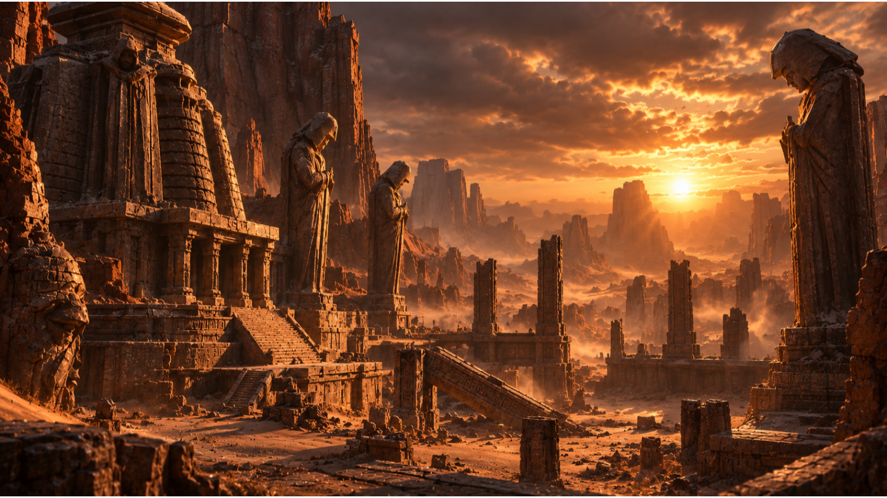</a><figcaption>@Image2 — exact ruined city</figcaption></figure></div>

**Что происходит:** Серёга идёт по руинам, внимательно осматривает древний город, замечает вход храма.

**Примечание к редакции (14.10.2026):** формат промта приведён к единому шаблону `PROMPT-STYLE-GUIDE` §5А (секции, START / END STATE, названные beats, `FRAME FILL / NO BARS`); смысл, референсы и тайминги прежние. Готовые ролики по задачам `e95f1bab9ab24f528b55fa58495d7adb` сделаны по прежней редакции текста; её дословная версия — в истории git (коммит перед «Unify prompt format of Scenes 30–34»). Результат сравнивать с фактически запущенным текстом.

<div class="engine-tabs" data-scene="33">

<div class="engine-pane" data-engine="wan30" data-main="1">

```text
Mode: reference-to-video | Duration: 30s | Resolution: 1080p | Aspect ratio: 16:9 | FPS: 24 | Native audio: on
Optimized for Wan 3.0 | Premium photoreal feature-film exploration, smooth camera | Atmospheric reconnaissance of a monumental ruined city

REFERENCES / AUTHORITY ORDER:
@Image1 — EXACT SEREGA identity (see CHARACTER APPEARANCE / IDENTITY LOCK).
@Image2 — EXACT Sith-planet stone city location from Scenes 26/27 (see LOCATION LOCK — CRITICAL).
Priority: @Image2 controls location, architecture and light direction. @Image1 controls identity and costume only.

CHARACTER APPEARANCE / IDENTITY LOCK:
SEREGA (@Image1): older pale Chancellor with a distinct mature face, thinning sparse light hair / bald crown, real human proportions, flowing deep dark-purple robe and fixed costume; do not average with other humans.

LOCATION LOCK — CRITICAL:
@Image2: ochre/red-brown ancient weathered masonry, colossal robed statues, broad stepped terraces, broken columns and tall squared stone towers, distant jagged canyon spires, low orange-gold sunset and dramatic layered clouds. Same planet and direction of light, not lava or a generic black Sith arena.

STORY LOCK — CRITICAL:
Atmospheric reconnaissance / investigation of a monumental place. Only Serega is visually present: no cats or additional figures. He is alive and thoughtfully observant, no spoken dialogue. Show only old architectural decay; no fresh battle damage from the duel.

START STATE:
Serega approaches slowly across a recognizable stepped stone terrace of the same city.

TIMELINE:
[0:00–0:06] — ARRIVAL ON THE TERRACE
Wide 28mm opening from a recognizable stepped stone terrace; one physically continuous lateral dolly reveals Serega approaching slowly through the giant ruin geometry. His robe and the wind are natural; no invisible teleporting.

[0:06–0:12] — SCANNING THE RUINS
Medium side tracking along a cracked carved balustrade as Serega scans ancient columns and far statues. His eyes lead the head turns, then his feet follow. He is wary and interested, not performing exaggerated fear.

[0:12–0:18] — THE EROSION MARK
Motivated over-shoulder view onto the same @Image2 sprawling ruin rooftops, massive temple façade, steps and distant spires. One ancient erosion mark catches his attention; no map, supernatural artifact or unrelated structure is conjured.

[0:18–0:24] — TOUCHING THE STONE
The camera performs a small physically credible quarter orbit as Serega climbs two real visible steps, touches weathered masonry with one hand and wipes off some fine dry dust. The damage and dust stay coherent.

[0:24–0:30] — THE TEMPLE ENTRANCE
From mid-wide over his shoulder the massive half-ruined temple entrance comes into line, still part of the original city. He hesitates, studies the silhouette against the orange light and deliberately starts toward it.

END STATE:
Serega walks toward the temple entrance with a clear approach direction, ready to continue into Scene 34.

CAMERA / SPACE:
One shared navigable stone environment, smooth stable 3D tracking, slow plausible parallax, no jump cuts or impossible speed ramp.

PERFORMANCE:
Wary, interested, thoughtful explorer; eyes lead, body follows. No exaggerated fear, no talking.

LIGHTING / MATERIALS:
High-end live-action face, purple cloth fibers, physically plausible setting sun and long warm shadows; drifting dry ash, thin dust and rare ember-like particles in the Scenes 26/27 mood without heavy volcanic fog.

AUDIO:
Boots crunching grit/stone, dry valley breeze, subtle robe rustle, slight stone crackle, natural breathing. No talk, voiceover or intrusive musical score.

NEGATIVE PROMPT:
wrong Serega, changed purple robe, cats appearing, duplicated humans, lava, black basalt, sudden interior cut, new fantastical building, unstable temple geometry, camera shake, face beauty filter, exaggerated magic, game render, subtitles, logo, watermark, borders.

FRAME FILL / NO BARS:
Fill the entire generated frame edge-to-edge. No letterboxing, no pillarboxing, no black bars, no side bars, no decorative borders, no empty margins.
```

</div>

<div class="engine-pane" data-engine="sd20x2">

Та же сцена двумя роликами по 15 с: сначала часть 1, часть 2 — после её результата (@Video1 части 2 = последние секунды части 1). Нумерация входов в каждой части своя.

**Входы части 1:** @Image1 — `references/full/serega.jpg`; @Image2 — `references/scenes/scene-27/S27-Image5-topview-source.png`.

*Часть 1: приход на террасу, осмотр, раскрытие города и замеченная метка эрозии.*

**Входы части 2:** @Video1 — последние секунды результата части 1; @Image1 — `references/full/serega.jpg`; @Image2 — `references/scenes/scene-27/S27-Image5-topview-source.png`.

*Часть 2: касание камня, вход храма в линию взгляда и решительный шаг к нему.*

#### 33 · Seedance 2.0 часть 1

```text
Mode: reference-to-video (omni-reference) | Duration: 15s | Resolution: 720p | Aspect ratio: 16:9 | FPS: 24 | Native audio: on
Optimized for Seedance 2.0 | Premium photoreal feature-film exploration with a moving, purposeful camera | Part 1 of 2: Serega strides into the monumental ruined Sith city, scans it, and an ancient erosion mark on the temple façade catches his eye

REFERENCES / AUTHORITY ORDER:
@Image1 — EXACT SEREGA identity and costume (see CHARACTER APPEARANCE / IDENTITY LOCK).
@Image2 — EXACT Sith-planet stone city location from Scenes 26/27 (see LOCATION LOCK — CRITICAL).
Priority: @Image2 controls location, architecture and light direction. @Image1 controls identity and costume only.

CHARACTER APPEARANCE / IDENTITY LOCK:
SEREGA (@Image1): older pale Chancellor with a distinct mature, full, round face, blue-grey eyes and a serious closed mouth; thinning sparse light hair at the sides with a bald crown; real human proportions, medium-heavy build. Floor-length deep dark-purple velvet robe with the large hood lying down on his shoulders, darker under-sleeves, dark shoes. Fixed costume; do not average with other humans.

LOCATION LOCK — CRITICAL:
@Image2: ochre/red-brown ancient weathered masonry, colossal robed statues, broad stepped terraces, broken columns and tall squared stone towers, distant jagged canyon spires, low orange-gold sunset and dramatic layered clouds. Same planet and direction of light, not lava or a generic black Sith arena.

STORY LOCK — CRITICAL:
Atmospheric reconnaissance / investigation of a monumental place. Only Serega is visually present: no cats or additional figures. He is alive and thoughtfully observant, no spoken dialogue. Show only old architectural decay; no fresh battle damage from the duel.

START STATE:
Serega approaches across a recognizable stepped stone terrace of the same city at a steady, purposeful walk, the colossal hooded statues and the low sun ahead of him.

TIMELINE:
[0:00–0:04] — ARRIVAL ON THE TERRACE
Wide 28mm low-angle opening: a fast lateral dolly with foreground rubble sliding past reveals Serega striding between the giant robed statues, robe hem sweeping the grit, dust lifting in the wind.

[0:04–0:08] — SCANNING THE RUINS
Cut on his stride to a medium side tracking shot along a cracked carved balustrade. He scans broken columns and distant statues: eyes lead, head follows, then the body turns. Face clearly readable in warm side light.

[0:08–0:12] — THE CITY OPENS UP
The camera cranes up over his shoulder as he reaches the terrace edge: the sprawling ruin rooftops, squared towers and canyon spires open up below in the sunset haze. He stops for one beat.

[0:12–0:15] — THE EROSION MARK
Motivated over-shoulder push toward the massive temple façade. One ancient erosion mark on a carved block a few steps below catches his attention; he turns sharply toward it and holds his gaze. No map or artifact appears.

END STATE:
Serega at the terrace edge, turned toward the temple façade, eyes fixed on one erosion mark on a carved block a few steps below him; sunset light from the same direction.

CAMERA / SPACE:
One shared navigable stone environment. Cuts only on movement, never jump cuts; consistent screen direction toward the temple side. Active but stable camera: low-angle lateral dolly, side tracking, crane-up reveal, over-shoulder push. Strong parallax from foreground columns and rubble; statues and towers never shift between shots. Face shown in medium shots with even light. No handheld shake, no teleporting.

PERFORMANCE:
Wary, interested, thoughtful explorer with energy in his walk: confident strides, decisive turns, focused eyes. Real weight transfer on uneven stone. No exaggerated fear, no talking.

LIGHTING / MATERIALS:
High-end live-action face, purple velvet catching the low sun, setting sun from the @Image2 direction with long warm shadows; drifting dry ash, thin dust and rare ember-like particles without heavy volcanic fog. Weathered ochre stone with chipped edges and sand in the joints.

AUDIO:
Boots crunching grit and stone in rhythm with his stride, dry valley breeze rising as the city opens up, robe rustle, natural breathing, distant wind through the towers. No talk, voiceover or intrusive score.

NEGATIVE PROMPT:
wrong Serega, face drift, changed purple robe, hood raised, cats appearing, other figures, duplicated humans, lightsaber, lava, black basalt, fresh battle damage, interior cut, new fantastical building, map or glowing artifact, statues moving, camera shake, jump cut, slow motion, beauty filter, game render, subtitles, logo, watermark, borders.

FRAME FILL / NO BARS:
Fill the entire generated frame edge-to-edge. No letterboxing, no pillarboxing, no black bars, no side bars, no decorative borders, no empty margins.
```

#### 33 · Seedance 2.0 часть 2

```text
Mode: reference-to-video (omni-reference) | Duration: 15s | Resolution: 720p | Aspect ratio: 16:9 | FPS: 24 | Native audio: on
Optimized for Seedance 2.0 | Premium photoreal feature-film exploration with a moving, purposeful camera | Part 2 of 2: Serega reaches the eroded stone, touches it, finds the half-ruined temple entrance and strides toward it

REFERENCES / AUTHORITY ORDER:
@Video1 — the last seconds of Part 1's result: Serega at the terrace edge looking down at an erosion mark on the temple façade. Absolute authority for the START STATE, his position, the light and the city layout.
@Image1 — EXACT SEREGA identity and costume (see CHARACTER APPEARANCE / IDENTITY LOCK).
@Image2 — EXACT Sith-planet stone city location from Scenes 26/27 (see LOCATION LOCK — CRITICAL).
Priority: @Video1 controls the start; @Image2 controls location, architecture and light direction; @Image1 controls identity and costume only.

CHARACTER APPEARANCE / IDENTITY LOCK:
SEREGA (@Image1): older pale Chancellor with a distinct mature, full, round face, blue-grey eyes and a serious closed mouth; thinning sparse light hair at the sides with a bald crown; real human proportions, medium-heavy build. Floor-length deep dark-purple velvet robe with the large hood lying down on his shoulders, darker under-sleeves, dark shoes. Fixed costume; do not average with other humans.

LOCATION LOCK — CRITICAL:
@Image2: ochre/red-brown ancient weathered masonry, colossal robed statues, broad stepped terraces, broken columns and tall squared stone towers, distant jagged canyon spires, low orange-gold sunset and dramatic layered clouds. Same planet and direction of light, not lava or a generic black Sith arena.

STORY LOCK — CRITICAL:
Atmospheric reconnaissance / investigation of a monumental place. Only Serega is visually present: no cats or additional figures. He is alive and thoughtfully observant, no spoken dialogue. Show only old architectural decay; no fresh battle damage from the duel.

START STATE:
Exactly the last frame of @Video1: Serega at the terrace edge, turned toward the temple façade, eyes on the erosion mark a few steps below.

TIMELINE:
[0:00–0:04] — DOWN TO THE MARK
Continuing @Video1 without a cut, he goes briskly down a short flight of worn steps toward the carved block, robe sweeping the stone; the camera follows at his shoulder.

[0:04–0:09] — TOUCHING THE STONE
Medium quarter orbit as he climbs two real visible steps, presses one hand to the weathered masonry and wipes off fine dry dust that drifts in the low sun. He studies the worn carving closely; damage and dust stay coherent.

[0:09–0:12] — THE TEMPLE ENTRANCE
Cut on his head turn to a mid-wide over his shoulder: the massive half-ruined temple entrance comes into line, part of the same city. He hesitates one breath and studies its dark silhouette against the orange light.

[0:12–0:15] — TOWARD THE TEMPLE
He deliberately strides toward the entrance; the camera follows behind him at walking pace, the dark doorway growing ahead.

END STATE:
Serega walks toward the temple entrance with a clear approach direction, ready to continue into Scene 34.

CAMERA / SPACE:
One shared navigable stone environment. Cuts only on movement, never jump cuts; consistent screen direction toward the temple. Active but stable camera: shoulder follow, quarter orbit, over-shoulder reveal, follow from behind. Strong parallax from foreground columns; temple geometry never shifts. Face shown in medium shots with even light. No handheld shake, no teleporting.

PERFORMANCE:
Wary, interested, thoughtful explorer with energy in his walk: decisive steps, a careful hand on the stone, one breath of hesitation, then resolve. Eyes lead, body follows. No exaggerated fear, no talking.

LIGHTING / MATERIALS:
High-end live-action face and hand, purple velvet catching the low sun, setting sun from the @Image2 direction with long warm shadows; the temple doorway dark against warm stone; drifting dry ash, thin dust and rare ember-like particles without heavy volcanic fog.

AUDIO:
Boots on worn steps and grit, the dry scrape of his palm on stone, a soft puff of dust, robe rustle, natural breathing, dry valley breeze. No talk, voiceover or intrusive score.

NEGATIVE PROMPT:
wrong Serega, face drift, changed purple robe, hood raised, cats appearing, other figures, duplicated humans, lightsaber, lava, black basalt, fresh battle damage, entering the temple, interior shot, new fantastical building, map or glowing artifact, unstable temple geometry, camera shake, jump cut, slow motion, beauty filter, game render, subtitles, logo, watermark, borders.

FRAME FILL / NO BARS:
Fill the entire generated frame edge-to-edge. No letterboxing, no pillarboxing, no black bars, no side bars, no decorative borders, no empty margins.
```

</div>

</div>

---

<a id="scene-36"></a>

## Сцена 36 — После пещеры: Серёга уходит с фрагментом карты

**⏳ В МЕДЛЕННОЙ ГЕНЕРАЦИИ**

<!-- scene-meta: {"target_engine":"Wan 3","production_state":"READY","duration_s":30,"dialogue":{"enabled":false,"language":null},"dependencies":[],"tags":["serega","pasha","sasha","naboo","cave","map","depart","continuity"]} -->

**Контекст использования:** Прямое продолжение Scene 17, которая уже в фильме (её Scene ID зарезервирован, поэтому связь в `dependencies` не пишется). Место в монтаже — стык около 51:52 после боя с монстром, перед блоком лесной пары. Сцена показывает расставание после вынужденного союза: Серёга молча уходит с единственным набусским фрагментом, Паша и Саша остаются на Набу. Карта — жёсткий светящийся модуль с референса сцены 17, не бумага. Транспорта и внешней местности нет: выход из пещеры — светлая водяная завеса, перелёт показан в Scene 37. Стартовый @Image6 — настоящий последний кадр канонического результата Scene 17 (task 67b8304f8a324b7493af32fd0a0ae5d7), извлечён и визуально проверен 16.10.2026: Паша слева, Серёга в центре держит модуль двумя руками, Саша справа. Это выбранный технический источник продолжения; точка обрезки в авторском монтаже отдельно не подтверждена. Технический результат не равен одобрению; запуск — только по команде владельца. Правка 14.10.2026 по решению владельца (вариант A, `reports/scenes-36-37-proposal-2026-10-14.md`).

**Референсы:** @Image1 — <a href="references/full/serega.jpg">Серёга</a>; @Image2 — <a href="references/full/pasha.jpg">Паша</a>; @Image3 — <a href="references/full/sasha.jpg">Саша</a>; @Image4 — <a href="references/scenes/scene-17/S17-Image4-topview-source.png">фрагмент карты, светящийся модуль</a>; @Image5 — <a href="references/scenes/scene-17/S17-post-battle-seated.png">пещера после боя, рассадка троих</a>; @Image6 — <a href="references/scenes/scene-36/S36-start-from-S17-result.png">настоящий последний кадр результата Scene 17</a>.

<div class="scene-ref-gallery">
<figure><a href="references/full/serega.jpg" target="_blank" rel="noopener"></a><figcaption>@Image1 — Серёга</figcaption></figure>
<figure><a href="references/full/pasha.jpg" target="_blank" rel="noopener"></a><figcaption>@Image2 — Паша</figcaption></figure>
<figure><a href="references/full/sasha.jpg" target="_blank" rel="noopener"></a><figcaption>@Image3 — Саша</figcaption></figure>
<figure><a href="references/scenes/scene-17/S17-Image4-topview-source.png" target="_blank" rel="noopener">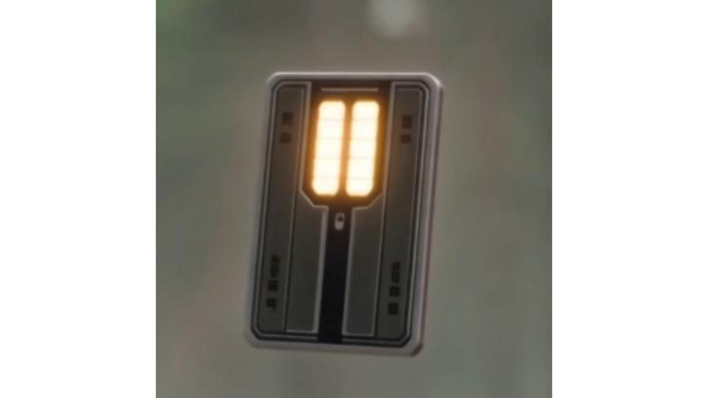</a><figcaption>@Image4 — модуль карты</figcaption></figure>
<figure><a href="references/scenes/scene-17/S17-post-battle-seated.png" target="_blank" rel="noopener">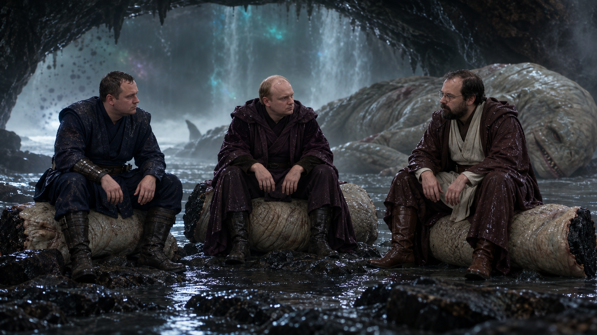</a><figcaption>@Image5 — пещера после боя</figcaption></figure></div>

**Новые опорные кадры · 14.10.2026:** постановочные helpers проверены ChatGPT; индивидуальные model sheets и фактические монтажные входы имеют приоритет. Это не одобрение владельца и не подмена последних кадров.

<div class="scene-ref-gallery">
<figure><a href="references/scenes/scene-36/S36-waterfall-exit-helper.png" target="_blank" rel="noopener">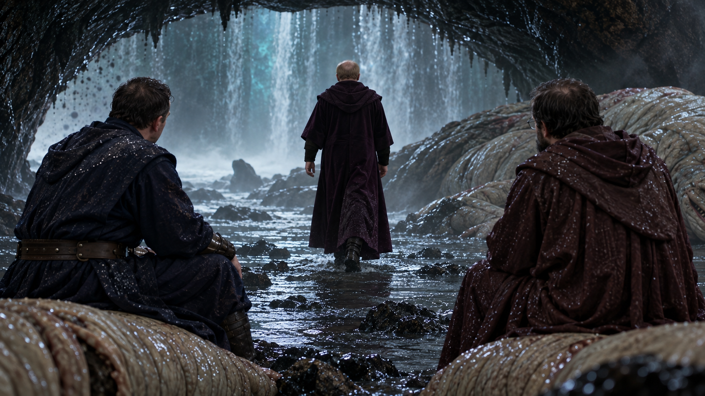</a><figcaption>Серёга у водяной завесы, двое остаются сидеть; модуль спрятан.</figcaption></figure>
</div>

<div class="scene-ref-gallery">
<figure><a href="references/scenes/scene-36/S36-start-from-S17-result.png" target="_blank" rel="noopener">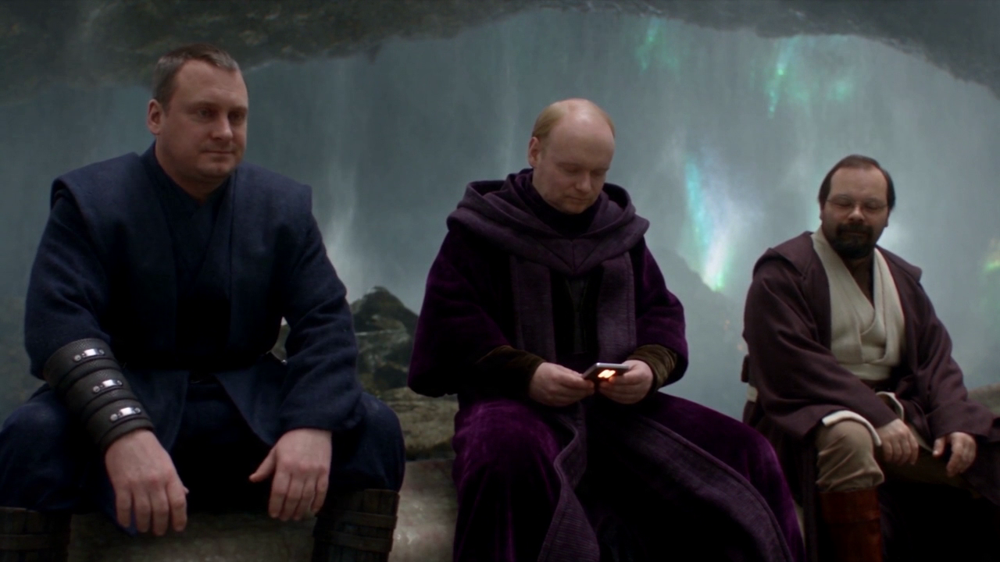</a><figcaption>@Image6 — настоящий финал Scene 17; старт Scene 36</figcaption></figure>
</div>

**Что происходит:** Серёга прячет полученный модуль под робу, молча кивает Паше и Саше и уходит по мокрым камням в глубь пещеры, к светлой водяной завесе. Паша и Саша остаются сидеть на останках монстра и провожают его взглядом.

<div class="engine-tabs" data-scene="36">

<div class="engine-pane" data-engine="wan30" data-main="1">

```text
Mode: reference-to-video | Duration: 30s | Resolution: 1080p | Aspect ratio: 16:9 | FPS: 24 | Native audio: on
Optimized for Wan 3.0 | Photoreal live-action cinema | Deadpan quiet departure: Serega leaves the post-battle cavern with the single map module

REFERENCES / AUTHORITY ORDER:
@Image6 — the genuine final frame of the canonical Scene 17 result in this same cavern. This image is the absolute start authority: positions of the three seated men, which hand holds the map module, camera side, water level, light and the inert monster remains.
@Image5 — the same post-battle cavern and seating arrangement: Pasha seated screen-left, Serega centre, Sasha screen-right, each on a separate severed pale section of the dead monster; wet black rocks and shallow water in front; the huge inert monster carcass lying behind on the right; a bright misty curtain of falling water at the back of the cave. It controls location geometry and composition if @Image6 is ambiguous.
@Image4 — the exact map module prop.
@Image1, @Image2, @Image3 — identity sheets for Serega, Pasha and Sasha.
Priority: @Image6 controls the first frame and positions; @Image5 controls cave geometry; @Image4 controls the prop; @Image1–@Image3 control faces and costumes only. No reference may add a fourth person or revive the monster.

CHARACTER APPEARANCE / IDENTITY LOCK:
@Image1 is the absolute visual authority for SEREGA (the Chancellor): pale older man, sparse light hair with a bald crown, mature serious face, long deep dark-purple robe with hood lowered, soaked and darkened by water.
@Image2 is the absolute visual authority for PASHA: clean-shaven man, dark navy-blue Jedi tunic, brown belt, dark trousers, high boots, leather bracer, soaked and battle-worn.
@Image3 is the absolute visual authority for SASHA: bearded man with round glasses, cream inner tunic, dark burgundy-brown robe, brown boots, soaked and battle-worn.
Three clearly different men; no face blending, no costume swaps, no added armour or jewellery.

PROP LOCK — CRITICAL:
The map is ONE small rigid palm-sized rectangular module from @Image4: rounded grey metal frame, dark-grey face, two vertical warm-amber glowing segmented panels in the upper middle, a black central stripe with a tiny lock-like mark, small dark markings at the corners. It never folds, bends, unrolls, duplicates, becomes paper, a disk or a hologram. Exactly one module exists in this scene.

CAVE / CONTINUITY LOCK:
The monster is dead and stays completely inert; its cut surfaces are dark and cauterized, no fresh blood. Pasha and Sasha stay seated on their own sections for the whole take and do not follow. No exterior landscape, vehicle or sky is revealed: the cave exit is only the bright misty water curtain at the back.

START STATE:
Match @Image6 exactly: all three seated and exhausted, Serega in the centre holding the single module between both hands, Pasha on the left, Sasha on the right, wet clothes, shallow water, mist.

TIMELINE:
[0:00–0:06] — THE MODULE SECURED
Hold the established three-shot. Serega looks down at the module; its amber panels glow softly on his wet fingers. He slides it calmly into an inner fold of his robe at the chest; the glow disappears under the cloth. Pasha and Sasha watch silently.

[0:06–0:12] — SEREGA RISES
Serega plants his boots on the wet stone and stands up from his monster section with tired, careful weight. He gives Pasha a small serious nod, then Sasha the same. Pasha answers with a minimal nod; Sasha glances at Pasha with a restrained "what was that about?" look. No words.

[0:12–0:20] — WALKING AWAY
Serega turns his back to the camera and walks upstage between the two seated men, along the wet rocky edge of the shallow water, past the dead carcass. The camera stays on its established frontal side and slowly pushes forward between Pasha and Sasha, keeping both seated in the foreground.

[0:20–0:26] — TOWARD THE LIGHT
Serega reaches the back of the cave; the bright curtain of falling water fills the background with cool misty light. His dark-purple silhouette becomes smaller and backlit; spray drifts around him.

[0:26–0:30] — THE PARTING IMAGE
Serega stops for one beat at the edge of the water curtain, a dark silhouette in the glow, then steps forward into the bright mist. In the foreground Pasha and Sasha remain seated on the monster sections, looking after him.

END STATE:
Serega is a backlit silhouette entering the bright water curtain at the back of the cave, the single module hidden in his robe; Pasha and Sasha remain seated in the foreground on separate monster sections; the monster stays dead. Clean cut point to a departure scene.

CAMERA / SPACE:
One continuous take, 35 mm natural perspective, slow push-in from the established frontal three-shot between the two seated men; no cuts, no orbit, no camera shake. Stable screen positions: Pasha left, Sasha right, the water curtain at the back. Real cave scale; the walk is a few dozen metres, no new tunnels or staircases.

PERFORMANCE:
Adult, restrained, physically tired after a hard fight. Serega is calm and purposeful, almost formal; Pasha is resigned; Sasha is quietly puzzled. Play it completely straight: nobody comments on sitting on monster pieces, nobody laughs or looks into the camera.

LIGHTING / MATERIALS:
Cool humid bounce light, glistening wet rock and soaked fabric, pale cauterized monster skin, drifting spray and mist. The water curtain is the brightest area of the frame and gradually rims Serega's silhouette. The module's amber glow is small and warm and is visible only before he hides it.

AUDIO:
Steady roar of falling water growing louder as Serega approaches it, dripping, wet footsteps on stone, soft heavy robe rustle, tired breathing. No dialogue, whisper, narrator or music.

NEGATIVE PROMPT:
folded paper map, scroll, second module, glowing hologram, map floating, Pasha or Sasha standing up or following, extra people, cats, resurrected or moving monster, fresh blood, gore, new combat, lightsabers ignited, spaceship, vehicle, exterior landscape, sunny sky, staircase, teleport, jump cut, changed faces, missing glasses on Sasha, dry clothes, comedy mugging, subtitles, text, logo, watermark, black bars.

FRAME FILL / NO BARS:
Fill the entire generated frame edge-to-edge. No letterboxing, no pillarboxing, no black bars, no side bars, no decorative borders, no empty margins.
```

</div>

<div class="engine-pane" data-engine="sd20x2">

Та же сцена двумя роликами по 15 с: сначала часть 1, часть 2 — после её результата (@Video1 части 2 = последние секунды части 1). Нумерация входов в каждой части своя.

**Входы части 1:** @Image1 — `references/full/serega.jpg`; @Image2 — `references/full/pasha.jpg`; @Image3 — `references/full/sasha.jpg`; @Image4 — `references/scenes/scene-17/S17-Image4-topview-source.png`; @Image5 — `references/scenes/scene-17/S17-post-battle-seated.png`; @Image6 — `references/scenes/scene-36/S36-start-from-S17-result.png`.

*Часть 1: модуль спрятан, Серёга встаёт, кивки и реакции, уходит между сидящими; старт — настоящий финал Scene 17 (@Image6).*

**Входы части 2:** @Video1 — последние секунды результата части 1; @Image1 — `references/full/serega.jpg`; @Image2 — `references/full/pasha.jpg`; @Image3 — `references/full/sasha.jpg`; @Image4 — `references/scenes/scene-17/S17-Image4-topview-source.png`; @Image5 — `references/scenes/scene-17/S17-post-battle-seated.png`.

*Часть 2: проход мимо туши к водяной завесе и уход в туман; старт строго от конца части 1.*

#### 36 · Seedance 2.0 часть 1

```text
Mode: reference-to-video (omni-reference) | Duration: 15s | Resolution: 720p | Aspect ratio: 16:9 | FPS: 24 | Native audio: on
Optimized for Seedance 2.0 | Photoreal live-action cinema, deadpan quiet departure | Part 1 of 2: Serega hides the single map module, rises, nods to Pasha and Sasha and strides off between them

REFERENCES / AUTHORITY ORDER:
@Image6 — the genuine final frame of the canonical Scene 17 result in this same cavern. This image is the absolute start authority: positions of the three seated men, which hand holds the map module, camera side, water level, light and the inert monster remains.
@Image5 — the same post-battle cavern and seating arrangement: Pasha seated screen-left, Serega centre, Sasha screen-right, each on a separate severed pale section of the dead monster; wet black rocks and shallow water in front; the huge inert monster carcass lying behind on the right; a bright misty curtain of falling water at the back of the cave. It controls location geometry and composition if @Image6 is ambiguous.
@Image4 — the exact map module prop.
@Image1, @Image2, @Image3 — identity sheets for Serega, Pasha and Sasha.
Priority: @Image6 controls the first frame and positions; @Image5 controls cave geometry; @Image4 controls the prop; @Image1–@Image3 control faces and costumes only. No reference may add a fourth person or revive the monster.

CHARACTER APPEARANCE / IDENTITY LOCK:
@Image1 is the absolute visual authority for SEREGA (the Chancellor): pale older man, sparse light hair with a bald crown, mature serious face, long deep dark-purple robe with hood lowered, soaked and darkened by water.
@Image2 is the absolute visual authority for PASHA: clean-shaven man, dark navy-blue Jedi tunic, brown belt, dark trousers, high boots, leather bracer, soaked and battle-worn.
@Image3 is the absolute visual authority for SASHA: bearded man with round glasses, cream inner tunic, dark burgundy-brown robe, brown boots, soaked and battle-worn.
Three clearly different men; no face blending, no costume swaps, no added armour or jewellery.

PROP LOCK — CRITICAL:
The map is ONE small rigid palm-sized rectangular module from @Image4: rounded grey metal frame, dark-grey face, two vertical warm-amber glowing segmented panels in the upper middle, a black central stripe with a tiny lock-like mark, small dark markings at the corners. It never folds, bends, unrolls, duplicates, becomes paper, a disk or a hologram. Exactly one module exists in this scene.

CAVE / CONTINUITY LOCK:
The monster is dead and stays completely inert; its cut surfaces are dark and cauterized, no fresh blood. Pasha and Sasha stay seated on their own sections for the whole take and do not follow. No exterior landscape, vehicle or sky is revealed: the cave exit is only the bright misty water curtain at the back.

START STATE:
Match @Image6 exactly: all three seated and exhausted, Serega in the centre holding the single module between both hands, Pasha on the left, Sasha on the right, wet clothes, shallow water, mist.

TIMELINE:
[0:00–0:04] — THE MODULE SECURED
The established three-shot from @Image6. Serega looks down at the module; its amber panels glow on his wet fingers. Cut on movement to a close insert: one decisive motion slides it into an inner fold of his robe at the chest; the glow vanishes under the cloth.

[0:04–0:08] — SEREGA RISES
Low medium angle: Serega plants his boots on the wet stone and stands up from his monster section in one tired, firm push, water dripping from the robe hem. He gives Pasha one small serious nod, then Sasha the same. Face readable in even, soft light.

[0:08–0:11] — THE REACTIONS
Quick matched medium shots: Pasha answers with a minimal nod; Sasha glances at Pasha with a restrained "what was that about?" look behind his round glasses. No words.

[0:11–0:15] — HE GOES
Back in the frontal three-shot, Serega turns his back to the camera and strides upstage between the two seated men toward the wet rocky edge of the shallow water. Hold as he walks a few paces past them toward the distant bright water curtain.

END STATE:
Frontal three-shot: Pasha seated screen-left and Sasha seated screen-right in the foreground on their monster sections, both looking after Serega, who walks away from camera a few paces upstage between them, back turned, the single module hidden in his robe; the inert carcass on the right; the bright water curtain at the back.

CAMERA / SPACE:
Start exactly on the @Image6 framing; motivated cuts on movement only: module insert, low medium on Serega rising, matched reaction mediums, then the frontal three-shot for the walk-off. 35 mm, steady glide, no orbit, no handheld shake. Stable geography: Pasha left, Sasha right, the water curtain at the back.

PERFORMANCE:
Restrained and tired after a hard fight; Serega moves with clear purpose and almost formal economy. Pasha is resigned; Sasha is quietly puzzled. Completely straight: nobody laughs or looks into the camera.

LIGHTING / MATERIALS:
Cool humid bounce light, glistening wet rock and soaked fabric, pale cauterized monster skin, drifting spray and mist. The water curtain is the brightest area at the back. The module's small warm amber glow is visible only before he hides it.

AUDIO:
Distant roar of falling water, dripping, wet footsteps on stone, heavy robe rustle, tired breathing. No dialogue, whisper, narrator or music.

NEGATIVE PROMPT:
folded paper map, scroll, second module, glowing hologram, map floating, Pasha or Sasha standing up or following, extra people, cats, resurrected or moving monster, fresh blood, gore, new combat, lightsabers ignited, spaceship, vehicle, exterior landscape, sunny sky, teleport, jump cut, slow motion, changed faces, missing glasses on Sasha, dry clothes, comedy mugging, subtitles, text, logo, watermark, black bars.

FRAME FILL / NO BARS:
Fill the entire generated frame edge-to-edge. No letterboxing, no pillarboxing, no black bars, no side bars, no decorative borders, no empty margins.
```

#### 36 · Seedance 2.0 часть 2

```text
Mode: reference-to-video (omni-reference) | Duration: 15s | Resolution: 720p | Aspect ratio: 16:9 | FPS: 24 | Native audio: on
Optimized for Seedance 2.0 | Photoreal live-action cinema, deadpan quiet departure | Part 2 of 2: Serega crosses the cavern past the dead carcass and disappears into the bright water curtain while Pasha and Sasha stay seated

REFERENCES / AUTHORITY ORDER:
@Video1 — the last seconds of Part 1's result: Serega walking away upstage between Pasha and Sasha, who sit on their monster sections in the foreground. Absolute authority for the START STATE, positions, camera side, water level and light.
@Image5 — the same post-battle cavern: wet black rocks and shallow water, the huge inert monster carcass lying on the right, a bright misty curtain of falling water at the back of the cave. Location geometry only; positions follow @Video1.
@Image4 — the exact map module prop; here it stays hidden inside Serega's robe.
@Image1, @Image2, @Image3 — identity sheets for Serega, Pasha and Sasha.
Priority: @Video1 controls the start and positions; @Image5 controls cave geometry; @Image4 controls the prop; @Image1–@Image3 control faces and costumes only. No reference may add a fourth person or revive the monster.

CHARACTER APPEARANCE / IDENTITY LOCK:
@Image1 is the absolute visual authority for SEREGA (the Chancellor): pale older man, sparse light hair with a bald crown, mature serious face, long deep dark-purple robe with hood lowered, soaked and darkened by water.
@Image2 is the absolute visual authority for PASHA: clean-shaven man, dark navy-blue Jedi tunic, brown belt, dark trousers, high boots, leather bracer, soaked and battle-worn.
@Image3 is the absolute visual authority for SASHA: bearded man with round glasses, cream inner tunic, dark burgundy-brown robe, brown boots, soaked and battle-worn.
Three clearly different men; no face blending, no costume swaps, no added armour or jewellery.

PROP LOCK — CRITICAL:
The map is ONE small rigid palm-sized rectangular module from @Image4: rounded grey metal frame, dark-grey face, two vertical warm-amber glowing segmented panels in the upper middle, a black central stripe with a tiny lock-like mark, small dark markings at the corners. It never folds, bends, unrolls, duplicates, becomes paper, a disk or a hologram. Exactly one module exists in this scene.

CAVE / CONTINUITY LOCK:
The monster is dead and stays completely inert; its cut surfaces are dark and cauterized, no fresh blood. Pasha and Sasha stay seated on their own sections for the whole take and do not follow. No exterior landscape, vehicle or sky is revealed: the cave exit is only the bright misty water curtain at the back.

START STATE:
Exactly the last frame of @Video1: Serega a few paces upstage between the two seated men, back to camera, walking toward the back of the cave; the module already hidden in his robe; Pasha seated left, Sasha seated right in the foreground.

TIMELINE:
[0:00–0:05] — WALKING AWAY
Continuing @Video1 without a cut, Serega strides along the wet rocky edge of the shallow water, past the dead carcass. The camera tracks forward low behind him at boot height, splashes kicking up from each step, then rises as it passes between Pasha and Sasha, keeping both seated in the foreground.

[0:05–0:10] — TOWARD THE LIGHT
Wide from behind: Serega reaches the back of the cave; the bright curtain of falling water fills the background with cool misty light. His dark-purple silhouette shrinks and becomes backlit; spray swirls around him and the roar swells.

[0:10–0:15] — THE PARTING IMAGE
Serega stops for one beat at the edge of the water curtain, a dark silhouette in the glow, then steps forward into the bright mist and is gone. In the foreground Pasha and Sasha remain seated on the monster sections, looking after him. Hold.

END STATE:
Serega is a backlit silhouette entering the bright water curtain at the back of the cave, the single module hidden in his robe; Pasha and Sasha remain seated in the foreground on separate monster sections; the monster stays dead. Clean cut point to a departure scene.

CAMERA / SPACE:
First beat continues @Video1 without a cut as a low forward tracking shot that rises between the seated men; then one cut on movement to the wide backlit view for the finish. 35 mm natural perspective, steady glide, no orbit, no shaky handheld. Stable geography: Pasha left, Sasha right, the water curtain at the back. Real cave scale: the walk is a few dozen metres, no new tunnels or staircases. The two seated men stay recognisable in the foreground; Serega reads as a silhouette at distance.

PERFORMANCE:
Serega walks with clear purpose and almost formal economy, tired but steady. Pasha is resigned; Sasha is quietly puzzled. Completely straight: nobody laughs or looks into the camera.

LIGHTING / MATERIALS:
Cool humid bounce light, glistening wet rock and soaked fabric, pale cauterized monster skin, drifting spray and mist. The water curtain is the brightest area of the frame and gradually rims Serega's silhouette. No module glow in this part.

AUDIO:
Steady roar of falling water swelling as Serega approaches it, dripping, splashing wet footsteps on stone, soft heavy robe rustle. No dialogue, whisper, narrator or music.

NEGATIVE PROMPT:
module visible again, glowing hologram, paper map, Pasha or Sasha standing up or following, extra people, cats, resurrected or moving monster, fresh blood, gore, new combat, lightsabers ignited, spaceship, vehicle, exterior landscape, sunny sky, staircase, tunnel, teleport, jump cut, slow motion, changed faces, missing glasses on Sasha, dry clothes, comedy mugging, subtitles, text, logo, watermark, black bars.

FRAME FILL / NO BARS:
Fill the entire generated frame edge-to-edge. No letterboxing, no pillarboxing, no black bars, no side bars, no decorative borders, no empty margins.
```

</div>

</div>

---

<a id="scene-37"></a>

## Сцена 37 — Отлёт Серёги с Набу к лесной планете

<!-- scene-meta: {"target_engine":"Seedance 2.0","production_state":"READY","duration_s":30,"dialogue":{"enabled":false,"language":null},"dependencies":[{"type":"continues","scene":36}],"tags":["serega","travel","naboo","forest_planet","map","bread_and_milk","continuity"]} -->

**Контекст использования:** Следует за Scene 36 через монтажную склейку. Показывает, что Канцлер с фрагментами Татуина и Набу (в кадре — один модуль) летит на лесную планету — стык перед существующим блоком «корабль другой пары, лесная планета, посадка» (около 51:52). Сцена **не** стыкуется с кадрами лесной пары и не показывает посадку: на Кашиике Серёга впервые появляется в готовом эпизоде с грибами (57:45). Корабль — собственный корабль Канцлера из начала фильма (ч. 1, 09:20–09:55 «Люк, кабина, прибытие»), а не корабль Виталика и Лёши; взлёт — с того же берега у брошенной стоянки рыбаков, где корабль сел в Scene 39 (правка владельца 17.10, 23:58: @Image3 — настоящий кадр берега из 39 вместо пейзажа из 19, рядом в кадре те же ящики с рыбой). Решения владельца 14.10.2026: в кабине бытовое напоминание «хлеб и молоко» (стикер-рисунок без надписей — отсылка к просьбе из начала фильма «По пути купи хлеба и молока», линия W13); модуль «указывает» на лесную планету — светится ярче, когда направлен на неё. По прямой команде владельца 15.10 создан отдельный вид лесной планеты из космоса — @Image6. Это новый AI-референс по зелёно-синей палитре доступной версии фильма, а не извлечённый установочный кадр: в исходной части 2 планета видна частично через окно около 21:14, лесная посадка — около 21:28. Таймкоды старой копии и позднего монтажного разбора не взаимозаменяемы. В монтаж достаточно ~10–15 с. Для бесплатного запуска подготовлены шесть изображений: identity, модуль, Набу, настоящий корпус, настоящая кабина и созданная планета. Видеовходы заменены явно перечисленными изображениями; геометрия корабля берётся из настоящих кадров. Запуск — только по команде владельца. Правка 14.10.2026, вариант A (`reports/scenes-36-37-proposal-2026-10-14.md`). **Динамика (владелец 18.10.2026):** сцена переписана активнее — бреющий проход над озером и штопор вертикально сквозь грозовую тучу с молниями. Версии промта — во вкладках над промтом (30 с · Wan 3.0 / Seedance 2.5 и Seedance 2.0 · 2 × 15 с); версию, которую запускает очередь, отмечает «★ в очереди».

**Референсы:** @Image1 — <a href="references/full/serega.jpg">Серёга</a>; @Image2 — <a href="references/scenes/scene-17/S17-Image4-topview-source.png">фрагмент карты, светящийся модуль</a>; @Image3 — <a href="references/scenes/scene-39/S39-shore-film-part2-14m27s.png">настоящий берег Набу, где Серёга сел в 39, ч. 2 14:27</a> (только место; двух бегущих не переносить); @Image4 — <a href="references/scenes/scene-37/S37-ship-source-part1-09m03s.png">корпус корабля Канцлера, ч. 1 09:03</a>; @Image5 — <a href="references/scenes/scene-37/S37-cockpit-source-part1-09m25s.png">геометрия кабины, ч. 1 09:25</a> (без боя и посторонних); @Image6 — <a href="references/scenes/scene-37/S37-forest-planet-reference.png">новый референс лесной планеты</a>.

<div class="scene-ref-gallery">
<figure><a href="references/full/serega.jpg" target="_blank" rel="noopener"></a><figcaption>@Image1 — Серёга</figcaption></figure>
<figure><a href="references/scenes/scene-17/S17-Image4-topview-source.png" target="_blank" rel="noopener"></a><figcaption>@Image2 — модуль карты</figcaption></figure>
<figure><a href="references/scenes/scene-39/S39-shore-film-part2-14m27s.png" target="_blank" rel="noopener">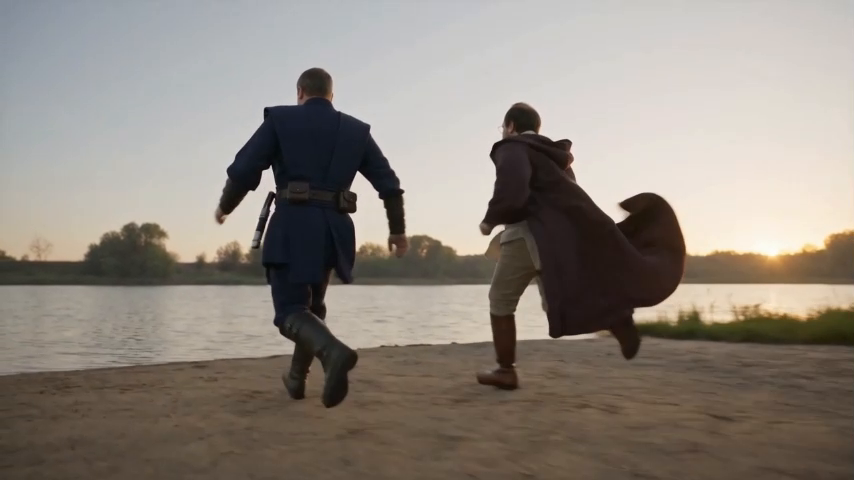</a><figcaption>@Image3 — берег Набу, место посадки в 39</figcaption></figure></div>

**Новые опорные кадры · 14.10.2026:** постановочные helpers проверены ChatGPT; индивидуальные model sheets и фактические монтажные входы имеют приоритет. Это не одобрение владельца и не подмена последних кадров.

<div class="scene-ref-gallery">
<figure><a href="references/scenes/scene-37/S37-cockpit-bread-milk-helper.png" target="_blank" rel="noopener">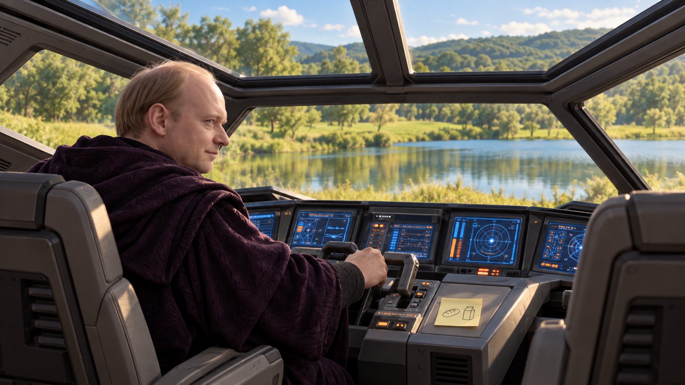</a><figcaption>Кабина с Серёгой и рисунками хлеба и молока; модельный лист приоритетнее helper.</figcaption></figure>
<figure><a href="references/scenes/scene-37/S37-lakeside-takeoff-helper.png" target="_blank" rel="noopener">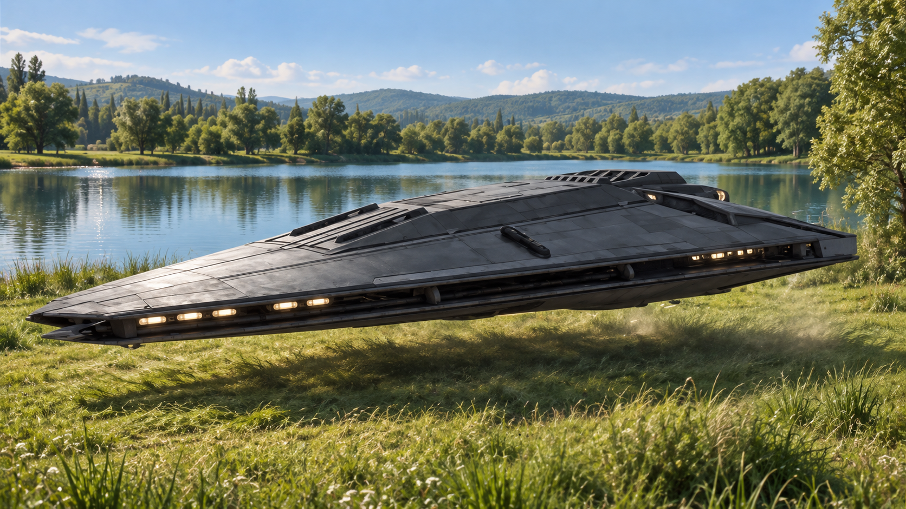</a><figcaption>Взлёт того же плоского корабля у озера; корпус из ч. 1 09:03.</figcaption></figure>
<figure><a href="references/scenes/scene-37/S37-cockpit-source-part1-09m25s.png" target="_blank" rel="noopener">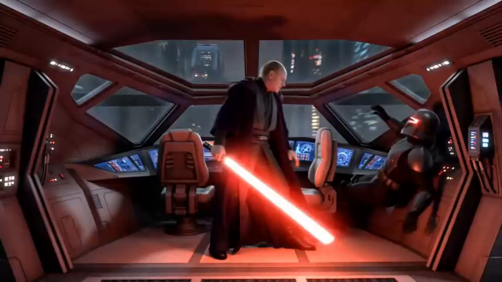</a><figcaption>Фактический кадр ч. 1, 09:25: только геометрия кабины; бой и посторонних не переносить.</figcaption></figure>
<figure><a href="references/scenes/scene-37/S37-ship-source-part1-09m03s.png" target="_blank" rel="noopener">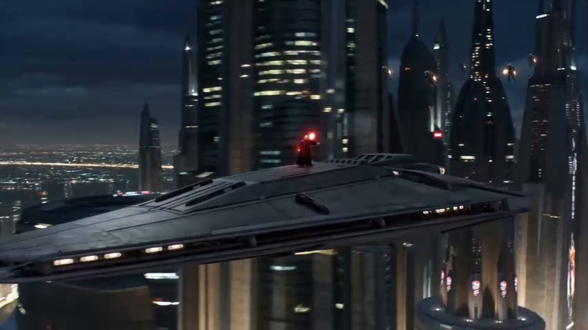</a><figcaption>Фактический кадр ч. 1, 09:03: только корпус корабля.</figcaption></figure>
</div>

[Скачать @Video1 — фактический отрывок ч. 1, 09:20–09:55](https://drive.google.com/file/d/1CLUP8dSgb0XsISVIsd8t5KZ_oCQZ_x_m/view). Архивный источник геометрии; в текущий запуск не загружается, вместо него используются реальные кадры @Image4 и @Image5.

<div class="scene-ref-gallery">
<figure><a href="references/scenes/scene-37/S37-forest-planet-reference.png" target="_blank" rel="noopener">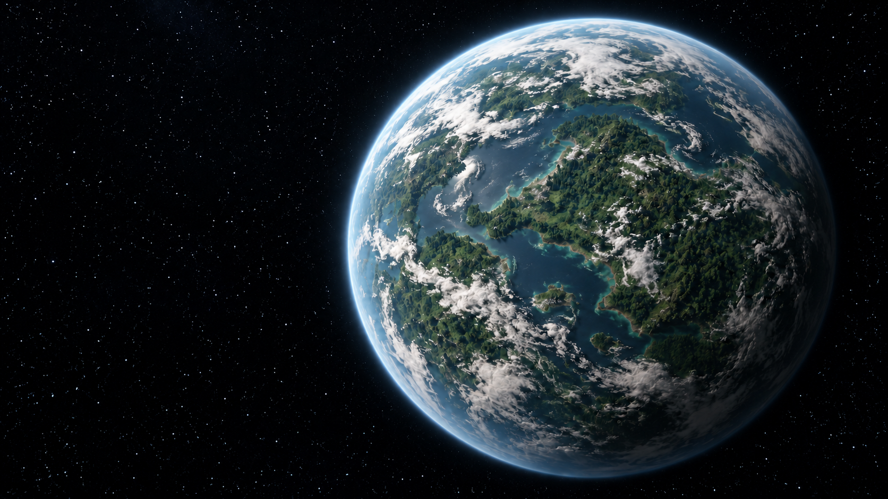</a><figcaption>@Image6 — лесная планета, новый созданный референс</figcaption></figure>
</div>

**Напоминание «хлеб и молоко» · 17.10,23:03:** один и тот же бледно-жёлтый стикер справа от пилота: чёрный рисунок батона слева и пакета молока справа. В каждом перелёте удержать оба рисунка различимыми примерно2секунды; монтаж должен сохранить этот момент. В52 зритель впервые ясно замечает записку, в37 Серёга сам замечает её и откладывает мысль, в41 она остаётся перед глазами, пока он занят компьютером. Это подводит к уже запущенной55 без новой реплики или вставки в финале.

**Что происходит:** Серёга один в кабине своего корабля, бросает взгляд на стикер с нарисованными хлебом и молоком, коротко выдыхает и резко даёт газ. Корабль срывается с того же берега у брошенной стоянки, где сел в 39, низко проносится над лугом и озером, поднимая брызги, затем штопором уходит вертикально вверх сквозь грозовую тучу с молниями и вырывается в космос. Там Серёга достаёт модуль — направленный на далёкую лесную планету, он светится ярче, — и корабль рывком уходит к ней; сцена заканчивается в космосе, до входа в атмосферу.

<div class="engine-tabs" data-scene="37">

<div class="engine-pane" data-engine="wan30" data-main="1">

```text
Mode: reference-to-video | Duration: 30s | Resolution: 1080p | Aspect ratio: 16:9 | FPS: 24 | Native audio: on
Optimized for Wan 3.0 | Photoreal live-action space-opera action cinema | Serega blasts off the Naboo lakeshore, rips a low pass over the lake, corkscrews up through a thunderhead, and the map module points him to a distant forest planet

REFERENCES / AUTHORITY ORDER:
@Image4 — genuine film frame of Serega's own craft: exact flat wedge-shaped dark-grey hull, colour, proportions and engines. Vehicle design only; the city and the person on its roof are not part of the shot.
@Image5 — genuine film frame of the same craft's cockpit: exact seats, windows, controls and layout. Interior geometry only; do not import the fight, people, poses or weapons in it.
@Image1 — absolute identity of SEREGA.
@Image2 — the exact map module prop.
@Image3 — genuine film frame of the exact Naboo lakeshore where Serega landed earlier: sandy bank, grass edges, treeline and water geometry. Location layout only; the two runners are NOT part of the shot, and its low evening sun is replaced by bright clear daylight.
@Image6 — the created destination-planet reference: blue-green globe, dense green forested continents, white cloud bands, thin blue atmosphere. Planet design only; show it small and distant, not at the reference's large framing.
Priority: @Image4 controls the hull; @Image5 controls the cockpit; @Image1 controls Serega's face and costume; @Image2 controls the prop; @Image3 controls the lakeshore; @Image6 controls the destination planet.

CHARACTER APPEARANCE / IDENTITY LOCK:
@Image1 is the absolute visual authority for SEREGA (the Chancellor): pale older man, sparse light hair with a bald crown, mature serious face, long deep dark-purple robe, still damp and darker at the hem after the cave. He is the only person in the frame. No pilot droid, co-pilot, cats or other Jedi. His face appears only in the cockpit, in medium shots with even light; never a tiny blurred face during the fast flight.

PROP LOCK — CRITICAL:
Exactly ONE small rigid palm-sized rectangular map module from @Image2: rounded grey metal frame, dark-grey face, two vertical warm-amber glowing segmented panels. It comes out of the inner fold of his robe and goes back there. When its face is turned toward the destination planet, the two amber panels brighten and pulse rhythmically; turned away, they dim to a soft glow. It never folds, multiplies, projects a hologram, shows a map image or becomes a screen.
BREAD-AND-MILK NOTE: exactly one palm-sized pale-yellow square sticky note, with two simple black line drawings: a loaf on the left and a milk carton on the right; no letters, words or numbers. It stays on the same blank sloping console panel immediately to the pilot's right, beside the controls, never on a screen. Preserve its size, colour, drawings and position in every cockpit shot. Keep it unobstructed and in focus long enough to recognise both groceries; no actual bread or milk aboard.

VEHICLE / TRAVEL LOCK — CRITICAL:
One and the same craft from @Image4 in every exterior shot: same silhouette, colour, engine glow and scale; its single side hatch with a short fold-down boarding ramp stays closed. Fast, skilled, physically credible flying: one take-off, one low pass, one corkscrew climb through one thunderhead, one burst of acceleration in space. It rolls around its long axis but never tumbles, is never struck by lightning and takes no damage. No landing, no atmospheric entry at the destination, no forest ground, no other ships, no space battle.

START STATE:
Serega is already seated alone at the controls inside the cockpit from @Image5, the module hidden in his robe, the craft resting on the grassy lakeshore of @Image3, lake and treeline visible through the window. A few metres away lies the abandoned fishing camp from his arrival: two fish-filled crates and dropped fishing rods, nobody there. Over the far end of the lake a single towering thunderhead rises into the bright sky.

TIMELINE:
[0:00–0:04] — THE NOTE AND THE THROTTLE
Medium cockpit shot of Serega with the note beside his hand, even light on his face. The note is sharply readable for the first two seconds while his eyes stop on its drawings. A tiny, utterly serious resigned exhale through the nose; he snaps both hands onto the controls and shoves the throttle forward. Instrument lights flare on.

[0:04–0:09] — LIFT-OFF AND LOW PASS
Hard cut to grass level beside the fish crates: the craft lifts off, tucks its gear and, nose dipped, rips forward left-to-right a few metres above the meadow and then the lake. Its wash flattens the grass in a racing wave, the crates rattle, a long spray trail tears off the water. The camera whip-pans with it as it roars past.

[0:09–0:14] — PULL-UP INTO THE STORM
Wide from behind and below: over the far end of the lake the craft pulls up almost vertically, starts a tight corkscrew climb, rolling around its own long axis, and punches into the dark wall of the thunderhead. A first lightning flash lights the cloud from inside.

[0:14–0:20] — CORKSCREW THROUGH THE THUNDERHEAD
Inside the storm the rolling silhouette spirals upward past the camera through churning cloud; branching lightning freezes its shape for an instant, rain streaks off the hull. It bursts out of the top of the anvil into blinding sunlight above a sea of white cloud, the sky darkening ahead.

[0:20–0:25] — THE MODULE POINTS THE WAY
Back in the cockpit after one clean time-compression cut: open space outside, a small distant green forest planet in the front window, the note still on its panel. Medium shot, even light. Serega whips the module out of his robe and holds it up; facing the planet, its amber panels brighten and pulse. One curt nod, one sharp heading correction, and the module goes straight back into his robe.

[0:25–0:30] — THE FOREST PLANET AHEAD
Exterior: Naboo's blue-green curve below, the craft fires its engines in one hard burst and streaks past the camera toward the distant planet with dense green forested continents and white cloud bands matching @Image6. Hold the final composition two seconds; the craft is still far from the planet.

END STATE:
The craft travels through open space toward the distant forest planet; no arrival, no other ship, no other characters. Clean cut point to the other Jedi pair's existing footage.

CAMERA / SPACE:
Five motivated action cuts; the cut into [0:20–0:25] is the single time compression. Energetic exteriors: grass-level angle, whip-pan, chase from below, fly-by inside the cloud, fly-away. Travel direction left-to-right and upward in every exterior shot. Credible ship scale. Cockpit framings are stable mediums. No warp tunnel, no random handheld chaos.

PERFORMANCE:
Serega's face stays cool, serious and focused; the energy is in his hands: decisive throttle push, hard grip on the controls, quick module draw and return. The note is played completely deadpan — one resigned exhale, no smile, no eye-roll to the camera, no speech.

LIGHTING / MATERIALS:
Cockpit: even instrument glow and daylight on his face and damp robe; warm amber module glow on his fingers. Exterior: bright Naboo daylight, glittering spray, dark blue-grey thunderhead cut by white lightning, wet hull highlights, blinding sun above the anvil, then hard sunlight and black space.

AUDIO:
Switch clicks, one short exhale, engine scream, Doppler roar of the low pass, hissing spray, rattling crates, thunder cracks, rain drumming on the hull, wind roar thinning to a deep hum in space, a faint module pulse, one final engine burst. No dialogue, narrator, music or radio voices.

NEGATIVE PROMPT:
new or different ship design, second ship, fishermen, the other Jedi pair, pilot droid, cats, passengers, open hatch in flight, lightning striking the ship, damage, crash, tumbling, landing, forest floor, entering the forest planet's atmosphere, hologram map, two or three modules, letters or words on the note, real groceries, space battle, explosions, hyperspace tunnel, flipping travel direction, melting or blurred face, tiny face in fast motion, changed face or robe, cartoon CGI, subtitles, text, logo, watermark, black bars.

FRAME FILL / NO BARS:
Fill the entire generated frame edge-to-edge. No letterboxing, no pillarboxing, no black bars, no side bars, no decorative borders, no empty margins.
```

</div>

<div class="engine-pane" data-engine="sd20x2">

Та же сцена двумя роликами по 15 с: сначала часть 1, часть 2 — после её результата (@Video1 части 2 = последние секунды части 1). Нумерация входов в каждой части своя.

**Входы части 1:** @Image1 — `references/full/serega.jpg`; @Image2 — `references/scenes/scene-37/S37-ship-source-part1-09m03s.png`; @Image3 — `references/scenes/scene-37/S37-cockpit-source-part1-09m25s.png`; @Image4 — `references/scenes/scene-39/S39-shore-film-part2-14m27s.png`.

**Входы части 2:** @Video1 — конец части 1; @Image1 — `references/full/serega.jpg`; @Image2 — `references/scenes/scene-37/S37-ship-source-part1-09m03s.png`; @Image3 — `references/scenes/scene-37/S37-cockpit-source-part1-09m25s.png`; @Image4 — `references/scenes/scene-17/S17-Image4-topview-source.png`; @Image5 — `references/scenes/scene-37/S37-forest-planet-reference.png`.

#### 37 · Seedance 2.0 часть 1

```text
Mode: reference-to-video (omni-reference) | Duration: 15s | Resolution: 720p | Aspect ratio: 16:9 | FPS: 24 | Native audio: on
Optimized for Seedance 2.0 | Photoreal live-action space-opera action cinema | Part 1 of 2: Serega glances at the bread-and-milk note, blasts off the Naboo lakeshore, rips a low pass over the lake and corkscrews into a towering thunderhead

REFERENCES / AUTHORITY ORDER:
@Image1 — absolute identity of SEREGA.
@Image2 — genuine film frame of Serega's own craft: exact flat wedge-shaped dark-grey hull, colour, proportions and engines. Vehicle design only; ignore the city and the person on its roof.
@Image3 — genuine film frame of the same craft's cockpit: exact seats, windows, controls and layout. Interior geometry only; no fight, people or weapons from it.
@Image4 — genuine film frame of the exact Naboo lakeshore where Serega landed earlier: sandy bank, grass edges, treeline and water geometry. Location layout only; the two runners are NOT part of the shot, and its low evening sun is replaced by bright clear daylight.
Priority: @Image1 face and costume; @Image2 hull; @Image3 cockpit; @Image4 lakeshore.

CHARACTER APPEARANCE / IDENTITY LOCK:
@Image1 is the absolute visual authority for SEREGA (the Chancellor): pale older man, sparse light hair with a bald crown, mature serious face, long deep dark-purple robe, still damp and darker at the hem after the cave. He is the only person in the scene. No pilot droid, co-pilot, cats or other Jedi. His face appears only in the cockpit, in a medium shot with even light.

BREAD-AND-MILK NOTE: exactly one palm-sized pale-yellow square sticky note, with two simple black line drawings: a loaf on the left and a milk carton on the right; no letters, words or numbers. It stays on the same blank sloping console panel immediately to the pilot's right, beside the controls, never on a screen. Preserve its size, colour, drawings and position in every cockpit shot. Keep it unobstructed and in focus long enough to recognise both groceries; no actual bread or milk aboard.

VEHICLE / TRAVEL LOCK — CRITICAL:
One and the same craft from @Image2 in every exterior shot: same silhouette, colour, engine glow and scale; its single side hatch with a short fold-down boarding ramp stays closed. Fast, skilled, physically credible flying: one take-off, one low pass over the lake meadow, the start of one corkscrew climb into one thunderhead. The craft rolls around its long axis but never tumbles, is never struck by lightning and takes no damage. The map module stays hidden in his robe; no glowing object.

START STATE:
Serega is already seated alone at the controls inside the cockpit from @Image3, the craft resting on the grassy lakeshore of @Image4 in bright daylight. A few metres away lies the abandoned fishing camp: two fish-filled crates and dropped fishing rods, nobody there. Over the far end of the lake a single towering grey thunderhead rises into the sky.

TIMELINE:
[0:00–0:04] — THE NOTE AND THE THROTTLE
Medium cockpit shot, even light: Serega and the note beside his hand. The note is sharp and readable for two full seconds while his eyes stop on its drawings. One tiny deadpan exhale through the nose, then he snaps both hands onto the controls and shoves the throttle forward. Instrument lights flare on.

[0:04–0:08] — LIFT-OFF
Hard cut to grass level beside the fish crates: the craft lifts off the shore, tucks its gear, dips its nose and launches forward left-to-right. Engine wash flattens the grass in a racing wave; the crates rattle and the rods bounce.

[0:08–0:12] — LOW PASS OVER THE LAKE
Low chase angle just above the water: the craft screams across the lake a few metres above the surface, tearing a long glittering spray trail behind it, and blasts past the camera with a whip-pan following it toward the thunderhead.

[0:12–0:15] — CORKSCREW INTO THE STORM
Wide from behind and below: at the far end of the lake the craft pulls up nearly vertical, starts a tight corkscrew roll around its own long axis and punches into the dark wall of the thunderhead; a first lightning flash lights the cloud from inside.

END STATE:
The craft is just vanishing, mid-roll, into the dark base of the thunderhead above the lake, lightning glowing inside the cloud; travel direction up and to the right.

CAMERA / SPACE:
Three hard action cuts. Stable medium framing in the cockpit; energetic exteriors: grass-level angle, low chase over the water, whip-pan on the fly-by, wide from behind and below. Travel left-to-right and upward in every exterior shot. Credible ship scale. No random handheld chaos.

PERFORMANCE:
Face cool, serious and deadpan; energy in his hands: a decisive throttle push and a hard grip on the controls. No smile, no look to camera, no speech.

LIGHTING / MATERIALS:
Cockpit: even instrument glow and daylight on his face and damp robe. Exterior: bright Naboo daylight, glittering spray, the dark blue-grey thunderhead with a white lightning flash inside. Real metal hull, real volumetric cloud.

AUDIO:
Switch clicks, one short exhale, engine scream, Doppler roar of the low pass, hissing spray, rattling crates, a deep roll of thunder as it enters the cloud. No dialogue, narrator, music or radio voices.

NEGATIVE PROMPT:
new or different ship design, second ship, fishermen, other Jedi, pilot droid, cats, passengers, open hatch in flight, map module visible, glowing object, lightning striking the ship, sparks, crash, tumbling, landing, readable text or letters on the note, real groceries, flipping travel direction, melting or blurred face, tiny face during fast motion, changed face or robe, night, sunset, cartoon CGI, subtitles, text, logo, watermark, black bars.

FRAME FILL / NO BARS:
Fill the entire generated frame edge-to-edge. No letterboxing, no pillarboxing, no black bars, no side bars, no decorative borders, no empty margins.
```

#### 37 · Seedance 2.0 часть 2

```text
Mode: reference-to-video (omni-reference) | Duration: 15s | Resolution: 720p | Aspect ratio: 16:9 | FPS: 24 | Native audio: on
Optimized for Seedance 2.0 | Photoreal live-action space-opera action cinema | Part 2 of 2: the craft corkscrews up through the lightning-lit thunderhead into space, the map module points Serega toward the distant forest planet and he accelerates toward it

REFERENCES / AUTHORITY ORDER:
@Video1 — the last seconds of Part 1's result: the craft rolling into the dark base of the thunderhead above the Naboo lake, lightning inside the cloud. Absolute START authority.
@Image1 — absolute identity of SEREGA.
@Image2 — genuine film frame of Serega's own craft: exact flat wedge-shaped dark-grey hull, colour, proportions and engines. Vehicle design only; ignore the city and the person on its roof.
@Image3 — genuine film frame of the same craft's cockpit: exact seats, windows, controls and layout. Interior geometry only; no fight, people or weapons from it.
@Image4 — the exact map module prop.
@Image5 — the destination-planet reference: blue-green globe, dense green forested continents, white cloud bands, thin blue atmosphere. Planet design only; small and distant.
Priority: @Video1 start; @Image1 face and costume; @Image2 hull; @Image3 cockpit; @Image4 prop; @Image5 destination planet.

CHARACTER APPEARANCE / IDENTITY LOCK:
@Image1 is the absolute visual authority for SEREGA (the Chancellor): pale older man, sparse light hair with a bald crown, mature serious face, long deep dark-purple robe, still damp and darker at the hem after the cave. He is the only person in the scene. No pilot droid, co-pilot, cats or other Jedi. His face appears only in the cockpit, in a medium shot with even light.

PROP LOCK — CRITICAL:
Exactly ONE small rigid palm-sized rectangular map module from @Image4: rounded grey metal frame, dark-grey face, two vertical warm-amber glowing segmented panels. It comes out of the inner fold of his robe and goes back there. Turned toward the destination planet, the two amber panels brighten and pulse rhythmically; turned away, they dim. It never folds, multiplies, projects a hologram, shows a map image or becomes a screen.
BREAD-AND-MILK NOTE: exactly one palm-sized pale-yellow square sticky note, with two simple black line drawings: a loaf on the left and a milk carton on the right; no letters, words or numbers. It stays on the same blank sloping console panel immediately to the pilot's right, beside the controls, never on a screen. Preserve its size, colour, drawings and position in every cockpit shot. Keep it unobstructed and in focus long enough to recognise both groceries; no actual bread or milk aboard.

VEHICLE / TRAVEL LOCK — CRITICAL:
The same craft from @Image2 and @Video1 in every exterior shot; its single side hatch with a short fold-down boarding ramp stays closed. One corkscrew climb, one burst of acceleration. It rolls but never tumbles, is never struck by lightning, takes no damage. No landing, no atmospheric entry, no other ships.

START STATE:
Exactly the last frame of @Video1: the craft rolling up into the dark thunderhead above the Naboo lake, lightning flickering inside the cloud.

TIMELINE:
[0:00–0:04] — CORKSCREW THROUGH THE THUNDERHEAD
Continuing @Video1 without a cut: inside the churning cloud the craft's dark silhouette spirals upward past the camera; branching lightning freezes its shape for an instant; rain streaks off the hull.

[0:04–0:07] — BURSTING OUT ON TOP
The craft bursts out through the top of the anvil into blinding sunlight above a sea of white cloud, levels its roll, and the sky darkens to black space with Naboo's blue-green curve falling away below.

[0:07–0:12] — THE MODULE POINTS THE WAY
Time-compression cut into the cockpit, medium shot, even light: open space, a small distant forest planet in the front window, the note on its panel. Serega whips the module out of his robe and holds it up; as its face turns toward the planet, the amber panels brighten and pulse. One curt nod, one sharp heading correction, the module straight back into his robe.

[0:12–0:15] — THE FOREST PLANET AHEAD
Exterior: the craft fires one hard engine burst and streaks past the camera toward the small distant forest planet matching @Image5. Hold the final composition; the craft is still far from the planet.

END STATE:
The craft travels through open space toward the distant forest planet; no arrival, no other ship, no other characters. Clean cut point.

CAMERA / SPACE:
The first beat continues @Video1 (fly-by inside the cloud, rising angle as it breaks out), then two hard cuts: stable cockpit medium, final fly-away. Travel left-to-right and upward in every exterior shot. No warp tunnel, no random handheld chaos.

PERFORMANCE:
Face cool and serious; energy in his hands: quick module draw, sharp heading correction. No smile, no look to camera, no speech.

LIGHTING / MATERIALS:
Dark cloud interior cut by white lightning, wet hull highlights, blinding sun above the anvil, then hard sunlight and black space. Cockpit: even instrument glow on his face and damp robe, amber module glow on his fingers.

AUDIO:
Rain drumming on the hull, thunder cracks, wind roar thinning to a deep hum in space, a faint module pulse, one final engine burst. No dialogue, narrator, music or radio voices.

NEGATIVE PROMPT:
new or different ship design, second ship, other Jedi, pilot droid, cats, passengers, lightning striking the ship, damage, crash, tumbling, landing, forest floor, atmospheric entry, hologram map, two or three modules, readable text or letters on the note, real groceries, space battle, explosions, hyperspace tunnel, flipping travel direction, melting or blurred face, changed face or robe, cartoon CGI, subtitles, text, logo, watermark, black bars.

FRAME FILL / NO BARS:
Fill the entire generated frame edge-to-edge. No letterboxing, no pillarboxing, no black bars, no side bars, no decorative borders, no empty margins.
```

</div>

</div>

---

<a id="scene-39"></a>

## Сцена 39 — Серёга прибывает на Набу: посадка у брошенной стоянки рыбаков

<!-- scene-meta: {"target_engine":"Seedance 2.0","production_state":"READY","duration_s":30,"dialogue":{"enabled":false,"language":null},"dependencies":[],"tags":["serega","travel","landing","naboo","lake","continuity"]} -->

**Контекст использования:**

- **Стык:** около **45:05** по сборке 01:03:42 [Р2], между участками 57 «Бег и прыжок в воду» (44:45–45:05) и 58 «Подводный путь и город». Сцена и место стыка подтверждены владельцем 16.10.2026.
- **Функции:**
- **Динамика (владелец 18.10.2026):** сцена переписана активнее — бреющий полёт над волнами со шлейфом брызг, крутой вираж вокруг скалистого островка и жёсткая посадка; в озеро Серёга идёт решительным шагом. Версии промта — во вкладках над промтом (30 с · Wan 3.0 / Seedance 2.5 и Seedance 2.0 · 2 × 15 с); версию, которую запускает очередь, отмечает «★ в очереди».
  - (1) объяснить, как Канцлер оказался на Набу: по [Р2] §9 и 61 он возникает в подводном городе без прибытия; [Р1] §10: «один канцлер не должен необъяснимо находиться… Его маршрут необходимо обозначить»;
  - (2) **поставить на луг у озера тот самый корабль, с которого он взлетает в Scene 37 (вариант A, решение владельца 14.10)** — сейчас его посадка нигде не показана;
  - (3) показать, что он идёт по следу пары: брошенная стоянка, круги на воде.
- **Корабль** — собственный корабль Канцлера из начала фильма (ч.1 09:20–09:55), тот же, что в 37. Не корабль Паши и Саши и не их водная машина.
- **Модуля карты в кадре нет.** Татуинский фрагмент Серёга уже забрал (Scene 48, решение владельца 16.10) и держит под робой; набусский получит в Scene 17.
- **Свет** — как в кадре бега и прыжка пары (участок 57). [Р2] отмечает там закатный свет при дневной сцене Маши.
- **Комедийный контраст:** пара в панике бежала и прыгала, а Серёга невозмутимо и решительно шагает в воду в мантии. Персонажи под водой без снаряжения — это правило мира фильма ([FA]: «персонажи под водой в своей одежде»).
- В монтаж достаточно 10–15 с.
- **Корпус корабля** — фактический кадр ч. 1, 09:03 (@Image3), тот же, что в Scene 37; видеовход корабля заменён этим кадром, как в 37.
- **READY:** найдены настоящие кадры берега (ч. 2 14:27, перед прыжком) и стоянки с ящиками (ч. 2 14:16, до бега). В этой старой двухчастной версии прыжок происходит на 14:29–14:31; это не таймкод 44:45–45:05 сборки [Р2]. Отдельного общего кадра пустой стоянки после прыжка нет: @Image4 фиксирует берег/закат, @Image5 — реквизит, людей из обоих исключить.
- Подготовлена и добавлена в разрешённую очередь после танцев; старт после ухода пары задаётся сценарием, а не выдаётся за извлечённый кадр.
- Создана по команде владельца 16.10.2026 (разбор маршрута Серёги — `reports/serega-travel-2026-10-14.md`).

**Референсы:**

- @Image1 — <a href="references/full/serega.jpg">Серёга</a>;
- @Image2 — <a href="references/scenes/scene-19/S19-Image1-topview-source.png">пейзаж Набу: озеро, луг, дворец на дальнем берегу</a> (только пейзаж; рыбаков с кадра не переносить);
- @Image3 — <a href="references/scenes/scene-37/S37-ship-source-part1-09m03s.png">корпус корабля Канцлера, ч. 1 09:03</a> (только корабль);
- @Image4 — <a href="references/scenes/scene-39/S39-shore-film-part2-14m27s.png">настоящий берег перед прыжком, ч. 2 14:27</a>, только геометрия и вечерний свет.
- @Image5 — <a href="references/scenes/scene-39/S39-camp-film-part2-14m16s.png">стоянка с ящиками рыбы, ч. 2 14:16</a>, только реквизит; людей и ночной свет не переносить.
- @Image6 — <a href="references/scenes/scene-37/S37-cockpit-source-part1-09m25s.png">кабина личного корабля, настоящий кадр ч. 1</a> (короткий план со стикером «хлеб и молоко», решение владельца 17.10);

<div class="scene-ref-gallery">
<figure><a href="references/full/serega.jpg" target="_blank" rel="noopener"></a><figcaption>@Image1 — Серёга</figcaption></figure>
<figure><a href="references/scenes/scene-19/S19-Image1-topview-source.png" target="_blank" rel="noopener">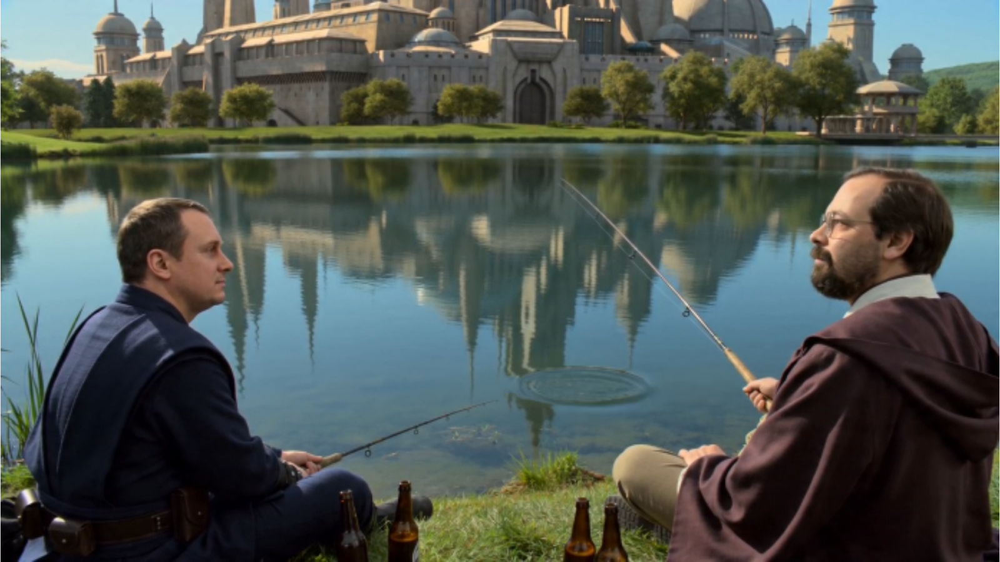</a><figcaption>@Image2 — озеро Набу</figcaption></figure>
<figure><a href="references/scenes/scene-37/S37-ship-source-part1-09m03s.png" target="_blank" rel="noopener"></a><figcaption>@Image3 — корпус корабля Канцлера</figcaption></figure><figure><a href="references/scenes/scene-39/S39-camp-film-part2-14m16s.png" target="_blank" rel="noopener">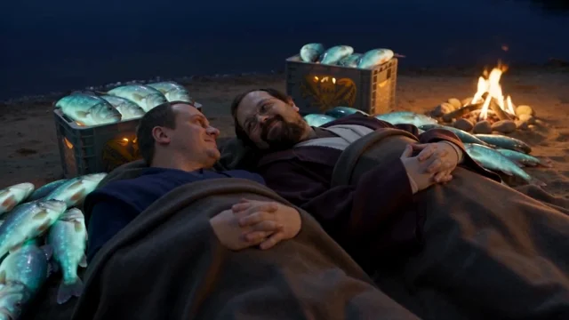</a><figcaption>@Image5 — ящики и рыба, настоящий кадр ч. 2 14:16</figcaption></figure><figure><a href="references/scenes/scene-39/S39-shore-film-part2-14m27s.png" target="_blank" rel="noopener"></a><figcaption>@Image4 — берег, ч. 2 14:27</figcaption></figure></div>
<figure><a href="references/scenes/scene-37/S37-cockpit-source-part1-09m25s.png" target="_blank" rel="noopener"></a><figcaption>@Image6 — кабина личного корабля</figcaption></figure>

**Напоминание «хлеб и молоко» · 17.10,23:03:** один и тот же бледно-жёлтый стикер справа от пилота: чёрный рисунок батона слева и пакета молока справа. В каждом перелёте удержать оба рисунка различимыми примерно2секунды; монтаж должен сохранить этот момент. В52 зритель впервые ясно замечает записку, в37 Серёга сам замечает её и откладывает мысль, в41 она остаётся перед глазами, пока он занят компьютером. Это подводит к уже запущенной55 без новой реплики или вставки в финале.

**Что происходит:** Вечером корабль Канцлера на большой скорости проносится над самой водой озера Набу, оставляя за собой шлейф брызг, резко закладывает вираж вокруг скалистого островка и с жёстким выравниванием садится на луг рядом с брошенной стоянкой рыбаков. Серёга, не задерживаясь, сходит по короткой рампе из бокового люка, быстрым шагом проходит мимо брошенных удочек и ящиков, переполненных рыбой, и смотрит на них с каменным неодобрением. На воде ещё расходятся круги от прыжка джедаев — он, не сбавляя шага, входит в озеро прямо в мантии и погружается; на берегу остаются корабль и пустая стоянка.

<div class="engine-tabs" data-scene="39">

<div class="engine-pane" data-engine="wan30" data-main="1">

```text
Mode: reference-to-video | Duration: 30s | Resolution: 1080p | Aspect ratio: 16:9 | FPS: 24 | Native audio: on
Optimized for Wan 3.0 | Photoreal live-action space-opera action cinema | Serega skims the evening Naboo lake at wave-top height, banks hard around a rocky islet, slams down by the abandoned fishing camp and strides into the lake after the Jedi

REFERENCES / AUTHORITY ORDER:
@Image3 — genuine film frame of Serega's own craft: exact flat wedge-shaped dark-grey hull, colour, proportions and engines. Vehicle design only; the city and the person on its roof are not part of the shot.
@Image4 — genuine film frame of the exact lakeshore immediately BEFORE the two fishermen jump: sandy bank, grass edges, treeline, evening sun and water geometry. Location layout and evening light only; remove the two runners. The empty post-jump state is the new scene.
@Image5 — genuine earlier camp frame: the exact two fish-filled crates, scattered caught fish and stone-ring fire spot. Props only; remove the sleeping people and do not copy its night lighting or lit fire. The camp is now deserted.
@Image6 — genuine cockpit of the same craft: seats, console, windows and interior geometry ONLY, for one short beat.
@Image2 — Naboo landscape look: blue lake, bright green lakeshore meadow, rounded trees, a pale domed palace on the far shore. Landscape and architecture only; the two fishermen in this image are NOT part of the shot.
@Image1 — absolute identity of SEREGA.
Priority: @Image3 controls the vehicle; @Image4 controls the location layout and light; @Image2 fills in landscape detail where @Image4 is ambiguous; @Image1 controls Serega's face and costume; @Image6 controls the cockpit interior.

CHARACTER APPEARANCE / IDENTITY LOCK:
@Image1 is the absolute visual authority for SEREGA (the Chancellor): pale older man, sparse light hair with a bald crown, mature serious face, long deep dark-purple robe with the hood lowered, dry at the start of the scene. He is the only person in the entire scene. No fishermen, no Jedi, no Gungans, no droids, no cats. His face is read only in medium shots with even warm light; never a tiny blurred face during the fast flight.

VEHICLE / LANDING LOCK — CRITICAL:
One and the same craft from @Image3 in every shot: same silhouette, colour, engine glow and scale. Access is always through its single side hatch with a short fold-down boarding ramp. Fast, controlled, credible approach: a wave-top skim, one hard bank around one small rocky islet, a hard flare, touchdown on its landing gear. The hull never touches the water. After touchdown the craft stays parked on the meadow for the rest of the scene. No second ship, no water vehicle driving, no crash, no hovering speeder.

CAMP / PROP LOCK:
Crates and fish from @Image5, rods and brown bottles from @Image2, bank and light from @Image4, in a new abandoned arrangement: dropped rods, fish-filled crates, a few empty brown bottles and a cold fire spot. Do not add tents, tables, people or extra vehicles. The only new landscape element is one small rocky islet with a few trees, far out on the open lake. No map, glowing module, hologram or any glowing object exists in this scene.

BREAD-AND-MILK NOTE: exactly one palm-sized pale-yellow square sticky note, with two simple black line drawings: a loaf on the left and a milk carton on the right; no letters, words or numbers. It stays on the same blank sloping console panel immediately to the pilot's right, beside the controls, never on a screen. Preserve its size, colour, drawings and position in every cockpit shot. Keep it unobstructed and in focus long enough to recognise both groceries; no actual bread or milk aboard.

START STATE:
Evening over the Naboo lake as in @Image4: the water near the bank still rippling where the fishermen jumped in, the camp abandoned on the shore, the meadow empty. Serega's craft is already low over the far end of the lake, racing toward the camera just above the water.

TIMELINE:
[0:00–0:05] — WAVE-TOP SKIM
Camera low on the water. The craft streaks in left-to-right a few metres above the wave tops, its wash ripping a double wake of white spray glowing in the low golden sun; palace domes on the far bank. It roars past the camera, spray sweeping across the lens edge.

[0:05–0:08] — COCKPIT
Hard cut inside the cockpit (@Image6), medium shot, even warm light: Serega at the controls, the note beside his hand, its loaf and milk-carton drawings sharp and unobstructed for two full seconds. His face is cool and serious; his hands throw the controls hard over into a bank.

[0:08–0:13] — HARD BANK AROUND THE ISLET
Wide exterior far out on open water: the craft knifes into a steep bank around the small rocky islet, low wingtip just above the water, the islet's trees whipping in the wash, a curved fan of spray behind it. It snaps level toward the near shore meadow.

[0:13–0:17] — FLARE AND TOUCHDOWN
Low angle from the meadow, crates at the frame edge: the nose pitches up in a hard flare, engines blast, grass flattens in a ring, shallow water by the bank sprays; the gear thumps down a short walk from the camp, the craft rocks once and the engines spool down.

[0:17–0:21] — OUT OF THE HATCH
After one clean time-compression cut, a closer angle: the side hatch opens and its short boarding ramp drops. Serega strides down it without pausing, robe swinging, onto the grass, gives his robe one sharp tug straight and surveys the shore; medium shot on his cold, appraising face for two seconds.

[0:21–0:25] — THE ABANDONED CAMP
Tracking alongside him at a brisk stride past the dropped rods, overflowing fish crates and empty bottles. He stops dead at the crates for one beat and looks down at the absurd pile of fish with completely deadpan disapproval, then snaps his eyes to the lake, where the last rings of the fishermen's dive are still spreading.

[0:25–0:30] — INTO THE LAKE
Without breaking stride he walks straight into the lake in his robe: ankles, knees, waist, chest; the dark-purple fabric darkens and spreads on the surface. One sharp breath and he goes under. The surface closes over him and rings spread; the parked craft and the abandoned camp remain on the empty shore. Hold this wide two seconds.

END STATE:
An empty evening lake with spreading rings where Serega went under; his craft parked on the meadow; the abandoned camp on the shore; nobody visible.

CAMERA / SPACE:
Four motivated action cuts (water-level fly-by, cockpit, wide bank, low landing angle), then one time-compression cut into a brisk tracking shot that ends as a static wide on the lake. Fast motion only in wide exteriors. Stable geography: lake on one side of frame, parked craft on the other, camp between them; the islet far out on open water. Approach travels left-to-right. Real human scale; the walk is a few dozen metres. No random handheld chaos.

PERFORMANCE:
Cold, purposeful and fast: the fishermen fled in panic, he lands hard and marches into the water with zero hesitation. Face serious; the disapproval is a tiny movement of the eyes. He strides, never runs. No speech, no smile.

LIGHTING / MATERIALS:
Warm low evening sun matching @Image4, long shadows, golden backlit spray over the lake. Engine heat shimmer fading after touchdown. Glistening fish scales, wet grass, dry robe fabric turning dark and heavy as it soaks.

AUDIO:
Engine scream and Doppler roar of the fly-by, hissing spray, the blast of the flare, gear thump, engines spooling down, hatch hiss, quick footsteps, flies buzzing over the crates, distant birdsong, lapping water, the robe dragging through the water, one sharp inhale, the water closing overhead. No dialogue, narrator or music.

NEGATIVE PROMPT:
fishermen, Jedi, any other person, Gungans, new or different ship design, second ship, hull touching the water, crash landing, speeder or water vehicle in motion, map module, glowing object, hologram, scuba gear, diving mask, breathing apparatus, running, jumping, diving splash, swimming strokes, islet next to the bank, night sky, rain, comedy mugging, speaking, melting or blurred face, changed face or robe, readable text or letters on the note, cartoon CGI, subtitles, text, logo, watermark, black bars.

FRAME FILL / NO BARS:
Fill the entire generated frame edge-to-edge. No letterboxing, no pillarboxing, no black bars, no side bars, no decorative borders, no empty margins.
```

</div>

<div class="engine-pane" data-engine="sd20x2">

Та же сцена двумя роликами по 15 с: сначала часть 1, часть 2 — после её результата (@Video1 части 2 = последние секунды части 1). Нумерация входов в каждой части своя.

**Входы части 1:** @Image1 — `references/full/serega.jpg`; @Image2 — `references/scenes/scene-37/S37-ship-source-part1-09m03s.png`; @Image3 — `references/scenes/scene-37/S37-cockpit-source-part1-09m25s.png`; @Image4 — `references/scenes/scene-39/S39-shore-film-part2-14m27s.png`; @Image5 — `references/scenes/scene-39/S39-camp-film-part2-14m16s.png`; @Image6 — `references/scenes/scene-19/S19-Image1-topview-source.png`.

**Входы части 2:** @Video1 — конец части 1; @Image1 — `references/full/serega.jpg`; @Image2 — `references/scenes/scene-37/S37-ship-source-part1-09m03s.png`; @Image3 — `references/scenes/scene-39/S39-shore-film-part2-14m27s.png`; @Image4 — `references/scenes/scene-39/S39-camp-film-part2-14m16s.png`; @Image5 — `references/scenes/scene-19/S19-Image1-topview-source.png`.

#### 39 · Seedance 2.0 часть 1

```text
Mode: reference-to-video (omni-reference) | Duration: 15s | Resolution: 720p | Aspect ratio: 16:9 | FPS: 24 | Native audio: on
Optimized for Seedance 2.0 | Photoreal live-action space-opera action cinema | Part 1 of 2: Serega skims his own craft over the evening Naboo lake at wave-top height, banks hard around a rocky islet and slams down on the meadow beside the abandoned fishing camp

REFERENCES / AUTHORITY ORDER:
@Image1 — absolute identity of SEREGA.
@Image2 — genuine film frame of Serega's own craft: exact flat wedge-shaped dark-grey hull, colour, proportions and engines. Vehicle design only; ignore the city and the person on its roof.
@Image3 — genuine cockpit of the same craft: interior geometry ONLY; no fight, people or weapons from it.
@Image4 — genuine film frame of the exact lakeshore: sandy bank, grass edges, treeline, evening sun and water geometry. Layout and evening light only; no runners.
@Image5 — genuine earlier camp frame: the exact two fish-filled crates, scattered fish and stone-ring fire spot. Props only; no people, no night light, no fire.
@Image6 — Naboo landscape look: blue lake, green meadow, rounded trees, a pale domed palace on the far shore, fishing rods and brown bottles. Landscape and those props only; no fishermen.
Priority: @Image1 face and costume; @Image2 vehicle; @Image3 cockpit; @Image4 location and light; @Image6 landscape detail; @Image5 camp props.

CHARACTER APPEARANCE / IDENTITY LOCK:
@Image1 is the absolute visual authority for SEREGA (the Chancellor): pale older man, sparse light hair with a bald crown, mature serious face, long deep dark-purple robe with the hood lowered, dry. He is the only person in the scene. No fishermen, no Jedi, no Gungans, no droids, no cats. His face appears only in the cockpit, in a medium shot with even warm light.

VEHICLE / LANDING LOCK — CRITICAL:
One and the same craft from @Image2 in every shot: same silhouette, colour, engine glow and scale; its single side hatch with a short fold-down boarding ramp stays closed in this part. Fast, controlled, credible approach: a wave-top skim, one hard bank around one small rocky islet, a hard flare, touchdown on its gear. The hull never touches the water. No crash.

CAMP / PROP LOCK:
Abandoned camp on the shore: dropped rods, the two fish-filled crates, empty brown bottles, a cold fire spot. No tents, people or vehicles. The only new landscape element is one small rocky islet with a few trees, far out on the open lake. No map, glowing module, hologram or any glowing object.

BREAD-AND-MILK NOTE: exactly one palm-sized pale-yellow square sticky note, with two simple black line drawings: a loaf on the left and a milk carton on the right; no letters, words or numbers. It stays on the same blank sloping console panel immediately to the pilot's right, beside the controls, never on a screen. Preserve its size, colour, drawings and position in every cockpit shot. Keep it unobstructed and in focus long enough to recognise both groceries; no actual bread or milk aboard.

START STATE:
Evening over the Naboo lake as in @Image4: the water near the bank still rippling where the fishermen jumped in, the camp abandoned on the shore, the meadow empty. Serega's craft is already low over the far end of the lake, racing toward the camera just above the water.

TIMELINE:
[0:00–0:04] — WAVE-TOP SKIM
Camera low on the water. The craft streaks in left-to-right a few metres above the wave tops, its wash ripping a double wake of white spray glowing in the low golden sun; palace domes on the far bank. It roars past the camera, spray sweeping across the lens.

[0:04–0:07] — COCKPIT
Hard cut, medium shot inside the cockpit, even warm light: Serega at the controls, the note beside his hand sharp and unobstructed for two full seconds. Face cool and serious; his hands throw the controls hard over.

[0:07–0:11] — HARD BANK AROUND THE ISLET
Wide, far out on open water: the craft knifes into a steep bank around the small rocky islet, low wingtip just above the water, trees whipping in the wash, a curved fan of spray behind; it snaps level toward the near shore.

[0:11–0:15] — FLARE AND TOUCHDOWN
Low angle from the meadow, crates at the frame edge: the nose pitches up in a hard flare, engines blast, grass flattens in a ring, shallow water sprays; the gear thumps down, the craft rocks once, engines spool down.

END STATE:
The craft stands parked on its gear on the evening meadow a short walk from the abandoned camp, hatch closed, heat shimmer over the engines; the lake beside it, faint rings still spreading near the bank; nobody visible.

CAMERA / SPACE:
Three hard action cuts: water-level fly-by, cockpit medium, wide bank, low landing angle. Fast motion only in wide exteriors. Approach travels left-to-right; the islet far out on open water; on the shore: lake on one side, craft on the other, camp between. No random handheld chaos.

PERFORMANCE:
Face cold and serious; energy in his hands on the controls. No speech, no smile, no look to camera.

LIGHTING / MATERIALS:
Warm low evening sun matching @Image4, long shadows, golden backlit spray, wet metal hull highlights, heat shimmer after touchdown.

AUDIO:
Engine scream and Doppler roar of the fly-by, hissing spray, the blast of the flare, gear thump, engines spooling down, flies over the crates, distant birdsong. No dialogue, narrator or music.

NEGATIVE PROMPT:
fishermen, Jedi, any other person, Gungans, new or different ship design, second ship, hull touching the water, crash landing, open hatch, map module, glowing object, hologram, night sky, rain, melting or blurred face, tiny face during fast motion, changed face or robe, readable text or letters on the note, cartoon CGI, subtitles, text, logo, watermark, black bars.

FRAME FILL / NO BARS:
Fill the entire generated frame edge-to-edge. No letterboxing, no pillarboxing, no black bars, no side bars, no decorative borders, no empty margins.
```

#### 39 · Seedance 2.0 часть 2

```text
Mode: reference-to-video (omni-reference) | Duration: 15s | Resolution: 720p | Aspect ratio: 16:9 | FPS: 24 | Native audio: on
Optimized for Seedance 2.0 | Photoreal live-action space-opera action comedy | Part 2 of 2: Serega strides down the ramp, glares at the abandoned fish crates and marches straight into the evening lake after the Jedi

REFERENCES / AUTHORITY ORDER:
@Video1 — the last seconds of Part 1's result: the craft parked on the evening meadow beside the abandoned camp, hatch closed, the lake beside it. Absolute authority for the START STATE, the craft's position, the camp layout and the light.
@Image1 — absolute identity of SEREGA.
@Image2 — genuine film frame of Serega's own craft: exact flat wedge-shaped dark-grey hull, colour, proportions and engines. Vehicle design only; the city and the person on its roof are not part of the shot.
@Image3 — genuine film frame of the exact lakeshore: sandy bank, grass edges, treeline, evening sun and water geometry. Location layout and light only; remove the two runners.
@Image4 — genuine earlier camp frame: the exact two fish-filled crates, scattered fish and stone-ring fire spot. Props only; remove the sleeping people, no night lighting, no lit fire.
@Image5 — Naboo landscape look: blue lake, green meadow, rounded trees, pale domed palace on the far shore, fishing rods and brown bottles. Landscape and those props only; the two fishermen are NOT part of the shot.
Priority: @Video1 controls the start; @Image1 controls Serega's face and costume; @Image2 controls the vehicle; @Image3 controls the shore; @Image4 and @Image5 control the camp props.

CHARACTER APPEARANCE / IDENTITY LOCK:
@Image1 is the absolute visual authority for SEREGA (the Chancellor): pale older man, sparse light hair with a bald crown, mature serious face, long deep dark-purple robe with the hood lowered, dry until he enters the water. He is the only person in the scene. No fishermen, no Jedi, no Gungans, no droids, no cats. His face is read in a medium shot with even warm light for at least two seconds.

VEHICLE / CAMP LOCK — CRITICAL:
The same craft from @Image2 and @Video1 stays parked on the meadow in the same spot for the whole part; access only through its single side hatch with a short fold-down boarding ramp. The abandoned camp keeps its layout from @Video1: dropped rods, the two fish-filled crates, a few empty brown bottles and a cold fire spot. No tents, tables, people or extra vehicles. No map, glowing module, hologram or any glowing object.

START STATE:
Exactly the last frame of @Video1: the craft parked on the evening meadow a short walk from the abandoned camp, hatch closed, the lake beside it.

TIMELINE:
[0:00–0:03] — HATCH AND RAMP
Continuing @Video1 without a cut, then pushing in: the side hatch opens with a hiss and the short boarding ramp drops onto the grass.

[0:03–0:06] — STEPPING OUT
Closer angle: Serega strides down the ramp without pausing, robe swinging, gives it one sharp tug straight and surveys the shore; medium shot on his cold, appraising face for two seconds.

[0:06–0:10] — THE ABANDONED CAMP
Tracking alongside him at a brisk stride past the dropped rods, the overflowing fish crates and the empty bottles. He stops dead at the crates and looks down at the absurd pile of fish with completely deadpan disapproval, then snaps his eyes to the lake, where the last rings of the fishermen's dive are still spreading.

[0:10–0:15] — INTO THE LAKE
Without breaking stride he walks straight into the lake in his robe: ankles, knees, waist, chest; the dark-purple fabric darkens and spreads on the surface. One sharp breath and he goes under. The surface closes, rings spread; the parked craft and the abandoned camp remain on the empty shore. Hold the wide final frame.

END STATE:
An empty evening lake with spreading rings where Serega went under; his craft parked on the meadow; the abandoned camp on the shore; nobody visible.

CAMERA / SPACE:
One push-in on the hatch, one cut to the ramp, then a continuous brisk tracking shot at human scale that ends as a static wide on the lake for the submersion. Stable geography: lake on one side of frame, parked craft on the other, camp between them; the walk is a few dozen metres. No random handheld chaos.

PERFORMANCE:
Cold, purposeful and fast: the fishermen fled in panic, he marches into the water with zero hesitation. His face stays serious; the disapproval is a tiny movement of the eyes, not a gesture to the camera. He strides, he never runs. No speech, no smile.

LIGHTING / MATERIALS:
Warm low evening sun matching @Image3 and @Video1, long shadows across the meadow, soft reflections on the lake, engine heat shimmer fading. Glistening fish scales, wet grass, dry robe fabric turning dark and heavy as it soaks.

AUDIO:
Hatch hiss, ramp clank, quick footsteps on metal then grass, flies buzzing over the fish crates, distant birdsong, lapping water, the robe dragging through the water, one sharp inhale, the water closing overhead. No dialogue, narrator or music.

NEGATIVE PROMPT:
fishermen, Jedi, any other person, Gungans, new or different ship design, second ship, ship moving or taking off, map module, glowing object, hologram, scuba gear, diving mask, breathing apparatus, running, jumping, diving splash, swimming strokes, night sky, rain, comedy mugging, speaking, melting or blurred face, changed face or robe, cartoon CGI, subtitles, text, logo, watermark, black bars.

FRAME FILL / NO BARS:
Fill the entire generated frame edge-to-edge. No letterboxing, no pillarboxing, no black bars, no side bars, no decorative borders, no empty margins.
```

</div>

</div>

---

<a id="scene-40"></a>

## Сцена 40 — Серёга прилетает на планету ситхов: посадка у руин

<!-- scene-meta: {"target_engine":"Seedance 2.0","production_state":"READY","duration_s":30,"dialogue":{"enabled":false,"language":null},"dependencies":[],"tags":["serega","travel","landing","sith_planet","map","bread_and_milk","continuity"]} -->

**Контекст использования:**

- **Стык:** после конца лесного блока (участок 77, 01:02:15–01:02:45 [Р2]: «Герои на земле, вмешательство вуки»; Канцлер уходит с фрагментом), перед **Scene 26** (уже в фильме): коты-магистры на террасе обращаются к Серёге за кадром. Место ветки планеты ситхов — после Кашиика — подтверждено владельцем 16.10.2026 (D1).
- **Функции:**
- **Динамика (владелец 18.10.2026):** сцена переписана активнее — нырок сквозь пыльную дымку и проход «на ребре» между двумя колоссальными статуями, жёсткая посадка на площадь храма. Версии промта — во вкладках над промтом (30 с · Wan 3.0 / Seedance 2.5 и Seedance 2.0 · 2 × 15 с); версию, которую запускает очередь, отмечает «★ в очереди».
  - (1) Серёга появляется на планете ситхов не «из ниоткуда» — сейчас ни одна сцена его прибытие не показывает;
  - (2) причина полёта читается тем же приёмом, который владелец утвердил для 37 14.10 и для этой сцены 16.10: модуль светится ярче, когда направлен на цель. Это согласуется с идеей Саши «карты → координаты заброшенного объекта» (master, «Идеи от Саши»);
  - (3) финал — он слышит зажигание мечей и смотрит за кадр. Так невидимый адресат реплик в 26 становится им.
- **Без взлёта с лесной планеты:** [Р2] §10 — «не требуется отдельный взлёт, перелёт и посадка». Отлёт обозначен удаляющейся лесной планетой в боковом окне.
- **В кадре ровно один модуль** — лесной, только что отнятый ([Р2]: в руке Канцлера около 01:02:00–01:02:05). К этому моменту у Серёги все три фрагмента (Татуин — Scene 48, Набу — 17/36, лес); остальные под робой, счёт в кадре не заявляется.
- Кабина и стикер «хлеб и молоко» — continuity с 37. Это не новый гэг.
- **Корзинка с грибами** из лесного эпизода (57:45) стоит в кабине у кресла пилота — подготовка финального «А молоко?» (решение владельца 16.10, W13). Если в готовом эпизоде корзинка выглядит иначе, её кадр можно добавить референсом.
- Корабль — тот же, что в 37 и 39.
- Направление взгляда в финале сверить с готовым результатом 26 в монтаже; при необходимости кадр зеркалится.
- Если владелец поставит 33 (руины) раньше котов, END этой сцены всё равно стыкуется: Серёга стоит у лестницы храма.
- В монтаж 12–20 с.
- **Все входы — изображения, уже есть в репозитории:** корпус (@Image4) и кабина (@Image5) — фактические кадры ч. 1, 09:03 и 09:25; лесная планета (@Image6) — тот же созданный референс, что в Scene 37. Видеовходы заменены этими кадрами, как в 37.
- **READY с 16.10.2026:** все входы в репозитории, QA §11 пройден. Модуль — общий дизайн-класс фрагментов (@Image2, как в READY-сцене 37 и в 48). Сверка с лесным захватом (01:02:00–01:02:05 по сборке [Р2]) и направление взгляда относительно 26 — монтажные заметки, а не входы генерации.
- Запуск — только по команде владельца.
- Создана по команде владельца 16.10.2026 (разбор маршрута Серёги — `reports/serega-travel-2026-10-14.md`).

**Референсы:**

- @Image1 — <a href="references/full/serega.jpg">Серёга</a>;
- @Image2 — <a href="references/scenes/scene-17/S17-Image4-topview-source.png">модуль карты (дизайн-класс фрагментов)</a>;
- @Image3 — <a href="references/scenes/scene-27/S27-Image5-topview-source.png">точные руины планеты ситхов</a>;
- @Image4 — <a href="references/scenes/scene-37/S37-ship-source-part1-09m03s.png">корпус корабля Канцлера, ч. 1 09:03</a> (только корабль);
- @Image5 — <a href="references/scenes/scene-37/S37-cockpit-source-part1-09m25s.png">геометрия кабины, ч. 1 09:25</a> (без боя и посторонних);
- @Image6 — <a href="references/scenes/scene-37/S37-forest-planet-reference.png">лесная планета, созданный референс из Scene 37</a>.

<div class="scene-ref-gallery">
<figure><a href="references/full/serega.jpg" target="_blank" rel="noopener"></a><figcaption>@Image1 — Серёга</figcaption></figure>
<figure><a href="references/scenes/scene-17/S17-Image4-topview-source.png" target="_blank" rel="noopener"></a><figcaption>@Image2 — модуль карты</figcaption></figure>
<figure><a href="references/scenes/scene-27/S27-Image5-topview-source.png" target="_blank" rel="noopener"></a><figcaption>@Image3 — руины планеты ситхов</figcaption></figure>
<figure><a href="references/scenes/scene-37/S37-ship-source-part1-09m03s.png" target="_blank" rel="noopener"></a><figcaption>@Image4 — корпус корабля Канцлера</figcaption></figure>
<figure><a href="references/scenes/scene-37/S37-cockpit-source-part1-09m25s.png" target="_blank" rel="noopener"></a><figcaption>@Image5 — кабина</figcaption></figure>
<figure><a href="references/scenes/scene-37/S37-forest-planet-reference.png" target="_blank" rel="noopener"></a><figcaption>@Image6 — лесная планета</figcaption></figure></div>

**Напоминание «хлеб и молоко» · 17.10,23:03:** один и тот же бледно-жёлтый стикер справа от пилота: чёрный рисунок батона слева и пакета молока справа. В каждом перелёте удержать оба рисунка различимыми примерно2секунды; монтаж должен сохранить этот момент. В52 зритель впервые ясно замечает записку, в37 Серёга сам замечает её и откладывает мысль, в41 она остаётся перед глазами, пока он занят компьютером. Это подводит к уже запущенной55 без новой реплики или вставки в финале.

**Что происходит:** Серёга один в кабине. Лесная планета позади уменьшается. Он резким движением достаёт модуль: тот вспыхивает, когда Серёга направляет его на пыльную охристую планету. Серёга даёт полный газ. Корабль круто ныряет сквозь пыльную закатную дымку, на ребре проносится в узкой щели между двумя колоссальными статуями в капюшонах, резко выравнивается и жёстко садится на площадь у лестницы храма. Серёга быстро сбегает по рампе и замирает: за кадром загудел зажжённый меч. Кто там, не показывается.

<div class="engine-tabs" data-scene="40">

<div class="engine-pane" data-engine="wan30" data-main="1">

```text
Mode: reference-to-video | Duration: 30s | Resolution: 1080p | Aspect ratio: 16:9 | FPS: 24 | Native audio: on
Optimized for Wan 3.0 | Photoreal live-action dark space-fantasy, fast aerial action | Serega dives through dust, knifes between two colossal statues, slams down at the Sith temple and freezes at an unseen saber hum

REFERENCES / AUTHORITY ORDER:
@Image4 — genuine film frame of Serega's own craft: exact flat wedge-shaped dark-grey hull, colour, proportions and engines. Vehicle design only; the city and the person on its roof in this source frame are not part of the shot. Do not design a new ship.
@Image5 — genuine film frame of the same craft's cockpit: exact seats, windows, controls and layout. Interior geometry only; do not import the fight, people, poses or weapons visible in this source frame.
@Image3 — the exact ancient ruin city of the destination planet: ochre-red carved stone, colossal hooded statues, a stepped temple with a wide stair, broken pillars, red rock spires, low golden-orange sunset haze. Absolute authority for architecture, palette and light of the landing site.
@Image6 — the forest planet Serega has just left: blue-green globe, dense green forested continents, white cloud bands and thin blue atmosphere. Planet design only; show it small and receding in the side window, not at the reference image's large framing scale.
@Image2 — the exact map module prop design.
@Image1 — absolute identity of SEREGA.
Priority: @Image4 controls the hull; @Image5 controls the cockpit; @Image3 controls the destination world; @Image6 controls the receding forest planet; @Image2 controls the prop; @Image1 controls Serega's face and costume.

CHARACTER APPEARANCE / IDENTITY LOCK:
@Image1 is the absolute visual authority for SEREGA (the Chancellor): pale older man, sparse light hair with a bald crown, mature serious face, long deep dark-purple robe, dusty and creased after a recent fight but intact; a lightsaber hilt hangs at his belt. He is the only person in the scene. His face is shown only in the cockpit and the final shot, medium framing, even light.

PROP LOCK — CRITICAL:
Exactly ONE small rigid palm-sized rectangular map module from @Image2 is ever visible: rounded grey metal frame, dark-grey face, two vertical warm-amber glowing segmented panels. It comes out of his robe and goes back there. Aimed at the destination planet, its panels flare bright and pulse. It never folds, multiplies, projects a hologram or becomes a screen.
BREAD-AND-MILK NOTE: exactly one palm-sized pale-yellow square sticky note, with two simple black line drawings: a loaf on the left and a milk carton on the right; no letters, words or numbers. It stays on the same blank sloping console panel immediately to the pilot's right, beside the controls, never on a screen. Preserve its size, colour, drawings and position in every cockpit shot. Keep it unobstructed and in focus long enough to recognise both groceries; no actual bread or milk aboard.
MUSHROOM BASKET: one small round wicker basket of fresh brown forest mushrooms on the cockpit floor beside the pilot seat; never picked up, never spills.

VEHICLE / LANDING LOCK — CRITICAL:
One and the same craft from @Image4 in every exterior shot: same silhouette, colour, engine glow and scale. Access is always through its single side hatch with a short fold-down boarding ramp. One approach, one steep atmospheric dive, one knife-edge pass, one hard landing on its landing gear; it never touches a statue and is never damaged. No take-off from the forest world, no hyperspace tunnel, no other ships, no space battle, no crash.

LOCATION LOCK:
A dry, dusty canyon world with the ruin city of @Image3; fine dust and rare ember-like sparks drift near the ground. Two colossal hooded statues stand close together at the edge of the temple plaza with a narrow gap between them. No lava, vegetation or water.

START STATE:
Serega is already seated alone at the controls inside the cockpit from @Image5, in open space. Through the side window the small green forest planet from @Image6 is receding. The module is hidden in his robe. The bread-and-milk note is on the console and the mushroom basket on the floor beside the seat.

TIMELINE:
[0:00–0:05] — THE MODULE POINTS ONWARD
Medium cockpit shot, even instrument light on his face; the yellow grocery note in the near foreground, both drawings readable for two seconds. Serega pulls the module from his robe in one quick motion and aims it at the small dusty ochre-red planet ahead: the amber panels flare bright and pulse. He snaps it back into his robe and shoves the throttle forward hard.

[0:05–0:10] — PUNCH IN
Cut to exterior from behind: the engines flare white-hot and the craft surges forward, left to right, then pitches nose-down at the planet. A golden rim of atmosphere rushes up; heat glow streaks along the leading edges.

[0:10–0:15] — DIVE THROUGH THE DUST
Cut to a fast tracking shot alongside: the craft plunges steeply through thick orange dust haze, vortex trails spiralling off its wingtips, red rock spires flashing past. The haze opens on the ruin city of @Image3, two colossal hooded statues rising dead ahead.

[0:15–0:20] — KNIFE-EDGE BETWEEN THE STATUES
Cut to a low wide angle on the plaza looking up into the gap between the statues. The craft rolls ninety degrees onto its side and screams through the gap, wingtips metres from the carved hoods, and roars over the camera; whip-pan with it. Grit showers from the statues' shoulders.

[0:20–0:24] — HARD FLARE
Continuous with the whip-pan: the craft snaps level, flares nose-up with engines blasting downward and drops onto its landing gear on the dusty stone plaza at the foot of the wide temple stair with a heavy jolt. A ring of dust bursts toward camera.

[0:24–0:30] — NOT ALONE
Cut to medium-wide frontal through swirling dust: the side hatch drops open, the ramp slaps down. Serega strides briskly down it and takes three quick steps toward the stair, then stops dead: a low lightsaber ignition hum sounds off-screen ahead. Push in to a medium shot, even sunset light on his face for the last three seconds: eyes narrowed, he looks hard ahead past the camera toward the top of the steps; his hand goes to the hilt at his belt without drawing it. Hold.

END STATE:
Serega stands alone on the dusty plaza in front of his parked craft, looking ahead off-screen toward the top of the temple stair, his hand on the unlit hilt at his belt, dust drifting in the sunset light. Nobody else is visible.

CAMERA / SPACE:
Four motivated action cuts (into 0:05, 0:10, 0:15, 0:24); the flare continues the whip-pan. Screen direction: left to right in space, then down and forward into the ruins. Fast tracking, low angles, one fly-by and one whip-pan; the statues tower over the craft. Final shot: stable frontal on Serega, craft behind him. Never reveal what he is looking at.

PERFORMANCE:
Face cool, serious and sure; every movement fast and decisive. At the saber hum: instant alert stillness, not fear. No speech, no smile, no look into the lens.

LIGHTING / MATERIALS:
Cockpit instrument glow and the module's amber flare on his fingers; hard sunlight and deep black in space; golden atmospheric rim, backlit orange dust with sun shafts; low sunset and long statue shadows on weathered stone. Grade matches the neighbouring ruin scenes.

AUDIO:
A rising pulse from the module, the engine surge, the roar of atmospheric entry, wind tearing through dust, a Doppler howl past the statues and over the camera, falling grit, the jolt of the gear, engines spooling down, hatch hiss and ramp clank, quick footsteps on grit, then one low lightsaber ignition hum off-screen ahead. No dialogue, narrator or music.

NEGATIVE PROMPT:
cats, Jedi, Sith, any other person, revealing the source of the saber hum, ignited saber in Serega's hand, craft clipping a statue, ship damage, crash, other ships, take-off from the forest planet, hyperspace tunnel, space battle, explosions, lava, vegetation, water, temple interior, ancient computer, two or three modules, hologram map, readable text on the note, spilled mushrooms, new ship design, melting or tiny unrecognisable face, changed face or robe, shaky handheld chaos, cartoon CGI, subtitles, text, logo, watermark, black bars.

FRAME FILL / NO BARS:
Fill the entire generated frame edge-to-edge. No letterboxing, no pillarboxing, no black bars, no side bars, no decorative borders, no empty margins.
```

</div>

<div class="engine-pane" data-engine="sd20x2">

Та же сцена двумя роликами по 15 с: сначала часть 1, часть 2 — после её результата (@Video1 части 2 = последние секунды части 1). Нумерация входов в каждой части своя.

**Входы части 1:** @Image1 — `references/full/serega.jpg`; @Image2 — `references/scenes/scene-17/S17-Image4-topview-source.png` (модуль); @Image3 — `references/scenes/scene-27/S27-Image5-topview-source.png` (руины); @Image4 — `references/scenes/scene-37/S37-ship-source-part1-09m03s.png` (корпус); @Image5 — `references/scenes/scene-37/S37-cockpit-source-part1-09m25s.png` (кабина); @Image6 — `references/scenes/scene-37/S37-forest-planet-reference.png` (лесная планета).

**Входы части 2:** @Video1 — конец части 1; @Image1 — `references/full/serega.jpg`; @Image2 — `references/scenes/scene-27/S27-Image5-topview-source.png` (руины); @Image3 — `references/scenes/scene-37/S37-ship-source-part1-09m03s.png` (корпус).

#### 40 · Seedance 2.0 часть 1

```text
Mode: reference-to-video (omni-reference) | Duration: 15s | Resolution: 720p | Aspect ratio: 16:9 | FPS: 24 | Native audio: on
Optimized for Seedance 2.0 | Photoreal live-action dark space-fantasy, fast aerial action | Part 1 of 2: the module points the way, Serega punches into the dusty planet's atmosphere and dives toward the ruin city

REFERENCES / AUTHORITY ORDER:
@Image1 — absolute identity of SEREGA.
@Image2 — the exact map module prop design.
@Image3 — the exact ancient ruin city of the destination planet: ochre-red carved stone, colossal hooded statues, a stepped temple with a wide stair, red rock spires, low golden-orange sunset haze. Architecture, palette and light only.
@Image4 — genuine film frame of Serega's own craft: exact flat wedge-shaped dark-grey hull, colour, proportions and engines. Vehicle design only; the city and the person on its roof are not part of the shot.
@Image5 — genuine film frame of the same craft's cockpit: exact seats, windows, controls and layout. Interior geometry only; no fight, people or weapons from it.
@Image6 — the forest planet Serega has just left: blue-green globe, green continents, white cloud bands. Planet design only; small and receding in the side window.
Priority: @Image1 controls Serega's face and costume; @Image4 the hull; @Image5 the cockpit; @Image3 the destination world; @Image6 the receding planet; @Image2 the prop.

CHARACTER APPEARANCE / IDENTITY LOCK:
@Image1 is the absolute visual authority for SEREGA (the Chancellor): pale older man, sparse light hair with a bald crown, mature serious face, long deep dark-purple robe, dusty and creased after a recent fight; a lightsaber hilt at his belt. He is the only person in the scene. His face appears only in the cockpit, medium framing, even light.

PROP LOCK — CRITICAL:
Exactly ONE small rigid palm-sized rectangular map module from @Image2: rounded grey metal frame, dark-grey face, two vertical warm-amber glowing segmented panels. Aimed at the destination planet the panels flare bright and pulse; it never folds, multiplies, projects a hologram or becomes a screen. It comes out of his robe and goes back there.
BREAD-AND-MILK NOTE: exactly one palm-sized pale-yellow square sticky note, with two simple black line drawings: a loaf on the left and a milk carton on the right; no letters, words or numbers. It stays on the same blank sloping console panel immediately to the pilot's right, beside the controls, never on a screen. Preserve its size, colour, drawings and position in every cockpit shot. Keep it unobstructed and in focus long enough to recognise both groceries; no actual bread or milk aboard.
MUSHROOM BASKET: one small round wicker basket of fresh brown forest mushrooms on the cockpit floor beside the pilot seat; never picked up, never spills.

VEHICLE LOCK — CRITICAL:
One and the same craft from @Image4 in every exterior shot: same silhouette, colour, engine glow and scale. One approach and one steep atmospheric dive. No take-off from the forest world, no hyperspace tunnel, no other ships, no battle, no crash.

START STATE:
Serega sits alone at the controls in the cockpit from @Image5, in open space. The small green forest planet from @Image6 recedes in the side window; a small dusty ochre-red planet hangs far ahead. The module is hidden in his robe; the note is on the console, the basket on the floor.

TIMELINE:
[0:00–0:05] — THE MODULE POINTS ONWARD
Medium cockpit shot, even instrument light on his face; the yellow grocery note in the near foreground, both drawings readable for two seconds. Serega whips the module out of his robe and aims it at the ochre-red planet: the amber panels flare bright and pulse. He snaps it back into his robe and slams the throttle forward.

[0:05–0:09] — PUNCH IN
Cut to exterior from behind: the engines flare white-hot and the craft surges forward, left to right, then pitches nose-down at the planet. A golden rim of atmosphere rushes up; heat glow streaks along the leading edges.

[0:09–0:15] — DIVE THROUGH THE DUST
Cut to a fast tracking shot alongside the craft: it plunges steeply through thick orange dust haze, vortex trails spiralling off its wingtips; red rock spires flash past close to camera. The haze opens: the ruin city of @Image3 below, two colossal hooded statues standing close together dead ahead, the craft still diving straight at them.

END STATE:
Exterior, the craft in a steep fast dive through thinning orange haze toward the ruin city, the two colossal hooded statues with a narrow gap between them looming ahead and below. Serega is inside, unseen.

CAMERA / SPACE:
Two motivated action cuts (into 0:05 and 0:09). Consistent screen direction: left to right in space, then down and forward. Punchy tracking and fast parallax past rock spires; the craft stays sharp and solid.

PERFORMANCE:
Face cool, serious and certain; hands fast and decisive. No speech, no smile, no look into the lens.

LIGHTING / MATERIALS:
Cockpit instrument glow, the module's amber flare on his fingers. Hard sunlight and deep black in space; golden atmospheric rim; backlit orange dust with sun shafts over the ochre ruins.

AUDIO:
Cockpit switches, a rising electronic pulse from the module, the throttle thump and engine surge, the roar of atmospheric entry, wind tearing through dust, rock spires whooshing past. No dialogue, narrator or music.

NEGATIVE PROMPT:
any other person, cats, Jedi, Sith, second ship, crash, ship damage, take-off from the forest planet, hyperspace tunnel, space battle, explosions, lava, vegetation, water, landing in this part, two or three modules, hologram map, readable text on the note, spilled mushrooms, new ship design, melting or morphing face, changed face or robe, cartoon CGI, subtitles, text, logo, watermark, black bars.

FRAME FILL / NO BARS:
Fill the entire generated frame edge-to-edge. No letterboxing, no pillarboxing, no black bars, no side bars, no decorative borders, no empty margins.
```

#### 40 · Seedance 2.0 часть 2

```text
Mode: reference-to-video (omni-reference) | Duration: 15s | Resolution: 720p | Aspect ratio: 16:9 | FPS: 24 | Native audio: on
Optimized for Seedance 2.0 | Photoreal live-action dark space-fantasy, fast aerial action into a tense stop | Part 2 of 2: knife-edge pass between two colossal hooded statues, hard flare landing on the temple plaza, Serega freezes at an unseen saber hum

REFERENCES / AUTHORITY ORDER:
@Video1 — the last seconds of Part 1's result: the craft diving through orange haze toward the two colossal hooded statues. Absolute authority for the START STATE, the craft's position, direction and the light.
@Image1 — absolute identity of SEREGA.
@Image2 — the exact ancient ruin city: ochre-red carved stone, colossal hooded statues, a stepped temple with a wide stair, broken pillars, golden-orange sunset haze. Architecture, palette and light of the landing site.
@Image3 — genuine film frame of Serega's own craft: exact flat wedge-shaped dark-grey hull, colour, proportions and engines. Vehicle design only; the city and the person on its roof are not part of the shot.
Priority: @Video1 controls the start; @Image1 controls Serega's face and costume; @Image3 the hull; @Image2 the ruins.

CHARACTER APPEARANCE / IDENTITY LOCK:
@Image1 is the absolute visual authority for SEREGA (the Chancellor): pale older man, sparse light hair with a bald crown, mature serious face, long deep dark-purple robe, dusty and creased after a recent fight but intact; a lightsaber hilt hangs at his belt. He is the only person in the scene. No cats, Jedi, Sith or droids. His face is shown only in the final shot, medium framing, even sunset light.

VEHICLE / LANDING LOCK — CRITICAL:
The same craft as in @Video1 and @Image3: same silhouette, colour, engine glow and scale. Access only through its single side hatch with a short fold-down boarding ramp. One knife-edge pass between the statues and one hard landing on its landing gear; it never touches a statue and is never damaged. No other ships, no crash, no cockpit shots in this part.

LOCATION LOCK:
A dry, dusty canyon world with the ruin city of @Image2; fine dust and rare ember-like sparks drift near the ground. Two colossal hooded statues stand close together at the edge of the temple plaza with a narrow gap between them. No lava, vegetation or water.

START STATE:
Exactly the last frame of @Video1: the craft diving fast toward the two colossal hooded statues above the ruin city in orange sunset haze.

TIMELINE:
[0:00–0:04] — KNIFE-EDGE
Continuing @Video1, then a cut to a low wide angle on the plaza looking up into the narrow gap between the statues: the craft rolls ninety degrees onto its side and screams through the gap, wingtips metres from the carved hoods, and roars just over the camera; whip-pan with it. Grit showers from the statues' shoulders.

[0:04–0:08] — HARD FLARE
Continuous with the whip-pan: the craft snaps level, flares nose-up with engines blasting downward and drops onto its landing gear on the dusty stone plaza at the foot of the wide temple stair with a heavy jolt. A ring of dust bursts outward toward camera; engines spool down.

[0:08–0:15] — NOT ALONE
Cut to medium-wide frontal through swirling dust: the side hatch drops open, the short ramp slaps down. Serega strides briskly down it and takes three quick steps toward the stair, then stops dead: a low lightsaber ignition hum sounds off-screen ahead. Push in to a medium shot, even light on his face for the last three seconds: eyes narrow, he looks hard ahead past the camera toward the top of the steps; his hand goes to the hilt at his belt without drawing it. Hold.

END STATE:
Serega stands alone on the dusty plaza in front of his parked craft, looking ahead off-screen toward the top of the temple stair, hand on the unlit hilt, dust drifting in the sunset light. Nobody else is visible.

CAMERA / SPACE:
Two motivated action cuts (into the low statue angle and into 0:08). Screen direction continues @Video1. Low angles for the statues' scale, one fly-by over the camera, one whip-pan on motion; the final frontal shot is stable. Never reveal what he is looking at.

PERFORMANCE:
Face cool and serious, movements fast and decisive; at the hum an instant alert stillness, not fear. No speech, no smile, no look into the lens.

LIGHTING / MATERIALS:
Low golden-orange sunset through dusty air, long statue shadows on weathered ochre stone, warm glints on the dark-grey hull, backlit dust after the landing.

AUDIO:
Doppler howl as the craft knifes past the statues and over the camera, falling grit, the heavy jolt of the gear, engines spooling down, hatch hiss and ramp clank, quick footsteps on grit, then one low lightsaber ignition hum off-screen ahead and wind across stone. No dialogue, narrator or music.

NEGATIVE PROMPT:
cats, Jedi, Sith, any other person, revealing the source of the saber hum, ignited saber in Serega's hand, craft clipping a statue, ship damage, crash, second ship, cockpit interior, temple interior, ancient computer, lava, vegetation, water, map module, hologram, new ship design, melting or morphing face, tiny unrecognisable face, changed face or robe, cartoon CGI, subtitles, text, logo, watermark, black bars.

FRAME FILL / NO BARS:
Fill the entire generated frame edge-to-edge. No letterboxing, no pillarboxing, no black bars, no side bars, no decorative borders, no empty margins.
```

</div>

</div>

---

<a id="scene-41"></a>

## Сцена 41 — Серёга увозит древний ПК с планеты ситхов

**⏳ В МЕДЛЕННОЙ ГЕНЕРАЦИИ**

<!-- scene-meta: {"target_engine":"Wan 3","production_state":"READY","duration_s":30,"dialogue":{"enabled":false,"language":null},"dependencies":[],"tags":["serega","travel","sith_planet","ancient_computer","depart","bread_and_milk","continuity"]} -->

**Контекст использования:**

- **Решение владельца 16.10.2026 (D4):** существующий финальный компьютер (участок 78, 01:02:45 [Р2]) стоит **на борту у окна в космос** и это **тот же ПК**, что найден в храме (35/38). Значит, ПК нужно увезти — эта сцена. ПК несёт Сила (подтверждено владельцем).
- **Стык:** после Scene 38 (и исхода боя D2), перед 01:02:45.
- **Функция** — физически связать находку в храме с уже существующим финалом: Серёга забирает ПК и улетает к флагману.
- **ПК несёт Сила** — бытовая левитация, как в гэге фильма с уборщицей и мокрым полом ([Р1] §2, §16).
- **Корзинка с грибами** из лесного эпизода (57:45) стоит в кабине у кресла пилота — подготовка финального «А молоко?» → взгляд на корзинку (решение владельца 16.10, W13). Если в готовом эпизоде корзинка выглядит иначе, её кадр можно добавить референсом.
- ПК **не включается**, Warcraft не показывается: это payoff существующего финала. Модули не показываются: их активация — W5/D5.
- Котов нет: в 33–38 Серёга один.
- В монтаж 12–20 с.
- **Входы-изображения есть:** ПК — фактический последний кадр результата Scene 35 (@Image2, тот же, что старт 38); корпус и кабина — кадры ч. 1 09:03 / 09:25 из пака Scene 37.
- **READY:** настоящий внешний вид крейсера извлечён из ч. 1, 11:22, сохранён как @Image6. Сцена добавлена в разрешённую очередь после танцев.
- Создана по команде владельца 16.10.2026 (разбор — `reports/serega-travel-2026-10-14.md`).
- Запуск — только по команде владельца.
- **Динамика (владелец 18.10.2026):** сцена переписана активнее — на взлёте рушится каменная голова статуи, корабль уходит от неё креном; резкое торможение в ангаре флагмана, привязанный ПК комично качается. Версии промта — во вкладках над промтом (30 с · Wan 3.0 / Seedance 2.5 и Seedance 2.0 · 2 × 15 с); версию, которую запускает очередь, отмечает «★ в очереди».

**Референсы:**

- @Image1 — <a href="references/full/serega.jpg">Серёга</a>;
- @Image2 — <a href="references/scenes/scene-38/S38-Image3-scene35-last-frame.png">древний ПК в нише храма — последний кадр Scene 35</a> (только ПК: блок, CRT, клавиатура);
- @Image3 — <a href="references/scenes/scene-27/S27-Image5-topview-source.png">руины планеты ситхов</a>;
- @Image4 — <a href="references/scenes/scene-37/S37-ship-source-part1-09m03s.png">корпус корабля Канцлера, ч. 1 09:03</a> (только корабль);
- @Image5 — <a href="references/scenes/scene-37/S37-cockpit-source-part1-09m25s.png">геометрия кабины, ч. 1 09:25</a> (без боя и посторонних);
- @Image6 — <a href="references/scenes/scene-41/S41-cruiser-film-part1-11m22s.png">крейсер Канцлера снаружи, настоящий кадр ч. 1, 11:22</a>.

<div class="scene-ref-gallery">
<figure><a href="references/full/serega.jpg" target="_blank" rel="noopener"></a><figcaption>@Image1 — Серёга</figcaption></figure>
<figure><a href="references/scenes/scene-38/S38-Image3-scene35-last-frame.png" target="_blank" rel="noopener">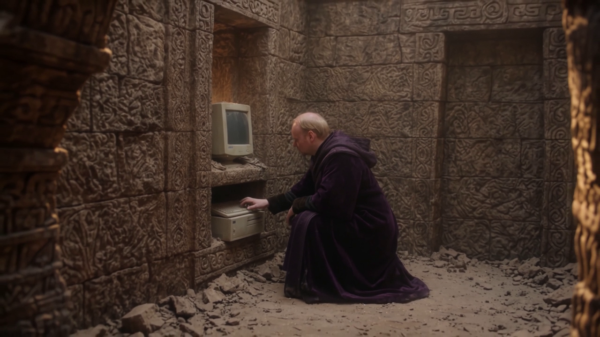</a><figcaption>@Image2 — древний ПК</figcaption></figure>
<figure><a href="references/scenes/scene-27/S27-Image5-topview-source.png" target="_blank" rel="noopener"></a><figcaption>@Image3 — руины планеты ситхов</figcaption></figure>
<figure><a href="references/scenes/scene-37/S37-ship-source-part1-09m03s.png" target="_blank" rel="noopener"></a><figcaption>@Image4 — корпус корабля Канцлера</figcaption></figure>
<figure><a href="references/scenes/scene-37/S37-cockpit-source-part1-09m25s.png" target="_blank" rel="noopener"></a><figcaption>@Image5 — кабина</figcaption></figure><figure><a href="references/scenes/scene-41/S41-cruiser-film-part1-11m22s.png" target="_blank" rel="noopener">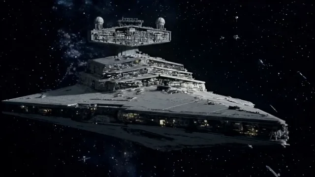</a><figcaption>@Image6 — крейсер, настоящий кадр ч. 1 11:22</figcaption></figure></div>

**Напоминание «хлеб и молоко» · 17.10,23:03:** один и тот же бледно-жёлтый стикер справа от пилота: чёрный рисунок батона слева и пакета молока справа. В каждом перелёте удержать оба рисунка различимыми примерно2секунды; монтаж должен сохранить этот момент. В52 зритель впервые ясно замечает записку, в37 Серёга сам замечает её и откладывает мысль, в41 она остаётся перед глазами, пока он занят компьютером. Это подводит к уже запущенной55 без новой реплики или вставки в финале.

**Что происходит:** На закате Серёга быстро выходит из арки храма, перед ним Сила несёт бежевый системный блок и CRT-монитор. Он забрасывает их в кабину через боковой люк и одним резким движением пристёгивает монитор к пассажирскому креслу. На взлёте от грохота двигателей с повреждённой в бою статуи откалывается каменная голова и падает на корабль; Серёга уходит креном, и голова разбивается о площадь. В космосе он на полной скорости летит к флагману и резко тормозит у освещённого ангара. Пристёгнутый монитор комично качается, и Серёга не глядя придерживает его ладонью. Корабль входит в свет проёма ангара.

<div class="engine-tabs" data-scene="41">

<div class="engine-pane" data-engine="wan30" data-main="1">

```text
Mode: reference-to-video | Duration: 30s | Resolution: 1080p | Aspect ratio: 16:9 | FPS: 24 | Native audio: on
Optimized for Wan 3.0 | Photoreal live-action space-fantasy action, deadpan | Serega Force-carries the ancient 1990s computer aboard, dodges a falling statue head at lift-off and brakes hard into his flagship's hangar

REFERENCES / AUTHORITY ORDER:
@Image2 — genuine frame of the temple niche: the exact yellowed beige 1990s system unit, the heavy beige CRT monitor and the keyboard. Absolute authority for the shape, colour, wear and dust of these three objects; the niche and the kneeling figure are not part of this shot.
@Image3 — the exact ancient ruin city outside the temple: ochre-red carved stone, colossal hooded statues, the wide temple stair, golden-orange sunset haze.
@Image4 — genuine film frame of Serega's own craft: exact flat wedge-shaped dark-grey hull, colour, proportions and engines. Vehicle design only; the city and the person on its roof are not part of the shot.
@Image5 — genuine film frame of the same craft's cockpit: exact seats, windows, controls and layout. Interior geometry only; no fight, people or weapons from it.
@Image6 — Serega's huge imperial flagship exactly as already shown earlier in the film: silhouette, colour, scale and hangar. Use the flagship only.
@Image1 — absolute identity of SEREGA.
Priority: @Image2 controls the computer objects; @Image3 controls the ruins; @Image4 controls the hull; @Image5 controls the cockpit; @Image6 controls the flagship; @Image1 controls Serega's face and costume.

CHARACTER APPEARANCE / IDENTITY LOCK:
@Image1 is the absolute visual authority for SEREGA (the Chancellor): pale older man, sparse light hair with a bald crown, mature serious face, long deep dark-purple robe, dusty from the temple. He is the only person in the scene. His face is shown only in medium framing with even light; never a tiny face during the flight action.

PROP LOCK — CRITICAL:
Exactly one beige 1990s system unit, one heavy CRT monitor and one keyboard, identical to @Image2 in every shot: same scratches, dust and dangling cables. Switched OFF throughout: dark screen, no lights, no game, no text. Strapped, it rocks but never breaks loose, falls or cracks. No map modules or holograms.
BREAD-AND-MILK NOTE: exactly one palm-sized pale-yellow square sticky note, with two simple black line drawings: a loaf on the left and a milk carton on the right; no letters, words or numbers. It stays on the same blank sloping console panel immediately to the pilot's right, beside the controls, never on a screen. Preserve its size, colour, drawings and position in every cockpit shot. Keep it unobstructed and in focus long enough to recognise both groceries; no actual bread or milk aboard.
MUSHROOM BASKET: one small round wicker basket of fresh brown forest mushrooms on the cockpit floor beside the pilot seat; never picked up, never spills.

VEHICLE / TRAVEL LOCK — CRITICAL:
One and the same craft from @Image4 in every shot; access only through its single side hatch with a short fold-down boarding ramp. Parked on the plaza at the start, then one lift-off, one dodge, one climb out, one fast approach and hard braking at the flagship from @Image6. Never hit or damaged. No docking interior, no second small ship, no space battle, no hyperspace tunnel.

RUINS / DEBRIS LOCK:
The ruins of @Image3 carry fresh battle damage: scorched stone, deep cracks, smoking rubble. Exactly one falling object: the cracked stone head of one colossal hooded statue; it misses the craft by metres. Nothing else collapses.

START STATE:
Sunset outside the temple from @Image3. Serega's craft stands parked on the dusty plaza at the foot of the stair, side hatch open and short boarding ramp lowered. Serega appears in the dark temple arch at the top of the stair.

TIMELINE:
[0:00–0:05] — OUT OF THE TEMPLE
Low tracking shot backing down the stair ahead of him: Serega strides fast out of the arch and down the stair. Before him the system unit and the CRT float at chest height by the Force, steered by two raised fingers; the keyboard is under his arm, cable swinging. Medium framing, even sunset light on his face.

[0:05–0:10] — STRAPPED IN
Cut inside the cockpit: the two objects sail in through the side hatch and land on the passenger seat. Serega yanks the seat strap across the CRT and clicks it in one sharp move, drops the keyboard on top and drops into the pilot seat. Note on the console, basket on the floor.

[0:10–0:16] — LIFT-OFF AND THE FALLING HEAD
Cut to exterior wide: the craft blasts off the plaza in a storm of dust. The engine thunder shakes the cracked ruins; the stone head of a colossal hooded statue splits free and topples toward the rising craft. The craft snaps into a hard sideways roll and slips past; the head plunges by metres away and smashes onto the plaza in a burst of dust. The craft levels and climbs steeply into the orange sky.

[0:16–0:21] — FLAT OUT TO THE FLAGSHIP
After one clean time-compression cut: exterior from behind in black space, the ochre-red planet curving away below. The craft streaks left to right at full speed toward the huge flagship from @Image6, which grows fast in frame, its hangar a bright rectangle of light.

[0:21–0:26] — HARD BRAKE, WOBBLING CRT
Cut to the cockpit, medium shot, even light: the lit hangar mouth rushes closer in the front window. Retro-thrusters fire and the cockpit lurches; the strapped dark CRT rocks forward against its strap and back, the keyboard skidding on top. Without looking, Serega slaps a flat hand on the monitor to steady it, the other on the controls. The yellow note on the console stays sharp and unobstructed for two seconds, both drawings legible, right in front of him while he deals with the computer.

[0:26–0:30] — INTO THE LIGHT
Cut to exterior from behind and slightly to the side: retro-thrusters flaring, the craft decelerates hard and glides into the lit hangar opening of the flagship, just crossing the threshold into the light as the shot holds. No hangar interior is shown.

END STATE:
The small craft braking into the lit hangar opening of the huge flagship, seen from outside; inside it, the switched-off computer strapped to the passenger seat.

CAMERA / SPACE:
Five motivated cuts (0:05, 0:10, 0:16, 0:21, 0:26); the 0:16 cut compresses the climb out. Screen direction: down the stair to the craft, up and away from the ruins, left to right toward the flagship. The wide keeps the craft and the falling head readable together; fast chase framing in space; a jolting but stable cockpit medium. The statue head is larger than the craft; the flagship dwarfs it. No random handheld chaos.

PERFORMANCE:
Completely serious, like a museum curator moving a priceless relic, but brisk and decisive: the fast stride, the sharp strap click, the reflexive slap on the CRT. The comedy is the care he gives an old beige computer while dodging falling ruins. No smile, no look into the lens, no speech.

LIGHTING / MATERIALS:
Low golden-orange sunset through dust and smoke; weathered, scorched stone; the yellowed plastic and the curved dark CRT glass catch the sunset. Cockpit instrument glow. Hard sunlight and deep black in space; the hangar light floods the cockpit during braking.

AUDIO:
Wind across stone, quick footsteps on grit, a faint low Force hum, the knock of plastic set down, the strap click, engine spin-up, dust roar at lift-off, the crack of the statue head, its whoosh past and the crash, a deep hum in space, engines at full burn, the thump of retro-thrusters, the CRT rattling against its strap and the slap of his palm on it. No dialogue, narrator, music, computer start-up sounds or game sounds.

NEGATIVE PROMPT:
computer switched on, glowing screen, game footage, Warcraft logo, CRT breaking loose, map modules, hologram, cats, Jedi, any other person, crew, droids, craft hit by debris, ship damage, crash, more than one falling object, new ship design, second ship, space battle, hyperspace tunnel, docking interior, hangar interior, lava, vegetation, modern gaming PC, laptop, duplicated monitor or keyboard, objects morphing, readable text on the note, spilled mushrooms, melting or morphing face, changed face or robe, cartoon CGI, subtitles, text, logo, watermark, black bars.

FRAME FILL / NO BARS:
Fill the entire generated frame edge-to-edge. No letterboxing, no pillarboxing, no black bars, no side bars, no decorative borders, no empty margins.
```

</div>

<div class="engine-pane" data-engine="sd20x2">

Та же сцена двумя роликами по 15 с: сначала часть 1, часть 2 — после её результата (@Video1 части 2 = последние секунды части 1). Нумерация входов в каждой части своя.

**Входы части 1:** @Image1 — `references/full/serega.jpg`; @Image2 — `references/scenes/scene-38/S38-Image3-scene35-last-frame.png` (ПК); @Image3 — `references/scenes/scene-27/S27-Image5-topview-source.png` (руины); @Image4 — `references/scenes/scene-37/S37-ship-source-part1-09m03s.png` (корпус); @Image5 — `references/scenes/scene-37/S37-cockpit-source-part1-09m25s.png` (кабина).

**Входы части 2:** @Video1 — конец части 1; @Image1 — `references/full/serega.jpg`; @Image2 — `references/scenes/scene-38/S38-Image3-scene35-last-frame.png` (ПК); @Image3 — `references/scenes/scene-37/S37-ship-source-part1-09m03s.png` (корпус); @Image4 — `references/scenes/scene-37/S37-cockpit-source-part1-09m25s.png` (кабина); @Image5 — `references/scenes/scene-41/S41-cruiser-film-part1-11m22s.png` (крейсер/флагман).

#### 41 · Seedance 2.0 часть 1

```text
Mode: reference-to-video (omni-reference) | Duration: 15s | Resolution: 720p | Aspect ratio: 16:9 | FPS: 24 | Native audio: on
Optimized for Seedance 2.0 | Photoreal live-action space-fantasy action, deadpan | Part 1 of 2: Serega Force-carries the ancient computer aboard, straps it in and dodges a falling statue head at lift-off

REFERENCES / AUTHORITY ORDER:
@Image1 — absolute identity of SEREGA.
@Image2 — genuine frame of the temple niche: the exact yellowed beige 1990s system unit, the heavy beige CRT monitor and the keyboard. Shape, colour, wear and dust of these three objects only; the niche and the kneeling figure are not part of this shot.
@Image3 — the exact ancient ruin city outside the temple: ochre-red carved stone, colossal hooded statues, the wide temple stair, golden-orange sunset haze.
@Image4 — genuine film frame of Serega's own craft: exact flat wedge-shaped dark-grey hull, colour, proportions and engines. Vehicle design only; the city and the person on its roof are not part of the shot.
@Image5 — genuine film frame of the same craft's cockpit: exact seats, windows, controls and layout. Interior geometry only; no fight, people or weapons from it.
Priority: @Image1 controls Serega's face and costume; @Image2 the computer; @Image3 the ruins; @Image4 the hull; @Image5 the cockpit.

CHARACTER APPEARANCE / IDENTITY LOCK:
@Image1 is the absolute visual authority for SEREGA (the Chancellor): pale older man, sparse light hair with a bald crown, mature serious face, long deep dark-purple robe, dusty from the temple. He is the only person in the scene. His face is shown in medium framing with even light; never a tiny face during the action.

PROP LOCK — CRITICAL:
Exactly one beige 1990s system unit, one heavy CRT monitor and one keyboard, identical to @Image2: same scratches, dust and dangling cables. Switched OFF throughout: dark screen, no lights, no text. Once strapped it never breaks loose. No map modules or holograms.
BREAD-AND-MILK NOTE: exactly one palm-sized pale-yellow square sticky note, with two simple black line drawings: a loaf on the left and a milk carton on the right; no letters, words or numbers. It stays on the same blank sloping console panel immediately to the pilot's right, beside the controls, never on a screen. Preserve its size, colour, drawings and position in every cockpit shot. Keep it unobstructed and in focus long enough to recognise both groceries; no actual bread or milk aboard.
MUSHROOM BASKET: one small round wicker basket of fresh brown forest mushrooms on the cockpit floor beside the pilot seat; never picked up, never spills.

VEHICLE / DEBRIS LOCK — CRITICAL:
The same craft from @Image4; access only through its single side hatch with a short fold-down boarding ramp. One lift-off and one dodge. The ruins carry fresh battle damage: scorched stone, deep cracks, smoking rubble. Exactly one falling object: the cracked stone head of one colossal hooded statue, larger than the craft; it misses by a few metres and smashes on the plaza. The craft is never hit.

START STATE:
Sunset outside the temple from @Image3. The craft stands parked on the dusty plaza at the foot of the stair, side hatch open, short ramp lowered. Serega appears in the dark temple arch at the top of the stair.

TIMELINE:
[0:00–0:05] — OUT OF THE TEMPLE
Low tracking shot backing down the stair ahead of him: Serega strides fast out of the arch and down the stair. The system unit and the CRT float before him at chest height by the Force; the keyboard is under his arm, cable swinging; two raised fingers steer. Medium framing, even sunset light on his face.

[0:05–0:09] — STRAPPED IN
Cut inside the cockpit: the objects sail in through the side hatch onto the passenger seat. Serega yanks the seat strap across the CRT and clicks it in one sharp move, drops the keyboard on top and drops into the pilot seat. The yellow note on the console readable for two seconds; the basket on the floor.

[0:09–0:15] — LIFT-OFF AND THE FALLING HEAD
Cut to exterior wide: the craft blasts off the plaza in a storm of dust. The engine thunder shakes the cracked ruins; the stone head of a colossal hooded statue splits free and topples toward the rising craft. The craft snaps into a hard sideways roll and slips past; the head plunges by and smashes on the plaza. The craft levels and climbs steeply into the orange sky.

END STATE:
Exterior: the craft climbing steeply away from the dust-shrouded ruins into the orange sky, the fallen statue head shattered on the plaza below.

CAMERA / SPACE:
Two motivated cuts (into 0:05 and 0:09). Direction: down the stair toward the craft, then up and away. The wide keeps the craft and the falling head readable together. Credible scale.

PERFORMANCE:
Completely serious, like a museum curator moving a priceless relic, but brisk and decisive. No smile, no look into the lens, no speech.

LIGHTING / MATERIALS:
Low golden-orange sunset through dust and smoke; scorched stone; the yellowed plastic and dark CRT glass catch the light; cockpit instrument glow.

AUDIO:
Quick footsteps on grit, a faint Force hum, the strap click, engine spin-up, dust roar at lift-off, the deep crack of the statue head, its whoosh past and the crash on the plaza. No dialogue, narrator, music or computer sounds.

NEGATIVE PROMPT:
computer switched on, glowing screen, game footage, text on screen, map modules, hologram, cats, Jedi, any other person, crew, droids, craft hit by debris, ship damage, crash, more than one falling object, new ship design, second ship, flagship, lava, vegetation, modern PC, duplicated monitor or keyboard, objects morphing, readable text on the note, spilled mushrooms, melting or morphing face, changed face or robe, cartoon CGI, subtitles, text, logo, watermark, black bars.

FRAME FILL / NO BARS:
Fill the entire generated frame edge-to-edge. No letterboxing, no pillarboxing, no black bars, no side bars, no decorative borders, no empty margins.
```

#### 41 · Seedance 2.0 часть 2

```text
Mode: reference-to-video (omni-reference) | Duration: 15s | Resolution: 720p | Aspect ratio: 16:9 | FPS: 24 | Native audio: on
Optimized for Seedance 2.0 | Photoreal live-action space-fantasy action, deadpan | Part 2 of 2: Serega races to his flagship and brakes hard into its lit hangar while the strapped CRT wobbles comically

REFERENCES / AUTHORITY ORDER:
@Video1 — the last seconds of Part 1's result: the craft climbing steeply away from the ruins into the orange sky. Absolute authority for the START STATE, the craft and its direction.
@Image1 — absolute identity of SEREGA.
@Image2 — the exact yellowed beige 1990s system unit, heavy beige CRT monitor and keyboard. These objects only; not the niche or the kneeling figure.
@Image3 — genuine film frame of Serega's own craft: exact flat wedge-shaped dark-grey hull, colour, proportions and engines. Vehicle design only; the city and the person on its roof are not part of the shot.
@Image4 — genuine film frame of the same craft's cockpit: exact seats, windows, controls and layout. Interior geometry only; no fight, people or weapons from it.
@Image5 — Serega's huge imperial flagship exactly as shown earlier in the film: silhouette, colour, scale and hangar. Use the flagship only.
Priority: @Video1 controls the start; @Image1 Serega's face and costume; @Image2 the computer; @Image3 the hull; @Image4 the cockpit; @Image5 the flagship.

CHARACTER APPEARANCE / IDENTITY LOCK:
@Image1 is the absolute visual authority for SEREGA (the Chancellor): pale older man, sparse light hair with a bald crown, mature serious face, long deep dark-purple robe, dusty from the temple. He is the only person in the scene. His face appears only in the cockpit, medium framing, even light.

PROP LOCK — CRITICAL:
Exactly one beige 1990s system unit, one heavy CRT monitor and one keyboard, identical to @Image2, strapped to the passenger seat with the keyboard on top. Switched OFF throughout: dark screen, no lights, no text. It rocks against the strap but never breaks loose, falls or cracks. No map modules or holograms.
BREAD-AND-MILK NOTE: exactly one palm-sized pale-yellow square sticky note, with two simple black line drawings: a loaf on the left and a milk carton on the right; no letters, words or numbers. It stays on the same blank sloping console panel immediately to the pilot's right, beside the controls, never on a screen. Preserve its size, colour, drawings and position in every cockpit shot. Keep it unobstructed and in focus long enough to recognise both groceries; no actual bread or milk aboard.
MUSHROOM BASKET: one small round wicker basket of fresh brown forest mushrooms on the cockpit floor beside the pilot seat; never picked up, never spills.

VEHICLE / TRAVEL LOCK — CRITICAL:
The same craft as in @Video1 and @Image3. One climb out of the atmosphere, one fast approach and hard braking at the flagship from @Image5. No docking interior, no hangar interior, no second small ship, no space battle, no hyperspace tunnel.

START STATE:
Exactly the last frame of @Video1: the craft climbing steeply into the orange sky above the dusty ruins.

TIMELINE:
[0:00–0:05] — FLAT OUT TO THE FLAGSHIP
Continuing @Video1, the craft punches out of the haze, then one time-compression cut to black space, the ochre-red planet curving away below. Exterior from behind: the craft streaks left to right at full speed, engines blazing, toward the flagship, which grows fast in frame, its hangar opening a bright rectangle of light.

[0:05–0:11] — HARD BRAKE, WOBBLING CRT
Cut to the cockpit, medium shot, even instrument light: the lit hangar mouth rushes closer through the front window. Retro-thrusters fire and the cockpit lurches; the strapped dark CRT rocks forward against its strap and back, the keyboard skids on top. Without looking, Serega slaps a flat hand on top of the monitor to steady it, the other hand on the controls. The yellow note stays sharp and unobstructed for two seconds, both drawings legible, right in front of him. The basket stays put.

[0:11–0:15] — INTO THE LIGHT
Cut to exterior from behind and slightly to the side: retro-thrusters flaring, the craft brakes hard and glides into the lit hangar opening of the flagship, just crossing the threshold into the light as the shot holds. No interior shown.

END STATE:
The small craft braking into the lit hangar opening of the huge flagship, seen from outside; inside it, the switched-off computer strapped to the passenger seat.

CAMERA / SPACE:
Three motivated cuts (time-compression into space, into 0:05, into 0:11). Left-to-right travel toward the flagship kept consistent. Fast chase framing outside, a jolting but stable cockpit medium; the flagship dwarfs the craft.

PERFORMANCE:
Deadpan, fast reflexes: the slap on the CRT is automatic, eyes on the hangar. No smile, no look into the lens, no speech.

LIGHTING / MATERIALS:
Hard sunlight and deep black in space; the hangar light floods the cockpit during braking; instrument glow on the yellowed plastic and dark CRT glass.

AUDIO:
Wind fading to a deep hum in space, engines at full burn, the thump of retro-thrusters, the rattle of the CRT against its strap and the slap of his palm on it, engines winding down. No dialogue, narrator, music, computer start-up or game sounds.

NEGATIVE PROMPT:
computer switched on, glowing screen, game footage, Warcraft logo, text on screen, CRT breaking loose or falling, map modules, hologram, cats, Jedi, any other person, crew, droids, ship damage, crash, new ship design, second ship, space battle, hyperspace tunnel, docking interior, hangar interior, duplicated monitor or keyboard, objects morphing, readable text on the note, spilled mushrooms, melting or morphing face, changed face or robe, cartoon CGI, subtitles, text, logo, watermark, black bars.

FRAME FILL / NO BARS:
Fill the entire generated frame edge-to-edge. No letterboxing, no pillarboxing, no black bars, no side bars, no decorative borders, no empty margins.
```

</div>

</div>

---

<a id="scene-42"></a>

## Сцена 42 — Татуин: бой на фоне червя — червь им не интересен

<!-- scene-meta: {"target_engine":"Seedance 2.0","production_state":"READY","duration_s":30,"dialogue":{"enabled":false,"language":null},"dependencies":[{"type":"continues","scene":16}],"tags":["serega","ilyusha","artem","tatooine","worm","duel","deadpan","continuity"]} -->

**Контекст использования:**

- **Решение владельца 16.10.2026:** Scene 16 принята; нужно продолжение битвы на фоне червя, который всё разрушает вокруг. Артём и Илюша дерутся с Серёгой, будто не замечая червя: лениво уворачиваются от его атак, он не их цель и им не интересен.
- **Стык:** сразу после Scene 16 (её единственный результат — task `36e8320e34da4f1b97c35e1e765e3e63`). Дальше — Scene 56 (бой в движении, владелец 18.10), затем Scene 48: Канцлер забирает татуинский фрагмент (решение владельца 16.10, D6).
- **Тон меняется осознанно:** в 16 червь — катастрофа; здесь комедия в равнодушии. Все трое заняты только дуэлью, от червя отмахиваются как от назойливой помехи. Без гримас и взглядов в камеру — смешно за счёт контраста масштаба и полного спокойствия.
- Цвета мечей — как в 16 и 27: Илюша синий, Артём зелёный, Серёга красный.
- Машина после разрушения не появляется (W8). Модуль карты в этой сцене не показывается — его исход в Scene 48.
- **READY:** настоящий последний кадр Scene 16 извлечён и проверен (899/899, 29.966667 с), подключён как @Image6. В разрешённой очереди после танцев.
- В монтаж 15–25 с. Запуск — только по команде владельца.
- **Динамика (владелец 18.10.2026):** сцена переписана активнее — плита-трамплин, прыжок через движущуюся спину червя, брошенный крутящийся меч Серёги отбит и пойман. Версии промта — во вкладках над промтом (30 с · Wan 3.0 / Seedance 2.5 и Seedance 2.0 · 2 × 15 с); версию, которую запускает очередь, отмечает «★ в очереди».

**Референсы:**

- @Image1 — <a href="references/full/serega.jpg">Серёга</a>;
- @Image2 — <a href="references/full/ilyusha.jpg">Илюша (Hooded Jedi)</a>;
- @Image3 — <a href="references/full/artem.jpg">Артём (Bearded Jedi)</a>;
- @Image4 — <a href="references/scenes/scene-16/S16-desert-location-clean.png">пустынные руины Scene 16</a> (только локация);
- @Image5 — <a href="references/scenes/scene-16/S16-worm-scale.png">масштаб и дизайн червя</a>;
- @Image6 — <a href="references/scenes/scene-42/S42-start-from-S16-result.png">настоящий последний кадр Scene 16</a>; пыль и позы — из результата, лица — по индивидуальным листам.

<div class="scene-ref-gallery">
<figure><a href="references/full/serega.jpg" target="_blank" rel="noopener"></a><figcaption>@Image1 — Серёга</figcaption></figure>
<figure><a href="references/full/ilyusha.jpg" target="_blank" rel="noopener"></a><figcaption>@Image2 — Илюша</figcaption></figure>
<figure><a href="references/full/artem.jpg" target="_blank" rel="noopener"></a><figcaption>@Image3 — Артём</figcaption></figure>
<figure><a href="references/scenes/scene-16/S16-desert-location-clean.png" target="_blank" rel="noopener"></a><figcaption>@Image4 — руины</figcaption></figure>
<figure><a href="references/scenes/scene-16/S16-worm-scale.png" target="_blank" rel="noopener"></a><figcaption>@Image5 — червь</figcaption></figure><figure><a href="references/scenes/scene-42/S42-start-from-S16-result.png" target="_blank" rel="noopener">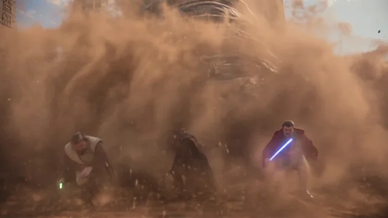</a><figcaption>@Image6 — настоящий конец Scene 16, 29.966667 с</figcaption></figure></div>

**Что происходит:** Из пыли последнего кадра 16 все трое тут же снова бросаются в бой — быстрый и жёсткий, а червь за их спинами крушит руины. Червь сносит левую опору ворот: Артём взбегает по падающей плите и обрушивается на Серёгу сверху, Илюша мимоходом перепрыгивает через спину червя, скользящую по песку, Серёга швыряет вращающийся меч, Илюша его отбивает, а Серёга ловит вернувшуюся рукоять. Червь раскалывает обелиск, верхняя половина падает на бок рядом с Артёмом, тот лениво отступает на полшага; с вставшего на дыбы червя льётся песок, они фехтуют прямо сквозь него. В конце три меча скрещены на переднем плане, а пасть червя неподвижно висит над ними — никто даже не поднимает глаз.

<div class="engine-tabs" data-scene="42">

<div class="engine-pane" data-engine="wan30" data-main="1">

```text
Mode: reference-to-video | Duration: 30s | Resolution: 1080p | Aspect ratio: 16:9 | FPS: 24 | Native audio: on
Optimized for Wan 3.0 | Photoreal live-action desert space-fantasy, fierce stunt duel with a deadpan running gag | Two Jedi and the Chancellor fight a fast acrobatic duel straight through the ruins a colossal sandworm is wrecking, and none of them cares about the worm

REFERENCES / AUTHORITY ORDER:
@Image6 — the genuine final frame of the previous scene: exact positions of the three crouching duelists, the worm, the light, the dust and the ruins. Absolute authority for the START STATE.
@Image1 — absolute identity of SEREGA.
@Image2 — absolute identity of ILYUSHA, the Hooded Jedi.
@Image3 — absolute identity of ARTEM, the Bearded Jedi.
@Image4 — the exact desert ruins: sandy plain, two tall glyph-covered gate piers, narrow central obelisk, harsh warm daylight. Location geometry only.
@Image5 — the exact colossal segmented sandworm: scale and design only; it is far larger than people and gate piers.
Priority: @Image6 controls the start; @Image1–@Image3 control the three identities; @Image4 controls the location; @Image5 controls the worm.

CHARACTER APPEARANCE / IDENTITY LOCK:
SEREGA (the Chancellor), @Image1: pale older man, sparse light hair with a bald crown, mature serious face, long deep dark-purple robe, sand in its folds; RED lightsaber.
ILYUSHA, @Image2: moustache, tousled chestnut hair, weathered face, light olive-green layered tunic, deep-red hooded cloak, brown boots; BLUE lightsaber.
ARTEM, @Image3: heavier build, short beard, cream-beige tunic under a brown outer robe, wide brown belt, brown boots; GREEN lightsaber.
Exactly three people. No other characters, no vehicles.

WORM / DESTRUCTION LOCK — CRITICAL:
The same colossal worm from @Image5 for the whole scene, always far larger than the gate piers. It wrecks the ruins of @Image4 around the duel, and the damage only accumulates: it smashes the LEFT gate pier into falling slabs (the right pier stays standing), and it cracks the central obelisk in half so that its top half topples and ends lying on its side on the sand as one long stone block. It strikes near the duelists again and again but never hits, swallows or touches anyone, and nobody touches it. Nobody ever fights the worm or looks at it for more than a glance.

START STATE:
Begin exactly from @Image6: Artem crouched on frame-left, Serega in the centre, Ilyusha on frame-right, all alive with the enormous worm behind them amid dense native dust. Their blades blaze to full brightness through the clearing dust and they spring straight back into the fight; individual sheets preserve faces and costumes.

TIMELINE:
[0:00–0:04] — BACK TO THE DUEL
From the @Image6 composition the three explode out of their crouch: blue and green blades against red in fast, hard, clean exchanges, sparks spitting at every clash. Behind them the worm smashes through the left gate pier; huge slabs start to rain down. Nobody turns around.

[0:04–0:09] — THE FALLING SLAB
A giant slab from the pier crashes down beside the duel and lands tilted like a ramp. Without a glance at it, Artem runs up the slab in three heavy strides, launches off its top edge and drops onto Serega with a two-handed overhead strike. Serega catches it on the red blade in a low crouch; sand bursts out under his boots, and he throws Artem off with one shove of the blade.

[0:09–0:13] — OVER THE WORM
A long stretch of the worm's back slides through the sand between Ilyusha and Serega, only waist-high above the surface, the rest of the colossal body still submerged, like a moving wall. Ilyusha does not stop: he hurdles the moving ridge in one bored, economical leap in mid-attack, without looking down, and lands straight into a slash that Serega parries. Neither touches the worm.

[0:13–0:18] — THE THROWN SABER
Serega hurls his red saber at Ilyusha; it spins through the air like a glowing disc. Ilyusha deflects it upward with the blue blade; it whirls back in a wide arc. Serega ducks under Artem's green swing, catches the returning hilt in one hand and blocks Artem's next strike in the same motion.

[0:18–0:22] — THE OBELISK
In the background the worm cracks the central obelisk in half; the top half topples straight toward Artem. Mid-combination, he takes one lazy half-step aside; the stone crashes down beside him and comes to rest on its side as a long block. He steps over its end as if over a puddle and continues his attack. Serega blocks it with bored precision.

[0:22–0:26] — FENCING IN THE SAND RAIN
The worm rears high above the duel and roars; tons of sand pour off its body in a heavy curtain straight onto the fighting ground. The three fence straight through the falling sand, the blades hissing and flaring in it, and all three duck the same flying debris at the same moment without looking up.

[0:26–0:30] — STILL NOT INTERESTED
Medium shot, faces close and readable in even light: the three lock blades in the foreground, red in the middle, green from frame-left, blue from frame-right, pushing against each other. Behind and above them the worm stops, its gaping maw hanging motionless over the three, sand still trickling from it, as if waiting for attention. None of them looks up. Hold.

END STATE:
The three duelists locked blade against blade in the foreground, Artem frame-left, Serega centre, Ilyusha frame-right, ignoring the worm whose gaping maw hangs motionless over them amid falling dust; the left gate pier smashed, the obelisk broken in half with its top half lying on its side as a long block.

CAMERA / SPACE:
The first shot begins exactly from the @Image6 framing. Then five motivated action cuts on movement, each matching screen direction and the left/centre/right geography: a low angle on Artem's run up the slab, a fast lateral tracking shot on Ilyusha's leap over the worm's back, a whip-pan that follows the spinning red saber and lands on Serega's catch, a wide for the falling obelisk and sand curtain, then a closer medium for the final lock. Fast action plays in wide and medium-wide shots with whole bodies visible; faces are recognised in medium shots, never tiny during speed. Keep the worm partly in frame in every wide shot for scale. No shaky handheld chaos, no teleporting, no spatial resets.

PERFORMANCE:
The duel is fast, fierce and athletic with real weight: hard strikes, jumps, crouching blocks, a thrown saber. The deadpan gag is the contrast: toward the worm all three are lazy, bored and unimpressed, dodging it with minimal half-steps and casual hops in stride, never panicked, never looking at it. Serega is cool and precise, Ilyusha quick and aggressive, Artem heavy and stubborn. No speech, no mugging, no look into the lens.

LIGHTING / MATERIALS:
Harsh warm desert sunlight, dry haze, long ruin shadows, sand sheets and stone debris in the air, realistic cloth and dust interaction, falling sand catching the light; saber light flickers on faces and robes through the dust.

AUDIO:
Saber hums, crackling clashes and whooshes in the foreground, the spinning saber's rising and falling whirr, heavy footsteps on stone and sand; the worm's deep roar, smashing stone and pouring sand behind, a little lower in the mix as if the fighters do not hear it; exertion breaths only. No dialogue, narrator or music.

NEGATIVE PROMPT:
worm swallowing or touching anyone, anyone touching or riding the worm, death, blood, characters fighting or attacking the worm, characters fleeing in panic, screaming, fear, slow motion, static standing duel, Force shove, sliding down a sand slope, standing on the toppled obelisk, both gate piers destroyed, obelisk left intact, car, speeder, vehicle wreck, extra people, duplicated characters, map module, hologram, wrong saber colours, second red saber, teleporting characters, small worm, cartoon CGI, comedy mugging, identity drift, costume changes, red cloak on Artem, subtitles, text, logo, watermark, black bars.

FRAME FILL / NO BARS:
Fill the entire generated frame edge-to-edge. No letterboxing, no pillarboxing, no black bars, no side bars, no decorative borders, no empty margins.
```

</div>

<div class="engine-pane" data-engine="sd20x2">

Та же сцена двумя роликами по 15 с: сначала часть 1, часть 2 — после её результата (@Video1 части 2 = последние секунды части 1). Нумерация входов в каждой части своя.

**Входы части 1:** @Image1 — `references/full/serega.jpg`; @Image2 — `references/full/ilyusha.jpg`; @Image3 — `references/full/artem.jpg`; @Image4 — `references/scenes/scene-16/S16-desert-location-clean.png`; @Image5 — `references/scenes/scene-16/S16-worm-scale.png`; @Image6 — `references/scenes/scene-42/S42-start-from-S16-result.png` (настоящий конец 16, старт).

**Входы части 2:** @Video1 — конец части 1; @Image1 — `references/full/serega.jpg`; @Image2 — `references/full/ilyusha.jpg`; @Image3 — `references/full/artem.jpg`; @Image4 — `references/scenes/scene-16/S16-desert-location-clean.png`; @Image5 — `references/scenes/scene-16/S16-worm-scale.png`.

#### 42 · Seedance 2.0 часть 1

```text
Mode: reference-to-video (omni-reference) | Duration: 15s | Resolution: 720p | Aspect ratio: 16:9 | FPS: 24 | Native audio: on
Optimized for Seedance 2.0 | Photoreal live-action desert space-fantasy, fierce stunt duel with a deadpan running gag | Part 1 of 2: the duel restarts and turns acrobatic in the ruins the ignored sandworm is wrecking

REFERENCES / AUTHORITY ORDER:
@Image6 — the genuine final frame of the previous scene: exact positions of the three crouching duelists, the worm, the light, the dust and the ruins. Absolute authority for the START STATE.
@Image1 — absolute identity of SEREGA.
@Image2 — absolute identity of ILYUSHA, the Hooded Jedi.
@Image3 — absolute identity of ARTEM, the Bearded Jedi.
@Image4 — the exact desert ruins: sandy plain, two tall glyph-covered gate piers, narrow central obelisk, harsh warm daylight. Location geometry only.
@Image5 — the exact colossal segmented sandworm: scale and design only; far larger than people and gate piers.
Priority: @Image6 controls the start; @Image1–@Image3 control identities; @Image4 the location; @Image5 the worm.

CHARACTER APPEARANCE / IDENTITY LOCK:
SEREGA (the Chancellor), @Image1: pale older man, sparse light hair with a bald crown, mature serious face, long deep dark-purple robe; RED lightsaber.
ILYUSHA, @Image2: moustache, tousled chestnut hair, weathered face, light olive-green layered tunic, deep-red hooded cloak, brown boots; BLUE lightsaber.
ARTEM, @Image3: heavier build, short beard, cream-beige tunic under a brown outer robe, wide brown belt, brown boots; GREEN lightsaber.
Exactly three people. No other characters, no vehicles.

WORM / DESTRUCTION LOCK — CRITICAL:
The same colossal worm from @Image5, always far larger than the gate piers. In this part it smashes the LEFT gate pier into falling slabs; the right pier and the central obelisk still stand. It never hits, swallows or touches anyone, and nobody touches it. Nobody fights it or looks at it for more than a glance.

START STATE:
Exactly @Image6: Artem crouched frame-left, Serega centre, Ilyusha frame-right, the enormous worm behind them in dense dust. Their blades blaze to full brightness as they spring back into the fight.

TIMELINE:
[0:00–0:04] — BACK TO THE DUEL
From the @Image6 framing all three explode out of the crouch: blue and green against red in fast, hard exchanges, sparks at every clash. Behind them the worm smashes the left gate pier; giant slabs rain down. Nobody turns around.

[0:04–0:08] — THE FALLING SLAB
A slab crashes down beside the duel and lands tilted like a ramp. Artem runs up it in three heavy strides, launches off the top edge and drops onto Serega with a two-handed overhead strike. Serega catches it on the red blade in a low crouch, sand bursting under his boots, and throws him off.

[0:08–0:11] — OVER THE WORM
A long stretch of the worm's back slides through the sand between Ilyusha and Serega, only waist-high above the surface, the rest of its body submerged. Ilyusha hurdles the moving ridge in one bored leap mid-attack, without looking down, and lands straight into a slash that Serega parries.

[0:11–0:15] — THE THROWN SABER
Serega hurls his red saber at Ilyusha, spinning like a glowing disc. Ilyusha deflects it upward with the blue blade; it whirls back in an arc. Serega ducks Artem's green swing, catches the returning hilt in one hand and blocks the next green strike in the same motion. Hold that block for the last second.

END STATE:
Serega in the centre holding his red saber again, blocking Artem's green blade from frame-left while Ilyusha closes in from frame-right; the left gate pier smashed into slabs, the central obelisk still standing, the worm looming behind in drifting dust.

CAMERA / SPACE:
Start exactly on the @Image6 framing, then cut on movement: low angle on Artem's run up the slab, fast lateral tracking on Ilyusha's leap, a whip-pan following the spinning saber into Serega's catch in a medium-wide. Keep left/centre/right geography and screen direction across every cut. Whole bodies in the fast shots; faces readable in the medium-wide catch. Worm partly in frame for scale in wide shots. No handheld chaos, no teleporting.

PERFORMANCE:
Fierce, athletic, weighty swordplay. Toward the worm everyone is lazy and unimpressed: casual hops in stride, no glances, no panic. Serega cool and precise, Ilyusha quick and aggressive, Artem heavy and stubborn. No speech, no mugging, no look into the lens.

LIGHTING / MATERIALS:
Harsh warm desert sun, dry haze, long ruin shadows, sand and stone debris in the air, real cloth and dust interaction; saber light flickering on faces and robes.

AUDIO:
Saber hums, crackling clashes, whooshes and the whirr of the spinning saber up front; heavy footsteps; the worm's roar and crashing stone behind, lower in the mix; exertion breaths only. No dialogue, narrator or music.

NEGATIVE PROMPT:
worm swallowing or touching anyone, anyone touching the worm, blood, fighting or fleeing the worm, screaming, slow motion, static duel, Force shove, obelisk breaking in this part, both piers destroyed, vehicles, extra people, duplicated characters, map module, wrong saber colours, small worm, cartoon CGI, mugging, identity drift, red cloak on Artem, subtitles, text, watermark, black bars.

FRAME FILL / NO BARS:
Fill the entire generated frame edge-to-edge. No letterboxing, no pillarboxing, no black bars, no side bars, no decorative borders, no empty margins.
```

#### 42 · Seedance 2.0 часть 2

```text
Mode: reference-to-video (omni-reference) | Duration: 15s | Resolution: 720p | Aspect ratio: 16:9 | FPS: 24 | Native audio: on
Optimized for Seedance 2.0 | Photoreal live-action desert space-fantasy, fierce stunt duel with a deadpan running gag | Part 2 of 2: the worm breaks the obelisk and buries the duel in sand, and the three still lock blades without looking up

REFERENCES / AUTHORITY ORDER:
@Video1 — the last seconds of Part 1's result: the three dueling in the ruins, Serega centre blocking Artem's green blade, the smashed left gate pier, the worm behind. Absolute authority for the START STATE, positions, damage and light.
@Image1 — absolute identity of SEREGA.
@Image2 — absolute identity of ILYUSHA, the Hooded Jedi.
@Image3 — absolute identity of ARTEM, the Bearded Jedi.
@Image4 — the desert ruins: sandy plain, glyph-covered gate piers, narrow central obelisk, harsh warm daylight. Location geometry only; damage follows @Video1.
@Image5 — the exact colossal segmented sandworm: scale and design only; far larger than people and gate piers.
Priority: @Video1 controls the start and the damage already done; @Image1–@Image3 control identities; @Image4 the location; @Image5 the worm.

CHARACTER APPEARANCE / IDENTITY LOCK:
SEREGA (the Chancellor), @Image1: pale older man, sparse light hair with a bald crown, mature serious face, long deep dark-purple robe; RED lightsaber.
ILYUSHA, @Image2: moustache, tousled chestnut hair, weathered face, light olive-green layered tunic, deep-red hooded cloak, brown boots; BLUE lightsaber.
ARTEM, @Image3: heavier build, short beard, cream-beige tunic under a brown outer robe, wide brown belt, brown boots; GREEN lightsaber.
Exactly three people. No other characters, no vehicles.

WORM / DESTRUCTION LOCK — CRITICAL:
The same colossal worm from @Image5, always far larger than the gate piers. The smashed left pier from @Video1 stays broken. In this part the worm cracks the central obelisk in half; its top half topples and ends lying on its side on the sand as one long stone block. It never hits, swallows or touches anyone, and nobody touches it. Nobody fights it or looks at it for more than a glance.

START STATE:
Exactly the last frame of @Video1: Artem frame-left, Serega centre with his red saber, Ilyusha frame-right, mid-duel in the ruins, the worm behind them.

TIMELINE:
[0:00–0:04] — A LAZY HALF-STEP
Continuing @Video1 without a cut: the duel rages on in fast exchanges. The worm's head slams into the sand right beside them; Ilyusha takes one lazy half-step sideways and keeps fencing, Serega leans back an inch to let a flying stone pass and parries Artem.

[0:04–0:08] — THE OBELISK
Wide: the worm cracks the central obelisk in half and the top half topples straight toward Artem. Mid-combination he takes one bored step aside; the stone crashes beside him and comes to rest on its side as a long block. He steps over its end like a puddle and attacks again.

[0:08–0:11] — FENCING IN THE SAND RAIN
The worm rears and roars; tons of sand pour off its body in a heavy curtain onto the duel. The three fence straight through the falling sand, blades hissing and flaring, and all duck the same flying debris at once without looking up.

[0:11–0:15] — STILL NOT INTERESTED
Medium shot, faces close and readable in even light: the three lock blades in the foreground, red in the middle, green from frame-left, blue from frame-right. Behind and above them the worm stops, its gaping maw hanging motionless over the three, sand trickling from it. Nobody looks up. Hold.

END STATE:
The three duelists locked blade against blade in the foreground, Artem frame-left, Serega centre, Ilyusha frame-right, ignoring the worm whose gaping maw hangs motionless over them amid falling dust; the left gate pier smashed, the obelisk broken with its top half lying on its side as a long block.

CAMERA / SPACE:
First beat continues @Video1 without a cut, then cut on movement to a wide for the falling obelisk, a tracking medium-wide through the sand curtain, and a closer medium for the final lock. Keep left/centre/right geography and screen direction. Worm partly in frame for scale in wide shots. Faces only recognisable in medium shots, never tiny during speed. No handheld chaos, no teleporting.

PERFORMANCE:
Fierce, precise swordplay with real weight; toward the worm everyone is lazy, bored and unimpressed, minimal dodges, never panicked. Serega cool, Ilyusha aggressive, Artem stubborn. No speech, no mugging, no look into the lens.

LIGHTING / MATERIALS:
Harsh warm desert sun, dry haze, long shadows, pouring sand catching the light, stone debris and dust in the air; saber light flickering on faces and robes.

AUDIO:
Saber hums and crackling clashes up front, footsteps on sand; the worm's roar, cracking stone and pouring sand behind, lower in the mix as if nobody hears it; exertion breaths only. No dialogue, narrator or music.

NEGATIVE PROMPT:
worm swallowing or touching anyone, anyone touching the worm, blood, fighting or fleeing the worm, screaming, looking up at the worm, slow motion, Force shove, sliding down a slope, standing on the obelisk block, rebuilt gate pier, obelisk left intact, vehicles, extra people, duplicated characters, map module, wrong saber colours, small worm, cartoon CGI, mugging, identity drift, red cloak on Artem, subtitles, text, watermark, black bars.

FRAME FILL / NO BARS:
Fill the entire generated frame edge-to-edge. No letterboxing, no pillarboxing, no black bars, no side bars, no decorative borders, no empty margins.
```

</div>

</div>

---

<a id="scene-43"></a>

## Сцена 43 — Ангар крейсера: у шаттла Канцлера заело крыло

**⏳ В МЕДЛЕННОЙ ГЕНЕРАЦИИ**

<!-- scene-meta: {"target_engine":"Wan 3","production_state":"READY","duration_s":30,"dialogue":{"enabled":true,"language":"ru"},"dependencies":[],"tags":["serega","imperial_cruiser","hangar","shuttle","comedy","dialogue","speaker_ownership"]} -->

**Контекст использования:**

- **Редакция 17.10.2026 после разбора владельцем:** одна исправленная бесплатная попытка, следующая после41 по команде22:53. Старый результат1b8f85b65ff24b13bcdbbeea3af3c096 сбрасывает повреждение в финале. Исправлена география крыльев, убрана конфликтующая видимость крыла сквозь окно; наземный тест ограничен безопасным углом, финал остаётся асимметричным. Уточнение владельца22:55: в старом результате Канцлер проходит сквозь корпус. Новый выход — через видимый открытый проём по полностью остановившейся рампе, без пересечения обшивки; выделены отдельные последовательные фазы открытия и спуска. Реплики и шутка сохранены. Реальный конец НОВОЙ43 нужен для44; старый конец не годится.

- **Команда владельца 16.10.2026:** имперский треугольный шаттл с раскладными крыльями стоит в ангаре звёздного разрушителя; перед взлётом крылья должны перейти в полётное положение, но одно заело, и Канцлер Серёга не может улететь; обыграть комедийно. Продолжение (ремонтники, крыло отваливается) — Scene 44. Две сцены вместо одной: заевшее крыло и ремонт с отваливанием не помещаются в одни 30 с.
- **Место в фильме (подтверждено владельцем 16.10.2026, как и разбивка на две сцены 43/44):** на крейсере Канцлера перед его отлётом к Татуину. Шутка заодно объясняет, почему дальше Канцлер летает на своём плоском корабле из ч. 1 09:20–09:55 (Scenes 37, 39–41), а не на парадном шаттле.
- **Ангар** — тот же имперский ангар крейсера, что в Scene 28 (H28A), в рабочем белом свете, без танцевальной подсветки. Шаттл уже виден в H28A справа с поднятыми крыльями; общий крупный референс шаттла с поднятыми крыльями создан, сохранён и прошёл QC; используется в 43 и 44. Это AI-референс дизайна, не кадр результата.
- **Пилот** — безымянный имперский пилот в шлеме; глобального листа нет, лицо не показывается.
- **Комедия** — серьёзная игра, юмор из ситуации: крыло жалко подёргивается, Серёга не меняется в лице.
- Русская речь → Wan 3.0. В монтаж ~20–25 с. READY после QC; актуальный приоритет: после41, только бесплатный безлимит.

**Референсы:**

- @Image3 — <a href="references/scenes/scene-43/S43-shuttle-raised-wings.png">общий шаттл 43/44 с поднятыми крыльями</a> (геометрия корпуса и шарниров; начало 44 — только по результату 43).

- @Image1 — <a href="references/full/serega.jpg">Серёга</a>;
- @Image2 — <a href="references/scenes/scene-28/H28A-ceremony.png">имперский ангар крейсера H28A</a> (геометрия ангара и силуэт шаттла справа; без танцевального света).

<div class="scene-ref-gallery">
<figure><a href="references/full/serega.jpg" target="_blank" rel="noopener"></a><figcaption>@Image1 — Серёга</figcaption></figure>
<figure><a href="references/scenes/scene-28/H28A-ceremony.png" target="_blank" rel="noopener"></a><figcaption>@Image2 — ангар H28A</figcaption></figure><figure><a href="references/scenes/scene-43/S43-shuttle-raised-wings.png" target="_blank" rel="noopener">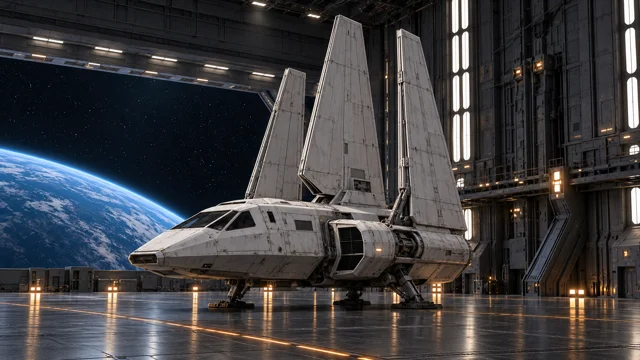</a><figcaption>@Image3 — общий шаттл 43/44, AI-референс дизайна</figcaption></figure><figure><a href="references/scenes/scene-43/S43-wing-hinge-closeup.png" target="_blank" rel="noopener">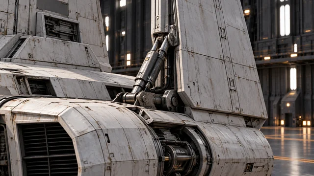</a><figcaption>@Image4 — шарнир поднятого крыла, деталь механики</figcaption></figure></div>

**Что происходит:** В ангаре крейсера шаттл Канцлера готовится к вылету: рампа закрыта, двигатели раскручиваются. При ограниченном наземном тесте правое крыло плавно отклоняется наружу, левое дёргается, скрежещет и застревает под45° над горизонталью; полного раскрытия до пола нет. Пилот щёлкает тумблером снова и снова — крыло жалко подёргивается на пару сантиметров. «Владыка… крыло заело». — «Я заметил». Двигатели глохнут, рабочее крыло обиженно поднимается обратно, рампа полностью опускается и останавливается; только затем Серёга появляется в открытом проёме, переступает порог и молча спускается по рампе на пол ангара и смотрит вверх на кривое крыло.

**Дополнительный вход:** @Image4 = <a href="references/scenes/scene-43/S43-wing-hinge-closeup.png">шарнир поднятого крыла, деталь механики</a>.

<div class="engine-tabs" data-scene="43">

<div class="engine-pane" data-engine="wan30" data-main="1">

```text
Mode: reference-to-video | Duration: 30s | Resolution: 1080p | Aspect ratio: 16:9 | FPS: 24 | Native audio: on
Optimized for Wan 3.0 | Photoreal live-action space-opera deadpan comedy | The Chancellor's Imperial shuttle cannot take off because one wing jams halfway

REFERENCES / AUTHORITY ORDER:
@Image1 — absolute identity of SEREGA (the Chancellor): face, head, build and robe.
@Image2 — the exact Imperial space-cruiser hangar: tall graphite wall ribs with white vertical light strips, dark satin metal floor with a flush Imperial starburst medallion and two amber guide lines, a huge rear opening onto stars and a blue planet. The white triangular shuttle with raised wings on the right of @Image2 is the shuttle of this scene. Location geometry and shuttle silhouette only; no people from this image.
@Image3 — the shared close exterior design reference of the same shuttle with BOTH side wings raised: hull, three distinct fins, hinges, cockpit and landing supports. Vehicle geometry only.
@Image4 — WING ROOT MECHANICAL DETAIL ONLY: compact pivot and actuator of the SAME upright parked shuttle from @Image3. @Image3 controls overall vehicle design, @Image2 location. This close-up does not set screen-left/right geography or the jammed end state and never replaces the real last frame of result43.
Priority: @Image1 controls Serega; @Image2 controls the hangar; @Image3 controls the shuttle design. The timeline controls moving wing positions.

CHARACTER APPEARANCE / IDENTITY LOCK:
SEREGA (the Chancellor), @Image1: pale older man, sparse light hair with a bald crown, mature serious face, long deep dark-purple velvet robe with a hood lying on the shoulders and black inner sleeves. No lightsaber in his hands.
IMPERIAL PILOT: one anonymous Imperial shuttle pilot in a black flight suit and a closed black helmet with a dark visor; his face is never shown.
Exactly two people: Serega and the pilot. Ground crew may stand far in the background as small, still silhouettes.

SHUTTLE / WING LOCK — CRITICAL:
One classic white triangular Imperial Lambda-type shuttle: a tall fixed central dorsal fin, two long side wings hinged at the top of the hull, a forward cockpit with a framed window and a lowering front boarding ramp, three landing legs. Parked, both side wings are raised almost vertical beside the central fin, as in @Image2. For flight the side wings unfold DOWN and outward. Here the shuttle performs a LIMITED ground preflight test, aborted before full flight deployment: neither wingtip may touch or pass through the hangar floor. The working RIGHT wing smoothly pivots outward to 45 degrees above horizontal and can return upright. The LEFT wing follows to the same 45-degree angle, jerks and jams there; it cannot return upright. LEFT and RIGHT are defined from the pilot's forward-facing seat, not by arbitrary screen position. The tall CENTRAL dorsal fin is fixed and never rotates. The shuttle stays on its landing legs the whole time and never lifts off. Same single shuttle, same white colour and shape, in every shot.

BOARDING PATH LOCK — CRITICAL:
One existing front boarding doorway opens onto one ramp with an unbroken walking surface from the threshold to the hangar floor. The solid hull, cockpit window and doorframe remain rigid obstacles. Serega stays inside until the ramp is fully lowered and stationary; he exits only through the clear doorway, with his body fitting inside its opening and his robe clear of the frame. His shoes stay on top of the ramp, with visible alternating foot contact and weight transfer. No part of him intersects the hull, closed panels, ramp or floor.

START STATE:
The shuttle stands on the hangar floor with both wings raised, front ramp closed, engines starting to whine. Serega is already inside, seated in the passenger seat right behind the pilot.

TIMELINE:
[0:00–0:05] — READY FOR DEPARTURE
Exterior wide in the hangar from @Image2, the shuttle on the right third of frame facing the open hangar mouth with stars and the blue planet beyond. The engine glow at the rear brightens; a rising turbine whine. A tiny background crew figure steps back to a safe distance.

[0:05–0:10] — ONE WING GOES, ONE DOESN'T
Closer exterior three-quarter view of the shuttle. Keep both side-wing roots and the fixed central fin visible in one front three-quarter view. With a smooth hydraulic hum the working right wing pivots outward to 45 degrees ABOVE horizontal, still clear of the floor. The left wing starts the same ground test, jerks, gives a loud metallic grind and jams at that outward 45-degree angle. The whole hull rocks slightly on its landing legs.

[0:10–0:15] — TRY AGAIN
Inside the cockpit, medium shot from the front-side: the pilot in his black helmet flips the same wing toggle three times in a row. The failed actuator gives a pathetic stuttering servo whine with each flip. The wing is outside this cockpit framing; do not invent a new wing position through the window. Serega sits upright with his hands folded on his lap and slowly turns his head toward the sound at the side window.

[0:15–0:21] — THE REPORT
The pilot stops, does not turn around, and says carefully: «Владыка… крыло заело.» A two-second pause. Serega, without moving anything except his eyes back to the pilot's helmet, answers flatly: «Я заметил.»

[0:21–0:24] — OPEN FIRST
Return to the same front three-quarter exterior axis, with a clear view of the doorway, the entire ramp and both wing roots. Engines wind down. ONLY the working right wing lifts upright; the left wing stays jammed at 45 degrees above horizontal. The front ramp lowers, its bottom edge meets the floor, and it stops. The doorway is visibly open; Serega remains inside while the ramp moves.

[0:24–0:30] — EXIT THROUGH THE DOORWAY
Keep this exterior shot uncut. Serega appears within the open doorway, crosses its threshold and walks alone down the centre of the stationary ramp at a normal pace. Show his whole body and his feet contacting its upper surface. He steps off the bottom edge onto the hangar floor, stops clear of the ramp and looks up. Hold the last second: left wing jammed at45 degrees, right wing upright. The pilot remains inside.

END STATE:
Serega standing on the hangar floor at the foot of the lowered front ramp, looking up at the left wing jammed at 45 degrees; the right wing raised; engines off; hangar mouth with stars behind.

CAMERA / SPACE:
Three fixed camera setups, reused in this order: establishing exterior wide; front three-quarter exterior showing both hinges and central fin; cockpit; return to the SAME front three-quarter exterior. Never cross the shuttle axis or exchange the two side wings. For the final exterior shot, keep the open doorway, full ramp and Serega's feet unobstructed, with both wing roots and the asymmetric wing positions readable; do not hide the exit behind the nose or a wing. Stable tripod or slow dolly; no handheld jitter, no whip pans, no zoom jumps. Real hangar scale: the shuttle is far larger than a person and far smaller than the hangar.

PERFORMANCE:
Played completely straight. The pilot is tense and embarrassed but professional; small, quick toggle movements, no slapstick. Serega is icy and still; the joke is that his face does not change. No smiles, no eye-rolls to camera.

LIGHTING / MATERIALS:
Working state of the @Image2 hangar: cool white wall strips and amber floor guide lines only, no cyan or magenta strips, no disco beams. Clean white painted metal of the shuttle with panel lines and light wear, hydraulic sheen at the wing hinge, a small puff of vapour from the hinge when the wing jams. Realistic skin texture and velvet response on Serega.

AUDIO:
Turbine whine rising, smooth hydraulic hum of the right wing, a loud metallic grind and clunk when the left wing jams, repeated stuttering servo whine, toggle clicks, cockpit beeps, then the engines winding down and the ramp's gas hiss and footsteps on metal. Big hangar reverb.

DIALOGUE / VOCALS:
Language: Russian, natural pronunciation without accent, accurate lip sync where a mouth is visible.
PILOT (voice from inside his closed helmet, slightly muffled, cautious): «Владыка… крыло заело.»
SEREGA (low, calm, completely flat): «Я заметил.»
Only these two lines. Serega's mouth moves only on his line; the pilot's helmet stays still. No narrator, no music, no subtitles.

NEGATIVE PROMPT:
walking through the hull or cockpit window, body clipping through panels, feet sinking through the ramp, exiting a closed door, walking on a moving ramp, teleporting outside, shuttle taking off, hovering or leaving the hangar, both wings working, both wings jammed, jammed wing returning upright, restored symmetrical final pose, rotating central fin, wings passing through the floor, wings falling off in this scene, explosions, fire, second shuttle, different ship design, X-wing or TIE fighter replacing the shuttle, disco lights, dancers, crowd, extra officers in the foreground, pilot's face visible, Serega smiling or shouting, lightsaber, slapstick mugging, changed face or robe, wrong speaker, extra dialogue, cartoon CGI, toy-like shuttle, subtitles, text, logo, watermark, black bars.

FRAME FILL / NO BARS:
Fill the entire generated frame edge-to-edge. No letterboxing, no pillarboxing, no black bars, no side bars, no decorative borders, no empty margins.
```

</div>

<div class="engine-pane" data-engine="sd20x2">

Та же сцена двумя роликами по 15 с: сначала часть 1, часть 2 — после её результата (@Video1 части 2 = последние секунды части 1). Нумерация входов в каждой части своя.

**Входы части 1:** @Image1 — `references/full/serega.jpg`; @Image2 — `references/scenes/scene-28/H28A-ceremony.png`; @Image3 — `references/scenes/scene-43/S43-shuttle-raised-wings.png`; @Image4 — `references/scenes/scene-43/S43-wing-hinge-closeup.png`.

*Часть 1 без речи: тест крыльев, левое заедает, тумблер лишь дёргает его; финал на внешнем плане, чтобы часть 2 унаследовала положение крыльев.*

**Входы части 2:** @Video1 — последние секунды результата части 1; @Image1 — `references/full/serega.jpg`; @Image2 — `references/scenes/scene-28/H28A-ceremony.png`; @Image3 — `references/scenes/scene-43/S43-shuttle-raised-wings.png`.

*Часть 2: обе реплики целиком («Владыка… крыло заело.» — «Я заметил.»), правое крыло поднимается, рампа, выход Серёги.*

#### 43 · Seedance 2.0 часть 1

```text
Mode: reference-to-video (omni-reference) | Duration: 15s | Resolution: 720p | Aspect ratio: 16:9 | FPS: 24 | Native audio: on
Optimized for Seedance 2.0 | Photoreal live-action space-opera deadpan comedy | Part 1 of 2: the Chancellor's shuttle runs its wing test, one wing jams, and the pilot's toggle only makes it twitch

REFERENCES / AUTHORITY ORDER:
@Image1 — absolute identity of SEREGA (the Chancellor): face, head, build and robe.
@Image2 — the exact Imperial cruiser hangar: graphite wall ribs with white light strips, dark metal floor with a starburst medallion and two amber guide lines, a huge opening onto stars and a blue planet. The white shuttle on its right is this scene's shuttle. Location and silhouette only; no people from it.
@Image3 — close exterior design of the same shuttle with BOTH side wings raised: hull, three fins, hinges, cockpit, landing supports. Vehicle geometry only.
@Image4 — WING ROOT MECHANICAL DETAIL ONLY: compact pivot and actuator of the SAME shuttle. It does not set screen-left/right geography or the jammed state.
Priority: @Image1 controls Serega; @Image2 the hangar; @Image3 the shuttle design. The timeline controls moving wing positions.

CHARACTER APPEARANCE / IDENTITY LOCK:
SEREGA (the Chancellor), @Image1: pale older man, sparse light hair with a bald crown, mature serious face, long deep dark-purple velvet robe with a hood lying on the shoulders and black inner sleeves. No lightsaber.
IMPERIAL PILOT: one anonymous pilot in a black flight suit and a closed black helmet with a dark visor; his face is never shown.
Exactly two people, both inside the closed shuttle the whole part. Ground crew only as small, still background silhouettes.

SHUTTLE / WING LOCK — CRITICAL:
One classic white triangular Imperial Lambda-type shuttle: a tall fixed central dorsal fin, two long side wings hinged at the top of the hull, a forward cockpit with a framed window and a lowering front boarding ramp, three landing legs. Parked, both side wings are raised almost vertical beside the central fin, as in @Image2. For flight the side wings unfold DOWN and outward. Here the shuttle performs a LIMITED ground preflight test, aborted before full flight deployment: neither wingtip may touch or pass through the hangar floor. The working RIGHT wing smoothly pivots outward to 45 degrees above horizontal and can return upright. The LEFT wing follows to the same 45-degree angle, jerks and jams there; it cannot return upright. LEFT and RIGHT are defined from the pilot's forward-facing seat, not by arbitrary screen position. The tall CENTRAL dorsal fin is fixed and never rotates. The shuttle stays on its landing legs the whole time and never lifts off. Same single shuttle, same white colour and shape, in every shot.

START STATE:
The shuttle on the hangar floor, both wings raised, front ramp closed, engines starting to whine. Serega inside, seated right behind the pilot.

TIMELINE:
[0:00–0:04] — READY FOR DEPARTURE
Exterior wide in the @Image2 hangar, the shuttle on the right third facing the open hangar mouth and stars. The camera glides low over the amber guide lines toward it; the rear engine glow flares. A tiny background crew figure steps back.

[0:04–0:09] — ONE WING GOES, ONE DOESN'T
Low front three-quarter exterior, both wing roots and the central fin in view. With a smooth hydraulic hum the right wing pivots outward to 45 degrees ABOVE horizontal, clear of the floor. The left wing follows, jerks, gives a loud metallic grind and jams at that angle. Quick hinge insert (@Image4 design): a puff of vapour, a shudder.

[0:09–0:15] — TRY AGAIN
Comic rhythm of quick cuts. Cockpit, medium from the front-side: the helmeted pilot flips the wing toggle; behind him Serega sits upright, hands folded, and slowly turns his head toward the sound. No wing visible through the glass. Cut to the same front three-quarter exterior: the jammed left wing twitches a couple of centimetres with a pathetic servo stutter. Cut: the toggle again. Cut: the same feeble twitch. Hold on that exterior.

END STATE:
Front three-quarter exterior: the right wing out at 45 degrees, the left wing jammed at 45 degrees and shuddering after its last twitch, central fin upright, ramp closed, engines still running; Serega and the pilot inside.

CAMERA / SPACE:
Cut on action between a low gliding wide, the front three-quarter exterior (plus one hinge insert) and the cockpit; the toggle intercut uses only the cockpit and that exterior axis. Never cross the shuttle axis or exchange the side wings. Smooth dolly and glide; no handheld jitter, whip pans or zoom jumps. Shuttle far larger than a person, far smaller than the hangar.

PERFORMANCE:
Played completely straight. The pilot is tense, embarrassed, professional; small quick toggle flips. Serega is icy and still. No smiles, no eye-rolls to camera.

LIGHTING / MATERIALS:
Working state of the @Image2 hangar: cool white wall strips and amber guide lines only, no coloured or disco light. White painted shuttle metal with panel lines and light wear, hydraulic sheen at the hinge.

AUDIO:
Rising turbine whine, smooth hydraulic hum, a loud metallic grind and clunk as the left wing jams, a stuttering servo whine on each toggle click, cockpit beeps. Big hangar reverb. No dialogue, narrator or music.

NEGATIVE PROMPT:
ramp opening, anyone leaving the shuttle, shuttle taking off or hovering, both wings working, jammed wing returning upright, rotating central fin, wings touching the floor, wings falling off, explosions, second shuttle, different ship design, disco lights, crowd, pilot's face visible, Serega smiling, lightsaber, slapstick mugging, changed face or robe, speech, cartoon CGI, toy-like shuttle, subtitles, text, logo, watermark, black bars.

FRAME FILL / NO BARS:
Fill the entire generated frame edge-to-edge. No letterboxing, no pillarboxing, no black bars, no side bars, no decorative borders, no empty margins.
```

#### 43 · Seedance 2.0 часть 2

```text
Mode: reference-to-video (omni-reference) | Duration: 15s | Resolution: 720p | Aspect ratio: 16:9 | FPS: 24 | Native audio: on
Optimized for Seedance 2.0 | Photoreal live-action space-opera deadpan comedy | Part 2 of 2: the jam is reported, the ramp lowers and the Chancellor walks out to look up at the wing

REFERENCES / AUTHORITY ORDER:
@Video1 — the last seconds of Part 1's result: front three-quarter exterior of the shuttle, both side wings out at 45 degrees, the left one jammed, ramp closed. Absolute START authority: wing positions, camera axis, light.
@Image1 — absolute identity of SEREGA (the Chancellor): face, head, build and robe.
@Image2 — the exact Imperial cruiser hangar: graphite ribs with white light strips, dark metal floor with amber guide lines, a huge opening onto stars. Location only; no people from it.
@Image3 — exterior design of the same shuttle: hull, fins, hinges, cockpit, legs. Geometry only; its raised wings are not the current pose.
Priority: @Video1 start and wing angles; @Image1 Serega; @Image2 hangar; @Image3 shuttle design.

CHARACTER APPEARANCE / IDENTITY LOCK:
SEREGA (the Chancellor), @Image1: pale older man, sparse light hair with a bald crown, mature serious face, long deep dark-purple velvet robe with a hood lying on the shoulders and black inner sleeves. No lightsaber.
IMPERIAL PILOT: one anonymous pilot in a black flight suit and a closed black helmet with a dark visor; his face is never shown.
Exactly two people. Ground crew only as small, still background silhouettes.

SHUTTLE / WING LOCK — CRITICAL:
One classic white triangular Imperial Lambda-type shuttle: a tall fixed central dorsal fin, two long side wings hinged at the top of the hull, a forward cockpit with a framed window and a lowering front boarding ramp, three landing legs. Parked, both side wings are raised almost vertical beside the central fin, as in @Image2. For flight the side wings unfold DOWN and outward. Here the shuttle performs a LIMITED ground preflight test, aborted before full flight deployment: neither wingtip may touch or pass through the hangar floor. The working RIGHT wing smoothly pivots outward to 45 degrees above horizontal and can return upright. The LEFT wing follows to the same 45-degree angle, jerks and jams there; it cannot return upright. LEFT and RIGHT are defined from the pilot's forward-facing seat, not by arbitrary screen position. The tall CENTRAL dorsal fin is fixed and never rotates. The shuttle stays on its landing legs the whole time and never lifts off. Same single shuttle, same white colour and shape, in every shot.

BOARDING PATH LOCK — CRITICAL:
One existing front boarding doorway opens onto one ramp with an unbroken walking surface from the threshold to the hangar floor. The solid hull, cockpit window and doorframe remain rigid obstacles. Serega stays inside until the ramp is fully lowered and stationary; he exits only through the clear doorway, with his body fitting inside its opening and his robe clear of the frame. His shoes stay on top of the ramp, with visible alternating foot contact and weight transfer. No part of him intersects the hull, closed panels, ramp or floor.

START STATE:
Exactly the last frame of @Video1; engines running; Serega seated inside right behind the pilot.

TIMELINE:
[0:00–0:06] — THE REPORT
One second on the @Video1 exterior, then cut to a cockpit medium, Serega's face readable in even light. The pilot stops flipping, does not turn around, and says carefully: «Владыка… крыло заело.» A two-second pause. Serega, moving only his eyes back to the pilot's helmet, answers flatly: «Я заметил.»

[0:06–0:09] — OPEN FIRST
Back to the same front three-quarter exterior. Engines wind down. ONLY the right wing lifts upright with an offended hydraulic sigh; the left stays jammed at 45 degrees. The ramp lowers, meets the floor and stops; Serega stays inside while it moves.

[0:09–0:15] — EXIT THROUGH THE DOORWAY
Uncut. Serega appears in the open doorway, crosses the threshold and walks alone down the stationary ramp, whole body in view. He steps onto the floor, stops clear of the ramp and looks up. Hold on the asymmetry; the pilot stays inside.

END STATE:
Serega standing on the hangar floor at the foot of the lowered front ramp, looking up at the left wing jammed at 45 degrees; the right wing raised; engines off; hangar mouth with stars behind.

CAMERA / SPACE:
Exterior from @Video1, cockpit, then the SAME front three-quarter exterior. Never cross the shuttle axis or exchange the side wings. Keep doorway, full ramp and Serega's feet unobstructed in the final shot. Stable or slow dolly; no handheld jitter or zoom jumps.

PERFORMANCE:
Completely straight. The pilot is embarrassed but professional; Serega is icy, his face never changes. No smiles, no eye-rolls to camera.

LIGHTING / MATERIALS:
Working @Image2 hangar light: cool white strips, amber guide lines, no disco light. White painted metal; real skin and velvet.

AUDIO:
Cockpit beeps, engines winding down, hydraulic sigh, ramp hiss, footsteps on metal, hangar reverb.

DIALOGUE / VOCALS:
Language: Russian, natural pronunciation without accent, accurate lip sync where a mouth is visible.
PILOT (voice from inside his closed helmet, slightly muffled, cautious): «Владыка… крыло заело.»
SEREGA (low, calm, completely flat): «Я заметил.»
Only these two lines. Serega's mouth moves only on his line; the pilot's helmet stays still. No narrator, no music, no subtitles.

NEGATIVE PROMPT:
walking through the hull, body clipping, exiting a closed door, walking on a moving ramp, teleporting, take-off, jammed wing returning upright, symmetrical final pose, wings falling off, second shuttle, pilot's face visible, Serega smiling, wrong speaker, extra dialogue, cartoon CGI, subtitles, watermark, black bars.

FRAME FILL / NO BARS:
Fill the entire generated frame edge-to-edge. No letterboxing, no pillarboxing, no black bars, no side bars, no decorative borders, no empty margins.
```

</div>

</div>

---

<a id="scene-44"></a>

## Сцена 44 — Ангар крейсера: ремонт крыла, и оно отваливается

<!-- scene-meta: {"target_engine":"Wan 3","production_state":"DRAFT","duration_s":30,"dialogue":{"enabled":true,"language":"ru"},"dependencies":[{"type":"continues","scene":43}],"tags":["serega","imperial_cruiser","hangar","shuttle","technicians","comedy","dialogue","speaker_ownership"]} -->

**Контекст использования:**

- **Уточнение владельца17.10,22:55:** в старом результате крыло одновременно лежит на полу и остаётся на шаттле. Исправленная попытка отслеживает одну физическую деталь: до падения она на шарнире, после — только на полу; на корпусе виден пустой корень, без второго крыла. Это требование к новому ролику, не утверждение об исправлении старого.

- **Редакция 17.10.2026 после разбора владельцем:** Новая одна бесплатная попытка44 разрешена17.10 после43; остаётся DRAFT до настоящего видео/финального кадра новой43 с застрявшим крылом. В старой платной задаче d837b803f130431ea0e2e5ad4b786c09 было4изображения, но отсутствовал требуемый @Video1; это не готовый continuity-пакет. Уточнено постоянное пустое крепление после падения; финальный общий план сохраняет крыло на полу. Старую задачу и её входы не переписывать.

- **Команда владельца 16.10.2026:** вторая сцена с тем же шаттлом — Серёга ходит и возмущается, а на заднем плане имперские ремонтники максимально комично пытаются сдвинуть заевшее крыло, и в процессе оно вообще отваливается. Продолжает Scene 43 через короткий скачок времени.
- **Техники** — трое безымянных имперских техников наземной службы; глобальных листов нет, описаны в промте.
- **До READY:** @Video1 или последний кадр результата Scene 43 (по нему старт) — после генерации 43; общий референс шаттла @Image3 уже сохранён; он задаёт дизайн, но не заменяет повреждённое положение крыла в результате 43.
- **Падение крыла** — без пострадавших: крыло падает плашмя рядом с техниками, никого не задевает.
- Русская речь → Wan 3.0. В монтаж ~20–25 с. Новая попытка внесена в очередь17.10, но заблокирована до проверенного настоящего конца новой43.

**Референсы:**

- @Image3 — <a href="references/scenes/scene-43/S43-shuttle-raised-wings.png">общий шаттл 43/44 с поднятыми крыльями</a> (геометрия корпуса и шарниров; начало 44 — только по результату 43).

- @Image1 — <a href="references/full/serega.jpg">Серёга</a>;
- @Image2 — <a href="references/scenes/scene-28/H28A-ceremony.png">имперский ангар крейсера H28A</a> (геометрия ангара и силуэт шаттла);
- @Video1 — последние секунды результата Scene 43 (выгрузить после её генерации).
- **Настоящий финал43 сохранён, но continuity не пройдена:** <a href="references/scenes/scene-44/S44-start-from-S43-result.png">кадр899/899 результата43</a> — оба боковых крыла подняты; требуемого застрявшего крыла45° нет. Не подменять AI-кадром и не подавать как утверждённый старт44. В Topview уже есть внешний результат44 (`d837b803f130431ea0e2e5ad4b786c09`); 17.10 владелец разрешил одну исправленную бесплатную попытку после новой43.

<div class="scene-ref-gallery">
<figure><a href="references/full/serega.jpg" target="_blank" rel="noopener"></a><figcaption>@Image1 — Серёга</figcaption></figure>
<figure><a href="references/scenes/scene-28/H28A-ceremony.png" target="_blank" rel="noopener"></a><figcaption>@Image2 — ангар H28A</figcaption></figure><figure><a href="references/scenes/scene-43/S43-shuttle-raised-wings.png" target="_blank" rel="noopener"></a><figcaption>@Image3 — общий шаттл 43/44, AI-референс дизайна</figcaption></figure><figure><a href="references/scenes/scene-44/S44-start-from-S43-result.png" target="_blank" rel="noopener">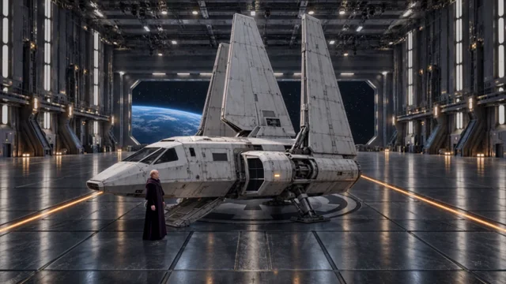</a><figcaption>Реальный финал43,29.967с. Кандидат для44: continuity не пройдена, крылья подняты.</figcaption></figure></div>

**Что происходит:** Немного позже. На переднем плане Серёга ходит взад-вперёд, руки за спиной: «Лучший флот в галактике… а крыло сложить некому». За его спиной трое техников воюют с заевшим левым крылом: один на стремянке лупит молотком по шарниру, второй повис на верёвке, привязанной к концу крыла, третий упирается плечом. От последнего удара крыло со стоном отрывается целиком и с грохотом падает плашмя на пол. Серёга замирает спиной к этому и закрывает глаза. Техник со стремянки, с молотком в руке: «Зато… теперь не мешает». Серёга медленно поворачивает голову.

<div class="engine-tabs" data-scene="44">

<div class="engine-pane" data-engine="wan30" data-main="1">

```text
Mode: reference-to-video | Duration: 30s | Resolution: 1080p | Aspect ratio: 16:9 | FPS: 24 | Native audio: on
Optimized for Wan 3.0 | Photoreal live-action space-opera deadpan comedy | Imperial technicians try to free the jammed shuttle wing behind the fuming Chancellor, and the wing falls off

REFERENCES / AUTHORITY ORDER:
@Video1 — the last seconds of the previous scene: Serega at the foot of the lowered ramp, the shuttle with its left wing jammed at 45 degrees and its right wing raised, the same hangar and light. Authority for the START STATE and the shuttle's position.
@Image1 — absolute identity of SEREGA (the Chancellor).
@Image2 — the exact Imperial space-cruiser hangar: tall graphite wall ribs with white vertical light strips, dark satin metal floor with a flush Imperial starburst medallion and two amber guide lines, a huge rear opening onto stars and a blue planet; the white triangular shuttle with raised wings on its right. Location and shuttle silhouette only; no people from this image.
@Image3 — the same shared close exterior shuttle design reference used for Scene43: hull, fins and hinges only. Its two raised wings are NOT the start pose of this scene.
Priority: @Video1 controls the actual damaged start state and wing angles; @Image1 controls Serega; @Image2 controls the hangar; @Image3 preserves the vehicle design. Never reset the jammed wing to the raised reference pose.

CHARACTER APPEARANCE / IDENTITY LOCK:
SEREGA (the Chancellor), @Image1: pale older man, sparse light hair with a bald crown, mature serious face, long deep dark-purple velvet robe with a hood lying on the shoulders and black inner sleeves; hands clasped behind his back while pacing.
THREE IMPERIAL TECHNICIANS, ordinary adult men in identical dark-grey Imperial ground-crew coveralls, black utility belts and soft black peaked caps:
TECH 1 — thin, on a tall rolling metal stepladder at the wing hinge, holding a big heavy hammer;
TECH 2 — stocky, hanging with both hands on a rope tied to the tip of the jammed wing;
TECH 3 — tall, pushing the wing's underside with his shoulder from the floor.
Exactly four people. No pilot visible, no other crew in the foreground.

SHUTTLE / WING LOCK — CRITICAL:
The same white triangular Imperial Lambda-type shuttle as before: tall fixed central dorsal fin, side wings hinged at the top of the hull, lowered front ramp. Its LEFT wing is jammed at about 45 degrees; its right wing is raised and never moves. The jammed left wing tears off at its hinge only once, in [0:18–0:24], and falls flat onto the floor beside the shuttle; it never hits anyone. Track ONE physical left-wing object continuously from its hinge to the floor. Before separation it is attached; after separation there are ZERO left wings on the hull and exactly ONE detached left wing on the floor. The vacated root is a short exposed hinge with a visible gap, not a second wing or wing-shaped remnant. The hull remains on its landing legs. This object count and empty root persist through the last frame; the wing never regrows, reattaches or duplicates. The raised right wing and fixed central fin remain exactly where they were. No fire, no explosion.

START STATE:
A little later than the end of @Video1: the shuttle in the same place with the left wing jammed at 45 degrees; the stepladder already at the hinge, the rope already tied to the wingtip, the three technicians in position. Serega in the foreground, frame-centre, a few metres in front of the shuttle.

TIMELINE:
[0:00–0:06] — THE REPAIR BEGINS
Wide, lens at chest height. In the sharp foreground Serega paces from frame-left to frame-right with his hands behind his back. Behind him in the middle ground: TECH 1 gives three brisk, solemnly measured hammer taps like an expert diagnostic test; TECH 2 braces and heaves the rope on each tap; TECH 3 leans in with his whole weight, boots sliding a few centimetres. Their absurdly coordinated effort achieves absolutely no wing movement.

[0:06–0:12] — THE FLEET
Serega turns and paces back, not looking at the shuttle, and says to nobody: «Лучший флот в галактике…» Behind him TECH 2 lifts both feet and hangs on the taut rope with his full weight, legs bicycling uselessly in the air; TECH 3 pushes harder with ridiculous earnestness. Their escalating effort still moves the wing not one centimetre.

[0:12–0:18] — NOBODY CAN FOLD A WING
Serega stops in the foreground, back to the shuttle, and finishes: «…а крыло сложить некому.» Behind him TECH 1 swings the hammer with full force — a loud CLANG and a spray of sparks at the hinge.

[0:18–0:24] — THE WING FALLS OFF
With a long rising metallic groan the one attached left wing separates visibly at its hinge, leaving that attachment point empty. Track that same wing as it swings down and crashes flat onto the hangar floor beside the shuttle with a huge booming impact that echoes through the hangar; a puff of dust and a few bolts bounce across the floor. Before the wing reaches the floor, TECH 3 steps clear of its landing area. TECH 2 releases the pull and drops onto his backside outside that area, still holding the slack rope; the stepladder wobbles with TECH 1 clinging to it. Serega, still with his back to it, stops completely and closes his eyes.

[0:24–0:30] — STILL HELPFUL
Total silence except the last echo. TECH 1 on the ladder, holding the hammer, says after a pause, hopefully: «Зато… теперь не мешает.» Serega slowly opens his eyes and turns only his head toward the technicians. Hold on his cold stare in the foreground; behind him the three technicians freeze.

END STATE:
Serega in the foreground, head turned toward the technicians with a cold stare; the left wing lying flat on the hangar floor; TECH 1 frozen on the stepladder with the hammer, TECH 2 sitting on the floor with the rope, TECH 3 standing still; the shuttle behind them with its empty left-wing root clearly visible, only the right side wing still attached and the central dorsal fin unchanged.

CAMERA / SPACE:
One continuous take with a fixed axis: Serega always in the foreground, the shuttle and technicians always behind him in the middle ground, the hangar mouth with stars beyond. No push-in during the fall. Keep Serega, the entire detached wing on the floor and its EMPTY root in one readable medium-wide composition through the end; do not hide the damage behind Serega. Deep focus so both planes stay readable. No cuts, no handheld jitter, no zoom jumps.

PERFORMANCE:
Serega is restrained, cold irritation: measured steps, quiet voice, no shouting, no big gestures. The technicians apply increasingly absurd physical effort with absolute professional seriousness: measured taps, a full-weight dangling pull and a hopeless shoulder shove, then one disastrously overconfident hammer blow. Keep their actions large, brisk and easy to read behind the unmoved Chancellor. The huge failure and the sincere hopeful final line are the punchline; no mugging, slow passive repairs or extra dialogue. Nobody is hurt.

LIGHTING / MATERIALS:
Working state of the @Image2 hangar: cool white wall strips and amber floor guide lines, no cyan or magenta strips, no disco beams. White painted shuttle metal with panel lines; a bright short spark burst at the hinge; real dust and small debris when the wing lands. Realistic skin and velvet on Serega, matte coveralls on the technicians.

AUDIO:
Hangar room tone, Serega's footsteps on metal, hammer taps, rope creak, a loud CLANG with sparks crackle, a long metallic groan, then a massive booming crash with long reverb, bolts rattling on the floor, then near silence.

DIALOGUE / VOCALS:
Language: Russian, natural pronunciation without accent, accurate lip sync.
SEREGA (quiet, cold, to nobody, in two parts): «Лучший флот в галактике…» — pause — «…а крыло сложить некому.»
TECH 1 (after the crash, hesitant, hopeful): «Зато… теперь не мешает.»
Only these lines. Mouths move only for the current speaker; the other technicians never speak. No narrator, no music, no subtitles.

NEGATIVE PROMPT:
wing hitting a person, injury, blood, fire, explosion, whole shuttle collapsing, both wings falling, detached wing regrowing or reattaching, duplicated wing, hidden empty hinge, shuttle taking off, second shuttle, different ship design, more than three technicians, stormtroopers, droids, pilot, Serega looking at the shuttle while speaking, Serega shouting, smiling or using the Force, technicians speaking together, slapstick pratfalls on purpose, wrong speaker, changed face or robe, disco lights, dancers, cartoon CGI, toy-like shuttle, subtitles, text, logo, watermark, black bars.

FRAME FILL / NO BARS:
Fill the entire generated frame edge-to-edge. No letterboxing, no pillarboxing, no black bars, no side bars, no decorative borders, no empty margins.
```

</div>

<div class="engine-pane" data-engine="sd20x2">

Та же сцена двумя роликами по 15 с: сначала часть 1, часть 2 — после её результата (@Video1 части 2 = последние секунды части 1). Нумерация входов в каждой части своя.

**Входы части 1:** @Video1 — последние секунды результата новой Scene 43 (левое крыло застряло на 45°); @Image1 — `references/full/serega.jpg`; @Image2 — `references/scenes/scene-28/H28A-ceremony.png`; @Image3 — `references/scenes/scene-43/S43-shuttle-raised-wings.png`.

*Часть 1: ремонт и обе половины реплики Серёги, заканчивается мощным ударом молотка — крыло ещё на месте.*

**Входы части 2:** @Video1 — последние секунды результата части 1; @Image1 — `references/full/serega.jpg`; @Image2 — `references/scenes/scene-28/H28A-ceremony.png`; @Image3 — `references/scenes/scene-43/S43-shuttle-raised-wings.png`.

*Часть 2: крыло отрывается и падает, пустой шарнир; «Зато… теперь не мешает.» и ледяной взгляд Серёги — один план.*

#### 44 · Seedance 2.0 часть 1

```text
Mode: reference-to-video (omni-reference) | Duration: 15s | Resolution: 720p | Aspect ratio: 16:9 | FPS: 24 | Native audio: on
Optimized for Seedance 2.0 | Photoreal live-action space-opera deadpan comedy | Part 1 of 2: three overzealous technicians attack the jammed wing behind the pacing, fuming Chancellor, ending in one huge hammer blow

REFERENCES / AUTHORITY ORDER:
@Video1 — the last seconds of the previous scene: Serega at the foot of the lowered ramp, the shuttle with its left wing jammed at 45 degrees and its right wing raised, the same hangar and light. Authority for the START STATE and the shuttle's position.
@Image1 — absolute identity of SEREGA (the Chancellor).
@Image2 — the exact Imperial cruiser hangar: graphite wall ribs with white light strips, dark metal floor with a starburst medallion and two amber guide lines, a huge opening onto stars. Location only; no people from it.
@Image3 — the shared exterior shuttle design reference: hull, fins and hinges only. Its two raised wings are NOT the pose of this scene.
Priority: @Video1 start state and wing angles; @Image1 Serega; @Image2 hangar; @Image3 vehicle design. Never reset the jammed wing to the raised pose.

CHARACTER APPEARANCE / IDENTITY LOCK:
SEREGA (the Chancellor), @Image1: pale older man, sparse light hair with a bald crown, mature serious face, long deep dark-purple velvet robe with a hood lying on the shoulders and black inner sleeves; hands clasped behind his back while pacing.
THREE IMPERIAL TECHNICIANS, ordinary adult men in identical dark-grey ground-crew coveralls, black utility belts and soft black peaked caps:
TECH 1 — thin, on a tall rolling metal stepladder at the wing hinge, holding a big heavy hammer;
TECH 2 — stocky, hanging with both hands on a rope tied to the tip of the jammed wing;
TECH 3 — tall, pushing the wing's underside with his shoulder from the floor.
Exactly four people. No pilot, no other crew in the foreground.

SHUTTLE / WING LOCK — CRITICAL:
The same white triangular Imperial Lambda-type shuttle: tall fixed central dorsal fin, side wings hinged at the top of the hull, lowered front ramp. Its LEFT wing is jammed at about 45 degrees; its right wing is raised and never moves. In this part the jammed left wing stays attached at its hinge the whole time and does not budge, however hard they try. The hull stays on its landing legs. No fire, no explosion.

START STATE:
A little later than the end of @Video1: the shuttle in the same place with the left wing jammed at 45 degrees; the stepladder already at the hinge, the rope already tied to the wingtip, the three technicians in position. Serega in the foreground, frame-centre, a few metres in front of the shuttle.

TIMELINE:
[0:00–0:04] — THE REPAIR BEGINS
Master wide, lens at chest height. In the sharp foreground Serega paces from frame-left to frame-right, hands behind his back. Behind him TECH 1 gives three solemn, measured hammer taps like an expert diagnosis; TECH 2 heaves the rope on each tap; TECH 3 leans in with his whole weight, boots skidding. The wing does not move.

[0:04–0:09] — THE FLEET
Serega turns and paces back, not looking at the shuttle, and says to nobody: «Лучший флот в галактике…» Quick cut to a low angle on the technicians: TECH 2 lifts both feet and dangles from the taut rope, legs bicycling in the air; TECH 3 shoves with red-faced earnestness. Not one centimetre. Cut back to the master.

[0:09–0:15] — NOBODY CAN FOLD A WING
Master: Serega stops in the foreground, back to the shuttle, and finishes: «…а крыло сложить некому.» Behind him TECH 1 spits on his palms, takes an enormous overconfident wind-up and swings the hammer with full force — a huge CLANG and a spray of sparks at the hinge. Hold as the sparks fade; the wing is still attached.

END STATE:
Master medium-wide: Serega standing still in the foreground, back to the shuttle; behind him TECH 1 on the stepladder right after his full-force blow, hammer against the hinge, sparks fading; TECH 2 on the rope, TECH 3 under the wing; the left wing still attached and jammed at 45 degrees, right wing raised.

CAMERA / SPACE:
Fixed axis: Serega always in the foreground, the shuttle and technicians behind him in the middle ground, the hangar mouth with stars beyond. Crisp comic cuts on action between the master wide and one low angle on the struggling technicians; end in the master. Deep focus so both planes stay sharp. No handheld jitter, no zoom jumps.

PERFORMANCE:
Serega: restrained, cold irritation, measured steps, quiet voice, no big gestures. The technicians: escalating, absurdly committed physical effort with total professional seriousness, large and easy to read behind the unmoved Chancellor. No mugging to camera.

LIGHTING / MATERIALS:
Working state of the @Image2 hangar: cool white wall strips and amber guide lines, no disco light. White painted shuttle metal; a bright spark burst at the hinge. Realistic skin and velvet on Serega, matte coveralls.

AUDIO:
Room tone, footsteps on metal, hammer taps, rope creak, squeaking boots, then a huge CLANG and sparks crackle.

DIALOGUE / VOCALS:
Language: Russian, natural pronunciation without accent, accurate lip sync.
SEREGA (quiet, cold, to nobody, in two parts): «Лучший флот в галактике…» — pause — «…а крыло сложить некому.»
Only this line. The technicians never speak. No narrator, no music, no subtitles.

NEGATIVE PROMPT:
wing moving, wing falling off in this part, wing reset to raised pose, injury, blood, fire, explosion, shuttle taking off, second shuttle, different ship design, more than three technicians, stormtroopers, droids, pilot, Serega looking at the shuttle while speaking, Serega shouting or smiling, technicians speaking, wrong speaker, changed face or robe, disco lights, cartoon CGI, subtitles, text, watermark, black bars.

FRAME FILL / NO BARS:
Fill the entire generated frame edge-to-edge. No letterboxing, no pillarboxing, no black bars, no side bars, no decorative borders, no empty margins.
```

#### 44 · Seedance 2.0 часть 2

```text
Mode: reference-to-video (omni-reference) | Duration: 15s | Resolution: 720p | Aspect ratio: 16:9 | FPS: 24 | Native audio: on
Optimized for Seedance 2.0 | Photoreal live-action space-opera deadpan comedy | Part 2 of 2: the wing tears off and crashes to the floor behind the Chancellor, and a technician sincerely sees the bright side

REFERENCES / AUTHORITY ORDER:
@Video1 — the last seconds of Part 1's result: Serega in the foreground, back to the shuttle, TECH 1 on the ladder right after his full-force blow, the left wing still jammed. Absolute START authority: positions, camera axis, light.
@Image1 — absolute identity of SEREGA (the Chancellor).
@Image2 — the exact Imperial cruiser hangar: graphite wall ribs with white light strips, dark metal floor with amber guide lines, a huge opening onto stars. Location only; no people from it.
@Image3 — shuttle design reference: hull, fins and hinges only; its raised wings are NOT this pose.
Priority: @Video1 start; @Image1 Serega; @Image2 hangar; @Image3 vehicle design.

CHARACTER APPEARANCE / IDENTITY LOCK:
SEREGA (the Chancellor), @Image1: pale older man, sparse light hair with a bald crown, mature serious face, long deep dark-purple velvet robe with a hood lying on the shoulders and black inner sleeves; hands clasped behind his back.
THREE IMPERIAL TECHNICIANS in identical dark-grey ground-crew coveralls, black utility belts and soft black peaked caps: TECH 1 — thin, on a tall rolling stepladder at the hinge with a big hammer; TECH 2 — stocky, on the rope tied to the wingtip; TECH 3 — tall, shoulder under the wing.
Exactly four people. No pilot, no other crew in the foreground.

SHUTTLE / WING LOCK — CRITICAL:
The same white triangular Imperial Lambda-type shuttle as before: tall fixed central dorsal fin, side wings hinged at the top of the hull, lowered front ramp. Its LEFT wing is jammed at about 45 degrees; its right wing is raised and never moves. The jammed left wing tears off at its hinge only once, in [0:00–0:06], and falls flat onto the floor beside the shuttle; it never hits anyone. Track ONE physical left-wing object continuously from its hinge to the floor. Before separation it is attached; after separation there are ZERO left wings on the hull and exactly ONE detached left wing on the floor. The vacated root is a short exposed hinge with a visible gap, not a second wing or wing-shaped remnant. The hull remains on its landing legs. This object count and empty root persist through the last frame; the wing never regrows, reattaches or duplicates. The raised right wing and fixed central fin remain exactly where they were. No fire, no explosion.

START STATE:
Exactly the last frame of @Video1: sparks fading at the hinge, the left wing still attached, the technicians in position, Serega's back to the shuttle.

TIMELINE:
[0:00–0:06] — THE WING FALLS OFF
Continuing @Video1 without a cut: a long rising metallic groan; the one attached left wing separates visibly at its hinge, leaving that root empty. Track that same wing as it swings down and crashes flat onto the floor beside the shuttle with a huge booming impact; dust puffs, bolts bounce away. Before it lands, TECH 3 steps clear and is left with both hands still raised, pushing empty air; TECH 2 drops onto his backside outside the landing area, holding the slack rope; the stepladder wobbles with TECH 1 clinging to it. Serega, back to it all, stops dead and closes his eyes.

[0:06–0:15] — STILL HELPFUL
Silence except the last echo. One loose bolt rolls across the floor in a slow wobbling curve and settles beside Serega's shoe. TECH 1, on the ladder, says after a pause, hopefully: «Зато… теперь не мешает.» Serega slowly opens his eyes and turns only his head toward the technicians. TECH 1 slowly lowers the hammer behind his back; the other two freeze. Hold on Serega's cold stare.

END STATE:
Serega in the foreground, head turned toward the technicians with a cold stare; the left wing lying flat on the hangar floor; TECH 1 frozen on the stepladder with the hammer, TECH 2 sitting on the floor with the rope, TECH 3 standing still; the shuttle behind them with its empty left-wing root clearly visible, only the right side wing still attached and the central dorsal fin unchanged.

CAMERA / SPACE:
One uncut medium-wide master on the @Video1 axis: Serega in the foreground, shuttle and technicians behind him. No push-in during the fall. Keep Serega, the whole detached wing on the floor and its EMPTY root readable through the end; never hide the damage behind Serega. Deep focus. No handheld jitter, no zoom jumps.

PERFORMANCE:
Serega: cold, restrained, utterly still; the closed eyes and the slow head turn are his whole reaction. The technicians: sincere, professional, quietly mortified, and TECH 1 genuinely hopeful. Nobody is hurt; no mugging to camera.

LIGHTING / MATERIALS:
Working @Image2 hangar light: cool white strips, amber guide lines. White painted metal; real dust and debris on landing; real skin and velvet.

AUDIO:
A long metallic groan, a massive booming crash with long hangar reverb, rattling bolts, then near silence and one bolt rolling to a stop.

DIALOGUE / VOCALS:
Language: Russian, natural pronunciation without accent, accurate lip sync.
TECH 1 (after the crash, hesitant, hopeful): «Зато… теперь не мешает.»
Only this line. Serega and the other technicians never speak. No narrator, no music, no subtitles.

NEGATIVE PROMPT:
wing hitting a person, injury, blood, fire, explosion, shuttle collapsing, both wings falling, wing regrowing or reattaching, duplicated wing, hidden empty hinge, shuttle taking off, second shuttle, more than three technicians, pilot, Serega speaking, shouting or smiling, technicians speaking together, wrong speaker, changed face or robe, cartoon CGI, subtitles, text, watermark, black bars.

FRAME FILL / NO BARS:
Fill the entire generated frame edge-to-edge. No letterboxing, no pillarboxing, no black bars, no side bars, no decorative borders, no empty margins.
```

</div>

</div>

---

<a id="scene-47"></a>

## Сцена 47 — Красная точка: Серёга уходит от котов хитростью

<!-- scene-meta: {"target_engine":"Seedance 2.0","production_state":"READY","duration_s":30,"dialogue":{"enabled":false,"language":null},"dependencies":[],"tags":["serega","cats","sith_planet","saber_duel","red_dot","comedy","continuity"]} -->

**Контекст использования:**

- **Решение владельца 16.10.2026:** дуэль котов и Серёги (Scenes 27–32) заканчивается «красной точкой». Серёга понимает, что котов не победить, гасит меч и рукоятью пускает по камням красную точку. Коты не выдерживают и бросаются её ловить, а он быстрым шагом уходит в храм. Коты остаются непобеждёнными мастерами, Серёга выигрывает хитростью.
- **Место в фильме:** сразу после Scene 32 (арка), перед Scene 33 (Серёга один идёт по руинам к храму). В монтаж ~15–20 с.
- **Стык:** старт — фактический последний кадр того ролика Scene 32, который пойдёт в монтаж (сейчас единственный результат — task `9746bfed635c451e97095c35b4e3b2bf`). Настоящий последний кадр 899/899 (29.966667 с) извлечён и проверен; @Image6 задаёт точный старт. На фактическом кадре арка стоит: не придумывать обрушение между сценами.
- Без речи → Wan 3.0, как бой 30–32. READY; добавлена в разрешённую владельцем очередь после танцев, в порядке п. 6в.
- **Динамика (владелец 18.10.2026):** сцена переписана активнее — коты атакуют с первого кадра; акробатическая охота за точкой: прыжок от стены, скольжение, столкновение лбами, рикошет. Версии промта — во вкладках над промтом (30 с · Wan 3.0 / Seedance 2.5 и Seedance 2.0 · 2 × 15 с); версию, которую запускает очередь, отмечает «★ в очереди».

**Референсы:**

- @Image1 — <a href="references/full/serega.jpg">Серёга</a>;
- @Image2 — <a href="references/luchik.jpg">Лучик</a>;
- @Image3 — <a href="references/ryzhik.jpg">Рыжик</a>;
- @Image4 — <a href="references/scenes/scene-27/S27-Image5-topview-source.png">те же руины</a>;
- @Image5 — <a href="references/scenes/scene-27/S27-three-subject-scale.png">масштаб</a> (вспомогательный).
- @Image6 — <a href="references/scenes/scene-47/S47-start-from-S32-result.png">настоящий последний кадр Scene 32</a>, абсолютный стартовый кадр; лица — по индивидуальным референсам.

<div class="scene-ref-gallery">
<figure><a href="references/full/serega.jpg" target="_blank" rel="noopener"></a><figcaption>@Image1 — Серёга</figcaption></figure>
<figure><a href="references/luchik.jpg" target="_blank" rel="noopener"></a><figcaption>@Image2 — Лучик</figcaption></figure>
<figure><a href="references/ryzhik.jpg" target="_blank" rel="noopener"></a><figcaption>@Image3 — Рыжик</figcaption></figure>
<figure><a href="references/scenes/scene-27/S27-Image5-topview-source.png" target="_blank" rel="noopener"></a><figcaption>@Image4 — точные руины</figcaption></figure>
<figure><a href="references/scenes/scene-27/S27-three-subject-scale.png" target="_blank" rel="noopener">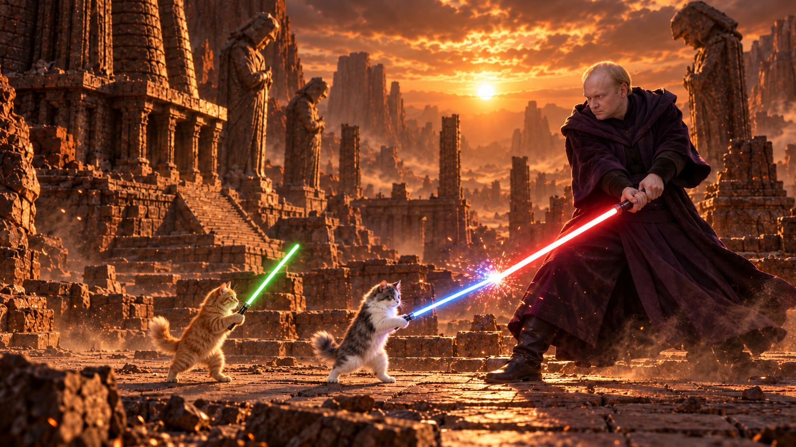</a><figcaption>@Image5 — масштаб</figcaption></figure><figure><a href="references/scenes/scene-47/S47-start-from-S32-result.png" target="_blank" rel="noopener">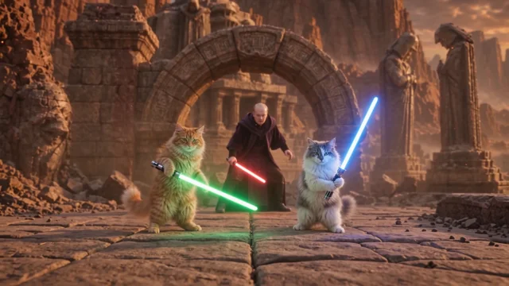</a><figcaption>@Image6 — конец 32, 29.966667 с</figcaption></figure></div>

**Что происходит:** Коты с двух сторон яростно атакуют Серёгу — Рыжик бьёт по ногам, Лучик прыгает с обломка сверху — и прижимают его спиной к опоре арки. Серёга с невозмутимым лицом гасит меч и пускает рукоятью красную точку; коты замирают, Лучик секунду держится и сдаётся, оба гасят и бросают мечи. Начинается бешеная охота: отталкивание от стены, скольжение на пузе, лобовое столкновение, рикошет от постамента статуи. Серёга загоняет точку в тёмную щель между обломками у арки, коты ныряют туда, а он поправляет мантию и быстрым шагом уходит по ступеням вглубь руин к храму.

<div class="engine-tabs" data-scene="47">

<div class="engine-pane" data-engine="wan30" data-main="1">

```text
Mode: reference-to-video | Duration: 30s | Resolution: 1080p | Aspect ratio: 16:9 | FPS: 24 | Native audio: on
Optimized for Wan 3.0 | Photoreal live-action action comedy at the end of a lightsaber duel | THE RED DOT — a fierce two-cat saber assault corners Serega, and he escapes by cunning while the cats chase a red dot in a frantic acrobatic hunt

REFERENCES / AUTHORITY ORDER:
@Image1 — exact SEREGA identity (see CHARACTER APPEARANCE / IDENTITY LOCK).
@Image2 — exact LUCHIK identity.
@Image3 — exact RYZHIK identity.
@Image4 — ABSOLUTE ancient Sith-planet ruins geography and sunset (see LOCATION LOCK — CRITICAL).
@Image5 — optional three-subject scale/staging helper only; never overrides identities or location.
@Image6 — genuine final frame of Scene 32: absolute opening composition, cat-left/right positions, standing arch and existing rubble. Preserve this actual state; do not invent an off-screen collapse.
Priority: @Image6 controls the exact opening frame and existing damage; @Image4 controls wider architecture, geography and sunset. @Image1, @Image2 and @Image3 control identities. @Image5 only helps scale and staging.

CHARACTER APPEARANCE / IDENTITY LOCK:
SEREGA (@Image1): exact older pale Chancellor identity, thinning hair / bald crown, recognizable mature face, human scale, long dark purple robe. His saber is RED; its polished metal hilt stays in his right hand for the whole scene.
LUCHIK (@Image2): exact white-and-grey natural long-haired cat: white muzzle/chest/forepaws, grey crown and back/facial markings, cold disciplined feline expression. BLUE saber.
RYZHIK (@Image3): exact warm orange striped tabby with fluffy ginger coat, darker stripes, lighter muzzle/chest, confident ferocious feline face. GREEN saber.
CAT SCALE: both cats ordinary house-cat size, upright top-of-head roughly around Serega's knee, in every shot and every jump. Genuinely feline: paws, fur, tails, ears, whiskers; no human hands, arms or anthropomorphic bodies. Exactly three characters, no duplicates.

LOCATION LOCK — CRITICAL:
@Image4 is the same world as the previous duel: huge weathered ochre/red-brown stone city, carved robed statues, temple terraces and stairs, shattered columns, rectangular towers, distant jagged mesa spires, low warm orange-gold sun. Preserve the standing arch and existing fallen blocks exactly as shown in @Image6; no invented collapse. Never substitute lava, black basalt, a clean arena or a red volcanic storm.

RED DOT LOCK — CRITICAL:
One small, crisp, bright red pointer dot, about the size of a coin, cast on the stone surfaces from the emitter end of Serega's switched-off saber hilt. Exactly one dot. It moves only where Serega points the hilt and only along real surfaces: stone floor, block faces, steps. No beam, no laser line in the air, no explosion, no magic; the blade itself is off while the dot is used.

START STATE:
Begin exactly from @Image6: Ryzhik on frame-left with a green saber, Luchik on frame-right with a blue saber, both upright on their hind legs, Serega behind them in the centre with his red saber lit low, the standing arch behind Serega. The cats attack at once; keep the exact existing rubble and sunset.

TIMELINE:
[0:00–0:05] — TWO-CAT ASSAULT
From the @Image6 framing both cats launch at Serega at once. Ryzhik dashes in low and slashes at his legs; Luchik bounds off a fallen block and strikes high. Serega blocks green, then blue, then green in fast, fierce, readable exchanges, driven back step by step until his back is against the stone pier of the arch.

[0:05–0:09] — CORNERED
Medium shot on Serega in even sunset light, face clear: blue and green blades crossed in front of his chest, pinning his red blade. Breathing hard, his face goes cool and deadpan; his eyes flick to the flat sunlit slab in front of the cats. In one sharp move he switches off the red blade. The cats freeze mid-attack, ears up, suspicious.

[0:09–0:13] — INSTINCT WINS
Serega points the empty hilt down: one small red dot appears on the slab a metre in front of the cats. Low cat-eye-level close two-shot: both heads snap down to the dot, pupils widen, tails twitch. Luchik holds his discipline for one second, then loses. The dot twitches left and right and both heads track it in perfect sync. Both cats switch off their sabers, let the unlit hilts drop on the stone and sink into a hunting crouch, rear ends wiggling.

[0:13–0:19] — THE HUNT
Wide: Serega flicks the dot away across the terrace and the cats explode after it on all fours. The dot zips up the face of a fallen block; Ryzhik springs at the block, kicks off its wall with all four paws and twists in mid-air as the dot slips away. Luchik overshoots, slides across the smooth stone on his belly with claws scrabbling, and the two collide head-on in a tumble of fur.

[0:19–0:24] — RICOCHET
The cats bounce up instantly. The dot zigzags along a broken column and up a statue plinth; both cats bound up after it, ricochet off the plinth wall and land in a heap. Serega walks briskly sideways along the terrace with the hilt aimed, steering the dot, face completely serious.

[0:24–0:27] — GONE
Serega sends the dot deep into a dark narrow gap between existing fallen blocks beside the arch. Both cats dive into the gap after it, head first, one after the other, and disappear; a puff of dust bursts out, scrabbling echoes inside.

[0:27–0:30] — DEEPER INTO THE RUINS
Serega lowers the hilt, straightens his robe with one tug, turns his back and strides briskly away up the temple stairs, deeper into the ruins, alone.

END STATE:
Serega alone, striding away up the temple stairs toward the temple entrance with the unlit hilt in his hand; the cats out of sight inside the rubble gap, dust still drifting from it; the same sunset ruins, damage preserved.

CAMERA / SPACE:
One coherent 3D space with readable geography and a fixed sunset direction. The first shot begins exactly from the @Image6 framing; then five motivated cuts on movement that keep screen direction: a medium on the cornered Serega, a low 50mm cat-eye-level close two-shot, a wide low tracking shot that whips with the dot during the hunt, a wide on the ricochet and the dive, and a wide following Serega up the stairs. Fast acrobatics play in wide shots with whole bodies visible; faces only recognisable in medium and close shots. Physically possible perspective and inertia; no jitter, teleporting, spatial resets or 180-degree axis flips.

PERFORMANCE:
The assault is fast and fierce: real feline speed, springing leaps and hard saber blows. Serega moves briskly and decisively, his face stays cool, serious and deadpan: no smile, no wink, no talking. The chase is frantic: genuine cat hunting instinct, wall kicks, slides, collisions, instant recoveries, ears and tails alive. Comedy comes from the situation, not from mugging; nobody looks into the lens.

LIGHTING / MATERIALS:
Warm weathered stone in low orange-gold sunset light; fine dry dust kicked up by every landing, rare ember-like particles; saber glow only while the blades are lit; the red dot stays small, crisp and slightly brighter than the sunlit stone.

AUDIO:
Saber hums, fierce clashes and switch-off sounds, unlit hilts clattering on stone, dry wind, rapid paw thumps, claws scrabbling and skidding on stone, a soft thud of the collision, one surprised cat chirp, scrabbling echoes from the gap, Serega's quick footsteps on the stone steps. No spoken dialogue, narrator, music, subtitles or on-screen titles.

NEGATIVE PROMPT:
giant cats, cats growing larger in close-ups, human cat-hands, talking cats, swaps, wrong saber color, a second red dot, visible laser beam, explosions, fake Force effects, floating hilts, Serega smiling or winking, injured cats, self-healing architecture, changing ruin geometry, collapsed arch, lava, character duplicates, glossy game look, cartoon, anime, incoherent cuts, text, watermark, frame borders.

FRAME FILL / NO BARS:
Fill the entire generated frame edge-to-edge. No letterboxing, no pillarboxing, no black bars, no side bars, no decorative borders, no empty margins.
```

</div>

<div class="engine-pane" data-engine="sd20x2">

Та же сцена двумя роликами по 15 с: сначала часть 1, часть 2 — после её результата (@Video1 части 2 = последние секунды части 1). Нумерация входов в каждой части своя.

**Входы части 1:** @Image1 — `references/full/serega.jpg`; @Image2 — `references/luchik.jpg`; @Image3 — `references/ryzhik.jpg`; @Image4 — `references/scenes/scene-27/S27-Image5-topview-source.png`; @Image5 — `references/scenes/scene-27/S27-three-subject-scale.png` (вспомогательный масштаб); @Image6 — `references/scenes/scene-47/S47-start-from-S32-result.png` (настоящий конец 32, старт).

**Входы части 2:** @Video1 — конец части 1; @Image1 — `references/full/serega.jpg`; @Image2 — `references/luchik.jpg`; @Image3 — `references/ryzhik.jpg`; @Image4 — `references/scenes/scene-27/S27-Image5-topview-source.png`; @Image5 — `references/scenes/scene-27/S27-three-subject-scale.png`.

#### 47 · Seedance 2.0 часть 1

```text
Mode: reference-to-video (omni-reference) | Duration: 15s | Resolution: 720p | Aspect ratio: 16:9 | FPS: 24 | Native audio: on
Optimized for Seedance 2.0 | Photoreal live-action action comedy at the end of a lightsaber duel | Part 1 of 2: two Jedi cats corner Serega in a fierce saber assault, and he lures them with a red dot

REFERENCES / AUTHORITY ORDER:
@Image1 — exact SEREGA identity.
@Image2 — exact LUCHIK identity.
@Image3 — exact RYZHIK identity.
@Image4 — ABSOLUTE ancient Sith-planet ruins geography and sunset.
@Image5 — optional three-subject scale/staging helper only; never overrides identities or location.
@Image6 — genuine final frame of the previous scene: absolute opening composition, cat-left/right positions, standing arch and existing rubble. Do not invent an off-screen collapse.
Priority: @Image6 controls the opening frame and existing damage; @Image4 the wider architecture and sunset; @Image1–@Image3 the identities; @Image5 only scale.

CHARACTER APPEARANCE / IDENTITY LOCK:
SEREGA (@Image1): exact older pale Chancellor, thinning hair / bald crown, recognizable mature face, human scale, long dark purple robe. RED saber; its polished metal hilt stays in his right hand throughout.
LUCHIK (@Image2): exact white-and-grey long-haired cat: white muzzle/chest/forepaws, grey crown, back and facial markings, cold disciplined expression. BLUE saber.
RYZHIK (@Image3): exact warm orange striped tabby, fluffy ginger coat, darker stripes, lighter muzzle/chest, confident ferocious face. GREEN saber.
CAT SCALE: ordinary house-cat size, upright top-of-head around Serega's knee, in every shot. Genuinely feline: paws, fur, tails, ears, whiskers; no human hands or anthropomorphic bodies. Exactly three characters.

LOCATION LOCK — CRITICAL:
The same weathered ochre/red-brown Sith stone city of @Image4: carved robed statues, temple terraces and stairs, shattered columns, distant mesa spires, low orange-gold sun. The arch and fallen blocks stay exactly as in @Image6. No lava, no clean arena.

RED DOT LOCK — CRITICAL:
One small, crisp, coin-sized bright red pointer dot cast on stone from the emitter end of Serega's switched-off hilt. Exactly one dot, only on real surfaces, only where he points. No beam in the air, no magic; his blade is off while the dot is used.

START STATE:
Exactly @Image6: Ryzhik frame-left with a green saber, Luchik frame-right with a blue saber, both upright on hind legs; Serega behind them in the centre, red saber lit low; the standing arch behind him.

TIMELINE:
[0:00–0:05] — TWO-CAT ASSAULT
From the @Image6 framing both cats launch at once: Ryzhik dashes low and slashes at Serega's legs, Luchik bounds off a fallen block and strikes high. Serega blocks green, blue, green in fast fierce exchanges, driven back until his back hits the arch pier.

[0:05–0:09] — CORNERED
Medium on Serega, face clear in even sunset light: blue and green blades cross in front of his chest, pinning his red blade. His face goes cool and deadpan; his eyes flick to the sunlit slab in front of the cats. He snaps off the red blade. The cats freeze mid-attack, ears up.

[0:09–0:15] — INSTINCT WINS
He points the empty hilt down: one red dot appears on the slab before the cats. Low cat-eye-level close two-shot: heads snap to the dot, pupils widen, tails twitch. Luchik resists for one second, then loses. The dot twitches left and right; both heads track it in sync. Both cats switch off their sabers, drop the unlit hilts on the stone and sink into a hunting crouch, rear ends wiggling. Hold the crouch on the last second.

END STATE:
Both cats crouched low on the stone, hunting-ready, eyes locked on the red dot on the slab, unlit hilts lying beside them; Serega in the centre in front of the arch, red blade off, hilt aimed at the dot; same sunset ruins.

CAMERA / SPACE:
Start exactly on the @Image6 framing; cut on movement to a medium on cornered Serega, then to a low 50mm cat-eye-level close two-shot. Keep screen direction, the cat-left/right layout and a fixed sunset direction. Fast action in wide shots with whole bodies; faces recognisable only in medium and close shots. No jitter, teleporting or axis flips.

PERFORMANCE:
The assault is fast and fierce with real feline speed and hard blows. Serega moves briskly and decisively; his face stays cool, serious and deadpan, no smile, no wink, no speech. The cats remain genuine cats in their reactions to the dot. Nobody looks into the lens.

LIGHTING / MATERIALS:
Warm weathered stone in low orange-gold sunset; fine dry dust from every landing; saber glow only while lit; the dot small, crisp, slightly brighter than the sunlit stone.

AUDIO:
Saber hums, fierce clashes, three switch-off sounds, hilts clattering on stone, dry wind, quick paw thumps, a tiny eager cat chirp. No dialogue, narrator, music or subtitles.

NEGATIVE PROMPT:
giant cats, cats larger in close-ups, human cat-hands, talking cats, swapped cats, wrong saber colours, a second red dot, visible laser beam, fake Force effects, floating hilts, Serega smiling or winking, collapsed arch, changing ruin geometry, lava, duplicates, glossy game look, cartoon, anime, text, watermark, frame borders.

FRAME FILL / NO BARS:
Fill the entire generated frame edge-to-edge. No letterboxing, no pillarboxing, no black bars, no side bars, no decorative borders, no empty margins.
```

#### 47 · Seedance 2.0 часть 2

```text
Mode: reference-to-video (omni-reference) | Duration: 15s | Resolution: 720p | Aspect ratio: 16:9 | FPS: 24 | Native audio: on
Optimized for Seedance 2.0 | Photoreal live-action action comedy at the end of a lightsaber duel | Part 2 of 2: a frantic acrobatic red-dot hunt, the cats vanish into the rubble and Serega walks off toward the temple

REFERENCES / AUTHORITY ORDER:
@Video1 — the last seconds of Part 1's result: both cats crouched, hunting-ready, before the red dot; Serega in front of the arch with his unlit hilt aimed at it; the same ruins and sunset. Absolute authority for the START STATE, positions and light.
@Image1 — exact SEREGA identity.
@Image2 — exact LUCHIK identity.
@Image3 — exact RYZHIK identity.
@Image4 — ABSOLUTE ancient Sith-planet ruins geography and sunset.
@Image5 — optional three-subject scale/staging helper only; never overrides identities or location.
Priority: @Video1 controls the start and existing damage; @Image4 the wider architecture and sunset; @Image1–@Image3 the identities; @Image5 only scale.

CHARACTER APPEARANCE / IDENTITY LOCK:
SEREGA (@Image1): exact older pale Chancellor, thinning hair / bald crown, recognizable mature face, human scale, long dark purple robe. His polished metal saber hilt, blade off, stays in his right hand throughout.
LUCHIK (@Image2): exact white-and-grey long-haired cat: white muzzle/chest/forepaws, grey crown, back and facial markings.
RYZHIK (@Image3): exact warm orange striped tabby, fluffy ginger coat, darker stripes, lighter muzzle/chest.
CAT SCALE: ordinary house-cat size, never larger than Serega's knee when upright, in every shot and every jump. Genuinely feline: paws, fur, tails, ears, whiskers; no human hands or anthropomorphic bodies. Exactly three characters.

LOCATION LOCK — CRITICAL:
The same weathered ochre/red-brown Sith stone city of @Image4: carved robed statues, temple terraces and stairs, shattered columns, distant mesa spires, low orange-gold sun. The arch and fallen blocks stay exactly as in @Video1. No lava, no clean arena.

RED DOT LOCK — CRITICAL:
One small, crisp, coin-sized bright red pointer dot cast on stone from the emitter end of Serega's switched-off hilt. Exactly one dot, only on real surfaces (floor, block faces, steps, plinths), only where he points. No beam in the air, no magic, all blades off.

START STATE:
Exactly the last frame of @Video1: both cats crouched low, eyes on the red dot, unlit hilts beside them; Serega in front of the arch aiming his hilt.

TIMELINE:
[0:00–0:05] — THE HUNT
Continuing @Video1 without a cut, Serega flicks the dot away across the terrace and both cats explode after it on all fours. Wide low tracking: the dot zips up a fallen block; Ryzhik kicks off its wall with all four paws and twists in mid-air as it slips away. Luchik overshoots, belly-slides across smooth stone with claws scrabbling, and the two collide head-on in a tumble of fur.

[0:05–0:09] — RICOCHET
They bounce up instantly. The dot zigzags along a broken column and up a statue plinth; both cats bound after it, ricochet off the plinth wall and land in a heap. Serega walks briskly sideways along the terrace with the hilt aimed, face completely serious.

[0:09–0:12] — GONE
He sends the dot deep into a dark narrow gap between existing fallen blocks beside the arch. Both cats dive in head first, one after the other, and vanish; a puff of dust bursts out, scrabbling echoes inside.

[0:12–0:15] — DEEPER INTO THE RUINS
Serega lowers the hilt, straightens his robe with one tug, turns his back and strides briskly away up the temple stairs, deeper into the ruins, alone.

END STATE:
Serega alone, striding away up the temple stairs toward the temple entrance with the unlit hilt in his hand; the cats out of sight inside the rubble gap, dust still drifting from it; the same sunset ruins, damage preserved.

CAMERA / SPACE:
First beat continues @Video1 without a cut, then cut on movement: a low wide tracking shot whipping with the dot, a wide on the ricochet and dive, a wide following Serega up the stairs. Keep screen direction and a fixed sunset direction. Acrobatics in wide shots with whole bodies visible; Serega's face, when seen, in a medium framing with even light. No jitter, teleporting or axis flips.

PERFORMANCE:
Frantic, real cat hunting: wall kicks, slides, collisions and instant recoveries, ears and tails alive; nobody is hurt. Serega moves briskly and decisively with a cool, deadpan face: no smile, no wink, no speech. Nobody looks into the lens.

LIGHTING / MATERIALS:
Warm weathered stone in low orange-gold sunset; dust bursts from every landing and from the gap; the dot small, crisp, slightly brighter than the sunlit stone.

AUDIO:
Rapid paw thumps, claws scrabbling and skidding on stone, a soft thud of the collision, one surprised cat chirp, scrabbling echoes from the gap, dry wind, Serega's quick footsteps on the stone steps. No dialogue, narrator, music or subtitles.

NEGATIVE PROMPT:
giant cats, cats larger in close-ups, human cat-hands, talking cats, swapped cats, lit sabers, a second red dot, visible laser beam, fake Force effects, floating hilts, injured cats, Serega smiling or winking, Serega running in panic, collapsed arch, changing ruin geometry, lava, duplicates, glossy game look, cartoon, anime, text, watermark, frame borders.

FRAME FILL / NO BARS:
Fill the entire generated frame edge-to-edge. No letterboxing, no pillarboxing, no black bars, no side bars, no decorative borders, no empty margins.
```

</div>

</div>

---

<a id="scene-48"></a>

## Сцена 48 — Татуин: после боя Канцлер забирает фрагмент карты

<!-- scene-meta: {"target_engine":"Seedance 2.0","production_state":"DRAFT","duration_s":30,"dialogue":{"enabled":false,"language":null},"dependencies":[{"type":"continues","scene":56}],"tags":["serega","ilyusha","artem","tatooine","worm","map","force_pull","worm_ride","deadpan","continuity"]} -->

**Контекст использования:**

- **Решение владельца 16.10.2026 (D6):** Канцлер забирает татуинский фрагмент после драки на фоне червя. Scene 16 принята; бой продолжает Scene 42 («червь им не интересен»), эта сцена — её развязка. Текст перенесён из прежней редакции Scene 42 (16.10), тон приведён к 42: червю по-прежнему никто не уделяет внимания.
- **Функция:** закрыть «первый фрагмент у Канцлера» — высший приоритет [Р2] §19 («показать момент захвата/кражи»). По [Р2] §8: Канцлер использует хаос червя, чтобы уйти с первым фрагментом.
- **Приём** — идея Саши (master, «Идеи от Саши», 32:51–32:52): меч гаснет → карта летит в руку Канцлера.
- **Правка владельца 18.10.2026:** финал другой — Серёга прячет модуль под робу, запрыгивает на червя и лихо уезжает на нём вдаль от джедаев (вместо «почти отвернулся и ушёл в бурю»). Червь по-прежнему никого не трогает; единственный контакт — Серёга сам едет у него на спине. Перед 48 теперь стоит новая Scene 56 (бой в движении), её конец — @Video1 этой сцены. Руины после 42/56 уже разрушены: в промте они не «восстанавливаются».
- **Кто держал фрагмент:** Артём (Bearded Jedi) — ответ владельца 17.10, 23:58. Бармен отдал модуль ему (31:51–31:52 по сборке [Р2]). Меч Илюши после 42 уже горит: он не «зажигает», а поднимает его.
- **Машина** после разрушения не появляется (W8). Отлёт Серёги с Татуина — Scene 53 (с окраины города), прибытие на Набу — Scene 39.
- Модуль того же дизайна, что набусский (@Image6); светится тускло, без голограмм.
- **До READY:** @Video1 — последние секунды результата Scene 56 (сначала нужны результаты 42 и 56).
- В монтаж 15–25 с. Запуск — только по команде владельца.
- **Динамика (владелец 18.10.2026):** сцена переписана активнее — резкий рывок Силой, спринт и прыжок на червя, Серёга уносится на нём как сёрфер; слово «спокойно» убрано. Версии промта — во вкладках над промтом (30 с · Wan 3.0 / Seedance 2.5 и Seedance 2.0 · 2 × 15 с); версию, которую запускает очередь, отмечает «★ в очереди».

**Референсы:**

- @Image1 — <a href="references/full/serega.jpg">Серёга</a>;
- @Image2 — <a href="references/full/ilyusha.jpg">Илюша (Hooded Jedi)</a>;
- @Image3 — <a href="references/full/artem.jpg">Артём (Bearded Jedi)</a>;
- @Image4 — <a href="references/scenes/scene-16/S16-desert-location-clean.png">пустынные руины Scene 16</a> (только локация);
- @Image5 — <a href="references/scenes/scene-16/S16-worm-scale.png">масштаб и дизайн червя</a>;
- @Image6 — <a href="references/scenes/scene-17/S17-Image4-topview-source.png">модуль карты (дизайн-класс фрагментов)</a>;
- @Video1 — последние секунды результата Scene 56 (выгрузить после её результата).

<div class="scene-ref-gallery">
<figure><a href="references/full/serega.jpg" target="_blank" rel="noopener"></a><figcaption>@Image1 — Серёга</figcaption></figure>
<figure><a href="references/full/ilyusha.jpg" target="_blank" rel="noopener"></a><figcaption>@Image2 — Илюша</figcaption></figure>
<figure><a href="references/full/artem.jpg" target="_blank" rel="noopener"></a><figcaption>@Image3 — Артём</figcaption></figure>
<figure><a href="references/scenes/scene-16/S16-desert-location-clean.png" target="_blank" rel="noopener"></a><figcaption>@Image4 — руины</figcaption></figure>
<figure><a href="references/scenes/scene-16/S16-worm-scale.png" target="_blank" rel="noopener"></a><figcaption>@Image5 — червь</figcaption></figure>
<figure><a href="references/scenes/scene-17/S17-Image4-topview-source.png" target="_blank" rel="noopener"></a><figcaption>@Image6 — модуль карты</figcaption></figure></div>

**Что происходит:** Трое сцепились мечами, червь ревёт над ними. Червь наконец обрушивается прямо между ними, Артёма сбивает волной песка: меч выпадает из руки и гаснет, из-за пояса вылетает светящийся модуль карты. Серёга протягивает руку — модуль летит сквозь пыль ему в ладонь. Илюша с горящим мечом бросается наперерез, но червь снова поднимается между ними и заставляет джедаев отпрыгнуть. Серёга быстро прячет модуль под робу, бросается к червю, запрыгивает на него и лихо уезжает на нём вдаль от джедаев.

<div class="engine-tabs" data-scene="48">

<div class="engine-pane" data-engine="wan30" data-main="1">

```text
Mode: reference-to-video | Duration: 30s | Resolution: 1080p | Aspect ratio: 16:9 | FPS: 24 | Native audio: on
Optimized for Wan 3.0 | Photoreal live-action desert space-fantasy, fast dashing action comedy | The ignored sandworm finally crashes between the duelists; the Chancellor rips the Tatooine map module to his hand with the Force, jumps onto the worm and rides it away

REFERENCES / AUTHORITY ORDER:
@Video1 — the last seconds of the previous scene: the three duelists locked blade against blade in the foreground, the furious worm rearing above them coiled to strike, the broken ruins, dust and light. Absolute authority for the START STATE.
@Image1 — absolute identity of SEREGA.
@Image2 — absolute identity of ILYUSHA, the Hooded Jedi.
@Image3 — absolute identity of ARTEM, the Bearded Jedi.
@Image4 — the desert ruins: sandy plain, glyph-covered gate piers, central obelisk, harsh warm daylight. Location geometry only; their damage follows @Video1.
@Image5 — the exact colossal segmented sandworm: scale and design only; it is far larger than people and gate piers.
@Image6 — the exact map module prop design.
Priority: @Video1 controls the start and the damage already done; @Image1–@Image3 control the three identities; @Image4 controls the location; @Image5 controls the worm; @Image6 controls the prop.

CHARACTER APPEARANCE / IDENTITY LOCK:
SEREGA (the Chancellor), @Image1: pale older man, sparse light hair with a bald crown, mature serious face, long deep dark-purple robe, sand in its folds; red lightsaber.
ILYUSHA, @Image2: moustache, tousled chestnut hair, weathered face, light olive-green layered tunic, deep-red hooded cloak, brown boots; blue lightsaber.
ARTEM, @Image3: heavier build, short beard, cream-beige tunic under a brown outer robe, wide brown belt, brown boots; green lightsaber.
Exactly three people. No other characters, no vehicles.

PROP LOCK — CRITICAL:
Exactly ONE small rigid palm-sized rectangular map module from @Image6: rounded grey metal frame, dark-grey face, two vertical warm-amber glowing segmented panels with a soft steady glow. It starts tucked in Artem's belt, flies through the air once and ends hidden in the inner fold of Serega's robe. It never folds, multiplies, breaks, projects a hologram or shows a map image.

WORM / LOCATION LOCK — CRITICAL:
The same colossal worm from @Image5 and the same ruins for the whole scene; the broken gate piers and the toppled obelisk halves stay as fixed landmarks and nothing rebuilds. The worm never swallows, bites or hurts anyone. Its only contact with a person is Serega deliberately riding its back at the end: he stands braced on one broad segment, gripping a ridge between segments, always far smaller than the worm. No car, speeder or wreck appears.

START STATE:
Exactly the last frame of @Video1: the two Jedi and the Chancellor locked blade against blade in the foreground, the furious worm rearing high above them, coiled to strike.

TIMELINE:
[0:00–0:06] — THE WORM CRASHES DOWN
Continuing @Video1 without a cut: the worm slams its upper body down onto the sand right between Artem and Serega. A heavy wave of sand throws Artem off his feet and pushes Ilyusha back several steps. Serega springs back out of the sand wave and snaps off his red saber in one sharp motion.

[0:06–0:11] — THE SABER GOES OUT
Artem hits the sand hard. His green saber flies out of his hand, its blade switches off in mid-air and the hilt lands half-buried. In the same tumble the glowing map module jerks loose from his belt and lands on the open sand between him and Serega.

[0:11–0:16] — THE MODULE FLIES TO THE CHANCELLOR
Fast push-in on Serega in the blowing dust. He thrusts out one open hand. The module rips off the sand and shoots straight through the dust into his palm; his fingers snap shut over its amber glow.

[0:16–0:21] — CUT OFF BY THE WORM
Ilyusha, his blue blade still lit, sprints at Serega to intercept, but the worm surges up out of the sand between them and forces both Jedi to leap aside. Artem, on his knees, can only watch.

[0:21–0:26] — ONTO THE WORM
In one quick move Serega shoves the module into the inner fold of his robe, sprints alongside the worm's long body as it slides past low over the sand, leaps onto its back, lands braced on one broad segment and grabs a ridge with one hand, robe whipping in the wind.

[0:26–0:30] — RIDING AWAY
Wide shot: the worm surges away across the dunes in a great spray of sand, Serega riding its back low and balanced like a surfer, robe streaming behind him, shrinking into the distance. In the foreground the two Jedi stand in the settling dust among the broken ruins and stare after him.

END STATE:
Serega rides the worm away into the far dunes with the module hidden in his robe; both Jedi alive in the foreground among the ruins, Artem's dark saber hilt half-buried in the sand.

CAMERA / SPACE:
The first two beats continue @Video1 as one take with fast arcing moves; then motivated cuts: a medium on Serega for the Force pull, a fast tracking shot for the jump onto the worm, and a final wide shot from behind the Jedi for the ride. Stable geography: Serega and the worm on frame-right, the Jedi on frame-left. Scale through parallax, dust layers and foreground debris. Only motivated impact vibration.

PERFORMANCE:
Serega is fast, decisive and dashing, his face cold and focused: the Force pull is a sharp, commanding gesture, the sprint and leap onto the worm athletic and bold. Artem is winded and annoyed, not frightened; Ilyusha is fast and determined, then left standing with his blade lowered. Nobody treats the worm as more than an obstacle. No speech, no smile, no look into the lens.

LIGHTING / MATERIALS:
Harsh warm desert sunlight, dry haze, long ruin shadows, blown sand in the air, realistic cloth and dust interaction; the module's soft amber glow reads through the dust; sand pouring off the worm's segments.

AUDIO:
The worm's deep roar and throat resonance, sand crashing down, debris impacts, wind, the hiss of two sabers switching off, the blue saber's hum as Ilyusha charges, a faint low Force hum as the module flies, a soft electronic pulse from it, the heavy grinding rush of the worm surging away and fading into the distance. Exertion breaths only; no dialogue, narrator or music.

NEGATIVE PROMPT:
worm swallowing or biting anyone, death, blood, Serega falling off the worm, worm shrunk to a tame size, saddle or reins, car, speeder, vehicle wreck, extra people, duplicated characters, two or three modules, hologram map, folded paper map, module breaking, Serega fighting with a saber after the crash, map exchange by hand, rebuilt ruins, teleporting camera, small worm, cartoon CGI, comedy mugging, identity drift, costume changes, red cloak on Artem, subtitles, text, logo, watermark, black bars.

FRAME FILL / NO BARS:
Fill the entire generated frame edge-to-edge. No letterboxing, no pillarboxing, no black bars, no side bars, no decorative borders, no empty margins.
```

</div>

<div class="engine-pane" data-engine="sd20x2">

Та же сцена двумя роликами по 15 с: сначала часть 1, часть 2 — после её результата (@Video1 части 2 = последние секунды части 1). Нумерация входов в каждой части своя.

**Входы части 1:** @Video1 — последние секунды результата Scene 56 (Wan-версии или Части 2 Seedance-версии 56 — что пошло в монтаж); @Image1 — `references/full/serega.jpg`; @Image2 — `references/full/ilyusha.jpg`; @Image3 — `references/full/artem.jpg`; @Image4 — `references/scenes/scene-16/S16-desert-location-clean.png`; @Image5 — `references/scenes/scene-16/S16-worm-scale.png`; @Image6 — `references/scenes/scene-17/S17-Image4-topview-source.png`.

**Входы части 2:** @Video1 — конец части 1 (её последние секунды); @Image1–@Image6 — те же файлы, что в части 1.

#### 48 · Seedance 2.0 часть 1

```text
Mode: reference-to-video (omni-reference) | Duration: 15s | Resolution: 720p | Aspect ratio: 16:9 | FPS: 24 | Native audio: on
Optimized for Seedance 2.0 | Photoreal live-action desert space-fantasy, fast dashing action comedy | Part 1 of 2: the ignored worm crashes down between the duelists, Artem's saber dies, the Chancellor Force-pulls the map module into his palm

REFERENCES / AUTHORITY ORDER:
@Video1 — the last seconds of the previous scene: the three duelists locked blade against blade in the foreground, the furious worm rearing above them coiled to strike, the broken ruins, dust and light. Absolute authority for the START STATE and screen positions.
@Image1 — absolute identity of SEREGA.
@Image2 — absolute identity of ILYUSHA, the Hooded Jedi.
@Image3 — absolute identity of ARTEM, the Bearded Jedi.
@Image4 — the desert ruins: sandy plain, glyph-covered gate piers, central obelisk, harsh warm daylight. Location geometry only; their damage follows @Video1.
@Image5 — the exact colossal segmented sandworm: scale and design only; it is far larger than people and gate piers.
@Image6 — the exact map module prop design.
Priority: @Video1 controls the start and the damage already done; @Image1–@Image3 control the three identities; @Image4 controls the location; @Image5 controls the worm; @Image6 controls the prop.

CHARACTER APPEARANCE / IDENTITY LOCK:
SEREGA (the Chancellor), @Image1: pale older man, sparse light hair with a bald crown, mature serious face, long deep dark-purple robe, sand in its folds; red lightsaber.
ILYUSHA, @Image2: moustache, tousled chestnut hair, weathered face, light olive-green layered tunic, deep-red hooded cloak, brown boots; blue lightsaber.
ARTEM, @Image3: heavier build, short beard, cream-beige tunic under a brown outer robe, wide brown belt, brown boots; green lightsaber.
Exactly three people. No other characters, no vehicles.

PROP LOCK — CRITICAL:
Exactly ONE small rigid palm-sized rectangular map module from @Image6: rounded grey metal frame, dark-grey face, two vertical warm-amber glowing segmented panels with a soft steady glow. It starts tucked in Artem's wide belt, flies through the air once and ends gripped in Serega's closed hand. It never folds, multiplies, breaks, projects a hologram or shows a map image.

WORM / LOCATION LOCK — CRITICAL:
The same colossal worm from @Image5 and the same ruins for the whole clip; the broken gate piers and toppled obelisk halves stay broken. The worm never swallows, bites, touches or hurts anyone; it only hits the sand. No car, speeder or wreck appears.

START STATE:
Exactly the last frame of @Video1: the two Jedi and the Chancellor locked blade against blade in the foreground, the furious worm rearing high above them, coiled to strike.

TIMELINE:
[0:00–0:04] — THE WORM CRASHES DOWN
Continuing @Video1 without a cut: the worm slams its upper body down onto the sand right between Artem and Serega. A heavy wave of sand blasts outward; Artem is thrown off his feet, Ilyusha is shoved back on frame-left, and Serega springs backwards out of the sand wave on frame-right, snapping off his red saber in one sharp motion.

[0:04–0:08] — THE SABER GOES OUT
Cut on the impact to a low wide angle: Artem hits the sand hard and rolls. His green saber spins out of his hand, its blade switches off in mid-air and the dark hilt lands half-buried. In the same tumble the glowing map module jerks loose from his belt and skids onto the open sand between him and Serega.

[0:08–0:12] — THE FORCE PULL
Fast push-in to a medium shot of Serega in the blowing dust, his face clearly lit and readable for two full seconds. He thrusts out one open hand. The module rips off the sand and shoots straight through the dust toward him.

[0:12–0:15] — CAUGHT
Tight shot: the module smacks into his palm and his fingers snap shut over its amber glow. Widen and hold on Serega, fist at chest height.

END STATE:
Serega on frame-right in the settling dust, the module gripped in his closed fist, saber off; the worm half-sunk in the churned sand behind him; Ilyusha on frame-left on his feet, blue blade lit; Artem on his knees beside his dark, half-buried hilt.

CAMERA / SPACE:
The first beat continues @Video1 with a fast arcing move; then three motivated cuts on action: a low wide on Artem's fall, a fast push-in to a medium on Serega for the Force pull, a tight catch that widens to hold. Serega and the worm on frame-right, the Jedi on frame-left. Speed lives in wide shots and bodies; faces in medium or close shots with even light. Scale through parallax, dust layers and foreground debris.

PERFORMANCE:
Serega is fast and dashing, his face cold: the Force pull is a sharp commanding gesture. Artem is winded and annoyed, not frightened. Ilyusha is determined. Nobody treats the worm as more than an obstacle. No speech, no smile, no look into the lens.

LIGHTING / MATERIALS:
Harsh warm desert sunlight, dry haze, blown sand in the air, realistic cloth and dust interaction; the module's soft amber glow reads through the dust; sand pouring off the worm's segments.

AUDIO:
The worm's deep roar, the thunder of its body hitting the sand, wind, the hiss of two sabers switching off, the hum of Ilyusha's blue saber, a faint low Force hum as the module flies, a soft electronic pulse and a dry slap as it hits the palm. Exertion breaths only; no dialogue, narrator or music.

NEGATIVE PROMPT:
worm swallowing, biting or touching anyone, death, blood, car, speeder, vehicle wreck, extra people, two or three modules, hologram map, module breaking, Serega fighting with a saber after the crash, Artem's saber still lit after the fall, rebuilt ruins, tiny blurred faces, small worm, cartoon CGI, comedy mugging, identity drift, costume changes, red cloak on Artem, subtitles, text, logo, watermark, black bars.

FRAME FILL / NO BARS:
Fill the entire generated frame edge-to-edge. No letterboxing, no pillarboxing, no black bars, no side bars, no decorative borders, no empty margins.
```

#### 48 · Seedance 2.0 часть 2

```text
Mode: reference-to-video (omni-reference) | Duration: 15s | Resolution: 720p | Aspect ratio: 16:9 | FPS: 24 | Native audio: on
Optimized for Seedance 2.0 | Photoreal live-action desert space-fantasy, fast dashing action comedy | Part 2 of 2: the worm cuts off the charging Jedi; the Chancellor hides the module, leaps onto the worm and rides it away

REFERENCES / AUTHORITY ORDER:
@Video1 — the last seconds of Part 1's result. Absolute authority for the START STATE, screen positions, ruins, dust and light.
@Image1 — absolute identity of SEREGA.
@Image2 — absolute identity of ILYUSHA, the Hooded Jedi.
@Image3 — absolute identity of ARTEM, the Bearded Jedi.
@Image4 — the desert ruins: sandy plain, glyph-covered gate piers, central obelisk, harsh warm daylight. Location geometry only; their damage follows @Video1.
@Image5 — the exact colossal segmented sandworm: scale and design only; it is far larger than people and gate piers.
@Image6 — the exact map module prop design.
Priority: @Video1 controls the start, positions and damage already done; @Image1–@Image3 control the three identities; @Image4 controls the location; @Image5 controls the worm; @Image6 controls the prop.

CHARACTER APPEARANCE / IDENTITY LOCK:
SEREGA (the Chancellor), @Image1: pale older man, sparse light hair with a bald crown, mature serious face, long deep dark-purple robe, sand in its folds; red lightsaber hilt, switched off, at his belt.
ILYUSHA, @Image2: moustache, tousled chestnut hair, weathered face, light olive-green layered tunic, deep-red hooded cloak, brown boots; blue lightsaber, lit.
ARTEM, @Image3: heavier build, short beard, cream-beige tunic under a brown outer robe, wide brown belt, brown boots; his green lightsaber hilt lies dark and half-buried in the sand.
Exactly three people. No other characters, no vehicles.

PROP LOCK — CRITICAL:
Exactly ONE small rigid palm-sized rectangular map module from @Image6: rounded grey metal frame, dark-grey face, two vertical warm-amber glowing segmented panels with a soft steady glow. It starts gripped in Serega's fist and ends hidden in the inner fold of his robe. It never folds, multiplies, breaks, projects a hologram or shows a map image.

WORM / LOCATION LOCK — CRITICAL:
The same colossal worm from @Image5 and the same ruins for the whole clip; the broken gate piers and toppled obelisk halves stay broken. The worm never swallows, bites or hurts anyone. Its only contact with a person is Serega deliberately riding its back: he stands braced on one broad segment, gripping a ridge between segments, always far smaller than the worm. No car, speeder or wreck appears.

START STATE:
Exactly the last frame of @Video1: Serega on frame-right, the module in his fist, the worm half-sunk behind him; Ilyusha on frame-left, blue blade lit; Artem on his knees.

TIMELINE:
[0:00–0:04] — CUT OFF BY THE WORM
Continuing @Video1 without a cut: Ilyusha sprints at Serega with his blue blade lit, but the worm surges up out of the sand between them in a towering wall of pouring sand, forcing both Jedi to leap aside. Artem, on his knees, can only watch.

[0:04–0:07] — HIDE THE MODULE
Cut to a medium shot of Serega, face clearly lit and readable for two seconds: in one quick move he shoves the glowing module into the inner fold of his robe and the amber glow disappears under the purple cloth.

[0:07–0:11] — ONTO THE WORM
Fast low tracking shot at running speed: the worm's long body slides past low over the sand on frame-right; Serega sprints alongside it, leaps onto its back, lands braced on one broad segment and grabs a ridge with one hand, robe whipping in the wind.

[0:11–0:15] — RIDING AWAY
Wide shot from behind the two Jedi: the worm surges away across the dunes in a great spray of sand, Serega riding its back low and balanced like a surfer, robe streaming behind him, shrinking into the distance. In the foreground the two Jedi stand in the settling dust and stare after him; hold the final wide beat.

END STATE:
Serega rides the worm away into the far dunes with the module hidden in his robe; both Jedi alive in the foreground among the ruins, Ilyusha's blue blade lowered, Artem's dark saber hilt half-buried in the sand.

CAMERA / SPACE:
The first beat continues @Video1 without a cut; then three motivated cuts on action: a medium on Serega hiding the module, a fast low tracking shot for the leap, a final wide from behind the Jedi for the ride. Serega and the worm on frame-right, the Jedi on frame-left. Speed lives in tracking and wide shots; faces medium and evenly lit, never tiny during speed. Scale through parallax, dust layers and foreground debris.

PERFORMANCE:
Serega is fast and dashing, his face cold: the hiding move is quick, the sprint and leap onto the worm athletic and bold. Ilyusha is fast and determined, then left standing with his blade lowered; Artem winded and annoyed. No speech, no smile, no look into the lens.

LIGHTING / MATERIALS:
Harsh warm desert sunlight, dry haze, blown sand in the air, realistic cloth and dust interaction; the module's amber glow vanishing into the robe; sand pouring off the worm's segments.

AUDIO:
The blue saber's hum as Ilyusha charges, the worm's deep roar and the crash of sand as it surges up, wind, Serega's boots pounding sand, the heavy grinding rush of the worm surging away and fading into the distance. Exertion breaths only; no dialogue, narrator or music.

NEGATIVE PROMPT:
worm swallowing or biting anyone, death, blood, Serega falling off the worm, saddle or reins, car, speeder, vehicle wreck, extra people, two modules, hologram map, Serega fighting with a saber, Artem's saber lit, rebuilt ruins, tiny blurred faces, small worm, cartoon CGI, comedy mugging, identity drift, costume changes, red cloak on Artem, subtitles, text, logo, watermark, black bars.

FRAME FILL / NO BARS:
Fill the entire generated frame edge-to-edge. No letterboxing, no pillarboxing, no black bars, no side bars, no decorative borders, no empty margins.
```

</div>

</div>

---

<a id="scene-49"></a>

## Сцена 49 — Финальные титры: все играют космический рок на инопланетных инструментах

<!-- scene-meta: {"target_engine":"Seedance 2.0","production_state":"READY","duration_s":15,"dialogue":{"enabled":false,"language":null},"dependencies":[{"type":"related_to","scene":28}],"tags":["dance_credits","alien_rock_band","imperial_hangar","same_H28B","identity_lock","instrument_ensemble","montage_insert"]} -->

**Контекст использования:** По прямому решению владельца 16.10.2026 — отдельная музыкальная сцена для монтажа вперемешку с танцами Scene 28. Это не новый зал: **тот же самый H28B-disco ангар с имперской эмблемой на полу и шаттлом справа**. Пафосные мини-составы по 2–3 человека, каждый музыкальный клип снимается на 15 секунд с монтажно пригодными 3–6-секундными фрагментами. В конце общий ансамбль 9 взрослых людей + Алеся + Лучик и Рыжик (как утверждено в Scene 28). **READY:** пять отдельных фотографий инструментов прошли визуальный QC и сохранены с manifest; каждый состав использует свой набор, общий 49F — все пять. Лица, костюмы и масштабы задают исходные identity-файлы и G28 v2. Запуск — по очереди после танцев, только безлимит / 0 кредитов. Неверные предыдущие AI-картинки отвергнуты: не использовать их как референсы. Внешность брать только из individual identity-файлов и G28-v2, костюмы не менять. **Музыка (решение владельца 16.10.2026):** трек для блока 28/49–51 — «Flares of the Blazing Sun» (HOYO-MiX, YMIR, 3:33). В промтах только общий темп и энергия (быстрый, драйвовый, героический хард-рок); саму песню Topview не воспроизводит, синхронизация на монтаже. **Правка 16.10.2026:** из промтов убраны монтажные пометки, уточнены приметы героев, 49F сокращена (9 146 → 7 360 знаков).

**Референсы:** @Image1 = <a href="references/scenes/scene-28/H28B-disco.png">H28B, **главная неизменная локация**</a> · персональные @Image2–@Image4 — ссылки в соответствующих подсценах · для общего финала @Image2 = <a href="references/scenes/scene-28/G28-full-ensemble-Alesya-v2.png">утверждённый состав G28 v2</a>. Фотографии инструментов подключены отдельными слотами после визуального QC. Номера @Image локальны каждому copy-paste промту.

<div class="scene-ref-gallery">
<figure><a href="references/scenes/scene-28/H28B-disco.png" target="_blank" rel="noopener"></a><figcaption>H28B — тот же ангар-танцпол, обязательный фон</figcaption></figure>
<figure><a href="references/scenes/scene-28/G28-full-ensemble-Alesya-v2.png" target="_blank" rel="noopener"></a><figcaption>G28 v2 — точный состав и костюмы 9+1+2</figcaption></figure>
</div>

**Что происходит:** В ангаре сначала сталкиваются два гитарных соло, затем играют трое ритмистов, затем ударная и тяжёлая секция, Маша Лагуна и крошечная Алеся исполняют космический синтезаторный пассаж, Лучик с Рыжиком серьёзно колотят лапами по кошачьим контроллерам, и вся компания складывается в чересчур пафосный рок-финал. Камера не создаёт новой площадки. Каждый ролик самостоятельный — можно смонтировать «танец → рок-группа → вуки-фанаты → танец».

<div class="engine-tabs" data-scene="49">

<div class="engine-pane" data-engine="sd20" data-main="1" data-duration="6 × 15 с">

### 49A · Гитарный дуэт — Серёга и Юля · 15 с

**Входы (в этом порядке):** @Image1 = <a href="references/scenes/scene-28/H28B-disco.png">H28B disco</a> · @Image2 = <a href="references/full/serega.jpg">Серёга</a> · @Image3 = <a href="references/full/yulya.jpg">Юля</a> · @Image4 = <a href="references/scenes/scene-49/S49A-lead-and-bass.png">инструменты A</a>.

<div class="scene-ref-gallery">
<figure><a href="references/scenes/scene-28/H28B-disco.png" target="_blank" rel="noopener"></a><figcaption>@Image1 — точная H28B-локация</figcaption></figure>
<figure><a href="references/full/serega.jpg" target="_blank" rel="noopener"></a><figcaption>@Image2 — Серёга</figcaption></figure>
<figure><a href="references/full/yulya.jpg" target="_blank" rel="noopener"></a><figcaption>@Image3 — Юля</figcaption></figure>
<figure><a href="references/scenes/scene-49/S49A-lead-and-bass.png" target="_blank" rel="noopener">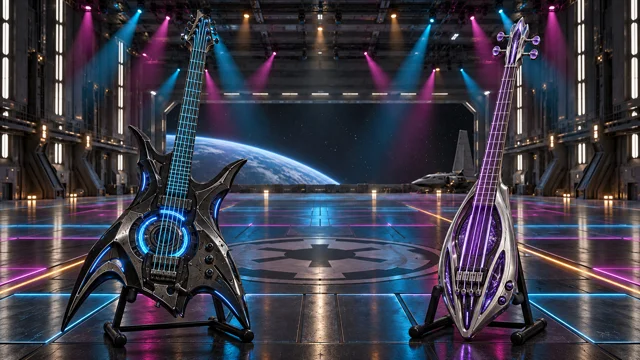</a><figcaption>@Image4 — инструменты</figcaption></figure>
<figure><a href="references/scenes/scene-49/S49A-playing-grip.png" target="_blank" rel="noopener"></a><figcaption>@Image5 — игровой хват дуэта</figcaption></figure></div>

**Дополнительный вход:** @Image5 = <a href="references/scenes/scene-49/S49A-playing-grip.png">игровой хват дуэта</a>.

```text
Mode: reference-to-video (omni-reference) | Duration: 15s | Resolution: 720p | Aspect ratio: 16:9 | FPS: 24 | Native audio: on
Optimized for Seedance 2.0 | Photoreal cinematic alien-rock performance, dramatic and absurdly pompous. A wildly pompous face-to-face melodic alien-guitar duet. The two rivals radiate serious rock-star grandeur.

REFERENCES / AUTHORITY ORDER:
@Image1 — H28B: PRIMARY EXACT LOCATION. This is the established imperial starship hangar/dance floor, not a new arena. Preserve geometry: big rear opening into space, the shuttle at frame-right, existing wall lights and imperial floor circle, fixed pillars and industrial walls. Lighting blue, magenta/violet with sparse amber accents.
@Image2 — ABSOLUTE CHARACTER IDENTITY: Серёга; exact face, hair, build and costume as described below.
@Image3 — ABSOLUTE CHARACTER IDENTITY: Юля; exact face, hair, build and costume as described below.
@Image4 — PROP DESIGN ONLY: Serega black/blue six-string lead guitar with blue ring core and Yulya silver/violet four-string bass.
@Image5 — PLAYING GRIP / POSE ONLY: left hand frets the physical neck, right hand picks strings above the body bridge, supported by a strap; do not use a two-handed smash grip. Original identities @Image2–3 and prop design @Image4 retain priority.
Priority: identity references outrank any new composition; @Image1 locks the hangar. The alien instruments are new props only and never change the location, faces or costumes.

CHARACTER APPEARANCE / IDENTITY LOCK:
Серёга (@Image2) — SEREGA, pale older male Chancellor with sparse light hair and a bald crown, reserved mature face, EXACT long dark-purple robe from individual sheet.
Юля (@Image3) — YULYA, long chestnut hair, exact adult female face; charcoal-black fitted armour, shoulder plates, gloves and long dark cape.
Every person retains approved age, face, hair, original outfit and human anatomy. No face blending or character substitutions. No children added. Natural cats remain small, uncostumed cats.

LOCATION / PROP / SCALE LOCK — CRITICAL:
Same exact H28B-disco from Scene 28, on the same floor, at the same shuttle and imperial insignia; never replace with another arena, cathedral, stadium, balcony, spaceship bridge or neon planet vista. Instrument design must be physically rigid and PLAYABLE: precise hand/paw interaction, visible strings/keys/membranes, stable prop continuity through every cut. Assigned instruments: 
Серёга: blue-ringed black-metal alien lead guitar, six clearly defined taut luminous strings, one physical neck and resonant blue energy core
Юля: silver-and-violet four-string alien bass with slim nacelle-like resonator, physical frets and hand-sized body
Any instrument light is a small physical effect; DO NOT morph instruments into light swords, extra limbs or unknown faces. All characters remain inside the already established 3D layout and its scale.

START STATE:
Exactly Серёга, Юля arrive in a consistent medium-wide shot within H28B, already in playing position with one distinct instrument apiece. The camera sees enough of floor architecture to register the SAME hangar.

TIMELINE:
[0:00–0:05] — INTRODUCTION
Inside the familiar exact H28B disco hangar, SEREGA (screen-left) strikes a bright electric-blue lead chord and plants his feet; YULYA (screen-right) answers on her violet bass. Their real faces and original clothes are plainly visible. The unchanged imperial floor circle grounds the perspective.

[0:05–0:10] — RIFF DUEL
SEREGA physically fingers notes while strumming with his other hand; YULYA picks matching bass notes, staring defiantly back. Colored instrument lights respond only when actually played. One smooth small lateral camera slide, no arbitrary location cut.

[0:10–0:15] — ROCK POWER POSE
They move two steps toward each other and hit one shared beat with aggressive but controlled head and shoulder movement, raising their instrument necks without colliding. End in a clear triumphal pose with faces readable for 2 seconds.

END STATE:
All named performers and instruments remain visible and physically stable in the same position within H28B; no costume or face changes. The final pose holds still for the last 1–2 seconds.

CAMERA / SPACE:
One continuous 15s cinematic performance shot with a small controlled dolly or one physically possible composition change as described; steady 28–50mm lens feeling, dramatic low-angle only without losing faces, no fast orbit through people or changing screen sides. Keep the hangar entrance and the shuttle fixed at frame-right. No external aerial establishing shot. Every player occupies a consistent spot.

PERFORMANCE:
Extremely confident, overly dramatic hard-rock stage attitude, strong deliberate musical accents and synchronized rhythm, but credible hand/instrument physics. Expressions proud, intense and slightly comically solemn; never switch into a different dance, mug for camera or become passive statues. Realistic robe/cape movement.

LIGHTING / MATERIALS:
Exact Scene 28 industrial hangar with bluish and magenta disco lighting and isolated amber practical sources. Modest stage haze, textured old metal panels, real reflective floor, existing shuttle and distant stars. Sculptural glowing instruments add local light only; no giant stage, skyscraper, unrelated planets or redesign.

AUDIO:
Native original instrumental cinematic hard rock, driving and heroic: fast steady four-beat drum pulse, crunchy distorted guitars, deep bass and bright futuristic synth accents, with big dramatic hits on every accent; each note synchronized precisely with the fingers or paws that play it. Original music only, no recognizable published melody. Natural reverb of the large metal hangar.

DIALOGUE / VOCALS:
No spoken dialogue, lyrics, stage announcements or human singing. Only natural exertion, breath and faint cheers from any distant existing onlookers if present.

NEGATIVE PROMPT:
Wrong people or faces, new human performers, different hangar, new huge concert arena, incorrect clothes, mutated anatomy, duplicated fingers/paws, changing character count, impossible instrument playing, swapped or liquefied instruments, excessive holograms, identity blending, stretched adult-sized Ewok, giant cats, floating cats, cartoon render, CGI plastic look, poster, collage, split-screen, montage cuts, readable signs, subtitles, camera shake, watermarks, black bars.

FRAME FILL / NO BARS:
Fill the entire 16:9 image from edge to edge. No bars, no letterboxing, no pillarboxing, no decorative borders, no text overlays.
```

### 49B · Ритм-секция — Паша, Саша и Артём · 15 с

**Входы (в этом порядке):** @Image1 = <a href="references/scenes/scene-28/H28B-disco.png">H28B disco</a> · @Image2 = <a href="references/full/pasha.jpg">Паша</a> · @Image3 = <a href="references/full/sasha.jpg">Саша</a> · @Image4 = <a href="references/full/artem.jpg">Артём</a> · @Image5 = <a href="references/scenes/scene-49/S49B-rhythm-instruments.png">инструменты B</a>.

<div class="scene-ref-gallery">
<figure><a href="references/scenes/scene-28/H28B-disco.png" target="_blank" rel="noopener"></a><figcaption>@Image1 — точная H28B-локация</figcaption></figure>
<figure><a href="references/full/pasha.jpg" target="_blank" rel="noopener"></a><figcaption>@Image2 — Паша</figcaption></figure>
<figure><a href="references/full/sasha.jpg" target="_blank" rel="noopener"></a><figcaption>@Image3 — Саша</figcaption></figure>
<figure><a href="references/full/artem.jpg" target="_blank" rel="noopener"></a><figcaption>@Image4 — Артём</figcaption></figure>
<figure><a href="references/scenes/scene-49/S49B-rhythm-instruments.png" target="_blank" rel="noopener"></a><figcaption>@Image5 — инструменты</figcaption></figure>
<figure><a href="references/scenes/scene-49/S49B-playing-grip.png" target="_blank" rel="noopener"></a><figcaption>@Image6 — игровые позы 49B</figcaption></figure></div>

**Дополнительный вход:** @Image6 = <a href="references/scenes/scene-49/S49B-playing-grip.png">игровые позы 49B</a>.

```text
Mode: reference-to-video (omni-reference) | Duration: 15s | Resolution: 720p | Aspect ratio: 16:9 | FPS: 24 | Native audio: on
Optimized for Seedance 2.0 | Photoreal cinematic alien-rock performance, dramatic and absurdly pompous. A three-person, extremely confident and slightly absurdly majestic rock rhythm break: heavy gravibass, alien electric guitar and orbital-ring percussion.

REFERENCES / AUTHORITY ORDER:
@Image1 — H28B: PRIMARY EXACT LOCATION. This is the established imperial starship hangar/dance floor, not a new arena. Preserve geometry: big rear opening into space, the shuttle at frame-right, existing wall lights and imperial floor circle, fixed pillars and industrial walls. Lighting blue, magenta/violet with sparse amber accents.
@Image2 — ABSOLUTE CHARACTER IDENTITY: Паша; exact face, hair, build and costume as described below.
@Image3 — ABSOLUTE CHARACTER IDENTITY: Саша; exact face, hair, build and costume as described below.
@Image4 — ABSOLUTE CHARACTER IDENTITY: Артём; exact face, hair, build and costume as described below.
@Image5 — PROP DESIGN ONLY: Pasha bronze four-amber-string gravibass, Sasha cobalt six-string rhythm guitar and Artem three-ring percussion.
@Image6 — PLAYING GRIP / POSE ONLY: Pasha left and Sasha centre use left hand fretting and right hand picking at the body bridge; Artem right holds one stick in each hand over separate rings. This is not a smash grip. Individual originals and separate prop designs override any helper deviations.
Priority: identity references outrank any new composition; @Image1 locks the hangar. The alien instruments are new props only and never change the location, faces or costumes.

CHARACTER APPEARANCE / IDENTITY LOCK:
Паша (@Image2) — PASHA, adult man in dark navy Jedi tunic with brown belt, dark trousers and high boots; exact adult face and build from his sheet.
Саша (@Image3) — SASHA, bearded adult man with distinctive round glasses, cream under-tunic and burgundy-brown robe; exact face and glasses.
Артём (@Image4) — ARTEM, heavier-built bearded man, cream/beige tunic beneath brown outer robe, wide belt and boots, unmodified facial hair.
Every person retains approved age, face, hair, original outfit and human anatomy. No face blending or character substitutions. No children added. Natural cats remain small, uncostumed cats.

LOCATION / PROP / SCALE LOCK — CRITICAL:
Same exact H28B-disco from Scene 28, on the same floor, at the same shuttle and imperial insignia; never replace with another arena, cathedral, stadium, balcony, spaceship bridge or neon planet vista. Instrument design must be physically rigid and PLAYABLE: precise hand/paw interaction, visible strings/keys/membranes, stable prop continuity through every cut. Assigned instruments: 
Паша: heavy bronze gravibass with four distinct amber light-strings, conventional playable fingerboard and solid body
Саша: compact twin-rail cobalt alien rhythm guitar with glowing pickups and six playable strings
Артём: standing metallic three-ring kinetic-percussion console struck by two short sticks; amber impact halos, solid supporting stand
Any instrument light is a small physical effect; DO NOT morph instruments into light swords, extra limbs or unknown faces. All characters remain inside the already established 3D layout and its scale.

START STATE:
Exactly Паша, Саша, Артём arrive in a consistent medium-wide shot within H28B, already in playing position with one distinct instrument apiece. The camera sees enough of floor architecture to register the SAME hangar.

TIMELINE:
[0:00–0:05] — FOUNDATION
Three unchanged Jedi performers stand in the exact H28B hangar. PASHA at left lays down a slow heavy four-string bass phrase, SASHA with round glasses takes center on bright cobalt guitar; ARTEM on the right is behind a waist-high three-ring percussion stand. All three props separate.

[0:05–0:10] — ACCELERATION
The camera makes a steady low-angle sideways tracking shot staying in the same floor geometry. Artëm strikes two actual rings with physical drumsticks; bright amber light pulses follow contact. Sasha's hands remain anatomically consistent and Pasha actually frets and plucks.

[0:10–0:15] — THREE-WAY HIT
All three exchange one sharp glance and execute an accented final chord and percussion hit simultaneously. Slight robe movement, smoke and existing disco light only; finish with instruments and faces stable and visible.

END STATE:
All named performers and instruments remain visible and physically stable in the same position within H28B; no costume or face changes. The final pose holds still for the last 1–2 seconds.

CAMERA / SPACE:
One continuous 15s cinematic performance shot with a small controlled dolly or one physically possible composition change as described; steady 28–50mm lens feeling, dramatic low-angle only without losing faces, no fast orbit through people or changing screen sides. Keep the hangar entrance and the shuttle fixed at frame-right. No external aerial establishing shot. Every player occupies a consistent spot.

PERFORMANCE:
Extremely confident, overly dramatic hard-rock stage attitude, strong deliberate musical accents and synchronized rhythm, but credible hand/instrument physics. Expressions proud, intense and slightly comically solemn; never switch into a different dance, mug for camera or become passive statues. Realistic robe/cape movement.

LIGHTING / MATERIALS:
Exact Scene 28 industrial hangar with bluish and magenta disco lighting and isolated amber practical sources. Modest stage haze, textured old metal panels, real reflective floor, existing shuttle and distant stars. Sculptural glowing instruments add local light only; no giant stage, skyscraper, unrelated planets or redesign.

AUDIO:
Native original instrumental cinematic hard rock, driving and heroic: fast steady four-beat drum pulse, crunchy distorted guitars, deep bass and bright futuristic synth accents, with big dramatic hits on every accent; each note synchronized precisely with the fingers or paws that play it. Original music only, no recognizable published melody. Natural reverb of the large metal hangar.

DIALOGUE / VOCALS:
No spoken dialogue, lyrics, stage announcements or human singing. Only natural exertion, breath and faint cheers from any distant existing onlookers if present.

NEGATIVE PROMPT:
Wrong people or faces, new human performers, different hangar, new huge concert arena, incorrect clothes, mutated anatomy, duplicated fingers/paws, changing character count, impossible instrument playing, swapped or liquefied instruments, excessive holograms, identity blending, stretched adult-sized Ewok, giant cats, floating cats, cartoon render, CGI plastic look, poster, collage, split-screen, montage cuts, readable signs, subtitles, camera shake, watermarks, black bars.

FRAME FILL / NO BARS:
Fill the entire 16:9 image from edge to edge. No bars, no letterboxing, no pillarboxing, no decorative borders, no text overlays.
```

### 49C · Тяжёлый драйв — Илюша, Лёша и Виталик · 15 с

**Входы (в этом порядке):** @Image1 = <a href="references/scenes/scene-28/H28B-disco.png">H28B disco</a> · @Image2 = <a href="references/full/ilyusha.jpg">Илюша</a> · @Image3 = <a href="references/full/lesha.jpg">Лёша</a> · @Image4 = <a href="references/full/vitalik.jpg">Виталик</a> · @Image5 = <a href="references/scenes/scene-49/S49C-drums-wind-bass.png">инструменты C</a>.

<div class="scene-ref-gallery">
<figure><a href="references/scenes/scene-28/H28B-disco.png" target="_blank" rel="noopener"></a><figcaption>@Image1 — точная H28B-локация</figcaption></figure>
<figure><a href="references/full/ilyusha.jpg" target="_blank" rel="noopener"></a><figcaption>@Image2 — Илюша</figcaption></figure>
<figure><a href="references/full/lesha.jpg" target="_blank" rel="noopener"></a><figcaption>@Image3 — Лёша</figcaption></figure>
<figure><a href="references/full/vitalik.jpg" target="_blank" rel="noopener"></a><figcaption>@Image4 — Виталик</figcaption></figure>
<figure><a href="references/scenes/scene-49/S49C-drums-wind-bass.png" target="_blank" rel="noopener"></a><figcaption>@Image5 — инструменты</figcaption></figure>
<figure><a href="references/scenes/scene-49/S49C-playing-grip.png" target="_blank" rel="noopener"></a><figcaption>@Image6 — игровые позы 49C</figcaption></figure></div>

**Дополнительный вход:** @Image6 = <a href="references/scenes/scene-49/S49C-playing-grip.png">игровые позы 49C</a>.

```text
Mode: reference-to-video (omni-reference) | Duration: 15s | Resolution: 720p | Aspect ratio: 16:9 | FPS: 24 | Native audio: on
Optimized for Seedance 2.0 | Photoreal cinematic alien-rock performance, dramatic and absurdly pompous. Three different alien instruments create a monumental hard-rock break without changing the already established Jedi costumes.

REFERENCES / AUTHORITY ORDER:
@Image1 — H28B: PRIMARY EXACT LOCATION. This is the established imperial starship hangar/dance floor, not a new arena. Preserve geometry: big rear opening into space, the shuttle at frame-right, existing wall lights and imperial floor circle, fixed pillars and industrial walls. Lighting blue, magenta/violet with sparse amber accents.
@Image2 — ABSOLUTE CHARACTER IDENTITY: Илюша; exact face, hair, build and costume as described below.
@Image3 — ABSOLUTE CHARACTER IDENTITY: Лёша; exact face, hair, build and costume as described below.
@Image4 — ABSOLUTE CHARACTER IDENTITY: Виталик; exact face, hair, build and costume as described below.
@Image5 — PROP DESIGN ONLY: Lesha curved black/brass wind synth, Ilyusha blue compact drums with two ring cymbals and Vitalik black orange/red bass.
@Image6 — PLAYING GRIP / POSE ONLY: Lesha left has the mouthpiece at his lips, hands on upper/lower keys; Ilyusha rear-centre sits with two sticks and feet at pedal/floor; Vitalik right frets with left hand, picks with right. Individual originals and separate prop designs override any helper deviations.
Priority: identity references outrank any new composition; @Image1 locks the hangar. The alien instruments are new props only and never change the location, faces or costumes.

CHARACTER APPEARANCE / IDENTITY LOCK:
Илюша (@Image2) — ILYUSHA, chestnut tousled hair, moustache, olive-green Jedi tunic and deep-red hooded cloak, brown boots.
Лёша (@Image3) — LESHA, moustache, purple inner tunic under long hooded grey robe, brown belt and pale boots.
Виталик (@Image4) — VITALIK, broad sturdy adult man in black tunic and dark leather/armour panels, brown trousers, tall boots, exact individual face.
Every person retains approved age, face, hair, original outfit and human anatomy. No face blending or character substitutions. No children added. Natural cats remain small, uncostumed cats.

LOCATION / PROP / SCALE LOCK — CRITICAL:
Same exact H28B-disco from Scene 28, on the same floor, at the same shuttle and imperial insignia; never replace with another arena, cathedral, stadium, balcony, spaceship bridge or neon planet vista. Instrument design must be physically rigid and PLAYABLE: precise hand/paw interaction, visible strings/keys/membranes, stable prop continuity through every cut. Assigned instruments: 
Илюша: compact futuristic drum kit with blue-edged rigid drum membranes, one kick drum and two ring-cymbals; real sticks
Лёша: black-brass spiral alien wind synthesizer, real curved tube and mouthpiece, turquoise sound-ring at the bell
Виталик: large black low-frequency bass with orange-red luminous strings and one round sub-bass resonator
Any instrument light is a small physical effect; DO NOT morph instruments into light swords, extra limbs or unknown faces. All characters remain inside the already established 3D layout and its scale.

START STATE:
Exactly Илюша, Лёша, Виталик arrive in a consistent medium-wide shot within H28B, already in playing position with one distinct instrument apiece. The camera sees enough of floor architecture to register the SAME hangar.

TIMELINE:
[0:00–0:05] — POWER START
ILYUSHA sits behind a modest futuristic drum kit slightly rear-center, moustache and red cloak visible. LESHA to screen-left blows a turquoise-glowing spiral wind-synth, physically keeping its mouthpiece at his lips. VITALIK to screen-right starts a huge red-orange bass riff, heavy dark armour unchanged.

[0:05–0:10] — PERCUSSION BUILD
Drummer hits alternating membranes and a ring cymbal with two visible sticks; the ring flashes after hits, not before. Lesha holds sustained brassy notes while Vitalik bends his knees, visibly picking bass strings. The camera moves closer but stays wide enough for all three.

[0:10–0:15] — MAXIMUM IMPACT
A 2-second crescendo ends as the drummer lands a double impact, bass drops one emphatic low note and Lesha points his synth's bell upward while continuing to play. The hangar's existing violet/blue wash and orange side-lights flare briefly, then a clean hold.

END STATE:
All named performers and instruments remain visible and physically stable in the same position within H28B; no costume or face changes. The final pose holds still for the last 1–2 seconds.

CAMERA / SPACE:
One continuous 15s cinematic performance shot with a small controlled dolly or one physically possible composition change as described; steady 28–50mm lens feeling, dramatic low-angle only without losing faces, no fast orbit through people or changing screen sides. Keep the hangar entrance and the shuttle fixed at frame-right. No external aerial establishing shot. Every player occupies a consistent spot.

PERFORMANCE:
Extremely confident, overly dramatic hard-rock stage attitude, strong deliberate musical accents and synchronized rhythm, but credible hand/instrument physics. Expressions proud, intense and slightly comically solemn; never switch into a different dance, mug for camera or become passive statues. Realistic robe/cape movement.

LIGHTING / MATERIALS:
Exact Scene 28 industrial hangar with bluish and magenta disco lighting and isolated amber practical sources. Modest stage haze, textured old metal panels, real reflective floor, existing shuttle and distant stars. Sculptural glowing instruments add local light only; no giant stage, skyscraper, unrelated planets or redesign.

AUDIO:
Native original instrumental cinematic hard rock, driving and heroic: fast steady four-beat drum pulse, crunchy distorted guitars, deep bass and bright futuristic synth accents, with big dramatic hits on every accent; each note synchronized precisely with the fingers or paws that play it. Original music only, no recognizable published melody. Natural reverb of the large metal hangar.

DIALOGUE / VOCALS:
No spoken dialogue, lyrics, stage announcements or human singing. Only natural exertion, breath and faint cheers from any distant existing onlookers if present.

NEGATIVE PROMPT:
Wrong people or faces, new human performers, different hangar, new huge concert arena, incorrect clothes, mutated anatomy, duplicated fingers/paws, changing character count, impossible instrument playing, swapped or liquefied instruments, excessive holograms, identity blending, stretched adult-sized Ewok, giant cats, floating cats, cartoon render, CGI plastic look, poster, collage, split-screen, montage cuts, readable signs, subtitles, camera shake, watermarks, black bars.

FRAME FILL / NO BARS:
Fill the entire 16:9 image from edge to edge. No bars, no letterboxing, no pillarboxing, no decorative borders, no text overlays.
```

### 49D · Космические синты — Маша Лагуна и Алеся · 15 с

**Входы (в этом порядке):** @Image1 = <a href="references/scenes/scene-28/H28B-disco.png">H28B disco</a> · @Image2 = <a href="references/masha-laguna.webp">Маша Лагуна</a> · @Image3 = <a href="references/scenes/scene-28/Ale28-Alesya-model-sheet.png">Алеся</a> · @Image4 = <a href="references/scenes/scene-49/S49D-harp-small-synth.png">инструменты D</a>.

<div class="scene-ref-gallery">
<figure><a href="references/scenes/scene-28/H28B-disco.png" target="_blank" rel="noopener"></a><figcaption>@Image1 — точная H28B-локация</figcaption></figure>
<figure><a href="references/masha-laguna.webp" target="_blank" rel="noopener"></a><figcaption>@Image2 — Маша Лагуна</figcaption></figure>
<figure><a href="references/scenes/scene-28/Ale28-Alesya-model-sheet.png" target="_blank" rel="noopener"></a><figcaption>@Image3 — Алеся</figcaption></figure>
<figure><a href="references/scenes/scene-49/S49D-harp-small-synth.png" target="_blank" rel="noopener"></a><figcaption>@Image4 — инструменты</figcaption></figure>
<figure><a href="references/scenes/scene-49/S49D-playing-grip.png" target="_blank" rel="noopener"></a><figcaption>@Image5 — игровые позы 49D</figcaption></figure></div>

**Дополнительный вход:** @Image5 = <a href="references/scenes/scene-49/S49D-playing-grip.png">игровые позы 49D</a>.

```text
Mode: reference-to-video (omni-reference) | Duration: 15s | Resolution: 720p | Aspect ratio: 16:9 | FPS: 24 | Native audio: on
Optimized for Seedance 2.0 | Photoreal cinematic alien-rock performance, dramatic and absurdly pompous. An intentionally overdramatic two-performer instrumental interlude: crystalline resonance harp and small illuminated alien keyboard, preserving the approved Laguna and Ewok designs.

REFERENCES / AUTHORITY ORDER:
@Image1 — H28B: PRIMARY EXACT LOCATION. This is the established imperial starship hangar/dance floor, not a new arena. Preserve geometry: big rear opening into space, the shuttle at frame-right, existing wall lights and imperial floor circle, fixed pillars and industrial walls. Lighting blue, magenta/violet with sparse amber accents.
@Image2 — ABSOLUTE CHARACTER IDENTITY: Маша Лагуна; exact face, hair, build and costume as described below.
@Image3 — ABSOLUTE CHARACTER IDENTITY: Алеся; exact face, hair, build and costume as described below.
@Image4 — PROP DESIGN ONLY: Masha silver harp with six blue anchored strings and Alesya small two-tier amber/violet keyboard; preserve her original small scale.
@Image5 — PLAYING HAND CONTACT / SCALE ONLY: Masha plucks separate anchored harp strings with both hands; tiny adult Alesya reaches the two low keyboard tiers naturally. Preserve original small scale. Individual originals and separate prop designs override any helper deviations.
Priority: identity references outrank any new composition; @Image1 locks the hangar. The alien instruments are new props only and never change the location, faces or costumes.

CHARACTER APPEARANCE / IDENTITY LOCK:
Маша Лагуна (@Image2) — MASHA LAGUNA, exact blue humanoid face and long light-blue tentacle-like head strands, completely opaque full-length blue costume with smooth enclosed torso, dark head and back details; no exposed body modifications.
Алеся (@Image3) — ALESYA, very short Ewok-sized character with approved adult human face, brown fur and round ears inside her brown hood, NO spear.
Every person retains approved age, face, hair, original outfit and human anatomy. No face blending or character substitutions. No children added. Natural cats remain small, uncostumed cats.

LOCATION / PROP / SCALE LOCK — CRITICAL:
Same exact H28B-disco from Scene 28, on the same floor, at the same shuttle and imperial insignia; never replace with another arena, cathedral, stadium, balcony, spaceship bridge or neon planet vista. Instrument design must be physically rigid and PLAYABLE: precise hand/paw interaction, visible strings/keys/membranes, stable prop continuity through every cut. Assigned instruments: 
Маша Лагуна: fixed slender silver-and-blue crystalline string-harp, six physically anchored light-arcs plucked by both hands
Алеся: small stable two-tier amber-violet alien synthesizer on a low stool-height stand, real tactile keys
Any instrument light is a small physical effect; DO NOT morph instruments into light swords, extra limbs or unknown faces. All characters remain inside the already established 3D layout and its scale.

START STATE:
Exactly Маша Лагуна, Алеся arrive in a consistent medium-wide shot within H28B, already in playing position with one distinct instrument apiece. The camera sees enough of floor architecture to register the SAME hangar.

TIMELINE:
[0:00–0:05] — CRYSTAL CHORD
MASHA LAGUNA plays a standing crystalline alien harp, visibly plucking physical taut arc-strings with natural hands; ALESYA stands lower on the same stage at her actual tiny Ewok height and hits the keys of a stable small alien synthesizer. Masha's opaque blue costume and head tendrils are exact.

[0:05–0:10] — KEYBOARD ANSWER
In a fixed two-shot, the small Ewok keyboard answers the harp with a rapid ascending phrase; a camera push moves only slightly, never scaling Alesya up to human height. Both instruments emit synchronized contained colored halos, without magic hologram walls.

[0:10–0:15] — HEROIC HOLD
Both finish with one matching high musical accent, Alesya lifting her tiny hands briefly above the keys while Masha makes a restrained regal gesture. Clean 2-second facial and costume hold, same hangar.

END STATE:
All named performers and instruments remain visible and physically stable in the same position within H28B; no costume or face changes. The final pose holds still for the last 1–2 seconds.

CAMERA / SPACE:
One continuous 15s cinematic performance shot with a small controlled dolly or one physically possible composition change as described; steady 28–50mm lens feeling, dramatic low-angle only without losing faces, no fast orbit through people or changing screen sides. Keep the hangar entrance and the shuttle fixed at frame-right. No external aerial establishing shot. Every player occupies a consistent spot.

PERFORMANCE:
Extremely confident, overly dramatic hard-rock stage attitude, strong deliberate musical accents and synchronized rhythm, but credible hand/instrument physics. Expressions proud, intense and slightly comically solemn; never switch into a different dance, mug for camera or become passive statues. Realistic robe/cape movement.

LIGHTING / MATERIALS:
Exact Scene 28 industrial hangar with bluish and magenta disco lighting and isolated amber practical sources. Modest stage haze, textured old metal panels, real reflective floor, existing shuttle and distant stars. Sculptural glowing instruments add local light only; no giant stage, skyscraper, unrelated planets or redesign.

AUDIO:
Native original instrumental cinematic hard rock, driving and heroic: fast steady four-beat drum pulse, crunchy distorted guitars, deep bass and bright futuristic synth accents, with big dramatic hits on every accent; each note synchronized precisely with the fingers or paws that play it. Original music only, no recognizable published melody. Natural reverb of the large metal hangar.

DIALOGUE / VOCALS:
No spoken dialogue, lyrics, stage announcements or human singing. Only natural exertion, breath and faint cheers from any distant existing onlookers if present.

NEGATIVE PROMPT:
Wrong people or faces, new human performers, different hangar, new huge concert arena, incorrect clothes, mutated anatomy, duplicated fingers/paws, changing character count, impossible instrument playing, swapped or liquefied instruments, excessive holograms, identity blending, stretched adult-sized Ewok, giant cats, floating cats, cartoon render, CGI plastic look, poster, collage, split-screen, montage cuts, readable signs, subtitles, camera shake, watermarks, black bars.

FRAME FILL / NO BARS:
Fill the entire 16:9 image from edge to edge. No bars, no letterboxing, no pillarboxing, no decorative borders, no text overlays.
```

### 49E · Кошачий ударный дуэт — Лучик и Рыжик · 15 с

**Входы (в этом порядке):** @Image1 = <a href="references/scenes/scene-28/H28B-disco.png">H28B disco</a> · @Image2 = <a href="references/luchik.jpg">Лучик</a> · @Image3 = <a href="references/ryzhik.jpg">Рыжик</a> · @Image4 = <a href="references/scenes/scene-49/S49E-cat-paw-controllers.png">инструменты E</a>.

<div class="scene-ref-gallery">
<figure><a href="references/scenes/scene-28/H28B-disco.png" target="_blank" rel="noopener"></a><figcaption>@Image1 — точная H28B-локация</figcaption></figure>
<figure><a href="references/luchik.jpg" target="_blank" rel="noopener"></a><figcaption>@Image2 — Лучик</figcaption></figure>
<figure><a href="references/ryzhik.jpg" target="_blank" rel="noopener"></a><figcaption>@Image3 — Рыжик</figcaption></figure>
<figure><a href="references/scenes/scene-49/S49E-cat-paw-controllers.png" target="_blank" rel="noopener"></a><figcaption>@Image4 — инструменты</figcaption></figure>
<figure><a href="references/scenes/scene-49/S49E-playing-grip.png" target="_blank" rel="noopener"></a><figcaption>@Image5 — игровые позы 49E</figcaption></figure></div>

**Дополнительный вход:** @Image5 = <a href="references/scenes/scene-49/S49E-playing-grip.png">игровые позы 49E</a>.

```text
Mode: reference-to-video (omni-reference) | Duration: 15s | Resolution: 720p | Aspect ratio: 16:9 | FPS: 24 | Native audio: on
Optimized for Seedance 2.0 | Photoreal cinematic alien-rock performance, dramatic and absurdly pompous. Two real unclothed cats become a comically serious percussion duo, while remaining ordinary small domestic cats; no anthropomorphic hands, clothes or standing upright.

REFERENCES / AUTHORITY ORDER:
@Image1 — H28B: PRIMARY EXACT LOCATION. This is the established imperial starship hangar/dance floor, not a new arena. Preserve geometry: big rear opening into space, the shuttle at frame-right, existing wall lights and imperial floor circle, fixed pillars and industrial walls. Lighting blue, magenta/violet with sparse amber accents.
@Image2 — ABSOLUTE CHARACTER IDENTITY: Лучик; exact fur pattern, size and natural cat body as described below; no clothes.
@Image3 — ABSOLUTE CHARACTER IDENTITY: Рыжик; exact fur pattern, size and natural cat body as described below; no clothes.
@Image4 — PROP DESIGN ONLY: Luchik four blue floor pads in a 2x2 layout and Ryzhik three amber circular floor pads; ordinary domestic-cat scale.
@Image5 — PLAYING PAW CONTACT ONLY: natural cat bodies, hind paws on real floor; reachable front paws on separate low blue/amber pads. No human hands or upright standing. Individual originals and separate prop designs override any helper deviations.
Priority: identity references outrank any new composition; @Image1 locks the hangar. The alien instruments are new props only and never change the location, faces or costumes.

CHARACTER APPEARANCE / IDENTITY LOCK:
Лучик (@Image2) — LUCHIK, natural small white-and-grey long-haired domestic cat: white muzzle/chest/paws, grey crown and back, exact real fur and cat limbs; no clothes.
Рыжик (@Image3) — RYZHIK, natural small long-haired orange tabby with darker striped fur and paler chest, exact real cat scale and cat paws; no clothes.
Both are real domestic cats: cat-sized, four-legged, natural fur, no clothes, no human hands, no standing upright. No face blending or substitutions.

LOCATION / PROP / SCALE LOCK — CRITICAL:
Same exact H28B-disco from Scene 28, on the same floor, at the same shuttle and imperial insignia; never replace with another arena, cathedral, stadium, balcony, spaceship bridge or neon planet vista. Instrument design must be physically rigid and PLAYABLE: precise paw interaction, visible pads, stable prop continuity. Assigned instruments: 
Лучик: low cat-sized broad blue touch-percussion pad, four paw-sized pressure surfaces
Рыжик: low cat-sized amber touch-percussion pad, three separate circular strike zones
Any instrument light is a small physical effect; DO NOT morph instruments into light swords, extra limbs or unknown faces. All characters remain inside the already established 3D layout and its scale.

START STATE:
Exactly Лучик, Рыжик arrive in a consistent medium-wide shot within H28B, already in playing position with one distinct instrument apiece. The camera sees enough of floor architecture to register the SAME hangar.

TIMELINE:
[0:00–0:05] — THE LITTLE STAGE
Low camera at FLOOR height near the same imperial dance-floor emblem. LUCHIK, white-grey, on left has a low four-pad blue drum controller; RYZHIK, ginger tabby, on right has a separate three-pad amber controller. The cats sit/stand naturally with hind paws on the real floor and front paws on reachable pads.

[0:05–0:10] — PAW GROOVE
Luchik strikes two wide pads with alternating natural front paws; Ryzhik answers on his amber pads. Each contact produces a contained pulse. Their natural bodies remain cat-sized, fur consistent; small focused meows and impatient growls punctuate the interaction without speech.

[0:10–0:15] — CAT ROCK FINISH
Both cats hit a final synchronized beat and look upward in magnificent serious poses as the drum lights fade. Camera makes a tiny floor-level push and keeps paws and original coats sharp and realistic.

END STATE:
All named performers and instruments remain visible and physically stable in the same position within H28B; no costume or face changes. The final pose holds still for the last 1–2 seconds.

CAMERA / SPACE:
One continuous 15s cinematic performance shot with a small controlled dolly or one physically possible composition change as described; steady 28–50mm lens feeling, dramatic low-angle only without losing faces, no fast orbit through people or changing screen sides. Keep the hangar entrance and the shuttle fixed at frame-right. No external aerial establishing shot. Every player occupies a consistent spot.

PERFORMANCE:
Extremely confident, overly dramatic hard-rock stage attitude, strong deliberate musical accents and synchronized rhythm, but credible hand/instrument physics. Expressions proud, intense and slightly comically solemn; never switch into a different dance, mug for camera or become passive statues. Realistic robe/cape movement.

LIGHTING / MATERIALS:
Exact Scene 28 industrial hangar with bluish and magenta disco lighting and isolated amber practical sources. Modest stage haze, textured old metal panels, real reflective floor, existing shuttle and distant stars. Sculptural glowing instruments add local light only; no giant stage, skyscraper, unrelated planets or redesign.

AUDIO:
Native original instrumental cinematic hard rock, driving and heroic: fast steady four-beat drum pulse, crunchy distorted guitars, deep bass and bright futuristic synth accents, with big dramatic hits on every accent; each note synchronized precisely with the fingers or paws that play it. Original music only, no recognizable published melody. Natural reverb of the large metal hangar.

DIALOGUE / VOCALS:
No spoken dialogue, lyrics, stage announcements or human singing. Natural cat meows and tiny rhythmic growls permitted between distinct percussion hits; no human words from cats.

NEGATIVE PROMPT:
Wrong people or faces, new human performers, different hangar, new huge concert arena, incorrect clothes, mutated anatomy, duplicated fingers/paws, changing character count, impossible instrument playing, swapped or liquefied instruments, excessive holograms, identity blending, stretched adult-sized Ewok, giant cats, floating cats, cartoon render, CGI plastic look, poster, collage, split-screen, montage cuts, readable signs, subtitles, camera shake, watermarks, black bars.

FRAME FILL / NO BARS:
Fill the entire 16:9 image from edge to edge. No bars, no letterboxing, no pillarboxing, no decorative borders, no text overlays.
```

### 49F · Все музыканты — общий пафосный финал · 15 с

**Входы (в этом порядке):** @Image1 = <a href="references/scenes/scene-28/H28B-disco.png">H28B disco</a> · @Image2 = <a href="references/scenes/scene-28/G28-full-ensemble-Alesya-v2.png">G28 v2 — полный ансамбль</a> · @Image3 = <a href="references/scenes/scene-49/S49A-lead-and-bass.png">инструменты A</a> · @Image4 = <a href="references/scenes/scene-49/S49B-rhythm-instruments.png">инструменты B</a> · @Image5 = <a href="references/scenes/scene-49/S49C-drums-wind-bass.png">инструменты C</a> · @Image6 = <a href="references/scenes/scene-49/S49D-harp-small-synth.png">инструменты D</a> · @Image7 = <a href="references/scenes/scene-49/S49E-cat-paw-controllers.png">инструменты E</a>.

<div class="scene-ref-gallery">
<figure><a href="references/scenes/scene-28/H28B-disco.png" target="_blank" rel="noopener"></a><figcaption>@Image1 — точная H28B-локация</figcaption></figure>
<figure><a href="references/scenes/scene-28/G28-full-ensemble-Alesya-v2.png" target="_blank" rel="noopener"></a><figcaption>@Image2 — утверждённый G28 v2</figcaption></figure>
<figure><a href="references/scenes/scene-49/S49A-lead-and-bass.png" target="_blank" rel="noopener"></a><figcaption>@Image3 — инструменты</figcaption></figure>
<figure><a href="references/scenes/scene-49/S49B-rhythm-instruments.png" target="_blank" rel="noopener"></a><figcaption>@Image4 — инструменты</figcaption></figure>
<figure><a href="references/scenes/scene-49/S49C-drums-wind-bass.png" target="_blank" rel="noopener"></a><figcaption>@Image5 — инструменты</figcaption></figure>
<figure><a href="references/scenes/scene-49/S49D-harp-small-synth.png" target="_blank" rel="noopener"></a><figcaption>@Image6 — инструменты</figcaption></figure>
<figure><a href="references/scenes/scene-49/S49E-cat-paw-controllers.png" target="_blank" rel="noopener"></a><figcaption>@Image7 — инструменты</figcaption></figure>
<figure><a href="references/scenes/scene-49/S49F-playing-grip.png" target="_blank" rel="noopener"></a><figcaption>@Image8 — игровые позы 49F</figcaption></figure></div>

**Дополнительный вход:** @Image8 = <a href="references/scenes/scene-49/S49F-playing-grip.png">игровые позы 49F</a>.

```text
Mode: reference-to-video (omni-reference) | Duration: 15s | Resolution: 720p | Aspect ratio: 16:9 | FPS: 24 | Native audio: on
Optimized for Seedance 2.0 | Photoreal cinematic alien-rock performance, dramatic and absurdly pompous. A master-wide shot combining the already established 9+1+2 people/Ewok/cats into one deliberately absurdly pompous cosmic rock-band finale, with accurate approved ensemble geography.

REFERENCES / AUTHORITY ORDER:
@Image1 — H28B: PRIMARY EXACT LOCATION. This is the established imperial starship hangar/dance floor, not a new arena. Preserve geometry: big rear opening into space, the shuttle at frame-right, existing wall lights and imperial floor circle, fixed pillars and industrial walls. Lighting blue, magenta/violet with sparse amber accents.
@Image2 — approved G28-full-ensemble-Alesya-v2: ABSOLUTE ALL-CAST IDENTITY, original wardrobe, true tiny Ewok and domestic-cat scales, and overall ensemble composition. NOT a reference for new concert props.
@Image3 — PROP DESIGN ONLY: Serega black/blue six-string lead guitar with blue ring core and Yulya silver/violet four-string bass.
@Image4 — PROP DESIGN ONLY: Pasha bronze four-amber-string gravibass, Sasha cobalt six-string rhythm guitar and Artem three-ring percussion.
@Image5 — PROP DESIGN ONLY: Lesha curved black/brass wind synth, Ilyusha blue compact drums with two ring cymbals and Vitalik black orange/red bass.
@Image6 — PROP DESIGN ONLY: Masha silver harp with six blue anchored strings and Alesya small two-tier amber/violet keyboard; preserve her original small scale.
@Image7 — PROP DESIGN ONLY: Luchik four blue floor pads in a 2x2 layout and Ryzhik three amber circular floor pads; ordinary domestic-cat scale.
@Image8 — FULL BAND PLAYING POSES / FIXED POSITIONS ONLY: same complete approved cast and relative scale; keep these instrument assignments and clear spatial arrangement throughout. Original @Image2 retains absolute identity/costume authority, @Image3–7 retain prop authority. Individual originals and separate prop designs override any helper deviations.
Priority: @Image2 is the authority for every character's face, costume and size; @Image1 locks the hangar. The alien instruments are new props only and never change the location, faces or costumes.

CHARACTER APPEARANCE / IDENTITY LOCK:
Серёга — SEREGA, pale older male Chancellor with sparse light hair and a bald crown, reserved mature face, EXACT long dark-purple robe from individual sheet.
Юля — YULYA, long chestnut hair, exact adult female face; charcoal-black fitted armour, shoulder plates, gloves and long dark cape.
Паша — PASHA, adult man in dark navy Jedi tunic with brown belt, dark trousers and high boots; exact adult face and build from his sheet.
Саша — SASHA, bearded adult man with distinctive round glasses, cream under-tunic and burgundy-brown robe; exact face and glasses.
Артём — ARTEM, heavier-built bearded man, cream/beige tunic beneath brown outer robe, wide belt and boots, unmodified facial hair.
Илюша — ILYUSHA, chestnut tousled hair, moustache, olive-green Jedi tunic and deep-red hooded cloak, brown boots.
Лёша — LESHA, moustache, purple inner tunic under long hooded grey robe, brown belt and pale boots.
Виталик — VITALIK, broad sturdy adult man in black tunic and dark leather/armour panels, brown trousers, tall boots, exact individual face.
Маша Лагуна — MASHA LAGUNA, exact blue humanoid face and long light-blue tentacle-like head strands, completely opaque full-length blue costume with smooth enclosed torso, dark head and back details; no exposed body modifications.
Алеся — ALESYA, very short Ewok-sized character with approved adult human face, brown fur and round ears inside her brown hood, NO spear.
Лучик — LUCHIK, natural small white-and-grey long-haired domestic cat: white muzzle/chest/paws, grey crown and back, exact real fur and cat limbs; no clothes.
Рыжик — RYZHIK, natural small long-haired orange tabby with darker striped fur and paler chest, exact real cat scale and cat paws; no clothes.
No face blending, substitutions or extra people. Cats stay small, four-legged and unclothed.

LOCATION / PROP / SCALE LOCK — CRITICAL:
Same exact H28B-disco from Scene 28: same floor, shuttle and imperial insignia; never another arena or stage. Instruments are rigid and PLAYABLE, with visible strings, keys and pads. Assigned instruments: Серёга: black-metal lead guitar with six blue luminous strings; Юля: silver-violet four-string bass; Паша: bronze gravibass with four amber strings; Саша: cobalt rhythm guitar; Артём: standing three-ring percussion console with two sticks; Илюша: compact drum kit with blue-edged drums; Лёша: black-brass spiral wind synthesizer with a turquoise bell ring; Виталик: large black bass with orange-red strings; Маша Лагуна: silver-blue crystalline harp; Алеся: small two-tier amber-violet synthesizer on a low stand; Лучик: low blue paw pad; Рыжик: low amber paw pad.
Instrument light is small and local; instruments never morph into swords, limbs or faces. Everyone keeps the established layout and scale.

START STATE:
The canonical full Scene 28 ensemble from @Image2 stands in the actual H28B dance-floor positions, now holding believable assigned alien instruments. The camera sees enough of floor architecture to register the SAME hangar.

TIMELINE:
[0:00–0:05] — FULL BAND REVEAL
Match the exact lineup of @Image2, nine existing people, tiny Aleсya and two ordinary-sized cats, all standing on the unchanged H28B hangar dance floor; maintain their true faces/costumes and relative sizes. The ensemble holds their individual alien instruments in visually plausible positions. No new musicians.

[0:05–0:10] — SYNCHRONIZED ROCK ACCENT
One grand synchronized musical beat: forward-row guitarists strike, back-row instrumentalists play, little Aleсya operates a low keyboard and the two cats paw their small drums at floor level. Camera moves forward only slightly at mid-height, never fly-throughs or identity-swapping cuts.

[0:10–0:15] — STADIUM FINISH
One collective pose timed to a huge ending chord: guitars angled upward, hands still on playable instruments, the cats lifting their heads, bright existing lights and a trace of haze. The clean wide frame holds still for the last 2 seconds.

END STATE:
The exact full lineup remains visibly recognizable in a clean wide performance pose, no new figures or changed stage. The final pose holds still for the last 1–2 seconds.

CAMERA / SPACE:
One continuous 15s wide shot with a small controlled dolly-in; steady 28–35mm lens, no orbit, no side switching. Keep the hangar entrance and the shuttle fixed at frame-right. Every player keeps a consistent spot.

PERFORMANCE:
Extremely confident, overly dramatic hard-rock stage attitude, strong deliberate musical accents and synchronized rhythm, but credible hand/instrument physics. Expressions proud, intense and slightly comically solemn; never switch into a different dance, mug for camera or become passive statues. Realistic robe/cape movement.

LIGHTING / MATERIALS:
Exact Scene 28 industrial hangar with bluish and magenta disco lighting and isolated amber practical sources. Modest stage haze, textured old metal panels, real reflective floor, existing shuttle and distant stars. Sculptural glowing instruments add local light only; no giant stage, skyscraper, unrelated planets or redesign.

AUDIO:
Native original instrumental cinematic hard rock, driving and heroic: fast steady four-beat drum pulse, crunchy distorted guitars, deep bass and bright futuristic synth accents, with big dramatic hits on every accent; each note synchronized precisely with the fingers or paws that play it. Original music only, no recognizable published melody. Natural reverb of the large metal hangar.

DIALOGUE / VOCALS:
No spoken dialogue, lyrics, stage announcements or human singing. Only natural exertion, breath and faint cheers from any distant existing onlookers if present.

NEGATIVE PROMPT:
Wrong faces, extra performers, different hangar, concert arena, wrong clothes, mutated anatomy, extra fingers/paws, changing character count, impossible playing, morphing instruments, identity blending, adult-sized Ewok, giant cats, cartoon or CGI plastic look, split-screen, cuts, subtitles, camera shake, watermarks, black bars.

FRAME FILL / NO BARS:
Fill the entire 16:9 image from edge to edge. No bars, no letterboxing, no pillarboxing, no decorative borders, no text overlays.
```

</div>

<div class="engine-pane" data-engine="wan30" data-duration="3 × 30 с">

Те же шесть номеров тремя роликами по 30 с на Wan 3.0: часть 1 = 49A + 49B, часть 2 = 49C + 49D, часть 3 = 49E + 49F.

#### 49 · Wan 3.0 часть 1 · 49A + 49B

**Входы:** @Image1 — `references/scenes/scene-28/H28B-disco.png`; @Image2 — `references/full/serega.jpg`; @Image3 — `references/full/yulya.jpg`; @Image4 — `references/full/pasha.jpg`; @Image5 — `references/full/sasha.jpg`; @Image6 — `references/full/artem.jpg`; @Image7 — `references/scenes/scene-49/S49A-lead-and-bass.png`; @Image8 — `references/scenes/scene-49/S49B-rhythm-instruments.png`; @Image9 — `references/scenes/scene-49/S49B-playing-grip.png`.

*49A+49B одним роликом: гитарный дуэт и ритм-секция через одну склейку на сильную долю; из-за лимита 9 картинок опущен хват S49A-playing-grip (хват дуэта описан текстом).*

```text
Mode: reference-to-video | Duration: 30s | Resolution: 1080p | Aspect ratio: 16:9 | FPS: 24 | Native audio: on
Optimized for Wan 3.0 | Photoreal cinematic alien-rock performance, dramatic and absurdly pompous | Serega and Yulya's face-to-face guitar duel hands the beat to the heavy rhythm section of Pasha, Sasha and Artem

REFERENCES / AUTHORITY ORDER:
@Image1 — H28B: PRIMARY EXACT LOCATION. This is the established imperial starship hangar/dance floor, not a new arena. Preserve geometry: big rear opening into space, the shuttle at frame-right, existing wall lights and imperial floor circle, fixed pillars and industrial walls. Lighting blue, magenta/violet with sparse amber accents.
@Image2 — ABSOLUTE CHARACTER IDENTITY: Серёга; exact face, hair, build, costume.
@Image3 — ABSOLUTE CHARACTER IDENTITY: Юля; exact face, hair, build, costume.
@Image4 — ABSOLUTE CHARACTER IDENTITY: Паша; exact face, hair, build, costume.
@Image5 — ABSOLUTE CHARACTER IDENTITY: Саша; exact face, hair, build, costume.
@Image6 — ABSOLUTE CHARACTER IDENTITY: Артём; exact face, hair, build, costume.
@Image7 — PROP DESIGN ONLY: Serega black/blue six-string lead guitar with blue ring core and Yulya silver/violet four-string bass.
@Image8 — PROP DESIGN ONLY: Pasha bronze four-amber-string gravibass, Sasha cobalt six-string rhythm guitar and Artem three-ring percussion.
@Image9 — PLAYING GRIP / POSE ONLY: left hand frets, right hand picks at the body bridge (Pasha left, Sasha centre; the same strap-supported grip for Serega and Yulya); Artem right holds one stick in each hand over separate rings. Not a smash grip. Originals and prop designs override helper deviations.
Priority: identity references outrank any new composition; @Image1 locks the hangar. The alien instruments are new props only and never change the location, faces or costumes.

CHARACTER APPEARANCE / IDENTITY LOCK:
Серёга (@Image2) — SEREGA, pale older male Chancellor with sparse light hair and a bald crown, reserved mature face, EXACT long dark-purple robe from individual sheet.
Юля (@Image3) — YULYA, long chestnut hair, exact adult female face; charcoal-black fitted armour, shoulder plates, gloves and long dark cape.
Паша (@Image4) — PASHA, adult man in dark navy Jedi tunic with brown belt, dark trousers and high boots; exact adult face and build from his sheet.
Саша (@Image5) — SASHA, bearded adult man with distinctive round glasses, cream under-tunic and burgundy-brown robe; exact face and glasses.
Артём (@Image6) — ARTEM, heavier-built bearded man, cream/beige tunic beneath brown outer robe, wide belt and boots, unmodified facial hair.
Every person retains approved age, face, hair, original outfit and human anatomy. No face blending or substitutions. Exactly these five people.

LOCATION / PROP / SCALE LOCK — CRITICAL:
Same exact H28B-disco from Scene 28, on the same floor, at the same shuttle and imperial insignia; never replace with another arena, cathedral, stadium, balcony, spaceship bridge or neon planet vista. Instrument design must be physically rigid and PLAYABLE: precise hand/paw interaction, visible strings/keys/membranes, stable prop continuity through every cut. Assigned instruments:
Серёга: blue-ringed black-metal alien lead guitar, six clearly defined taut luminous strings, one physical neck and resonant blue energy core
Юля: silver-and-violet four-string alien bass with slim nacelle-like resonator, physical frets and hand-sized body
Паша: heavy bronze gravibass with four distinct amber light-strings, conventional playable fingerboard and solid body
Саша: compact twin-rail cobalt alien rhythm guitar with glowing pickups and six playable strings
Артём: standing metallic three-ring kinetic-percussion console struck by two short sticks; amber impact halos, solid supporting stand
Any instrument light is a small physical effect; DO NOT morph instruments into light swords, extra limbs or unknown faces. All characters remain inside the already established 3D layout and its scale.

START STATE:
Serega and Yulya face each other near the imperial floor circle of H28B in a medium-wide shot, already in playing position. Pasha, Sasha and Artem wait with their instruments on their own spot of the same floor, outside the opening frame. Enough floor architecture is visible to register the SAME hangar.

TIMELINE:
[0:00–0:05] — INTRODUCTION
SEREGA (screen-left) strikes a bright electric-blue lead chord and plants his feet; YULYA (screen-right) answers on her violet bass. Real faces and original clothes plainly visible on the imperial floor circle.

[0:05–0:10] — RIFF DUEL
SEREGA physically fingers notes while strumming with his other hand; YULYA picks matching bass notes, staring defiantly back. Instrument lights respond only when actually played. Riffs trade blow for blow, heads snapping on accents.

[0:10–0:15] — ROCK POWER POSE
They move two steps toward each other and hit one shared beat with aggressive but controlled head and shoulder movement, raising their instrument necks without colliding. Triumphal pose, faces readable, as the chord rings out.

[0:15–0:20] — FOUNDATION
Cut on the downbeat to the rhythm section in the same hangar. PASHA at left lays down a heavy four-string bass phrase, SASHA with round glasses takes center on cobalt guitar; ARTEM on the right stands behind a waist-high three-ring percussion stand.

[0:20–0:25] — ACCELERATION
Faster now: Artem strikes two actual rings with real sticks in a fast roll; amber pulses follow contact. Sasha chops tight rhythm chords, Pasha actually frets and plucks, shoulders rocking on the beat.

[0:25–0:30] — THREE-WAY HIT
All three exchange one sharp glance and execute an accented final chord and percussion hit simultaneously, robes swinging. The existing disco light flares once; finish with instruments and faces stable in a heroic held pose.

END STATE:
Pasha, Sasha and Artem hold their final accent in place within H28B, instruments intact, faces and costumes unchanged; still for the last 1–2 seconds.

CAMERA / SPACE:
Two setups joined by one motivated hard cut on the 0:15 downbeat. Duet: low-angle medium-wide, a quick sideways slide during the riff duel, push-in to a medium two-shot for the power pose. Trio: steady low-angle sideways tracking in the same floor geometry, ending frontal medium-wide on all three. 28–50mm lens feeling; faces in medium shots with even light, speed from tracking and playing hands, never whip pans across faces. No orbit through people, no side switching. Hangar entrance and shuttle fixed at frame-right in both setups; every player keeps a consistent spot.

PERFORMANCE:
Extremely confident, overly dramatic hard-rock stage attitude, sharp accents and tight rhythm at real-time speed, credible hand/instrument physics. Expressions proud, intense and slightly comically solemn: the duet a mock-serious rivalry, the trio a heavy, self-important groove. Never break into a dance, mug for camera or freeze into statues; realistic robe/cape motion.

LIGHTING / MATERIALS:
Exact Scene 28 industrial hangar with bluish and magenta disco lighting and isolated amber practical sources. Modest stage haze, textured old metal panels, real reflective floor, existing shuttle and distant stars. Sculptural glowing instruments add local light only; no giant stage, skyscraper, unrelated planets or redesign.

AUDIO:
Native original instrumental cinematic hard rock, driving and heroic: fast steady four-beat drum pulse, crunchy distorted guitars, deep bass and ringing ring-percussion, with big dramatic hits on every accent; each note synchronized precisely with the fingers that play it. One continuous track across the cut: the duet's last chord rings into Pasha's first bass phrase. Original music only, no recognizable published melody. Natural reverb of the large metal hangar.

DIALOGUE / VOCALS:
No spoken dialogue, lyrics, stage announcements or human singing. Only natural exertion and breath.

NEGATIVE PROMPT:
Wrong faces, extra performers, different hangar, concert arena, wrong clothes, mutated anatomy, duplicated fingers, impossible playing, swapped or liquefied instruments, holograms, identity blending, melting faces, slow motion, cartoon or CGI plastic look, collage, split-screen, random jump cuts, cut to another location, subtitles, camera shake, watermarks, black bars.

FRAME FILL / NO BARS:
Fill the entire generated frame edge-to-edge. No letterboxing, no pillarboxing, no black bars, no side bars, no decorative borders, no empty margins.
```

#### 49 · Wan 3.0 часть 2 · 49C + 49D

**Входы:** @Image1 — `references/scenes/scene-28/H28B-disco.png`; @Image2 — `references/full/ilyusha.jpg`; @Image3 — `references/full/lesha.jpg`; @Image4 — `references/full/vitalik.jpg`; @Image5 — `references/masha-laguna.webp`; @Image6 — `references/scenes/scene-28/Ale28-Alesya-model-sheet.png`; @Image7 — `references/scenes/scene-49/S49C-drums-wind-bass.png`; @Image8 — `references/scenes/scene-49/S49D-harp-small-synth.png`; @Image9 — `references/scenes/scene-49/S49D-playing-grip.png`.

*49C+49D одним роликом: тяжёлый драйв обрывается двойным ударом в космический пассаж арфы и синта; опущен хват S49C-playing-grip (лимит 9), оставлен S49D из-за масштаба Алеси.*

```text
Mode: reference-to-video | Duration: 30s | Resolution: 1080p | Aspect ratio: 16:9 | FPS: 24 | Native audio: on
Optimized for Wan 3.0 | Photoreal cinematic alien-rock performance, dramatic and absurdly pompous | Ilyusha, Lesha and Vitalik's heavy break crashes into a cosmic harp-and-synth passage by Masha Laguna and tiny Alesya

REFERENCES / AUTHORITY ORDER:
@Image1 — H28B: PRIMARY EXACT LOCATION. This is the established imperial starship hangar/dance floor, not a new arena. Preserve geometry: big rear opening into space, the shuttle at frame-right, existing wall lights and imperial floor circle, fixed pillars and industrial walls. Lighting blue, magenta/violet with sparse amber accents.
@Image2 — ABSOLUTE CHARACTER IDENTITY: Илюша; exact face, hair, build, costume.
@Image3 — ABSOLUTE CHARACTER IDENTITY: Лёша; exact face, hair, build, costume.
@Image4 — ABSOLUTE CHARACTER IDENTITY: Виталик; exact face, hair, build, costume.
@Image5 — ABSOLUTE CHARACTER IDENTITY: Маша Лагуна; exact face, head strands, build, costume.
@Image6 — ABSOLUTE CHARACTER IDENTITY: Алеся; exact face, fur, tiny Ewok scale, hood.
@Image7 — PROP DESIGN ONLY: Lesha curved black/brass wind synth, Ilyusha blue compact drums with two ring cymbals and Vitalik black orange/red bass.
@Image8 — PROP DESIGN ONLY: Masha silver harp with six blue anchored strings and Alesya small two-tier amber/violet keyboard; preserve her original small scale.
@Image9 — PLAYING HAND CONTACT / SCALE ONLY: Masha plucks separate anchored harp strings with both hands; tiny adult Alesya reaches the two low keyboard tiers naturally. Preserve original small scale. Individual originals and separate prop designs override any helper deviations.
Priority: identity references outrank any new composition; @Image1 locks the hangar. The alien instruments are new props only and never change the location, faces or costumes.

CHARACTER APPEARANCE / IDENTITY LOCK:
Илюша (@Image2) — ILYUSHA, chestnut tousled hair, moustache, olive-green Jedi tunic and deep-red hooded cloak, brown boots.
Лёша (@Image3) — LESHA, moustache, purple inner tunic under long hooded grey robe, brown belt and pale boots.
Виталик (@Image4) — VITALIK, broad sturdy adult man in black tunic and dark leather/armour panels, brown trousers, tall boots, exact individual face.
Маша Лагуна (@Image5) — MASHA LAGUNA, exact blue humanoid face and long light-blue tentacle-like head strands, completely opaque full-length blue costume with smooth enclosed torso, dark head and back details; no exposed body modifications.
Алеся (@Image6) — ALESYA, very short Ewok-sized character with approved adult human face, brown fur and round ears inside her brown hood, NO spear.
Every performer retains approved age, face, hair, original outfit and anatomy. No face blending or substitutions. Exactly these five performers.

LOCATION / PROP / SCALE LOCK — CRITICAL:
Same exact H28B-disco from Scene 28, on the same floor, at the same shuttle and imperial insignia; never replace with another arena, cathedral, stadium, balcony, spaceship bridge or neon planet vista. Instrument design must be physically rigid and PLAYABLE: precise hand/paw interaction, visible strings/keys/membranes, stable prop continuity through every cut. Assigned instruments:
Илюша: compact futuristic drum kit with blue-edged rigid drum membranes, one kick drum and two ring-cymbals; real sticks
Лёша: black-brass spiral alien wind synthesizer, real curved tube and mouthpiece, turquoise sound-ring at the bell
Виталик: large black low-frequency bass with orange-red luminous strings and one round sub-bass resonator
Маша Лагуна: fixed slender silver-and-blue crystalline string-harp, six physically anchored light-arcs plucked by both hands
Алеся: small stable two-tier amber-violet alien synthesizer on a low stool-height stand, real tactile keys
Playing contact: Lesha keeps the mouthpiece at his lips, hands on upper/lower keys; Ilyusha sits with two sticks, feet at pedal/floor; Vitalik frets with left hand, picks with right.
Any instrument light is a small physical effect; DO NOT morph instruments into light swords, extra limbs or unknown faces. All characters remain inside the already established 3D layout and its scale.

START STATE:
Ilyusha, Lesha and Vitalik in a medium-wide shot within H28B, already in playing position; Masha Laguna and Alesya wait at their instruments elsewhere on the same floor, outside the opening frame. Enough floor architecture is visible to register the SAME hangar.

TIMELINE:
[0:00–0:05] — POWER START
ILYUSHA sits behind a modest futuristic drum kit rear-center, red cloak visible. LESHA to screen-left blows a turquoise-glowing spiral wind-synth, mouthpiece at his lips. VITALIK to screen-right starts a huge red-orange bass riff, heavy dark armour unchanged.

[0:05–0:10] — PERCUSSION BUILD
The drummer hits alternating membranes and a ring cymbal with two visible sticks; the ring flashes after hits, not before. Lesha holds brassy notes; Vitalik bends his knees, visibly picking bass strings.

[0:10–0:15] — MAXIMUM IMPACT
A crescendo ends as the drummer lands a double impact, the bass drops one emphatic low note and Lesha points his synth's bell upward while still playing. The violet/blue wash and orange side-lights flare briefly.

[0:15–0:20] — CRYSTAL CHORD
Cut on the impact to MASHA LAGUNA at her standing crystalline harp, plucking physical taut arc-strings with natural hands; ALESYA stands beside and below her at her actual tiny Ewok height, hitting the keys of her small stable synthesizer.

[0:20–0:25] — KEYBOARD ANSWER
The small Ewok keyboard answers the harp with a rapid ascending phrase; Masha's hands sweep the arcs faster; both instruments emit contained synchronized halos.

[0:25–0:30] — HEROIC HOLD
Both finish with one matching high accent, Alesya lifting her tiny hands briefly above the keys while Masha makes a restrained regal gesture. Clean facial hold.

END STATE:
Masha Laguna and Alesya hold their final pose at their instruments within H28B, Alesya still tiny beside Masha, faces and costumes unchanged; still for the last 1–2 seconds.

CAMERA / SPACE:
Two setups joined by one motivated hard cut on the 0:15 double impact. Trio: low-angle medium-wide moving closer during the build, always wide enough for all three. Duo: two-shot with a slight push-in that never scales Alesya up to human height. 28–50mm lens feeling; faces in medium shots with even light, speed from hands and sticks, never whip pans across faces. No orbit through people, no side switching. Hangar entrance and shuttle fixed at frame-right; every player keeps a consistent spot.

PERFORMANCE:
Extremely confident, overly dramatic hard-rock stage attitude, sharp accents and tight rhythm at real-time speed, credible hand/instrument physics. Expressions proud, intense and slightly comically solemn: the trio monumental, the duo regal and cosmic. Never break into a dance, mug for camera or freeze into statues; realistic robe/cape motion.

LIGHTING / MATERIALS:
Exact Scene 28 industrial hangar with bluish and magenta disco lighting and isolated amber practical sources. Modest stage haze, textured old metal panels, real reflective floor, existing shuttle and distant stars. Sculptural glowing instruments add local light only; no giant stage, skyscraper, unrelated planets or redesign.

AUDIO:
Native original instrumental cinematic hard rock, driving and heroic: fast steady four-beat drum pulse, deep bass, brassy wind-synth, bright crystalline harp and synth, big dramatic hits on every accent; each note synchronized with the fingers or sticks that play it. One continuous track: the double impact rings into the harp chord, the drum pulse keeps going. Original music only. Natural reverb of the large metal hangar.

DIALOGUE / VOCALS:
No spoken dialogue, lyrics, stage announcements or human singing. Only natural exertion and breath.

NEGATIVE PROMPT:
Wrong faces, extra performers, different hangar, concert arena, wrong clothes, mutated anatomy, duplicated fingers, impossible playing, swapped or liquefied instruments, hologram walls, identity blending, melting faces, stretched adult-sized Ewok, slow motion, cartoon or CGI plastic look, collage, split-screen, random jump cuts, cut to another location, subtitles, camera shake, watermarks, black bars.

FRAME FILL / NO BARS:
Fill the entire generated frame edge-to-edge. No letterboxing, no pillarboxing, no black bars, no side bars, no decorative borders, no empty margins.
```

#### 49 · Wan 3.0 часть 3 · 49E + 49F

**Входы:** @Image1 — `references/scenes/scene-28/H28B-disco.png`; @Image2 — `references/scenes/scene-28/G28-full-ensemble-Alesya-v2.png`; @Image3 — `references/luchik.jpg`; @Image4 — `references/ryzhik.jpg`; @Image5 — `references/scenes/scene-49/S49E-cat-paw-controllers.png`; @Image6 — `references/scenes/scene-49/S49A-lead-and-bass.png`; @Image7 — `references/scenes/scene-49/S49B-rhythm-instruments.png`; @Image8 — `references/scenes/scene-49/S49C-drums-wind-bass.png`; @Image9 — `references/scenes/scene-49/S49F-playing-grip.png`.

*49E+49F: кошачий дуэт на уровне пола, затем быстрый подъём камеры на общий план всей группы; опущены S49E-playing-grip и S49D-harp-small-synth (лимит 9), арфу и синт Алеси держат S49F и текст.*

```text
Mode: reference-to-video | Duration: 30s | Resolution: 1080p | Aspect ratio: 16:9 | FPS: 24 | Native audio: on
Optimized for Wan 3.0 | Photoreal cinematic alien-rock performance, dramatic and absurdly pompous | Luchik and Ryzhik's deadly serious paw-drum duet rises into the full 9+1+2 band's grand cosmic rock finale

REFERENCES / AUTHORITY ORDER:
@Image1 — H28B: PRIMARY EXACT LOCATION, the established imperial hangar/dance floor, not a new arena: big rear opening into space, shuttle at frame-right, wall lights, imperial floor circle, fixed pillars and industrial walls; blue, magenta/violet light with sparse amber accents.
@Image2 — approved G28-full-ensemble-Alesya-v2: ABSOLUTE ALL-CAST IDENTITY, original wardrobe, true tiny Ewok and domestic-cat scales, and overall ensemble composition. NOT a reference for new concert props.
@Image3 — ABSOLUTE IDENTITY: Лучик; exact fur pattern, size and natural cat body; no clothes.
@Image4 — ABSOLUTE IDENTITY: Рыжик; exact fur pattern, size and natural cat body; no clothes.
@Image5 — PROP DESIGN ONLY: Luchik four blue floor pads in a 2x2 layout and Ryzhik three amber circular floor pads; ordinary domestic-cat scale.
@Image6 — PROP DESIGN ONLY: Serega black/blue six-string lead guitar with blue ring core and Yulya silver/violet four-string bass.
@Image7 — PROP DESIGN ONLY: Pasha bronze four-amber-string gravibass, Sasha cobalt six-string rhythm guitar and Artem three-ring percussion.
@Image8 — PROP DESIGN ONLY: Lesha curved black/brass wind synth, Ilyusha blue compact drums with two ring cymbals and Vitalik black orange/red bass.
@Image9 — FULL BAND PLAYING POSES / FIXED POSITIONS ONLY: cast arrangement, relative scale and instrument assignments, incl. Masha's harp, Alesya's small keyboard and both cats at their pads in the front corners. @Image2–4 keep identity authority, @Image5–8 prop authority.
Priority: @Image2 rules every face, costume and size, @Image3–4 the cats in close shots; @Image1 locks the hangar. Instruments are new props only.

CHARACTER APPEARANCE / IDENTITY LOCK:
Серёга — SEREGA, pale older male Chancellor with sparse light hair and a bald crown, reserved mature face, long dark-purple robe.
Юля — YULYA, long chestnut hair, exact adult female face; charcoal-black fitted armour, shoulder plates, gloves and long dark cape.
Паша — PASHA, adult man in dark navy Jedi tunic with brown belt, dark trousers and high boots.
Саша — SASHA, bearded adult man with distinctive round glasses, cream under-tunic and burgundy-brown robe.
Артём — ARTEM, heavier-built bearded man, cream/beige tunic beneath brown outer robe, wide belt and boots.
Илюша — ILYUSHA, chestnut tousled hair, moustache, olive-green Jedi tunic and deep-red hooded cloak, brown boots.
Лёша — LESHA, moustache, purple inner tunic under long hooded grey robe, brown belt and pale boots.
Виталик — VITALIK, broad sturdy adult man in black tunic and dark leather/armour panels, brown trousers, tall boots.
Маша Лагуна — MASHA LAGUNA, exact blue humanoid face, long light-blue tentacle-like head strands, completely opaque full-length blue costume with smooth enclosed torso, dark head and back details.
Алеся — ALESYA, very short Ewok-sized character with approved adult human face, brown fur and round ears inside her brown hood, NO spear.
Лучик (@Image3) — LUCHIK, natural small white-and-grey long-haired domestic cat: white muzzle/chest/paws, grey crown and back.
Рыжик (@Image4) — RYZHIK, natural small long-haired orange tabby with darker striped fur and paler chest.
Both are real domestic cats: cat-sized, four-legged, natural fur, no clothes, no human hands, no standing upright. No face blending, substitutions or extra people.

LOCATION / PROP / SCALE LOCK — CRITICAL:
Same exact H28B-disco from Scene 28: same floor, shuttle and imperial insignia; never another arena or stage. Instruments are rigid and PLAYABLE, with visible strings, keys and pads. Assigned instruments: Серёга: black-metal lead guitar with six blue luminous strings; Юля: silver-violet four-string bass; Паша: bronze gravibass with four amber strings; Саша: cobalt rhythm guitar; Артём: standing three-ring percussion console with two sticks; Илюша: compact drum kit with blue-edged drums; Лёша: black-brass spiral wind synthesizer with a turquoise bell ring; Виталик: large black bass with orange-red strings; Маша Лагуна: silver-blue crystalline harp; Алеся: small two-tier amber-violet synthesizer on a low stand; Лучик: low blue paw pad; Рыжик: low amber paw pad.
Instrument light is small and local; instruments never morph into swords, limbs or faces. Everyone keeps the established layout and scale.

START STATE:
Low camera at FLOOR height near the imperial dance-floor emblem: LUCHIK on the left at his low four-pad blue controller, RYZHIK on the right at his three-pad amber controller, hind paws on the real floor, front paws on reachable pads. The band's boots and stands are soft and out of focus behind them.

TIMELINE:
[0:00–0:05] — THE LITTLE STAGE
The two cats start tapping, natural bodies and long fur sharp and cat-sized; the floor emblem grounds the perspective.

[0:05–0:10] — PAW GROOVE
Luchik strikes two wide pads with alternating natural front paws; Ryzhik answers on his amber pads in a quick rhythm. Each contact produces a contained pulse; small focused meows punctuate the groove without speech.

[0:10–0:15] — CAT ROCK FINISH
Both cats hit one synchronized beat and look upward in magnificent serious poses toward the band above them.

[0:15–0:20] — FULL BAND REVEAL
On that beat the camera cranes up and back into the master wide: the exact lineup of @Image2, nine people, tiny Alesya and the two cats at their pads in the front corners, every musician playing an assigned alien instrument on the unchanged H28B floor.

[0:20–0:25] — SYNCHRONIZED ROCK ACCENT
One grand synchronized beat: forward-row guitarists strike, back-row instrumentalists play, little Alesya operates her low keyboard, the cats paw their small pads. Heads drive on every accent.

[0:25–0:30] — STADIUM FINISH
One collective pose on a huge ending chord: guitars angled upward, hands still on playable instruments, the cats lifting their heads, existing lights flaring through haze.

END STATE:
The full lineup stays recognizable in a clean wide performance pose, no new figures or changed stage. The final pose holds still for the last 1–2 seconds.

CAMERA / SPACE:
First half: floor-level camera with a tiny push, paws and coats sharp. At 0:15 one fast crane-up-and-back into the master wide in front of the band, never through people, then a slight forward move at mid-height. 28–35mm lens feeling, no orbit, no side switching, no whip pans across faces. Hangar entrance and shuttle fixed at frame-right; every player keeps a consistent spot.

PERFORMANCE:
Extremely confident, overly dramatic hard-rock stage attitude at real-time speed, sharp synchronized accents, credible hand/paw/instrument physics. The cats stay ordinary cats, comically focused; the humans proud, intense and slightly comically solemn. No dancing, mugging or statue freezes.

LIGHTING / MATERIALS:
Exact Scene 28 hangar with bluish and magenta disco lighting and isolated amber practicals. Modest stage haze, textured metal panels, real reflective floor, existing shuttle and distant stars. Glowing instruments add local light only.

AUDIO:
Native original instrumental cinematic hard rock, driving and heroic: fast steady four-beat drum pulse, crunchy distorted guitars, deep bass and bright futuristic synth accents, with big dramatic hits on every accent; each note synchronized with the fingers or paws that play it; the paw groove grows into the full band at the reveal. Original music only. Large metal-hangar reverb.

DIALOGUE / VOCALS:
No spoken dialogue, lyrics or human singing. Natural cat meows and tiny rhythmic growls between percussion hits; no human words from cats.

NEGATIVE PROMPT:
Wrong faces, extra performers, different hangar, concert arena, wrong clothes, mutated anatomy, extra fingers/paws, changing character count, impossible playing, morphing instruments, identity blending, melting faces, adult-sized Ewok, giant cats, floating cats, cats in clothes or standing upright, slow motion, cartoon or CGI plastic look, split-screen, subtitles, camera shake, watermarks, black bars.

FRAME FILL / NO BARS:
Fill the entire generated frame edge-to-edge. No letterboxing, no pillarboxing, no black bars, no side bars, no decorative borders, no empty margins.
```

</div>

</div>

---

<a id="scene-50"></a>

## Сцена 50 — Финальные титры: вуки-фанаты слэмятся и трясут гривами

<!-- scene-meta: {"target_engine":"Seedance 2.0","production_state":"READY","duration_s":15,"dialogue":{"enabled":false,"language":null},"dependencies":[{"type":"related_to","scene":28},{"type":"related_to","scene":49}],"tags":["dance_credits","wookiee_crowd","rock_headbang","safe_mosh_pit","same_H28B","montage_insert"]} -->

**Контекст использования:** Дополнительная зрительская сцена по прямому решению владельца 16.10.2026. **В той же H28B-ангар-дискотеке** толпа вуки восторженно фанатеет от группы из Scene 49 и энергично трясёт шерстью как хэви-метал фанаты. Два **самостоятельных** коротких 15-секундных монтажа: (50A) волна хедбэнга; (50B) дружелюбный контролируемый слэм в небольшом круге. Для дальнейшего монтажа вместе с танцами Scene 28 и музыкантами Scene 49. **READY (выбор владельца 17.10, 23:58):** из трёх постановочных кадров выбран **вариант 2 — вуки с поднятыми руками** (task `1c48a62d14d14d348a5c49fe5cdb5e70`, «выглядят более подвижно и по-фанатски»). Он подключён как @Image5 в 50A/50B и как @Image8 в 51A/51B, чтобы вуки в 51 совпали с 50. Варианты 1 и 3 остаются в архиве, во входы не идут. Видеоролики 50A/50B ещё не запущены; редакторская приёмка не выполнена. **Музыка (решение владельца 16.10.2026):** трек для блока 28/49–51 — «Flares of the Blazing Sun» (HOYO-MiX, YMIR, 3:33). В промтах только общий темп и энергия (быстрый, драйвовый, героический хард-рок); саму песню Topview не воспроизводит, синхронизация на монтаже. **Правка 16.10.2026:** из промтов убраны монтажные пометки, в звук вписан темп.

**Референсы:** @Image1 = <a href="references/scenes/scene-28/H28B-disco.png">H28B, точная локация</a>; @Image2 = <a href="references/scenes/scene-28/G28-full-ensemble-Alesya-v2.png">G28 v2, только знакомые участники группы на дальнем плане</a>, **не заменять их вуки**. Вуки — отдельные зрители, а не новые члены основной группы.

<div class="scene-ref-gallery">
<figure><a href="references/scenes/scene-28/H28B-disco.png" target="_blank" rel="noopener"></a><figcaption>@Image1 — неизменный ангар-дискотека</figcaption></figure>
<figure><a href="references/scenes/scene-28/G28-full-ensemble-Alesya-v2.png" target="_blank" rel="noopener"></a><figcaption>@Image2 — состав группы, только фоновые участники</figcaption></figure>
</div>

**Референс внешности вуки · 17.10:** @Image3 = <a href="references/scenes/scene-50/S50-wookiees-owner-03m400.jpg">предоставленный владельцем кадр00:03.400</a>. Использовать только морды, шерсть и анатомию вуки; интерьер и людей из кадра не переносить. Локация остаётся H28B. «Аудитория» здесь означает только толпу зрителей-фанатов. Три постановочных кадра толпы готовы и показаны ниже; до выбора владельца DRAFT сохраняется. <a href="references/scenes/scene-50/S50-fans-image-prompt.txt">Подготовленный промт изображения для Nano Banana</a>.

<div class="scene-ref-gallery"><figure><a href="references/scenes/scene-50/S50-wookiees-owner-03m400.jpg" target="_blank" rel="noopener"></a><figcaption>@Image3 — внешность вуки из своего ролика, только species reference</figcaption></figure></div>

**Дополнительный вход:** @Image4 = <a href="references/scenes/scene-50/S50-wookiees-owner-14m833.jpg">вуки крупно00:14.833</a>; только внешность.

<div class="scene-ref-gallery"><figure><a href="references/scenes/scene-50/S50-wookiees-owner-14m833.jpg" target="_blank" rel="noopener"></a><figcaption>@Image4 — морда и шерсть вуки, кадр владельца</figcaption></figure></div>

**Готовые кадры фанатов · 17.10.2026:** три бесплатных варианта Nano Banana Pro, оригиналы 2752×1536. Нажмите миниатюру, чтобы открыть полный кадр. Выбран вариант 2 (владелец 17.10): он вход @Image5 для 50A/50B и @Image8 для 51A/51B.

<div class="scene-ref-gallery">
<figure><a href="references/scenes/scene-50/S50-fans-48657a07.png" target="_blank" rel="noopener"></a><figcaption>Вариант 1 — полные фигуры, хлопки · не выбран</figcaption></figure>
<figure><a href="references/scenes/scene-50/S50-fans-1c48a62d.png" target="_blank" rel="noopener"></a><figcaption>Вариант 2 — энергичные позы, поднятые руки · ✅ выбран владельцем 17.10</figcaption></figure>
<figure><a href="references/scenes/scene-50/S50-fans-792d7b8a.png" target="_blank" rel="noopener"></a><figcaption>Вариант 3 — более крупные лица · не выбран</figcaption></figure>
</div>

**Что происходит:** Несколько десятков высоких лохматых вуки на танцполе смотрят на группу и радостно рычат, раскачивают длинную шерсть и головы в тяжёлом рок-ритме, вскидывают лапы, а потом устраивают небольшой дружелюбный слэм-круг без травм и агрессивной драки. Танцы, рок-концерт и кадры фанатов монтируются вперемешку. Только та же просторная площадка и свет Scene 28.

<div class="engine-tabs" data-scene="50">

<div class="engine-pane" data-engine="sd20x2" data-main="1">

### 50A · Стена грив — радостный хедбэнг · 15 с

**Входы:** @Image1 = <a href="references/scenes/scene-28/H28B-disco.png">H28B disco</a> · @Image2 = <a href="references/scenes/scene-28/G28-full-ensemble-Alesya-v2.png">G28 v2, только сценическая группа вдали</a> · @Image3 = <a href="references/scenes/scene-50/S50-wookiees-owner-03m400.jpg">вуки, внешний вид</a> · @Image4 = <a href="references/scenes/scene-50/S50-wookiees-owner-14m833.jpg">вуки крупно</a> · @Image5 = <a href="references/scenes/scene-50/S50-fans-1c48a62d.png">выбранная толпа вуки, вариант 2</a>.

```text
Mode: reference-to-video (omni-reference) | Duration: 15s | Resolution: 720p | Aspect ratio: 16:9 | FPS: 24 | Native audio: on
Optimized for Seedance 2.0 | Photoreal funny epic concert crowd insert, a PACKED CROWD OF WOOKIEE FANS intensely enjoying the alien rock band in the same Scene 28 hangar. First fan-wave: synchronized headbanging.

REFERENCES / AUTHORITY ORDER:
@Image1 — H28B-disco: ABSOLUTE EXACT LOCATION from Scene 28; unchanged imperial floor emblem, same industrial walls and hangar entrance opening toward space, shuttle fixed at the right, same purple-blue and warm practical lighting. This is the crowd occupying the existing dance floor, never a new arena.
@Image2 — G28-full-ensemble-Alesya-v2: existing musicians' identity and original uniforms ONLY if distant or partial band is visible beyond the crowd. Do not copy its people into the WOOKIEE audience and do not change the group.
@Image3 — owner-supplied video frame at00:03.400: Wookiee species appearance ONLY, including long layered brown fur, muzzle shape, eyes, body proportions and optional bandoliers. Ignore all its human subjects, interior, lighting, black bars and composition. Do not clone one face across the crowd.
@Image4 — owner-supplied close view at00:14.833: Wookiee muzzle, eyes, long layered fur and bandolier detail ONLY. Ignore the humans, table, background and framing.
@Image5 — the chosen staged frame of this exact Wookiee fan crowd in H28B: their fur colours, bandoliers, raised-arms rock-fan energy, crowd density and placement on the dance floor. Crowd look and staging ONLY; never a new arena, never band identities.
Priority: @Image1 determines architecture and camera geography. @Image5 sets the look, energy and density of the Wookiee crowd; @Image3–@Image4 refine Wookiee anatomy. @Image2 keeps distant band familiar. Wookiees are NEW CROWD EXTRAS ONLY; they have no human faces, no shirts or newly invented named identities.

CHARACTER APPEARANCE / IDENTITY LOCK:
WOOKIEE FANS: convincing tall bipedal fur-covered Wookiee aliens with natural long flowing brown, sandy, dark-chestnut and grey fur, recognizably ape-like elongated muzzles, broad shoulders and strong human-like arm motion; distinct individuals, not identical cloned heads, no costumes or masks. Keep species anatomy and size stable. The band's established exact human/Ewok/cat characters are separate far-back performers when visible, never merged with Wookiees; keep their real costumes unchanged.

LOCATION / CROWD SAFETY LOCK — CRITICAL:
The exact original H28B disco hangar; floor emblem remains fixed and the ship is STILL at frame-right. Audience fills the actual open space IN FRONT of the existing group performing at the back of the same hall. Do NOT create a new raised concert stage or move the group or shuttle. All contact is controlled playful dance-crowd shoulder-to-shoulder bouncing; no injury, crush, fall, impact against architecture or knocked-over children/cats. Plenty of plausible standing space between Wookiees.

START STATE:
From a camera placed behind/among the Wookiee audience looking toward the established band area in H28B, dozens of tall fur-covered Wookiee rock fans stand in a crowded but traversable dance-floor sector. The front rows are ready to catch a huge downbeat, elbows and claws kept clear.

TIMELINE:
[0:00–0:05] — THE WALL OF FUR
Medium-wide side/front view of 8–12 distinguishable Wookiee fans near the camera, with additional fans in depth; their massive shaggy heads bend forward and their long hair SWINGS down naturally in the first synchronized beat. Real faces/muzzles are briefly visible between swings.

[0:05–0:10] — THE HEADBANG WAVE
A visible ROCK HEADBANG WAVE crosses the crowd from screen-left to screen-right. Each Wookiee sharply nods neck and shoulders on a repeated rhythmic beat while thick fur strands continue with plausible inertia. Some raise one arm toward the distant band, some stomp in place; no random jumping teleportation.

[0:10–0:15] — FULL THROTTLE
A heroic low-angle close/medium shot on a front-row pair: they roar with enthusiasm, pump their arms once and perform two tight synchronized headbangs. The rest remain visible behind them; end on a wide rhythmic beat with a 2-second hold.

END STATE:
All Wookiee fans are safe, upright and still excited, with natural fur inertia settling in the same location. The band remains beyond them, never substituted by Wookiees. End on a sharp, still, readable final beat.

CAMERA / SPACE:
One continuous physically consistent shot in the SAME H28B hall. Moderate eye-level dolly that ends slightly lower on the lead two fans. Keep the floor, walls, stage zone and fixed shuttle consistent. No stadium, canyon, forest, balcony or cosmic floating platform. Fur motions must respect gravity and real body mass.

PERFORMANCE:
Maximum exaggerated adoration and happy hard-rock energy: natural Wookiee roaring and waving, rhythmic headbangs, stomps and compact coordinated bouncing. Distinct facial reactions, shoulders, hands, heads and shaggy mane all physically coordinated. Slamming is enthusiastic dancing, not a fight. No aggressive attacks or collisions at head level.

LIGHTING / MATERIALS:
Same approved Scene 28 magenta, blue and amber disco spotlights moving on real metal/fur surfaces; the same floor reflections, controlled haze and industrial lamps. Dense detailed authentic fur with physically believable strand movement.

AUDIO:
Deep cheers and distinct Wookiee growls, happy roars, claps, footfalls and a fast, driving, heroic original hard-rock beat from the distant band. Rhythmic whooshes of their fur movement; no recognizable copyrighted song recreated.

DIALOGUE / VOCALS:
Wookiee roars and growls only. No spoken languages, narrators, chant lyrics, subtitles, voiceover or identifiable lines from a known film.

NEGATIVE PROMPT:
Wrong hangar, invented concert arena, different dance floor, new shuttle, missing imperial emblem, crowd of humans, bear suits, cartoon fur, cloned heads, giant mismatched monsters, band members replaced by Wookiees, violent fight, injuries, crowd crush, stampede, broken equipment, furry limbs morphing, invisible legs, duplicated fingers, temporal flicker, teleporting audience, aggressive mosh punches, camera warp, subtitles, music lyrics, watermarks, black bars.

FRAME FILL / NO BARS:
Fill the entire 16:9 image from edge to edge. No bars, no letterboxing, no pillarboxing, no decorative borders, no text overlays.
```

### 50B · Вуки-слэм — праздничный круг · 15 с

**Входы:** @Image1 = <a href="references/scenes/scene-28/H28B-disco.png">H28B disco</a> · @Image2 = <a href="references/scenes/scene-28/G28-full-ensemble-Alesya-v2.png">G28 v2, только сценическая группа вдали</a> · @Image3 = <a href="references/scenes/scene-50/S50-wookiees-owner-03m400.jpg">вуки, внешний вид</a> · @Image4 = <a href="references/scenes/scene-50/S50-wookiees-owner-14m833.jpg">вуки крупно</a> · @Image5 = <a href="references/scenes/scene-50/S50-fans-1c48a62d.png">выбранная толпа вуки, вариант 2</a>.

```text
Mode: reference-to-video (omni-reference) | Duration: 15s | Resolution: 720p | Aspect ratio: 16:9 | FPS: 24 | Native audio: on
Optimized for Seedance 2.0 | Photoreal funny epic concert crowd insert, a PACKED CROWD OF WOOKIEE FANS intensely enjoying the alien rock band in the same Scene 28 hangar. Second fan-wave: controlled, playful heavy-metal mosh pit.

REFERENCES / AUTHORITY ORDER:
@Image1 — H28B-disco: ABSOLUTE EXACT LOCATION from Scene 28; unchanged imperial floor emblem, same industrial walls and hangar entrance opening toward space, shuttle fixed at the right, same purple-blue and warm practical lighting. This is the crowd occupying the existing dance floor, never a new arena.
@Image2 — G28-full-ensemble-Alesya-v2: existing musicians' identity and original uniforms ONLY if distant or partial band is visible beyond the crowd. Do not copy its people into the WOOKIEE audience and do not change the group.
@Image3 — owner-supplied video frame at00:03.400: Wookiee species appearance ONLY, including long layered brown fur, muzzle shape, eyes, body proportions and optional bandoliers. Ignore all its human subjects, interior, lighting, black bars and composition. Do not clone one face across the crowd.
@Image4 — owner-supplied close view at00:14.833: Wookiee muzzle, eyes, long layered fur and bandolier detail ONLY. Ignore the humans, table, background and framing.
@Image5 — the chosen staged frame of this exact Wookiee fan crowd in H28B: their fur colours, bandoliers, raised-arms rock-fan energy, crowd density and placement on the dance floor. Crowd look and staging ONLY; never a new arena, never band identities.
Priority: @Image1 determines architecture and camera geography. @Image5 sets the look, energy and density of the Wookiee crowd; @Image3–@Image4 refine Wookiee anatomy. @Image2 keeps distant band familiar. Wookiees are NEW CROWD EXTRAS ONLY; they have no human faces, no shirts or newly invented named identities.

CHARACTER APPEARANCE / IDENTITY LOCK:
WOOKIEE FANS: convincing tall bipedal fur-covered Wookiee aliens with natural long flowing brown, sandy, dark-chestnut and grey fur, recognizably ape-like elongated muzzles, broad shoulders and strong human-like arm motion; distinct individuals, not identical cloned heads, no costumes or masks. Keep species anatomy and size stable. The band's established exact human/Ewok/cat characters are separate far-back performers when visible, never merged with Wookiees; keep their real costumes unchanged.

LOCATION / CROWD SAFETY LOCK — CRITICAL:
The exact original H28B disco hangar; floor emblem remains fixed and the ship is STILL at frame-right. Audience fills the actual open space IN FRONT of the existing group performing at the back of the same hall. Do NOT create a new raised concert stage or move the group or shuttle. All contact is controlled playful dance-crowd shoulder-to-shoulder bouncing; no injury, crush, fall, impact against architecture or knocked-over children/cats. Plenty of plausible standing space between Wookiees.

START STATE:
From a camera placed behind/among the Wookiee audience looking toward the established band area in H28B, dozens of tall fur-covered Wookiee rock fans stand in a crowded but traversable dance-floor sector. An open circular pocket in the crowd is beginning to form as two safe groups dance toward one another.

TIMELINE:
[0:00–0:05] — OPEN THE PIT
A handful of exuberant adult Wookiee fans create a small circular open dance pocket on the same familiar disco floor, raising arms and nodding heads to the offscreen band's rhythm. Camera keeps both participants and recognizable H28B architecture visible.

[0:05–0:10] — PLAYFUL MOSH
A contained circle pit begins: four to six Wookiees bounce shoulder-to-shoulder lightly and safely, veering off one another, with a clear open perimeter. Fur whips with inertial motion as they headbang. One enthusiastic fan helps another keep balance; no aggression, no falls.

[0:10–0:15] — MASSIVE FINISH
The whole surrounding group stomps a synchronized final downbeat and throws their long manes forward and back. One Wookiee makes a triumphant guttural rock cheer; end in a stable wide shot clearly showing the unchanged hangar and crowd.

END STATE:
All Wookiee fans are safe, upright and still excited, with natural fur inertia settling in the same location. The band remains beyond them, never substituted by Wookiees. End on a sharp, still, readable final beat.

CAMERA / SPACE:
One continuous physically consistent shot in the SAME H28B hall. Wide master view of the compact circular pit with a gentle shoulder-height orbit of at most 30 degrees, no teleporting. Keep the floor, walls, stage zone and fixed shuttle consistent. No stadium, canyon, forest, balcony or cosmic floating platform. Fur motions must respect gravity and real body mass.

PERFORMANCE:
Maximum exaggerated adoration and happy hard-rock energy: natural Wookiee roaring and waving, rhythmic headbangs, stomps and compact coordinated bouncing. Distinct facial reactions, shoulders, hands, heads and shaggy mane all physically coordinated. Slamming is enthusiastic dancing, not a fight. No aggressive attacks or collisions at head level.

LIGHTING / MATERIALS:
Same approved Scene 28 magenta, blue and amber disco spotlights moving on real metal/fur surfaces; the same floor reflections, controlled haze and industrial lamps. Dense detailed authentic fur with physically believable strand movement.

AUDIO:
Deep cheers and distinct Wookiee growls, happy roars, claps, footfalls and a fast, driving, heroic original hard-rock beat from the distant band. Rhythmic whooshes of their fur movement; no recognizable copyrighted song recreated.

DIALOGUE / VOCALS:
Wookiee roars and growls only. No spoken languages, narrators, chant lyrics, subtitles, voiceover or identifiable lines from a known film.

NEGATIVE PROMPT:
Wrong hangar, invented concert arena, different dance floor, new shuttle, missing imperial emblem, crowd of humans, bear suits, cartoon fur, cloned heads, giant mismatched monsters, band members replaced by Wookiees, violent fight, injuries, crowd crush, stampede, broken equipment, furry limbs morphing, invisible legs, duplicated fingers, temporal flicker, teleporting audience, aggressive mosh punches, camera warp, subtitles, music lyrics, watermarks, black bars.

FRAME FILL / NO BARS:
Fill the entire 16:9 image from edge to edge. No bars, no letterboxing, no pillarboxing, no decorative borders, no text overlays.
```

</div>

<div class="engine-pane" data-engine="wan30">

Та же сцена (50A + 50B) одним роликом 30 с на Wan 3.0.

**Входы:** @Image1 — `references/scenes/scene-28/H28B-disco.png`; @Image2 — `references/scenes/scene-28/G28-full-ensemble-Alesya-v2.png`; @Image3 — `references/scenes/scene-50/S50-wookiees-owner-03m400.jpg`; @Image4 — `references/scenes/scene-50/S50-wookiees-owner-14m833.jpg`; @Image5 — `references/scenes/scene-50/S50-fans-1c48a62d.png`.

*50A+50B одним роликом: волна хедбэнга переходит в дружелюбный слэм-круг через одну склейку на сильную долю.*

#### 50 · Wan 3.0 · 30 с

```text
Mode: reference-to-video | Duration: 30s | Resolution: 1080p | Aspect ratio: 16:9 | FPS: 24 | Native audio: on
Optimized for Wan 3.0 | Photoreal funny epic concert crowd scene, a PACKED CROWD OF WOOKIEE FANS in the same Scene 28 hangar | A synchronized headbang wave of shaggy manes grows into a happy, controlled heavy-metal mosh circle

REFERENCES / AUTHORITY ORDER:
@Image1 — H28B-disco: ABSOLUTE EXACT LOCATION from Scene 28; unchanged imperial floor emblem, same industrial walls and hangar entrance opening toward space, shuttle fixed at the right, same purple-blue and warm practical lighting. This is the crowd occupying the existing dance floor, never a new arena.
@Image2 — G28-full-ensemble-Alesya-v2: existing musicians' identity and original uniforms ONLY if distant or partial band is visible beyond the crowd. Do not copy its people into the WOOKIEE audience and do not change the group.
@Image3 — owner-supplied video frame at 00:03.400: Wookiee species appearance ONLY, including long layered brown fur, muzzle shape, eyes, body proportions and optional bandoliers. Ignore all its human subjects, interior, lighting, black bars and composition. Do not clone one face across the crowd.
@Image4 — owner-supplied close view at 00:14.833: Wookiee muzzle, eyes, long layered fur and bandolier detail ONLY. Ignore the humans, table, background and framing.
@Image5 — the chosen staged frame of this exact Wookiee fan crowd in H28B: their fur colours, bandoliers, raised-arms rock-fan energy, crowd density and placement on the dance floor. Crowd look and staging ONLY; never a new arena, never band identities.
Priority: @Image1 determines architecture and camera geography. @Image5 sets the look, energy and density of the Wookiee crowd; @Image3–@Image4 refine Wookiee anatomy. @Image2 keeps distant band familiar. Wookiees are NEW CROWD EXTRAS ONLY; they have no human faces, no shirts or newly invented named identities.

CHARACTER APPEARANCE / IDENTITY LOCK:
WOOKIEE FANS: convincing tall bipedal fur-covered Wookiee aliens with natural long flowing brown, sandy, dark-chestnut and grey fur, recognizably ape-like elongated muzzles, broad shoulders and strong human-like arm motion; distinct individuals, not identical cloned heads, no costumes or masks. Keep species anatomy and size stable. The band's established exact human/Ewok/cat characters are separate far-back performers when visible, never merged with Wookiees; keep their real costumes unchanged.

LOCATION / CROWD SAFETY LOCK — CRITICAL:
The exact original H28B disco hangar; floor emblem remains fixed and the ship is STILL at frame-right. Audience fills the actual open space IN FRONT of the existing group performing at the back of the same hall. Do NOT create a new raised concert stage or move the group or shuttle. All contact is controlled playful dance-crowd shoulder-to-shoulder bouncing; no injury, crush, fall, impact against architecture or knocked-over children/cats. Plenty of plausible standing space between Wookiees.

START STATE:
From a camera placed behind/among the Wookiee audience looking toward the established band area in H28B, dozens of tall fur-covered Wookiee rock fans stand in a crowded but traversable dance-floor sector. The front rows are ready to catch a huge downbeat, elbows and claws kept clear.

TIMELINE:
[0:00–0:05] — THE WALL OF FUR
Medium-wide side/front view of 8–12 distinguishable Wookiee fans near the camera, with more fans in depth; their massive shaggy heads bend forward and their long hair SWINGS down naturally on the first synchronized beat. Real faces/muzzles are briefly visible between swings.

[0:05–0:10] — THE HEADBANG WAVE
A visible ROCK HEADBANG WAVE crosses the crowd from screen-left to screen-right. Each Wookiee sharply nods neck and shoulders on a repeated rhythmic beat while thick fur strands follow with plausible inertia. Some raise one arm toward the distant band, some stomp in place; no random jumping teleportation.

[0:10–0:15] — FULL THROTTLE
Heroic low-angle medium shot on a front-row pair: they roar with enthusiasm, pump their arms once and perform two tight synchronized headbangs, the crowd still visible behind them.

[0:15–0:20] — OPEN THE PIT
Cut to a wide master: a handful of exuberant adult Wookiee fans open a small circular dance pocket on the same familiar disco floor, raising arms and nodding to the band's rhythm, recognizable H28B architecture visible.

[0:20–0:25] — PLAYFUL MOSH
A contained circle pit: four to six Wookiees bounce shoulder-to-shoulder lightly and safely, veering off one another, with a clear open perimeter. Fur whips with inertial motion as they headbang. One enthusiastic fan helps another keep balance; no aggression, no falls.

[0:25–0:30] — MASSIVE FINISH
The whole surrounding group stomps a synchronized final downbeat and throws their long manes forward and back. One Wookiee lets out a triumphant guttural rock cheer.

END STATE:
All Wookiee fans are safe, upright and still excited, natural fur inertia settling, in a stable wide shot clearly showing the unchanged hangar, the crowd and the band beyond them, never substituted by Wookiees. A sharp, still, readable final beat.

CAMERA / SPACE:
Two setups in the SAME H28B hall joined by one motivated cut on the 0:15 downbeat. First: eye-level dolly along the edge of the crowd that ends lower on the lead two fans. Second: wide master of the compact circle pit with a shoulder-height orbit of at most 30 degrees, no teleporting. Energy comes from the crowd's rhythm and fur motion; muzzles read in medium shots, the fast mosh stays in the wide. Keep the floor, walls, stage zone and fixed shuttle consistent. No stadium, canyon, forest, balcony or cosmic floating platform. Fur motions respect gravity and real body mass.

PERFORMANCE:
Maximum exaggerated adoration and happy hard-rock energy at real-time speed: natural Wookiee roaring and waving, rhythmic headbangs, stomps and compact coordinated bouncing. Distinct facial reactions, shoulders, hands, heads and shaggy mane all physically coordinated. Slamming is enthusiastic dancing, not a fight. No aggressive attacks or collisions at head level.

LIGHTING / MATERIALS:
Same approved Scene 28 magenta, blue and amber disco spotlights moving on real metal/fur surfaces; the same floor reflections, controlled haze and industrial lamps. Dense detailed authentic fur with physically believable strand movement.

AUDIO:
Deep cheers and distinct Wookiee growls, happy roars, claps, footfalls and a fast, driving, heroic original hard-rock beat from the distant band, continuous across the cut. Rhythmic whooshes of their fur movement, heavy stomps on the metal floor on every downbeat; no recognizable copyrighted song recreated.

DIALOGUE / VOCALS:
Wookiee roars and growls only. No spoken languages, narrators, chant lyrics, subtitles, voiceover or identifiable lines from a known film.

NEGATIVE PROMPT:
Wrong hangar, invented concert arena, different dance floor, new shuttle, missing imperial emblem, crowd of humans, bear suits, cartoon fur, cloned heads, giant mismatched monsters, band members replaced by Wookiees, violent fight, injuries, crowd crush, stampede, broken equipment, furry limbs morphing, invisible legs, duplicated fingers, temporal flicker, teleporting audience, aggressive mosh punches, slow motion, camera warp, subtitles, music lyrics, watermarks, black bars.

FRAME FILL / NO BARS:
Fill the entire generated frame edge-to-edge. No letterboxing, no pillarboxing, no black bars, no side bars, no decorative borders, no empty margins.
```

</div>

</div>

---

<a id="scene-51"></a>

## Сцена 51 — Финальные титры: рок-финал с разбиванием инопланетных инструментов

<!-- scene-meta: {"target_engine":"Seedance 2.0","production_state":"READY","duration_s":15,"dialogue":{"enabled":false,"language":null},"dependencies":[{"type":"related_to","scene":28},{"type":"related_to","scene":49},{"type":"related_to","scene":50}],"tags":["dance_credits","alien_rock_band","instrument_smash","same_H28B","wookiee_fans","montage_insert"]} -->

**Контекст использования:** Дополнительная короткая сцена по прямому решению владельца 16.10.2026. Это не новая площадка, а **тот же H28B-диско ангар** из Scene 28 и Scene 49–50: та же имперская эмблема на полу, тот же шаттл справа, тот же открытый проём в космос, тот же сине-розовый дискотечный свет. После кульминации выступления музыканты устраивают максимально пафосный рок-финал: последний общий аккорд, драматическая пауза, а затем **Серёга, Юля и Паша** эффектно разбивают собственные инопланетные инструменты. Вуки-фанаты в восторге; их внешний вид — выбранный владельцем кадр толпы 50, вариант 2 (@Image8 в 51A/51B, 17.10). **READY:** фотографии инструментов 49A/49B и замах: обе руки за гриф прошли QC и подключены. Постановка задаёт только позы: исходные лица/костюмы и отдельные фотографии инструментов имеют приоритет. Запуск по очереди после 50; 51B после 51A, без автоматического повторения. **Музыка (решение владельца 16.10.2026):** трек для блока 28/49–51 — «Flares of the Blazing Sun» (HOYO-MiX, YMIR, 3:33). В промтах только общий темп и энергия (быстрый, драйвовый, героический хард-рок); саму песню Topview не воспроизводит, синхронизация на монтаже. **Правка 16.10.2026:** из промтов убраны монтажные пометки, в звук вписан темп.

**Референсы:** @Image1 = <a href="references/scenes/scene-28/H28B-disco.png">оригинальный H28B-ангар</a>; @Image2 = <a href="references/full/serega.jpg">Серёга</a>; @Image3 = <a href="references/full/yulya.jpg">Юля</a>; @Image4 = <a href="references/full/pasha.jpg">Паша</a>. Абсолютный приоритет сохранения настоящих лиц и костюмов, а также геометрии H28B. <a href="references/scenes/scene-28/G28-full-ensemble-Alesya-v2.png">G28 v2</a> — вспомогательный референс состава Scene 49, не слот генерации.

<div class="scene-ref-gallery">
<figure><a href="references/scenes/scene-28/H28B-disco.png" target="_blank" rel="noopener"></a><figcaption>@Image1 — точный ангар H28B</figcaption></figure>
<figure><a href="references/full/serega.jpg" target="_blank" rel="noopener"></a><figcaption>@Image2 — Серёга</figcaption></figure>
<figure><a href="references/full/yulya.jpg" target="_blank" rel="noopener"></a><figcaption>@Image3 — Юля</figcaption></figure>
<figure><a href="references/full/pasha.jpg" target="_blank" rel="noopener"></a><figcaption>@Image4 — Паша</figcaption></figure>
<figure><a href="references/scenes/scene-28/G28-full-ensemble-Alesya-v2.png" target="_blank" rel="noopener"></a><figcaption>G28 v2 — вспомогательный общий состав</figcaption></figure>
<figure><a href="references/scenes/scene-49/S49A-lead-and-bass.png" target="_blank" rel="noopener"></a><figcaption>@Image5 — инструменты</figcaption></figure>
<figure><a href="references/scenes/scene-49/S49B-rhythm-instruments.png" target="_blank" rel="noopener"></a><figcaption>@Image6 — инструменты</figcaption></figure>
<figure><a href="references/scenes/scene-51/S51-neck-grip-windup.png" target="_blank" rel="noopener"></a><figcaption>@Image7 — замах: обе руки за гриф</figcaption></figure>
</div>

**Что происходит:** После общего выступления группа даёт последний мощный аккорд. Серёга, Юля и Паша пафосно замахиваются и разбивают часть своих инопланетных инструментов о пол или стойки. Летят безопасные обломки корпусов и искры, но без травм, крови или чрезмерной жести. Коты не находятся в опасной зоне удара и только реагируют на финал. Толпа вуки ревёт, трясёт гривами и вскидывает лапы. Сцена должна монтироваться с танцами Scene 28, выступлением Scene 49 и фанатами Scene 50.

<div class="engine-tabs" data-scene="51">

<div class="engine-pane" data-engine="sd20x2" data-main="1">

### 51A · Последний аккорд и замах · 15 с

**Входы:** @Image1 = <a href="references/scenes/scene-28/H28B-disco.png">H28B</a> · @Image2 = <a href="references/full/serega.jpg">Серёга</a> · @Image3 = <a href="references/full/yulya.jpg">Юля</a> · @Image4 = <a href="references/full/pasha.jpg">Паша</a> · @Image5 = <a href="references/scenes/scene-49/S49A-lead-and-bass.png">инструменты</a> · @Image6 = <a href="references/scenes/scene-49/S49B-rhythm-instruments.png">инструменты</a> · @Image7 = <a href="references/scenes/scene-51/S51-neck-grip-windup.png">замах: обе руки за гриф</a> · @Image8 = <a href="references/scenes/scene-50/S50-fans-1c48a62d.png">выбранные вуки-фанаты, вариант 2</a>. Других людей не добавлять.

```text
Mode: reference-to-video (omni-reference) | Duration: 15s | Resolution: 720p | Aspect ratio: 16:9 | FPS: 24 | Native audio: on
Optimized for Seedance 2.0 | Photoreal cinematic hard-rock finale insert, same exact Scene 28 H28B hangar, same approved cast and wardrobe as Scene 49, ending just BEFORE any destruction: the wind-up to the instrument smash.

REFERENCES / AUTHORITY ORDER:
@Image1 — ABSOLUTE EXACT H28B hangar from Scene 28 and 49; preserve the original imperial emblem on the dance floor, shuttle at frame-right, space opening, blue/magenta and amber practical lights, same walls and floor.
@Image2 — EXACT SEREGA face and deep purple Chancellor robe from his approved individual reference.
@Image3 — EXACT YULYA face and her dark armoured costume, long chestnut hair, shoulder pieces and cape.
@Image4 — EXACT PASHA face, blue Jedi tunic, brown belt and boots.
@Image5 — PROP DESIGN ONLY: Serega black/blue six-string lead guitar with blue ring core and Yulya silver/violet four-string bass.
@Image6 — PROP DESIGN ONLY: use ONLY Pasha bronze four-amber-string gravibass; exclude the blue guitar and ring percussion shown in this image.
@Image7 — CORRECT TWO-HANDED NECK GRIP / POSE / SPACING ONLY: three separate pre-impact wind-ups, Serega left, Yulya centre, Pasha right, empty non-overlapping floor impact zones. BOTH hands wrap the narrow neck/fretboard near the headstock, heavy instrument BODY raised above/behind shoulder and headstock protruding below lower hand. No hand grasps the wide body. The body, not the headstock, is the striking end. Individual originals @Image2-4 override any face or costume variation; @Image5-6 override prop shape/string variations. Never copy this helper as a new identity or redesign.
@Image8 — the chosen Wookiee fan crowd frame from the previous fan scene: Wookiee look, fur colours, bandoliers and raised-arms fan energy for the audience in the far rear ONLY. It never overrides the hangar, the three musicians or the instruments.
Priority: @Image2–4 establish the original individual human identity and outfits. @Image1 establishes original hangar architecture. Original music only. Instruments are props only.

CHARACTER APPEARANCE / IDENTITY LOCK:
SEREGA (@Image2) — older pale man, sparse fair hair/bald crown, mature unchanged face and deep-purple Chancellor robe; plays the same rigid black-metal alien LEAD GUITAR with SIX physical glowing-blue strings and one blue ring resonance core as Scene 49.
YULYA (@Image3) — long chestnut hair, exact woman's face, charcoal-black armoured outfit, gloves and cape; plays her slender silver-and-violet alien FOUR-STRING BASS with rigid playable neck.
PASHA (@Image4) — exact adult face, navy Jedi tunic, brown belt, boots; plays his heavy bronze FOUR-STRING GRAVIBASS with amber strings and physical resonator.
Only three exact approved main humans are face-readable in the foreground. No new faces, no costume changes or swapped guitars. Distinct Wookiee audience members belong in the far rear; cats and tiny Alesya are outside the impact zone.

GRIP / CONTACT LOCK:
Playing grip belongs only to the final chord: left hand frets, right hand picks near the bridge, instrument supported at waist. For the smash, BOTH hands securely clasp the narrow NECK near the headstock, never the body; shoulder straps are clear. The raised HEAVY BODY swings down and contacts the floor FIRST; headstock stays beside the hands. Maintain distinct hand/neck contact during the swing. No treating a guitar body as a handle.

LOCATION / INSTRUMENT / SAFETY LOCK — CRITICAL:
Only the same H28B hangar. One original assigned physical instrument per person. All breakaway effects in part 51B happen at real contact with the unoccupied floor, not in the air. Neither the fans nor the cats are in the instrument-swing area. No new raised concert stage, arena or spaceship.

START STATE:
Same original three characters and three intact alien instruments, in their Scene 49 positions inside H28B. Serega at frame-left, Yulya midframe and Pasha frame-right, with clear empty floor areas in front. The Wookiee fans cheer well behind them. The fixed shuttle is on the right.

TIMELINE:
[0:00–0:05] — FINAL UNISON CHORD
The band hits one massive synchronized final chord in the same H28B layout. Camera sees enough of the floor and shuttle to prove this is the identical hangar. The lead players lean into the hit. Wookiees in the audience answer with a loud excited reaction.

[0:05–0:10] — THE PAUSE OF GLORY
A dramatic micro-pause. Each releases the playing grip and removes the shoulder strap from the body, then takes the neck in BOTH hands near the headstock: one hand just above the other. Serёga keeps the blue lead guitar, Yulya her violet bass, Pasha his bronze gravibass. Hands never grasp the wide instrument body. Smoke and disco lights thicken the atmosphere. The crowd realises what is about to happen.

[0:10–0:15] — DRAWBACK BEFORE IMPACT
The selected musicians raise the HEAVY BODIES above/behind their shoulders by the two-handed NECK grips; the headstocks point below their lower hands. They take one clear body-first downward wind-up toward their separate empty floor patches. Freeze the energy just before impact: instruments high or pulled back, faces proud and intense, Wookiees roaring and throwing manes back. End frozen at the top of the wind-up.

END STATE:
All THREE instruments remain INTACT, visibly held above the empty floor areas in a controlled dramatic wind-up. A still two-second pre-impact hold; NO debris or destruction in 51A.

CAMERA / SPACE:
One continuous cinematic shot in the SAME H28B hangar, with a controlled dolly-in or low-angle push. No teleporting, no changing to a different arena.

PERFORMANCE:
Extremely pompous theatrical rock-star performance. One synchronized chord, tense comedic pause and slow careful wind-up, real hand-to-neck physics. Do not break the props in this part.

LIGHTING / MATERIALS:
Same H28B blue-magenta disco wash with small amber practicals and mild haze. Metallic surfaces, robes, fur and instruments catch real highlights. No redesign.

AUDIO:
Original driving, heroic hard-rock finale: one huge final chord with a big drum hit, synced to the playing. Roars from Wookiee fans, metallic stage resonance, instrument hum, and breath/exertion. No lyrics, no spoken dialogue.

DIALOGUE / VOCALS:
No speech. Wookiee cheering/roaring only. Cats may give brief natural reaction sounds but no human-like voices.

NEGATIVE PROMPT:
Wrong hangar, wrong faces, different costumes, different stage, smashing already happens too early, new arena, cartoon look, blood, injuries, human crowd instead of Wookiees, cats in danger, duplicated instruments, black bars, subtitles, watermarks.

FRAME FILL / NO BARS:
Fill the entire 16:9 image from edge to edge. No bars, no letterboxing, no pillarboxing, no decorative borders, no text overlays.
```

### 51B · Разбивают инструменты — рок-кульминация · 15 с

**Входы:** @Image1 = <a href="references/scenes/scene-28/H28B-disco.png">H28B</a> · @Image2 = <a href="references/full/serega.jpg">Серёга</a> · @Image3 = <a href="references/full/yulya.jpg">Юля</a> · @Image4 = <a href="references/full/pasha.jpg">Паша</a> · @Image5 = <a href="references/scenes/scene-49/S49A-lead-and-bass.png">инструменты</a> · @Image6 = <a href="references/scenes/scene-49/S49B-rhythm-instruments.png">инструменты</a> · @Image7 = <a href="references/scenes/scene-51/S51-neck-grip-windup.png">замах: обе руки за гриф</a> · @Image8 = <a href="references/scenes/scene-50/S50-fans-1c48a62d.png">выбранные вуки-фанаты, вариант 2</a>. Других людей не добавлять.

```text
Mode: reference-to-video (omni-reference) | Duration: 15s | Resolution: 720p | Aspect ratio: 16:9 | FPS: 24 | Native audio: on
Optimized for Seedance 2.0 | Photoreal cinematic hard-rock destruction payoff in the exact same H28B hangar: the triumphant instrument-smash moment.

REFERENCES / AUTHORITY ORDER:
@Image1 — ABSOLUTE EXACT H28B hangar from Scene 28 and 49; preserve the original imperial emblem on the dance floor, shuttle at frame-right, space opening, blue/magenta and amber practical lights, same walls and floor.
@Image2 — EXACT SEREGA face and deep purple Chancellor robe from his approved individual reference.
@Image3 — EXACT YULYA face and her dark armoured costume, long chestnut hair, shoulder pieces and cape.
@Image4 — EXACT PASHA face, blue Jedi tunic, brown belt and boots.
@Image5 — PROP DESIGN ONLY: Serega black/blue six-string lead guitar with blue ring core and Yulya silver/violet four-string bass.
@Image6 — PROP DESIGN ONLY: use ONLY Pasha bronze four-amber-string gravibass; exclude the blue guitar and ring percussion shown in this image.
@Image7 — CORRECT TWO-HANDED NECK GRIP / POSE / SPACING ONLY: three separate pre-impact wind-ups, Serega left, Yulya centre, Pasha right, empty non-overlapping floor impact zones. BOTH hands wrap the narrow neck/fretboard near the headstock, heavy instrument BODY raised above/behind shoulder and headstock protruding below lower hand. No hand grasps the wide body. The body, not the headstock, is the striking end. Individual originals @Image2-4 override any face or costume variation; @Image5-6 override prop shape/string variations. Never copy this helper as a new identity or redesign.
@Image8 — the chosen Wookiee fan crowd frame from the previous fan scene: Wookiee look, fur colours, bandoliers and raised-arms fan energy for the audience in the far rear ONLY. It never overrides the hangar, the three musicians or the instruments.
Priority: @Image2–4 establish the original individual human identity and outfits. @Image1 establishes original hangar architecture. Original music only. Instruments are props only.

CHARACTER APPEARANCE / IDENTITY LOCK:
SEREGA (@Image2) — older pale man, sparse fair hair/bald crown, mature unchanged face and deep-purple Chancellor robe; plays the same rigid black-metal alien LEAD GUITAR with SIX physical glowing-blue strings and one blue ring resonance core as Scene 49.
YULYA (@Image3) — long chestnut hair, exact woman's face, charcoal-black armoured outfit, gloves and cape; plays her slender silver-and-violet alien FOUR-STRING BASS with rigid playable neck.
PASHA (@Image4) — exact adult face, navy Jedi tunic, brown belt, boots; plays his heavy bronze FOUR-STRING GRAVIBASS with amber strings and physical resonator.
Only three exact approved main humans are face-readable in the foreground. No new faces, no costume changes or swapped guitars. Distinct Wookiee audience members belong in the far rear; cats and tiny Alesya are outside the impact zone.

GRIP / CONTACT LOCK:
Playing grip belongs only to the final chord: left hand frets, right hand picks near the bridge, instrument supported at waist. For the smash, BOTH hands securely clasp the narrow NECK near the headstock, never the body; shoulder straps are clear. The raised HEAVY BODY swings down and contacts the floor FIRST; headstock stays beside the hands. Maintain distinct hand/neck contact during the swing. No treating a guitar body as a handle.

LOCATION / INSTRUMENT / SAFETY LOCK — CRITICAL:
Only the same H28B hangar. One original assigned physical instrument per person. All breakaway effects in part 51B happen at real contact with the unoccupied floor, not in the air. Neither the fans nor the cats are in the instrument-swing area. No new raised concert stage, arena or spaceship.

START STATE:
Direct continuation of 51A's pre-impact position: the same faces, costumes, and INTACT three distinct instruments held safely above three empty non-overlapping areas of the exact H28B floor. Wookiees at a safe distance behind, no cats or tiny Alesya in impact area.

TIMELINE:
[0:00–0:05] — IMPACT
Open right on the decisive strike. The three distinct guitars and basses are individually smashed onto separate unoccupied H28B floor marks. A shower of small rigid fragments and sparks bursts outward in a clear controlled pattern. The performers’ faces show proud intensity.

[0:05–0:10] — CROWD ERUPTS
Wookiee fans in the same H28B space roar, pump fists and violently headbang in celebration. Some band members lift broken necks or fragments in victory. The cats react from a safe distance, startled but not endangered.

[0:10–0:15] — VICTORY TABLEAU
The camera settles into a heroic end pose: broken instrument pieces on the reflective floor, smoke and colored light around the musicians, several players holding final victory stances, Wookiee fans still cheering behind them. End on a clean, still finishing frame.

END STATE:
Three instruments each fractured only ONCE upon distinct floor contacts; coherent outer-shell pieces and three proud uninjured musicians remain in exact H28B. Wookiees behind, a clean, still two-second heroic ending.

CAMERA / SPACE:
Single continuous physically coherent shot. Keep enough architecture visible to confirm the same H28B hangar and same shuttle orientation. No cut to a different venue. No chaotic handheld collapse.

PERFORMANCE:
One real impact per original instrument in an unoccupied floor area, then proud triumphant poses. The fans celebrate and headbang behind; no human attack or injury, cats stay safe.

SAFETY / TONE:
No blood, no bodily harm, no limbs struck by debris, no dangerous attack behavior. The instrument-smash is theatrical stage action only. Keep it triumphant and absurdly pompous.

LIGHTING / MATERIALS:
Same magenta-blue disco lighting, amber practicals, reflective floor, haze and real metal textures from Scene 28 / 49 / 50. Spark effects are brief and local.

AUDIO:
Original driving, heroic hard-rock final hit on the impact, destructive crunches, shattering instrument shells, metallic clang, crowd roar, Wookiee cheers and room echo. No lyrics, no spoken dialogue.

DIALOGUE / VOCALS:
No speech. Wookiee roars only. No subtitles or narration.

NEGATIVE PROMPT:
Wrong location, new arena, wrong cast, gore, injuries, fire engulfing the set, cats under debris, broken body parts, random explosions, different costumes, crowd crush, cartoon rendering, black bars, text overlays, watermarks.

FRAME FILL / NO BARS:
Fill the entire 16:9 image from edge to edge. No bars, no letterboxing, no pillarboxing, no decorative borders, no text overlays.
```

---

</div>

<div class="engine-pane" data-engine="wan30">

Та же сцена (51A + 51B) одним роликом 30 с на Wan 3.0.

**Входы:** @Image1 — `references/scenes/scene-28/H28B-disco.png`; @Image2 — `references/full/serega.jpg`; @Image3 — `references/full/yulya.jpg`; @Image4 — `references/full/pasha.jpg`; @Image5 — `references/scenes/scene-49/S49A-lead-and-bass.png`; @Image6 — `references/scenes/scene-49/S49B-rhythm-instruments.png`; @Image7 — `references/scenes/scene-51/S51-neck-grip-windup.png`; @Image8 — `references/scenes/scene-50/S50-fans-1c48a62d.png`.

*51A+51B одним роликом: аккорд, пауза, замах без заморозки и сразу удар; заканчивается победным табло 51B.*

#### 51 · Wan 3.0 · 30 с

```text
Mode: reference-to-video | Duration: 30s | Resolution: 1080p | Aspect ratio: 16:9 | FPS: 24 | Native audio: on
Optimized for Wan 3.0 | Photoreal cinematic hard-rock finale, same exact Scene 28 H28B hangar | One last unison chord, a pompous pause, a two-handed wind-up and the triumphant smash of three alien instruments

REFERENCES / AUTHORITY ORDER:
@Image1 — ABSOLUTE EXACT H28B hangar from Scene 28 and 49; preserve the original imperial emblem on the dance floor, shuttle at frame-right, space opening, blue/magenta and amber practical lights, same walls and floor.
@Image2 — EXACT SEREGA face and deep purple Chancellor robe from his approved individual reference.
@Image3 — EXACT YULYA face and her dark armoured costume, long chestnut hair, shoulder pieces and cape.
@Image4 — EXACT PASHA face, blue Jedi tunic, brown belt and boots.
@Image5 — PROP DESIGN ONLY: Serega black/blue six-string lead guitar with blue ring core and Yulya silver/violet four-string bass.
@Image6 — PROP DESIGN ONLY: use ONLY Pasha bronze four-amber-string gravibass; exclude the blue guitar and ring percussion shown in this image.
@Image7 — CORRECT TWO-HANDED NECK GRIP / POSE / SPACING ONLY: three separate pre-impact wind-ups, Serega left, Yulya centre, Pasha right, empty non-overlapping floor impact zones. BOTH hands wrap the narrow neck/fretboard near the headstock, heavy instrument BODY raised above/behind shoulder and headstock protruding below lower hand. No hand grasps the wide body. The body, not the headstock, is the striking end. Individual originals @Image2-4 override any face or costume variation; @Image5-6 override prop shape/string variations. Never copy this helper as a new identity or redesign.
@Image8 — the chosen Wookiee fan crowd frame from the previous fan scene: Wookiee look, fur colours, bandoliers and raised-arms fan energy for the audience in the far rear ONLY. It never overrides the hangar, the three musicians or the instruments.
Priority: @Image2–4 establish the original individual human identity and outfits. @Image1 establishes original hangar architecture. Original music only. Instruments are props only.

CHARACTER APPEARANCE / IDENTITY LOCK:
SEREGA (@Image2) — older pale man, sparse fair hair/bald crown, mature unchanged face and deep-purple Chancellor robe; plays the same rigid black-metal alien LEAD GUITAR with SIX physical glowing-blue strings and one blue ring resonance core as Scene 49.
YULYA (@Image3) — long chestnut hair, exact woman's face, charcoal-black armoured outfit, gloves and cape; plays her slender silver-and-violet alien FOUR-STRING BASS with rigid playable neck.
PASHA (@Image4) — exact adult face, navy Jedi tunic, brown belt, boots; plays his heavy bronze FOUR-STRING GRAVIBASS with amber strings and physical resonator.
Only three exact approved main humans are face-readable in the foreground. No new faces, no costume changes or swapped guitars. Distinct Wookiee audience members belong in the far rear; cats and tiny Alesya are outside the impact zone.

GRIP / CONTACT LOCK:
Playing grip belongs only to the final chord: left hand frets, right hand picks near the bridge, instrument supported at waist. For the smash, BOTH hands securely clasp the narrow NECK near the headstock, never the body; shoulder straps are clear. The raised HEAVY BODY swings down and contacts the floor FIRST; headstock stays beside the hands. Maintain distinct hand/neck contact during the swing. No treating a guitar body as a handle.

LOCATION / INSTRUMENT / SAFETY LOCK — CRITICAL:
Only the same H28B hangar. One original assigned physical instrument per person. All breakaway effects happen at real contact with the unoccupied floor, not in the air. Neither the fans nor the cats are in the instrument-swing area. No new raised concert stage, arena or spaceship. No blood, no bodily harm, no limbs struck by debris, no dangerous attack behavior: the smash is theatrical stage action only, triumphant and absurdly pompous.

START STATE:
Same original three characters and three intact alien instruments, in their Scene 49 positions inside H28B. Serega at frame-left, Yulya midframe and Pasha frame-right, with clear empty floor areas in front. The Wookiee fans cheer well behind them. The fixed shuttle is on the right.

TIMELINE:
[0:00–0:05] — FINAL UNISON CHORD
The band hits one massive synchronized final chord in the same H28B layout, the lead players leaning hard into the hit. Enough floor and shuttle are visible to prove this is the identical hangar. The Wookiees in the rear answer with a loud excited roar.

[0:05–0:10] — THE PAUSE OF GLORY
A dramatic micro-pause. Each releases the playing grip, slips the strap off and takes the neck in BOTH hands near the headstock, one hand just above the other. Serega keeps the blue lead guitar, Yulya her violet bass, Pasha his bronze gravibass. Haze and disco lights thicken; the crowd realises what is about to happen.

[0:10–0:14] — DRAWBACK
In one powerful move the three raise the HEAVY BODIES above/behind their shoulders by the two-handed NECK grips, headstocks below their lower hands, faces proud and intense. A one-beat hold at the top of the wind-up over three separate empty floor patches.

[0:14–0:19] — IMPACT
Body-first, the three instruments come down hard and are individually smashed onto separate unoccupied floor marks. A shower of small rigid fragments and sparks bursts outward in a clear controlled pattern, each instrument fracturing only once.

[0:19–0:25] — CROWD ERUPTS
The Wookiee fans in the rear roar, pump fists and wildly headbang in celebration. Serega, Yulya and Pasha lift the broken necks in victory. The cats react from a safe distance, startled but not endangered.

[0:25–0:30] — VICTORY TABLEAU
The camera settles into a heroic end pose: broken instrument pieces on the reflective floor, smoke and colored light around the three musicians in final victory stances, Wookiee fans still cheering behind them.

END STATE:
Three instruments each fractured only ONCE upon distinct floor contacts; coherent outer-shell pieces and three proud uninjured musicians remain in exact H28B. Wookiees behind, a clean, still two-second heroic ending.

CAMERA / SPACE:
Low-angle medium-wide on the trio with a controlled push-in through the chord and the pause, faces readable in even light. The camera widens for the wind-up and impact so the speed of the swing plays in a wide frame, with one motivated cut on the impact to a low side angle along the floor marks, then back to the frontal wide for the crowd reaction and tableau. Keep enough architecture visible to confirm the same H28B hangar and shuttle orientation. No cut to a different venue, no chaotic handheld collapse.

PERFORMANCE:
Extremely pompous theatrical rock-star performance at real-time speed: one synchronized chord, a tense comedic pause, a fast powerful wind-up with real hand-to-neck physics, then one real impact per instrument and proud triumphant poses. No human attack or injury; cats stay safe.

LIGHTING / MATERIALS:
Same H28B blue-magenta disco wash with small amber practicals and mild haze, reflective floor and real metal textures from Scene 28 / 49 / 50. Robes, fur and instruments catch real highlights; spark effects are brief and local. No redesign.

AUDIO:
Original driving, heroic hard-rock finale: one huge final chord with a big drum hit, a held breath of instrument hum, then a final hit on the impact with destructive crunches, shattering shells and metallic clang, then crowd roar, Wookiee cheers and room echo. No lyrics, no spoken dialogue.

DIALOGUE / VOCALS:
No speech. Wookiee cheering/roaring only. Cats may give brief natural reaction sounds but no human-like voices. No subtitles or narration.

NEGATIVE PROMPT:
Wrong hangar, wrong faces, different costumes, different stage, new arena, wrong cast, hands gripping the instrument body, smashing with the headstock, smashing in mid-air, instrument breaking more than once, gore, blood, injuries, fire engulfing the set, random explosions, cats in danger, human crowd instead of Wookiees, duplicated instruments, slow motion, melting faces, cartoon rendering, subtitles, text overlays, watermarks, black bars.

FRAME FILL / NO BARS:
Fill the entire generated frame edge-to-edge. No letterboxing, no pillarboxing, no black bars, no side bars, no decorative borders, no empty margins.
```

</div>

</div>

---

<a id="scene-52"></a>

## Сцена 52 — Серёга пересаживается на свой корабль и прилетает на Татуин

<!-- scene-meta: {"target_engine":"Seedance 2.0","production_state":"DRAFT","duration_s":30,"dialogue":{"enabled":false,"language":null},"dependencies":[{"type":"continues","scene":44}],"tags":["serega","travel","story_bridge","continuity"]} -->

**Контекст использования:** После поломки шаттла 43–44, до татуинской ветки (кантина 33:50 → погоня → 16/42/48). **Правка владельца 17.10, 23:58:** посадка не у руин с червём, а на окраине татуинского города: в фильме Серёга на Татуине сначала появляется в кантине, руины — конец блока. Вход в личный корабль везде одинаковый: боковой люк с короткой рампой. **Владелец 18.10, 00:17:** кадра города нет — город задан описанием в промте (TATOOINE TOWN LOCK), отдельного слота нет. Из негатива убрано «missing pilot» (пилот — сам Серёга); бесплатный интерфейс принимает видео + несколько изображений (владелец); сейчас входов шесть: видео + 5 изображений. Бесшовное начало по настоящему концу НОВОЙ44: Серёга ещё смотрит на техников, на полу одно отвалившееся крыло, на шаттле пустое крепление. Он переводит взгляд с повреждения на личный корабль, молча решает пересесть и идёт к нему. Камера раскрывает второй, уже припаркованный корабль плавным движением; первый не превращается во второй и не ремонтируется. Показываем пересадку, перелёт и посадку. Точный старт нельзя подготовить до результата44; новая поломка здесь не происходит. В монтаже сохранить реакцию на поломку, пересадку и ясный показ записки; сокращать прежде всего внешние планы перелёта. **Динамика (владелец 18.10.2026):** сцена переписана активнее — слалом под корпусом разрушителя, бреющий полёт над дюнами с хвостом песка и жёсткая посадка у окраины города. Версии промта — во вкладках над промтом (30 с · Wan 3.0 / Seedance 2.5 и Seedance 2.0 · 2 × 15 с); версию, которую запускает очередь, отмечает «★ в очереди».

**Референсы:** @Video1 — последние секунды исправленной44 с настоящим отвалившимся крылом (ожидаются; не заменять прежним дефектным роликом). @Image1 — <a href="references/full/serega.jpg">Серёга</a>; @Image2 — <a href="references/scenes/scene-37/S37-ship-source-part1-09m03s.png">личный корабль, настоящий кадр фильма</a>; @Image3 — <a href="references/scenes/scene-28/H28A-ceremony.png">ангар разрушителя H28A</a>; @Image4 — <a href="references/scenes/scene-41/S41-cruiser-film-part1-11m22s.png">разрушитель, настоящий кадр фильма</a>; @Image5 — <a href="references/scenes/scene-37/S37-cockpit-source-part1-09m25s.png">кабина личного корабля, настоящий кадр ч. 1</a> (стикер «хлеб и молоко», 17.10).

<div class="scene-ref-gallery">
<figure><a href="references/full/serega.jpg" target="_blank" rel="noopener"></a><figcaption>@Image1 — Серёга</figcaption></figure>
<figure><a href="references/scenes/scene-37/S37-ship-source-part1-09m03s.png" target="_blank" rel="noopener"></a><figcaption>@Image2 — личный корабль, настоящий кадр фильма</figcaption></figure>
<figure><a href="references/scenes/scene-28/H28A-ceremony.png" target="_blank" rel="noopener"></a><figcaption>@Image3 — ангар разрушителя H28A</figcaption></figure>
<figure><a href="references/scenes/scene-41/S41-cruiser-film-part1-11m22s.png" target="_blank" rel="noopener"></a><figcaption>@Image4 — разрушитель, настоящий кадр фильма</figcaption></figure>
<figure><a href="references/scenes/scene-37/S37-cockpit-source-part1-09m25s.png" target="_blank" rel="noopener"></a><figcaption>@Image5 — кабина личного корабля</figcaption></figure>
</div>

**Напоминание «хлеб и молоко» · 17.10,23:03:** один и тот же бледно-жёлтый стикер справа от пилота: чёрный рисунок батона слева и пакета молока справа. В каждом перелёте удержать оба рисунка различимыми примерно2секунды; монтаж должен сохранить этот момент. В52 зритель впервые ясно замечает записку, в37 Серёга сам замечает её и откладывает мысль, в41 она остаётся перед глазами, пока он занят компьютером. Это подводит к уже запущенной55 без новой реплики или вставки в финале.

**Что происходит:** Продолжая конец 44, Серёга переводит взгляд с упавшего крыла и пустого крепления на свой корабль, резко разворачивается, быстрым шагом взбегает по короткой рампе и сразу садится за пульт; записка с хлебом и молоком ясно видна. Корабль вылетает из ангара, ныряет под брюхо разрушителя и петляет между его конструкциями, вырываясь в космос. После временной склейки он на бреющем несётся над дюнами Татуина, поднимая хвост песка, резко тормозит и садится на окраине города; Серёга спускается по рампе и идёт в город.

**Готовность:** DRAFT до настоящего @Video1 новой44 (одно отвалившееся крыло, пустое крепление); пять изображений сохранены, город задан описанием. Один бесплатный запуск разрешён владельцем17.10, после44. Фактическая очередь и приоритет — `ops/topview-launch-queue.json`; максимум 0 кредитов. Готовый текст не означает полученный или одобренный ролик.

<div class="engine-tabs" data-scene="52">

<div class="engine-pane" data-engine="wan30" data-main="1">

```text
Mode: reference-to-video | Duration: 30s | Resolution: 1080p | Aspect ratio: 16:9 | FPS: 24 | Native audio: on
Optimized for Wan 3.0 | Photoreal live-action space-opera cinema, fast kinetic flight with dry deadpan | Serega abandons the broken shuttle, slaloms his own craft under the destroyer's hull and skims Tatooine's dunes to a hard landing at the edge of the desert town

REFERENCES / AUTHORITY ORDER:
@Video1 — the actual ending of the repaired-wing episode: Serega's precise pose, the three technicians, the one detached left wing on the floor, the empty wing root, the right wing raised, hangar light and camera axis. Absolute opening-state authority. Continue from that final frame without replaying the fall.
@Image1 — absolute identity of SEREGA: face, age, body and purple robe.
@Image2 — genuine film frame of Serega's OWN flat wedge-shaped dark-grey craft: exact hull, proportions, colour, engines and scale. Vehicle design only; ignore the source city, the person on its roof and any other ships.
@Image3 — the destroyer's hangar architecture and white/amber working light only. Its intact raised-wing shuttle is NOT the damage authority: keep the broken shuttle exactly as @Video1 shows it. No disco lights.
@Image4 — genuine film exterior of the enormous grey wedge-shaped destroyer: silhouette, scale, ribbed underside and hangar opening. The departure vessel, not Serega's craft.
@Image5 — genuine cockpit of the same small craft: seats, console, forward windows and interior geometry only, for one short interior beat.
Priority: @Video1 controls the opening and the permanent shuttle damage; @Image1 Serega; @Image2 the personal craft; @Image3–@Image5 their assigned places; the Tatooine town is defined by the TATOOINE TOWN LOCK text. The two ships always remain distinct.

CHARACTER APPEARANCE / IDENTITY LOCK:
SEREGA (the Chancellor), @Image1: pale older man, sparse light hair and a bald crown, exact mature face and build, long deep dark-purple Chancellor robe. Exactly one Serega; preserve his face and costume in profile, in motion and across cuts.
THE THREE TECHNICIANS from @Video1: dark-grey coveralls, black caps, their actual faces, poses and tools (ladder, rope, standing). They stay by the broken shuttle and leave frame as the camera follows Serega.
No co-pilot, new crew, cats, Jedi or droids.

VEHICLE / CONTINUITY LOCK — CRITICAL:
Exactly one personal craft from @Image2. At the opening the BROKEN formal shuttle and the parked personal craft are two separate physical vehicles in the SAME hangar. The broken shuttle stays grounded with its empty left-wing root and the single fallen wing on the floor. The camera reveals the personal craft in a nearby clear bay, without a teleport or hull morph. Access to the personal craft is always through its single side hatch with a short fold-down boarding ramp. Serega boards it once; the same craft leaves the destroyer once and lands on Tatooine once. No ship substitution or second departure. No map fragment or computer has been acquired yet.
BREAD-AND-MILK NOTE: exactly one palm-sized pale-yellow square sticky note, with two simple black line drawings: a loaf on the left and a milk carton on the right; no letters, words or numbers. It stays on the same blank sloping console panel immediately to the pilot's right, beside the controls, never on a screen. Preserve its size, colour, drawings and position in every cockpit shot. Keep it unobstructed and in focus long enough to recognise both groceries; no actual bread or milk aboard.

TATOOINE TOWN LOCK (described, no reference image): a small desert spaceport town on a vast pale-sand plain under a harsh bright sun: low sand-coloured adobe buildings with thick rounded walls, smooth domed roofs, small round windows and arched doorways, narrow dusty streets between them, a few slim moisture-vaporator towers on the outskirts, heat haze and low dunes beyond. Weathered, lived-in, real. No ancient stone ruins, no gate piers or obelisk, no sandworm.

START STATE:
Exactly the last frame of @Video1: Serega has turned his head toward the frozen technicians; the detached wing lies on the floor, its empty attachment point visible on the shuttle. Preserve positions, lighting and camera side. His personal craft is parked a few steps away, out of frame, side hatch open and short ramp lowered.

TIMELINE:
[0:00–0:03] — NO FLIGHT IN THAT SHUTTLE
Continue @Video1 without a cut. Serega's eyes go from the technicians to the fallen wing and the empty root; one beat of dry disbelief, then his head snaps toward his own craft.

[0:03–0:08] — STRAIGHT TO HIS OWN CRAFT
Same shot: he spins away and strides fast across the floor, robe swinging; the camera tracks low beside him and reveals the personal craft. He takes the short ramp in a few quick steps and vanishes through the open side hatch, feet on the ramp. The broken shuttle stays behind, unchanged.

[0:08–0:11] — THE REMINDER
Hard cut, cockpit medium shot, even light on his face. He drops into the pilot seat and snaps two switches. The same pale-yellow note beside his right hand stays sharp for two seconds, loaf and milk carton clear; his eyes flick to it, then forward. He leaves it in place.

[0:11–0:17] — DROP AND SLALOM UNDER THE DESTROYER
Exterior wide: the small craft shoots out of the lit hangar mouth and drops below the destroyer's belly. It slaloms left-to-right under the immense ribbed underside of @Image4, banking hard between hanging hull structures and lit ventral bays, whips past the camera and bursts out from under the stern into black space, always small and clear of the hull.

[0:17–0:23] — DUNE SKIM ON TATOOINE
One explicit time-compression cut to Tatooine in harsh daylight: low camera on a dune crest as the same craft screams past metres above the sand, left-to-right, throwing a tall rooster-tail of sand. The camera whip-pans after it over the next dune line; the domed town rises out of the heat haze ahead.

[0:23–0:26] — HARD FLARE LANDING
At the town outskirts the craft pitches its nose up into a hard braking flare and drops onto a clear sandy flat a short walk from the first buildings; supports bite into the sand and a dust cloud rolls over the camera.

[0:26–0:30] — INTO TOWN
Through the thinning dust the side hatch opens and the ramp folds down. Serega strides down it in a medium shot, face and robe clearly recognisable in even sunlight, and heads straight for the town. Hold a clean walking cut point.

END STATE:
Serega walks from his parked craft toward the desert town; the craft stays at the town edge behind him, dust settling. No battle, worm, ruins or map retrieval occurs in this scene.

CAMERA / SPACE:
[0:00–0:08] is one uncut continuation of @Video1, same side of the axis and floor geography. Then five motivated action cuts: cockpit, slalom, Tatooine, landing, ramp. Speed lives in wide exteriors: low fly-bys past camera, whip-pans following the craft. Serega's face only in medium shots with even light. Constant left-to-right flight; tiny craft against the vast destroyer. No random handheld shake.

PERFORMANCE:
Fast, decisive and utterly serious: one dry beat of disbelief at the wing, then quick strides and quick hands. Cool focused face; no speech, no smile, no look into the lens.

LIGHTING / MATERIALS:
White/amber hangar light; hard sunlight and deep shadow under the destroyer's belly; harsh warm desert daylight, real sand spray and dust, heavy purple robe, weathered dark-grey metal. The craft's colour identical everywhere.

AUDIO:
Hangar room tone and the fading tail of the wing crash, no new crash; fast footsteps, clanging ramp, hatch seal, rising engine whine, roaring doppler fly-by, the shriek of low flight and hissing sand, braking thrust, desert wind, town noise, boots on sand. No dialogue, narrator, music or captions.

NEGATIVE PROMPT:
repaired wing, second left wing, replayed wing fall, formal shuttle taking off, ships merging, craft appearing from nowhere, walking through a hull, different or duplicate personal craft, collision with the destroyer, new people, cats, disco light, space battle, asteroids, worm, ancient stone ruins, map module, computer, hyperspace tunnel, teleporting inside one shot, repeated landing, melting face, tiny face during fast motion, changing face or robe, cartoon render, subtitles, watermark.

FRAME FILL / NO BARS:
Fill the entire generated frame edge-to-edge. No letterboxing, no pillarboxing, no black bars, no side bars, no decorative borders, no empty margins.
```

</div>

<div class="engine-pane" data-engine="sd20x2">

Та же сцена двумя роликами по 15 с: сначала часть 1, часть 2 — после её результата (@Video1 части 2 = последние секунды части 1). Нумерация входов в каждой части своя.

**Входы части 1:** @Video1 — последние секунды исправленной 44 (одно отвалившееся крыло, пустое крепление, три техника); @Image1 — `references/full/serega.jpg`; @Image2 — `references/scenes/scene-37/S37-ship-source-part1-09m03s.png`; @Image3 — `references/scenes/scene-28/H28A-ceremony.png`; @Image4 — `references/scenes/scene-41/S41-cruiser-film-part1-11m22s.png`; @Image5 — `references/scenes/scene-37/S37-cockpit-source-part1-09m25s.png`.

**Входы части 2:** @Video1 — конец части 1 (корабль уходит из-под кормы разрушителя в космос); @Image1 — `references/full/serega.jpg`; @Image2 — `references/scenes/scene-37/S37-ship-source-part1-09m03s.png`.

#### 52 · Seedance 2.0 часть 1

```text
Mode: reference-to-video (omni-reference) | Duration: 15s | Resolution: 720p | Aspect ratio: 16:9 | FPS: 24 | Native audio: on
Optimized for Seedance 2.0 | Photoreal live-action space-opera cinema, fast kinetic action with dry deadpan | Part 1 of 2: Serega abandons the broken shuttle, boards his own craft, drops out of the destroyer's hangar and slaloms under its hull into open space

REFERENCES / AUTHORITY ORDER:
@Video1 — the actual ending of the repaired-wing episode: Serega's precise pose, the three technicians, the one detached left wing on the floor, the empty wing root, hangar light and camera axis. Absolute opening authority; continue its final frame, never replay the fall.
@Image1 — absolute identity of SEREGA: face, age, body and purple robe.
@Image2 — Serega's OWN flat wedge-shaped dark-grey craft: hull, proportions, colour, engines. Vehicle design only; ignore the city and the person on its roof.
@Image3 — the destroyer's hangar architecture and white/amber working light only; its intact shuttle is not the damage authority.
@Image4 — the enormous grey wedge-shaped destroyer exterior: silhouette, scale, ribbed underside, hangar opening.
@Image5 — the craft's genuine cockpit: interior geometry only.
Priority: @Video1 opening and shuttle damage; @Image1 Serega; @Image2 the personal craft; @Image3–@Image5 their places. The two ships always remain distinct.

CHARACTER APPEARANCE / IDENTITY LOCK:
SEREGA (the Chancellor), @Image1: pale older man, sparse light hair and a bald crown, exact mature face and build, long deep dark-purple Chancellor robe. Exactly one Serega; same face and robe in profile, in motion and across cuts.
THE THREE TECHNICIANS from @Video1: dark-grey coveralls, black caps, their actual faces and tools; they stay by the broken shuttle and leave frame as the camera follows Serega. No co-pilot, crew, cats, Jedi or droids.

VEHICLE / CONTINUITY LOCK — CRITICAL:
The broken formal shuttle and the personal craft are two separate vehicles in the same hangar. The shuttle stays grounded with its empty left-wing root and the single fallen wing on the floor. The personal craft is revealed by the camera move in a nearby clear bay, no teleport or morph. Access only through its single side hatch with a short fold-down boarding ramp. Serega boards once; the craft leaves the destroyer once, small beside it, never touching the hull. No map fragment or computer aboard.
BREAD-AND-MILK NOTE: exactly one palm-sized pale-yellow square sticky note, with two simple black line drawings: a loaf on the left and a milk carton on the right; no letters, words or numbers. It stays on the same blank sloping console panel immediately to the pilot's right, beside the controls, never on a screen. Preserve its size, colour, drawings and position in every cockpit shot. Keep it unobstructed and in focus long enough to recognise both groceries; no actual bread or milk aboard.

START STATE:
Exactly the last frame of @Video1: Serega has turned his head toward the frozen technicians; the detached wing lies on the floor, the empty attachment point visible on the shuttle. His personal craft is parked a few steps away, out of frame, side hatch open, short ramp lowered.

TIMELINE:
[0:00–0:03] — NO FLIGHT IN THAT SHUTTLE
Continue @Video1 without a cut: his eyes go from the technicians to the fallen wing and the empty root, one dry beat of disbelief, then his head snaps toward his own craft.

[0:03–0:07] — STRAIGHT TO HIS CRAFT
Same shot: he spins away and strides fast across the floor, robe swinging; the camera tracks low beside him and reveals the personal craft. He takes the short ramp in a few quick steps and vanishes through the side hatch. The broken shuttle stays behind unchanged.

[0:07–0:10] — THE REMINDER
Hard cut, cockpit medium shot with even light on his face. He drops into the pilot seat and snaps two switches; the pale-yellow note beside his right hand stays sharp for two seconds, loaf and milk carton clear. His eyes flick to it, then forward.

[0:10–0:15] — DROP AND SLALOM
Exterior wide: the small craft shoots out of the lit hangar mouth, drops below the destroyer's belly and slaloms left-to-right under the immense ribbed underside, banking hard between hanging hull structures and lit ventral bays, whips past the camera and bursts out from under the stern into black space.

END STATE:
The personal craft is flying left-to-right in open black space just clear of the destroyer's stern, engines glowing, the vast hull behind it. Serega is aboard; the broken shuttle remains in the hangar.

CAMERA / SPACE:
[0:00–0:07] one continuous take from @Video1 with a fast low tracking move on the same side of the axis. Then two hard action cuts: cockpit, exterior slalom. Speed in the wide exterior: fly-by past camera, whip-pan. Face only in medium shots. Left-to-right flight, tiny craft against the vast destroyer.

PERFORMANCE:
Fast, decisive, utterly serious: one dry beat of disbelief, then quick strides and hands. Cool face; no speech, no smile, no look into the lens.

LIGHTING / MATERIALS:
White/amber hangar light; hard sunlight and deep shadow under the destroyer's belly; heavy purple robe, weathered dark-grey metal; the craft's colour identical inside and out.

AUDIO:
Hangar tone and the fading tail of the wing crash; fast footsteps, clanging ramp, hatch seal, rising engine whine, roaring doppler of the fly-by, deep hull resonance. No dialogue, narrator, music or captions.

NEGATIVE PROMPT:
repaired wing, replayed wing fall, formal shuttle taking off, ships merging, walking through a hull, different or duplicate craft, collision with the destroyer, new people, cats, disco light, space battle, asteroids, hyperspace tunnel, map module, computer, melting face, changing face or robe, cartoon render, subtitles, watermark.

FRAME FILL / NO BARS:
Fill the entire generated frame edge-to-edge. No letterboxing, no pillarboxing, no black bars, no side bars, no decorative borders, no empty margins.
```

#### 52 · Seedance 2.0 часть 2

```text
Mode: reference-to-video (omni-reference) | Duration: 15s | Resolution: 720p | Aspect ratio: 16:9 | FPS: 24 | Native audio: on
Optimized for Seedance 2.0 | Photoreal live-action space-opera cinema, fast kinetic flight with dry deadpan | Part 2 of 2: after a time cut the same craft skims Tatooine's dunes throwing a rooster-tail of sand, flares hard at the edge of the desert town and Serega strides off toward it

REFERENCES / AUTHORITY ORDER:
@Video1 — the last seconds of Part 1's result: the personal craft flying left-to-right in black space just clear of the destroyer's stern. Absolute START authority for the craft's look, colour and screen direction.
@Image1 — absolute identity of SEREGA: face, age, body and purple robe.
@Image2 — Serega's OWN flat wedge-shaped dark-grey craft: hull, proportions, colour, engines, scale. Vehicle design only; ignore the source city, the person on its roof and other ships.
Priority: @Video1 controls the opening frame; @Image1 controls Serega; @Image2 controls the craft. The Tatooine town is defined by the TATOOINE TOWN LOCK text.

CHARACTER APPEARANCE / IDENTITY LOCK:
SEREGA (the Chancellor), @Image1: pale older man, sparse light hair and a bald crown, exact mature face and build, long deep dark-purple Chancellor robe. Exactly one Serega, the only person aboard; no co-pilot, crew, cats, Jedi or droids.

VEHICLE / CONTINUITY LOCK — CRITICAL:
Exactly one personal craft, the same as in @Video1 and @Image2, identical colour in space and in the desert. It lands on Tatooine exactly once. Access only through its single side hatch with a short fold-down boarding ramp. No other ships, no destroyer on Tatooine. No map fragment or computer has been acquired yet.

TATOOINE TOWN LOCK (described, no reference image): a small desert spaceport town on a vast pale-sand plain under a harsh bright sun: low sand-coloured adobe buildings with thick rounded walls, smooth domed roofs, small round windows and arched doorways, narrow dusty streets between them, a few slim moisture-vaporator towers on the outskirts, heat haze and low dunes beyond. Weathered, lived-in, real. No ancient stone ruins, no gate piers or obelisk, no sandworm.

START STATE:
Exactly the last frame of @Video1: the personal craft streaking left-to-right through black space away from the destroyer, Serega aboard.

TIMELINE:
[0:00–0:02] — AWAY
Continue @Video1 for a moment as the craft accelerates away, then one explicit time-compression cut.

[0:02–0:07] — DUNE SKIM
Tatooine, harsh daylight. Low camera on a dune crest as the same craft screams past only metres above the sand, left-to-right, engine wash throwing a tall rooster-tail of sand behind it. A chase angle follows it over the next dune line; the domed sand-coloured town rises out of the heat haze ahead.

[0:07–0:10] — HARD FLARE LANDING
At the town outskirts the craft pitches its nose up into a hard braking flare, engines blasting forward, and drops onto a clear sandy flat a short walk from the first buildings. Landing supports bite into the sand; a thick cloud of dust rolls outward over the camera.

[0:10–0:15] — INTO TOWN
Through the thinning dust the side hatch opens and the short ramp folds down. Serega strides down it in a medium shot, face and robe clearly recognisable in even sunlight, steps onto the sand and heads straight for the town without looking back. Hold a clean walking cut point for the last two seconds.

END STATE:
Serega walks from his parked craft toward the desert town; the craft stands at the town edge behind him, dust settling. No battle, worm, ruins or map retrieval.

CAMERA / SPACE:
Three hard action cuts: time cut to the dunes, the flare landing, the ramp. Speed lives in wide exteriors: low fly-by past camera, whip-pan, chase angle over the dunes. Serega's face only in the final medium shot. Constant left-to-right direction; the craft small against the town and the plain.

PERFORMANCE:
Serega steps out fast and decisive, face cool and serious; brisk strides, no speech, no smile, no look into the lens.

LIGHTING / MATERIALS:
Hard light in space; harsh warm desert sun, real sand spray, rolling dust, heat haze, heavy purple robe, weathered dark-grey hull, sand-coloured adobe walls.

AUDIO:
Engine roar fading into space; the shriek of low flight, hissing sand spray, doppler fly-by, braking thrust, dust settling, ramp motor and hatch seal, desert wind, distant town noise, boots on sand. No dialogue, narrator, music or captions.

NEGATIVE PROMPT:
different or duplicate craft, colour change, crash, repeated landing, destroyer on Tatooine, sandworm, ancient stone ruins, obelisk, battle, map module, computer, new people, cats, hyperspace tunnel, teleporting inside one shot, melting face, tiny face during fast motion, changing face or robe, cartoon render, subtitles, watermark.

FRAME FILL / NO BARS:
Fill the entire generated frame edge-to-edge. No letterboxing, no pillarboxing, no black bars, no side bars, no decorative borders, no empty margins.
```

</div>

</div>

---

<a id="scene-53"></a>

## Сцена 53 — Взлёт Серёги с Татуина: курс на Набу

<!-- scene-meta: {"target_engine":"Seedance 2.0","production_state":"READY","duration_s":30,"dialogue":{"enabled":false,"language":null},"dependencies":[{"type":"continues","scene":48},{"type":"related_to","scene":39}],"tags":["serega","travel","story_bridge","continuity"]} -->

**Контекст использования:** После того как Серёга забрал татуинский фрагмент в 48; перед прибытием на Набу в 39. Отдельный взлёт с Татуина, которого пока нет. Короткая временная склейка переносит действие от поля боя к личному кораблю, который ждёт там же, где сел в 52, — на окраине татуинского города (правка владельца 17.10, 23:58; руины с червём — место боя, не стоянка); точного финального кадра 48 для такой самостоятельной связки не требуется. Набу не оказывается соседним небесным телом: сцена заканчивается уходом от Татуина, посадка на Набу остаётся в 39. **Динамика (владелец 18.10.2026):** сцена переписана активнее — бреющий проход по узкому каньону у города и вертикальный взлёт мимо двух солнц. Версии промта — во вкладках над промтом (30 с · Wan 3.0 / Seedance 2.5 и Seedance 2.0 · 2 × 15 с); версию, которую запускает очередь, отмечает «★ в очереди».

**Референсы:** @Image1 — <a href="references/full/serega.jpg">Серёга</a>; @Image2 — <a href="references/scenes/scene-37/S37-ship-source-part1-09m03s.png">личный корабль</a>; @Image3 — <a href="references/scenes/scene-37/S37-cockpit-source-part1-09m25s.png">настоящая кабина</a>; @Image4 — <a href="references/scenes/scene-17/S17-Image4-topview-source.png">один модуль карты</a>. Город Татуина задан описанием в промте (владелец 18.10, 00:17: кадра нет).

<div class="scene-ref-gallery">
<figure><a href="references/full/serega.jpg" target="_blank" rel="noopener"></a><figcaption>@Image1 — Серёга</figcaption></figure>
<figure><a href="references/scenes/scene-37/S37-ship-source-part1-09m03s.png" target="_blank" rel="noopener"></a><figcaption>@Image2 — личный корабль</figcaption></figure>
<figure><a href="references/scenes/scene-37/S37-cockpit-source-part1-09m25s.png" target="_blank" rel="noopener"></a><figcaption>@Image3 — настоящая кабина</figcaption></figure>
<figure><a href="references/scenes/scene-17/S17-Image4-topview-source.png" target="_blank" rel="noopener"></a><figcaption>@Image4 — один модуль карты</figcaption></figure>
</div>

**Напоминание «хлеб и молоко» · 17.10,23:03:** один и тот же бледно-жёлтый стикер справа от пилота: чёрный рисунок батона слева и пакета молока справа. В каждом перелёте удержать оба рисунка различимыми примерно2секунды; монтаж должен сохранить этот момент. В52 зритель впервые ясно замечает записку, в37 Серёга сам замечает её и откладывает мысль, в41 она остаётся перед глазами, пока он занят компьютером. Это подводит к уже запущенной55 без новой реплики или вставки в финале.

**Что происходит:** После временной склейки Серёга уже в кабине на окраине татуинского города: бросает взгляд на модуль, прячет его в робу и резко включает системы. Корабль срывается с песка, поднимая кольцо пыли, ныряет в узкий песчаниковый каньон рядом с городом и на скорости проходит его повороты. На выходе из каньона он уходит почти вертикально вверх мимо двух солнц; в космосе Серёга задаёт курс и даёт полную тягу.

**Готовность:** READY: четыре изображения сохранены, город задан описанием в промте. Один бесплатный запуск разрешён владельцем 17.10.2026. Фактическая очередь и приоритет — `ops/topview-launch-queue.json`; максимум 0 кредитов. Готовый текст не означает полученный или одобренный ролик.

<div class="engine-tabs" data-scene="53">

<div class="engine-pane" data-engine="wan30" data-main="1">

```text
Mode: reference-to-video | Duration: 30s | Resolution: 1080p | Aspect ratio: 16:9 | FPS: 24 | Native audio: on
Optimized for Wan 3.0 | Photoreal live-action space-opera cinema, fast kinetic flight, serious and purposeful | Serega blasts off from the edge of the desert town with the single Tatooine map module, tears through a narrow sandstone canyon and climbs vertically past the two suns into space

REFERENCES / AUTHORITY ORDER:
@Image1 — absolute identity and costume of SEREGA.
@Image2 — genuine film exterior of his own flat dark-grey wedge-shaped craft: hull, engines, colour and proportions. Vehicle design only; ignore the source city's people and buildings.
@Image3 — its genuine cockpit: seats, console, forward windows and hard interior geometry ONLY. Do not import the fight, other people, poses or weapons visible in that source frame.
@Image4 — exactly one small rigid palm-sized map module: rounded grey frame, dark face, two warm-amber segmented strips. Prop geometry only.
Priority: @Image1 controls Serega; @Image2 the exterior of the craft; @Image3 the cockpit; @Image4 the prop. The Tatooine town is defined by the TATOOINE TOWN LOCK text.

CHARACTER APPEARANCE / IDENTITY LOCK:
SEREGA (the Chancellor), @Image1: pale older man, sparse light hair and a bald crown, exact mature face and build, long deep dark-purple Chancellor robe with sand and dust in its folds after the desert fight. Exactly one Serega; same face and robe in every cockpit shot. No co-pilot, crew, cats, Jedi, droids or new accessories.

PROP / VEHICLE LOCK — CRITICAL:
One personal craft, one Serega, one module. The module stays rigid; it never unfolds, duplicates or projects a hologram. He puts it into the inner fold of his robe before operating the controls. No computer and no mushroom basket aboard yet. The craft is parked on the same sandy flat at the town edge where it landed, and makes exactly one take-off from Tatooine. Its single side hatch with a short fold-down boarding ramp is already closed. No second landing. In the canyon it flies fast but never touches the rock walls.
BREAD-AND-MILK NOTE: exactly one palm-sized pale-yellow square sticky note, with two simple black line drawings: a loaf on the left and a milk carton on the right; no letters, words or numbers. It stays on the same blank sloping console panel immediately to the pilot's right, beside the controls, never on a screen. Preserve its size, colour, drawings and position in every cockpit shot. Keep it unobstructed and in focus long enough to recognise both groceries; no actual bread or milk aboard.

TATOOINE TOWN LOCK (described, no reference image): a small desert spaceport town on a vast pale-sand plain under a harsh bright sun: low sand-coloured adobe buildings with thick rounded walls, smooth domed roofs, small round windows and arched doorways, narrow dusty streets between them, a few slim moisture-vaporator towers on the outskirts, heat haze and low dunes beyond. Weathered, lived-in, real. No ancient stone ruins, no gate piers or obelisk, no sandworm.

CANYON / SKY LOCK:
Near the town, a single narrow natural canyon of wind-carved ochre sandstone: tall smooth layered walls, a winding sandy floor, sharp bright-and-shadow bands. Natural rock only, no carved ruins or structures. Above Tatooine hang exactly two suns, close together in the pale sky.

START STATE:
After a time jump from his escape with the Tatooine fragment, Serega is already seated alone in his cockpit; the craft stands on the sandy flat at the outskirts of the desert town, the first domed sand-coloured buildings visible through the window in harsh daylight. The module is in his hand.

TIMELINE:
[0:00–0:04] — THE FRAGMENT SECURED
Medium cockpit shot, even light, Serega's face clearly visible. One quick glance at the module's steady amber glow, then he shoves the one module into his robe and slams both hands onto the controls, flicking switches in a fast sequence. The yellow grocery note beside his right hand stays clear and in focus for two seconds; he does not touch or cover it.

[0:04–0:08] — BLAST-OFF
Hard cut, low exterior angle at the town edge: the engines ignite and the exact craft punches up off the sand. A ring of dust blasts outward across the flat toward the camera; the town buildings stay fixed behind. The landing supports retract after clear separation, the nose swings left-to-right toward the rocks and the craft surges away at speed.

[0:08–0:16] — CANYON RUN
Wide shots only: the craft drops into the narrow sandstone canyon and races low along its winding floor, banking hard left and right through the turns, engine wash ripping sand off the ground behind it. A camera placed at a bend whip-pans as it roars past, close but clean, and holds on the tiny craft threading between the towering walls toward the bright canyon mouth.

[0:16–0:24] — STRAIGHT UP PAST THE TWO SUNS
Hard cut, low angle from the canyon rim: the craft bursts out of the canyon mouth and pulls into a near-vertical climb, engines blazing. It shoots straight up across the two suns, a quick flare as it crosses them, and the sky deepens from pale blue to dark indigo as it shrinks upward.

[0:24–0:27] — COURSE SET
Matching cockpit, medium shot, cooler even instrument light on his face, stars appearing outside. Serega makes one definite course selection with a sharp press and shoves the thrust lever fully forward. The module stays hidden; no holographic map and no readable destination text.

[0:27–0:30] — ONWARD
Exterior rear three-quarter view in open space: the tan curve of Tatooine below, the two suns glinting on its rim; the same craft kicks into full acceleration and streaks away into empty black space. Clean cut point for the separate arrival scene.

END STATE:
Serega and the single Tatooine fragment have left Tatooine in his own craft, accelerating through open space. The arrival on Naboo is a separate scene after a time cut.

CAMERA / SPACE:
Five motivated action cuts: blast-off, canyon, climb, cockpit course set, space. Speed lives in the exteriors: low angles, whip-pans and fly-bys past camera in the canyon, a low upward angle for the vertical climb, a rear three-quarter chase in space. Serega's face only in medium cockpit shots with even light, never tiny during speed. Consistent left-to-right screen direction until the climb; credible ship scale against the canyon walls. The atmospheric climb is compressed by cuts, not by morphing terrain inside one shot. No random handheld shake.

PERFORMANCE:
A fast, decisive departure after finishing his task: quick precise hands, a sharp shove of the thrust lever, cool focused face. No speech, no smile, no new conflict, no look into the lens.

LIGHTING / MATERIALS:
Harsh warm desert daylight on sand and sand-coloured walls, hard bright-and-shadow bands in the canyon, two-sun lens flare on the climb, dusty purple robe hem, worn dark-grey hull, the module's small amber glow; cooler cockpit instrument light as the ship reaches space. No lighting-driven change of his face.

AUDIO:
Cockpit hum, cloth rustle as the module is stowed, rapid switch clicks, engine ignition and sand blast, the roaring doppler of the craft whipping past camera and echoing between canyon walls, the strained rising engine scream of the vertical climb thinning into the silence of space, a final thrust surge. No dialogue, narrator, music, captions or spoken navigation.

NEGATIVE PROMPT:
two map modules, hologram map, folding map, modern phone, computer, mushrooms, co-pilot, crew, cats, other Jedi, sandworm, ancient stone ruins, carved canyon structures, craft scraping or crashing into rock, more than two suns, formal winged shuttle, wrong ship, Naboo beside Tatooine, destination landing, repeated take-off, space battle, asteroids, cockpit fight, melting or blurred face, tiny face during fast motion, costume change, text overlay, watermark.

FRAME FILL / NO BARS:
Fill the entire generated frame edge-to-edge. No letterboxing, no pillarboxing, no black bars, no side bars, no decorative borders, no empty margins.
```

</div>

<div class="engine-pane" data-engine="sd20x2">

Та же сцена двумя роликами по 15 с: сначала часть 1, часть 2 — после её результата (@Video1 части 2 = последние секунды части 1). Нумерация входов в каждой части своя.

**Входы части 1:** @Image1 — `references/full/serega.jpg`; @Image2 — `references/scenes/scene-37/S37-ship-source-part1-09m03s.png`; @Image3 — `references/scenes/scene-37/S37-cockpit-source-part1-09m25s.png`; @Image4 — `references/scenes/scene-17/S17-Image4-topview-source.png`.

**Входы части 2:** @Video1 — конец части 1 (корабль несётся по каньону к выходу); @Image1 — `references/full/serega.jpg`; @Image2 — `references/scenes/scene-37/S37-ship-source-part1-09m03s.png`; @Image3 — `references/scenes/scene-37/S37-cockpit-source-part1-09m25s.png`.

#### 53 · Seedance 2.0 часть 1

```text
Mode: reference-to-video (omni-reference) | Duration: 15s | Resolution: 720p | Aspect ratio: 16:9 | FPS: 24 | Native audio: on
Optimized for Seedance 2.0 | Photoreal live-action space-opera cinema, fast kinetic flight, serious and purposeful | Part 1 of 2: Serega stows the Tatooine map module, blasts off from the edge of the desert town and tears through a narrow sandstone canyon

REFERENCES / AUTHORITY ORDER:
@Image1 — absolute identity and costume of SEREGA.
@Image2 — genuine film exterior of his own flat dark-grey wedge-shaped craft: hull, engines, colour, proportions. Vehicle design only; ignore the source city's people and buildings.
@Image3 — its genuine cockpit: seats, console, forward windows, interior geometry ONLY; do not import the fight, people, poses or weapons from that frame.
@Image4 — exactly one small rigid palm-sized map module: rounded grey frame, dark face, two warm-amber segmented strips. Prop geometry only.
Priority: @Image1 Serega; @Image2 the craft exterior; @Image3 the cockpit; @Image4 the prop. The Tatooine town is defined by the TATOOINE TOWN LOCK text.

CHARACTER APPEARANCE / IDENTITY LOCK:
SEREGA (the Chancellor), @Image1: pale older man, sparse light hair and a bald crown, exact mature face and build, long deep dark-purple Chancellor robe with sand and dust in its folds after the desert fight. Exactly one Serega; no co-pilot, crew, cats, Jedi, droids or new accessories.

PROP / VEHICLE LOCK — CRITICAL:
One craft, one Serega, one module. The module stays rigid; it never unfolds, duplicates or projects a hologram, and goes into the inner fold of his robe before he flies. No computer or mushroom basket aboard. The craft takes off once from the sandy flat at the town edge where it landed; its single side hatch with a short fold-down boarding ramp is already closed. In the canyon it never touches the rock.
BREAD-AND-MILK NOTE: exactly one palm-sized pale-yellow square sticky note, with two simple black line drawings: a loaf on the left and a milk carton on the right; no letters, words or numbers. It stays on the same blank sloping console panel immediately to the pilot's right, beside the controls, never on a screen. Preserve its size, colour, drawings and position in every cockpit shot. Keep it unobstructed and in focus long enough to recognise both groceries; no actual bread or milk aboard.

TATOOINE TOWN LOCK (described, no reference image): a small desert spaceport town on a vast pale-sand plain under a harsh bright sun: low sand-coloured adobe buildings with thick rounded walls, smooth domed roofs, small round windows and arched doorways, narrow dusty streets between them, a few slim moisture-vaporator towers on the outskirts, heat haze and low dunes beyond. Weathered, lived-in, real. No ancient stone ruins, no gate piers or obelisk, no sandworm.

CANYON LOCK:
Near the town, one narrow natural canyon of wind-carved ochre sandstone: tall layered walls, a winding sandy floor, hard bright-and-shadow bands. Natural rock only, no ruins.

START STATE:
After a time jump from his escape with the Tatooine fragment, Serega is seated alone in his cockpit; the craft stands on the sandy flat at the town outskirts, domed sand-coloured buildings through the window in harsh daylight. The module is in his hand.

TIMELINE:
[0:00–0:04] — FRAGMENT SECURED
Medium cockpit shot, even light, face clear. A quick glance at the module's amber glow, he shoves it into his robe, slams both hands onto the controls and flicks switches fast. The yellow note beside his right hand stays sharp for two seconds, untouched.

[0:04–0:08] — BLAST-OFF
Hard cut, low exterior angle: the engines ignite and the craft punches up off the sand; a ring of dust blasts toward the camera, the town fixed behind. Supports retract after separation; the nose swings left-to-right and it surges away.

[0:08–0:15] — CANYON RUN
Wide shots only: the craft drops into the narrow sandstone canyon and races low along the winding floor, banking hard left and right, engine wash ripping sand off the ground. A camera at a bend whip-pans as it roars past close but clean; a high angle shows the tiny craft threading between towering walls toward a bright opening ahead.

END STATE:
The craft is racing low through the canyon toward its bright mouth, left-to-right, sand spraying behind; Serega aboard with the module hidden in his robe.

CAMERA / SPACE:
Two hard action cuts: to the blast-off and to the canyon. Speed lives in wide exteriors: low angles, whip-pans, fly-by past camera. Face only in the medium cockpit shot. Left-to-right direction; credible scale against the canyon walls.

PERFORMANCE:
Fast and decisive, cool focused face; quick precise hands. No speech, no smile, no look into the lens.

LIGHTING / MATERIALS:
Harsh warm desert daylight, hard canyon light bands, dusty purple robe hem, worn dark-grey hull, the module's small amber glow.

AUDIO:
Cockpit hum, cloth rustle as the module is stowed, rapid switch clicks, engine ignition, sand blast, faint town noise, the roaring doppler fly-by echoing between canyon walls. No dialogue, narrator, music or captions.

NEGATIVE PROMPT:
two modules, hologram map, folding map, phone, computer, mushrooms, co-pilot, crew, cats, Jedi, sandworm, ancient ruins, carved canyon structures, scraping or crashing into rock, formal winged shuttle, wrong ship, repeated take-off, space battle, cockpit fight, melting face, tiny face during fast motion, costume change, text overlay, watermark.

FRAME FILL / NO BARS:
Fill the entire generated frame edge-to-edge. No letterboxing, no pillarboxing, no black bars, no side bars, no decorative borders, no empty margins.
```

#### 53 · Seedance 2.0 часть 2

```text
Mode: reference-to-video (omni-reference) | Duration: 15s | Resolution: 720p | Aspect ratio: 16:9 | FPS: 24 | Native audio: on
Optimized for Seedance 2.0 | Photoreal live-action space-opera cinema, fast kinetic flight, serious and purposeful | Part 2 of 2: Serega's craft bursts out of the canyon into a vertical climb past Tatooine's two suns, sets course and accelerates into space

REFERENCES / AUTHORITY ORDER:
@Video1 — the last seconds of Part 1's result: the craft racing low through the sandstone canyon toward its bright mouth. Absolute START authority for the craft, the canyon, light and screen direction.
@Image1 — absolute identity and costume of SEREGA.
@Image2 — genuine film exterior of his own flat dark-grey wedge-shaped craft: hull, engines, colour, proportions. Vehicle design only; ignore the source city's people and buildings.
@Image3 — its genuine cockpit: seats, console, forward windows, interior geometry ONLY; do not import the fight, people, poses or weapons from that frame.
Priority: @Video1 the opening; @Image1 Serega; @Image2 the craft exterior; @Image3 the cockpit.

CHARACTER APPEARANCE / IDENTITY LOCK:
SEREGA (the Chancellor), @Image1: pale older man, sparse light hair and a bald crown, exact mature face and build, long deep dark-purple Chancellor robe with sand and dust in its folds. Exactly one Serega; no co-pilot, crew, cats, Jedi, droids or new accessories.

PROP / VEHICLE LOCK — CRITICAL:
One craft, one Serega. The single Tatooine map module stays hidden in the inner fold of his robe the whole time: never visible, no hologram, no map display. No computer or mushroom basket aboard. The craft never touches the rock, never lands again.
BREAD-AND-MILK NOTE: exactly one palm-sized pale-yellow square sticky note, with two simple black line drawings: a loaf on the left and a milk carton on the right; no letters, words or numbers. It stays on the same blank sloping console panel immediately to the pilot's right, beside the controls, never on a screen. Preserve its size, colour, drawings and position in every cockpit shot. Keep it unobstructed and in focus long enough to recognise both groceries; no actual bread or milk aboard.

SKY LOCK:
Exactly two suns, close together in Tatooine's pale sky. The canyon is natural ochre sandstone, no ruins. Naboo never appears.

START STATE:
Exactly the last frame of @Video1: the craft racing low and fast through the narrow canyon toward its bright mouth, Serega aboard.

TIMELINE:
[0:00–0:03] — CANYON MOUTH
Continue @Video1: the craft rips through the last bend toward the bright canyon mouth, sand spraying behind.

[0:03–0:09] — STRAIGHT UP PAST THE TWO SUNS
Hard cut, low angle from the canyon rim: the craft bursts out of the mouth and pulls into a near-vertical climb, engines blazing, shooting straight up across the two suns with a quick flare; the sky deepens from pale blue to dark indigo.

[0:09–0:12] — COURSE SET
Cockpit medium shot, cooler even light on his recognisable face, stars outside. The yellow note stays sharp beside his right hand. One sharp course-selection press, then he shoves the thrust lever fully forward. No hologram, no readable destination text.

[0:12–0:15] — ONWARD
Exterior rear three-quarter view: the tan curve of Tatooine below, the two suns glinting on its rim; the craft kicks into full acceleration and streaks away into black space. Hold a clean cut point.

END STATE:
Serega and the hidden Tatooine fragment have left Tatooine in his own craft, accelerating through open space toward a separate arrival scene.

CAMERA / SPACE:
Three hard action cuts: climb, cockpit, space. Speed in wide exteriors: whip-pan at the canyon mouth, low upward angle for the climb, rear chase in space. Face only in the medium cockpit shot with even light. Credible ship scale; the climb is compressed by cuts, not morphing terrain.

PERFORMANCE:
Fast, decisive, cool focused face; one sharp press and a hard shove of the thrust lever. No speech, no smile, no look into the lens.

LIGHTING / MATERIALS:
Hard canyon light bands, two-sun lens flare, darkening sky, worn dark-grey hull, dusty purple robe; cooler cockpit light in space. No lighting-driven change of his face.

AUDIO:
Engine roar echoing between canyon walls, a strained rising engine scream through the vertical climb thinning into the silence of space, a sharp switch click and a final thrust surge. No dialogue, narrator, music, captions or spoken navigation.

NEGATIVE PROMPT:
visible map module, hologram map, more than two suns, Naboo beside Tatooine, landing, crash into rock, formal winged shuttle, wrong or duplicate ship, co-pilot, cats, sandworm, ruins, space battle, asteroids, melting face, tiny face during fast motion, costume change, text overlay, watermark.

FRAME FILL / NO BARS:
Fill the entire generated frame edge-to-edge. No letterboxing, no pillarboxing, no black bars, no side bars, no decorative borders, no empty margins.
```

</div>

</div>

---

<a id="scene-54"></a>

## Сцена 54 — Доставка древнего компьютера в комнату: стык к Warcraft

**⏳ В МЕДЛЕННОЙ ГЕНЕРАЦИИ**

<!-- scene-meta: {"target_engine":"Wan 3","production_state":"READY","duration_s":30,"dialogue":{"enabled":false,"language":null},"dependencies":[{"type":"continues","scene":41}],"tags":["serega","computer","story_bridge","continuity"]} -->

**Контекст использования:** После возвращения на крейсер в 41, перед существующим игровым финалом. Комната и положение за столом взяты из настоящего результата Topview b9180e24788d4830a6c44fedf8dba7d4, просмотренного 17.10: тёмные рёбра стен, круглый иллюминатор, стол, тяжёлое кресло, CRT на горизонтальном блоке. Это проверенный исходный ролик финала, а не утверждение о выбранном дубле в самой свежей монтажной сборке. Новая связка заканчивается до включения ПК; склейка с подходящим боковым планом старого ролика около 5–7 с, без повторного захода к столу. Сам Warcraft заново не генерируется. Правка 17.10, 23:58 (владелец): промт приведён к шаблону §5А (названия битов, строка цели), смысл и входы прежние.

**Референсы:** @Image1 — <a href="references/full/serega.jpg">Серёга</a>; @Image2 — <a href="references/scenes/scene-38/S38-Image3-scene35-last-frame.png">древний ПК, настоящий финал 35</a>; @Image3 — <a href="references/scenes/scene-54/S54-room-opening-actual.png">комната, настоящий кадр старого финала</a>; @Image4 — <a href="references/scenes/scene-54/S54-room-side-actual.png">стол и посадка, настоящий боковой кадр</a>.

<div class="scene-ref-gallery">
<figure><a href="references/full/serega.jpg" target="_blank" rel="noopener"></a><figcaption>@Image1 — Серёга</figcaption></figure>
<figure><a href="references/scenes/scene-38/S38-Image3-scene35-last-frame.png" target="_blank" rel="noopener"></a><figcaption>@Image2 — древний ПК, настоящий финал 35</figcaption></figure>
<figure><a href="references/scenes/scene-54/S54-room-opening-actual.png" target="_blank" rel="noopener"></a><figcaption>@Image3 — комната, настоящий кадр старого финала</figcaption></figure>
<figure><a href="references/scenes/scene-54/S54-room-side-actual.png" target="_blank" rel="noopener"></a><figcaption>@Image4 — стол и посадка, настоящий боковой кадр</figcaption></figure>
</div>

**Что происходит:** Серёга приносит компьютер в свою корабельную комнату с помощью Силы. Ставит горизонтальный блок, опускает сверху CRT, кладёт клавиатуру, подключает провод и садится. Рука тянется к кнопке — дальше существующий игровой финал.

**Готовность:** READY по входам, один бесплатный запуск разрешён владельцем 17.10.2026. Фактическая очередь и приоритет — `ops/topview-launch-queue.json`; максимум 0 кредитов. Готовый текст не означает полученный или одобренный ролик.

<div class="engine-tabs" data-scene="54">

<div class="engine-pane" data-engine="wan30" data-main="1">

```text
Mode: reference-to-video | Duration: 30s | Resolution: 1080p | Aspect ratio: 16:9 | FPS: 24 | Native audio: on
Optimized for Wan 3.0 | Photoreal live-action space-opera cinema, quiet deadpan | Serega installs the recovered ancient computer in his ship room and reaches for the power button

REFERENCES / AUTHORITY ORDER:
@Image1 — absolute identity of SEREGA: face, build, age and purple robe.
@Image2 — genuine temple result showing the recovered beige horizontal desktop system unit, CRT monitor and keyboard. Use ONLY those objects and their wear; do not import the stone niche, ruins, kneeling pose or temple light.
@Image3 — genuine opening frame of the existing computer ending: dark angular ribbed spaceship room, large circular space viewport, white wall strips, low blue panels, heavy metal desk and chair. Location geometry only, not an exact start pose; the desk starts EMPTY in this scene.
@Image4 — genuine side frame of that same ending: exact desk direction, CRT-on-horizontal-case arrangement, chair and seated Serega position. It sets the ENDING arrangement and camera side, not a second computer.
Priority: @Image1 controls Serega; @Image2 the recovered objects; @Image3 the room; @Image4 the final placement and axis. Keep the hardware's dimensions consistent rather than copying a conflicting source pose.

CHARACTER APPEARANCE / IDENTITY LOCK:
SEREGA (the Chancellor), @Image1: pale older man, sparse light hair and a bald crown, exact mature face and build, long deep dark-purple Chancellor robe. Exactly one Serega; preserve his face and costume in profile views and across cuts. No co-pilot, crew, cats, Jedi, droids or new accessories.

PROP / CONTINUITY LOCK — CRITICAL:
Exactly ONE horizontal beige desktop system unit, ONE beige CRT and ONE keyboard arrive with Serega; no second set is already waiting on the desk. One wired mouse already lies at the empty desk's keyboard area. The system unit is set flat on the desk and the CRT is lowered onto it as in @Image4. The same objects keep their model and size. Everything stays switched OFF: dark CRT glass, no game, boot screen or logo. Serega's controlled Force levitation carries the computer; parts never fly randomly. No basket, map modules or new magical artifact.

START STATE:
Inside the existing spaceship room, looking from its entrance toward the desk and the circular viewport. Desk and chair are in their established places, the computer is not yet installed. Serega enters the foreground with the keyboard tucked under one arm; the system unit and the CRT float separately just ahead of him at chest height, guided by his free hand.

TIMELINE:
[0:00–0:06] — INTO THE ROOM
Medium tracking shot with Serega and the two floating objects, already inside the room. He guides them toward the empty desk. His face stays readable in three-quarter view, the circular viewport behind the desk.

[0:06–0:13] — SET DOWN
One clear action at a time: he lowers the horizontal system unit flat onto the desk, then lowers the CRT onto the same case. Visible contact ends each levitation; no object passes through another. The final stack matches @Image4.

[0:13–0:19] — PLUGGED IN
He lays the single keyboard in front, routes its cable behind the case and connects one accessible power cable. A brief controlled hand insert; no tangled fingers or impossible sockets. Other cables are already bundled with the recovered hardware.

[0:19–0:25] — SEATED
He draws the heavy chair back and sits on the exact side of the desk shown in @Image4, adjusts the keyboard once and rests one hand beside the mouse. The dark monitor faces him; no screen content.

[0:25–0:30] — THE BUTTON
Move to the side-view axis of @Image4, Serega framed recognisably beside the CRT stack. He exhales with quiet satisfaction and reaches toward the system unit's power button. End just BEFORE pressing it, for a clean cut into the existing ending.

END STATE:
The recovered computer is installed in Serega's established spaceship room. He sits in the established chair position, reaching for the power button; the screen is still dark. The existing Warcraft footage supplies switching on and playing, with no repeated approach to the desk.

CAMERA / SPACE:
One room only: a medium entrance-to-desk tracking shot, then two motivated closer cuts for placement/connection and for the final side angle. Match the circular viewport, wall ribs, desk axis and chair placement. No new corridor, hangar, apartment or second workstation. Faces medium or close, never tiny in a wide room.

PERFORMANCE:
Practical, absorbed, utterly serious: he handles the old computer like a precious relic, then visibly relaxes once seated. No dialogue, no comic facial distortion.

LIGHTING / MATERIALS:
The existing cool dark-metal room with white practical strips, soft neutral facial fill, worn beige plastic, dusty CRT glass and heavy purple cloth. No screen glow before power, no temple daylight, no change of room between cuts.

AUDIO:
Quiet ship ventilation, a subdued Force hum, two distinct soft desk-contact thuds, keyboard placement, a cable click, chair movement and one natural exhale. No music, dialogue, narrator, game audio or computer start-up sound.

NEGATIVE PROMPT:
modern gaming PC, upright replacement tower, LCD, laptop, second computer, duplicated CRT, objects merging or changing size, monitor already on the desk at start, glowing screen, generated Warcraft gameplay, game text, new room, temple, additional people, face drift, changed robe, floating seated character, hands through plastic, subtitles, watermark.

FRAME FILL / NO BARS:
Fill the entire generated frame edge-to-edge. No letterboxing, no pillarboxing, no black bars, no side bars, no decorative borders, no empty margins.
```

</div>

<div class="engine-pane" data-engine="sd20x2">

Та же сцена двумя роликами по 15 с: сначала часть 1, часть 2 — после её результата (@Video1 части 2 = последние секунды части 1). Нумерация входов в каждой части своя.

**Входы части 1:** @Image1 — `references/full/serega.jpg`; @Image2 — `references/scenes/scene-38/S38-Image3-scene35-last-frame.png`; @Image3 — `references/scenes/scene-54/S54-room-opening-actual.png`; @Image4 — `references/scenes/scene-54/S54-room-side-actual.png`.

*Вход в комнату, системный блок и CRT на стол, клавиатура положена; конец — Серёга стоит у собранного ПК, ничего не подключено.*

**Входы части 2:** @Video1 — последние секунды результата части 1 (ПК собран на столе, Серёга стоит рядом); @Image1 — `references/full/serega.jpg`; @Image2 — `references/scenes/scene-38/S38-Image3-scene35-last-frame.png`; @Image3 — `references/scenes/scene-54/S54-room-opening-actual.png`; @Image4 — `references/scenes/scene-54/S54-room-side-actual.png`.

*Кабель, кресло, рука к кнопке; финал прежний — стоп до нажатия, стык со старым игровым финалом.*

#### 54 · Seedance 2.0 часть 1

```text
Mode: reference-to-video (omni-reference) | Duration: 15s | Resolution: 720p | Aspect ratio: 16:9 | FPS: 24 | Native audio: on
Optimized for Seedance 2.0 | Photoreal live-action space-opera cinema, quiet deadpan with smooth gliding camera | Part 1 of 2: Serega Force-carries the recovered ancient computer into his ship room and stacks it on the empty desk

REFERENCES / AUTHORITY ORDER:
@Image1 — absolute identity of SEREGA: face, build, age and purple robe.
@Image2 — genuine temple result showing the recovered beige horizontal desktop system unit, CRT monitor and keyboard. Use ONLY those objects and their wear; do not import the stone niche, ruins, kneeling pose or temple light.
@Image3 — genuine opening frame of the existing computer ending: dark angular ribbed spaceship room, large circular space viewport, white wall strips, low blue panels, heavy metal desk and chair. Location geometry only, not an exact start pose; the desk starts EMPTY in this scene.
@Image4 — genuine side frame of that same ending: exact desk direction, CRT-on-horizontal-case arrangement and chair position. It sets the final stacking arrangement, not a second computer.
Priority: @Image1 controls Serega; @Image2 the recovered objects; @Image3 the room; @Image4 the placement and axis. Keep the hardware's dimensions consistent rather than copying a conflicting source pose.

CHARACTER APPEARANCE / IDENTITY LOCK:
SEREGA (the Chancellor), @Image1: pale older man, sparse light hair and a bald crown, exact mature face and build, long deep dark-purple Chancellor robe. Exactly one Serega; preserve his face and costume in profile views and across cuts. No co-pilot, crew, cats, Jedi, droids or new accessories.

PROP / CONTINUITY LOCK — CRITICAL:
Exactly ONE horizontal beige desktop system unit, ONE beige CRT and ONE keyboard arrive with Serega; no second set is already waiting on the desk. One wired mouse already lies at the empty desk's keyboard area. The system unit is set flat on the desk and the CRT is lowered onto it as in @Image4. The same objects keep their model and size. Everything stays switched OFF: dark CRT glass, no game, boot screen or logo. Serega's controlled Force levitation carries the computer; parts never fly randomly. No basket, map modules or new magical artifact.

START STATE:
Inside the existing spaceship room, looking from its entrance toward the desk and the circular viewport. Desk and chair are in their established places, the computer is not yet installed. Serega enters the foreground with the keyboard tucked under one arm; the system unit and the CRT float separately just ahead of him at chest height, guided by his free hand.

TIMELINE:
[0:00–0:05] — INTO THE ROOM
Smooth medium tracking shot moving backward ahead of Serega as he strides in with purpose, the two floating objects gliding in front of his raised hand. His face stays readable in three-quarter view, the circular viewport opening up behind the desk.

[0:05–0:09] — THE CASE
Low angle from desk height: with one decisive downward gesture he brings the horizontal system unit down flat onto the desk. Visible contact and a soft thud end its levitation.

[0:09–0:13] — THE MONITOR
The camera arcs half around the desk as the CRT drifts in and settles squarely on top of the case with a second soft thud. One clear action at a time; no object passes through another. The stack now matches @Image4.

[0:13–0:15] — KEYBOARD DOWN
He takes the keyboard from under his arm and lays it in front of the stack, beside the waiting mouse. He stands at the desk looking at the assembled machine. Hold.

END STATE:
The beige case lies flat on the desk with the dark CRT on top and the keyboard in front, as in @Image4; Serega stands beside the desk, the chair still pushed in, the screen dark and nothing yet plugged in.

CAMERA / SPACE:
One room only. A gliding backward track from the entrance, a low desk-height angle for the case, then a half-arc around the desk for the monitor and keyboard; every cut is motivated by the next action and keeps the desk-to-viewport axis. Match the circular viewport, wall ribs and chair placement. No new corridor, hangar, apartment or second workstation. Faces medium or close in even light, never tiny in a wide room. Stable inertia, no jitter.

PERFORMANCE:
Practical, absorbed, utterly serious: confident, economical Force gestures; he handles the old computer like a precious relic. No dialogue, no comic facial distortion.

LIGHTING / MATERIALS:
The existing cool dark-metal room with white practical strips, soft neutral facial fill, worn beige plastic, dusty CRT glass and heavy purple cloth. No screen glow, no temple daylight, no change of room between cuts.

AUDIO:
Quiet ship ventilation, a subdued Force hum rising and falling with each lift, two distinct soft desk-contact thuds and the light clack of the keyboard set down. No music, dialogue, narrator, game audio or computer start-up sound.

NEGATIVE PROMPT:
modern gaming PC, upright replacement tower, LCD, laptop, second computer, duplicated CRT, objects merging or changing size, monitor already on the desk at start, parts spinning or flying wildly, glowing screen, generated Warcraft gameplay, game text, Serega sitting down in this part, new room, temple, additional people, face drift, changed robe, hands through plastic, subtitles, watermark.

FRAME FILL / NO BARS:
Fill the entire generated frame edge-to-edge. No letterboxing, no pillarboxing, no black bars, no side bars, no decorative borders, no empty margins.
```

#### 54 · Seedance 2.0 часть 2

```text
Mode: reference-to-video (omni-reference) | Duration: 15s | Resolution: 720p | Aspect ratio: 16:9 | FPS: 24 | Native audio: on
Optimized for Seedance 2.0 | Photoreal live-action space-opera cinema, quiet deadpan with smooth gliding camera | Part 2 of 2: Serega plugs in the recovered ancient computer, sits down and reaches for the power button

REFERENCES / AUTHORITY ORDER:
@Video1 — the last seconds of Part 1's result: the beige case flat on the desk with the CRT on top and the keyboard in front, Serega standing beside the desk in his ship room. Absolute authority for the START STATE, positions, objects and light.
@Image1 — absolute identity of SEREGA: face, build, age and purple robe.
@Image2 — genuine temple result showing the recovered beige horizontal desktop system unit, CRT monitor and keyboard. Use ONLY those objects and their wear; do not import the stone niche, ruins, kneeling pose or temple light.
@Image3 — genuine opening frame of the existing computer ending: dark angular ribbed spaceship room, large circular space viewport, white wall strips, low blue panels, heavy metal desk and chair. Location geometry only.
@Image4 — genuine side frame of that same ending: exact desk direction, CRT-on-horizontal-case arrangement, chair and seated Serega position. It sets the ENDING pose and camera side, not a second computer.
Priority: @Video1 controls the start; @Image1 controls Serega; @Image2 the recovered objects; @Image3 the room; @Image4 the final seated position and axis.

CHARACTER APPEARANCE / IDENTITY LOCK:
SEREGA (the Chancellor), @Image1: pale older man, sparse light hair and a bald crown, exact mature face and build, long deep dark-purple Chancellor robe. Exactly one Serega; preserve his face and costume in profile views and across cuts. No co-pilot, crew, cats, Jedi, droids or new accessories.

PROP / CONTINUITY LOCK — CRITICAL:
Exactly ONE horizontal beige desktop system unit, ONE beige CRT and ONE keyboard arrive with Serega; no second set is already waiting on the desk. One wired mouse already lies at the empty desk's keyboard area. The system unit is set flat on the desk and the CRT is lowered onto it as in @Image4. The same objects keep their model and size. Everything stays switched OFF: dark CRT glass, no game, boot screen or logo. Serega's controlled Force levitation carries the computer; parts never fly randomly. No basket, map modules or new magical artifact.
In this part the levitation is already over: the case, CRT, keyboard and mouse stand on the desk exactly as at the end of @Video1 and do not move except for the keyboard nudge.

START STATE:
Exactly the last frame of @Video1: Serega standing beside the desk in his ship room, the stacked computer and keyboard in place, the chair pushed in, the screen dark.

TIMELINE:
[0:00–0:05] — PLUGGED IN
Continuing @Video1 without a reset: he routes the keyboard cable behind the case and connects one accessible power cable. A brief close insert of his hand and the plug clicking home; no tangled fingers or impossible sockets. Other cables are already bundled with the recovered hardware.

[0:05–0:10] — SEATED
Low medium angle: he draws the heavy chair back in one motion and sits on the exact side of the desk shown in @Image4, adjusts the keyboard once and rests one hand beside the mouse. The dark monitor faces him; no screen content.

[0:10–0:15] — THE BUTTON
Glide onto the side-view axis of @Image4, Serega framed recognisably beside the CRT stack. He exhales with quiet satisfaction and reaches toward the system unit's power button. End just BEFORE pressing it, for a clean cut into the existing ending.

END STATE:
The recovered computer is installed in Serega's established spaceship room. He sits in the established chair position, reaching for the power button; the screen is still dark. The existing Warcraft footage supplies switching on and playing, with no repeated approach to the desk.

CAMERA / SPACE:
One room only. Open on the @Video1 framing, a close insert for the cable, a low medium angle for the chair, then a smooth glide onto the side axis of @Image4; every cut is motivated by the next action and keeps the desk-to-viewport axis, wall ribs and chair placement. No new corridor, hangar, apartment or second workstation. Face medium or close in even light. Stable inertia, no jitter.

PERFORMANCE:
Practical, absorbed, utterly serious, then he visibly relaxes once seated: a small settled exhale of a man about to enjoy himself. No dialogue, no comic facial distortion.

LIGHTING / MATERIALS:
The existing cool dark-metal room with white practical strips, soft neutral facial fill, worn beige plastic, dusty CRT glass and heavy purple cloth. No screen glow before power, no change of room between cuts.

AUDIO:
Quiet ship ventilation, a cable click, chair legs scraping on metal, cloth rustle as he sits, a keyboard nudge and one natural exhale. No music, dialogue, narrator, game audio or computer start-up sound.

NEGATIVE PROMPT:
modern gaming PC, upright replacement tower, LCD, laptop, second computer, duplicated CRT, objects moving or changing size, glowing screen, power pressed, generated Warcraft gameplay, game text, new room, additional people, face drift, changed robe, floating seated character, hands through plastic, subtitles, watermark.

FRAME FILL / NO BARS:
Fill the entire generated frame edge-to-edge. No letterboxing, no pillarboxing, no black bars, no side bars, no decorative borders, no empty margins.
```

</div>

</div>

---

<a id="scene-55"></a>

## Сцена 55 — «А молоко?»: Юля заходит, пока Серёга играет в Warcraft

**⏳ В МЕДЛЕННОЙ ГЕНЕРАЦИИ**

<!-- scene-meta: {"target_engine":"Wan 3","production_state":"READY","duration_s":30,"dialogue":{"enabled":true,"language":"ru"},"dependencies":[{"type":"continues","scene":54}],"tags":["serega","yulya","final_gag","callback","W13"]} -->

**Контекст использования:** Финальная шутка линии W13 (решения владельца 17.10.2026). Идёт после существующего игрового финала: Серёга уже играет в Warcraft за древним ПК в своей комнате на крейсере (комната — настоящие кадры старого финала, как в 54). Пасхалка «понял тот, кто понял»: в первые минуты фильма Юля просит купить хлеба и молока ([FA] ч. 1, 01:40–02:30), стикер-напоминание с хлебом и молоком висит в кабине во всех его перелётах (37, 39, 40, 41, 52, 53), а он всё равно забыл. Юля заходит и спокойно спрашивает «Дорогой, а ты купил хлеб и молоко?»; Серёга замирает, виноватая пауза. Без вставки с кабиной: зритель вспоминает сам. Игровой экран не генерируется: CRT повёрнут от камеры или виден под углом, только цветной отсвет. Wan 3.0 на 30 с выбран владельцем 17.10: Wan лучше справляется с русской речью. В монтаже можно сократить до 15–20 с; последняя сцена перед титрами 49–51.

**Референсы:** @Image1 — <a href="references/full/serega.jpg">Серёга</a>; @Image2 — <a href="references/full/yulya.jpg">Юля</a>; @Image3 — <a href="references/scenes/scene-54/S54-room-opening-actual.png">комната, вид от входа, настоящий кадр финала</a>; @Image4 — <a href="references/scenes/scene-54/S54-room-side-actual.png">стол, кресло и окно, настоящий кадр финала</a>.

<div class="scene-ref-gallery">
<figure><a href="references/full/serega.jpg" target="_blank" rel="noopener"></a><figcaption>@Image1 — Серёга</figcaption></figure>
<figure><a href="references/full/yulya.jpg" target="_blank" rel="noopener"></a><figcaption>@Image2 — Юля</figcaption></figure>
<figure><a href="references/scenes/scene-54/S54-room-opening-actual.png" target="_blank" rel="noopener"></a><figcaption>@Image3 — комната, вид от входа, настоящий кадр финала</figcaption></figure>
<figure><a href="references/scenes/scene-54/S54-room-side-actual.png" target="_blank" rel="noopener"></a><figcaption>@Image4 — стол, кресло и окно, настоящий кадр финала</figcaption></figure>
</div>

**Что происходит:** Серёга сидит за древним ПК и увлечённо играет, лицо в отсвете экрана. За его спиной в комнату входит Юля, подходит к креслу и спокойно спрашивает: «Дорогой, а ты купил хлеб и молоко?». Серёга замирает с рукой на мышке, медленно поворачивается к ней, виновато молчит и украдкой косится на экран.

**Готовность:** READY по входам (все 4 изображения в репозитории). В очереди сразу после картинки вуки-фанатов (решение владельца 17.10), бесплатный запуск. Готовый текст не означает полученный или одобренный ролик.

<div class="engine-tabs" data-scene="55">

<div class="engine-pane" data-engine="wan30" data-main="1">

```text
Mode: reference-to-video | Duration: 30s | Resolution: 1080p | Aspect ratio: 16:9 | FPS: 24 | Native audio: on
Optimized for Wan 3.0 | Photoreal live-action space-opera cinema | One dry domestic punchline: the forgotten bread and milk

REFERENCES / AUTHORITY ORDER:
@Image1 controls Serega's exact face, build, age and long dark-purple robe.
@Image2 controls Yulya's exact face, long chestnut hair, dark black-grey armour with pauldrons and gloves, and long black cloak.
@Image3 is a genuine frame of the existing computer room seen from its entrance: dark angular ribbed walls, white wall strips, blue side panels, metal floor grilles, the heavy desk and chair in front of a large circular space viewport. Room geometry and entrance axis only.
@Image4 is a genuine frame of the same room closer to the desk: heavy metal desk, tall angular chair facing the viewport, drifting rocks in space outside. It fixes the desk/chair position and the seated direction, not a pose.
Priority: @Image1 and @Image2 identity; @Image3 and @Image4 room.

CHARACTER APPEARANCE / IDENTITY LOCK:
SEREGA (@Image1): pale older man, sparse light hair and bald crown, exact mature face and build, long deep dark-purple Chancellor robe. Exactly one Serega.
YULYA (@Image2): exact face and age, long chestnut hair, dark black-grey armour with pauldrons and gloves, long black cloak. Exactly one Yulya. She walks normally; no weapon, no hologram, no magic.
Preserve both identities and costumes in every angle; no beautification, no wardrobe change, no other people, droids or cats.

PROP / CONTINUITY LOCK:
Exactly ONE beige horizontal desktop case with ONE beige CRT on top, ONE keyboard and ONE wired mouse on the desk, as in the existing ending. The CRT is switched on but its screen faces away from the camera or is seen at a steep angle: only a soft changing green-gold game glow on Serega's face, never readable game imagery, text or logos. No bread, no milk, no shopping bags, no basket anywhere in the room.

START STATE:
Inside the existing computer room. Serega sits in the heavy chair at the desk facing the circular viewport, hunched forward, one hand on the mouse, the other on the keyboard, fully absorbed in the game. Camera behind and slightly to the side of him on the room's entrance axis, as in @Image3.

TIMELINE:
[0:00–0:07] — ABSORBED: medium shot from behind and to the side of the chair along the room axis; rapid mouse clicks and keyboard taps, soft game glow flickering on Serega's three-quarter face. He leans in, lips pressed, fully concentrated. Slow push-in.

[0:07–0:13] — YULYA ENTERS: a soft door hiss from the entrance end. Yulya walks in along the room axis, cloak moving, takes in the scene, and stops just behind and beside the chair, arms folded. Serega does not notice; he keeps clicking.

[0:13–0:18] — THE QUESTION: medium two-shot, both faces readable. Yulya, calm and matter-of-fact, asks her question. Serega's clicking stops mid-motion.

[0:18–0:23] — FREEZE: close-up on Serega, hand frozen on the mouse. A beat of silence; he slowly turns his head toward her, eyes widening with guilty realisation.

[0:23–0:30] — GUILTY PAUSE: two-shot. Serega looks up at Yulya with a tiny apologetic half-smile and says nothing; then his eyes slide sideways back toward the glowing screen. Yulya keeps waiting, one eyebrow raised. Hold to the end.

END STATE:
Serega seated, half turned to Yulya, guilty half-smile, eyes drifting to the screen; Yulya standing beside the chair, arms folded, waiting. Same room, same lighting.

CAMERA / SPACE:
One room only. Shots keep the desk-to-viewport axis, wall ribs and floor grilles from @Image3 and @Image4; Yulya enters from the entrance end. Medium and close shots; faces always readable, never tiny. Cuts are motivated and invisible; no new corridor, apartment or second computer.

PERFORMANCE:
Deadpan domestic comedy. Yulya: calm, warm, unimpressed, not angry. Serega: total absorption, then a frozen guilty schoolboy reaction, no shouting, no exaggerated cartoon faces.

LIGHTING / MATERIALS:
Cool dark-metal room with white practical strips and soft green-gold monitor glow on Serega's face; Yulya rim-lit by the wall strips. Worn beige plastic, matte armour, heavy purple cloth.

AUDIO:
Fast mouse clicks and keyboard taps with faint muffled fantasy battle sounds from the computer, soft door hiss, Yulya's footsteps, the clicking stopping dead, ship ventilation hum, one small guilty swallow. No music.

DIALOGUE / VOCALS:
Yulya, in Russian, calm and clear at 0:14: «Дорогой, а ты купил хлеб и молоко?»
Serega says nothing.
No other speech, no subtitles.

NEGATIVE PROMPT:
readable game screen, generated Warcraft gameplay, game text or logos, hologram Yulya, weapons, lightsaber, second computer, modern PC, laptop, bread or milk in shot, shopping bags, basket, cockpit, extra people, droids, cats, changed robe, changed armour, face drift, new room, subtitles, watermark.

FRAME FILL / NO BARS:
Fill the generated image edge-to-edge, 16:9. No letterboxing, pillarboxing, black bars, decorative borders or empty margins.
```

</div>

<div class="engine-pane" data-engine="sd20x2">

Та же сцена двумя роликами по 15 с: сначала часть 1, часть 2 — после её результата (@Video1 части 2 = последние секунды части 1). Нумерация входов в каждой части своя.

**Входы части 1:** @Image1 — `references/full/serega.jpg`; @Image2 — `references/full/yulya.jpg`; @Image3 — `references/scenes/scene-54/S54-room-opening-actual.png`; @Image4 — `references/scenes/scene-54/S54-room-side-actual.png`.

*Без речи: Серёга играет, Юля входит и встаёт у кресла, скрестив руки; обрыв перед вопросом.*

**Входы части 2:** @Video1 — последние секунды результата части 1 (Юля стоит у кресла играющего Серёги); @Image1 — `references/full/serega.jpg`; @Image2 — `references/full/yulya.jpg`; @Image3 — `references/scenes/scene-54/S54-room-opening-actual.png`; @Image4 — `references/scenes/scene-54/S54-room-side-actual.png`.

*Вся реплика «Дорогой, а ты купил хлеб и молоко?» целиком в этой части (0:01), затем замирание и виноватая пауза.*

#### 55 · Seedance 2.0 часть 1

```text
Mode: reference-to-video (omni-reference) | Duration: 15s | Resolution: 720p | Aspect ratio: 16:9 | FPS: 24 | Native audio: on
Optimized for Seedance 2.0 | Photoreal live-action space-opera cinema, deadpan domestic comedy with gentle living camera | Part 1 of 2: Serega is lost in his game as Yulya quietly walks in and stops behind his chair

REFERENCES / AUTHORITY ORDER:
@Image1 controls Serega's exact face, build, age and long dark-purple robe.
@Image2 controls Yulya's exact face, long chestnut hair, dark black-grey armour with pauldrons and gloves, and long black cloak.
@Image3 is a genuine frame of the existing computer room seen from its entrance: dark angular ribbed walls, white wall strips, blue side panels, metal floor grilles, the heavy desk and chair in front of a large circular space viewport. Room geometry and entrance axis only.
@Image4 is a genuine frame of the same room closer to the desk: heavy metal desk, tall angular chair facing the viewport, drifting rocks in space outside. It fixes the desk/chair position and the seated direction, not a pose.
Priority: @Image1 and @Image2 identity; @Image3 and @Image4 room.

CHARACTER APPEARANCE / IDENTITY LOCK:
SEREGA (@Image1): pale older man, sparse light hair and bald crown, exact mature face and build, long deep dark-purple Chancellor robe. Exactly one Serega.
YULYA (@Image2): exact face and age, long chestnut hair, dark black-grey armour with pauldrons and gloves, long black cloak. Exactly one Yulya. She walks normally; no weapon, no hologram, no magic.
Preserve both identities and costumes in every angle; no beautification, no wardrobe change, no other people, droids or cats.

PROP / CONTINUITY LOCK:
Exactly ONE beige horizontal desktop case with ONE beige CRT on top, ONE keyboard and ONE wired mouse on the desk, as in the existing ending. The CRT is switched on but its screen faces away from the camera or is seen at a steep angle: only a soft changing green-gold game glow on Serega's face, never readable game imagery, text or logos. No bread, no milk, no shopping bags, no basket anywhere in the room.

START STATE:
Inside the existing computer room. Serega sits in the heavy chair at the desk facing the circular viewport, hunched forward, one hand on the mouse, the other on the keyboard, fully absorbed in the game. Camera behind and slightly to the side of him on the room's entrance axis, as in @Image3.

TIMELINE:
[0:00–0:07] — ABSORBED
Medium shot from behind and to the side of the chair along the room axis, slowly pushing in and drifting around to his three-quarter face. Rapid mouse clicks and keyboard taps, soft game glow flickering on his face. He leans in, lips pressed, fully concentrated, shoulders twitching with each in-game move.

[0:07–0:12] — YULYA ENTERS
A soft door hiss from the entrance end. Yulya walks in along the room axis, cloak moving, and takes in the scene: her husband glued to the screen. The camera eases back to let her into the frame. Serega does not notice; he keeps clicking.

[0:12–0:15] — SHE WAITS
Medium two-shot, both faces readable in even light: Yulya stops just behind and beside the chair and folds her arms, calm and patient. Serega clicks on, oblivious. Nobody speaks yet. Hold.

END STATE:
Serega still hunched at the desk, clicking, unaware; Yulya standing just behind and beside his chair, arms folded, looking at him, about to speak. Same room, same lighting.

CAMERA / SPACE:
One room only. Shots keep the desk-to-viewport axis, wall ribs and floor grilles from @Image3 and @Image4; Yulya enters from the entrance end. The camera stays gently alive: a slow push-in and drift on Serega, then an easing pull-back that settles into a steady two-shot for her arrival. Faces always readable, never tiny. Cuts are motivated and invisible; no new corridor, apartment or second computer. No whip-pans or fast moves.

PERFORMANCE:
Deadpan domestic comedy. Yulya: calm, warm, unimpressed, not angry. Serega: total absorption in the game, completely unaware of her. No exaggerated cartoon faces.

LIGHTING / MATERIALS:
Cool dark-metal room with white practical strips and soft green-gold monitor glow on Serega's face; Yulya rim-lit by the wall strips. Worn beige plastic, matte armour, heavy purple cloth.

AUDIO:
Fast mouse clicks and keyboard taps with faint muffled fantasy battle sounds from the computer, soft door hiss, Yulya's footsteps on the metal floor, ship ventilation hum. No speech and no music in this part.

NEGATIVE PROMPT:
readable game screen, generated Warcraft gameplay, game text or logos, hologram Yulya, weapons, lightsaber, second computer, modern PC, laptop, bread or milk in shot, shopping bags, basket, cockpit, extra people, droids, cats, changed robe, changed armour, face drift, new room, anyone speaking, Serega turning around, frantic camera, subtitles, watermark.

FRAME FILL / NO BARS:
Fill the entire generated frame edge-to-edge. No letterboxing, no pillarboxing, no black bars, no side bars, no decorative borders, no empty margins.
```

#### 55 · Seedance 2.0 часть 2

```text
Mode: reference-to-video (omni-reference) | Duration: 15s | Resolution: 720p | Aspect ratio: 16:9 | FPS: 24 | Native audio: on
Optimized for Seedance 2.0 | Photoreal live-action space-opera cinema, deadpan domestic comedy with gentle living camera | Part 2 of 2: Yulya asks about the forgotten bread and milk, and Serega freezes in guilty silence

REFERENCES / AUTHORITY ORDER:
@Video1 — the last seconds of Part 1's result: Serega hunched at the desk playing, Yulya standing just behind and beside his chair with arms folded. Absolute authority for the START STATE, positions and light.
@Image1 controls Serega's exact face, build, age and long dark-purple robe.
@Image2 controls Yulya's exact face, long chestnut hair, dark black-grey armour with pauldrons and gloves, and long black cloak.
@Image3 is a genuine frame of the existing computer room seen from its entrance: dark angular ribbed walls, white wall strips, blue side panels, metal floor grilles, the heavy desk and chair in front of a large circular space viewport. Room geometry and entrance axis only.
@Image4 is a genuine frame of the same room closer to the desk: heavy metal desk, tall angular chair facing the viewport, drifting rocks in space outside. It fixes the desk/chair position and the seated direction, not a pose.
Priority: @Video1 controls the start; @Image1 and @Image2 identity; @Image3 and @Image4 room.

CHARACTER APPEARANCE / IDENTITY LOCK:
SEREGA (@Image1): pale older man, sparse light hair and bald crown, exact mature face and build, long deep dark-purple Chancellor robe. Exactly one Serega.
YULYA (@Image2): exact face and age, long chestnut hair, dark black-grey armour with pauldrons and gloves, long black cloak. Exactly one Yulya. She walks normally; no weapon, no hologram, no magic.
Preserve both identities and costumes in every angle; no beautification, no wardrobe change, no other people, droids or cats.

PROP / CONTINUITY LOCK:
Exactly ONE beige horizontal desktop case with ONE beige CRT on top, ONE keyboard and ONE wired mouse on the desk, as in the existing ending. The CRT is switched on but its screen faces away from the camera or is seen at a steep angle: only a soft changing green-gold game glow on Serega's face, never readable game imagery, text or logos. No bread, no milk, no shopping bags, no basket anywhere in the room.

START STATE:
Exactly the last frame of @Video1: Serega seated at the desk, hunched forward, one hand on the mouse, clicking; Yulya standing just behind and beside the chair, arms folded, looking at him.

TIMELINE:
[0:00–0:05] — THE QUESTION
Continuing @Video1 without a reset, medium two-shot, both faces readable in even light. Yulya, calm and matter-of-fact, asks her question. Serega's clicking stops mid-motion.

[0:05–0:10] — FREEZE
Close-up on Serega, hand frozen on the mouse. A beat of silence; he slowly turns his head toward her, eyes widening with guilty realisation.

[0:10–0:15] — GUILTY PAUSE
Two-shot from a slightly low angle beside the desk. Serega looks up at Yulya with a tiny apologetic half-smile and says nothing; then his eyes slide sideways back toward the glowing screen. Yulya keeps waiting, one eyebrow raised. Hold to the end.

END STATE:
Serega seated, half turned to Yulya, guilty half-smile, eyes drifting to the screen; Yulya standing beside the chair, arms folded, waiting. Same room, same lighting.

CAMERA / SPACE:
One room only. Open on the @Video1 two-shot, cut in to a close-up for the freeze, then out to a slightly low two-shot for the guilty pause. A barely perceptible slow push-in on each shot keeps the frame alive; the stillness after the question carries the joke. Keep the desk-to-viewport axis, wall ribs and floor grilles from @Image3 and @Image4. Faces always readable, never tiny. Cuts are motivated and invisible; no new corridor, apartment or second computer. No whip-pans or fast moves.

PERFORMANCE:
Deadpan domestic comedy. Yulya: calm, warm, unimpressed, not angry. Serega: a frozen guilty schoolboy reaction, no shouting, no exaggerated cartoon faces.

LIGHTING / MATERIALS:
Cool dark-metal room with white practical strips and soft green-gold monitor glow on Serega's face; Yulya rim-lit by the wall strips. Worn beige plastic, matte armour, heavy purple cloth.

AUDIO:
Mouse clicks and faint muffled fantasy battle sounds from the computer under the first words, the clicking stopping dead, the game sounds murmuring on alone, ship ventilation hum, one small guilty swallow. No music.

DIALOGUE / VOCALS:
Yulya, in natural native Russian, calm and clear at 0:01, accurate lip sync: «Дорогой, а ты купил хлеб и молоко?»
Serega says nothing.
No other speech, no subtitles.

NEGATIVE PROMPT:
readable game screen, generated Warcraft gameplay, game text or logos, hologram Yulya, weapons, lightsaber, second computer, modern PC, laptop, bread or milk in shot, shopping bags, basket, cockpit, extra people, droids, cats, changed robe, changed armour, face drift, new room, Serega speaking, accented or garbled Russian, lip desync, Yulya re-entering the room, frantic camera, subtitles, watermark.

FRAME FILL / NO BARS:
Fill the entire generated frame edge-to-edge. No letterboxing, no pillarboxing, no black bars, no side bars, no decorative borders, no empty margins.
```

</div>

</div>

---

<a id="scene-56"></a>

## Сцена 56 — Татуин: бой в движении — червь требует внимания

<!-- scene-meta: {"target_engine":"Seedance 2.0","production_state":"DRAFT","duration_s":30,"dialogue":{"enabled":false,"language":null},"dependencies":[{"type":"continues","scene":42}],"tags":["serega","ilyusha","artem","tatooine","worm","duel","action","deadpan","continuity"]} -->

**Контекст использования:**

- **Команда владельца 18.10.2026:** продолжить и расширить бой 42 промежуточной сценой, которая приводит к 48. Заодно ответ на замечание друга про динамику: здесь больше движения, чем в 42, — толчок Силой, двое на одного, бой на осыпающемся песке, прыжки на поваленный обелиск и с него, мотивированные монтажные склейки вместо одного неподвижного плана.
- **Стык:** сразу после Scene 42 (её конец — три скрещённых меча, червь завис над ними) → эта сцена → Scene 48 (червь обрушивается между ними).
- **Шутка 42 сохраняется:** червю по-прежнему никто не уделяет внимания, но он злится всё сильнее и в конце встаёт над ними для удара — это и есть начало 48.
- **Подводка к 48:** модуль карты всё время за поясом Артёма; в середине Серёга на миг замечает его свечение. Модуль здесь не выпадает.
- Цвета мечей: Илюша синий, Артём зелёный, Серёга красный. Разрушения только копятся: сломанная опора ворот и расколотый обелиск из 42 не восстанавливаются. Машина не появляется (W8).
- **До READY:** @Video1 — последние секунды результата Scene 42 (сначала нужен её результат).
- В монтаж 15–25 с. Запуск — только по команде владельца.
- **Версии промта (владелец 18.10.2026):** во вкладках над промтом — 30 с (Wan 3.0 / Seedance 2.5) и Seedance 2.0 (2 × 15 с); версию, которую запускает очередь, отмечает «★ в очереди».

**Референсы:**

- @Image1 — <a href="references/full/serega.jpg">Серёга</a>;
- @Image2 — <a href="references/full/ilyusha.jpg">Илюша (Hooded Jedi)</a>;
- @Image3 — <a href="references/full/artem.jpg">Артём (Bearded Jedi)</a>;
- @Image4 — <a href="references/scenes/scene-16/S16-desert-location-clean.png">пустынные руины Scene 16</a> (только локация);
- @Image5 — <a href="references/scenes/scene-16/S16-worm-scale.png">масштаб и дизайн червя</a>;
- @Video1 — последние секунды результата Scene 42 (выгрузить после её результата).

<div class="scene-ref-gallery">
<figure><a href="references/full/serega.jpg" target="_blank" rel="noopener"></a><figcaption>@Image1 — Серёга</figcaption></figure>
<figure><a href="references/full/ilyusha.jpg" target="_blank" rel="noopener"></a><figcaption>@Image2 — Илюша</figcaption></figure>
<figure><a href="references/full/artem.jpg" target="_blank" rel="noopener"></a><figcaption>@Image3 — Артём</figcaption></figure>
<figure><a href="references/scenes/scene-16/S16-desert-location-clean.png" target="_blank" rel="noopener"></a><figcaption>@Image4 — руины</figcaption></figure>
<figure><a href="references/scenes/scene-16/S16-worm-scale.png" target="_blank" rel="noopener"></a><figcaption>@Image5 — червь</figcaption></figure>
</div>

**Что происходит:** Скрещённые мечи разлетаются, Серёга толчком Силы отбрасывает обоих джедаев по песку. Илюша и Артём атакуют с двух сторон, Серёга отбивается от обоих. Червь пропахивает траншею прямо под ними: песок уходит из-под ног, все трое съезжают по осыпи, не прекращая бой, Илюша перепрыгивает траншею. Серёга вскакивает на поваленный обелиск, Артём за ним; в схватке у Артёма за поясом вспыхивает модуль, и Серёга на миг его замечает. Червь сносит камень, все трое спрыгивают, перекатываются и снова скрещивают мечи. Разъярённый червь встаёт над ними во весь рост, готовый ударить.

<div class="engine-tabs" data-scene="56">

<div class="engine-pane" data-engine="wan30" data-main="1">

```text
Mode: reference-to-video | Duration: 30s | Resolution: 1080p | Aspect ratio: 16:9 | FPS: 24 | Native audio: on
Optimized for Wan 3.0 | Photoreal live-action desert space-fantasy, fast physical action with a deadpan running gag | The duel breaks loose and races across the collapsing ruins while the ignored sandworm grows ever angrier

REFERENCES / AUTHORITY ORDER:
@Video1 — the last seconds of the previous scene: the three duelists locked blade against blade in the foreground, the colossal worm hanging motionless over them, the broken ruins, dust and light. Absolute authority for the START STATE and the screen positions.
@Image1 — absolute identity of SEREGA.
@Image2 — absolute identity of ILYUSHA, the Hooded Jedi.
@Image3 — absolute identity of ARTEM, the Bearded Jedi.
@Image4 — the desert ruins: sandy plain, glyph-covered gate piers, central obelisk, harsh warm daylight. Location geometry only; their damage follows @Video1.
@Image5 — the exact colossal segmented sandworm: scale and design only; it is far larger than people and gate piers.
Priority: @Video1 controls the start and the damage already done; @Image1–@Image3 control the three identities; @Image4 controls the location; @Image5 controls the worm.

CHARACTER APPEARANCE / IDENTITY LOCK:
SEREGA (the Chancellor), @Image1: pale older man, sparse light hair with a bald crown, mature serious face, long deep dark-purple robe, sand in its folds; RED lightsaber.
ILYUSHA, @Image2: moustache, tousled chestnut hair, weathered face, light olive-green layered tunic, deep-red hooded cloak, brown boots; BLUE lightsaber.
ARTEM, @Image3: heavier build, short beard, cream-beige tunic under a brown outer robe, wide brown belt, brown boots; GREEN lightsaber.
Exactly three people. No other characters, no vehicles.

WORM / DESTRUCTION LOCK — CRITICAL:
The same colossal worm from @Image5 for the whole scene, always far larger than the gate piers. Damage only accumulates: the smashed gate pier and the cracked obelisk from @Video1 stay broken; the toppled obelisk top lies on its side as a long stone block; nothing rebuilds. The worm strikes near the fighters again and again but never hits, swallows or touches anyone. Nobody fights the worm or looks at it for more than a glance.

PROP LOCK:
Exactly ONE small palm-sized map module with two warm-amber glowing strips stays tucked in Artem's wide belt for the whole scene. It never falls out here.

START STATE:
Exactly the last frame of @Video1: the three locked blade against blade in the foreground, Artem frame-left, Serega centre, Ilyusha frame-right, the worm's gaping maw hanging over them in falling dust.

TIMELINE:
[0:00–0:04] — BREAK
Continuing @Video1 without a cut: the three blades spring apart with a bright crackle. Serega thrusts his free palm out and a Force shove sends both Jedi sliding backwards across the sand on their boots. Above them the worm's maw snaps shut on empty air.

[0:04–0:09] — TWO AGAINST ONE
Ilyusha and Artem charge from both sides at once. Serega pivots between them, the red blade blocking blue, then green, then blue in fast, clean, readable exchanges while the camera circles the three at running speed.

[0:09–0:14] — THE GROUND MOVES
The worm ploughs a trench straight through the fighting ground. The sand slides away under their feet; still fencing, all three skid down the collapsing slope, and Ilyusha leaps across the opening trench in mid-swing to land beside Serega.

[0:14–0:19] — ON THE STONE
Serega springs onto the long toppled obelisk block; Artem jumps up after him and they duel along its top, step by step, Ilyusha attacking from the sand below. In one exchange the amber glow of the module in Artem's belt flashes in close view; Serega's eyes flick to it for a single beat.

[0:19–0:25] — THE WORM TRIES AGAIN
The worm sweeps its body across the ruin and shatters the stone block. All three jump down together, roll through the sand and come up already fighting, not one of them looking back.

[0:25–0:30] — LOCKED AGAIN
The three cross blades again in the foreground, faces close and readable. Behind and above them the furious worm rears to its full height and roars, its body coiled to strike straight down at them. Hold the moment just before the strike.

END STATE:
The three duelists locked blade against blade in the foreground, ignoring the furious worm that rears high above them, coiled to strike; the module still in Artem's belt; dust and broken ruins all around.

CAMERA / SPACE:
The first beat continues @Video1 without a cut. After it, up to four motivated action cuts on movement, each matching screen direction and the left/centre/right geography; fast circling and tracking moves at running speed, low angles during the jumps, one close insert of the module glow. Keep the worm partly in frame for scale in every wide shot. The duel always stays readable; motion blur only on fast blades. No shaky handheld chaos, no teleporting.

PERFORMANCE:
Fast, athletic, fully committed swordplay with real weight: slides, leaps, rolls and Force shoves. The deadpan gag remains: toward the worm everyone is bored and unimpressed, never panicked. Serega is cool and precise, Ilyusha quick and aggressive, Artem heavy and stubborn. No speech, no mugging, no look into the lens.

LIGHTING / MATERIALS:
Harsh warm desert sunlight, dry haze, long ruin shadows, sand sheets and stone debris in the air, realistic cloth and dust interaction; saber light flickers on faces and robes; the module's small amber glow reads through the dust.

AUDIO:
Saber hums, crackling clashes and whooshes in the foreground, footsteps, slides and thuds on sand, a dull Force shove thump; the worm's roars, sliding sand and shattering stone behind, slightly lower in the mix; exertion breaths only. No dialogue, narrator or music.

NEGATIVE PROMPT:
worm swallowing or touching anyone, death, blood, characters attacking or fleeing the worm, screaming, fear, slow motion, static standing duel, repaired ruins, rebuilt obelisk, car, speeder, vehicle wreck, extra people, duplicated characters, module falling out, two modules, hologram, wrong saber colours, small worm, cartoon CGI, comedy mugging, identity drift, costume changes, red cloak on Artem, subtitles, text, logo, watermark, black bars.

FRAME FILL / NO BARS:
Fill the entire generated frame edge-to-edge. No letterboxing, no pillarboxing, no black bars, no side bars, no decorative borders, no empty margins.
```

</div>

<div class="engine-pane" data-engine="sd20x2">

Та же сцена двумя роликами по 15 с: сначала часть 1, часть 2 — после её результата (@Video1 части 2 = последние секунды части 1). Нумерация входов в каждой части своя.

**Входы части 1:** @Video1 — последние секунды результата Scene 42; @Image1 — `references/full/serega.jpg`; @Image2 — `references/full/ilyusha.jpg`; @Image3 — `references/full/artem.jpg`; @Image4 — `references/scenes/scene-16/S16-desert-location-clean.png`; @Image5 — `references/scenes/scene-16/S16-worm-scale.png`.

**Входы части 2:** @Video1 — конец части 1 (её последние секунды); @Image1–@Image5 — те же файлы, что в части 1.

#### 56 · Seedance 2.0 часть 1

```text
Mode: reference-to-video (omni-reference) | Duration: 15s | Resolution: 720p | Aspect ratio: 16:9 | FPS: 24 | Native audio: on
Optimized for Seedance 2.0 | Photoreal live-action desert space-fantasy, fast physical action with a deadpan running gag | Part 1 of 2: the duel breaks loose, two Jedi press the Chancellor and the ground slides away under them while the ignored worm snaps and ploughs past

REFERENCES / AUTHORITY ORDER:
@Video1 — the last seconds of the previous scene: the three duelists locked blade against blade in the foreground, the colossal worm hanging motionless over them, the broken ruins, dust and light. Absolute authority for the START STATE and the screen positions.
@Image1 — absolute identity of SEREGA.
@Image2 — absolute identity of ILYUSHA, the Hooded Jedi.
@Image3 — absolute identity of ARTEM, the Bearded Jedi.
@Image4 — the desert ruins: sandy plain, glyph-covered gate piers, central obelisk, harsh warm daylight. Location geometry only; their damage follows @Video1.
@Image5 — the exact colossal segmented sandworm: scale and design only; it is far larger than people and gate piers.
Priority: @Video1 controls the start and the damage already done; @Image1–@Image3 control the three identities; @Image4 controls the location; @Image5 controls the worm.

CHARACTER APPEARANCE / IDENTITY LOCK:
SEREGA (the Chancellor), @Image1: pale older man, sparse light hair with a bald crown, mature serious face, long deep dark-purple robe, sand in its folds; RED lightsaber.
ILYUSHA, @Image2: moustache, tousled chestnut hair, weathered face, light olive-green layered tunic, deep-red hooded cloak, brown boots; BLUE lightsaber.
ARTEM, @Image3: heavier build, short beard, cream-beige tunic under a brown outer robe, wide brown belt, brown boots; GREEN lightsaber.
Exactly three people. No other characters, no vehicles.

WORM / DESTRUCTION LOCK — CRITICAL:
The same colossal worm from @Image5 for the whole clip, always far larger than the gate piers. Damage only accumulates: the smashed gate pier and the cracked obelisk from @Video1 stay broken; the toppled obelisk top lies on its side as a long stone block; nothing rebuilds. The worm strikes near the fighters but never hits, swallows or touches anyone. Nobody fights the worm or looks at it for more than a glance.

PROP LOCK:
Exactly ONE small palm-sized map module with two warm-amber glowing strips stays tucked in Artem's wide belt for the whole clip. It never falls out.

START STATE:
Exactly the last frame of @Video1: the three locked blade against blade in the foreground, Artem frame-left, Serega centre, Ilyusha frame-right, the worm's gaping maw hanging over them in falling dust.

TIMELINE:
[0:00–0:04] — BREAK
Continuing @Video1 without a cut: the three blades spring apart with a bright crackle. Serega thrusts his free palm out and a Force shove sends both Jedi sliding backwards across the sand on their boots. Above them the worm's maw snaps shut on empty air.

[0:04–0:09] — TWO AGAINST ONE
Cut on motion to a fast circling shot at running speed: Ilyusha and Artem charge from both sides at once. Serega pivots between them, the red blade blocking blue, then green, then blue in fast, clean, readable exchanges; each face gets a clear medium beat as he turns to it.

[0:09–0:13] — THE GROUND MOVES
Cut to a low wide angle: the worm ploughs a trench straight through the fighting ground behind them. The sand slides away under their feet; still fencing, all three skid down the collapsing slope.

[0:13–0:15] — THE LEAP
Low angle as Ilyusha leaps across the opening trench in mid-swing and lands beside Serega, blue meeting red at once. Hold the three fencing at the foot of the slope, the long toppled obelisk block right behind Serega.

END STATE:
The three still fencing at the foot of the fresh collapsed slope, Artem frame-left, Serega centre with the long toppled obelisk block just behind him, Ilyusha frame-right; the worm's body sliding away along its new trench in the background; the module still glowing in Artem's belt.

CAMERA / SPACE:
The first beat continues @Video1 without a cut. Then three motivated action cuts, matching screen direction and the left/centre/right geography: a fast circle at running speed, a low wide angle for the collapsing ground, a low angle for the leap. Keep the worm partly in frame for scale in every wide shot. Faces read in medium shots with even light; never tiny faces during speed. Motion blur only on fast blades. No handheld chaos.

PERFORMANCE:
Fast, athletic, fully committed swordplay with real weight: slides, skids, a leap and a Force shove. The deadpan gag remains: toward the worm everyone is unimpressed, never panicked. Serega is cool and precise, his face serious while his body moves fast; Ilyusha quick and aggressive; Artem heavy and stubborn. No speech, no mugging, no look into the lens.

LIGHTING / MATERIALS:
Harsh warm desert sunlight, dry haze, sand sheets and stone debris in the air, realistic cloth and dust interaction; saber light flickers on faces and robes; the module's small amber glow reads at Artem's belt.

AUDIO:
Saber hums, crackling clashes and whooshes in the foreground, boots sliding and thudding on sand, a dull Force shove thump; the worm's jaws snapping shut, its roar and the hiss of sliding sand behind, slightly lower in the mix; exertion breaths only. No dialogue, narrator or music.

NEGATIVE PROMPT:
worm swallowing or touching anyone, death, blood, characters attacking or fleeing the worm, fear, slow motion, static standing duel, repaired ruins, rebuilt obelisk, car, speeder, vehicle wreck, extra people, module falling out, two modules, wrong saber colours, tiny blurred faces, small worm, cartoon CGI, comedy mugging, identity drift, costume changes, red cloak on Artem, subtitles, text, logo, watermark, black bars.

FRAME FILL / NO BARS:
Fill the entire generated frame edge-to-edge. No letterboxing, no pillarboxing, no black bars, no side bars, no decorative borders, no empty margins.
```

#### 56 · Seedance 2.0 часть 2

```text
Mode: reference-to-video (omni-reference) | Duration: 15s | Resolution: 720p | Aspect ratio: 16:9 | FPS: 24 | Native audio: on
Optimized for Seedance 2.0 | Photoreal live-action desert space-fantasy, fast physical action with a deadpan running gag | Part 2 of 2: the duel runs along the toppled obelisk, the worm shatters it, and the three lock blades again under the furious rearing worm

REFERENCES / AUTHORITY ORDER:
@Video1 — the last seconds of Part 1's result. Absolute authority for the START STATE, screen positions, ruins, dust and light.
@Image1 — absolute identity of SEREGA.
@Image2 — absolute identity of ILYUSHA, the Hooded Jedi.
@Image3 — absolute identity of ARTEM, the Bearded Jedi.
@Image4 — the desert ruins: sandy plain, glyph-covered gate piers, central obelisk, harsh warm daylight. Location geometry only; their damage follows @Video1.
@Image5 — the exact colossal segmented sandworm: scale and design only; it is far larger than people and gate piers.
Priority: @Video1 controls the start, positions and damage already done; @Image1–@Image3 control the three identities; @Image4 controls the location; @Image5 controls the worm.

CHARACTER APPEARANCE / IDENTITY LOCK:
SEREGA (the Chancellor), @Image1: pale older man, sparse light hair with a bald crown, mature serious face, long deep dark-purple robe, sand in its folds; RED lightsaber.
ILYUSHA, @Image2: moustache, tousled chestnut hair, weathered face, light olive-green layered tunic, deep-red hooded cloak, brown boots; BLUE lightsaber.
ARTEM, @Image3: heavier build, short beard, cream-beige tunic under a brown outer robe, wide brown belt, brown boots; GREEN lightsaber.
Exactly three people. No other characters, no vehicles.

WORM / DESTRUCTION LOCK — CRITICAL:
The same colossal worm from @Image5 for the whole clip, always far larger than the gate piers. Damage only accumulates: the smashed gate pier and the cracked obelisk from @Video1 stay broken; the long toppled obelisk block shatters in this clip and stays shattered; nothing rebuilds. The worm strikes near the fighters but never hits, swallows or touches anyone. Nobody fights the worm or looks at it for more than a glance.

PROP LOCK:
Exactly ONE small palm-sized map module with two warm-amber glowing strips stays tucked in Artem's wide belt for the whole clip. It never falls out.

START STATE:
Exactly the last frame of @Video1: the three fencing at the foot of the collapsed slope, Artem frame-left, Serega centre with the toppled obelisk block behind him, Ilyusha frame-right, the worm in the background.

TIMELINE:
[0:00–0:04] — ON THE STONE
Continuing @Video1 without a cut: Serega springs backwards up onto the long toppled obelisk block; Artem jumps up after him and they duel along its top, step by step, while Ilyusha attacks from the sand below.

[0:04–0:06] — THE GLOW
Close insert in mid-exchange: the amber glow of the module in Artem's belt flashes past the blades. Cut to a medium shot of Serega, face clearly lit: his eyes flick to it for a single beat, then back to the fight.

[0:06–0:10] — THE WORM TRIES AGAIN
Wide low angle: the worm sweeps its body across the ruin and shatters the stone block into tumbling chunks. All three jump down together, roll through the sand and come up already fighting. Nobody looks back.

[0:10–0:15] — LOCKED AGAIN
The three cross blades again in the foreground, Artem frame-left, Serega centre, Ilyusha frame-right, faces close, evenly lit and readable. Behind and above them the furious worm rears to its full height and roars, coiled to strike straight down. Hold the moment just before the strike.

END STATE:
The three duelists locked blade against blade in the foreground, ignoring the furious worm that rears high above them, coiled to strike; the module still in Artem's belt; the obelisk block shattered; dust and broken ruins all around.

CAMERA / SPACE:
The first beat continues @Video1 without a cut, tracking along the stone block at running speed. Then three motivated action cuts, matching screen direction and the left/centre/right geography: a close insert of the module glow with a medium on Serega's eyes, a wide low angle for the shattering block and the roll, a low medium-wide on the locked blades under the worm. Keep the worm in frame for scale in wide shots. Faces read in medium and close shots with even light; never tiny faces during speed. Motion blur only on fast blades. No handheld chaos.

PERFORMANCE:
Fast, athletic, fully committed swordplay with real weight: jumps, footwork along the narrow stone, a roll and an instant return to fencing. The deadpan gag remains: toward the worm everyone is unimpressed, never panicked. Serega is cool and precise, his face serious while his body moves fast; Ilyusha quick and aggressive; Artem heavy and stubborn. No speech, no mugging, no look into the lens.

LIGHTING / MATERIALS:
Harsh warm desert sunlight, dry haze, sand sheets and stone debris in the air, realistic cloth and dust interaction; saber light flickers on faces and robes; the module's small amber glow reads through the dust.

AUDIO:
Saber hums, crackling clashes and whooshes in the foreground, boots on stone, thuds and rolls in sand; the worm's roars, the grinding sweep of its body and the crack of shattering stone behind, slightly lower in the mix; exertion breaths only. No dialogue, narrator or music.

NEGATIVE PROMPT:
worm swallowing or touching anyone, death, blood, characters attacking or fleeing the worm, fear, slow motion, static standing duel, repaired ruins, rebuilt obelisk, worm striking early, car, speeder, vehicle wreck, extra people, module falling out, two modules, wrong saber colours, tiny blurred faces, small worm, cartoon CGI, comedy mugging, identity drift, costume changes, red cloak on Artem, subtitles, text, logo, watermark, black bars.

FRAME FILL / NO BARS:
Fill the entire generated frame edge-to-edge. No letterboxing, no pillarboxing, no black bars, no side bars, no decorative borders, no empty margins.
```

</div>

</div>
