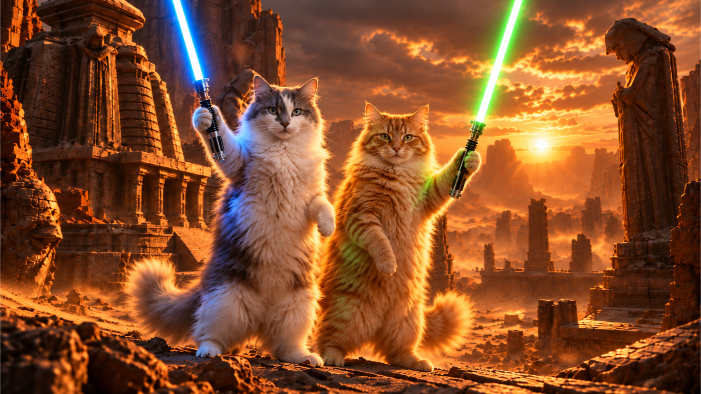
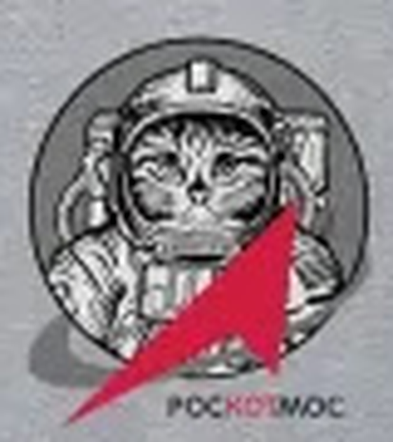
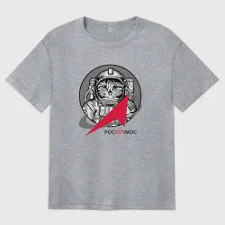
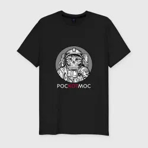

# Актуальные видео-сцены и промты

Рабочий мастер-файл. Здесь хранятся только актуальные промты, которые ещё нужны для генерации или доработки. Когда ролик готов и промт больше не нужен, соответствующая сцена удаляется из файла и из оглавления.

**Канонический источник:** `video-prompts.md`. Это единственный редактируемый мастер; `video-prompts.html` генерируется из него автоматически и вручную не редактируется.

## 📌 РЕВИЗИЯ / ТЕКУЩИЙ СТАТУС

**25 сцен к генерации/доработке · 46 полных текстов промта**

- **🛠️ 11** рабочих направлений в блоке **«Сцены в работе»**: W5–W15. Из них W14–W15 — «обдумать», а не отдельные сцены для автоматической генерации.
- **⏳ 1** сцена сейчас в медленной генерации: **28** — **5 активных Topview-задач / 5 занятых слотов из 6**. Редакционная приёмка будущих результатов отдельно. Новые генерации автоматически не запускать.
- **Последняя оформленная активная сцена:** 48 — после боя Канцлер забирает татуинский фрагмент (DRAFT, 16.10.2026, развязка Scene 42; Scene 16 принята владельцем, 42 — продолжение боя, в котором червь никому не интересен). Предыдущие: 47 — «красная точка»: Серёга уходит от котов хитростью, развязка дуэли 27–32 (DRAFT, 16.10.2026, решение владельца). Предыдущие: 46 — спутники РосКОТмоса сбиты в сражении (DRAFT, 16.10.2026, команда владельца); 45 — корабль котов в стиле РосКОТмоса снаружи в космическом сражении (DRAFT, ждёт референса корабля снаружи); 43–44 — у шаттла Канцлера в ангаре крейсера заело крыло, ремонтники чинят, и оно отваливается (DRAFT, русская речь, Wan 3.0). Предыдущие: 42 — после червя Канцлер забирает татуинский фрагмент (DRAFT, 16.10.2026, продолжение Scene 16); 41 — Серёга увозит древний ПК на борт (DRAFT). Предыдущие: 40 — Серёга прилетает на планету ситхов и садится у руин (DRAFT, 16.10.2026); вместе с 39 (прибытие на Набу) закрывает недостающие перелёты Серёги между планетами. Предыдущие: 38 — Серёга внимательно изучает древний ПК после его обнаружения в Scene 35. Scenes 35–38 — новые полные промты-продолжения без автоматических генераций; 35 продолжает Scene 34 (древний ПК), 36–37 — последствия уже вставленной в фильм Scene 17. Scene 28 — финальный имперский танец: 10×15 с Seedance 2.0 и 10×30 с Wan 3.0, 20 самостоятельных промтов. Референсы ангара H28A/H28B и сохранённые постановочные кадры P28/L28/F28 созданы; R28A/R28B сохранены как вспомогательные композиционные кадры, S28 проверен и сохранён; G28 v2 с Алесей и точным составом 9+1+2 проверен и сохранён; сцена готова к поэтапному запуску (`READY`), C28 будет выбран из результата части 2. Правки кошачьей ветки 23–27 сохранены. Scene 20 получила защиту закрытого голубого дизайна Маши для будущих запусков.
- **Ревизия Control Center:** дата определяется автоматически по содержательному изменению canonical master; чистая техническая пересинхронизация без изменения содержимого дату ревизии не меняет.
- **Последняя полная синхронизация:** **16.10.2026 · текущая по live Topview/Drive сверке**. Точное техническое время свежей telemetry берётся из `topview-status.json.checked_at`.

**Статусы V3.5 для обсуждения правок:** `NEEDS_FIX` означает, что сцену/промт нужно отдельно обсудить и решить, требуется ли изменение; это не разрешение автоматически переписывать промт или запускать новый рендер. `NEEDS_RERENDER` означает, что предыдущий результат уже признан кандидатом на повторную генерацию, но для slow-сцен повторный запуск всё равно запрещён до результата/ошибки или отдельного решения пользователя.

**Синхронизация контекста:** **16.10.2026**. Точное техническое время зеркала хранится в `project-status.json` и здесь не дублируется. Фактическая карта — `film-analysis.md`, статусы и зависимости — `film-backlog.md`. Новые решения пользователя имеют приоритет над старым Notion. В active master остаются **25 актуальных сцен и 46 полных текстов промта**. Сцены **1, 2, 3, 4, 5, 6, 7, 9, 10, 11, 12, 14, 15, 17, 18, 19, 20, 21, 22, 23, 26 и 29** удалены из active master; их Scene ID зарезервированы и не переиспользуются. Scenes 10, 11, 17, 19, 22, 23, 29 помечены владельцем «🎞 В фильме» 10.10.2026; подтверждение хранится в review-ledger.json, а не означает новую генерацию. По явному решению пользователя Scene 3 и 4 признаны неудачными и больше не дорабатываются, а Scene 5 принята как выбранный монтажный вариант и пойдёт в фильм, поэтому её prompt также больше не нужен в active master. Canonical slow-list сейчас: **28**. Полная live Topview сверка 10.10.2026 (ручная сверка Claude, пока «AI Film — единый монитор» не публикует): 11 boards, 554 video tasks, **1/6 active task slots**, свободно 5. Активна одна Wan 3.0 задача со статусом `init`: Scene 16 — `36e8320e34da4f1b97c35e1e765e3e63`. Scene 20 — `2c28a4161c8f459d8bf0c0460ac21ec5` технически завершена 10.10.2026 17:08:14 UTC (`success`). Технически завершены со статусом `success`: Scene 30 — `e369529cc93d465ba14127e4712f7bbd` (09.10.2026 13:57:32 UTC); Scene 31 — `32a4df3b18714cde9c55f0281cc2dd41` (09.10.2026 21:25:14 UTC); Scene 32 — `9746bfed635c451e97095c35b4e3b2bf` (10.10.2026 07:21:04 UTC); ранее Scene 33 — `e95f1bab9ab24f528b55fa58495d7adb` и Scene 34 — `3fb3d9ee26474b62982ae8ef062afc32`. Результаты требуют отдельной редакционной проверки и не считаются одобренными. Это попытки уже существующих сцен; production/approval state не менялся. Scene 28 здесь не запускалась. Никакие старые промты Notion сюда автоматически не добавлены. Непрерывный аудиовизуальный контроль не выполнялся.

**Новые промты 09.10.2026:** Scene 20 расширена вставками 12–13, добавлены Scenes 29–34 с полными production-промтами и имеющимися референсами: кантина (часть 3), три разрушительных боя, исследование руин и вход в храм. Это новые тексты для запуска, а не уже выполненные/одобренные Topview-результаты. Танцы Scene 28 и их неподтверждённые вспомогательные фото не менялись.

## ⏳ Сейчас в медленной генерации

| Сцена | Статус | Действие |
|---|---|---|
| 24 — Коты в кабине: запуск корабля и взлёт | ✅ Решение владельца: на переделку · ✅ Технический результат получен · `success` · Wan 3.0 | task `a3efa5cce8224b7896e8166e0d5f2b9e`; решение владельца применено в панели сайта |
| 25 — Коты в кабине: космическое сражение | ✅ Решение владельца: на переделку · ✅ Технический результат получен · `success` · Wan 3.0 | task `57b6f3aac4804d2486721131e30640f6`; решение владельца применено в панели сайта |
| 27 — Серёга против котов-магистров: бой на световых мечах | ✅ Решение владельца: на переделку · ✅ Технический результат получен · `success` · Wan 3.0 | task `dbe204aeb9a74478af04c6bbfe7693f9`; решение владельца применено в панели сайта |
| 16 — Татуин: гигантский пустынный червь и бой на руинах | ✅ Технический результат получен · `success` · Wan 3.0 | task `36e8320e34da4f1b97c35e1e765e3e63`; требуется отдельная редакционная проверка |
| 30 — Разрушение колоннады | ✅ Решение владельца: на переделку · ✅ Технический результат получен · `success` · Wan 3.0 | task `3710685303634b2482b90581aa6a8a2b`; решение владельца применено в панели сайта |
| 31 — Лестница и телекинетические обломки | ✅ Решение владельца: на переделку · ✅ Технический результат получен · `success` · Wan 3.0 | task `4682335cffc24a339179845c2713c46e`; решение владельца применено в панели сайта |
| 35 — Древний ПК в руинах храма: находка Серёги | ✅ Решение владельца: принято · ✅ Технический результат получен · `success` · Wan 3.0 | task `6d1ff4a96a0043f2884ffb528d5d9c9a`; решение владельца применено в панели сайта |
| 32 — Обрушение древней арки | ✅ Технический результат получен · `success` · Wan 3.0 | task `9746bfed635c451e97095c35b4e3b2bf`; требуется отдельная редакционная проверка |
| 34 — Вход в храм | ✅ Технический результат получен · `success` · Wan 3.0 | task `3fb3d9ee26474b62982ae8ef062afc32`; требуется отдельная редакционная проверка |
| 38 — Серёга рассматривает древний компьютер в заброшенном храме | ✅ Решение владельца: принято · ✅ Технический результат получен · `success` · Wan 3.0 | task `e948bd09e5d349448e0ff72fb3049d04`; решение владельца применено в панели сайта |
| 28 — Финальные титры: имперский строевой танец | ⏳ В МЕДЛЕННОЙ ГЕНЕРАЦИИ · ✅ Технический результат получен · `success` · Wan 3.0 | task `721cfbef2af0479da57f0a52479d2f54`; ждёт решения владельца в панели сайта |
| 28 — Финальные титры: имперский строевой танец | ⏳ В МЕДЛЕННОЙ ГЕНЕРАЦИИ · ✅ Технический результат получен · `success` · Seedance 2.0 | task `fec838b4f63b452c8c76fe50f8e0fdad`; ждёт решения владельца в панели сайта |
| 28 — Финальные титры: имперский строевой танец | ⏳ В МЕДЛЕННОЙ ГЕНЕРАЦИИ · `init` · Wan 3.0 | task `762b3091b3e44b8599a0a58b91a253c5`; ждать terminal и проверить результат отдельно |
| 28 — Финальные титры: имперский строевой танец | ⏳ В МЕДЛЕННОЙ ГЕНЕРАЦИИ · `init` · Seedance 2.0 | task `e471e35fc7454fe5a2a89e06fac3f122`; ждать terminal и проверить результат отдельно |
| 28 — Финальные титры: имперский строевой танец | ⏳ В МЕДЛЕННОЙ ГЕНЕРАЦИИ · `init` · Wan 3.0 | task `d3844e4199d64abebe323be430a5cb35`; ждать terminal и проверить результат отдельно |
| 28 — Финальные титры: имперский строевой танец | ⏳ В МЕДЛЕННОЙ ГЕНЕРАЦИИ · `init` · Wan 3.0 | task `f88eee8ea93242309b71621e354ccac2`; ждать terminal и проверить результат отдельно |
| 28 — Финальные титры: имперский строевой танец | ⏳ В МЕДЛЕННОЙ ГЕНЕРАЦИИ · `init` · Wan 3.0 | task `2bccc8a3521b411cb7bd51f9c8ba1119`; ждать terminal и проверить результат отдельно |

**Правило владельца (11.10.2026):** завершение, ошибка или отмена генерации автоматически меняют только технический статус и число занятых слотов Topview. **Сцена остаётся в canonical slow-списке / ожидании решения до явной кнопки в панели «🔑 Владелец»** и проверенного применения `owner_decisions` в GitHub. Технический `success` не означает одобрение. Новый запуск — только по решению владельца.

| # | Сцена | Референсы | Что происходит |
|---|-------|-----------|-----------------|
| 13 | [Совет джедаев — говорящий кот Лучик](#scene-13) | @image1 = композиция/локация; @image2 = Лучик; @image4 = Black; @image5 = Purple | После решения Совета кот на коленях у Purple спокойно человеческим голосом подтверждает решение. Black с кальяном и Purple воспринимают это как совершенно нормальное событие. |
| 16 | [Татуин — гигантский пустынный червь и бой на руинах](#scene-16) | @video1 = локация/герои Татуина | Огромный червь в духе Dune вырывается из песка в локации @video1 и разносит всё вокруг, пока герои сражаются на его фоне и уворачиваются от атак. Технический результат получен; требуется отдельная редакционная проверка. |
| 24 | [Коты в кабине: запуск корабля и взлёт](#scene-24) | @Image1 = парный continuity котов; @Image2 = Лучик; @Image3 = Рыжик; @Image4 = **точный approved cockpit / composition reference** | Тот же тёплый жилой интерьер как на фото: Рыжик слева в кадре у навигации, Лучик справа у пилотских органов управления; обычный домашний масштаб котов, без гигантских полугуманоидных пропорций.  Решение владельца: на переделку; ожидание завершено. |
| 25 | [Коты в кабине: космическое сражение](#scene-25) | @Image1 = парный continuity котов; @Image2 = Лучик; @Image3 = Рыжик; @Image4 = **точный approved cockpit / composition reference** | Сражение видно из той же кабины без redesign: Рыжик слева в кадре у тактики/навигации, Лучик справа пилотирует; оба остаются обычного кошачьего масштаба и хорошо читаются лицами.  Решение владельца: на переделку; ожидание завершено. |
| 27 | [Серёга против котов-магистров: бой на световых мечах](#scene-27) | @Image1 = коты; @Image2 = Серёга; @Image3 = Лучик; @Image4 = Рыжик; @Image5 = точная локация древнего города-руины | Обе прошлые 15s Seedance 2.0 задачи технически завершены; обе Wan 3.0 попытки основного 30s варианта технически завершены и требуют отдельного просмотра. **30s и обе 15s версии исправлены:** обычный небольшой масштаб котов, непрерывная пепельно-пыльная атмосфера и значительно более быстрый, агрессивный бой без статичного позирования.  Решение владельца: на переделку; ожидание завершено. |
| 28 | [Финальные титры — имперский строевой танец](#scene-28) | Character sheets из «Персонажей»; H28A/H28B; сохранённые P28/L28/F28; R28A/R28B как композиционные helpers; S28/G28 проверены; C28 только после результата части 2 | Две версии: 10×15 с Seedance 2.0 / 10×30 с Wan 3.0. Церемония → дискотека; жесты у лица, разъезд, кружение на руках и на плече; монтаж около 90 с; `READY` для поэтапного запуска; часть 3 ждёт C28 из части 2.<br>**⏳ В МЕДЛЕННОЙ ГЕНЕРАЦИИ** |
| 30 | [Коты против Серёги — разрушение колоннады](#scene-30) | Коты + Серёга + та же локация и масштаб Scene 27 | Удары мечей надрезают парапет и колонну; Force-удар обрушивает повреждённую каменную опору. Технический результат получен; требуется отдельная редакционная проверка.  Решение владельца: на переделку; ожидание завершено. |
| 31 | [Коты против Серёги — разрушенная лестница](#scene-31) | Те же точные персонажи/руины | Телекинетический бой с перехватом камней и логичным разрушением лестницы. Технический результат получен; требуется отдельная редакционная проверка.  Решение владельца: на переделку; ожидание завершено. |
| 32 | [Коты против Серёги — обрушение арки](#scene-32) | Те же точные персонажи/руины | Кульминационный бой: мечи и Сила обрушивают часть арки, оставляя повреждения в окружении. Технический результат получен; требуется отдельная редакционная проверка. |
| 33 | [Серёга изучает древний город ситхов](#scene-33) | @Image1 Серёга; @Image2 точные руины | Атмосферная проходка Серёги по локации битвы, осмотр каменной архитектуры и обнаружение входа храма. Технический результат получен; требуется отдельная редакционная проверка. |
| 34 | [Серёга входит в полуразрушенный храм](#scene-34) | @Image1 Серёга; @Image2 внешний храм/руины | Непрерывный кинематографичный проход из знакомой руинной локации в консервативно реконструированный зал храма. Технический результат получен; требуется отдельная редакционная проверка. |
| 35 | [Древний ПК в храме: находка Серёги](#scene-35) | Серёга; тот же храм; фактический конец Scene 34 | Приключенческое открытие старого ПК и CRT под древними камнями; без включения и преждевременного Warcraft payoff. DRAFT, требуется фактический финал 34.  Решение владельца: принято; ожидание завершено. |
| 36 | [После пещеры: Серёга уходит с фрагментом карты](#scene-36) | Серёга, Паша, Саша; пещера; модуль карты | Продолжение уже вставленной Scene 17: Серёга прячет модуль и уходит к водяной завесе, Паша и Саша остаются на Набу. READY: настоящий финальный кадр результата Scene 17 сохранён и проверен. |
| 37 | [Отлёт Серёги с Набу к лесной планете](#scene-37) | Серёга; корабль Канцлера; модуль карты; луг у озера Набу; лесная планета | Взлёт с Набу, стикер «хлеб и молоко», модуль указывает на лесную планету; без посадки, стык перед лесной парой. READY: реальные кадры корабля и новый референс лесной планеты сохранены. |
| 38 | [Серёга рассматривает древний компьютер в храме](#scene-38) | @Image1 точный Серёга; @Image2 храм; @Video1/@Image3 конец Scene 35 с компьютером | Отдельное 30-секундное продолжение находки: внимательно исследует CRT, клавиатуру и бежевый системный блок, без включения, новых артефактов или преждевременного Warcraft. DRAFT до сверки реального конца 35. Решение владельца: принято; ожидание завершено. |
| 39 | [Серёга прибывает на Набу: посадка у брошенной стоянки рыбаков](#scene-39) | Серёга; корабль Канцлера; озеро и луг Набу; стоянка пары после прыжка | Посадка корабля Канцлера на луг у озера и спокойный вход в воду по следу пары; ставит корабль, с которого взлетает 37. Стык ~45:05 по сборке. DRAFT до выгрузки кадра стоянки. |
| 40 | [Серёга прилетает на планету ситхов: посадка у руин](#scene-40) | Серёга; корабль Канцлера; модуль карты; стикер «хлеб и молоко»; руины ситхов | Модуль светится к цели, посадка у руин, зажигание меча за кадром — стык с котами Scene 26. После лесного блока (D1). READY 16.10: все входы в репозитории. |
| 41 | [Серёга увозит древний ПК с планеты ситхов](#scene-41) | Серёга; древний ПК; корабль Канцлера; руины ситхов; крейсер | Сила несёт блок и монитор из храма в кабину, взлёт, полёт к крейсеру — стык с финальным компьютером у окна в космос (01:02:45). DRAFT до выгрузки кадра крейсера. |
| 42 | [Татуин: бой на фоне червя — червь им не интересен](#scene-42) | Серёга, Илюша, Артём; червь; руины Scene 16 | Продолжение принятой Scene 16: дуэль продолжается, червь крушит всё вокруг, герои лениво уворачиваются, не глядя на него. DRAFT до последнего кадра 16. |
| 43 | [Ангар крейсера: у шаттла Канцлера заело крыло](#scene-43) | Серёга; имперский ангар H28A с шаттлом | Шаттл не может взлететь: левое крыло застряло на полпути. «Владыка… крыло заело». — «Я заметил». Серёга выходит по рампе. DRAFT, русская речь. |
| 44 | [Ангар крейсера: ремонт крыла, и оно отваливается](#scene-44) | Серёга; ангар H28A; конец Scene 43 | Серёга ворчит на переднем плане, трое техников за спиной чинят крыло, и оно отваливается целиком. DRAFT до результата 43. |
| 45 | [Корабль котов в стиле РосКОТмоса: космическое сражение снаружи](#scene-45) | Логотип РосКОТмос (футболка владельца); свет кабины 24–25; корабль снаружи — создать | Тот же бой, что в 25, снаружи: белый корабль с красной «галочкой» и логотипом уклоняется, стреляет и прорывается. DRAFT до референса корабля. |
| 46 | [Спутники РосКОТмоса сбиты в сражении](#scene-46) | Логотип РосКОТмос; корабль котов из 45 | Шальной огонь и обломки цепочкой ломают три спутника с логотипом; последняя панель с котом-космонавтом кувыркается мимо камеры. DRAFT. |
| 47 | [Красная точка: Серёга уходит от котов хитростью](#scene-47) | Серёга, Лучик, Рыжик; те же руины 27–32; конец Scene 32 | Развязка дуэли (решение владельца 16.10): Серёга гасит меч, пускает рукоятью красную точку, коты бросаются её ловить, он уходит к храму. DRAFT до кадра конца 32. |
| 48 | [Татуин: после боя Канцлер забирает фрагмент карты](#scene-48) | Серёга, Илюша, Артём; червь; модуль карты | Развязка 42: червь падает между дуэлянтами, меч Илюши гаснет, модуль Силой летит в руку Канцлера, Серёга уходит в бурю (D6). DRAFT до результата 42. |

---

## Сцены в работе

Это не финальные промты, а рабочий блок. Сюжетные идеи из «Ближайших направлений», «Сюжетных идей-кандидатов», заметок Саши и отдельной сюжетной логики сведены сюда в одну очередь. Статус **ОБДУМАТЬ** означает монтажную/сюжетную задачу, которую пока не следует превращать в отдельную генерационную сцену без проверки существующего материала.

| ID | Очередь / сцена в работе | Статус | Базовые референсы | Что уже понятно |
|---|---|---|---|---|
| W6 | **Татуин: гигантский червь, карта и побег Канцлера** | В РАБОТЕ: SCENES 42 + 48 (DRAFT); SCENE 16 ПРИНЯТА | развязка Татуина; карта; машина; Канцлер | Червь, руины и противостояние — Scene 16, исход не разрешён, обмена картой нет. Открыто: (1) решено 16.10 — «16 надо продолжить» (продолжение — Scene 42); (2) судьба татуинского фрагмента (D6/M1); (3) какую часть погони 46–49 [Р2] заменяет 16; (4) машина: не показывать после разрушения. Отлёт Серёги с Татуина генерировать не нужно — его прибытие на Набу закроет Scene 39. Возможное решение D6 из заметок Саши — 32:51: «меч гасится → карта левитирует в руку Канцлера». **16.10 владелец (D6):** Канцлер забирает татуинский фрагмент после драки на фоне червя; продолжение 16 — **Scene 42** (DRAFT, приём Саши 32:51). **16.10 владелец:** Scene 16 принята; продолжение — бой, в котором червю никто не уделяет внимания (**Scene 42**), фрагмент — **Scene 48**. |
| W5 | **Три фрагмента / артефакта → запретное знание → Warcraft 3** | В РАЗРАБОТКЕ (D5) | три фрагмента/карты; компьютер/CRT; референс Канцлера | Путь фрагментов к цели виден через приём «модуль светится к цели» (37, решение 14.10; продолжение — 40): Набу → лес → планета ситхов → храм → древний ПК (35/38). Открыто: (1) как соединяются фрагменты и что открывают (D5; рекомендация [Р2] — «А + Д»: доступ, затем бытовой возврат); (2) тот ли это ПК, что в существующем финале, и где тот стоит (D4; по [Р1] §1 — «в космическом окружении», тогда нужна 41). «Диск / провод / мышь» по-прежнему идея. **16.10 владелец:** D4 решён — финальный компьютер стоит на борту у окна в космос, это тот же ПК из храма → **Scene 41** (Сила несёт блок и монитор). Все три фрагмента у Канцлера: Татуин — Scene 48, Набу — 17/36, лес — силовой захват. Открыт D5. |
| W11 | **Татуин: кто передал Канцлеру маршрут / координаты** | В РАЗРАБОТКЕ · КОРОТКАЯ РЕПЛИКА / ЗВУК | кантина; существующий контакт/бармен/коммуникатор; татуинский блок | Прибытие Канцлера на Татуин не показано, он появляется в кантине 33:50 [Р2]. Посадку не генерировать: отлёт уже есть (уход корабля в гиперпространство, 27:50–28:55 [Р2]), а причину появления даёт только «след». Варианты без новой сцены: реплика у карты 14:05–15:20 «Координаты прислал наш контакт на Татуине» ([Р2] §13) или сигнал/маяк в кантине ([Р1] N4). Бармен отдал модуль герою (31:51–31:52, [Р2] §3) — не противоречить этому. **16.10 владелец:** прилёт на Татуин не генерируем. |
| W7 | **Переходы между крупными группами / полёт к следующей планете** | В РАБОТЕ: 37, 40 (READY), 39/41 (DRAFT) + монтаж | конечные и начальные кадры соседних блоков; корабль/планета | Линия Серёги: Корусант → крейсер показан (09:20–09:55); крейсер → Татуин — монтаж + W11; Татуин → Набу — **Scene 39** (стык ~45:05); Набу → лес — **36 + 37** (решение 14.10, без посадки); лес → планета ситхов — **Scene 40** (стык после 01:02:45 → Scene 26); ПК → финальный CRT — **Scene 41** (D4 решён 16.10). **16.10 владелец:** 39 и 40 нужны, место стыков подтверждено; прилёт на Татуин и посадку на Кашиике не генерируем. Смена групп: T2 и Татуин → Набу — существующая посадка пары (39:25–40:30); идея Саши 37:30 уже есть в этом участке. Корабль везде один — из ч.1 09:20–09:55. |
| W13 | **Финальный Warcraft → callback «хлеб и молоко»** | В РАЗРАБОТКЕ ПОСЛЕ W5 | компьютер/Warcraft; начало фильма с бытовой просьбой; Канцлер | Просьба «хлеб и молоко» есть в начале ([FA] ч.1 01:40–02:30). Промежуточное напоминание — стикер на пульте в 37 (решение 14.10); тот же стикер как continuity в 40/41. **16.10 владелец:** в 40 и 41 в кабине стоит корзинка с грибами из лесного эпизода. Финальный удар («А молоко?» и взгляд на корзинку — [Р2] §12, вариант Д) — 6–10 с после W5. Отдельный эпизод не нужен. |
| W8 | **Недоделанные гонки и транспорт** | В РАЗРАБОТКЕ / СВЕРИТЬ (Татуин) | референсы конкретной машины/экипажа; татуинская линия | Космическая погоня решена (Scene 5); сцены 3 и 4 не возвращать. Транспорт Канцлера между планетами зафиксирован: один корабль из ч.1 09:20–09:55 (37, 39, 40, 41). Открыто: татуинская машина и Scene 16 — машина не появляется после уничтожения; один узнаваемый дизайн машины Канцлера ([Р1] §16, [Р2] §8). |
| W14 | **ОБДУМАТЬ: монтажные и локальные идеи из заметок Саши** | ОБДУМАТЬ, НЕ НОВАЯ СЦЕНА | существующий фильм и точные таймкоды | Пункты Саши разбирать по одному при монтаже. Уточнения: 53:16 («показ спуска на землю») — посадка лесной пары, уже есть (51:52–52:40 [Р2]); 37:30 — прилёт пары на Набу, уже есть (39:25–40:30); 30:01 и 49:26 — сверить с вставленными 17 и 23. |

**Рабочая сюжетная очередь (ревизия 16.10.2026):** W5 → W11 → W6 (Scenes 42, 48) → W7 (Scenes 39–41) → W13. W8 ведётся параллельно как transport-continuity. W9, W10, W12, W15 сняты 16.10.2026 по решению владельца: закрыты Scenes 17/36, связкой 37, рекомендацией [Р2] и Scenes 19–20 (прежний текст — в git-истории и в разборе). W14 — пул «обдумать», а не разрешение на генерацию. Маршрут Серёги и обоснования — `reports/serega-travel-2026-10-14.md`.

### Ближайшие направления

Это рабочие направления для последующего разбора. Они не являются автоматическим разрешением менять существующие промты, снимать slow-lock или запускать новые генерации без отдельного решения пользователя.

1. **Закрыть сюжетную логику карты и Warcraft.** Определить, зачем Канцлеру карта, что дают её части и как это связано с Warcraft 3 / турниром, чтобы уже существующий компьютерный финал стал понятным payoff, а не случайным эпизодом.
2. **Закрыть последствия боя с монстром.** Для монтажного продолжения бывшей Scene 17 / линии W1 определить владельца набусского фрагмента, причину временного перемирия Канцлера и джедаев и понятный выход к следующей сюжетной линии.
3. **Разобраться с Татуином и транспортом.** Согласовать W6/W8 с уже существующей погоней: какую часть материала заменяет эпизод с гигантским червём, когда окончательно исчезает/разрушается машина и у кого остаётся фрагмент карты.
4. **Доделать переходы W7.** Проверить Татуин → Набу, последствия монстра → лесную группу, лесной финал → компьютер и другие слабые стыки. Генерировать новый переход только там, где функцию нельзя закрыть существующим планом, звуком или короткой репликой.
5. **Разбирать существующие NEEDS_FIX / NEEDS_RERENDER по одной сцене.** Текущий кандидат: Scene 13 — NEEDS_RERENDER. Scenes 10, 11 и 17 уже в фильме (выведены из active master); Scenes 3 и 4 выведены по решению пользователя в пользу Scene 5 и не являются кандидатами на доработку. Не переписывать сцены массово и не считать production status разрешением на новый render.
6. **После закрытия новых сцен перейти к финальному монтажному проходу.** Выбрать сокращения повторных боёв, танцев, гиперпрыжков и лесных проходов, пересчитать хронометраж и затем вручную проверить склейки, звук, музыку, continuity и краткие артефакты.
#### Сюжетные идеи-кандидаты для детального разбора

Это предложения соавтора, а не утверждённые сцены и не разрешение на генерацию. Их задача — закрыть уже найденные сюжетные пробелы минимальным количеством нового материала.

- **Три ключа турнира.** Три фрагмента могут складываться не просто в карту сокровищ, а в древний игровой/турнирный ключ: на CRT кратко проявляются пустыня, вода и лес, затем Warcraft. Это связывает реплику про «источник контроля» с уже существующим игровым финалом без отдельной длинной сцены.
- **Долг после монстра.** Продолжить сцену 17 коротким моральным последствием: один джедай признаёт, что Канцлер помог выжить, другой подчёркивает, что это не даёт права забрать карту. Так временное перемирие получает причину.
- **Кто сдал маршрут на Татуине.** Короткий payoff через контакт/бармена/коммуникатор: координаты были проданы или переданы Канцлеру. Его появление становится следствием предыдущей сцены, а не случайностью.
- **Карта в обмен на друга на Кашиике.** Рассмотреть вариант, где фрагмент отдаётся сознательно ради спасения товарища, вместо чистого Force pull. Это делает захват последнего ключа поступком персонажа.
- **Хлеб и молоко в финале.** После запуска Warcraft вернуть бытовую просьбу из начала — «Ты хлеб и молоко купил?». Использовать только если callback усиливает финал и не ломает уже выбранную W5-логику.

#### Идеи от Саши

Распознано с четырёх рукописных листов. Это идеи, монтажные замечания и варианты сюжетной логики от Саши, а не утверждённые сцены и не разрешение автоматически менять master-промты или запускать генерации. Места, которые по фотографии нельзя уверенно разобрать, оставлены как `[неразборчиво]` вместо догадки.

- **Маша / рыбалка / возврат к миссии.** Маша в виде «Лава-лагуны» появляется во время сцены на рыбалке, «лицом к лицу» `[формулировка частично неразборчива]`. Реплика/идея: «Когда наконец сможешь уделять внимание мне, а не своим увлечениям?» → «Ой, у нас же важное поручение» → сцена бегущих ног.
- **13:37 — смена кадров.** Сделать конечный кадр с ~13:47 и начальный с ~13:36; использовать движение/новое видео для перехода к теме. Во время видео — диалог о посещении планеты для поиска карты; рядом есть пометка про кадры с Землёй/картой `[частично неразборчиво]`.
- **14:49 — переход.** Склейка ухода от карты к переходу в коридор.
- **15:18.** «Пилота сверху».
- **16:11.** «Обрезать чуть-чуть Артёма?»
- **16:0x.** Попробовать переозвучить в Wan кадры третьей сцены с `[неразборчиво]`.
- **22:30.** «Мат перезвучить стоит».
- **27:31 — корабль / интерьер.** Начало с корабля и переход к планам Ильи и Артёма внутри.
- **Warcraft → хлеб и молоко.** Отдельно отмечен возврат к шутке/мотиву «хлеб и молоко» рядом с линией Warcraft.
- **Кадр с Землёй на карте.** Отмечен как отдельный переход/вставка; продолжение записи `[неразборчиво]`.
- **29:46.** Моменты Тёмы перед `[неразборчиво]` — попробовать в Wan.
- **30:01 — после монстров.** Переход к танцам после монстров; рядом пометка, что дополнительный переход между кадрами/эпизодами, возможно, не нужен `[частично неразборчиво]`.
- **32:51 — карта.** Меч гасится → карта левитирует/летит в руку к Канцлеру.
- **32:52.** Конечный кадр — момент, когда Серёгиус почти отвернулся.
- **37:30 — полёт к планете.** Полёт к планете Саши/Паши: камера вылетает из корабля, мы видим планету и летим к ней.
- **38:41.** «Закат → рассвет → закат» — ускорить.
- **39:36.** Скрыть пару рук / кадрировать.
- **41:53 — появление Маши.** Вставка на рассвете → появление Маши → «Ой, у нас же важная миссия» → побежали.
- **42:02.** Песня `[неразборчиво]` после исчезновения/погружения в воде.
- **42:07.** После «Лава-лагуны» — кадры погружения.
- **43:07.** Диалог заменить `[продолжение неразборчиво]`.
- **44:47.** Драка после `[неразборчиво]`; рядом пометка «2 Паши».
- **45:20.** «2 Саши из-под воды» — до подводной сцены.
- **45:22.** Связать сцену под водой.
- **45:34.** Кадр со скрещёнными мечами переходит в кадр с `[неразборчиво]` → в кадр 45:44.
- **48:22 — продолжение после монстра.** Вторая сцена с `[неразборчиво]` над/после монстра продолжается. Предложенные реплики: «Спасибо, что не оставил нас сражаться в одиночку против этого гада»; «Вы бы и не справились без меня»; «Помнишь, когда мы в детстве мечтали вместе стать джедаями?» `[дальше часть фразы неразборчива]`; «А зачем тебе эта карта?»; «Почему отдал?» / «Там было…» `[продолжение неразборчиво]`.
- **49:26.** Поставить эпизод с `[неразборчиво]` при отделении/отдалении камеры.
- **50:31 — уход в лес.** Уход Лёхи и Виталика в лес → первый кадр → камера вращается между ними → показ окрестностей с подлётом к лесу (новый кадр).
- **50:44.** Олень с кораблём → `[неразборчиво]` эвоков → приветствует Олега и берёт за руку.
- **52:25.** Вставить речь джедая на озвучке, сделать её эпичной.
- **53:16.** Показ спуска на землю.

**Отдельная сюжетная логика от Саши:**
- Продумать связную логику происходящего **от кантины до попадания в комнату с Канцлером**.
- **Три карты → три артефакта древности.** Рядом пометки: «диск / провод к розетке / мышь» `[частично неразборчиво]`.
- Реплика/смысл: **«Вы получили доступ к запретному знанию»**.
- Предусмотреть заключительный кадр с джедаями, которые потеряли карту `[часть формулировки неразборчива]`.
- Карты/артефакты дают доступ к **координатам заброшенного объекта в космосе** `[точное определение объекта неразборчиво]`; в связанной комнате/объекте есть компьютер/терминал, после чего появляется голограмма/карта с координатами `[частично неразборчиво]`.

---

<a id="scene-13"></a>

## Сцена 13 — Совет джедаев: говорящий кот Лучик

<!-- scene-meta: {"target_engine":"Wan 3","production_state":"NEEDS_RERENDER","duration_s":30,"dialogue":{"enabled":true,"language":"ru"},"tags":["dialogue","comedy","continuous_take","needs_rerender","speaker_ownership"]} -->

**Контекст использования:** Текущий результат отклонён пользователем: в речевом отрезке артикулировал PURPLE, а кот почти не двигал пастью; последующий обмен взглядами BLACK↔PURPLE дополнительно делал сцену похожей на разговор людей. Говорящий кот канонически идентифицирован как **Лучик**. Новый prompt сохраняет композицию и deadpan-комедию, но жёстко закрепляет голос и артикуляцию только за Лучиком. Автоматически не перезапускать: это готовая переработка для следующего пользовательского запуска.

**Правка 16.10.2026:** добавлен `END STATE` по последнему биту таймлайна; механическая чистка по `reports/prompt-audit-2026-10.md` §4, смысл сцены не менялся. Прежние запуски шли по предыдущей редакции, она дословно в истории git.

**Референсы:** @image1 = композиция, кресла, кальяны, панорамный город и общий свет · @image2 = **Лучик**, точный индивидуальный identity reference · @image3 = BLACK, первичный референс лица/телосложения/костюма · @image4 = PURPLE, первичный референс лица/телосложения/костюма

**Используемые identity-референсы на сайте:**
<div class="scene-ref-gallery" style="display:grid;grid-template-columns:repeat(auto-fit,minmax(145px,1fr));gap:10px;margin:10px 0 16px">
<figure style="margin:0"><a href="references/luchik.jpg" target="_blank" rel="noopener"></a><figcaption style="font-size:12px;margin-top:5px">Лучик — identity</figcaption></figure>
<figure style="margin:0"><a href="references/full/vitalik.jpg" target="_blank" rel="noopener"></a><figcaption style="font-size:12px;margin-top:5px">BLACK / Виталик — identity</figcaption></figure>
<figure style="margin:0"><a href="references/full/lesha.jpg" target="_blank" rel="noopener"></a><figcaption style="font-size:12px;margin-top:5px">PURPLE / Лёша — identity</figcaption></figure>
</div>

**Референсы локации, композиции и действия:**
<div class="scene-ref-gallery">
<figure><a href="references/scenes/scene-13/S13-Image1-topview-source.png" target="_blank" rel="noopener"></a><figcaption>@image1 — Совет: локация и композиция</figcaption></figure>
<figure><a href="references/scenes/scene-13/S13-council-lap.png" target="_blank" rel="noopener"></a><figcaption>@image5 — проверенная расстановка: Лучик на коленях у Лёши</figcaption></figure>
<figure><a href="references/scenes/scene-13/S13-luchik-closeup.png" target="_blank" rel="noopener"></a><figcaption>@image6 — крупность Лучика, человеческие рты вне кадра</figcaption></figure>
</div>

**Что происходит:** BLACK спокойно сидит слева и курит кальян. PURPLE сидит справа; **Лучик** всё время естественно лежит поперёк его колен, не садится вертикально. После длинной серьёзной паузы камера одним непрерывным медленным движением приближается к коту и ДО начала реплики приходит в настоящий крупный план его морды. BLACK и PURPLE к этому моменту уходят из читаемой речевой зоны кадра и всё время держат рты полностью закрытыми. Весь текст кот произносит целиком в крупном плане с отчётливым естественным липсинком: «Полностью с вами согласен, коллеги. Так и поступим». Голос серьёзный, спокойный и уверенный — без комедийной интонации. После реплики камера очень мягко освобождает место для реакции: BLACK переводит взгляд именно на кота, PURPLE слегка кивает именно коту, гладит его, кот снова опускает голову.

```text
Mode: reference-to-video | Duration: 30s | Resolution: 1080p | Aspect ratio: 16:9 | FPS: 24 | Native audio: on
Optimized for Wan 3 | Photoreal live-action deadpan comedy | One continuous restrained camera move

REFERENCES:
@image5 — supplemental opening staging only: exact BLACK left, PURPLE right, Luchik on PURPLE lap. @image6 — supplemental cat close-up framing only, with human mouths outside the crop. Individual identities remain locked by images2/3/4.
@image1 — PRIMARY COMPOSITION / ENVIRONMENT reference: two seated Jedi in large armchairs inside the futuristic high-rise council lounge, panoramic golden city skyline, hookahs, furniture placement, camera axis, warm sunset light and the cat resting on the right character's lap.
@image2 — PRIMARY LUCHIK / ЛУЧИК IDENTITY reference: exact recurring fluffy white-and-grey long-haired cat. Preserve his exact face shape, white muzzle/chest/legs, grey crown/facial and back markings, ears, natural eye appearance, long fur, coat pattern and feline anatomy. The blue lightsaber, upright pose and temple background visible in the model sheet are IDENTITY-REFERENCE ARTIFACTS ONLY for this scene: do NOT import the saber, standing pose or temple environment into the Jedi Council shot.
@image3 — PRIMARY BLACK identity reference: heavyset man, short brown hair, black tunic with dark leather vest panels, dark forearm protection, brown trousers and boots. He remains seated on the LEFT.
@image4 — PRIMARY PURPLE identity reference: leaner mustached man with brown hair, purple inner tunic under a long grey hooded outer robe, brown belt and tan boots. He remains seated on the RIGHT with the cat across his lap.

REFERENCE PRIORITY / IDENTITY LOCK:
@image3 and @image4 are absolute identity authorities for BLACK and PURPLE. @image2 is absolute identity authority for LUCHIK / ЛУЧИК. @image1 controls composition, environment, furniture, hookahs, lighting and starting geography only. Never average human faces with incidental faces in @image1. Preserve every character's face, body proportions, costume, left-right position and the cat's coat pattern throughout.

LUCHIK BODY LOCK:
The cat remains a normal realistic domestic cat for the entire shot. It lies naturally HORIZONTALLY ACROSS PURPLE'S LAP. It does NOT sit upright, stand on hind legs, become humanoid, grow human lips, gesture with paws or change body proportions. During the speaking beat only the cat's HEAD and NECK rise slightly. After the line it naturally lowers its head again.

ABSOLUTE SPEAKER OWNERSHIP — CRITICAL:
ONLY LUCHIK / ЛУЧИК SPEAKS.
BLACK and PURPLE NEVER speak, whisper, mutter, mouth words, imitate speech or lip-sync at any point.
During the entire cat line BOTH HUMAN MOUTHS remain fully CLOSED, still and visibly non-speaking.
The Russian voice originates physically from LUCHIK and ONLY LUCHIK'S muzzle/jaw makes small synchronized speech movements.
No ventriloquism. No off-screen human speaker. No voice transfer. No speech animation on BLACK. No speech animation on PURPLE.
If the frame contains a human mouth during the line, it must remain clearly closed and motionless.

START STATE:
Match @image1. BLACK is relaxed on the left with the hookah. PURPLE is relaxed on the right with the cat lying across his lap. The meeting has already reached a calm conclusion. No one is surprised by the cat's presence.

TIMELINE / PERFORMANCE:
[0:00–0:07] — SERIOUS SILENCE
Stable medium-wide composition matching @image1. BLACK slowly inhales from the hookah. PURPLE gently strokes the cat once along its back. The cat lies comfortably, breathes naturally and blinks. Nobody speaks.

[0:07–0:13] — DEADPAN BUILD
BLACK exhales a thin realistic smoke cloud. PURPLE keeps a neutral, serious council expression. The cat becomes attentive: ears adjust slightly and eyes focus forward. It stays lying down. Human mouths remain closed.

[0:13–0:17] — CAMERA PUSHES INTO A TRUE CAT CLOSE-UP
Without cutting, the camera begins a slow, physically continuous push directly toward the cat's face. By the END of this beat, BEFORE any word is spoken, arrive at a TRUE CLOSE-UP of the cat's face/muzzle: eyes, nose and mouth clearly readable, with the cat unmistakably owning the frame. BLACK and PURPLE must be pushed out of the readable speaking area; ideally their faces are outside frame, and if any part of a human face remains visible, the mouth is fully closed and motionless. The cat lifts ONLY its head and neck. No body straightening, no anthropomorphic posture.

[0:17–0:23] — CAT LINE IN CLOSE-UP
HOLD THE TRUE CLOSE-UP for the ENTIRE spoken line. Do not cut away, widen, pan to a human or reduce the cat to a secondary subject while it speaks.
The cat looks forward and says in natural Russian:
LUCHIK: «Полностью с вами согласен, коллеги. Так и поступим».
VOICE / DELIVERY: serious, calm, controlled and confident; mature and authoritative, with no jokey, cute, excited or theatrical intonation. The humor comes only from the absurd fact that a realistic cat is speaking and everyone accepts it as normal.
LIP SYNC: clear, readable and accurately synchronized to every Russian syllable, using restrained natural feline muzzle/jaw motion. The mouth movement must be visible in the close-up without turning into human lips.
BLACK and PURPLE remain absolutely silent with closed mouths for the complete line.

[0:23–0:27] — REACTION TO THE CAT
After the cat finishes, hold the close-up for a short silent beat, then let the camera ease back/reframe only as much as needed to reveal the human reactions. BLACK shifts his eyes first and then turns his head slightly TOWARD THE CAT — not toward PURPLE. PURPLE looks DOWN/TOWARD THE CAT and gives one tiny approving nod. No human-to-human conversational look exchange.

[0:27–0:30] — RETURN TO NORMAL
PURPLE resumes gently stroking the cat. The cat blinks and lowers its head back onto PURPLE's lap. BLACK calmly returns to the hookah. End on the same absurdly serious atmosphere.

END STATE:
PURPLE gently strokes LUCHIK lying across his lap, the cat's head resting down; BLACK back at the hookah; nobody speaks; same chairs, hookahs, panoramic window and skyline.

CAMERA / SPACE:
One continuous unbroken take. The defining camera move is a slow physical PUSH-IN from the established two-shot to a TRUE CLOSE-UP of the cat's face BEFORE the cat begins speaking. HOLD that close-up for the full line so the cat's lip sync is impossible to misread. Only after the final word may the camera ease slightly back/reframe for BLACK and PURPLE's reaction. No reaction cuts during the line. Preserve the established 180-degree axis, chair positions, hookahs, panoramic window and skyline. Camera motion is physically stable with controlled inertia. No digital zoom look, handheld jitter, whip pan, zoom jump or geometry reset.

LIGHTING / MATERIAL REALISM:
Warm sunset backlight through the panoramic windows, realistic skin and fur texture, soft practical interior fill, subtle haze catching the hookah smoke, physically plausible reflections and fabric response. Preserve @image1 color balance. No plastic skin, no glossy fake fur, no fantasy glow on the cat.

AUDIO:
Clear natural Russian LUCHIK dialogue only. LUCHIK VOICE: serious, calm, mature, controlled and confident; no comic delivery, no cute voice, no excitement, no exaggerated bass or villain effect. BLACK and PURPLE produce no spoken sound. Quiet room tone, faint futuristic city ambience, subtle hookah bubbling/inhalation and cloth/fur movement. No subtitles, no narrator, no non-diegetic music. The cat voice must remain spatially centered on the cat's on-screen close-up position.

NEGATIVE PROMPT:
wrong speaker, PURPLE speaking, BLACK speaking, human lip-sync, human mouth movement during cat line, ventriloquism, off-screen speaker, transferred voice, cat voice from human, silent cat mouth during dialogue, exaggerated human lips on cat, cat sitting upright, cat standing, anthropomorphic cat body, cat gesturing with paws, cat anatomy changing, cat leaving PURPLE's lap, human-to-human conversational glance after the line, shocked reaction, slapstick acting, identity drift, face averaging, face swap, costume drift, changed seating, duplicated people, duplicated cat, warped furniture, broken eyelines, random cut, hard cut, camera jitter, micro-shake, subtitles, captions, text, logo, watermark, cartoon, anime, game-render look, black bars, side bars.

FRAME FILL / NO BARS:
Fill the entire generated frame edge-to-edge. No letterboxing, no pillarboxing, no black bars, no side bars, no decorative borders, no empty margins.
```

<a id="scene-16"></a>

## Сцена 16 — Татуин: гигантский пустынный червь и бой на руинах

<!-- scene-meta: {"target_engine":"Seedance 2.5","production_state":"READY","duration_s":30,"dialogue":{"enabled":false,"language":null},"tags":["action","continuous_take"]} -->

Wan 3.0 task `36e8320e34da4f1b97c35e1e765e3e63` технически завершён 11.10.2026 03:00:50 UTC. Результат требует отдельной редакционной проверки; новый Scene ID не создаётся.

**Решение владельца 16.10.2026: принять.** Продолжение боя — Scene 42 (червь никому не интересен), развязка с фрагментом карты — Scene 48. Кнопки сайта «Принять» / «Переделать» по 16 этим решением закрыты по смыслу.

**Контекст использования:** Новый активный промт на основе бывшей W6; рабочий пункт W6 получил конкретные референсы и теперь оформлен как активная сцена 16. 30-секундная большая пустынная сцена для Seedance 2.5: двое татуинных джедаев и Канцлер сталкиваются на руинах, а из-под земли вырывается колоссальный песчаный червь. Сцена должна работать как самостоятельный мощный экшен-блок, из которого потом при желании можно отдельно собрать и более короткий фрагмент.

**Референсы:** @Video1 = пустынная локация, руины, общий масштаб и композиционный дух сцены · @Image1 = Hooded Jedi · @Image2 = Bearded Jedi · @Image3 = Chancellor · @Image4 = чистая локация · @Image5 = стартовая расстановка · @Image6 = масштаб червя

**Используемые identity-референсы на сайте:**
<div class="scene-ref-gallery" style="display:grid;grid-template-columns:repeat(auto-fit,minmax(145px,1fr));gap:10px;margin:10px 0 16px">
<figure style="margin:0"><a href="references/full/ilyusha.jpg" target="_blank" rel="noopener"></a><figcaption style="font-size:12px;margin-top:5px">Hooded Jedi / Илюша</figcaption></figure>
<figure style="margin:0"><a href="references/full/artem.jpg" target="_blank" rel="noopener"></a><figcaption style="font-size:12px;margin-top:5px">Bearded Jedi / Артём</figcaption></figure>
<figure style="margin:0"><a href="references/full/serega.jpg" target="_blank" rel="noopener"></a><figcaption style="font-size:12px;margin-top:5px">Серёга / Chancellor</figcaption></figure>
</div>

**Референсы локации, композиции и действия:**
<div class="scene-ref-gallery">
<figure><a href="references/scenes/scene-16/S16-desert-location-clean.png" target="_blank" rel="noopener"></a><figcaption>@Image4 — чистая локация из Video1, реконструкция</figcaption></figure>
<figure><a href="references/scenes/scene-16/S16-three-character-standoff.png" target="_blank" rel="noopener"></a><figcaption>@Image5 — стартовая расстановка трёх героев</figcaption></figure>
<figure><a href="references/scenes/scene-16/S16-worm-scale.png" target="_blank" rel="noopener"></a><figcaption>@Image6 — масштаб червя после появления</figcaption></figure>
</div>

**Подготовка проверена 09.10.2026:** точный пакет Scene 16 в Google Drive имеет статус `ready`, `remaining: []`, содержит два исходных MP4 (`S16-desert-source-1.mp4` и `S16-desert-source-2.mp4`), три вспомогательных PNG и manifest. Обе исходные Topview-задачи проверены как `success`. Новый тридцатисекундный ролик запущен как бесплатная Wan 3.0 задача `36e8320e34da4f1b97c35e1e765e3e63` и находится в статусе `init`; технический результат после завершения потребует отдельной редакционной проверки и не считается заранее одобренным.

**Источник пустыни найден:** @Video1 — [второй указанный ролик Topview](https://www.topview.ai/board/1a6244cf1ae747ef847d949a80d6133c?tool-type=video-edit&boardResultId=9fd93e2905e14c77b616884f1d6962f6). [Первый ролик](https://www.topview.ai/board/1a6244cf1ae747ef847d949a80d6133c?tool-type=video-edit&boardResultId=f1a90e67bfe44c50a31692b905a290f0) — дополнительная проверка той же пустыни. Image4 очищен на основе кадра Video1 около 14 с; это реконструкция пустой площадки, а не найденное исходное фото. Две покрытые знаками опоры и центральный обелиск фиксируют географию. Исторический Topview Image4 со спидером не является локацией.

**Что происходит:** На пустынных руинах двое джедаев и Канцлер находятся в напряжённом противостоянии. Внезапно земля начинает дрожать, и из песка вырывается колоссальный пустынный червь масштаба «гигантское стихийное бедствие». Он рушит окружающие конструкции, вздымает песчаные волны, делает несколько агрессивных заходов и кружит вокруг героев. На протяжении всей сцены герои остаются в кадре на фоне катастрофы, продолжают сражаться и вынуждены постоянно уклоняться от атак чудовища и обрушений.

```text
Mode: reference-to-video | Duration: 30s | Resolution: 1080p | Aspect ratio: 16:9 | FPS: 24 | Native audio: on

REFERENCES:
@Video1 — PRIMARY exact desert environment continuity: the supplied Topview desert-car video (source task 9fd93e2905e14c77b616884f1d6962f6). Preserve its sandy plain, two tall glyph-covered gate piers and narrow central obelisk. Do not inherit incidental character faces, saber-color errors or previous video actions.
@Image1 — PRIMARY identity reference for the Hooded Jedi: mustached man, tousled brown hair, weathered face, light-green layered tunic, deep-red hooded cloak, brown boots, lightsaber hilt on belt. Preserve face, costume, proportions and overall identity exactly.
@Image2 — PRIMARY identity reference for the Bearded Jedi: heavier build, short beard, cream tunic under a brown Jedi over-robe, wide brown belt, brown boots, lightsaber hilt on belt. Preserve face, build, costume and identity exactly.
@Image3 — PRIMARY identity reference for the Chancellor: pale man with thinning hair / bald crown and deep purple robes. Preserve face, body type, robe silhouette and identity exactly.

@Image4 — CLEAN LOCATION plate reconstructed from Video1 at about 14s; environment geometry and daylight only.
@Image5 — OPENING COMPOSITION: Ilyusha frame-left with blue blade, Artem centre-left with green blade, Serega frame-right. Three exact identities still come from Images1–3.
@Image6 — WORM SCALE/DESIGN after emergence: gigantic segmented worm beyond the gate, right of the central obelisk, much larger than people and gate piers. This is NOT the first frame; the worm must be absent at 0s.

REFERENCE PRIORITY:
Use @Image1, @Image2 and @Image3 as the absolute identity lock for the three characters. Use @Video1 and @Image4 for the exact desert environment; @Image5 locks initial staging and @Image6 locks the later worm scale. Helpers never override individual identities. Do not let the environment reference overwrite the character identities.

SCENE OVERVIEW:
A photorealistic cinematic desert action scene on ruined Tatooine-like wasteland terrain. The Hooded Jedi and the Bearded Jedi are confronting the Chancellor among weathered ruins when a colossal subterranean sandworm erupts from beneath the ground and turns the entire location into chaos. The worm is gigantic on the scale of a natural disaster — towering, segmented, immense, powerful, with a massive circular maw and rows of terrifying teeth. It is not a small monster; it feels like an unstoppable force of nature. Throughout the scene, the three characters stay grounded in the same battle space and must keep fighting and dodging while the worm attacks the environment around them.

ACTION TIMELINE — SINGLE CONTINUOUS 30-SECOND TAKE:
[0:00–0:05]
Begin with the clean three-person standoff from @Image5 in the exact @Image4 ruins. The worm is still beneath the sand and invisible. Ilyusha is left, Artem centre-left, Serega right; keep the gate and central obelisk as stable orientation landmarks. The Hooded Jedi and the Bearded Jedi face the Chancellor at medium distance. Wind moves robes and loose sand. The camera glides laterally through the ruins, keeping all three readable in the same frame. Small grains of sand begin to tremble across the ground and a low subterranean rumble builds beneath the dialogue-free tension.

[0:05–0:09]
The rumble intensifies violently. Sand ripples outward in fast concentric waves. Broken beams, rocks and debris start to shake loose. All three characters instinctively shift their stance and glance toward the source of the vibration. Then the ground splits beyond the gate, behind the group and right of the central obelisk, at the location established by @Image6. A colossal sandworm bursts out of the earth in an explosive eruption of sand and debris, instantly dominating the background.

[0:09–0:14]
The worm rises to full terrifying scale, rearing high above the ruins with its gigantic circular mouth open. Sand cascades off its ridged body. The shockwave throws dust through the air and knocks loose pieces of the surrounding structures. The heroes break their positions and sprint in different directions to avoid the collapse and the worm's initial surge. The camera keeps moving fluidly, holding spatial continuity so the audience clearly understands where each person is relative to the worm.

[0:14–0:20]
The Hooded Jedi and the Bearded Jedi attempt to regroup while the Chancellor uses the chaos to press his advantage. The three continue their live-action fight in short fast exchanges — evasive footwork, quick defensive movements, robe motion, physical urgency — but the worm remains the dominant threat in the background. It sweeps across the ruins, slamming its body through structures and sending dust clouds and fragments outward. Everyone is forced to interrupt combat and dodge a second aggressive pass from the worm.

[0:20–0:25]
The worm follows one readable broad arc behind the group, dives partially beneath the sand and surges up from the same background side, its massive head and upper body carving through the location. One ruin wall collapses, sending debris and sand down around the fighters. The Bearded Jedi dives clear. The Hooded Jedi uses a fast sidestep and roll. The Chancellor pivots away with dangerous precision, barely avoiding the jaws. Keep the worm huge in frame and unmistakably larger than every surrounding structure.

[0:25–0:30]
Final escalation. Keep the three people alive and the narrative outcome unresolved; do not add a map exchange, a vehicle explosion or a new ending.  The worm rears behind the three combatants while they continue the standoff in the foreground, battered by wind and sand. The scene ends on a powerful wide action composition: the two Jedi and the Chancellor still alive and in motion on the ruined desert ground, the colossal sandworm towering behind them amid collapsing debris and swirling dust, with the conflict still unresolved and continuing beyond the cut.

CAMERA:
Single continuous unbroken shot for the full 30 seconds. High-end cinematic motion with controlled inertia and stable spatial continuity. The camera may drift, arc and reframe to preserve all three characters and the worm, but there are no cuts, jump cuts or teleporting viewpoints. Emphasize scale through parallax, dust layers, foreground debris and wide-to-medium re-framing within the same take. No random micro-shake; only motivated impact vibration during the biggest eruptions.

MOVEMENT / STAGING RULES:
The worm's motion must feel massive and heavy, displacing huge volumes of sand. Its attacks are broad environmental threats: eruptions, surges, rears, sweeping passes, partial dives and re-emergence. The three characters must remain readable, keep their identities locked, and react believably to the danger. They are not standing still while the worm performs in the background: they are actively dodging, repositioning and trying to continue their conflict in the middle of the chaos.

STYLE / LIGHTING:
Photorealistic cinematic sci-fi/fantasy. Harsh warm desert light, dry haze, blown sand, long ruin shadows, strong scale cues, natural motion blur, realistic cloth and dust interaction. Serious blockbuster tone. No comedy.

AUDIO (native):
Powerful subterranean rumble, violent sand eruption, debris crashes, heavy impacts, rushing sand, distant wind, robe movement, footsteps on sand and stone, and huge monstrous roar / throat resonance from the worm. Optional brief exertion grunts from the characters, but no dialogue and no music.

NEGATIVE PROMPT:
small worm, tiny creature, comedic monster, cartoon, anime, stylized rendering, game-render look, floating worm, worm flying in the air without sand displacement, characters ignoring the worm, static posing, identity drift, face swap, extra characters, costume changes, missing robe colors, duplicate Chancellor, duplicate Jedi, warping ruins, popping geometry, sudden scene reset, teleporting camera, hard cuts, subtitles, on-screen text, logo, watermark.

FRAME FILL / NO BARS: Fill the entire generated frame edge-to-edge. No letterboxing, no pillarboxing, no black bars, no side bars, no decorative borders, no empty margins.
```

---

<a id="scene-24"></a>

## Сцена 24 — Коты в кабине: запуск корабля и взлёт

<!-- scene-meta: {"target_engine":"Seedance 2.5","production_state":"READY","duration_s":30,"dialogue":{"enabled":false,"language":null},"dependencies":[],"tags":["cats","cockpit","takeoff","continuous_take","character_identity"]} -->

Wan 3.0 task `a3efa5cce8224b7896e8166e0d5f2b9e` технически завершён 12.10.2026 00:49:59 UTC. Результат требует отдельной редакционной проверки; новый Scene ID не создаётся.

Предыдущая попытка: технический результат Topview получен 02.10.2026; редакционное решение по ней не принято.

**Контекст использования:** Продолжение кошачьей ветки после просмотра результата. Главный визуальный приоритет — **точно сохранить approved cockpit photo**: тёплый янтарный жилой интерьер корабля с плотными физическими панелями, глубиной заднего отсека/коридора и той же фронтальной композицией. Рыжик остаётся штурманом/оператором систем и виден **слева в кадре**; Лучик остаётся пилотом и виден **справа в кадре**. Коты обычного домашнего размера относительно кресел и консолей, не гигантские полугуманоидные существа.

**Правка 16.10.2026:** «canopy» в таймлайне заменено на «windows/viewports» (cockpit lock запрещает bubble canopy), добавлен `END STATE`; механическая чистка по `reports/prompt-audit-2026-10.md` §4, смысл сцены не менялся. Прежние запуски шли по предыдущей редакции, она дословно в истории git.

**Референсы:** @Image1 = парный continuity/composition reference тех же двух котов из Scene 23 · @Image2 = **Лучик**, точный индивидуальный identity reference · @Image3 = **Рыжик**, точный индивидуальный identity reference · @Image4 = **APPROVED EXACT COCKPIT / COMPOSITION reference**: текущая фотография с тёплым интерьером, Рыжиком слева в кадре у навигации и Лучиком справа у пилотских органов управления. @Image4 абсолютен для интерьера, света, масштаба кресел/консолей и композиции.

**Используемые identity-референсы на сайте:**
<div class="scene-ref-gallery" style="display:grid;grid-template-columns:repeat(auto-fit,minmax(145px,1fr));gap:10px;margin:10px 0 16px">
<figure style="margin:0"><a href="references/luchik.jpg" target="_blank" rel="noopener"></a><figcaption style="font-size:12px;margin-top:5px">Лучик — identity</figcaption></figure>
<figure style="margin:0"><a href="references/ryzhik.jpg" target="_blank" rel="noopener"></a><figcaption style="font-size:12px;margin-top:5px">Рыжик — identity</figcaption></figure>
</div>

**Референсы локации, композиции и действия:**
<div class="scene-ref-gallery">
<figure><a href="references/scenes/scene-24/S24-Image3-topview-source.png" target="_blank" rel="noopener"></a><figcaption>@Image4 — точная тёплая кабина; историческое имя Image3</figcaption></figure>
</div>

**Что происходит:** В **той же кабине, что на @Image4**, RYZHIK визуально остаётся слева в кадре и работает с навигацией/голографическими системами, а LUCHIK справа держит основные пилотские органы управления. Оба кота читаются лицами и сохраняют обычный кошачий масштаб. Панели оживают, двигатели набирают тягу, корабль физически взлетает без redesign интерьера и без перехода к generic starfighter cockpit.

```text
Mode: reference-to-video | Duration: 30s | Resolution: 1080p | Aspect ratio: 16:9 | FPS: 24 | Native audio: on
Optimized for Seedance 2.5 | Photoreal live-action space-opera cockpit | Continuous physical take

REFERENCES / AUTHORITY ORDER:
@Image1 — PAIR CONTINUITY reference for the recurring cat duo.
@Image2 — ABSOLUTE INDIVIDUAL IDENTITY reference for LUCHIK / ЛУЧИК: fluffy white-and-grey long-haired cat with white muzzle/chest/legs, grey crown/facial and back markings, dense natural fur and calm stern expression; fixed PILOT identity and recurring BLUE lightsaber identity.
@Image3 — ABSOLUTE INDIVIDUAL IDENTITY reference for RYZHIK / РЫЖИК: fluffy ginger long-haired tabby cat with warm orange coat, darker tabby striping, lighter muzzle/chest and serious confident expression; fixed NAVIGATOR / SYSTEMS identity and recurring GREEN lightsaber identity.
@Image4 — PRIMARY EXACT COCKPIT / STAGING reference. Match this approved photo closely: warm amber practical lighting, dense tactile consoles, the visible rear compartment/corridor depth, seat proportions, camera height and the exact visual placement of RYZHIK on frame-left and LUCHIK on frame-right.
Priority: @Image4 controls cockpit environment, lighting, seat/console scale and composition. @Image2/@Image3 control individual cat identity. @Image1 supports pair continuity only. Do not average or swap identities.

CHARACTER APPEARANCE / ROLE LOCK:
LUCHIK remains the PILOT, but visually occupies the RIGHT SIDE OF FRAME at the main flight controls exactly as in @Image4.
RYZHIK remains the NAVIGATOR / SYSTEMS operator, visually occupying the LEFT SIDE OF FRAME with the holographic/navigation displays exactly as in @Image4.
They remain visually natural photoreal cats. No human hands, no human arms, no humanoid faces, no costume drift. Their blue/green Jedi sabers from Scene 23 are safely clipped/stowed and remain OFF inside the cockpit.

CAT SCALE / ANATOMY LOCK — CRITICAL:
Both cats remain ordinary adult domestic-cat scale relative to the chairs, armrests, yokes and consoles in @Image4.
They must never become giant half-human cats, never approach half a human's height and never gain oversized humanoid torsos.
Their bodies remain fully feline; only their paw interactions are adapted to the controls.

ENVIRONMENT / COCKPIT LOCK — @Image4 IS ABSOLUTE:
Use the exact warm lived-in ship interior shown in @Image4, not a generic cold starfighter cockpit.
Preserve the amber practical strip lights, dense physical panels, tactile mechanical controls, modest holographic/nav displays, visible depth into the rear cabin/corridor and the same believable furniture/console proportions.
Do not replace the cabin with a bubble canopy, empty fighter cockpit, blue game-HUD environment or a different ship interior.

START STATE:
Ship is stationary on a launch pad or inside a hangar opening. Engines are off or at idle.
Begin from a front-biased medium-wide composition closely matching @Image4: RYZHIK clearly visible on frame-left at navigation, LUCHIK clearly visible on frame-right at the main pilot controls, both faces readable and both bodies correctly scaled to the seats/consoles.

TIMELINE:
[0:00–0:06] — PRE-FLIGHT
Medium-wide cockpit view matches @Image4 closely: RYZHIK stays on frame-left at navigation and LUCHIK stays on frame-right at the pilot controls. Both faces remain readable. RYZHIK taps two or three deliberate controls; indicators wake in sequence. LUCHIK places both front paws on the flight yoke/dual controls.

[0:06–0:12] — SYSTEMS ONLINE
Power rises through the cockpit: displays illuminate, engine vibration builds, navigation route appears. RYZHIK confirms readiness with a focused look toward LUCHIK, no speech. LUCHIK responds with a brief determined glance and returns eyes forward.

[0:12–0:18] — ENGINE START / LIFT
LUCHIK advances the throttle. A deep engine spool builds. Through the forward windows/viewports, the hangar/pad begins to move downward relative to the ship. Camera and loose cockpit details react to believable acceleration — mild vibration only, no chaotic shake.

[0:18–0:24] — DEPARTURE
Ship moves forward and upward through a real exit path. Exterior structures slide past the windows with correct parallax. RYZHIK actively manages navigation and power distribution while LUCHIK keeps the flight path stable.

[0:24–0:30] — CLEAR OF BASE
The craft clears the structure/atmospheric boundary into a broad open flight path. Stars/upper atmosphere become visible ahead. LUCHIK banks gently toward the chosen vector; RYZHIK checks tactical/nav display. End in a stable forward-flight cockpit state that can continue directly into Scene 25.

END STATE:
Stable forward flight, stars/upper atmosphere ahead through the windows; RYZHIK frame-left checking navigation, LUCHIK frame-right at the controls; same @Image4 cockpit and composition.

CAMERA / CONTINUITY:
Keep the camera inside the cockpit for the complete shot and compositionally close to the approved @Image4 photo: front-biased medium-wide / three-quarter-front view, not a long rear-view of the cats.
Both faces should remain readable for most of the scene. One continuous take, no exterior cutaway. Stable camera attached to ship with controlled vibration from engines.
Never swap the frame-left/frame-right placement: RYZHIK stays left in frame, LUCHIK stays right.

PERFORMANCE:
Both cats act competent, serious and purposeful. Paw interactions are clean and minimal. No comedy mugging, no random meowing, no licking/grooming during launch. Natural ears, blinking, breathing and small body adjustments under acceleration.

LIGHTING / MATERIALS:
Preserve the warm amber practical-light mood of @Image4 as the base look. Practical display glow falls naturally on fur; realistic brushed/worn metal and controlled glass reflections remain visible. Exterior light may change during launch but must not turn the cabin into a cold generic blue sci-fi cockpit. Avoid neon overload and game-HUD look.

AUDIO:
Cockpit power-up tones, switches, relays, navigation beeps, engine turbine/reactor spool, hull vibration, rising thrust, wind/launch ambience transitioning toward muted space-flight rumble. No dialogue, no narrator, no music.

NEGATIVE PROMPT:
wrong cockpit, cockpit redesign, generic bubble-canopy starfighter, cold blue cockpit replacing @Image4, missing rear-cabin depth, frame-left/frame-right swap, RYZHIK on frame-right, LUCHIK on frame-left, giant cats, half-human cats, cats oversized relative to seats, back-only cat framing, hidden cat, identity swap, extra cat, duplicated cat, human hands, human arms, humanoid body, warped paws, impossible control interaction, cockpit geometry changing, random seat movement, ship teleporting to space, hard cut, exterior cutaway, random camera shake, floating controls, unreadable overlaid UI, cartoon, anime, game-render look, plastic fur, subtitles, text, logo, watermark, black bars.

FRAME FILL / NO BARS:
Fill the entire generated frame edge-to-edge. No letterboxing, no pillarboxing, no black bars, no side bars, no decorative borders, no empty margins.
```

---

<a id="scene-25"></a>

## Сцена 25 — Коты в кабине: космическое сражение

<!-- scene-meta: {"target_engine":"Seedance 2.5","production_state":"READY","duration_s":30,"dialogue":{"enabled":false,"language":null},"dependencies":[{"type":"continues","scene":24}],"tags":["cats","cockpit","space_battle","action","character_identity"]} -->

Wan 3.0 task `57b6f3aac4804d2486721131e30640f6` технически завершён 12.10.2026 10:41:28 UTC. Результат требует отдельной редакционной проверки; новый Scene ID не создаётся.

**Контекст использования:** Прямое продолжение исправленной Scene 24. Те же коты и **тот же exact cockpit @Image4** без redesign: RYZHIK остаётся слева в кадре у навигации/оружия, LUCHIK справа пилотирует. Оба кота сохраняют обычный домашний масштаб и читаются лицами. Всё сражение видно изнутри того же тёплого жилого корабля.

**Правка 16.10.2026:** «canopy» в таймлайне и CAMERA заменено на «windows/viewports» (cockpit lock запрещает bubble canopy); механическая чистка по `reports/prompt-audit-2026-10.md` §4, смысл сцены не менялся. Прежние запуски шли по предыдущей редакции, она дословно в истории git.

**Референсы:** @Image1 = парный continuity reference котов · @Image2 = **Лучик**, точный индивидуальный identity reference · @Image3 = **Рыжик**, точный индивидуальный identity reference · @Image4 = **APPROVED EXACT COCKPIT / COMPOSITION reference**, тот же что в Scene 24. Финальный кадр Scene 24 можно добавить как дополнительный start continuity reference только если он реально доступен; он не переопределяет @Image4.

**Используемые identity-референсы на сайте:**
<div class="scene-ref-gallery" style="display:grid;grid-template-columns:repeat(auto-fit,minmax(145px,1fr));gap:10px;margin:10px 0 16px">
<figure style="margin:0"><a href="references/luchik.jpg" target="_blank" rel="noopener"></a><figcaption style="font-size:12px;margin-top:5px">Лучик — identity</figcaption></figure>
<figure style="margin:0"><a href="references/ryzhik.jpg" target="_blank" rel="noopener"></a><figcaption style="font-size:12px;margin-top:5px">Рыжик — identity</figcaption></figure>
</div>

**Референсы локации, композиции и действия:**
<div class="scene-ref-gallery">
<figure><a href="references/scenes/scene-24/S24-Image3-topview-source.png" target="_blank" rel="noopener"></a><figcaption>@Image4 — точная тёплая кабина; историческое имя Image3</figcaption></figure>
</div>

**Что происходит:** Через окна **той же кабины @Image4** видно плотное космическое сражение. LUCHIK справа в кадре резко, но физически правдоподобно уклоняет корабль от огня; RYZHIK слева ведёт навигацию, переключает щиты и стреляет. Интерьер, свет, масштаб кресел и обычный кошачий размер не меняются.

```text
Mode: reference-to-video | Duration: 30s | Resolution: 1080p | Aspect ratio: 16:9 | FPS: 24 | Native audio: on
Optimized for Seedance 2.5 | Photoreal cockpit battle | Continuous interior perspective

REFERENCES / AUTHORITY ORDER:
@Image1 — PAIR CONTINUITY reference for the recurring cat pair.
@Image2 — ABSOLUTE INDIVIDUAL IDENTITY reference for LUCHIK / ЛУЧИК: fluffy white-and-grey long-haired cat with white muzzle/chest/legs and grey crown/facial/back markings; PILOT; recurring BLUE lightsaber identity.
@Image3 — ABSOLUTE INDIVIDUAL IDENTITY reference for RYZHIK / РЫЖИК: fluffy ginger long-haired tabby cat with warm orange coat, darker tabby striping and lighter muzzle/chest; NAVIGATOR / WEAPONS; recurring GREEN lightsaber identity.
@Image4 — PRIMARY EXACT COCKPIT / STAGING reference, identical to Scene 24. Preserve its warm amber practical lighting, dense physical controls, visible rear-cabin depth, seat/console proportions, camera family and frame-left/frame-right placement.
Priority: @Image4 controls cockpit environment/composition. @Image2/@Image3 control identity. @Image1 supports pair continuity.

COCKPIT / SCALE LOCK — CRITICAL:
Use the exact same warm lived-in @Image4 cockpit from Scene 24.
RYZHIK remains on the LEFT SIDE OF FRAME at tactical/navigation systems; LUCHIK remains on the RIGHT SIDE OF FRAME at the pilot controls.
Both remain ordinary adult domestic-cat scale relative to chairs and consoles; no giant or half-human cats.

START STATE:
Begin as a direct continuation of Scene 24 after takeoff. The ship is already in forward flight. Both cats are clearly visible from the front/three-quarter front in the same cockpit geometry and the first signs of a larger battle appear outside.

TIMELINE:
[0:00–0:06] — BATTLE ARRIVAL
Fighters cross the view through the forward windows at different depths. Distant capital ships exchange fire. LUCHIK leans into the controls and aligns the craft with a safe route. RYZHIK switches the tactical display from navigation to combat.

[0:06–0:13] — FIRST EVASION
Incoming fire crosses ahead. LUCHIK makes one clean bank and controlled dive/roll with believable inertia. Exterior starfield and ships rotate consistently through the windows. RYZHIK braces naturally and adjusts shields.

[0:13–0:20] — RETURN FIRE
RYZHIK acquires a target and deliberately activates weapons. Short controlled bursts fire forward from the ship; one enemy craft ahead is hit or forced away. LUCHIK maintains the flight path and does not abandon the controls.

[0:20–0:26] — THREAD THE FIGHT
The ship passes between a larger vessel and drifting debris with clear depth and safe clearance. A nearby explosion briefly lights the cockpit, but does not white-out the frame. LUCHIK corrects course; RYZHIK rapidly checks another system.

[0:26–0:30] — BREAK THROUGH
LUCHIK accelerates through an opening in the battle formation. RYZHIK looks forward with focused satisfaction while keeping one paw on the tactical controls. End with the craft still in combat, ready for the next exterior or narrative shot.

CAMERA / SPACE:
Camera remains inside the cockpit for the full scene, but stays compositionally close to @Image4 rather than settling into a back-only angle. Both cat faces remain readable for most of the scene.
No exterior cutaway. Cockpit geometry stays fixed; all external movement is visible through the windows/viewports with correct parallax. Motion follows ship physics: mass, inertia, no instantaneous 180-degree turns, no starfield teleport.

PERFORMANCE:
Competent, angry-focused Jedi-cat crew rather than slapstick animals. LUCHIK actively flies; RYZHIK actively navigates/fires. Natural ear movement, blinking and body lean under G-forces. No dialogue and no random meowing.

LIGHTING / VFX:
Exterior battle flashes cast brief motivated reflections on fur and metal. Weapon bolts and engines retain stable colors and geometry. Avoid giant lens flares, oversaturated neon and screen-filling explosions.

AUDIO:
Cockpit engine tone, alert beeps, weapon charging/firing, shield impact, hull creaks, distant muffled explosions, rapid control clicks. No spoken dialogue, narrator or music.

NEGATIVE PROMPT:
wrong cockpit, cockpit redesign, generic fighter canopy replacing @Image4, cold blue cockpit, missing rear-cabin depth, frame-left/frame-right swap, RYZHIK on frame-right, LUCHIK on frame-left, giant cats, half-human cats, oversized cats relative to seats, hidden cat, back-only cat framing, role swap, identity swap, duplicated cats, extra cats, human hands, humanoid faces, cockpit morphing, seats moving, external camera cut, impossible ship rotation, teleporting stars, duplicated ships, random explosions inside cockpit, weapons firing backward, floating paws, broken controls, excessive camera shake, white flash transition, cartoon, anime, game-render look, subtitles, text, logo, watermark, black bars.

FRAME FILL / NO BARS:
Fill the entire generated frame edge-to-edge. No letterboxing, no pillarboxing, no black bars, no side bars, no decorative borders, no empty margins.
```

---

<a id="scene-27"></a>

## Сцена 27 — Серёга против котов-магистров: бой на световых мечах

<!-- scene-meta: {"target_engine":"Seedance 2.5","production_state":"READY","duration_s":30,"dialogue":{"enabled":false,"language":null},"dependencies":[],"tags":["cats","lightsaber_battle","sith_planet","action","jedi","character_identity"]} -->

Wan 3.0 task `dbe204aeb9a74478af04c6bbfe7693f9` технически завершён 12.10.2026 20:29:33 UTC. Результат требует отдельной редакционной проверки; новый Scene ID не создаётся.

**Последние Topview-задачи:** обе 15-секундные альтернативные части Seedance 2.0 технически завершены (`success`): Part 1 — 03.10.2026 19:01:20, Part 2 — 04.10.2026 07:05:59. Обе Wan 3.0 попытки существующего основного 30-секундного варианта технически завершены 08.10.2026: `ffa34324436745beb161d72ae9d4394f` — 13:44:15 UTC, `017bebefc4c54038954301968a4b5d68` — 13:46:23 UTC. Scene 27 снята с Topview-managed slow; новые Scene ID не создаются. Technical success не означает редакционное одобрение.

**Лимит split-версии — 07.10.2026:** каждый самостоятельный промт Seedance 2.0 на 15 с — не более **10 000 символов**  включая пробелы и переносы. Часть 1: **9 532**; часть 2: **9 682** символ (текст внутри fence без крайних пробелов). Редакция ниже предназначена для будущего запуска; уже полученные ролики использовали ранее отправленные тексты.

**Контекст использования:** Немедленное продолжение исправленной Scene 26. **Все три production-варианта Scene 27 — основной 30s Seedance 2.5 и обе 15s части Seedance 2.0 — получают одинаковые коррективы после просмотра результатов:** коты остаются обычного небольшого домашнего масштаба, в воздухе непрерывно присутствует та же сухая пепельно-пыльная взвесь с редкими искрящимися частицами, а бой становится заметно быстрее, агрессивнее и подвижнее, без долгих hero-pose пауз и статичного стояния. Коты явно превосходят Серёгу скоростью и координацией; Серёга почти всё время вынужден обороняться.

**Правка 16.10.2026:** из всех трёх блоков убраны слова об устаревшей локации (black-basalt / volcanic) из позитивной части; в основной 30 с абзац continuity заменён на `START STATE / BLOCKING` как в части 1, у @Image2 добавлена краткая внешность Серёги; механическая чистка по `reports/prompt-audit-2026-10.md` §4, смысл сцены не менялся. Прежние запуски шли по предыдущей редакции, она дословно в истории git.

**Референсы:** @Image1 = парный continuity/composition reference котов · @Image2 = канонический model sheet Серёги · @Image3 = **Лучик**, точный индивидуальный identity reference · @Image4 = **Рыжик**, точный индивидуальный identity reference · @Image5 = **точный LOCATION / ENVIRONMENT reference**: чистый широкий кадр древнего монументального каменного города-руины на закате. @Image5 является абсолютным визуальным источником локации, архитектуры, материала, пространственного масштаба, направления света и цветовой атмосферы. При будущей генерации фактический последний кадр Scene 26 можно добавить как start-frame continuity reference только для стартовых позиций/эмоционального состояния; он не должен переопределять @Image5 как authority окружения.

**Используемые identity-референсы на сайте:**
<div class="scene-ref-gallery" style="display:grid;grid-template-columns:repeat(auto-fit,minmax(145px,1fr));gap:10px;margin:10px 0 16px">
<figure style="margin:0"><a href="references/full/serega.jpg" target="_blank" rel="noopener"></a><figcaption style="font-size:12px;margin-top:5px">Серёга — identity</figcaption></figure>
<figure style="margin:0"><a href="references/luchik.jpg" target="_blank" rel="noopener"></a><figcaption style="font-size:12px;margin-top:5px">Лучик — identity</figcaption></figure>
<figure style="margin:0"><a href="references/ryzhik.jpg" target="_blank" rel="noopener"></a><figcaption style="font-size:12px;margin-top:5px">Рыжик — identity</figcaption></figure>
</div>

**Референсы локации, композиции и действия:**
<div class="scene-ref-gallery">
<figure><a href="references/scenes/scene-27/S27-Image1-topview-source.png" target="_blank" rel="noopener"></a><figcaption>@Image1 — парная композиция котов</figcaption></figure>
<figure><a href="references/scenes/scene-27/S27-Image5-topview-source.png" target="_blank" rel="noopener"></a><figcaption>@Image5 — точная локация древних руин</figcaption></figure>
<figure><a href="references/scenes/scene-27/S27-three-subject-scale.png" target="_blank" rel="noopener"></a><figcaption>@Image6 — небольшой масштаб котов и общий бой</figcaption></figure>
</div>

**Что происходит:** Бой разворачивается прямо в локации @Image5 и сохраняет атмосферу Scene 26: в тёплом закатном воздухе постоянно движутся мелкий сухой пепел, пыль и редкие ember-like частицы. Оба кота заметно меньше Серёги — даже в вертикальной боевой стойке их голова не выше примерно уровня его колена. Они не позируют, а непрерывно меняют позиции и углы атаки: Лучик давит точными силовыми сериями с синим клинком, Рыжик быстро обходит и режет углы зелёным. Серёга с красным мечом отбивается и пытается контратаковать, но почти каждый обмен заставляет его отступать, блокировать или восстанавливаться.

```text
Mode: reference-to-video | Duration: 30s | Resolution: 1080p | Aspect ratio: 16:9 | FPS: 24 | Native audio: on
Optimized for Seedance 2.5 | Photoreal live-action lightsaber combat | Aggressive but readable choreography

REFERENCES / IDENTITY:
@Image6 — optional three-subject scale/staging only: small domestic cats below Serega knee height. Images2/3/4 remain identity authority; Image5 remains exact environment.
@Image1 — PAIR CONTINUITY / COMPOSITION reference for LUCHIK and RYZHIK.
@Image2 — PRIMARY exact identity reference for SEREGA / THE CHANCELLOR: pale older Chancellor face and build, balding crown with sparse light hair, long deep-purple robe; no beautification or redesign.
@Image3 — ABSOLUTE INDIVIDUAL IDENTITY reference for LUCHIK / ЛУЧИК: fluffy white-and-grey long-haired cat with white muzzle/chest/legs, grey crown/facial/back markings; cold, disciplined master-like presence.
@Image4 — ABSOLUTE INDIVIDUAL IDENTITY reference for RYZHIK / РЫЖИК: fluffy ginger long-haired tabby cat with warm orange coat, darker tabby striping and lighter muzzle/chest; faster, more aggressive predatory confidence.
@Image5 — PRIMARY EXACT LOCATION / ENVIRONMENT reference: the clean wide view of the same vast ancient ruined stone city/temple complex at sunset. Preserve its warm reddish-brown / ochre weathered stone, monumental robed statues, massive temple façades, broad stepped terraces and stairways, broken columns, tall rectangular ruin towers, scattered masonry, jagged canyon/mesa-like rock spires and layered distant ruins, together with the warm orange-gold low sun, dramatic cloudscape and dusty atmospheric depth.
Preserve exact faces, fur, coat patterns, body proportions and costume. @Image3/@Image4 outrank @Image1 for individual cat identity. @Image5 is the absolute authority for battlefield environment, architecture, material palette, spatial scale, sunset direction and atmosphere. @Image1 controls pair continuity/composition only and must not override @Image5 environment. No identity swaps.
LUCHIK = BLUE saber.
RYZHIK = GREEN saber.
SEREGA = RED saber.
All three saber colors remain fixed for the entire shot.

CAT SCALE / ANATOMY LOCK — CRITICAL:
LUCHIK and RYZHIK remain ordinary adult domestic-cat scale relative to SEREGA and the ruins.
Even in upright combat posture, the top of each cat's head stays roughly around SEREGA's knee level, never half-human height and never giant humanoid-cat scale.
Retain feline heads, fur, paws and body proportions. No human hands, no human arms and no oversized humanoid torsos.

ENVIRONMENT / LOCATION LOCK — @Image5 IS ABSOLUTE:
Use @Image5 as the exact visual authority for the battlefield environment. The fight takes place inside the vast ancient monumental ruined stone city shown there, not on a generic dark Sith plateau. Preserve the recognizable architecture and scale logic: warm reddish-brown / ochre weathered stone, giant robed statues, massive temple façades, broad stepped terraces, long stairways, broken columns and parapets, tall rectangular ruin towers, fallen masonry, jagged desert canyon/mesa spires and layered ruined silhouettes receding into dusty haze.
Lighting must follow @Image5: a low warm orange-gold sunset near the horizon beneath dramatic dark clouds, strong golden edge light, long natural shadows and warm atmospheric haze between the ruins. Saber colors may add only local blue/green/red light near the characters.
This is NOT a black-basalt plateau, NOT a lava field, NOT a volcanic battlefield, NOT a featureless field of black monoliths and NOT a deep-red storm-sky environment. Do not replace @Image5 with generic Sith architecture.

ATMOSPHERE CONTINUITY — REQUIRED:
Carry over the successful atmosphere from Scene 26: fine drifting dry ash, dust motes and sparse ember-like particles remain visible throughout the fight at several depth planes.
This is dry ruin atmosphere, not volcanic smoke. The particles should react subtly to footwork, blade motion and impacts, adding motion and depth without obscuring the choreography.
Do not render clean empty air.

START STATE / BLOCKING:
Begin directly after the cats issue their challenge in Scene 26, already inside the ancient sunset-lit stone city of @Image5; no new arrival, no temporal reset, no location drift. SEREGA faces the two cats across a broad open weathered-stone terrace. RYZHIK is slightly forward on camera-left/center; LUCHIK is offset on the opposite side, half a step back but ready to close. All three sabers are already ignited. The fight begins immediately from this standoff tension.

POWER DYNAMIC — CRITICAL:
The CATS ARE CLEARLY THE SUPERIOR FIGHTERS.
SEREGA is competent and dangerous, but the two Jedi cats are faster, more coordinated, more precise and physically dominant.
Do not stage a balanced 50/50 duel. Do not make SEREGA casually overpower either cat.
Every major exchange should push SEREGA farther backward or force him to recover.
The cats never look helpless, confused or accidentally lucky; their advantage is intentional mastery.

ANTI-STATIC ACTION RULE — CRITICAL:
This must NOT look like actors posing with sabers.
Except for the final resolving beat, no fighter may remain planted in a hero pose for more than about 1–1.5 seconds.
Every exchange must create visible locomotion, angle change, pressure or recovery: cats flank, close distance, redirect and re-angle; SEREGA blocks while giving ground.
Avoid isolated single-cat glamour close-ups during the fight. Keep the two-on-one interaction readable in the same evolving 3D space.

TIMELINE / CHOREOGRAPHY:
[0:00–0:05] — EXPLOSIVE OPEN
RYZHIK attacks first from one angle while LUCHIK immediately closes from the other. SEREGA catches both strikes in a desperate compact guard. Clean saber contact, sparks and light interaction; no bodies intersect.

[0:05–0:11] — LUCHIK DOMINATES CENTER
LUCHIK drives a powerful precise three-beat combination that forces SEREGA back several steps across the broad weathered-stone terrace shown in @Image5. RYZHIK circles to cut off the escape angle rather than randomly spinning.

[0:11–0:17] — SEREGA COUNTERS / CATS READ HIM
SEREGA attempts one skilled red-saber counterattack. The cats anticipate it: RYZHIK redirects the blade, LUCHIK slips inside the line and forces SEREGA to turn and retreat. The choreography clearly shows teamwork and superior timing.

[0:17–0:23] — TWO-ON-ONE PRESSURE
Both cats attack in alternating rhythm, not chaotic simultaneous flailing. Blue and green blades create readable crossing patterns around SEREGA's red defense. SEREGA blocks but loses ground. A nearby broken stone column, parapet or fallen architectural fragment from @Image5 is struck and throws localized sparks/stone chips, demonstrating force without harming bodies graphically.

[0:23–0:27] — DECISIVE BREAK
LUCHIK pins/deflects SEREGA's saber line for a beat while RYZHIK lands a controlled Force-like impact or hilt/physical strike that throws SEREGA backward onto one knee or against a low broken stone terrace / fallen masonry element from the @Image5 ruins. No gore, no dismemberment. His saber remains in hand but his defense is broken.

[0:27–0:30] — CATS OWN THE FRAME
SEREGA recovers into a low defensive position, breathing hard. LUCHIK and RYZHIK advance together with sabers ready, completely composed. Camera settles low behind/near SEREGA so the two cats dominate the final composition and their superiority is unmistakable.

CAMERA:
Dynamic but physically readable action camera: controlled lateral tracking, short motivated push-ins and one low finishing angle. Do not use frantic random cuts, impossible orbiting, teleporting camera or constant shake. Preserve screen direction and action axis so the two cats' teamwork can be followed.

COMBAT PHYSICS:
Every blade has one continuous hilt and one continuous blade. Contacts happen at believable distances. No saber passing through bodies, no floating hilts, no extra blades, no blade length/color changes. Cats may use stylized bipedal combat balance while retaining feline anatomy; no human hands/arms. Landings and impacts obey gravity and momentum.

PERFORMANCE:
LUCHIK: cold, forceful, disciplined master.
RYZHIK: faster, more aggressive, predatory confidence.
SEREGA: skilled but increasingly pressured; anger gives way to concentration and strain. No clowning, no fear caricature, no dialogue.

LIGHTING / VFX:
Follow @Image5 lighting exactly: low warm orange-gold sunset, strong natural golden edge light, long directional shadows, dramatic cloud cover and dusty atmospheric depth across the ruined city. Saber light subtly adds local blue/green/red illumination to fur, SEREGA's robe/costume and nearby warm stone only at close range. Sparks and small stone chips are localized at impacts. Preserve the warm ochre/reddish-brown stone palette and cinematic sunset contrast. No volcanic glow, no heavy volcanic smoke wall, no giant bloom and no game-like particle spam. Keep the intentional fine dry ash/dust/embers visible.

AUDIO:
Distinct blue/green/red saber hum, hard blade clashes, air swishes, boots/paws on dry weathered stone, wind moving through monumental ruins, light grit/dust movement, localized stone chips/impacts and SEREGA's exertion breaths/grunts only. Cats may produce brief natural exertion growls/hisses, but no spoken dialogue. No narrator.

NEGATIVE PROMPT:
Serega winning, Serega overpowering both cats, balanced 50/50 staging, cat helplessness, random flailing, static posing, long hero pose, isolated single-cat glamour shot, giant cats, half-human cats, oversized cats, cat head above Serega knee level, clean empty air, missing ash, missing dust, wrong saber color, extra saber, duplicated blade, floating hilt, saber through body, gore, blood spray, dismemberment, severed limbs, identity swap, merged cats, duplicated cats, human hands on cats, humanoid cat face, extra limbs, teleporting fighters, position reset, environment morph, impossible camera spin, constant shaky cam, cartoon, anime, game-render look, black basalt plateau, lava field, volcanic glow, deep red storm sky, featureless black monolith field, generic dark Sith plateau, location drift away from @Image5, missing monumental statues/terraces/stairs/towers, subtitles, text, logo, watermark, black bars.

FRAME FILL / NO BARS:
Fill the entire generated frame edge-to-edge. No letterboxing, no pillarboxing, no black bars, no side bars, no decorative borders, no empty margins.
```

### Дополнительная версия — Seedance 2.0 — 2 × 15 секунд

**Назначение:** Альтернативная split-версия той же Scene 27 для Seedance 2.0. Исходный 30-секундный вариант выше остаётся основным и не заменяется. **Обе 15-секундные части получают те же исправления, что и 30s:** normal domestic-cat scale, голова котов примерно не выше колена Серёги в вертикальной стойке; постоянная мелкая пепельно-пыльная взвесь/редкие embers; быстрый агрессивный two-on-one без долгого статичного позирования. Оба используют ту же точную локацию @Image5 и сохраняют identity, цвета мечей и пространственную географию.

#### Часть 1 — 15 секунд

```text
Mode: reference-to-video | Duration: 15s | Resolution: 1080p | Aspect ratio: 16:9 | FPS: 24 | Native audio: on
Optimized for Seedance 2.0 | Photoreal live-action lightsaber combat | Aggressive but readable choreography

REFERENCES / IDENTITY:
@Image6 — optional three-subject scale/staging only: small domestic cats below Serega knee height. Images2/3/4 remain identity authority; Image5 remains exact environment.
@Image1 = LUCHIK/RYZHIK pair continuity and composition ONLY.
@Image2 = absolute SEREGA identity/costume sheet.
@Image3 = absolute individual LUCHIK identity sheet.
@Image4 = absolute individual RYZHIK identity sheet.
@Image5 = absolute location, architecture, scale, sunset and atmospheric reference: the supplied wide ancient ruined stone city.
Individual sheets override the pair image for faces, bodies, fur and clothing; @Image5 overrides other images for environment. A sheet's multiple views show ONE character. Exactly SEREGA and the two cats. No swaps or duplicates.
Saber ownership is fixed: LUCHIK BLUE, RYZHIK GREEN, SEREGA RED.

CAT SCALE / ANATOMY LOCK — CRITICAL:
LUCHIK and RYZHIK remain ordinary adult domestic-cat scale relative to SEREGA and the ruins.
Even in upright combat posture, the top of each cat's head stays roughly around SEREGA's knee level, never half-human height and never giant humanoid-cat scale.
Retain feline heads, fur, paws and body proportions. No human hands, no human arms and no oversized humanoid torsos.

ENVIRONMENT / LOCATION LOCK — @Image5 IS ABSOLUTE:
Use the exact ancient ruined city in @Image5: weathered reddish-brown/ochre stone, giant robed statues, monumental temple facades, broad stepped terraces and stairs, broken columns/parapets, tall rectangular towers and fallen masonry. Preserve the jagged canyon/mesa spires and layered distant ruins fading into dusty haze. Keep the same coherent battlefield scale and geometry throughout.
Match its low orange-gold sunset, dramatic clouds, golden edge light and long natural shadows. Saber light adds only local blue/green/red accents. Never substitute a generic Sith plateau, black basalt, lava, volcanic glow, black monolith field or deep-red storm sky.

ATMOSPHERE CONTINUITY — REQUIRED:
Carry over the successful atmosphere from Scene 26: fine drifting dry ash, dust motes and sparse ember-like particles remain visible throughout the fight at several depth planes.
This is dry ruin atmosphere, not volcanic smoke. The particles should react subtly to footwork, blade motion and impacts, adding motion and depth without obscuring the choreography.
Do not render clean empty air.

CHARACTER APPEARANCE / IDENTITY LOCK:
SEREGA (@Image2): exact pale older Chancellor face and build, balding crown with sparse light hair, long deep-purple robe; preserve approved head shape, age, silhouette and material. No beautification or redesign.
LUCHIK (@Image3): white-and-grey long-haired cat, white muzzle/chest/legs, grey crown/facial/back markings, full natural fur and exact feline face; cold, disciplined master.
RYZHIK (@Image4): ginger long-haired tabby, warm orange coat, darker tabby stripes, lighter muzzle/chest and exact feline face; fast, confident and aggressive.
Preserve the individual sheets' proportions, ears, muzzles, paws, tails and coat patterns. Compact hilts may be held with stylized feline combat balance; cats never acquire human hands, arms, faces or torsos.

CONTINUITY FROM SCENE 26:
Begin directly after the cats issue their challenge in Scene 26, already inside the ancient sunset-lit stone city of @Image5. No new arrival, no temporal reset and no location drift away from @Image5.

START STATE / BLOCKING:
SEREGA faces the two cats across a broad open weathered-stone terrace/plaza matching @Image5, with monumental ruined architecture clearly readable around and behind them.
RYZHIK is slightly forward on camera-left/center.
LUCHIK is offset on the opposite side, half a step back but ready to close.
All three sabers are already ignited:
RYZHIK = GREEN.
LUCHIK = BLUE.
SEREGA = RED.
The fight begins immediately from this standoff tension.

POWER DYNAMIC — CRITICAL:
The cats are clearly superior in speed, coordination and precision. SEREGA is skilled but forced to defend, give ground and recover; his counters never reverse their advantage. LUCHIK controls center with disciplined pressure; RYZHIK flanks aggressively. Their mastery is deliberate, never accidental luck or helpless flailing. No balanced 50/50 duel.

ANTI-STATIC ACTION RULE — CRITICAL:
This must NOT look like actors posing with sabers.
Except for the final resolving beat, no fighter may remain planted in a hero pose for more than about 1–1.5 seconds.
Every exchange must create visible locomotion, angle change, pressure or recovery: cats flank, close distance, redirect and re-angle; SEREGA blocks while giving ground.
Avoid isolated single-cat glamour close-ups during the fight. Keep the two-on-one interaction readable in the same evolving 3D space.

TIMELINE / CHOREOGRAPHY:
[0:00–0:04] — EXPLOSIVE OPEN
Immediately after the standoff, RYZHIK attacks first from one angle while LUCHIK closes from the other. SEREGA catches the opening pressure in a compact desperate guard. Clean blade contacts, sparks and readable spacing; no bodies intersect.

[0:04–0:08] — RYZHIK FORCES THE FIRST RETREAT
RYZHIK drives fast aggressive green-blade attacks that make SEREGA give up ground. LUCHIK does not flail randomly; he tracks the spacing intelligently and cuts off the escape line, forcing SEREGA to stay trapped between both cats' angles.

[0:08–0:12] — LUCHIK TAKES CONTROL OF CENTER
LUCHIK enters decisively with a precise blue-blade three-beat series. SEREGA blocks and survives, but he is clearly pressured. He attempts one red-saber counter but cannot turn momentum in his favor because RYZHIK immediately threatens from the side.

[0:12–0:15] — END STATE FOR PART 2
The cats' coordinated pressure forces SEREGA backward toward a low broken stone terrace / fallen masonry element matching the @Image5 ruins. He ends this part in a strained defensive stance, slightly lower and off-balance, red saber still in hand. LUCHIK stands closer on one side with blue saber poised; RYZHIK has angled around to the other side with green saber ready to spring. End on a clear tense mid-wide composition that directly sets up Part 2.

CAMERA / LENS / CONTINUITY:
Dynamic but physically readable action camera. Controlled lateral tracking with short motivated push-ins. Preserve one coherent action axis and clear left-right geography. No frantic random cuts, impossible orbiting, teleporting camera or constant shake. The two cats' teamwork must remain easy to follow. Maintain one coherent 3D battlefield and stable ruin geometry.

COMBAT PHYSICS:
Every saber has one continuous hilt and one continuous blade. Contacts happen at believable distances. No saber passing through bodies, no floating hilts, no extra blades, no blade length/color changes and no clipping. Landings, footwork and impacts obey gravity and momentum. The cats may fight in stylized bipedal balance while retaining unmistakably feline anatomy.

PERFORMANCE:
LUCHIK: cold, forceful, disciplined master.
RYZHIK: faster, more aggressive, predatory confidence.
SEREGA: skilled and dangerous, but increasingly pressured; serious and concentrated. No clowning, parody, fear caricature or dialogue.

LIGHTING / MATERIAL REALISM / VFX:
Follow @Image5: low orange-gold sunset, dramatic cloud cover, warm golden rim light, long natural shadows and dusty atmospheric depth. Blue, green and red saber light adds only local illumination to nearby fur, SEREGA's robe/costume and warm weathered stone. Preserve detailed natural fur, worn fabric, carved ancient stone and believable dust/stone response. Sparks and small stone chips remain localized at impacts. Keep the required fine non-volcanic dry ash/dust/embers visible. No volcanic glow, heavy ash storm, screen-filling bloom, excessive particles or glossy game-render materials.

AUDIO (native):
Distinct blue/green/red saber hum, hard blade clashes, air swishes, boots and paws on dry weathered stone, wind passing through stairs/columns/ruins, light grit and dust movement, small stone impacts and SEREGA's effort breaths/grunts only. Cats may produce brief natural exertion hisses/growls, but no spoken dialogue. No narrator. No generated intrusive music.

NEGATIVE PROMPT:
Serega winning, Serega overpowering both cats, balanced 50/50 staging, cat helplessness, random flailing, static posing, long hero pose, isolated single-cat glamour shot, giant cats, half-human cats, oversized cats, cat head above Serega knee level, clean empty air, missing ash, missing dust, wrong saber color, extra saber, duplicated blade, floating hilt, saber through body, gore, blood spray, dismemberment, severed limbs, identity swap, face morphing, merged cats, duplicated cats, humanoid cat face, human hands on cats, human arms on cats, extra limbs, teleporting fighters, position reset, environment morph, impossible camera spin, constant shaky cam, cartoon, anime, game-render look, black basalt plateau, lava field, volcanic glow, deep red storm sky, featureless black monolith field, generic dark Sith plateau, location drift away from @Image5, missing monumental statues/terraces/stairs/towers, subtitles, text, logo, watermark, black bars.

FRAME FILL / NO BARS:
Fill the entire generated frame edge-to-edge. No letterboxing, no pillarboxing, no black bars, no side bars, no decorative borders, no empty margins.
```

#### Часть 2 — 15 секунд

```text
Mode: reference-to-video | Duration: 15s | Resolution: 1080p | Aspect ratio: 16:9 | FPS: 24 | Native audio: on
Optimized for Seedance 2.0 | Photoreal live-action lightsaber combat | Aggressive but readable choreography

REFERENCES / IDENTITY:
@Image6 — optional three-subject scale/staging only: small domestic cats below Serega knee height. Images2/3/4 remain identity authority; Image5 remains exact environment.
@Image1 = LUCHIK/RYZHIK pair continuity and composition ONLY.
@Image2 = absolute SEREGA identity/costume sheet.
@Image3 = absolute individual LUCHIK identity sheet.
@Image4 = absolute individual RYZHIK identity sheet.
@Image5 = absolute location, architecture, scale, sunset and atmospheric reference: the supplied wide ancient ruined stone city.
Individual sheets override the pair image for faces, bodies, fur and clothing; @Image5 overrides other images for environment. A sheet's multiple views show ONE character. Exactly SEREGA and the two cats. No swaps or duplicates.
Saber ownership is fixed: LUCHIK BLUE, RYZHIK GREEN, SEREGA RED.

CAT SCALE / ANATOMY LOCK — CRITICAL:
LUCHIK and RYZHIK remain ordinary adult domestic-cat scale relative to SEREGA and the ruins.
Even in upright combat posture, the top of each cat's head stays roughly around SEREGA's knee level, never half-human height and never giant humanoid-cat scale.
Retain feline heads, fur, paws and body proportions. No human hands, no human arms and no oversized humanoid torsos.

ENVIRONMENT / LOCATION LOCK — @Image5 IS ABSOLUTE:
Use the exact ancient ruined city in @Image5: weathered reddish-brown/ochre stone, giant robed statues, monumental temple facades, broad stepped terraces and stairs, broken columns/parapets, tall rectangular towers and fallen masonry. Preserve the jagged canyon/mesa spires and layered distant ruins fading into dusty haze. Keep the same coherent battlefield scale and geometry throughout.
Match its low orange-gold sunset, dramatic clouds, golden edge light and long natural shadows. Saber light adds only local blue/green/red accents. Never substitute a generic Sith plateau, black basalt, lava, volcanic glow, black monolith field or deep-red storm sky.

ATMOSPHERE CONTINUITY — REQUIRED:
Carry over the successful atmosphere from Scene 26: fine drifting dry ash, dust motes and sparse ember-like particles remain visible throughout the fight at several depth planes.
This is dry ruin atmosphere, not volcanic smoke. The particles should react subtly to footwork, blade motion and impacts, adding motion and depth without obscuring the choreography.
Do not render clean empty air.

CHARACTER APPEARANCE / IDENTITY LOCK:
SEREGA (@Image2): exact pale older Chancellor face and build, balding crown with sparse light hair, long deep-purple robe; preserve approved head shape, age, silhouette and material. No beautification or redesign.
LUCHIK (@Image3): white-and-grey long-haired cat, white muzzle/chest/legs, grey crown/facial/back markings, full natural fur and exact feline face; cold, disciplined master.
RYZHIK (@Image4): ginger long-haired tabby, warm orange coat, darker tabby stripes, lighter muzzle/chest and exact feline face; fast, confident and aggressive.
Preserve the individual sheets' proportions, ears, muzzles, paws, tails and coat patterns. Compact hilts may be held with stylized feline combat balance; cats never acquire human hands, arms, faces or torsos.

CONTINUITY FROM SCENE 26 / PART 1:
Continue immediately from the end of Part 1 with no reset. Preserve the same action axis and the same @Image5 environment: warm sunset, monumental ancient stone ruins, stepped terraces, giant statues, stairs, towers, broken masonry and distant jagged rock spires. @Image5 remains the absolute environment authority.
Start exactly from this Part 1 end-state:
SEREGA is backed closer to a low broken stone terrace / fallen masonry element from the @Image5 environment, in a strained defensive stance, slightly lower and off-balance, red saber still in hand.
LUCHIK is closer on one side with blue saber ready to press.
RYZHIK has angled around on the opposite side with green saber ready to spring.
All three remain inside the same coherent battlefield geometry.

POWER DYNAMIC — CRITICAL:
The cats are clearly superior in speed, coordination and precision. SEREGA is skilled but forced to defend, give ground and recover; his counters never reverse their advantage. LUCHIK controls center with disciplined pressure; RYZHIK flanks aggressively. Their mastery is deliberate, never accidental luck or helpless flailing. No balanced 50/50 duel.

ANTI-STATIC ACTION RULE — CRITICAL:
This must NOT look like actors posing with sabers.
Except for the final resolving beat, no fighter may remain planted in a hero pose for more than about 1–1.5 seconds.
Every exchange must create visible locomotion, angle change, pressure or recovery: cats flank, close distance, redirect and re-angle; SEREGA blocks while giving ground.
Avoid isolated single-cat glamour close-ups during the fight. Keep the two-on-one interaction readable in the same evolving 3D space.

TIMELINE / CHOREOGRAPHY:
[0:00–0:04] — IMMEDIATE CONTINUATION
From the Part 1 end pose, RYZHIK springs first from the wider angle while LUCHIK holds center pressure. SEREGA reacts quickly and blocks, but the geometry makes it clear he is already on the back foot and cannot reset the fight on his terms.

[0:04–0:08] — COORDINATED PRESSURE
LUCHIK drives a clean, forceful blue-blade sequence that pins SEREGA's line for a moment while RYZHIK repositions and threatens from the side. The attacks alternate rhythmically rather than degenerating into chaotic simultaneous flailing. SEREGA manages to defend, but loses more ground and composure.

[0:08–0:12] — DECISIVE BREAK
SEREGA attempts one committed red-saber counterattack to create space. The cats read it instantly: one redirects the blade while the other lands a controlled non-gory impact — either a hilt/physical hit or a restrained Force-like push — that knocks SEREGA backward onto one knee or against the same low broken stone terrace / fallen masonry element from Part 1. His saber stays in hand, but his defense is clearly broken.

[0:12–0:15] — CATS OWN THE FRAME
SEREGA remains in a low defensive recovery posture, breathing hard, red saber held up but visibly disadvantaged. LUCHIK and RYZHIK advance together and dominate the final composition, calm and fully in control, blue and green sabers ready. End with the cats clearly owning the frame and the power dynamic unmistakable.

CAMERA / LENS / CONTINUITY:
Dynamic but physically readable action camera with controlled lateral tracking, one short motivated push-in and a low finishing angle. Preserve screen direction and action axis so the teamwork remains easy to follow. No frantic cuts, impossible orbiting, teleporting camera or constant shake. Maintain one coherent 3D battlefield and stable ruin geometry.

COMBAT PHYSICS:
Every saber has one continuous hilt and one continuous blade. Contacts happen at believable distances. No saber passing through bodies, no floating hilts, no extra blades, no clipping and no blade length/color changes. Cats retain unmistakably feline anatomy even in stylized bipedal combat balance. Motion obeys gravity and momentum.

PERFORMANCE:
LUCHIK: cold, forceful, disciplined master.
RYZHIK: faster, more aggressive, predatory confidence.
SEREGA: skilled but increasingly strained, serious, reactive and under heavy pressure. No clowning, dialogue or parody.

LIGHTING / MATERIAL REALISM / VFX:
Continue the exact @Image5 lighting from Part 1: low orange-gold sunset, dramatic cloud cover, warm golden rim light, long natural shadows and dusty atmospheric depth. Blue, green and red saber light adds only local color to fur, SEREGA's robe/costume and nearby warm weathered stone. Sparks and small stone debris are localized and controlled. Preserve detailed natural fur, worn fabric and carved ancient-stone response. No volcanic glow, no heavy volcanic smoke wall, no screen-filling bloom and no glossy game aesthetics. Keep the intentional fine dry ash/dust/embers visible without excessive particle spam.

AUDIO (native):
Distinct blue/green/red saber hum, hard blade clashes, air swishes, wind moving through the ancient stone ruins, light grit/dust movement, boots and paws on dry weathered stone, controlled debris/stone impacts and SEREGA's exertion breaths/grunts. Cats may produce brief natural exertion hisses/growls, but no spoken dialogue. No narrator. No generated intrusive music.

NEGATIVE PROMPT:
Serega winning, Serega overpowering both cats, balanced 50/50 staging, cat helplessness, random flailing, static posing, long hero pose, isolated single-cat glamour shot, giant cats, half-human cats, oversized cats, cat head above Serega knee level, clean empty air, missing ash, missing dust, wrong saber color, extra saber, duplicated blade, floating hilt, saber through body, gore, blood spray, dismemberment, severed limbs, identity swap, face morphing, merged cats, duplicated cats, humanoid cat face, human hands on cats, human arms on cats, extra limbs, teleporting fighters, position reset, environment morph, impossible camera spin, constant shaky cam, cartoon, anime, game-render look, black basalt plateau, lava field, volcanic glow, deep red storm sky, featureless black monolith field, generic dark Sith plateau, location drift away from @Image5, missing monumental statues/terraces/stairs/towers, subtitles, text, logo, watermark, black bars.

FRAME FILL / NO BARS:
Fill the entire generated frame edge-to-edge. No letterboxing, no pillarboxing, no black bars, no side bars, no decorative borders, no empty margins.
```

<a id="scene-28"></a>

## Сцена 28 — Финальные титры: имперский строевой танец

**⏳ В МЕДЛЕННОЙ ГЕНЕРАЦИИ**

<!-- scene-meta: {"target_engine":"Seedance 2.0","production_state":"READY","duration_s":15,"dialogue":{"enabled":false,"language":null},"tags":["end_credits","dance","ensemble","10_part_sequence","two_engine_versions","ceremony_to_disco","character_identity"]} -->

Wan 3.0 task `721cfbef2af0479da57f0a52479d2f54` технически завершён 16.10.2026 07:00:16 UTC. Результат требует отдельной редакционной проверки; новый Scene ID не создаётся.

Seedance 2.0 task `fec838b4f63b452c8c76fe50f8e0fdad` технически завершён 15.10.2026 21:11:31 UTC. Результат требует отдельной редакционной проверки; новый Scene ID не создаётся.

**Контекст использования:** отдельная внесюжетная кода ПОСЛЕ сюжетного финала, под финальные титры. Девять людей/гуманоидов, Алеся и два кота из вкладки «Персонажи» исполняют нелепую хореографию с абсолютно серьёзными лицами. Отсылка к заставкам «Миротворца» — серьёзная подача нелепой хореографии. По запросу пользователя добавлены мотивы второй заставки: повторные движения руками у лица, кружение на руках и перенос на плече; здесь они поставлены для наших персонажей и ангара. Центральная пара — Серёга и Юля. Сцена не меняет сюжетный финал, Warcraft или историю карты.

**Редакция 08.10.2026:** по запросу пользователя подготовлены ДВЕ законченные версии одного номера: **Seedance 2.0 — 10×15 с** и **Wan 3.0 — 10×30 с**, всего 20 автономных промтов. Старый вариант Seedance 2.5 заменён этими версиями. Каждый блок содержит собственные референсы, внешность, действие, свет, начало/конец и ограничения. Это альтернативы: не требуется генерировать оба комплекта.

**Правка 16.10.2026:** из A8–A10 и B8–B10 убраны операторские и монтажные пометки («use only after…», «editorial cut / freeze»); их заменили нейтральным описанием начала и конца клипа. Механическая чистка по `reports/prompt-audit-2026-10.md` §4, смысл сцены не менялся. Прежние запуски шли по предыдущей редакции, она дословно в истории git.

**Готовность:** H28A/H28B сохранены как две версии света одной локации. Существуют 11 ранее утверждённых individual character sheets; 08.10 добавлен проверенный модельный лист Алеси по двум входным фото из указанной пользователем Topview-задачи. Дополнительно сохранены удачные постановочные кадры **P28** (пара лицом к лицу), **L28** (Серёга несёт Юлю) и **F28** (взаимный жест у лица). **R28A/R28B** сохранены отдельно только как вспомогательные кадры композиции/расстановки: individual character sheets всегда имеют приоритет внешности, а ошибки лица/кошачьей пластики из этих helpers нельзя переносить в генерацию. **C28** формируется только из чистого результата части 2; **S28** исправлен и сохранён: Юля сидит боком на правом плече, правая рука Серёги поддерживает бёдра, левая — голени; **G28** собран и проверен по individual sheets: девять людей/гуманоидов, маленькая Алеся и два обычных кота, без дублей. Scene 28 — `READY` для поэтапного запуска. Части 1–2 имеют все входы; часть 3 запускается только после выбора C28 из чистого результата части 2. Видеогенерации этой сцены не запускались. Готовность текстов не означает готовность всех визуальных входов.

**Драматургия:** имперская строевая церемония постепенно превращается в дискотеку, но никто этого не признаёт. Сначала строгая симметрия и бело-янтарный свет. На полу оживает геометрическая сетка cyan/magenta, затем включаются потолочные лучи. Танец всё нелепее, лица всё так же официальны. В конце все замирают как на парадном портрете. Декорация не превращается в другую комнату: дискотечное оборудование встроено в тот же имперский ангар.

### Два состояния одной локации

<div class="scene28-ref-gallery" style="display:grid;grid-template-columns:repeat(auto-fit,minmax(220px,1fr));gap:12px;margin:14px 0 20px">
<figure style="margin:0"><a href="references/scenes/scene-28/H28A-ceremony.png" target="_blank" rel="noopener"></a><figcaption style="font-size:12px;margin-top:5px"><b>H28A</b> — церемония, исходный свет. <a href="references/scenes/scene-28/H28A-ceremony.png" target="_blank" rel="noopener">Открыть PNG</a></figcaption></figure>
<figure style="margin:0"><a href="references/scenes/scene-28/H28B-disco.png" target="_blank" rel="noopener"></a><figcaption style="font-size:12px;margin-top:5px"><b>H28B</b> — дискотека в том же ангаре. <a href="references/scenes/scene-28/H28B-disco.png" target="_blank" rel="noopener">Открыть PNG</a></figcaption></figure>
</div>

### Сохранённые референсные кадры Scene 28

Эти изображения сохранены отдельно для повторного использования; удачные кадры **не перегенерировать без отдельной причины**. Для внешности каждого персонажа абсолютный приоритет остаётся у его individual model sheet. P28/L28/F28/S28/G28 можно использовать как pose/location continuity references. R28A/R28B — только вспомогательная постановка рядов/композиции, не identity authority. Прежние неудачные групповые попытки не используются. Новый G28-full-ensemble-Alesya-v2.png прошёл проверку состава и внешности; J28/T28 — проверенные промежуточные группы для сборки, individual sheets остаются identity authority.

<div class="scene28-ref-gallery" style="display:grid;grid-template-columns:repeat(auto-fit,minmax(220px,1fr));gap:12px;margin:14px 0 20px">
<figure style="margin:0"><a href="references/scenes/scene-28/P28-pair-facing.webp" target="_blank" rel="noopener"></a><figcaption style="font-size:12px;margin-top:5px"><b>P28</b> — пара лицом к лицу; поза, ось и H28B.</figcaption></figure>
<figure style="margin:0"><a href="references/scenes/scene-28/L28-carry.webp" target="_blank" rel="noopener"></a><figcaption style="font-size:12px;margin-top:5px"><b>L28</b> — перенос Юли на руках; pose reference.</figcaption></figure>
<figure style="margin:0"><a href="references/scenes/scene-28/F28-face-gesture.webp" target="_blank" rel="noopener"></a><figcaption style="font-size:12px;margin-top:5px"><b>F28</b> — взаимный жест у лица; staging reference.</figcaption></figure>
<figure style="margin:0"><a href="references/scenes/scene-28/S28-shoulder.png" target="_blank" rel="noopener"></a><figcaption style="font-size:12px;margin-top:5px"><b>S28</b> — исправленная посадка на правом плече; поддержка бёдер и голеней.</figcaption></figure>
<figure style="margin:0"><a href="references/scenes/scene-28/G28-full-ensemble-Alesya-v2.png" target="_blank" rel="noopener"></a><figcaption style="font-size:12px;margin-top:5px"><b>G28</b> — Финальный ансамбль: девять людей/гуманоидов, Алеся и два кота.</figcaption></figure>
<figure style="margin:0"><a href="references/scenes/scene-28/J28-four-jedi.png" target="_blank" rel="noopener"></a><figcaption style="font-size:12px;margin-top:5px"><b>J28</b> — Проверенная группа джедаев для сборки G28; не добавлять четырёх людей в парный дубль.</figcaption></figure>
<figure style="margin:0"><a href="references/scenes/scene-28/T28-trio.png" target="_blank" rel="noopener"></a><figcaption style="font-size:12px;margin-top:5px"><b>T28</b> — Маша, Лёша и Виталик — проверенная группа в H28B.</figcaption></figure>
</div>

**Геометрия:** тёмные металлические рёбра, белые вертикальные световые вставки, две янтарные направляющие на чёрном сатиновом полу, плоская имперская эмблема в центре. В глубине широкий проём с космосом и планетой; справа неподвижный шаттл. H28B сделан как смена света H28A: камера, пол, стены, эмблема, проём и шаттл сохраняются. Нет сцены-подиума, DJ-стойки, барной мебели или новых танцоров. Слабые отражения пола не создают двойников персонажей.

**Световая партитура:** часть 1 начинается в H28A и постепенно приходит к H28B; часть 2 сохраняет стабильный H28B для читаемых взаимных жестов у лица; часть 3 допускает один медленный проход лучей только после завершения разъезда; части 4–7 используют плавное пульсирование пола и медленные симметричные проходы лучей; в частях 8–9 свет стабилен для поддержек, в части 10 лучи останавливаются для финальной позы. Нейтральный мягкий свет на лицах постоянен. Цветные акценты работают на полу, стенах и заднем плане, без пересветов кожи, изменения голубого дизайна Маши и частого стробоскопа. Если модель не удерживает переключение, взять чистую церемониальную и дискотечную фазы и соединить на музыкальном акценте; не маскировать геометрические ошибки вспышкой.

**Общий мотив:** два коротких боковых шага → низкие угловатые предплечья → небольшой поворот плеч → внезапная торжественная остановка. Вариации сохраняют один танец. Никаких улыбок, подмигиваний, эротических жестов, прыжков, бросков партнёра или оружия. Исключение из прежнего запрета поддержек: две отдельные контролируемые парные вставки 8–9, по новой команде пользователя. Маша двигается в пределах своего длинного цельного закрытого костюма; коты остаются обычными четвероногими котами.

**Алеся:** маленький коричневый эвок с точным взрослым человеческим лицом Алеси, мехом, круглыми ушами и коричневым капюшоном. [Развёрнутый Ale28](references/scenes/scene-28/Ale28-Alesya-model-sheet.png). Источник — обе входные фотографии задачи `dd7ccc1b23334ea0b54455a6605e12ea`. В танце без копья: отдельный номер 7 и общий финал 10.

<div class="scene-ref-gallery">
<figure><a href="references/scenes/scene-28/Ale28-Alesya-model-sheet.png" target="_blank" rel="noopener"></a><figcaption>Ale28 — Алеся: повороты тела и крупные планы лица</figcaption></figure>
</div>

### Музыка

**Основная музыкальная рекомендация — Electric Six, “Dance Commander”.** Здесь хорошо работает сочетание рок-гитары, танцевального пульса и комически командного характера: Серёга буквально становится распорядителем парада. Один трек на весь номер; звук генераций в финальной сборке отключить. Рабочее ощущение темпа — около 120–121 BPM, но точную сетку и монтажные точки выставлять по ВЫБРАННОМУ аудиофайлу: каталоговые оценки/версии записи различаются. Не обещать музыкальную синхронизацию одним текстом промта. [Официальное видео](https://www.youtube.com/watch?v=vboGDSUGCyY).

**Отсылка:** в первом сезоне Peacemaker звучит Wig Wam — “Do Ya Wanna Taste It”, во втором — Foxy Shazam — “Oh Lord”. “In My Dreams” и “Killin’ It” из предыдущего обсуждения были предложениями альтернатив, а не названиями тем этих сезонов. Наш выбор — “Dance Commander”; “Oh Lord” можно рассматривать только как альтернативное музыкальное решение с переразметкой монтажа. [Заставка HBO Max, сезон 1](https://www.youtube.com/watch?v=_mrr3UNALww) · [заставка HBO Max, сезон 2](https://www.youtube.com/watch?v=_74zkpM31yw). Для публичного релиза выбранная запись требует отдельного решения по использованию музыки; права этим планом не предоставляются.

### Две версии и общий монтаж примерно на 90 секунд

| Версия | Блоки | Исходный материал | Практическое назначение |
|---|---:|---:|---|
| **A · Seedance 2.0** | **10×15 с** | **150 с** | Основная рекомендация для танца: отдельный короткий дубль каждого действия, проще отбор и замена проблемного жеста. |
| **B · Wan 3.0** | **10×30 с** | **300 с** | Полноценная альтернатива с более длинным вступлением, повтором простого мотива и запасом до/после жеста. Не удваивать скорость или число сложных действий. |

Обе версии рассчитаны на **один итоговый номер около 85–95 секунд**. 150/300 секунд — суммарная длина исходников, а не обязательная длина титров. Одни и те же десять частей сохраняют состав и географию; 30-секундный вариант также разделяет жесты у лица, разъезд и две поддержки на самостоятельные рендеры. `duration_s:15` в scene-meta обозначает основную версию A; в каждом блоке B явно задано 30 секунд.

| Часть | Кто в кадре | Содержание и свет | Ориентир для монтажа |
|---:|---|---|---:|
| 1 | Серёга + Юля | Официальная стойка → танцпол и лучи → сближение. | 8 с |
| 2 | Серёга + Юля | Четыре взаимных прохода рукой у внешней щеки, строго по очереди; затем обе руки опущены. Свет стабильный. | 10 с |
| 3 | Серёга + Юля | Разъезд скользящими шагами назад в противоположные стороны с сохранением взгляда. | 8 с |
| 4 | Паша + Саша | Зеркальный джедайский устав. | 8 с |
| 5 | Артём + Илюша | Тяжеловесная вариация общего рисунка. | 8 с |
| 6 | Маша + Лёша + Виталик | Маша задаёт фигуру, мужчины отвечают с запаздыванием. | 9 с |
| 7 | Алеся + Лучик + Рыжик | Алеся дирижирует двумя маленькими жестами; коты шагают и поворачивают головы. | 7 с |
| 8 | Серёга + Юля | После склейки он уже держит её на руках; один размеренный полукруг мелкими шагами. | 9 с |
| 9 | Серёга + Юля | Новая склейка: она уже сидит боком на его правом плече; два парадных шага и замер. | 9 с |
| 10 | Все 12 | Общий акцент и торжественно нелепая финальная поза. | 4 с + 10 с стоп-кадра |

Это даёт около 90 секунд. Короткие окна — ориентир: выбирать чистые целые движения и при необходимости расширить монтаж до 95–105 с, не ускорять силой взаимодействия рук/тел. Точные склейки выставить по выбранному аудиофайлу: генерационные 15/30 секунд не обязаны совпадать с музыкальными фразами. При ~120 BPM 15 секунд — примерно 30 долей, не целое число четырёхдольных тактов; обрезать на сильную долю и использовать запас. Касание и ноги не исправлять агрессивным optical flow. Для финальных 11 персонажей достаточно нескольких чистых секунд; длинный хвост Wan — запас для выбора, не просьба всё время усложнять танец.

### Выбор модели и порядок работы

**Рекомендация — Seedance 2.0 по 15 секунд.** Это производственный выбор для коротких взаимодействий, контроля рук и монтажной замены, а не результат уже проведённого A/B-теста наших персонажей. Seedance 2.0 официально заявляет улучшения сложного движения/взаимодействий, но сам разработчик отмечает ограничения согласованности нескольких персонажей. Без сравнения одинакового эпизода нельзя честно объявить его гарантированно лучше Wan 3.0. Для спокойного открытия ангара и простого парного танца 30 секунд Wan могут быть удобны; для касания щеки, трио и общего ансамбля я бы начал с короткой версии.

При подготовке проверен live Topview config: **Seedance 2.0 — 4–15 с; Wan 3.0 — 2–30 с**, обе модели доступны в `omni_reference`, 1080p, 16:9. Подпись Wan 3.0 относится к модели, доступной в Topview; не переносить на неё автоматически сведения о других версиях Wan. Источники: [официальное описание Seedance 2.0](https://seed.bytedance.com/en/blog/seedance-2-0-official-launch) · [страница сравнения Topview](https://www.topview.ai/wan-3-vs-seedance-2).

- Части 1–9: `omni_reference`, 3–4 изображения по конкретной схеме блока. Это выбранный бюджет постановки, не заявление о максимуме модели. Model sheet с несколькими видами описывает одного персонажа.
- Часть 10: `image_to_video`, один заранее собранный и проверенный G28. Перед отправкой сверить текущую доступность режима выбранного движка; не подменять движок молча. При дрейфе лиц ансамбля использовать сам G28 с монтажным стоп-кадром/небольшим наездом.
- В текущем standalone Topview video tool нет входа reference audio. Это ограничение данного интерфейса, не утверждение, что модель нигде не поддерживает аудиореференс. Песню накладывать в CapCut/другом редакторе; `@Audio1` в эти промты не добавлять. Синхронизация ударов музыки — монтажная задача.
- По последней команде владельца запустить первые доступные последовательные части Seedance 2.0 начиная с части 1. Части 1 и 2 можно отправить при двух свободных слотах; часть 3 ждёт C28 из результата части 2. Затем оценить руку/щёку, лица, ось и ноги. Другую модель пробовать на том же эпизоде и с теми же входами, если нужен честный A/B. Уточнение владельца 15.10: все готовые сцены запускать постепенно по свободным слотам, максимум шесть активных задач; очередь и защита от повторов — `ops/topview-launch-queue.json`. Новые поддержки сначала отдельно проверить на чистых L28/S28; сложную пересадку с рук на плечо не генерировать одним движением. Existing slow-задачи Scene 20 не отменять и не перезапускать.
- Владелец уже разрешил первые последовательные 15s части при готовых входах и свободных slow slots. Запуск только через проверенный unlimited/zero-credit путь; платный fallback не разрешён. Приёмка: лица и костюмы → рука/щёка → ноги → география и свет → музыкальный акцент. Титры добавляются в редакторе, а не внутри генерации.

### Оставшиеся визуальные входы

**H28A/H28B уже существуют:** файлы выше. В части 1 H28A задаёт архитектуру/начальный свет, H28B — только конечное световое состояние; не смешивать два ракурса и не создавать второй зал. В частях 2–9 достаточно H28B как environment reference. Он не заменяет individual character sheets и не обязан задавать ту же крупность кадра.

**P28 — создан и сохранён.** [Открыть WEBP](https://virudik.github.io/ai-film-prompts/references/scenes/scene-28/P28-pair-facing.webp). Парный средний кадр в H28B: Серёга слева в профиль смотрит вправо, Юля справа — влево, лица на расстоянии 55–65 см; обе правые руки опущены. Камера видит внешние щёки и свободный путь каждой руки. P28 задаёт только позу/ось/кадрирование, model sheets сохраняют приоритет внешности.

**C28 — ещё не выбран.** После части 2 взять чистый кадр ПОСЛЕ полного отхода обеих рук. Для части 3 это reference позы и оси, а не буквальное кадрирование: общий план сознательно шире среднего. При дефекте кисти выбрать чистый предконтактный жест и монтажный акцент; искажённое лицо не переносить в следующий reference.

**L28 — создан и сохранён.** [Открыть WEBP](https://virudik.github.io/ai-film-prompts/references/scenes/scene-28/L28-carry.webp). Чистый общий парный кадр для части 8: Серёга стоит устойчиво и уже держит Юлю поперёк перед собой, левая рука поддерживает её спину, правая — бёдра над коленями. Её голова со стороны его левого плеча, согнутые ноги с правой; обе головы и все опорные конечности различимы. Плащи не переплетены. Это постановочный pose reference, individual sheets выше него по внешности.

**S28 — исправлен, проверен и сохранён 07.10.2026.** [Открыть PNG](https://virudik.github.io/ai-film-prompts/references/scenes/scene-28/S28-shoulder.png). Проверенный общий парный кадр для части 9: Юля сидит прямо боком на правом плече Серёги, обе согнутые ноги перед правой стороной его корпуса; его правая рука держит бёдра, левая стабилизирует голени. Головы разнесены и видны. Не пытаться одновременно развернуть, поднять и пересадить её из L28: переход делается монтажной склейкой. Эта конкретная поза — наша постановка мотива «на плече», а не утверждение о точной позе из сериала.

**G28 v2 — дополнен Алесей, проверен и сохранён 08.10.2026.** [Открыть PNG](https://virudik.github.io/ai-film-prompts/references/scenes/scene-28/G28-full-ensemble-Alesya-v2.png). Общий кадр собран последовательно из проверенных J28/T28, individual sheets Серёги/Юли и двух котов. Состав 9+1+2 проверен, предыдущие неудачные попытки не используются. Передний человеческий ряд: Серёга слева, Юля справа. Второй слева направо: Паша, Саша, Артём, Илюша. Третий: Лёша, Маша, Виталик. Алеся стоит впереди по центру между главной парой и котами; её небольшой рост и лицо взяты из Ale28. Ряды раздвинуты, каждое лицо видно. Лучик на полу впереди слева, Рыжик справа, головы ниже человеческого колена. Низкая угловатая поза, руки не закрывают лица. У Маши гладкий непрозрачный голубой торс и длинный подол. G28 — один first frame части 10 после проверки всех 9+1+2 персонажей по их individual sheets.

Ниже — полные тексты для указанных входов. Нумерация @Image локальна каждому промту. P28/L28/F28 уже сохранены; R28A/R28B — helpers композиции. S28 подготовлен и прошёл проверку позы/внешности; G28 тоже проверен; только C28 ожидает чистого результата части 2. Individual character sheets всегда выше generated pose/composition reference по внешности.

### Версия A — Seedance 2.0, десять роликов по 15 секунд

#### A1 · Танец 1 — Серёга и Юля задают устав

**Референсы:** @Image1 = H28A (ангар и начальный свет) · @Image2 = sheet Серёги · @Image3 = sheet Юли · @Image4 = H28B (только конечный дискотечный свет).

**Используемые identity-референсы на сайте:**
<div class="scene-ref-gallery" style="display:grid;grid-template-columns:repeat(auto-fit,minmax(145px,1fr));gap:10px;margin:10px 0 16px">
<figure style="margin:0"><a href="references/full/serega.jpg" target="_blank" rel="noopener"></a><figcaption style="font-size:12px;margin-top:5px">Серёга</figcaption></figure>
<figure style="margin:0"><a href="references/full/yulya.jpg" target="_blank" rel="noopener"></a><figcaption style="font-size:12px;margin-top:5px">Юля</figcaption></figure>
<figure style="margin:0"><a href="references/full/pasha.jpg" target="_blank" rel="noopener"></a><figcaption style="font-size:12px;margin-top:5px">Паша</figcaption></figure>
<figure style="margin:0"><a href="references/full/sasha.jpg" target="_blank" rel="noopener"></a><figcaption style="font-size:12px;margin-top:5px">Саша</figcaption></figure>
<figure style="margin:0"><a href="references/full/artem.jpg" target="_blank" rel="noopener"></a><figcaption style="font-size:12px;margin-top:5px">Артём</figcaption></figure>
<figure style="margin:0"><a href="references/full/ilyusha.jpg" target="_blank" rel="noopener"></a><figcaption style="font-size:12px;margin-top:5px">Илюша</figcaption></figure>
<figure style="margin:0"><a href="references/full/lesha.jpg" target="_blank" rel="noopener"></a><figcaption style="font-size:12px;margin-top:5px">Лёша</figcaption></figure>
<figure style="margin:0"><a href="references/full/vitalik.jpg" target="_blank" rel="noopener"></a><figcaption style="font-size:12px;margin-top:5px">Виталик</figcaption></figure>
<figure style="margin:0"><a href="references/masha-laguna.webp" target="_blank" rel="noopener"></a><figcaption style="font-size:12px;margin-top:5px">Маша-Лагуна</figcaption></figure>
<figure style="margin:0"><a href="references/luchik.jpg" target="_blank" rel="noopener"></a><figcaption style="font-size:12px;margin-top:5px">Лучик</figcaption></figure>
<figure style="margin:0"><a href="references/ryzhik.jpg" target="_blank" rel="noopener"></a><figcaption style="font-size:12px;margin-top:5px">Рыжик</figcaption></figure>
</div>

```text
Mode: omni-reference video | Target model: Seedance 2.0 | Duration: 15s | Resolution: 1080p | Aspect ratio: 16:9
Audio intent: silent dance plate for externally added music; no dialogue, singing or generated score.

REFERENCES / PRIORITY:
@Image1 is the supplied H28A empty hangar: exact architecture, floor markings, camera axis and STARTING white/amber ceremonial light only. @Image4 is the SAME empty hangar in H28B lighting: use it ONLY as the ENDING cyan/magenta floor-and-ceiling light target, never a second room or a second camera. @Image2 is the exact SEREGA identity/costume sheet; @Image3 is the exact YULIA identity/costume sheet. Individual sheets outrank the location for faces, age, proportions and clothing. Multiple views on a sheet describe ONE person. Exactly two performers; no other people or animals.

CHARACTER APPEARANCE / IDENTITY LOCK:
SEREGA is the pale older Chancellor with a balding crown, sparse light hair and a long deep-purple robe. YULIA has the exact referenced face, long chestnut hair, dark black-grey armor, shoulder pieces, gloves and a long black cloak. Preserve both faces and builds; no beautification or costume redesign. Hands stay empty; no lightsabers.

SCENE / STYLE:
Photoreal live-action Imperial space-cruiser ceremonial hangar. Match the supplied location geometry: tall graphite ribs and white wall strips, satin dark floor with a flush Imperial starburst medallion, two amber guide lines and embedded cyan/magenta tile borders. A huge rear opening frames stationary space and a planet; one shuttle stays parked deep frame-right. The dance floor is the original hangar floor, not a newly appearing stage. Reflections stay faint and never create duplicate performers. No traffic, extra furniture, DJ booth or crowd.

START STATE:
Full-body frontal symmetrical two-shot. Serega is frame-left and Yulia frame-right, about three metres apart, both facing the camera between the two floor lines. Camera is outside their path, looking toward the rear opening. Both look solemn and ready for an official inspection.

LIGHTING CUE / CONTINUITY:
Start with the ceremonial H28A state: white and amber practical lights only; cyan/magenta circuits and overhead colored beams are OFF. Follow the timeline to turn on the embedded floor strips first, then the ceiling beams, reaching the H28B lighting state before the final approach. Once lit, keep the ending light stable. Keep soft neutral-white key/fill on every face constant, with stable exposure and readable natural skin. Cyan/magenta accents affect floor, rear walls and thin overhead haze, never wash out faces or recolor costumes. Preserve the exact architecture, camera axis, shuttle and planet. Lighting changes are gradual adjustments of existing fixtures, not morphing scenery, flashes or rapid strobing.

TIMELINE / ACTION:
0–3s: hold the formal inspection stance in strict white/amber ceremonial light. Natural breathing and serious forward gaze; no dance or colored light yet.
3–6s: the embedded cyan/magenta floor borders slowly illuminate. Both performers keep their official posture as though nothing unusual has happened. Existing white facial fill remains unchanged.
6–11s: overhead colored beams gradually become visible, reaching the supplied H28B state. Both perform two small inward step-touches with low angular forearms, one restrained shoulder quarter-turn, then square back to camera. Grounded weight transfer and natural robe inertia; no high kicks.
11–14s: with the disco lighting now steady, each takes a final small inward step and turns toward the other: Serega left faces right; Yulia right faces left. Stop at about 60 cm face separation without touching.
14–15s: hold that facing position, both hands lowered, deadpan; all lighting steady.

CAMERA / PERFORMANCE / MATERIALS:
One locked, chest-height full-body camera, approximately 35mm equivalent perspective; feet remain visible and heads have safe margin. No orbit, zoom or cut. Serious faces, normal blinking, restrained breathing and physically grounded foot contact. Preserve skin texture, cloth weight, armor response and consistent neutral face-light shadows. No smiles or comedy mugging.

END STATE:
Serega left facing right and Yulia right facing left, approximately 60 cm face separation, both hands lowered. The next editorial shot may be closer on this same axis. H28B disco lighting is established and steady at the last frame.

NEGATIVE PROMPT:
Rapid strobing, facial color flicker, magenta skin, costume recoloring, lighting-driven identity drift, new room geometry, DJ booth, generated text, Extra dancers, duplicated sheet views, swapped identities, reversed screen positions, face drift, new hairstyle, wardrobe change, extra arms or fingers, skating without weight transfer, tangled cloak, fast spins, high kicks, weapons, heavy floor mirror images, moving architecture, abrupt light flashes, exaggerated facial comedy, singing, subtitles, credits, logos, watermark, camera shake or cuts.

FRAME FILL / NO BARS:
Fill the entire generated frame edge-to-edge. No letterboxing, pillarboxing, black bars, decorative borders or empty margins.
```

#### A2 · Танец 2 — Четыре взаимных жеста у лица

**Референсы:** @Image1 = H28B · @Image2 = sheet Серёги · @Image3 = sheet Юли · @Image4 = сохранённый P28 (только постановка пары).

```text
Mode: omni-reference video | Target model: Seedance 2.0 | Duration: 15s | Resolution: 1080p | Aspect ratio: 16:9
Audio intent: silent performance plate; external music will be added in editing. No speech, singing or generated score.

REFERENCES / PRIORITY:
@Image1 is the supplied H28B hangar location/H28B light design only. @Image2 is the absolute SEREGA face/body/costume reference. @Image3 is the absolute YULIA face/body/costume reference. @Image4 controls this two-person pose, camera angle and framing only. Identity sheets override the pair composition for individual appearance. Exactly two people; each multi-view sheet represents one person.

CHARACTER APPEARANCE / IDENTITY LOCK:
SEREGA: exact pale older face, balding crown with sparse light hair, long deep-purple Chancellor robe. YULIA: exact face and build, long chestnut hair, black-grey armor and shoulder pieces, gloves, long black cloak. Do not restyle either person or obscure their eyes. Each person's right hand has five stable fingers; Yulia keeps her approved glove. Never merge a glove or fingers into skin.

SCENE / START STATE:
Photoreal live-action Imperial space-cruiser ceremonial hangar. Match the supplied location geometry: tall graphite ribs and white wall strips, satin dark floor with a flush Imperial starburst medallion, two amber guide lines and embedded cyan/magenta tile borders. A huge rear opening frames stationary space and a planet; one shuttle stays parked deep frame-right. The dance floor is the original hangar floor, not a newly appearing stage. Reflections stay faint and never create duplicate performers. No traffic, extra furniture, DJ booth or crowd. Medium waist-up profile two-shot from @Image4: Serega frame-left faces right, Yulia frame-right faces left, their faces about 60 cm apart. Both right hands are down. The camera sees both outer cheeks and the separate paths each hand will take.

LIGHTING CUE / CONTINUITY:
Use the established H28B disco state from the first frame to the last: cyan/magenta floor borders and visible overhead beams, all held STEADY. No pulses or moving beams during the hand-to-cheek gesture. Do not restart the lights or revert to the ceremonial state. Keep soft neutral-white key/fill on every face constant, with stable exposure and readable natural skin. Cyan/magenta accents affect floor, rear walls and thin overhead haze, never wash out faces or recolor costumes. Preserve the exact architecture, camera axis, shuttle and planet. Lighting changes are gradual adjustments of existing fixtures, not morphing scenery, flashes or rapid strobing.

TIMELINE / FOUR ALTERNATING HAND PASSES:
Each pass follows the same short outside-cheek arc from cheekbone toward jaw. Use the back of softly grouped fingers; one very light surface brush is allowed, never pressure or a broad palm covering eyes/nose/mouth. Fully withdraw through visible air before the other person raises a hand. Only ONE hand moves at a time; the other person's hands stay down. Four passes total: SEREGA, YULIA, SEREGA, YULIA. Neither head chases the hand; both remain deadpan.
0–1s: Hold the solemn facing stance; both hands down.
1–3.5s: SEREGA makes the first right-hand pass, then withdraws his hand.
3.5–6s: YULIA answers with her right hand, then withdraws it.
6–8.5s: SEREGA repeats the same restrained pass once and withdraws.
8.5–11s: YULIA repeats her answering pass once and withdraws.
11–13s: Both lower their hands fully to their own sides; feet stay planted.
13–15s: Hold a clean, fully separated hands-down end pose for the next wide shot.

CAMERA / PERFORMANCE / REALISM:
One locked medium two-shot with natural 50mm-equivalent perspective. Keep the entire moving hand and both faces visible; never cut to a hand close-up. Maintain the left/right profile axis. Stable practical light, natural skin and fabric detail, no beauty filter. The joke is total earnestness during an oddly formal gesture; no grin, wink, seduction, slap or exaggerated reaction.

END STATE:
The same two people face one another on the same axis, stationary, both right hands fully lowered and a visible air gap between every hand and either face. A later wide shot starts from this no-contact state. H28B disco lighting is established and steady at the last frame.

NEGATIVE PROMPT:
Rapid strobing, facial color flicker, magenta skin, costume recoloring, lighting-driven identity drift, new room geometry, DJ booth, generated text, Hand covering eyes, grabbing face, palm wipe across nose, cheek stretching, melted fingers, fingers fused to skin, extra hand, left-hand substitutions, simultaneous face-touching, a fifth pass, changing face, changed hair, incorrect costume, kiss, embrace, simultaneous footwork, sliding separation, extra person, weapons, camera orbit, shake, cuts, subtitles, text, logos, watermark.

FRAME FILL / NO BARS:
Fill the entire generated frame edge-to-edge. No letterboxing, pillarboxing, black bars, decorative borders or empty margins.
```

#### A3 · Танец 3 — Невозмутимый разъезд

**Референсы:** @Image1 = H28B · @Image2 = sheet Серёги · @Image3 = sheet Юли · @Image4 = будущий C28 после отхода руки (только поза/ось; общий план шире).

```text
Mode: omni-reference video | Target model: Seedance 2.0 | Duration: 15s | Resolution: 1080p | Aspect ratio: 16:9
Audio intent: silent dance plate for an external soundtrack. No dialogue, vocals or generated score.

REFERENCES / PRIORITY:
@Image1 defines the supplied H28B hangar architecture, floor and light. @Image2 is the exact SEREGA identity/costume sheet. @Image3 is the exact YULIA identity/costume sheet. @Image4 defines only the face-to-face orientation and the arms-down pose AFTER the cheek gesture; it does not set this wider framing. Preserve the individual identities above all other image information. Exactly two people.

CHARACTER APPEARANCE / IDENTITY LOCK:
SEREGA: pale older Chancellor, balding crown, sparse light hair, long deep-purple robe and the exact referenced face/build. YULIA: exact face/build, long chestnut hair, black-grey armor with shoulder pieces and gloves, long black cloak. Empty hands, unchanged clothing; both feet remain grounded and anatomically correct.

SCENE / START STATE:
Photoreal live-action Imperial space-cruiser ceremonial hangar. Match the supplied location geometry: tall graphite ribs and white wall strips, satin dark floor with a flush Imperial starburst medallion, two amber guide lines and embedded cyan/magenta tile borders. A huge rear opening frames stationary space and a planet; one shuttle stays parked deep frame-right. The dance floor is the original hangar floor, not a newly appearing stage. Reflections stay faint and never create duplicate performers. No traffic, extra furniture, DJ booth or crowd. Wide full-body frontal camera on the same stage axis. Serega is left facing right, Yulia right facing left, about 60 cm between their faces. BOTH hands are already lowered; there is no hand-face contact.

LIGHTING CUE / CONTINUITY:
Begin in the same steady H28B state as the preceding cheek shot. Hold lighting steady throughout the retreat. Only after both people stop may the rear ceiling beams make one slow outward sweep; keep them away from faces. End at the full disco lighting level. Keep soft neutral-white key/fill on every face constant, with stable exposure and readable natural skin. Cyan/magenta accents affect floor, rear walls and thin overhead haze, never wash out faces or recolor costumes. Preserve the exact architecture, camera axis, shuttle and planet. Lighting changes are gradual adjustments of existing fixtures, not morphing scenery, flashes or rapid strobing.

TIMELINE / GLIDE GEOMETRY:
0–2s: hold the close facing pose; a short stillness sets up the musical edit.
2–9s: they make three small, smooth backward heel-toe shuffles AWAY from one another. Serega travels toward frame-left while still facing right; Yulia travels toward frame-right while still facing left. Each retreats roughly 1.2 metres along one straight horizontal line. Controlled alternating foot pressure creates a smooth theatrical glide; feet never levitate and bodies do not teleport. No lateral crossing, spinning or contact. They maintain eye contact throughout this retreat.
9–12s: both stop under control, now about three metres apart. Their cloaks settle with real inertia.
12–14s: both turn their torsos and heads toward the camera and raise bent forearms into a deliberately severe, low angular parade pose.
14–15s: hold the pose with unchanged serious faces.

CAMERA / ACTING / MATERIALS:
One locked full-body symmetrical view, approximately 35mm perspective; room on both outer sides for the retreat. Camera must not track a character and hide the separation. Keep feet and the growing air gap readable. Satin reflections are soft and secondary. No moving platforms, floor mechanisms, magic beams or wheels. Natural cloth, breathing and foot friction; absurdly formal performance without smiling.

END STATE:
Serega left, Yulia right, three metres apart, facing the camera in the same low angular arm pose. This pose supplies the graphic match-cut to the next dancing pair. Keep the established H28B disco palette and unchanged neutral facial fill through the final frame.

NEGATIVE PROMPT:
Rapid strobing, facial color flicker, magenta skin, costume recoloring, lighting-driven identity drift, new room geometry, DJ booth, generated text, Hands touching face, attached hands during separation, stretched arms, pulled skin, reversed directions, crossing positions, sliding into each other, floating, ice-skating blades, wheels, conveyor belts, teleportation, foot distortion, identity swap, duplicate bodies, heavy mirrored doubles, weapons, slapstick faces, camera movement, cuts, generated credits, text, logos or watermark.

FRAME FILL / NO BARS:
Fill the entire generated frame edge-to-edge. No letterboxing, pillarboxing, black bars, decorative borders or empty margins.
```

#### A4 · Танец 4 — Паша и Саша: джедайский устав

**Референсы:** @Image1 = H28B · @Image2 = sheet Паши · @Image3 = sheet Саши.

```text
Mode: omni-reference video | Target model: Seedance 2.0 | Duration: 15s | Resolution: 1080p | Aspect ratio: 16:9
Audio intent: silent dance plate; external soundtrack in post. No dialogue, singing or generated score.

REFERENCES / PRIORITY:
@Image1 is the supplied empty hangar environment, framing family and the H28B lighting design only. @Image2 is the exact PASHA identity/costume sheet. @Image3 is the exact SASHA identity/costume sheet. Each sheet supplies one person, not a cast of its multiple views. Individual sheets control faces and clothes above all environment information. Exactly two Jedi, empty hands and no lightsabers.

CHARACTER APPEARANCE / IDENTITY LOCK:
PASHA has the exact referenced clean-shaven face and build, dark navy Jedi tunic, brown belt, dark trousers and tall boots. SASHA has the exact referenced bearded face, round glasses, cream inner tunic and dark burgundy-brown outer robe. Keep Sasha's glasses stable and present. Do not transfer beard, glasses, hair or costume between them.

SCENE / START STATE:
Photoreal live-action Imperial space-cruiser ceremonial hangar. Match the supplied location geometry: tall graphite ribs and white wall strips, satin dark floor with a flush Imperial starburst medallion, two amber guide lines and embedded cyan/magenta tile borders. A huge rear opening frames stationary space and a planet; one shuttle stays parked deep frame-right. The dance floor is the original hangar floor, not a newly appearing stage. Reflections stay faint and never create duplicate performers. No traffic, extra furniture, DJ booth or crowd. Full-body pair composition: Pasha frame-left, Sasha frame-right, facing camera with bent forearms held in a low angular shape. Each has room to step without entering the other's silhouette.

LIGHTING CUE / CONTINUITY:
Full H28B disco state is already active at the first frame. Floor borders breathe gently in a two-second cycle and ceiling beams make slow mirrored sweeps over the rear half of the floor. White facial fill and amber guide lines remain steady. Keep soft neutral-white key/fill on every face constant, with stable exposure and readable natural skin. Cyan/magenta accents affect floor, rear walls and thin overhead haze, never wash out faces or recolor costumes. Preserve the exact architecture, camera axis, shuttle and planet. Lighting changes are gradual adjustments of existing fixtures, not morphing scenery, flashes or rapid strobing.

TIMELINE / CHOREOGRAPHY:
0–2s: hold the angular opening pose, perfectly solemn.
2–6s: two small synchronized step-touches toward frame-left. On each landing the forearms tilt as one stiff geometric shape, then return level. Hands never pass across faces.
6–10s: reverse with two small step-touches toward frame-right, returning to the original marks. Bodies remain upright; robes respond naturally.
10–13s: both lower their arms, turn their shoulders a quarter-turn toward each other, then square back to the lens as if receiving an absurd military command.
13–15s: simultaneously raise only the elbows into the same low angular ending pose and become almost still. Natural blinking continues.

CAMERA / PERFORMANCE / MATERIALS:
Locked chest-height camera with moderate 35mm perspective, both complete bodies and boots visible. No orbit, zoom or cut. The movement is small, readable, precisely ordered and intentionally odd; neither performer plays a joke to camera. Preserve skin texture, fabric weave, weighted robe hems, soft boot contact and consistent neutral face-light shadows. No rigid frozen facial mask.

END STATE:
Pasha remains left and Sasha right on their initial marks, facing camera in the angular low-arm pose, ready for a graphic match-cut to another pair. Keep the established H28B disco palette and unchanged neutral facial fill through the final frame.

NEGATIVE PROMPT:
Rapid strobing, facial color flicker, magenta skin, costume recoloring, lighting-driven identity drift, new room geometry, DJ booth, generated text, Four Jedi, background dancers, duplicated people, identity blending, missing glasses, glasses deformation, beard transfer, navy/burgundy clothing swap, extra fingers, arms through robes, high kicks, acrobatics, weapons, smiling, mugging, glossy game render, changing hangar geometry, abrupt unplanned light changes, strong mirrored doubles, camera shake, edits, text, credits, logos, watermark.

FRAME FILL / NO BARS:
Fill the entire generated frame edge-to-edge. No letterboxing, pillarboxing, black bars, decorative borders or empty margins.
```

#### A5 · Танец 5 — Артём и Илюша: заводные церемониальные фигуры

**Референсы:** @Image1 = H28B · @Image2 = sheet Артёма · @Image3 = sheet Илюши.

```text
Mode: omni-reference video | Target model: Seedance 2.0 | Duration: 15s | Resolution: 1080p | Aspect ratio: 16:9
Audio intent: silent dance plate; music added externally. No dialogue, singing or generated score.

REFERENCES / PRIORITY:
@Image1 defines only the supplied H28B hangar architecture, floor markings, lighting and background. @Image2 is the exact ARTEM identity/costume model sheet. @Image3 is the exact ILYUSHA identity/costume model sheet. Individual sheets override all other appearance information. Each multi-view sheet describes one person. Exactly these two performers, no other people or animals.

CHARACTER APPEARANCE / IDENTITY LOCK:
ARTEM has the exact referenced heavier build, short beard, cream-beige tunic, brown outer robe, broad belt and brown boots. ILYUSHA has the exact referenced face, moustache, chestnut hair, olive-green tunic, deep-red hooded cloak and brown boots. Preserve the sheet's hood placement and face visibility. Do not swap beard, moustache, colors or builds. Hands empty, no sabers.

SCENE / START STATE:
Photoreal live-action Imperial space-cruiser ceremonial hangar. Match the supplied location geometry: tall graphite ribs and white wall strips, satin dark floor with a flush Imperial starburst medallion, two amber guide lines and embedded cyan/magenta tile borders. A huge rear opening frames stationary space and a planet; one shuttle stays parked deep frame-right. The dance floor is the original hangar floor, not a newly appearing stage. Reflections stay faint and never create duplicate performers. No traffic, extra furniture, DJ booth or crowd. Artem stands frame-left and Ilyusha frame-right, full-body, front-facing, elbows bent in a low angular pose.

LIGHTING CUE / CONTINUITY:
Full H28B disco state is already active. Use the same gentle two-second floor-light pulse and one slow symmetrical outward/inward ceiling-beam sweep across the background. Do not change the palette or neutral facial fill. Keep soft neutral-white key/fill on every face constant, with stable exposure and readable natural skin. Cyan/magenta accents affect floor, rear walls and thin overhead haze, never wash out faces or recolor costumes. Preserve the exact architecture, camera axis, shuttle and planet. Lighting changes are gradual adjustments of existing fixtures, not morphing scenery, flashes or rapid strobing.

TIMELINE / CHOREOGRAPHY:
0–2s: hold with severe, earnest faces.
2–6s: both take two short grounded side-steps toward frame-right, knees softly flexing at each landing. The heavy robes settle a fraction after the bodies, while faces remain dignified.
6–10s: both return toward frame-left in two steps. Forearms stay angular and make one restrained outward-inward pulse below shoulder height; no hand flourishes.
10–13s: they perform one slow, synchronized quarter-turn of shoulders away from each other, then return square to camera with an absurdly precise stop. Their feet pivot naturally instead of twisting through the floor.
13–15s: lower hands to the belt area and hold an official inspection stance.

CAMERA / PERFORMANCE / REALISM:
One locked full-body symmetrical camera, chest height and approximately 35mm perspective. Maintain the initial screen positions, stable horizon and enough room around robe hems. No cuts or camera orbit. Choreography is stiff by intention but bodies retain real weight, natural breathing and fabric inertia. Preserve matte cloth, natural skin detail and restrained floor reflections. No comedy expressions or broad head bobbing.

END STATE:
Both stand at their original marks, arms low, looking directly at camera. Their posture reads as a solemn ceremonial punctuation to the same dance motif. Keep the established H28B disco palette and unchanged neutral facial fill through the final frame.

NEGATIVE PROMPT:
Rapid strobing, facial color flicker, magenta skin, costume recoloring, lighting-driven identity drift, new room geometry, DJ booth, generated text, Extra performers, identity change, beard/moustache swapping, red cloak on Artem, brown robe replacing Ilyusha's cloak, giant shoulders, human duplication from sheets, tangled limbs, fused hands, cloak morphing, high kicks, jumps, acrobatics, weapons, facial mugging, changing location, moving shuttle, mirrored doubles, cartoon motion, unstable camera, cuts, titles, logos, watermark.

FRAME FILL / NO BARS:
Fill the entire generated frame edge-to-edge. No letterboxing, pillarboxing, black bars, decorative borders or empty margins.
```

#### A6 · Танец 6 — Маша, Лёша и Виталик: торжественный сбой

**Референсы:** @Image1 = H28B · @Image2 = sheet Маши Лагуны · @Image3 = sheet Лёши · @Image4 = sheet Виталика.

```text
Mode: omni-reference video | Target model: Seedance 2.0 | Duration: 15s | Resolution: 1080p | Aspect ratio: 16:9
Audio intent: silent dance plate; external soundtrack in edit. No singing, dialogue, lip sync or generated score.

REFERENCES / PRIORITY:
@Image1 is the supplied H28B hangar architecture/H28B light design only. @Image2 is the absolute MASHA-LAGUNA identity/design sheet. @Image3 is the absolute LESHA identity/costume sheet. @Image4 is the absolute VITALIK identity/costume sheet. Preserve these three separate identities; multiple sheet views never create extra performers. Exactly three characters.

CHARACTER APPEARANCE / IDENTITY LOCK:
MASHA-LAGUNA is the tall slender adult aquatic-blue woman with the exact human face, long light-blue tentacle-like head strands and black ornamental crown, neck collar and upper-back structure. Her exact floor-length light-blue costume has an OPAQUE, continuous smooth torso covering the entire chest and abdomen. The torso is costume material, not bare skin: no nipples, areolae, navel, anatomical breast-tip relief, cutouts or transparency. Preserve the reference silhouette without adding new clothing panels or changing the long hem.
LESHA is the exact slimmer moustached man in a purple inner tunic, long grey hooded robe, brown belt and light boots. VITALIK is the exact heavier-built man in a black tunic, dark leather/armor panels, brown trousers and tall boots. Do not blend their faces, builds or costumes. All hands are empty.

SCENE / START STATE:
Photoreal live-action Imperial space-cruiser ceremonial hangar. Match the supplied location geometry: tall graphite ribs and white wall strips, satin dark floor with a flush Imperial starburst medallion, two amber guide lines and embedded cyan/magenta tile borders. A huge rear opening frames stationary space and a planet; one shuttle stays parked deep frame-right. The dance floor is the original hangar floor, not a newly appearing stage. Reflections stay faint and never create duplicate performers. No traffic, extra furniture, DJ booth or crowd. Masha is in the centre, Lesha frame-left and Vitalik frame-right, each separated by clear air. A locked frontal full-body camera sees Masha's intact long silhouette.

LIGHTING CUE / CONTINUITY:
Full H28B disco state is already active, with gentle two-second floor pulses and slow background beam sweeps. Keep the entire trio in neutral soft white fill. Masha must remain the same aquatic blue with a smooth opaque blue costume, never magenta skin or transparent glowing torso. Keep soft neutral-white key/fill on every face constant, with stable exposure and readable natural skin. Cyan/magenta accents affect floor, rear walls and thin overhead haze, never wash out faces or recolor costumes. Preserve the exact architecture, camera axis, shuttle and planet. Lighting changes are gradual adjustments of existing fixtures, not morphing scenery, flashes or rapid strobing.

TIMELINE / CHOREOGRAPHY:
0–3s: all three stand formally, serious and motionless apart from breathing.
3–7s: Masha raises both bent forearms into a low square shape, tilts that shape gently left then right, and stops. Lesha and Vitalik repeat that single short gesture a moment after her, like over-serious attendants responding to a command. No overlapping silhouettes or rapid arm waves.
7–11s: all three make two very small step-touches in place. Masha's steps remain inside the practical movement range of her floor-length costume; do not split the hem, expose legs or invent a tail. Head strands lag softly with natural inertia.
11–13s: all lower their hands and rotate their shoulders slightly toward centre, then face the lens again.
13–15s: the trio freezes in a dignified low angular pose, completely convinced of its grandeur.

CAMERA / ACTING / MATERIALS:
One locked approximately 40mm full-body composition with equal facial readability. No close-up of Masha's torso. Comedy comes from the delayed response and solemn timing, never a sexual gesture. Preserve natural faces, fabric/armor weight, smooth opaque blue costume material and stable low-intensity floor reflections. Architecture and neutral facial fill never change; only the specified background/floor disco cues may vary.

END STATE:
Masha centre, Lesha left, Vitalik right, all facing camera, arms held low and faces clear. No new entrants. Keep the established H28B disco palette and unchanged neutral facial fill through the final frame.

NEGATIVE PROMPT:
Rapid strobing, facial color flicker, magenta skin, costume recoloring, lighting-driven identity drift, new room geometry, DJ booth, generated text, Nipples, areolae, navel, bare chest, bare abdomen, see-through costume, anatomical torso embossing, shortened dress, slit, mermaid tail, new tentacles, ordinary hair on Masha, identity blending, duplicated people, transferred robes, extra limbs, hands through costume, dancing crowd, weapons, sexualized dance, smiling, lip movement, changing hangar, camera movement, cuts, captions, credits, logo, watermark.

FRAME FILL / NO BARS:
Fill the entire generated frame edge-to-edge. No letterboxing, pillarboxing, black bars, decorative borders or empty margins.
```

#### A7 · Танец 7 — Алеся, Лучик и Рыжик: невозмутимый дирижёр

**Референсы:** @Image1 = H28B · @Image2 = sheet Лучика · @Image3 = sheet Рыжика · @Image4 = Ale28, sheet Алеси. Ровно три персонажа; людей на фон не добавлять.

```text
Mode: omni-reference video | Target model: Seedance 2.0 | Duration: 15s | Resolution: 1080p | Aspect ratio: 16:9
Audio intent: silent plate for external music; no speech, human vocals or generated score.

REFERENCES / PRIORITY:
@Image1 defines the supplied H28B hangar geometry, light and floor only. @Image2 defines the exact LUCHIK feline identity; @Image3 defines the exact RYZHIK feline identity. Individual cat sheets outrank the location for face, fur, size and anatomy. @Image4 is the absolute ALESYA identity: the small brown-furred Ewok-like adult woman with her exact human face, brown hood, round ears and compact furry body. Exactly THREE subjects: Alesya plus two ordinary domestic cats. No extra people or animals. Do not turn cats into Ewoks or Alesya into a cat.

CHARACTER APPEARANCE / IDENTITY LOCK:
LUCHIK is the long-haired fluffy white-grey cat with white muzzle, chest and paws, grey crown/back markings and the exact referenced feline face. RYZHIK is the long-haired ginger tabby with darker orange stripes and a paler muzzle/chest. Keep their separate coat patterns, body proportions, ear shapes and natural paws. They remain ordinary domestic-cat scale relative to hangar floor panels: low bodies, four feline legs, no human torso or hands. Alesya is about one metre tall; the cats remain normal house cats well below her waist. Preserve her adult face from Image4, hood and short furry limbs. Alesya has no spear or other weapon. No lightsabers in this dance.

SCENE / START STATE:
Photoreal live-action Imperial space-cruiser ceremonial hangar. Match the supplied location geometry: tall graphite ribs and white wall strips, satin dark floor with a flush Imperial starburst medallion, two amber guide lines and embedded cyan/magenta tile borders. A huge rear opening frames stationary space and a planet; one shuttle stays parked deep frame-right. The dance floor is the original hangar floor, not a newly appearing stage. Reflections stay faint and never create duplicate performers. No traffic, extra furniture, DJ booth or crowd. Camera is low and wide enough to include all three complete bodies and Alesya's hood. Alesya stands centred slightly behind the cats, Luchik frame-left and Ryzhik frame-right on all fours. Leave clear gaps around every silhouette, without overlapping faces.

LIGHTING CUE / CONTINUITY:
Full H28B disco state is already active. Floor strips behind the cats pulse gently every two seconds; ceiling beams remain high and in the rear background. The cats and paws stay clearly visible in neutral white fill. No beam points into the cats' eyes. Keep soft neutral-white key/fill on every face constant, with stable exposure and readable natural skin. Cyan/magenta accents affect floor, rear walls and thin overhead haze, never wash out faces or recolor costumes. Preserve the exact architecture, camera axis, shuttle and planet. Lighting changes are gradual adjustments of existing fixtures, not morphing scenery, flashes or rapid strobing.

TIMELINE / FELINE ACTION AND CONDUCTOR:
0–3s: Alesya holds a perfectly solemn expression, arms low. Both cats stare solemnly ahead with natural breathing and occasional blinking.
3–7s: Alesya gives one small downward two-forearm conducting pulse, then holds; each cat takes two small deliberate forward walking steps and stops. This is believable feline gait with alternating paws, not a human two-legged dance. The approximate shared timing supplies the joke.
7–10s: both turn their heads toward frame-left, hold briefly, then bring their gaze back toward camera. Bodies remain in place.
10–13s: Alesya repeats one small downward forearm pulse and returns her arms low; each cat shifts weight, lifts one front paw only a few centimetres and puts it down once. No high-five, crossing paws or standing upright.
13–15s: hold the absurdly commanding feline stare; tails may make one restrained natural movement.

CAMERA / MATERIALS / PERFORMANCE:
Locked low camera, natural 50mm-equivalent perspective, no zoom, orbit or cuts. Their serious expression remains recognizably feline, never a human grin. Real soft fur, whiskers, paw-floor contact and low-contrast reflections. Do not force exact human beat-count choreography onto the cats. The external edit chooses the best synchronized moment.

END STATE:
Alesya remains centre with her original adult face and low arms. Both cats stand calmly on all fours at the closer marks, Luchik left and Ryzhik right, facing camera with stable anatomy. Keep the established H28B disco palette and unchanged neutral facial fill through the final frame.

NEGATIVE PROMPT:
Rapid strobing, facial color flicker, magenta skin, costume recoloring, lighting-driven identity drift, new room geometry, DJ booth, generated text, Giant or waist-high cats, human limbs on cats, human hands on cats, bipedal cats, cat-headed people, costumes on cats, Alesya face drift, changed hood, giant Ewok, extra Ewoks, spear, extra cats, merged fur patterns, grey/ginger swapping, duplicate paws, extra tails, elastic bodies, levitation, lip-sync speech, saber props, humans in background, moving architecture, rapid strobing, mirror doubles, cartoon fur, shaky camera, cuts, text, credits, logos, watermark.

FRAME FILL / NO BARS:
Fill the entire generated frame edge-to-edge. No letterboxing, pillarboxing, black bars, decorative borders or empty margins.
```

#### A8 · Танец 8 — Размеренное кружение на руках

**Референсы:** @Image1 = H28B · @Image2 = sheet Серёги · @Image3 = sheet Юли · @Image4 = сохранённый L28, проверенная опорная поза пары.

```text
Mode: omni-reference video | Target model: Seedance 2.0 | Duration: 15s | Resolution: 1080p | Aspect ratio: 16:9
Audio intent: silent dance plate for one externally added soundtrack. No speech, singing or generated music.

REFERENCES / PRIORITY:
@Image1 = H28B, exact hangar geometry and established disco lighting ONLY.
@Image2 = absolute SEREGA identity/costume sheet.
@Image3 = absolute YULIA identity/costume sheet.
@Image4 = the supplied and checked L28 two-person supported-pose reference: exact opening body arrangement, support points and camera framing ONLY. Individual sheets outrank it for faces, build and wardrobe. Exactly two adults; multiple sheet views never create extra people.

CHARACTER APPEARANCE / IDENTITY LOCK:
SEREGA: exact pale older Chancellor, balding crown with sparse light hair, approved build and long deep-purple robe. YULIA: exact referenced face/build, long chestnut hair, black-grey armor and shoulder pieces, gloves and a long black cloak. Preserve age, proportions, clothing and full adult scale during the support. No beautification, costume change, face blending or head/body swapping. Hands are empty apart from the specified support; no weapons.

SCENE / STYLE / LIGHT:
Photoreal live-action Imperial ceremonial hangar in the H28B disco state. Retain tall graphite ribs, white wall strips, satin dark floor, flush Imperial medallion, two amber guide lines and cyan/magenta floor borders. The rear opening, stationary planet and deep frame-right parked shuttle retain the reference geometry. Colored floor accents and overhead beams remain STEADY throughout this interaction; constant soft neutral-white face light, natural exposure, no strobe or colored face flicker. Reflections are faint, never a second pair. No other cast, crowds, machinery, platforms or new furniture. The performance is utterly serious, like a state ceremony.

START STATE / SUPPORT GEOMETRY:
SEREGA already holds YULIA in a stable two-arm cradle across the front of his torso: his left forearm supports her upper back and his right forearm supports her thighs above the knees. Her head is toward his left shoulder; her bent legs extend to his right. She keeps her torso compact, one gloved hand resting on his upper shoulder, without covering his neck or face. Both heads remain separate and visible. His feet begin shoulder-width apart on the hangar floor.
This clip starts already in the supported pose. Do not show the lift, an on-camera pickup or a transfer from another shot.

ACTION / PHYSICS:
One slow CLOCKWISE half-turn viewed from above, performed by four small grounded walking steps around a compact arc. He turns his whole supported body and her with it; he does not twist her torso independently. Keep the same hands, support points, body scale and gap between their heads throughout. Her knees stay bent and legs together, boots clear of his robe. No full revolution, throw, release, jump or switch of carrier.
Visible supporting arms stay outside bodies. Preserve contact, gravity, weight transfer and separate clothing layers; no floating support, fused limbs or arms passing through armor. Keep cloaks clear of boots and supporting joints.

TIMELINE:
0–2s: establish the already-supported cradle pose and solemn faces.
2–10s: perform the single four-step half-turn, with continuous readable foot contact and cloth inertia.
10–13s: decelerate and settle into the same secure cradle hold at the opposite orientation.
13–15s: hold a clean stable edit point; do not put her down or lift her onto a shoulder.

CAMERA / PERFORMANCE:
One locked, wide full-body two-shot, natural approximately 35mm perspective, matching the supplied pose reference. Frame the full height and width of both people with head and foot clearance for the entire motion. Do not zoom or orbit to fake the turn. Both stay solemn, with natural blinking and breathing; no smile, wink, panic, romantic kiss or exaggerated strain. Skin, armor, hair and cloth retain practical material detail and believable inertia.

END STATE:
The same pair remains in the cradle hold after ONE half-turn. Keep the support points fixed and faces solemn. The shoulder pose belongs to a separate later shot; do not morph into it here. H28B light and the hangar remain unchanged through the final frame.

NEGATIVE PROMPT:
Incorrect support geometry, missing support hand, detached grip, extra arms/legs/fingers, fused bodies, face swap, changing scale, child-sized partner, broken joints, floating feet, gliding carrier, weightless partner, duplicated people, mirrored doubles, tangled cloaks, body passing through armor, lift during camera cut, pickup transition, shoulder transfer, throw, drop, fast spin, jump, weapons, smiles, changing room, facial color flicker, strobe, camera shake, cuts within this clip, captions, credits, text, logos or watermark.

FRAME FILL / NO BARS:
Fill the entire generated frame edge-to-edge. No letterboxing, pillarboxing, black bars, decorative borders or empty margins.
```

#### A9 · Танец 9 — Парадная переноска на плече

**Референсы:** @Image1 = H28B · @Image2 = sheet Серёги · @Image3 = sheet Юли · @Image4 = S28-shoulder.png, проверенная опорная поза пары.

```text
Mode: omni-reference video | Target model: Seedance 2.0 | Duration: 15s | Resolution: 1080p | Aspect ratio: 16:9
Audio intent: silent dance plate for one externally added soundtrack. No speech, singing or generated music.

REFERENCES / PRIORITY:
@Image1 = H28B, exact hangar geometry and established disco lighting ONLY.
@Image2 = absolute SEREGA identity/costume sheet.
@Image3 = absolute YULIA identity/costume sheet.
@Image4 = the supplied and checked S28 two-person supported-pose reference: exact opening body arrangement, support points and camera framing ONLY. Individual sheets outrank it for faces, build and wardrobe. Exactly two adults; multiple sheet views never create extra people.

CHARACTER APPEARANCE / IDENTITY LOCK:
SEREGA: exact pale older Chancellor, balding crown with sparse light hair, approved build and long deep-purple robe. YULIA: exact referenced face/build, long chestnut hair, black-grey armor and shoulder pieces, gloves and a long black cloak. Preserve age, proportions, clothing and full adult scale during the support. No beautification, costume change, face blending or head/body swapping. Hands are empty apart from the specified support; no weapons.

SCENE / STYLE / LIGHT:
Photoreal live-action Imperial ceremonial hangar in the H28B disco state. Retain tall graphite ribs, white wall strips, satin dark floor, flush Imperial medallion, two amber guide lines and cyan/magenta floor borders. The rear opening, stationary planet and deep frame-right parked shuttle retain the reference geometry. Colored floor accents and overhead beams remain STEADY throughout this interaction; constant soft neutral-white face light, natural exposure, no strobe or colored face flicker. Reflections are faint, never a second pair. No other cast, crowds, machinery, platforms or new furniture. The performance is utterly serious, like a state ceremony.

START STATE / SUPPORT GEOMETRY:
YULIA is already seated upright SIDE-SADDLE on SEREGA's RIGHT shoulder, exactly as the approved pose reference: both bent legs hang together in front of the right side of his torso. His right forearm supports her thighs, while his left hand stabilizes her lower legs. Her torso stays upright and slightly balanced toward him; one gloved hand lightly rests on his shoulder away from his face. Their heads are separate with an unobstructed outline. His stance is broad and grounded, their cloaks hang separately. She is one full-size adult, not miniaturized.
This clip starts already in the supported pose. Do not show the lift, an on-camera pickup or a transfer from another shot.

ACTION / PHYSICS:
Keeping this one fixed supported pose, SEREGA performs TWO small solemn parade steps toward camera along a straight line, then stops. He carries the combined weight with measured heel-to-toe transfer and modest torso response. YULIA makes one small dignified chin lift and otherwise remains remarkably official. No mounting, dismounting, spinning, bounce, toss, shoulder swap or change of grip. The joke is a formal parade carried out in this absurd pose.
Visible supporting arms stay outside bodies. Preserve contact, gravity, weight transfer and separate clothing layers; no floating support, fused limbs or arms passing through armor. Keep cloaks clear of boots and supporting joints.

TIMELINE:
0–3s: establish the already-supported shoulder pose, both serious.
3–8s: take exactly two small grounded parade steps toward camera.
8–11s: settle the combined weight and let both cloaks fall naturally.
11–13s: YULIA makes one small formal chin lift; SEREGA holds his official gaze.
13–15s: hold a balanced clean final pose for the cut to the ensemble.

CAMERA / PERFORMANCE:
One locked, wide full-body two-shot, natural approximately 35mm perspective, matching the supplied pose reference. Frame the full height and width of both people with head and foot clearance for the entire motion. Do not zoom or orbit to fake the turn. Both stay solemn, with natural blinking and breathing; no smile, wink, panic, romantic kiss or exaggerated strain. Skin, armor, hair and cloth retain practical material detail and believable inertia.

END STATE:
Stop in the same right-shoulder pose, both faces visible, with exactly the original supporting arms and legs. End on the held pose; do not generate the dismount or extra cast. H28B light and the hangar remain unchanged through the final frame.

NEGATIVE PROMPT:
Incorrect support geometry, missing support hand, detached grip, extra arms/legs/fingers, fused bodies, face swap, changing scale, child-sized partner, broken joints, floating feet, gliding carrier, weightless partner, duplicated people, mirrored doubles, tangled cloaks, body passing through armor, lift during camera cut, pickup transition, shoulder transfer, throw, drop, fast spin, jump, weapons, smiles, changing room, facial color flicker, strobe, camera shake, cuts within this clip, captions, credits, text, logos or watermark.

FRAME FILL / NO BARS:
Fill the entire generated frame edge-to-edge. No letterboxing, pillarboxing, black bars, decorative borders or empty margins.
```

#### A10 · Танец 10 — Общая финальная печать

**Референсы:** @Image1 = G28-full-ensemble-Alesya-v2.png, проверенный G28 с 9 людьми/гуманоидами, Алесей и 2 котами в свете H28B; единый first frame. Не загружать 12 individual sheets вместо него.

```text
Mode: image-to-video from one approved first frame | Target model: Seedance 2.0 | Duration: 15s | Resolution: 1080p | Aspect ratio: 16:9 from the source frame
Audio intent: silent ensemble plate; soundtrack and final credits are added in editing.

REFERENCE / PRIORITY:
@Image1 is the already checked twelve-subject GROUP MASTER and the exact first frame. Preserve its identities, complete head count, costumes, row positions, cat scale, hangar geometry, steady H28B light and camera. It was assembled from the approved individual character sheets; animate those existing people, do not invent or recompose a cast. Exactly NINE adult human/humanoid characters, ONE small ALESYA Ewok-like character with her exact adult human face, and TWO ordinary cats. No new references are needed for this animation input.

CHARACTER APPEARANCE / IDENTITY LOCK:
Front human row: SEREGA, pale older balding man in deep-purple robe, left; YULIA, long chestnut hair and dark armor/black cloak, right. Second row left to right: PASHA, clean-shaven/navy Jedi; SASHA, beard/round glasses/cream-burgundy robe; ARTEM, heavier bearded man/cream-brown robes; ILYUSHA, moustache/olive tunic/deep-red cloak. Rear row left to right: LESHA, slimmer moustached man/purple inner tunic/grey robe; MASHA-LAGUNA, aquatic-blue woman/long blue head strands/black crown-collar/back ornament/opaque floor-length blue costume; VITALIK, heavier man/black tunic/dark leather panels/brown trousers. Preserve every face exactly as visible in @Image1.
ALESYA stands at front centre: small brown-furred body, brown hood, round ears and exact adult human face from the source sheet; no spear. Keep her distinct from the two cats and smaller than the adults.
LUCHIK, fluffy white-grey cat, is on the floor front-left; RYZHIK, fluffy ginger tabby, is front-right. Both remain on all fours at ordinary domestic-cat scale, their standing heads below a nearby adult knee. Masha's chest and abdomen remain covered by one smooth opaque blue costume surface: no nipples, areolae, navel or anatomical relief. No weapons.

SCENE / START STATE:
Photoreal live-action Imperial space-cruiser ceremonial hangar. Match the supplied location geometry: tall graphite ribs and white wall strips, satin dark floor with a flush Imperial starburst medallion, two amber guide lines and embedded cyan/magenta tile borders. A huge rear opening frames stationary space and a planet; one shuttle stays parked deep frame-right. The dance floor is the original hangar floor, not a newly appearing stage. Reflections stay faint and never create duplicate performers. No traffic, extra furniture, DJ booth or crowd. All faces are visible through staggered rows. Alesya keeps her arms low and remains still with natural breathing. The nine people already hold a low angular arm pose below their faces; cats stand normally. Retain upper-corner negative space for later titles without generating any text.

LIGHTING CUE / CONTINUITY:
The provided group master already contains the H28B disco light. Hold the floor strips and ceiling beams completely steady for the entire final tableau: no new lighting event, pulse or sweep. Keep every face, Masha's smooth blue costume and both cats readable. Keep soft neutral-white key/fill on every face constant, with stable exposure and readable natural skin. Cyan/magenta accents affect floor, rear walls and thin overhead haze, never wash out faces or recolor costumes. Preserve the exact architecture, camera axis, shuttle and planet. Lighting changes are gradual adjustments of existing fixtures, not morphing scenery, flashes or rapid strobing.

TIMELINE / MINIMAL ENSEMBLE ACTION:
0–2s: hold the source composition in steady disco lighting with natural breathing.
2–5s: the nine people make ONE small coordinated downward forearm pulse and return to the same low angular pose. Feet remain planted. Both cats stay on all fours with at most a slight natural head lift.
5–15s: settle into the same solemn final tableau and hold. Only natural breathing, occasional blinking and tiny cloth/fur settling. No extra gestures, steps or formation changes. Keep the final frames clean and still.

CAMERA / PERFORMANCE / REALISM:
One completely locked camera with the source lens, perspective and framing. No push-in during generation, parallax, orbit, reframing or focus rack. Preserve source skin, fur, cloth and armor textures. The ensemble's conviction makes the pose funny; no smiles, comic grimaces, applause or waving. This is a live-action tableau, not rubber animation.

END STATE:
The same twelve visible identities in the same positions and low final pose, no occluded faces and no changed bodies. Hold until the last frame; nothing follows inside this clip. H28B disco lighting is established and steady at the last frame.

NEGATIVE PROMPT:
Rapid strobing, facial color flicker, magenta skin, costume recoloring, lighting-driven identity drift, new room geometry, DJ booth, Missing or extra person, duplicated face, merged rows, costume swap, changed glasses, changed cat colors, human-scale cats, humanoid cats, bipedal cats, Masha torso anatomy, nipples, navel, exposed abdomen, new weapons, crossing arms over faces, walking, dancing formations, big gestures, mirror doubles, camera movement, background motion, lip sync, generated titles, captions, logos, watermark, cartoon or game-render look.

FRAME FILL / NO BARS:
Fill the entire generated frame edge-to-edge. No letterboxing, pillarboxing, black bars, decorative borders or empty margins.
```

### Версия B — Wan 3.0, десять роликов по 30 секунд

#### B1 · Танец 1 — Серёга и Юля задают устав

**Референсы:** @Image1 = H28A (ангар и начальный свет) · @Image2 = sheet Серёги · @Image3 = sheet Юли · @Image4 = H28B (только конечный дискотечный свет).

```text
Mode: omni-reference video | Target model: Wan 3.0 | Duration: 30s | Resolution: 1080p | Aspect ratio: 16:9
Audio intent: silent dance plate for externally added music; no dialogue, singing or generated score.

REFERENCES / PRIORITY:
@Image1 is the supplied H28A empty hangar: exact architecture, floor markings, camera axis and STARTING white/amber ceremonial light only. @Image4 is the SAME empty hangar in H28B lighting: use it ONLY as the ENDING cyan/magenta floor-and-ceiling light target, never a second room or a second camera. @Image2 is the exact SEREGA identity/costume sheet; @Image3 is the exact YULIA identity/costume sheet. Individual sheets outrank the location for faces, age, proportions and clothing. Multiple views on a sheet describe ONE person. Exactly two performers; no other people or animals.

CHARACTER APPEARANCE / IDENTITY LOCK:
SEREGA is the pale older Chancellor with a balding crown, sparse light hair and a long deep-purple robe. YULIA has the exact referenced face, long chestnut hair, dark black-grey armor, shoulder pieces, gloves and a long black cloak. Preserve both faces and builds; no beautification or costume redesign. Hands stay empty; no lightsabers.

SCENE / STYLE:
Photoreal live-action Imperial space-cruiser ceremonial hangar. Match the supplied location geometry: tall graphite ribs and white wall strips, satin dark floor with a flush Imperial starburst medallion, two amber guide lines and embedded cyan/magenta tile borders. A huge rear opening frames stationary space and a planet; one shuttle stays parked deep frame-right. The dance floor is the original hangar floor, not a newly appearing stage. Reflections stay faint and never create duplicate performers. No traffic, extra furniture, DJ booth or crowd.

START STATE:
Full-body frontal symmetrical two-shot. Serega is frame-left and Yulia frame-right, about three metres apart, both facing the camera between the two floor lines. Camera is outside their path, looking toward the rear opening. Both look solemn and ready for an official inspection.

LIGHTING CUE / CONTINUITY:
Start with the ceremonial H28A state: white and amber practical lights only; cyan/magenta circuits and overhead colored beams are OFF. Follow the timeline to turn on the embedded floor strips first, then the ceiling beams, reaching the H28B lighting state before the final approach. Once lit, keep the ending light stable. Keep soft neutral-white key/fill on every face constant, with stable exposure and readable natural skin. Cyan/magenta accents affect floor, rear walls and thin overhead haze, never wash out faces or recolor costumes. Preserve the exact architecture, camera axis, shuttle and planet. Lighting changes are gradual adjustments of existing fixtures, not morphing scenery, flashes or rapid strobing.

TIMELINE / ACTION:
0–6s: everyone holds an official inspection stance in white/amber ceremony light. Both stare forward, completely serious, with natural breathing. No colored light or dancing yet.
6–10s: cyan/magenta borders slowly illuminate inside the existing floor panels. Neither performer acknowledges the change. Do not change facial fill or architecture.
10–16s: the ceiling beams fade in gradually to the supplied H28B state. Both perform two small synchronized inward step-touches, low angular forearms and one restrained shoulder quarter-turn, then square to camera.
16–22s: repeat the same short geometric arm motif once with two tiny step-touches in place. Keep the tempo natural, with real weight transfer; do not stretch every motion into slow motion. Disco light is now steady.
22–28s: each takes one controlled inward step and turns toward the other. Serega stays left facing right; Yulia stays right facing left. Stop at about 60 cm face separation, without touching or overlapping.
28–30s: hold face-to-face, both arms fully lowered and all light steady.

CAMERA / PERFORMANCE / MATERIALS:
One locked, chest-height full-body camera, approximately 35mm equivalent perspective; feet remain visible and heads have safe margin. No orbit, zoom or cut. Serious faces, normal blinking, restrained breathing and physically grounded foot contact. Preserve skin texture, cloth weight, armor response and consistent neutral face-light shadows. No smiles or comedy mugging.

END STATE:
Serega left facing right and Yulia right facing left, approximately 60 cm face separation, both hands lowered. The next editorial shot may be closer on this same axis. H28B disco lighting is established and steady at the last frame.

NEGATIVE PROMPT:
Rapid strobing, facial color flicker, magenta skin, costume recoloring, lighting-driven identity drift, new room geometry, DJ booth, generated text, Extra dancers, duplicated sheet views, swapped identities, reversed screen positions, face drift, new hairstyle, wardrobe change, extra arms or fingers, skating without weight transfer, tangled cloak, fast spins, high kicks, weapons, heavy floor mirror images, moving architecture, abrupt light flashes, exaggerated facial comedy, singing, subtitles, credits, logos, watermark, camera shake or cuts.

FRAME FILL / NO BARS:
Fill the entire generated frame edge-to-edge. No letterboxing, pillarboxing, black bars, decorative borders or empty margins.
```

#### B2 · Танец 2 — Четыре взаимных жеста у лица

**Референсы:** @Image1 = H28B · @Image2 = sheet Серёги · @Image3 = sheet Юли · @Image4 = сохранённый P28 (только постановка пары).

```text
Mode: omni-reference video | Target model: Wan 3.0 | Duration: 30s | Resolution: 1080p | Aspect ratio: 16:9
Audio intent: silent performance plate; external music will be added in editing. No speech, singing or generated score.

REFERENCES / PRIORITY:
@Image1 is the supplied H28B hangar location/H28B light design only. @Image2 is the absolute SEREGA face/body/costume reference. @Image3 is the absolute YULIA face/body/costume reference. @Image4 controls this two-person pose, camera angle and framing only. Identity sheets override the pair composition for individual appearance. Exactly two people; each multi-view sheet represents one person.

CHARACTER APPEARANCE / IDENTITY LOCK:
SEREGA: exact pale older face, balding crown with sparse light hair, long deep-purple Chancellor robe. YULIA: exact face and build, long chestnut hair, black-grey armor and shoulder pieces, gloves, long black cloak. Do not restyle either person or obscure their eyes. Each person's right hand has five stable fingers; Yulia keeps her approved glove. Never merge a glove or fingers into skin.

SCENE / START STATE:
Photoreal live-action Imperial space-cruiser ceremonial hangar. Match the supplied location geometry: tall graphite ribs and white wall strips, satin dark floor with a flush Imperial starburst medallion, two amber guide lines and embedded cyan/magenta tile borders. A huge rear opening frames stationary space and a planet; one shuttle stays parked deep frame-right. The dance floor is the original hangar floor, not a newly appearing stage. Reflections stay faint and never create duplicate performers. No traffic, extra furniture, DJ booth or crowd. Medium waist-up profile two-shot from @Image4: Serega frame-left faces right, Yulia frame-right faces left, their faces about 60 cm apart. Both right hands are down. The camera sees both outer cheeks and the separate paths each hand will take.

LIGHTING CUE / CONTINUITY:
Use the established H28B disco state from the first frame to the last: cyan/magenta floor borders and visible overhead beams, all held STEADY. No pulses or moving beams during the hand-to-cheek gesture. Do not restart the lights or revert to the ceremonial state. Keep soft neutral-white key/fill on every face constant, with stable exposure and readable natural skin. Cyan/magenta accents affect floor, rear walls and thin overhead haze, never wash out faces or recolor costumes. Preserve the exact architecture, camera axis, shuttle and planet. Lighting changes are gradual adjustments of existing fixtures, not morphing scenery, flashes or rapid strobing.

TIMELINE / FOUR ALTERNATING HAND PASSES:
Each pass follows the same short outside-cheek arc from cheekbone toward jaw. Use the back of softly grouped fingers; one very light surface brush is allowed, never pressure or a broad palm covering eyes/nose/mouth. Fully withdraw through visible air before the other person raises a hand. Only ONE hand moves at a time; the other person's hands stay down. Four passes total: SEREGA, YULIA, SEREGA, YULIA. Neither head chases the hand; both remain deadpan.
0–3s: Hold the solemn facing stance; both hands down.
3–8s: SEREGA makes the first right-hand pass, then withdraws his hand.
8–13s: YULIA answers with her right hand, then withdraws it.
13–18s: SEREGA repeats the same restrained pass once and withdraws.
18–23s: YULIA repeats her answering pass once and withdraws.
23–26s: Both lower their hands fully to their own sides; feet stay planted.
26–30s: Hold a clean, fully separated hands-down end pose for the next wide shot. No fifth gesture.

CAMERA / PERFORMANCE / REALISM:
One locked medium two-shot with natural 50mm-equivalent perspective. Keep the entire moving hand and both faces visible; never cut to a hand close-up. Maintain the left/right profile axis. Stable practical light, natural skin and fabric detail, no beauty filter. The joke is total earnestness during an oddly formal gesture; no grin, wink, seduction, slap or exaggerated reaction.

END STATE:
The same two people face one another on the same axis, stationary, both right hands fully lowered and a visible air gap between every hand and either face. A later wide shot starts from this no-contact state. H28B disco lighting is established and steady at the last frame.

NEGATIVE PROMPT:
Rapid strobing, facial color flicker, magenta skin, costume recoloring, lighting-driven identity drift, new room geometry, DJ booth, generated text, Hand covering eyes, grabbing face, palm wipe across nose, cheek stretching, melted fingers, fingers fused to skin, extra hand, left-hand substitutions, simultaneous face-touching, a fifth pass, changing face, changed hair, incorrect costume, kiss, embrace, simultaneous footwork, sliding separation, extra person, weapons, camera orbit, shake, cuts, subtitles, text, logos, watermark.

FRAME FILL / NO BARS:
Fill the entire generated frame edge-to-edge. No letterboxing, pillarboxing, black bars, decorative borders or empty margins.
```

#### B3 · Танец 3 — Невозмутимый разъезд

**Референсы:** @Image1 = H28B · @Image2 = sheet Серёги · @Image3 = sheet Юли · @Image4 = будущий C28 после отхода руки (только поза/ось; общий план шире).

```text
Mode: omni-reference video | Target model: Wan 3.0 | Duration: 30s | Resolution: 1080p | Aspect ratio: 16:9
Audio intent: silent dance plate for an external soundtrack. No dialogue, vocals or generated score.

REFERENCES / PRIORITY:
@Image1 defines the supplied H28B hangar architecture, floor and light. @Image2 is the exact SEREGA identity/costume sheet. @Image3 is the exact YULIA identity/costume sheet. @Image4 defines only the face-to-face orientation and the arms-down pose AFTER the cheek gesture; it does not set this wider framing. Preserve the individual identities above all other image information. Exactly two people.

CHARACTER APPEARANCE / IDENTITY LOCK:
SEREGA: pale older Chancellor, balding crown, sparse light hair, long deep-purple robe and the exact referenced face/build. YULIA: exact face/build, long chestnut hair, black-grey armor with shoulder pieces and gloves, long black cloak. Empty hands, unchanged clothing; both feet remain grounded and anatomically correct.

SCENE / START STATE:
Photoreal live-action Imperial space-cruiser ceremonial hangar. Match the supplied location geometry: tall graphite ribs and white wall strips, satin dark floor with a flush Imperial starburst medallion, two amber guide lines and embedded cyan/magenta tile borders. A huge rear opening frames stationary space and a planet; one shuttle stays parked deep frame-right. The dance floor is the original hangar floor, not a newly appearing stage. Reflections stay faint and never create duplicate performers. No traffic, extra furniture, DJ booth or crowd. Wide full-body frontal camera on the same stage axis. Serega is left facing right, Yulia right facing left, about 60 cm between their faces. BOTH hands are already lowered; there is no hand-face contact.

LIGHTING CUE / CONTINUITY:
Begin in the same steady H28B state as the preceding cheek shot. Hold lighting steady throughout the retreat. Only after both people stop may the rear ceiling beams make one slow outward sweep; keep them away from faces. End at the full disco lighting level. Keep soft neutral-white key/fill on every face constant, with stable exposure and readable natural skin. Cyan/magenta accents affect floor, rear walls and thin overhead haze, never wash out faces or recolor costumes. Preserve the exact architecture, camera axis, shuttle and planet. Lighting changes are gradual adjustments of existing fixtures, not morphing scenery, flashes or rapid strobing.

TIMELINE / GLIDE GEOMETRY:
0–5s: hold the close face-to-face pose, both arms already lowered and no hand-face contact. Steady disco light.
5–14s: perform three small smooth backward heel-toe shuffles AWAY from each other. Serega travels left while facing right; Yulia travels right while facing left. Each moves about 1.2 metres along the same straight horizontal line. Maintain eye contact, alternating foot pressure and continuous floor contact. No floating, crossing or teleportation.
14–18s: both stop under control about three metres apart; cloak and robe settle naturally. Keep the light steady until the bodies have stopped.
18–23s: both turn toward the camera and form the same low angular forearm pose. Only now do the ceiling beams make one slow outward sweep behind them, never over faces.
23–27s: make one small downward forearm pulse, then return to the angular pose; feet remain planted.
27–30s: hold the final front-facing pose, faces solemn, screen positions unchanged.

CAMERA / ACTING / MATERIALS:
One locked full-body symmetrical view, approximately 35mm perspective; room on both outer sides for the retreat. Camera must not track a character and hide the separation. Keep feet and the growing air gap readable. Satin reflections are soft and secondary. No moving platforms, floor mechanisms, magic beams or wheels. Natural cloth, breathing and foot friction; absurdly formal performance without smiling.

END STATE:
Serega left, Yulia right, three metres apart, facing the camera in the same low angular arm pose. This pose supplies the graphic match-cut to the next dancing pair. Keep the established H28B disco palette and unchanged neutral facial fill through the final frame.

NEGATIVE PROMPT:
Rapid strobing, facial color flicker, magenta skin, costume recoloring, lighting-driven identity drift, new room geometry, DJ booth, generated text, Hands touching face, attached hands during separation, stretched arms, pulled skin, reversed directions, crossing positions, sliding into each other, floating, ice-skating blades, wheels, conveyor belts, teleportation, foot distortion, identity swap, duplicate bodies, heavy mirrored doubles, weapons, slapstick faces, camera movement, cuts, generated credits, text, logos or watermark.

FRAME FILL / NO BARS:
Fill the entire generated frame edge-to-edge. No letterboxing, pillarboxing, black bars, decorative borders or empty margins.
```

#### B4 · Танец 4 — Паша и Саша: джедайский устав

**Референсы:** @Image1 = H28B · @Image2 = sheet Паши · @Image3 = sheet Саши.

```text
Mode: omni-reference video | Target model: Wan 3.0 | Duration: 30s | Resolution: 1080p | Aspect ratio: 16:9
Audio intent: silent dance plate; external soundtrack in post. No dialogue, singing or generated score.

REFERENCES / PRIORITY:
@Image1 is the supplied empty hangar environment, framing family and the H28B lighting design only. @Image2 is the exact PASHA identity/costume sheet. @Image3 is the exact SASHA identity/costume sheet. Each sheet supplies one person, not a cast of its multiple views. Individual sheets control faces and clothes above all environment information. Exactly two Jedi, empty hands and no lightsabers.

CHARACTER APPEARANCE / IDENTITY LOCK:
PASHA has the exact referenced clean-shaven face and build, dark navy Jedi tunic, brown belt, dark trousers and tall boots. SASHA has the exact referenced bearded face, round glasses, cream inner tunic and dark burgundy-brown outer robe. Keep Sasha's glasses stable and present. Do not transfer beard, glasses, hair or costume between them.

SCENE / START STATE:
Photoreal live-action Imperial space-cruiser ceremonial hangar. Match the supplied location geometry: tall graphite ribs and white wall strips, satin dark floor with a flush Imperial starburst medallion, two amber guide lines and embedded cyan/magenta tile borders. A huge rear opening frames stationary space and a planet; one shuttle stays parked deep frame-right. The dance floor is the original hangar floor, not a newly appearing stage. Reflections stay faint and never create duplicate performers. No traffic, extra furniture, DJ booth or crowd. Full-body pair composition: Pasha frame-left, Sasha frame-right, facing camera with bent forearms held in a low angular shape. Each has room to step without entering the other's silhouette.

LIGHTING CUE / CONTINUITY:
Full H28B disco state is already active at the first frame. Floor borders breathe gently in a two-second cycle and ceiling beams make slow mirrored sweeps over the rear half of the floor. White facial fill and amber guide lines remain steady. Keep soft neutral-white key/fill on every face constant, with stable exposure and readable natural skin. Cyan/magenta accents affect floor, rear walls and thin overhead haze, never wash out faces or recolor costumes. Preserve the exact architecture, camera axis, shuttle and planet. Lighting changes are gradual adjustments of existing fixtures, not morphing scenery, flashes or rapid strobing.

TIMELINE / CHOREOGRAPHY:
0–3s: hold the low angular inspection pose, perfectly solemn, in the already active disco state.
3–8s: two small synchronized step-touches toward frame-left. Forearms tilt as one geometric shape on each landing, then return level; hands stay below faces.
8–13s: two step-touches toward frame-right return both to their original marks. Real foot contact and weighted robe hems.
13–18s: repeat the same leftward two-step motif once, no new choreography or bigger movements.
18–23s: repeat the rightward return once, maintaining the same faces, spacing and natural tempo.
23–27s: lower the arms, turn shoulders a quarter-turn toward each other, then square back to the lens as if obeying a military command.
27–30s: raise elbows into the original low angular pose and hold with natural blinking.

CAMERA / PERFORMANCE / MATERIALS:
Locked chest-height camera with moderate 35mm perspective, both complete bodies and boots visible. No orbit, zoom or cut. The movement is small, readable, precisely ordered and intentionally odd; neither performer plays a joke to camera. Preserve skin texture, fabric weave, weighted robe hems, soft boot contact and consistent neutral face-light shadows. No rigid frozen facial mask.

END STATE:
Pasha remains left and Sasha right on their initial marks, facing camera in the angular low-arm pose, ready for a graphic match-cut to another pair. Keep the established H28B disco palette and unchanged neutral facial fill through the final frame.

NEGATIVE PROMPT:
Rapid strobing, facial color flicker, magenta skin, costume recoloring, lighting-driven identity drift, new room geometry, DJ booth, generated text, Four Jedi, background dancers, duplicated people, identity blending, missing glasses, glasses deformation, beard transfer, navy/burgundy clothing swap, extra fingers, arms through robes, high kicks, acrobatics, weapons, smiling, mugging, glossy game render, changing hangar geometry, abrupt unplanned light changes, strong mirrored doubles, camera shake, edits, text, credits, logos, watermark.

FRAME FILL / NO BARS:
Fill the entire generated frame edge-to-edge. No letterboxing, pillarboxing, black bars, decorative borders or empty margins.
```

#### B5 · Танец 5 — Артём и Илюша: заводные церемониальные фигуры

**Референсы:** @Image1 = H28B · @Image2 = sheet Артёма · @Image3 = sheet Илюши.

```text
Mode: omni-reference video | Target model: Wan 3.0 | Duration: 30s | Resolution: 1080p | Aspect ratio: 16:9
Audio intent: silent dance plate; music added externally. No dialogue, singing or generated score.

REFERENCES / PRIORITY:
@Image1 defines only the supplied H28B hangar architecture, floor markings, lighting and background. @Image2 is the exact ARTEM identity/costume model sheet. @Image3 is the exact ILYUSHA identity/costume model sheet. Individual sheets override all other appearance information. Each multi-view sheet describes one person. Exactly these two performers, no other people or animals.

CHARACTER APPEARANCE / IDENTITY LOCK:
ARTEM has the exact referenced heavier build, short beard, cream-beige tunic, brown outer robe, broad belt and brown boots. ILYUSHA has the exact referenced face, moustache, chestnut hair, olive-green tunic, deep-red hooded cloak and brown boots. Preserve the sheet's hood placement and face visibility. Do not swap beard, moustache, colors or builds. Hands empty, no sabers.

SCENE / START STATE:
Photoreal live-action Imperial space-cruiser ceremonial hangar. Match the supplied location geometry: tall graphite ribs and white wall strips, satin dark floor with a flush Imperial starburst medallion, two amber guide lines and embedded cyan/magenta tile borders. A huge rear opening frames stationary space and a planet; one shuttle stays parked deep frame-right. The dance floor is the original hangar floor, not a newly appearing stage. Reflections stay faint and never create duplicate performers. No traffic, extra furniture, DJ booth or crowd. Artem stands frame-left and Ilyusha frame-right, full-body, front-facing, elbows bent in a low angular pose.

LIGHTING CUE / CONTINUITY:
Full H28B disco state is already active. Use the same gentle two-second floor-light pulse and one slow symmetrical outward/inward ceiling-beam sweep across the background. Do not change the palette or neutral facial fill. Keep soft neutral-white key/fill on every face constant, with stable exposure and readable natural skin. Cyan/magenta accents affect floor, rear walls and thin overhead haze, never wash out faces or recolor costumes. Preserve the exact architecture, camera axis, shuttle and planet. Lighting changes are gradual adjustments of existing fixtures, not morphing scenery, flashes or rapid strobing.

TIMELINE / CHOREOGRAPHY:
0–3s: hold severe official posture in the already active disco lighting.
3–8s: take two short grounded side-steps toward frame-right, knees flexing slightly; heavy cloth settles after each step.
8–13s: return toward frame-left with two steps. Low angular forearms make one restrained outward-inward pulse.
13–18s: repeat the same two rightward steps once with identical spacing and normal tempo, no new gesture.
18–23s: return left to the original marks once. Keep heels, boots and robe hems separate and grounded.
23–27s: make one synchronized shoulder quarter-turn away from each other, then return square to camera with a precise stop. Feet pivot naturally.
27–30s: lower hands to belt level and hold the official inspection stance.

CAMERA / PERFORMANCE / REALISM:
One locked full-body symmetrical camera, chest height and approximately 35mm perspective. Maintain the initial screen positions, stable horizon and enough room around robe hems. No cuts or camera orbit. Choreography is stiff by intention but bodies retain real weight, natural breathing and fabric inertia. Preserve matte cloth, natural skin detail and restrained floor reflections. No comedy expressions or broad head bobbing.

END STATE:
Both stand at their original marks, arms low, looking directly at camera. Their posture reads as a solemn ceremonial punctuation to the same dance motif. Keep the established H28B disco palette and unchanged neutral facial fill through the final frame.

NEGATIVE PROMPT:
Rapid strobing, facial color flicker, magenta skin, costume recoloring, lighting-driven identity drift, new room geometry, DJ booth, generated text, Extra performers, identity change, beard/moustache swapping, red cloak on Artem, brown robe replacing Ilyusha's cloak, giant shoulders, human duplication from sheets, tangled limbs, fused hands, cloak morphing, high kicks, jumps, acrobatics, weapons, facial mugging, changing location, moving shuttle, mirrored doubles, cartoon motion, unstable camera, cuts, titles, logos, watermark.

FRAME FILL / NO BARS:
Fill the entire generated frame edge-to-edge. No letterboxing, pillarboxing, black bars, decorative borders or empty margins.
```

#### B6 · Танец 6 — Маша, Лёша и Виталик: торжественный сбой

**Референсы:** @Image1 = H28B · @Image2 = sheet Маши Лагуны · @Image3 = sheet Лёши · @Image4 = sheet Виталика.

```text
Mode: omni-reference video | Target model: Wan 3.0 | Duration: 30s | Resolution: 1080p | Aspect ratio: 16:9
Audio intent: silent dance plate; external soundtrack in edit. No singing, dialogue, lip sync or generated score.

REFERENCES / PRIORITY:
@Image1 is the supplied H28B hangar architecture/H28B light design only. @Image2 is the absolute MASHA-LAGUNA identity/design sheet. @Image3 is the absolute LESHA identity/costume sheet. @Image4 is the absolute VITALIK identity/costume sheet. Preserve these three separate identities; multiple sheet views never create extra performers. Exactly three characters.

CHARACTER APPEARANCE / IDENTITY LOCK:
MASHA-LAGUNA is the tall slender adult aquatic-blue woman with the exact human face, long light-blue tentacle-like head strands and black ornamental crown, neck collar and upper-back structure. Her exact floor-length light-blue costume has an OPAQUE, continuous smooth torso covering the entire chest and abdomen. The torso is costume material, not bare skin: no nipples, areolae, navel, anatomical breast-tip relief, cutouts or transparency. Preserve the reference silhouette without adding new clothing panels or changing the long hem.
LESHA is the exact slimmer moustached man in a purple inner tunic, long grey hooded robe, brown belt and light boots. VITALIK is the exact heavier-built man in a black tunic, dark leather/armor panels, brown trousers and tall boots. Do not blend their faces, builds or costumes. All hands are empty.

SCENE / START STATE:
Photoreal live-action Imperial space-cruiser ceremonial hangar. Match the supplied location geometry: tall graphite ribs and white wall strips, satin dark floor with a flush Imperial starburst medallion, two amber guide lines and embedded cyan/magenta tile borders. A huge rear opening frames stationary space and a planet; one shuttle stays parked deep frame-right. The dance floor is the original hangar floor, not a newly appearing stage. Reflections stay faint and never create duplicate performers. No traffic, extra furniture, DJ booth or crowd. Masha is in the centre, Lesha frame-left and Vitalik frame-right, each separated by clear air. A locked frontal full-body camera sees Masha's intact long silhouette.

LIGHTING CUE / CONTINUITY:
Full H28B disco state is already active, with gentle two-second floor pulses and slow background beam sweeps. Keep the entire trio in neutral soft white fill. Masha must remain the same aquatic blue with a smooth opaque blue costume, never magenta skin or transparent glowing torso. Keep soft neutral-white key/fill on every face constant, with stable exposure and readable natural skin. Cyan/magenta accents affect floor, rear walls and thin overhead haze, never wash out faces or recolor costumes. Preserve the exact architecture, camera axis, shuttle and planet. Lighting changes are gradual adjustments of existing fixtures, not morphing scenery, flashes or rapid strobing.

TIMELINE / CHOREOGRAPHY:
0–4s: the three stand formally, serious, in already active disco light with neutral white fill on bodies and faces.
4–10s: Masha raises bent forearms into a low square shape, tilts it gently left and right, then stops. Lesha and Vitalik repeat the same gesture a short moment after her. Arms stay below faces; silhouettes remain separate.
10–16s: all perform two very small step-touches in place. Masha stays within her floor-length costume's practical movement range; preserve the intact hem and smooth opaque torso. Head strands lag naturally.
16–22s: repeat the same low square-arm gesture once, Masha first and the two men following with the same small delay. Do not introduce hip thrusts, new gestures or extra tentacles.
22–26s: lower hands, make one small shoulder turn toward centre, then face the lens again.
26–30s: hold the dignified low angular final pose, no new entrants, no costume or skin changes.

CAMERA / ACTING / MATERIALS:
One locked approximately 40mm full-body composition with equal facial readability. No close-up of Masha's torso. Comedy comes from the delayed response and solemn timing, never a sexual gesture. Preserve natural faces, fabric/armor weight, smooth opaque blue costume material and stable low-intensity floor reflections. Architecture and neutral facial fill never change; only the specified background/floor disco cues may vary.

END STATE:
Masha centre, Lesha left, Vitalik right, all facing camera, arms held low and faces clear. No new entrants. Keep the established H28B disco palette and unchanged neutral facial fill through the final frame.

NEGATIVE PROMPT:
Rapid strobing, facial color flicker, magenta skin, costume recoloring, lighting-driven identity drift, new room geometry, DJ booth, generated text, Nipples, areolae, navel, bare chest, bare abdomen, see-through costume, anatomical torso embossing, shortened dress, slit, mermaid tail, new tentacles, ordinary hair on Masha, identity blending, duplicated people, transferred robes, extra limbs, hands through costume, dancing crowd, weapons, sexualized dance, smiling, lip movement, changing hangar, camera movement, cuts, captions, credits, logo, watermark.

FRAME FILL / NO BARS:
Fill the entire generated frame edge-to-edge. No letterboxing, pillarboxing, black bars, decorative borders or empty margins.
```

#### B7 · Танец 7 — Алеся, Лучик и Рыжик: невозмутимый дирижёр

**Референсы:** @Image1 = H28B · @Image2 = sheet Лучика · @Image3 = sheet Рыжика · @Image4 = Ale28, sheet Алеси. Ровно три персонажа; людей на фон не добавлять.

```text
Mode: omni-reference video | Target model: Wan 3.0 | Duration: 30s | Resolution: 1080p | Aspect ratio: 16:9
Audio intent: silent plate for external music; no speech, human vocals or generated score.

REFERENCES / PRIORITY:
@Image1 defines the supplied H28B hangar geometry, light and floor only. @Image2 defines the exact LUCHIK feline identity; @Image3 defines the exact RYZHIK feline identity. Individual cat sheets outrank the location for face, fur, size and anatomy. @Image4 is the absolute ALESYA identity: the small brown-furred Ewok-like adult woman with her exact human face, brown hood, round ears and compact furry body. Exactly THREE subjects: Alesya plus two ordinary domestic cats. No extra people or animals. Do not turn cats into Ewoks or Alesya into a cat.

CHARACTER APPEARANCE / IDENTITY LOCK:
LUCHIK is the long-haired fluffy white-grey cat with white muzzle, chest and paws, grey crown/back markings and the exact referenced feline face. RYZHIK is the long-haired ginger tabby with darker orange stripes and a paler muzzle/chest. Keep their separate coat patterns, body proportions, ear shapes and natural paws. They remain ordinary domestic-cat scale relative to hangar floor panels: low bodies, four feline legs, no human torso or hands. Alesya is about one metre tall; the cats remain normal house cats well below her waist. Preserve her adult face from Image4, hood and short furry limbs. Alesya has no spear or other weapon. No lightsabers in this dance.

SCENE / START STATE:
Photoreal live-action Imperial space-cruiser ceremonial hangar. Match the supplied location geometry: tall graphite ribs and white wall strips, satin dark floor with a flush Imperial starburst medallion, two amber guide lines and embedded cyan/magenta tile borders. A huge rear opening frames stationary space and a planet; one shuttle stays parked deep frame-right. The dance floor is the original hangar floor, not a newly appearing stage. Reflections stay faint and never create duplicate performers. No traffic, extra furniture, DJ booth or crowd. Camera is low and wide enough to include all three complete bodies and Alesya's hood. Alesya stands centred slightly behind the cats, Luchik frame-left and Ryzhik frame-right on all fours. Leave clear gaps around every silhouette, without overlapping faces.

LIGHTING CUE / CONTINUITY:
Full H28B disco state is already active. Floor strips behind the cats pulse gently every two seconds; ceiling beams remain high and in the rear background. The cats and paws stay clearly visible in neutral white fill. No beam points into the cats' eyes. Keep soft neutral-white key/fill on every face constant, with stable exposure and readable natural skin. Cyan/magenta accents affect floor, rear walls and thin overhead haze, never wash out faces or recolor costumes. Preserve the exact architecture, camera axis, shuttle and planet. Lighting changes are gradual adjustments of existing fixtures, not morphing scenery, flashes or rapid strobing.

TIMELINE / FELINE ACTION AND CONDUCTOR:
0–5s: Alesya stands solemnly with arms low; both cats stand on all fours and look solemnly forward, with natural breathing and blinking. Disco lighting is already established behind them.
5–10s: Alesya gives one small downward two-forearm conducting pulse and holds; each cat takes two small deliberate forward walking steps and stops. Use normal alternating feline gait, never human bipedal dance.
10–15s: both turn heads toward frame-left, pause, then look back to camera; bodies stay planted.
15–20s: Alesya repeats one small downward forearm pulse and returns her arms low; each cat shifts weight and lifts one front paw only a few centimetres, then places it down once. No high-five, crossed paws or human hands.
20–25s: hold the closer marks. Allow one restrained natural tail-tip movement; do not repeat the walk or add tricks.
25–30s: both hold a calm commanding feline stare on all fours, fur and anatomy stable.

CAMERA / MATERIALS / PERFORMANCE:
Locked low camera, natural 50mm-equivalent perspective, no zoom, orbit or cuts. Their serious expression remains recognizably feline, never a human grin. Real soft fur, whiskers, paw-floor contact and low-contrast reflections. Do not force exact human beat-count choreography onto the cats. The external edit chooses the best synchronized moment.

END STATE:
Alesya remains centre with her original adult face and low arms. Both cats stand calmly on all fours at the closer marks, Luchik left and Ryzhik right, facing camera with stable anatomy. Keep the established H28B disco palette and unchanged neutral facial fill through the final frame.

NEGATIVE PROMPT:
Rapid strobing, facial color flicker, magenta skin, costume recoloring, lighting-driven identity drift, new room geometry, DJ booth, generated text, Giant or waist-high cats, human limbs on cats, human hands on cats, bipedal cats, cat-headed people, costumes on cats, Alesya face drift, changed hood, giant Ewok, extra Ewoks, spear, extra cats, merged fur patterns, grey/ginger swapping, duplicate paws, extra tails, elastic bodies, levitation, lip-sync speech, saber props, humans in background, moving architecture, rapid strobing, mirror doubles, cartoon fur, shaky camera, cuts, text, credits, logos, watermark.

FRAME FILL / NO BARS:
Fill the entire generated frame edge-to-edge. No letterboxing, pillarboxing, black bars, decorative borders or empty margins.
```

#### B8 · Танец 8 — Размеренное кружение на руках

**Референсы:** @Image1 = H28B · @Image2 = sheet Серёги · @Image3 = sheet Юли · @Image4 = сохранённый L28, проверенная опорная поза пары.

```text
Mode: omni-reference video | Target model: Wan 3.0 | Duration: 30s | Resolution: 1080p | Aspect ratio: 16:9
Audio intent: silent dance plate for one externally added soundtrack. No speech, singing or generated music.

REFERENCES / PRIORITY:
@Image1 = H28B, exact hangar geometry and established disco lighting ONLY.
@Image2 = absolute SEREGA identity/costume sheet.
@Image3 = absolute YULIA identity/costume sheet.
@Image4 = the supplied and checked L28 two-person supported-pose reference: exact opening body arrangement, support points and camera framing ONLY. Individual sheets outrank it for faces, build and wardrobe. Exactly two adults; multiple sheet views never create extra people.

CHARACTER APPEARANCE / IDENTITY LOCK:
SEREGA: exact pale older Chancellor, balding crown with sparse light hair, approved build and long deep-purple robe. YULIA: exact referenced face/build, long chestnut hair, black-grey armor and shoulder pieces, gloves and a long black cloak. Preserve age, proportions, clothing and full adult scale during the support. No beautification, costume change, face blending or head/body swapping. Hands are empty apart from the specified support; no weapons.

SCENE / STYLE / LIGHT:
Photoreal live-action Imperial ceremonial hangar in the H28B disco state. Retain tall graphite ribs, white wall strips, satin dark floor, flush Imperial medallion, two amber guide lines and cyan/magenta floor borders. The rear opening, stationary planet and deep frame-right parked shuttle retain the reference geometry. Colored floor accents and overhead beams remain STEADY throughout this interaction; constant soft neutral-white face light, natural exposure, no strobe or colored face flicker. Reflections are faint, never a second pair. No other cast, crowds, machinery, platforms or new furniture. The performance is utterly serious, like a state ceremony.

START STATE / SUPPORT GEOMETRY:
SEREGA already holds YULIA in a stable two-arm cradle across the front of his torso: his left forearm supports her upper back and his right forearm supports her thighs above the knees. Her head is toward his left shoulder; her bent legs extend to his right. She keeps her torso compact, one gloved hand resting on his upper shoulder, without covering his neck or face. Both heads remain separate and visible. His feet begin shoulder-width apart on the hangar floor.
This clip starts already in the supported pose. Do not show the lift, an on-camera pickup or a transfer from another shot.

ACTION / PHYSICS:
One slow CLOCKWISE half-turn viewed from above, performed by four small grounded walking steps around a compact arc. He turns his whole supported body and her with it; he does not twist her torso independently. Keep the same hands, support points, body scale and gap between their heads throughout. Her knees stay bent and legs together, boots clear of his robe. No full revolution, throw, release, jump or switch of carrier.
Visible supporting arms stay outside bodies. Preserve contact, gravity, weight transfer and separate clothing layers; no floating support, fused limbs or arms passing through armor. Keep cloaks clear of boots and supporting joints.

TIMELINE:
0–5s: establish the already-supported cradle pose and solemn faces.
5–19s: perform the single four-step half-turn, unhurried and continuous.
19–24s: decelerate and settle into the same secure cradle hold at the opposite orientation.
24–30s: maintain the stable pose with natural breathing for the edit; no second turn, set-down or shoulder transfer.

CAMERA / PERFORMANCE:
One locked, wide full-body two-shot, natural approximately 35mm perspective, matching the supplied pose reference. Frame the full height and width of both people with head and foot clearance for the entire motion. Do not zoom or orbit to fake the turn. Both stay solemn, with natural blinking and breathing; no smile, wink, panic, romantic kiss or exaggerated strain. Skin, armor, hair and cloth retain practical material detail and believable inertia.

END STATE:
The same pair remains in the cradle hold after ONE half-turn. Keep the support points fixed and faces solemn. The shoulder pose belongs to a separate later shot; do not morph into it here. H28B light and the hangar remain unchanged through the final frame.

NEGATIVE PROMPT:
Incorrect support geometry, missing support hand, detached grip, extra arms/legs/fingers, fused bodies, face swap, changing scale, child-sized partner, broken joints, floating feet, gliding carrier, weightless partner, duplicated people, mirrored doubles, tangled cloaks, body passing through armor, lift during camera cut, pickup transition, shoulder transfer, throw, drop, fast spin, jump, weapons, smiles, changing room, facial color flicker, strobe, camera shake, cuts within this clip, captions, credits, text, logos or watermark.

FRAME FILL / NO BARS:
Fill the entire generated frame edge-to-edge. No letterboxing, pillarboxing, black bars, decorative borders or empty margins.
```

#### B9 · Танец 9 — Парадная переноска на плече

**Референсы:** @Image1 = H28B · @Image2 = sheet Серёги · @Image3 = sheet Юли · @Image4 = S28-shoulder.png, проверенная опорная поза пары.

```text
Mode: omni-reference video | Target model: Wan 3.0 | Duration: 30s | Resolution: 1080p | Aspect ratio: 16:9
Audio intent: silent dance plate for one externally added soundtrack. No speech, singing or generated music.

REFERENCES / PRIORITY:
@Image1 = H28B, exact hangar geometry and established disco lighting ONLY.
@Image2 = absolute SEREGA identity/costume sheet.
@Image3 = absolute YULIA identity/costume sheet.
@Image4 = the supplied and checked S28 two-person supported-pose reference: exact opening body arrangement, support points and camera framing ONLY. Individual sheets outrank it for faces, build and wardrobe. Exactly two adults; multiple sheet views never create extra people.

CHARACTER APPEARANCE / IDENTITY LOCK:
SEREGA: exact pale older Chancellor, balding crown with sparse light hair, approved build and long deep-purple robe. YULIA: exact referenced face/build, long chestnut hair, black-grey armor and shoulder pieces, gloves and a long black cloak. Preserve age, proportions, clothing and full adult scale during the support. No beautification, costume change, face blending or head/body swapping. Hands are empty apart from the specified support; no weapons.

SCENE / STYLE / LIGHT:
Photoreal live-action Imperial ceremonial hangar in the H28B disco state. Retain tall graphite ribs, white wall strips, satin dark floor, flush Imperial medallion, two amber guide lines and cyan/magenta floor borders. The rear opening, stationary planet and deep frame-right parked shuttle retain the reference geometry. Colored floor accents and overhead beams remain STEADY throughout this interaction; constant soft neutral-white face light, natural exposure, no strobe or colored face flicker. Reflections are faint, never a second pair. No other cast, crowds, machinery, platforms or new furniture. The performance is utterly serious, like a state ceremony.

START STATE / SUPPORT GEOMETRY:
YULIA is already seated upright SIDE-SADDLE on SEREGA's RIGHT shoulder, exactly as the approved pose reference: both bent legs hang together in front of the right side of his torso. His right forearm supports her thighs, while his left hand stabilizes her lower legs. Her torso stays upright and slightly balanced toward him; one gloved hand lightly rests on his shoulder away from his face. Their heads are separate with an unobstructed outline. His stance is broad and grounded, their cloaks hang separately. She is one full-size adult, not miniaturized.
This clip starts already in the supported pose. Do not show the lift, an on-camera pickup or a transfer from another shot.

ACTION / PHYSICS:
Keeping this one fixed supported pose, SEREGA performs TWO small solemn parade steps toward camera along a straight line, then stops. He carries the combined weight with measured heel-to-toe transfer and modest torso response. YULIA makes one small dignified chin lift and otherwise remains remarkably official. No mounting, dismounting, spinning, bounce, toss, shoulder swap or change of grip. The joke is a formal parade carried out in this absurd pose.
Visible supporting arms stay outside bodies. Preserve contact, gravity, weight transfer and separate clothing layers; no floating support, fused limbs or arms passing through armor. Keep cloaks clear of boots and supporting joints.

TIMELINE:
0–6s: establish the already-supported shoulder pose, both serious.
6–16s: take exactly two small grounded parade steps toward camera with pauses for weight transfer.
16–22s: settle the combined weight and let both cloaks fall naturally.
22–25s: YULIA makes one small formal chin lift; SEREGA holds his official gaze.
25–30s: hold the balanced final pose for the edit; do not invent more steps or a dismount.

CAMERA / PERFORMANCE:
One locked, wide full-body two-shot, natural approximately 35mm perspective, matching the supplied pose reference. Frame the full height and width of both people with head and foot clearance for the entire motion. Do not zoom or orbit to fake the turn. Both stay solemn, with natural blinking and breathing; no smile, wink, panic, romantic kiss or exaggerated strain. Skin, armor, hair and cloth retain practical material detail and believable inertia.

END STATE:
Stop in the same right-shoulder pose, both faces visible, with exactly the original supporting arms and legs. End on the held pose; do not generate the dismount or extra cast. H28B light and the hangar remain unchanged through the final frame.

NEGATIVE PROMPT:
Incorrect support geometry, missing support hand, detached grip, extra arms/legs/fingers, fused bodies, face swap, changing scale, child-sized partner, broken joints, floating feet, gliding carrier, weightless partner, duplicated people, mirrored doubles, tangled cloaks, body passing through armor, lift during camera cut, pickup transition, shoulder transfer, throw, drop, fast spin, jump, weapons, smiles, changing room, facial color flicker, strobe, camera shake, cuts within this clip, captions, credits, text, logos or watermark.

FRAME FILL / NO BARS:
Fill the entire generated frame edge-to-edge. No letterboxing, pillarboxing, black bars, decorative borders or empty margins.
```

#### B10 · Танец 10 — Общая финальная печать

**Референсы:** @Image1 = G28-full-ensemble-Alesya-v2.png, проверенный G28 с 9 людьми/гуманоидами, Алесей и 2 котами в свете H28B; единый first frame. Не загружать 12 individual sheets вместо него.

```text
Mode: image-to-video from one approved first frame | Target model: Wan 3.0 | Duration: 30s | Resolution: 1080p | Aspect ratio: 16:9 from the source frame
Audio intent: silent ensemble plate; soundtrack and final credits are added in editing.

REFERENCE / PRIORITY:
@Image1 is the already checked twelve-subject GROUP MASTER and the exact first frame. Preserve its identities, complete head count, costumes, row positions, cat scale, hangar geometry, steady H28B light and camera. It was assembled from the approved individual character sheets; animate those existing people, do not invent or recompose a cast. Exactly NINE adult human/humanoid characters, ONE small ALESYA Ewok-like character with her exact adult human face, and TWO ordinary cats. No new references are needed for this animation input.

CHARACTER APPEARANCE / IDENTITY LOCK:
Front human row: SEREGA, pale older balding man in deep-purple robe, left; YULIA, long chestnut hair and dark armor/black cloak, right. Second row left to right: PASHA, clean-shaven/navy Jedi; SASHA, beard/round glasses/cream-burgundy robe; ARTEM, heavier bearded man/cream-brown robes; ILYUSHA, moustache/olive tunic/deep-red cloak. Rear row left to right: LESHA, slimmer moustached man/purple inner tunic/grey robe; MASHA-LAGUNA, aquatic-blue woman/long blue head strands/black crown-collar/back ornament/opaque floor-length blue costume; VITALIK, heavier man/black tunic/dark leather panels/brown trousers. Preserve every face exactly as visible in @Image1.
ALESYA stands at front centre: small brown-furred body, brown hood, round ears and exact adult human face from the source sheet; no spear. Keep her distinct from the two cats and smaller than the adults.
LUCHIK, fluffy white-grey cat, is on the floor front-left; RYZHIK, fluffy ginger tabby, is front-right. Both remain on all fours at ordinary domestic-cat scale, their standing heads below a nearby adult knee. Masha's chest and abdomen remain covered by one smooth opaque blue costume surface: no nipples, areolae, navel or anatomical relief. No weapons.

SCENE / START STATE:
Photoreal live-action Imperial space-cruiser ceremonial hangar. Match the supplied location geometry: tall graphite ribs and white wall strips, satin dark floor with a flush Imperial starburst medallion, two amber guide lines and embedded cyan/magenta tile borders. A huge rear opening frames stationary space and a planet; one shuttle stays parked deep frame-right. The dance floor is the original hangar floor, not a newly appearing stage. Reflections stay faint and never create duplicate performers. No traffic, extra furniture, DJ booth or crowd. All faces are visible through staggered rows. Alesya keeps her arms low and remains still with natural breathing. The nine people already hold a low angular arm pose below their faces; cats stand normally. Retain upper-corner negative space for later titles without generating any text.

LIGHTING CUE / CONTINUITY:
The provided group master already contains the H28B disco light. Hold the floor strips and ceiling beams completely steady for the entire final tableau: no new lighting event, pulse or sweep. Keep every face, Masha's smooth blue costume and both cats readable. Keep soft neutral-white key/fill on every face constant, with stable exposure and readable natural skin. Cyan/magenta accents affect floor, rear walls and thin overhead haze, never wash out faces or recolor costumes. Preserve the exact architecture, camera axis, shuttle and planet. Lighting changes are gradual adjustments of existing fixtures, not morphing scenery, flashes or rapid strobing.

TIMELINE / MINIMAL ENSEMBLE ACTION:
0–4s: hold the complete supplied group composition with natural breathing and fully steady disco lighting.
4–7s: the nine people make ONE small coordinated downward forearm pulse and return to the source low angular pose. Feet remain planted; both cats stay on all fours, with at most a slight natural head lift.
7–15s: settle into the solemn final tableau, no new choreography. Keep all nine adult human/humanoid faces, Alesya's face and the two feline identities unchanged.
15–23s: hold that same pose, allowing only breathing, occasional natural blinks and tiny cloth/fur settling. No walking, turns, hand waves or formation changes.
23–30s: continue the clean unchanged tableau through the final frame. Do not invent a second ending or alter any face to fill the duration.

CAMERA / PERFORMANCE / REALISM:
One completely locked camera with the source lens, perspective and framing. No push-in during generation, parallax, orbit, reframing or focus rack. Preserve source skin, fur, cloth and armor textures. The ensemble's conviction makes the pose funny; no smiles, comic grimaces, applause or waving. This is a live-action tableau, not rubber animation.

END STATE:
The same twelve visible identities in the same positions and low final pose, no occluded faces and no changed bodies. Hold until the last frame; nothing follows inside this clip. H28B disco lighting is established and steady at the last frame.

NEGATIVE PROMPT:
Rapid strobing, facial color flicker, magenta skin, costume recoloring, lighting-driven identity drift, new room geometry, DJ booth, Missing or extra person, duplicated face, merged rows, costume swap, changed glasses, changed cat colors, human-scale cats, humanoid cats, bipedal cats, Masha torso anatomy, nipples, navel, exposed abdomen, new weapons, crossing arms over faces, walking, dancing formations, big gestures, mirror doubles, camera movement, background motion, lip sync, generated titles, captions, logos, watermark, cartoon or game-render look.

FRAME FILL / NO BARS:
Fill the entire generated frame edge-to-edge. No letterboxing, pillarboxing, black bars, decorative borders or empty margins.
```

**Проверка результата:** сверить каждое видимое лицо/костюм с individual sheet; очередность четырёх жестов и обе кисти/щёки в части 2; разрыв контакта и направления разъезда в части 3; закрытый гладкий торс Маши в части 6; масштаб и лапы котов в части 7; контакты рук/тел и опору в частях 8–9; точный состав 9+1+2 в части 10. Свет может меняться только по партитуре, геометрия и внешность остаются теми же. Technical success не равен принятому дублю. Если общий рендер плывёт, использовать проверенный G28 и монтажный стоп-кадр.

---

<a id="scene-30"></a>

## Сцена 30 — Коты против Серёги: разрушение колоннады

<!-- scene-meta: {"target_engine":"Wan 3","production_state":"READY","duration_s":30,"dialogue":{"enabled":false,"language":null},"dependencies":[{"type":"continues","scene":27}],"tags":["cats","force","saber_combat","destructible_environment"]} -->

Wan 3.0 task `3710685303634b2482b90581aa6a8a2b` технически завершён 13.10.2026 06:20:57 UTC. Результат требует отдельной редакционной проверки; новый Scene ID не создаётся.

Wan 3.0 task `e369529cc93d465ba14127e4712f7bbd` технически завершён 09.10.2026 13:57:32 UTC. Результат требует отдельной редакционной проверки; новый Scene ID не создаётся.

**Контекст использования:** Первый новый разрушительный бой в той же точной локации с обычным малым масштабом котов, не переодобряет старые результаты. Готовый результат Scene 27/30/31 — возможный источник кадра-стыка только после того, как владелец выберет фактический ролик; @Image5 остаётся абсолютным для архитектуры; не утверждать, что выбранный ролик уже есть или одобрен.

**Референсы:** @Image1 пара котов; @Image2 Серёга; @Image3 Лучик; @Image4 Рыжик; @Image5 город-руины; @Image6 масштаб, optional

<div class="scene-ref-gallery">
<figure><a href="references/full/serega.jpg" target="_blank" rel="noopener"></a><figcaption>@Image2 — Серёга</figcaption></figure>
<figure><a href="references/luchik.jpg" target="_blank" rel="noopener"></a><figcaption>@Image3 — Лучик</figcaption></figure>
<figure><a href="references/ryzhik.jpg" target="_blank" rel="noopener"></a><figcaption>@Image4 — Рыжик</figcaption></figure>
<figure><a href="references/scenes/scene-27/S27-Image1-topview-source.png" target="_blank" rel="noopener"></a><figcaption>@Image1 — пара котов</figcaption></figure>
<figure><a href="references/scenes/scene-27/S27-Image5-topview-source.png" target="_blank" rel="noopener"></a><figcaption>@Image5 — точные руины</figcaption></figure>
<figure><a href="references/scenes/scene-27/S27-three-subject-scale.png" target="_blank" rel="noopener"></a><figcaption>@Image6 — масштаб</figcaption></figure></div>

**Что происходит:** Коты заставляют Серёгу отступить; мечи прорезают каменную колоннаду, Сила опрокидывает предварительно надрезанную колонну, следы остаются.

**Примечание к редакции (14.10.2026):** формат промта приведён к единому шаблону `PROMPT-STYLE-GUIDE` §5А (секции, START / END STATE, названные beats, `FRAME FILL / NO BARS`); смысл, референсы и тайминги прежние. Готовые ролики по задачам `e369529cc93d465ba14127e4712f7bbd`, `3710685303634b2482b90581aa6a8a2b` сделаны по прежней редакции текста; её дословная версия — в истории git (коммит перед «Unify prompt format of Scenes 30–34»). Результат сравнивать с фактически запущенным текстом.

```text
Mode: reference-to-video | Duration: 30s | Resolution: 1080p | Aspect ratio: 16:9 | FPS: 24 | Native audio: on
Optimized for Wan 3.0 | Photoreal choreographed lightsaber + Force destruction sequence | RUIN COLONNADE — SEREGA VS TWO JEDI CATS, SABER-CUT SUPPORT

REFERENCES / AUTHORITY ORDER:
@Image1 — composition of both Jedi cats together, NOT an individual face lock.
@Image2 — exact SEREGA identity (see CHARACTER APPEARANCE / IDENTITY LOCK).
@Image3 — exact LUCHIK identity.
@Image4 — exact RYZHIK identity.
@Image5 — ABSOLUTE ancient Sith-planet ruins geography and sunset (see LOCATION LOCK — CRITICAL).
@Image6 — optional three-subject scale/staging helper only; never overrides actual identities or location.
Priority: @Image5 controls architecture, geography and sunset. @Image2, @Image3 and @Image4 control identities; the individual cat sheets @Image3 / @Image4 override @Image1. @Image6 only helps scale and staging.

CHARACTER APPEARANCE / IDENTITY LOCK:
SEREGA (@Image2): exact older pale Chancellor identity, thinning hair / bald crown, recognizable mature face, human scale, long dark purple robe. Always a RED saber.
LUCHIK (@Image3): exact white-and-grey natural long-haired cat: white muzzle/chest/forepaws, grey crown and back/facial markings, cold disciplined feline expression. Always a BLUE saber.
RYZHIK (@Image4): exact warm orange striped tabby with fluffy ginger coat, lighter muzzle/chest, confident ferocious feline face. Always a GREEN saber.
CAT SCALE: both cats ordinary housecat size, upright top-of-head roughly around Serega's human knee. They remain genuinely feline, with paws, fur, tail, ears, muzzles; no human hands/arms or giant anthropomorphic bodies. Stable single blade/hilt per fighter.

LOCATION LOCK — CRITICAL:
@Image5 is the REAL SAME WORLD from Scenes 26/27: huge weathered ochre/red-brown stone city, carved robed statues, temple terraces/stairs, shattered columns, rectangular towers and distant jagged mesa spires, dramatic low warm orange-gold sun. Never substitute lava, black basalt, featureless arena or generic red volcanic storm.

DESTRUCTION PHYSICS LOCK — CRITICAL:
Every saber cut makes a localized glowing real incision in solid stone at actual contact. Force actions have initiator, direction, identifiable affected mass, realistic acceleration, gravity and landing. Stones must visibly fracture, fall, scatter pebbles and raise dry dust; rubble and scars PERSIST in following shots. Never restore vanished supports or magically rebuild the terrace. Limit structural destruction to readable localized architecture; no indiscriminate whole-city explosion. Fighters avoid falling debris; no gore, dismemberment or graphic injuries.

START STATE:
The next battle after Scene 27 in the identical sunset city. Start with the same terrace architecture, any verified prior damage preserved. The cats stand on both sides of Serega, all sabers lit.

TIMELINE:
[0:00–0:05] — ESTABLISHING THE TERRACE
One cinematic mid-wide establishes a familiar ochre terrace, two knee-high cats closing on the purple-robed human. Dust glows in golden sunset; broad stairs and statues hold spatial orientation.

[0:05–0:11] — THE SEVERED RAIL
RYZHIK lashes out with a quick GREEN saber sequence that makes SEREGA retreat toward a weathered balustrade. LUCHIK flanks and draws his BLUE blade across a small cracked section of the stone railing; the severed rail falls heavily DOWN its own steps.

[0:11–0:18] — THE PRE-CUT COLUMN
Serega makes one compact desperate RED parry; Ryzhik slips around him and scores a green hot incision around the already weakened base of a nearby column. Camera stays mid-wide so the cause of damage and the safe position of all three are obvious.

[0:18–0:24] — FORCE TOPPLE
LUCHIK braces and Force-pushes the PRE-CUT column sideways into an empty stone path. It tips with believable momentum and gravity, breaks into heavy chunks and creates a finite dust cloud; no one teleports to avoid it.

[0:24–0:30] — RETREAT THROUGH DEBRIS
Serega ducks behind his red saber and springs aside as the cats advance through settling debris, maintaining superiority. The missing rail and toppled column remain visible, altering his escape route.

END STATE:
Serega retreats down a connected stairway, the damaged column lying behind, the cats pressing aggressively. No final victory or death.

CAMERA / SPACE:
One coherent 3D space, readable geography, fixed sunset direction. Controlled, smooth motivated 28–35mm tracking and restrained 50mm accents, physically possible perspective and inertia, no camera jitter, teleportation, spatial resets or 180-degree axis flips.

PERFORMANCE:
Cats clearly outrank Serega in speed, precision and two-against-one coordination. Luchik controls center; Ryzhik aggressively takes wide angles. Serega is skilled but pressured and constantly defending/repositioning; never easy victory or balanced 50/50. No actors frozen in hero poses longer than one second during fights.

LIGHTING / MATERIALS:
Warm weathered stones in low orange-gold sunset light; continuous drift of fine dry ash/dust with rare ember-like particles as in Scenes 26/27, NOT volcanic smoke. Distinct glowing blue, green and red blades; hot glowing incisions cooling on cut stone.

AUDIO:
Realistic distinct colored saber hum and clashes, cracking stone, gritty paw/boot movement, small impacts, dry wind, force-pressure dust rush, natural short effort noises only. No spoken dialogue, narrator, background songs, subtitles or on-screen titles.

NEGATIVE PROMPT:
giant cats, human cat-hands, swaps, wrong saber color, random extra weapons, clipping blades, floating hilts, impossible stone weight, self-healing architecture, empty clean air, changing ruin geometry, lava, fake Force fireballs, character duplicates, glossy game look, anime, static posing, incoherent cuts, text, watermark, frame borders.

FRAME FILL / NO BARS:
Fill the entire generated frame edge-to-edge. No letterboxing, no pillarboxing, no black bars, no side bars, no decorative borders, no empty margins.
```

---

<a id="scene-31"></a>

## Сцена 31 — Коты против Серёги: лестница и телекинетические обломки

<!-- scene-meta: {"target_engine":"Wan 3","production_state":"READY","duration_s":30,"dialogue":{"enabled":false,"language":null},"dependencies":[{"type":"continues","scene":30}],"tags":["cats","force","saber_combat","destructible_environment"]} -->

Wan 3.0 task `4682335cffc24a339179845c2713c46e` технически завершён 13.10.2026 16:07:41 UTC. Результат требует отдельной редакционной проверки; новый Scene ID не создаётся.

Wan 3.0 task `32a4df3b18714cde9c55f0281cc2dd41` технически завершён 09.10.2026 21:25:14 UTC. Результат требует отдельной редакционной проверки; новый Scene ID не создаётся.

**Контекст использования:** Продолжение географии и накопленных разрушений Scene30, не новая арена. Готовый результат Scene 27/30/31 — возможный источник кадра-стыка только после того, как владелец выберет фактический ролик; @Image5 остаётся абсолютным для архитектуры; не утверждать, что выбранный ролик уже есть или одобрен.

**Референсы:** @Image1 коты; @Image2 Серёга; @Image3 Лучик; @Image4 Рыжик; @Image5 те же руины; @Image6 опциональный масштаб

<div class="scene-ref-gallery">
<figure><a href="references/full/serega.jpg" target="_blank" rel="noopener"></a><figcaption>@Image2 — Серёга</figcaption></figure>
<figure><a href="references/luchik.jpg" target="_blank" rel="noopener"></a><figcaption>@Image3 — Лучик</figcaption></figure>
<figure><a href="references/ryzhik.jpg" target="_blank" rel="noopener"></a><figcaption>@Image4 — Рыжик</figcaption></figure>
<figure><a href="references/scenes/scene-27/S27-Image1-topview-source.png" target="_blank" rel="noopener"></a><figcaption>@Image1 — пара котов</figcaption></figure>
<figure><a href="references/scenes/scene-27/S27-Image5-topview-source.png" target="_blank" rel="noopener"></a><figcaption>@Image5 — точные руины</figcaption></figure>
<figure><a href="references/scenes/scene-27/S27-three-subject-scale.png" target="_blank" rel="noopener"></a><figcaption>@Image6 — масштаб</figcaption></figure></div>

**Что происходит:** Коты перехватывают обломки Силой, разбивают часть перил и теснят Серёгу по ступеням.

**Примечание к редакции (14.10.2026):** формат промта приведён к единому шаблону `PROMPT-STYLE-GUIDE` §5А (секции, START / END STATE, названные beats, `FRAME FILL / NO BARS`); смысл, референсы и тайминги прежние. Готовые ролики по задачам `32a4df3b18714cde9c55f0281cc2dd41`, `4682335cffc24a339179845c2713c46e` сделаны по прежней редакции текста; её дословная версия — в истории git (коммит перед «Unify prompt format of Scenes 30–34»). Результат сравнивать с фактически запущенным текстом.

```text
Mode: reference-to-video | Duration: 30s | Resolution: 1080p | Aspect ratio: 16:9 | FPS: 24 | Native audio: on
Optimized for Wan 3.0 | Photoreal choreographed lightsaber + Force destruction sequence | STAIRCASE FORCE COMBAT — LEVITATING RUBBLE AND INTERCEPTS

REFERENCES / AUTHORITY ORDER:
@Image1 — composition of both Jedi cats together, NOT an individual face lock.
@Image2 — exact SEREGA identity (see CHARACTER APPEARANCE / IDENTITY LOCK).
@Image3 — exact LUCHIK identity.
@Image4 — exact RYZHIK identity.
@Image5 — ABSOLUTE ancient Sith-planet ruins geography and sunset (see LOCATION LOCK — CRITICAL).
@Image6 — optional three-subject scale/staging helper only; never overrides actual identities or location.
Priority: @Image5 controls architecture, geography and sunset. @Image2, @Image3 and @Image4 control identities; the individual cat sheets @Image3 / @Image4 override @Image1. @Image6 only helps scale and staging.

CHARACTER APPEARANCE / IDENTITY LOCK:
SEREGA (@Image2): exact older pale Chancellor identity, thinning hair / bald crown, recognizable mature face, human scale, long dark purple robe. Always a RED saber.
LUCHIK (@Image3): exact white-and-grey natural long-haired cat: white muzzle/chest/forepaws, grey crown and back/facial markings, cold disciplined feline expression. Always a BLUE saber.
RYZHIK (@Image4): exact warm orange striped tabby with fluffy ginger coat, lighter muzzle/chest, confident ferocious feline face. Always a GREEN saber.
CAT SCALE: both cats ordinary housecat size, upright top-of-head roughly around Serega's human knee. They remain genuinely feline, with paws, fur, tail, ears, muzzles; no human hands/arms or giant anthropomorphic bodies. Stable single blade/hilt per fighter.

LOCATION LOCK — CRITICAL:
@Image5 is the REAL SAME WORLD from Scenes 26/27: huge weathered ochre/red-brown stone city, carved robed statues, temple terraces/stairs, shattered columns, rectangular towers and distant jagged mesa spires, dramatic low warm orange-gold sun. Never substitute lava, black basalt, featureless arena or generic red volcanic storm.

DESTRUCTION PHYSICS LOCK — CRITICAL:
Every saber cut makes a localized glowing real incision in solid stone at actual contact. Force actions have initiator, direction, identifiable affected mass, realistic acceleration, gravity and landing. Stones must visibly fracture, fall, scatter pebbles and raise dry dust; rubble and scars PERSIST in following shots. Never restore vanished supports or magically rebuild the terrace. Limit structural destruction to readable localized architecture; no indiscriminate whole-city explosion. Fighters avoid falling debris; no gore, dismemberment or graphic injuries.

START STATE:
Continue from Scene 30's stair route, not a new arena. The fallen column and the missing railing are still behind the fighters.

TIMELINE:
[0:00–0:05] — PURSUIT DOWN THE STEPS
Track Serega moving downward on intact connected stone steps. Both small cats pursue and their correct sabers remain visible. Weathered giant statues orient the camera.

[0:05–0:11] — DELAYING STONES
Serega sends two small broken stones outward with a deliberate RED-side Force gesture as a delaying defense. RYZHIK dodges; LUCHIK arrests one heavier stone in the air with a planted feline stance and redirects it toward an empty cracked wall.

[0:11–0:18] — IMPACT AND PRESSURE
The redirected stone impacts the old wall, producing realistic chipped masonry and fine ochre dust, not a building-size magical explosion. Luchik immediately drives three precise blue saber beats; Serega blocks and loses three steps; Ryzhik circles wide with green saber poised.

[0:18–0:24] — THE RAIL SUPPORT FALLS
Ryzhik slices a narrow notch in the existing stair rail, then uses a focused paw gesture to Force-shove its now weak top block; one support crumbles and falls toward a vacant lower landing. Show the exact trajectory and the final debris.

[0:24–0:30] — DRIVEN TO THE ARCH
The cats combine forward tactical pressure; Serega staggers to the foot of the stair beside an ancient half-ruined stone arch, trying to defend as dust swirls. Both cats are clearly on top.

END STATE:
A damaged rail, displaced blocks on a lower landing and an old stone arch still standing ahead; ready to continue into Scene 32.

CAMERA / SPACE:
One coherent 3D space, readable geography, fixed sunset direction. Controlled, smooth motivated 28–35mm tracking and restrained 50mm accents, physically possible perspective and inertia, no camera jitter, teleportation, spatial resets or 180-degree axis flips.

PERFORMANCE:
Cats clearly outrank Serega in speed, precision and two-against-one coordination. Luchik controls center; Ryzhik aggressively takes wide angles. Serega is skilled but pressured and constantly defending/repositioning; never easy victory or balanced 50/50. No actors frozen in hero poses longer than one second during fights.

LIGHTING / MATERIALS:
Warm weathered stones in low orange-gold sunset light; continuous drift of fine dry ash/dust with rare ember-like particles as in Scenes 26/27, NOT volcanic smoke. Distinct glowing blue, green and red blades; hot glowing incisions cooling on cut stone.

AUDIO:
Realistic distinct colored saber hum and clashes, cracking stone, gritty paw/boot movement, small impacts, dry wind, force-pressure dust rush, natural short effort noises only. No spoken dialogue, narrator, background songs, subtitles or on-screen titles.

NEGATIVE PROMPT:
giant cats, human cat-hands, swaps, wrong saber color, random extra weapons, clipping blades, floating hilts, impossible stone weight, self-healing architecture, empty clean air, changing ruin geometry, lava, fake Force fireballs, character duplicates, glossy game look, anime, static posing, incoherent cuts, text, watermark, frame borders.

FRAME FILL / NO BARS:
Fill the entire generated frame edge-to-edge. No letterboxing, no pillarboxing, no black bars, no side bars, no decorative borders, no empty margins.
```

---

<a id="scene-32"></a>

## Сцена 32 — Коты против Серёги: обрушение древней арки

<!-- scene-meta: {"target_engine":"Wan 3","production_state":"READY","duration_s":30,"dialogue":{"enabled":false,"language":null},"dependencies":[{"type":"continues","scene":31}],"tags":["cats","force","saber_combat","temple_arch","destructible_environment"]} -->

Wan 3.0 task `9746bfed635c451e97095c35b4e3b2bf` технически завершён 10.10.2026 07:21:04 UTC. Результат требует отдельной редакционной проверки; новый Scene ID не создаётся.

**Контекст использования:** Монтажно-открытая кульминация с устойчивыми повреждениями каменного сооружения. Готовый результат Scene 27/30/31 — возможный источник кадра-стыка только после того, как владелец выберет фактический ролик; @Image5 остаётся абсолютным для архитектуры; не утверждать, что выбранный ролик уже есть или одобрен.

**Референсы:** @Image1 коты; @Image2 Серёга; @Image3 Лучик; @Image4 Рыжик; @Image5 те же руины; @Image6 масштаб

<div class="scene-ref-gallery">
<figure><a href="references/full/serega.jpg" target="_blank" rel="noopener"></a><figcaption>@Image2 — Серёга</figcaption></figure>
<figure><a href="references/luchik.jpg" target="_blank" rel="noopener"></a><figcaption>@Image3 — Лучик</figcaption></figure>
<figure><a href="references/ryzhik.jpg" target="_blank" rel="noopener"></a><figcaption>@Image4 — Рыжик</figcaption></figure>
<figure><a href="references/scenes/scene-27/S27-Image1-topview-source.png" target="_blank" rel="noopener"></a><figcaption>@Image1 — пара котов</figcaption></figure>
<figure><a href="references/scenes/scene-27/S27-Image5-topview-source.png" target="_blank" rel="noopener"></a><figcaption>@Image5 — точные руины</figcaption></figure>
<figure><a href="references/scenes/scene-27/S27-three-subject-scale.png" target="_blank" rel="noopener"></a><figcaption>@Image6 — масштаб</figcaption></figure></div>

**Что происходит:** Световые мечи надрезают арку, два координированных Force-удара обрушивают её локальную часть, три бойца продолжают противостояние.

**Примечание к редакции (14.10.2026):** формат промта приведён к единому шаблону `PROMPT-STYLE-GUIDE` §5А (секции, START / END STATE, названные beats, `FRAME FILL / NO BARS`); смысл, референсы и тайминги прежние. Готовые ролики по задачам `9746bfed635c451e97095c35b4e3b2bf` сделаны по прежней редакции текста; её дословная версия — в истории git (коммит перед «Unify prompt format of Scenes 30–34»). Результат сравнивать с фактически запущенным текстом.

```text
Mode: reference-to-video | Duration: 30s | Resolution: 1080p | Aspect ratio: 16:9 | FPS: 24 | Native audio: on
Optimized for Wan 3.0 | Photoreal choreographed lightsaber + Force destruction sequence | TEMPLE ARCH CLIMAX — SABER SCARS AND COLLAPSING MASONRY

REFERENCES / AUTHORITY ORDER:
@Image1 — composition of both Jedi cats together, NOT an individual face lock.
@Image2 — exact SEREGA identity (see CHARACTER APPEARANCE / IDENTITY LOCK).
@Image3 — exact LUCHIK identity.
@Image4 — exact RYZHIK identity.
@Image5 — ABSOLUTE ancient Sith-planet ruins geography and sunset (see LOCATION LOCK — CRITICAL).
@Image6 — optional three-subject scale/staging helper only; never overrides actual identities or location.
Priority: @Image5 controls architecture, geography and sunset. @Image2, @Image3 and @Image4 control identities; the individual cat sheets @Image3 / @Image4 override @Image1. @Image6 only helps scale and staging.

CHARACTER APPEARANCE / IDENTITY LOCK:
SEREGA (@Image2): exact older pale Chancellor identity, thinning hair / bald crown, recognizable mature face, human scale, long dark purple robe. Always a RED saber.
LUCHIK (@Image3): exact white-and-grey natural long-haired cat: white muzzle/chest/forepaws, grey crown and back/facial markings, cold disciplined feline expression. Always a BLUE saber.
RYZHIK (@Image4): exact warm orange striped tabby with fluffy ginger coat, lighter muzzle/chest, confident ferocious feline face. Always a GREEN saber.
CAT SCALE: both cats ordinary housecat size, upright top-of-head roughly around Serega's human knee. They remain genuinely feline, with paws, fur, tail, ears, muzzles; no human hands/arms or giant anthropomorphic bodies. Stable single blade/hilt per fighter.

LOCATION LOCK — CRITICAL:
@Image5 is the REAL SAME WORLD from Scenes 26/27: huge weathered ochre/red-brown stone city, carved robed statues, temple terraces/stairs, shattered columns, rectangular towers and distant jagged mesa spires, dramatic low warm orange-gold sun. Never substitute lava, black basalt, featureless arena or generic red volcanic storm.

DESTRUCTION PHYSICS LOCK — CRITICAL:
Every saber cut makes a localized glowing real incision in solid stone at actual contact. Force actions have initiator, direction, identifiable affected mass, realistic acceleration, gravity and landing. Stones must visibly fracture, fall, scatter pebbles and raise dry dust; rubble and scars PERSIST in following shots. Never restore vanished supports or magically rebuild the terrace. Limit structural destruction to readable localized architecture; no indiscriminate whole-city explosion. Fighters avoid falling debris; no gore, dismemberment or graphic injuries.

START STATE:
Physically continuous from Scene 31 near the temple stair plaza. Preserve the missing rails, fallen blocks and the same sunset city; no unexplained fresh walls.

TIMELINE:
[0:00–0:05] — CORNERED AT THE ARCH
35mm mid-wide of a stable half-ruined temple arch, Serega forced close to it by the blue/green duo. The three identities stay fixed and the cats remain around human-knee height.

[0:05–0:11] — HOT CUT ON THE SUPPORT
Ryzhik accelerates from an outside angle with fast green blade strikes; Serega blocks with the red blade but is driven backward. Luchik's blue saber intersects the red attack and deliberately scores a HOT CUT on one visibly cracked lower arch support.

[0:11–0:18] — FAILED COUNTER
Serega tries one committed red counter to break the encirclement, but the cats move faster. His blade leaves a separate real shallow scar across a stone slab. Ryzhik raises one paw to apply Force pressure on an unstable lintel directly above the pre-cut support.

[0:18–0:24] — PARTIAL COLLAPSE
Luchik braces safely and adds a single well-directed Force push. Dust sifts, the pre-existing crack lengthens, and THREE identifiable heavy blocks fall from a short arch section into an EMPTY side passage. Show the impacts and the debris that remains; the entire temple does NOT vanish.

[0:24–0:30] — LOW DEFENSIVE STANCE
The camera tracks backward as Serega narrowly dodges and drops into a strained low defensive stance; the cats advance side by side with blue/green sabers amid settling ochre dust. The partly standing arch is clearly permanently changed.

END STATE:
Unresolved tense stance: the cats dominate, Serega alive and struggling. The blocked shortcut and the partial arch stay preserved for the next edit.

CAMERA / SPACE:
One coherent 3D space, readable geography, fixed sunset direction. Controlled, smooth motivated 28–35mm tracking and restrained 50mm accents, physically possible perspective and inertia, no camera jitter, teleportation, spatial resets or 180-degree axis flips.

PERFORMANCE:
Cats clearly outrank Serega in speed, precision and two-against-one coordination. Luchik controls center; Ryzhik aggressively takes wide angles. Serega is skilled but pressured and constantly defending/repositioning; never easy victory or balanced 50/50. No actors frozen in hero poses longer than one second during fights.

LIGHTING / MATERIALS:
Warm weathered stones in low orange-gold sunset light; continuous drift of fine dry ash/dust with rare ember-like particles as in Scenes 26/27, NOT volcanic smoke. Distinct glowing blue, green and red blades; hot glowing incisions cooling on cut stone.

AUDIO:
Realistic distinct colored saber hum and clashes, cracking stone, gritty paw/boot movement, small impacts, dry wind, force-pressure dust rush, natural short effort noises only. No spoken dialogue, narrator, background songs, subtitles or on-screen titles.

NEGATIVE PROMPT:
giant cats, human cat-hands, swaps, wrong saber color, random extra weapons, clipping blades, floating hilts, impossible stone weight, self-healing architecture, empty clean air, changing ruin geometry, lava, fake Force fireballs, character duplicates, glossy game look, anime, static posing, incoherent cuts, text, watermark, frame borders.

FRAME FILL / NO BARS:
Fill the entire generated frame edge-to-edge. No letterboxing, no pillarboxing, no black bars, no side bars, no decorative borders, no empty margins.
```

---

<a id="scene-33"></a>

## Сцена 33 — Серёга исследует руины на планете ситхов

<!-- scene-meta: {"target_engine":"Wan 3","production_state":"READY","duration_s":30,"dialogue":{"enabled":false,"language":null},"dependencies":[],"tags":["serega","sith_city","exploration","camera"]} -->

Wan 3.0 task `e95f1bab9ab24f528b55fa58495d7adb` технически завершён 09.10.2026 01:24:31 UTC. Результат требует отдельной редакционной проверки; новый Scene ID не создаётся.

**Контекст использования:** Атмосферный самостоятельный проход по локации боя. Место в сюжетной последовательности относительно боёв пока монтажное, не выдумывать утверждённую хронологию.

**Референсы:** @Image1 Серёга; @Image2 та же древняя планета/город-руины

<div class="scene-ref-gallery">
<figure><a href="references/full/serega.jpg" target="_blank" rel="noopener"></a><figcaption>@Image1 — Серёга, exact identity</figcaption></figure>
<figure><a href="references/scenes/scene-27/S27-Image5-topview-source.png" target="_blank" rel="noopener"></a><figcaption>@Image2 — exact ruined city</figcaption></figure></div>

**Что происходит:** Серёга идёт по руинам, внимательно осматривает древний город, замечает вход храма.

**Примечание к редакции (14.10.2026):** формат промта приведён к единому шаблону `PROMPT-STYLE-GUIDE` §5А (секции, START / END STATE, названные beats, `FRAME FILL / NO BARS`); смысл, референсы и тайминги прежние. Готовые ролики по задачам `e95f1bab9ab24f528b55fa58495d7adb` сделаны по прежней редакции текста; её дословная версия — в истории git (коммит перед «Unify prompt format of Scenes 30–34»). Результат сравнивать с фактически запущенным текстом.

```text
Mode: reference-to-video | Duration: 30s | Resolution: 1080p | Aspect ratio: 16:9 | FPS: 24 | Native audio: on
Optimized for Wan 3.0 | Premium photoreal feature-film exploration, smooth camera | Atmospheric reconnaissance of a monumental ruined city

REFERENCES / AUTHORITY ORDER:
@Image1 — EXACT SEREGA identity (see CHARACTER APPEARANCE / IDENTITY LOCK).
@Image2 — EXACT Sith-planet stone city location from Scenes 26/27 (see LOCATION LOCK — CRITICAL).
Priority: @Image2 controls location, architecture and light direction. @Image1 controls identity and costume only.

CHARACTER APPEARANCE / IDENTITY LOCK:
SEREGA (@Image1): older pale Chancellor with a distinct mature face, thinning sparse light hair / bald crown, real human proportions, flowing deep dark-purple robe and fixed costume; do not average with other humans.

LOCATION LOCK — CRITICAL:
@Image2: ochre/red-brown ancient weathered masonry, colossal robed statues, broad stepped terraces, broken columns and tall squared stone towers, distant jagged canyon spires, low orange-gold sunset and dramatic layered clouds. Same planet and direction of light, not lava or a generic black Sith arena.

STORY LOCK — CRITICAL:
Atmospheric reconnaissance / investigation of a monumental place. Only Serega is visually present: no cats or additional figures. He is alive and thoughtfully observant, no spoken dialogue. Show only old architectural decay; no fresh battle damage from the duel.

START STATE:
Serega approaches slowly across a recognizable stepped stone terrace of the same city.

TIMELINE:
[0:00–0:06] — ARRIVAL ON THE TERRACE
Wide 28mm opening from a recognizable stepped stone terrace; one physically continuous lateral dolly reveals Serega approaching slowly through the giant ruin geometry. His robe and the wind are natural; no invisible teleporting.

[0:06–0:12] — SCANNING THE RUINS
Medium side tracking along a cracked carved balustrade as Serega scans ancient columns and far statues. His eyes lead the head turns, then his feet follow. He is wary and interested, not performing exaggerated fear.

[0:12–0:18] — THE EROSION MARK
Motivated over-shoulder view onto the same @Image2 sprawling ruin rooftops, massive temple façade, steps and distant spires. One ancient erosion mark catches his attention; no map, supernatural artifact or unrelated structure is conjured.

[0:18–0:24] — TOUCHING THE STONE
The camera performs a small physically credible quarter orbit as Serega climbs two real visible steps, touches weathered masonry with one hand and wipes off some fine dry dust. The damage and dust stay coherent.

[0:24–0:30] — THE TEMPLE ENTRANCE
From mid-wide over his shoulder the massive half-ruined temple entrance comes into line, still part of the original city. He hesitates, studies the silhouette against the orange light and deliberately starts toward it.

END STATE:
Serega walks toward the temple entrance with a clear approach direction, ready to continue into Scene 34.

CAMERA / SPACE:
One shared navigable stone environment, smooth stable 3D tracking, slow plausible parallax, no jump cuts or impossible speed ramp.

PERFORMANCE:
Wary, interested, thoughtful explorer; eyes lead, body follows. No exaggerated fear, no talking.

LIGHTING / MATERIALS:
High-end live-action face, purple cloth fibers, physically plausible setting sun and long warm shadows; drifting dry ash, thin dust and rare ember-like particles in the Scenes 26/27 mood without heavy volcanic fog.

AUDIO:
Boots crunching grit/stone, dry valley breeze, subtle robe rustle, slight stone crackle, natural breathing. No talk, voiceover or intrusive musical score.

NEGATIVE PROMPT:
wrong Serega, changed purple robe, cats appearing, duplicated humans, lava, black basalt, sudden interior cut, new fantastical building, unstable temple geometry, camera shake, face beauty filter, exaggerated magic, game render, subtitles, logo, watermark, borders.

FRAME FILL / NO BARS:
Fill the entire generated frame edge-to-edge. No letterboxing, no pillarboxing, no black bars, no side bars, no decorative borders, no empty margins.
```

---

<a id="scene-34"></a>

## Сцена 34 — Серёга входит в полуразрушенный храм ситхов

Wan 3.0 task `3fb3d9ee26474b62982ae8ef062afc32` технически завершён 09.10.2026 06:30:02 UTC. Результат требует отдельной редакционной проверки; новый Scene ID не создаётся.

<!-- scene-meta: {"target_engine":"Wan 3","production_state":"READY","duration_s":30,"dialogue":{"enabled":false,"language":null},"dependencies":[{"type":"continues","scene":33}],"tags":["serega","sith_temple","exploration","continuous_take"]} -->

**Контекст использования:** Непрерывное продолжение Scene33. @Image2 — точный внешний вид; интерьер по нему реконструируется консервативно, без ложного обещания точного исходного интерьера.

**Референсы:** @Image1 Серёга; @Image2 тот же внешний храм/локация битвы

<div class="scene-ref-gallery">
<figure><a href="references/full/serega.jpg" target="_blank" rel="noopener"></a><figcaption>@Image1 — Серёга, exact identity</figcaption></figure>
<figure><a href="references/scenes/scene-27/S27-Image5-topview-source.png" target="_blank" rel="noopener"></a><figcaption>@Image2 — exact ruined city</figcaption></figure></div>

**Что происходит:** Он входит через частично разрушенную арку и осматривает первый полутёмный древний зал без смены лица или архитектурной логики.

**Примечание к редакции (14.10.2026):** формат промта приведён к единому шаблону `PROMPT-STYLE-GUIDE` §5А (секции, START / END STATE, названные beats, `FRAME FILL / NO BARS`); смысл, референсы и тайминги прежние. Готовые ролики по задачам `3fb3d9ee26474b62982ae8ef062afc32` сделаны по прежней редакции текста; её дословная версия — в истории git (коммит перед «Unify prompt format of Scenes 30–34»). Результат сравнивать с фактически запущенным текстом.

```text
Mode: reference-to-video | Duration: 30s | Resolution: 1080p | Aspect ratio: 16:9 | FPS: 24 | Native audio: on
Optimized for Wan 3.0 | Photoreal unbroken outdoor-to-indoor temple entry | One continuous take from the sunlit steps into the first dark hall

REFERENCES / AUTHORITY ORDER:
@Image1 — exact SEREGA identity (see CHARACTER APPEARANCE / IDENTITY LOCK).
@Image2 — absolute exterior: the Sith-planet ruin city temple façade (see LOCATION LOCK — CRITICAL).
Priority: @Image2 controls the exterior, the stone construction and the sunset direction; the interior continues it conservatively. @Image1 controls identity and costume only.

CHARACTER APPEARANCE / IDENTITY LOCK:
SEREGA (@Image1): exact older pale Chancellor identity, thinning light hair, long dark-purple cloak and human body scale.

LOCATION LOCK — CRITICAL:
@Image2: ochre weathered stone temple façade, giant carved statues, broad terrace/steps, cracked stone jambs and arch, ruined towers and the orange sunset direction. The same exact setting as Scene 33 and Scenes 26/27, not a new temple.

INTERIOR LOCK — CRITICAL:
Inside the door, conservatively CONTINUE this very same stone construction: load-bearing geometry, ancient erosion, broken vaults, a credible first hall and debris. Do not invent a huge ornate glowing altar, futuristic machines or an unrelated cave. No new people, cats or enemy attack.

START STATE:
Directly from the final approach of Scene 33: the temple entrance is already in his line of sight, in the same position relative to the exterior columns; he keeps the same forward travel vector. One physical camera path: sunlit steps → damaged arch → first dark hall.

TIMELINE:
[0:00–0:06] — APPROACH TO THE FAÇADE
Exterior wide-middle shows the exact partly broken stone temple façade and Serega at its approach. Low orange light edges his robe, wind lifts fine dust. He steps around identifiable debris rather than through it.

[0:06–0:12] — UP THE STEPS
Controlled shoulder-level tracking accompanies Serega up shallow uneven steps. He briefly tilts his head up to study an eroded monumental lintel. Slow breathing, serious focused expression and believable footing.

[0:12–0:18] — CROSSING THE ARCH
One uninterrupted behind-shoulder push crosses the arch plane naturally. The same textured stone continues inward; outside sunshine remains visible behind through the entrance and a narrow beam enters through a cracked vault. Exposure adapts gradually; no flash or teleport.

[0:18–0:24] — THE FIRST CHAMBER
Inside a conservative first chamber: cracked red-ochre masonry, two structural supports aligned with the exterior, a small partial ceiling collapse and realistic old stone reliefs. Serega keeps a steady cautious pace and studies the walls without revealing an arbitrary new artifact.

[0:24–0:30] — TOWARD THE DEEPER PASSAGE
The camera settles on his profile with the dark interior corridor behind; he pauses, glances at the carved wall, then turns toward the deeper passage. Still enough to cut into a later investigation; no monster cliffhanger or premature resolution.

END STATE:
Serega in profile inside the first hall, turned toward the deeper passage, exterior light still visible behind him through the entrance.

CAMERA / SPACE:
Feature-film single continuous take, smooth physically motivated dolly, consistent 28–35mm perspective. No cut from outside directly to a disconnected hall, no impossible wide room behind a narrow exterior wall, no morphing roof; stable geography.

PERFORMANCE:
Serious, focused, cautious explorer with slow breathing and believable footing; no talking.

LIGHTING / MATERIALS:
Real sunlight penetration, physically coherent shadow direction, dry drifting dust lit in shafts, detailed robe, skin and stone; gradual exposure adaptation from sunset exterior to dim interior.

AUDIO:
Exterior wind gradually takes on a reverberant low indoor ambience, authentic footsteps on stone and cloth noise, occasional granular masonry movement. No dialogue, narrator, cinematic music, whispering apparitions or chants.

NEGATIVE PROMPT:
wrong person or robe, redesigned façade, giant new stairs, glowing Sith magic, laser weapons appearing, gratuitous enemies, faceless statue morphs, impossible 3D plan, camera shake, time warp, instant exposure black-out, text, subtitles, logo, game CGI, border bars.

FRAME FILL / NO BARS:
Fill the entire generated frame edge-to-edge. No letterboxing, no pillarboxing, no black bars, no side bars, no decorative borders, no empty margins.
```

---

---

<a id="scene-35"></a>

## Сцена 35 — Древний ПК в руинах храма: находка Серёги

<!-- scene-meta: {"target_engine":"Wan 3","production_state":"DRAFT","duration_s":30,"dialogue":{"enabled":false,"language":null},"dependencies":[{"type":"continues","scene":34}],"tags":["serega","sith_temple","exploration","ancient_computer","continuity"]} -->

Wan 3.0 task `6d1ff4a96a0043f2884ffb528d5d9c9a` технически завершён 14.10.2026 02:07:59 UTC. Результат требует отдельной редакционной проверки; новый Scene ID не создаётся.

**Контекст использования:** Прямое продолжение Scene 34. Владелец попросил приключенческий проход в духе поиска древнего артефакта: в храме Серёга находит старый персональный компьютер. Это постановочный кандидат после уже созданной Scene 34. Перед запуском взять фактический последний кадр её результата как @Video1/@Image3, чтобы не угадывать интерьер, и проверить монтажное место. Находка пока не утверждает, что ПК работает или что карта уже собрана; технический результат Scene 34 не равен редакционному одобрению. Без автоматической генерации.

**Референсы:** @Image1 — <a href="references/full/serega.jpg">Серёга, точная identity</a>; @Image2 — <a href="references/scenes/scene-27/S27-Image5-topview-source.png">та же наружная архитектура планеты ситхов</a>; @Video1/@Image3 — фактический конец готовой Scene 34, интерьер (подключить перед запуском).

**Что происходит:** Серёга изучает пыльный зал, обнаруживает скрытый древний проход и каменную нишу, в которой на постаменте под обломками лежит неожиданная находка: облезлый бежевый системный блок 1990-х, массивный CRT-монитор и клавиатура. Удивление сыграно сухо и серьёзно. Концовка — крупный читаемый общий вид найденного компьютера, готовый для дальнейшего монтажного эпизода про Warcraft.

**Примечание к редакции (13.10.2026):** формат промта приведён к стандарту `PROMPT-STYLE-GUIDE` (секции, START / END STATE, названные beats, `FRAME FILL / NO BARS`); смысл, референсы и тайминги прежние. В Topview по задаче `6d1ff4a96a0043f2884ffb528d5d9c9a` уже запущена предыдущая редакция текста; её дословная версия — в истории git (коммит перед «Unify prompt format of Scenes 35–38»). Результат сравнивать с фактически запущенным текстом.

```text
Mode: reference-to-video | Duration: 30s | Resolution: 1080p | Aspect ratio: 16:9 | FPS: 24 | Native audio: on
Optimized for Wan 3.0 | Photoreal live-action cinema | Deadpan archaeological discovery in a Sith temple

REFERENCES / AUTHORITY ORDER:
@Image1 — ABSOLUTE SEREGA identity reference (see CHARACTER APPEARANCE / IDENTITY LOCK).
@Image2 — the same Sith-planet city and temple architecture already used for Scenes 33 and 34: red-ochre ancient masonry, eroded stone, orange sunset and modest dry dust. The exterior design may only be glimpsed through the existing entrance.
@Video1 / @Image3 — the genuine end of approved-for-use Scene 34, not an imagined temple interior. They lock the current first interior hall, carved corridor entrance, camera side, sunlight direction, actual door position and physical geometry. Do not replace with fantasy statues, a vast new cathedral or a generic cave.
Priority: @Video1 / @Image3 control the interior geometry and the starting frame. @Image2 controls architecture material, palette and light only. @Image1 controls identity only.

CHARACTER APPEARANCE / IDENTITY LOCK:
@Image1 is the absolute visual authority for SEREGA (the Chancellor): exact older pale human face, receding thin light hair, human anatomy and proportions, long dark-purple robe. No face averaging, costume change or invented jewellery. No new visible prop may spontaneously appear in his hands.

STORY / PROP LOCK — CRITICAL:
This is a serious archaeological adventure with a deadpan absurd find. Serega is alone, searching intentionally rather than looking into the camera.
The dusty beige late-20th-century computer is an ordinary tangible object found in an ancient temple, not a magical CGI interface: an old beige desktop PC tower or horizontal case, a bulky grey-beige CRT monitor, a simple keyboard, coiled dusty cables. No modern flat monitor, RGB LEDs or futuristic holograms. Nothing automatically powers on.

START STATE:
Continue the exact final position and forward direction of Scene 34. Serega turns from the first chamber into a narrower accessible side passage, with the exterior light remaining geometrically consistent behind him. He keeps the same appearance and robe.

TIMELINE:
[0:00–0:05] — NOTICING THE RECESS
Medium-wide stable continuation of the last frame from Scene 34. Serega pauses at the carved masonry and notices a narrow recess behind fallen stone. A restrained, observant expression; the camera glides laterally only enough to reveal the recess naturally.

[0:05–0:11] — APPROACH
He approaches along the same floor, slow deliberate boots over ancient grit. Tracking follows at shoulder height, passing one broken architectural support. A thin sunlight shaft from the known wall opening rakes through floating fine dust. Walls stay navigable and the scale believable.

[0:11–0:17] — UNCOVERING
Over the same shoulder, Serega carefully moves a small loose flat stone aside with both hands. The movement uncovers the corner of a rectangular beige object beneath cloth and dust. The reveal is mechanical and physically plausible, not a glowing portal or puzzle trap.

[0:17–0:23] — THE COMPUTER REVEALED
Smooth motivated three-quarter view, still spatially linked: Serega brushes dust from a bulky boxy CRT monitor on a stone shelf; below it a beige case and keyboard become visible in the same wide-enough composition. Keyboard and cables remain attached where visible; the computer does not morph between angles.

[0:23–0:27] — DEADPAN BEWILDERMENT
Close medium reaction on Serega: his intense explorer's concentration shifts into a tiny, utterly serious bewilderment. He looks from the monitor to the keyboard, but never laughs or winks. One authentic dry stone scrape and quiet shoe movement.

[0:27–0:30] — FINAL COMPOSITION
The camera drifts back to an attractive, readable archaeological still composition: Serega, the dusty old PC, CRT monitor and keyboard all in one spatially consistent shot. He reaches toward the keyboard but does NOT press the power button.

END STATE:
The dusty computer remains in place and off. The find is unresolved, suitable for the existing Warcraft/CRT story; the adventure can continue with a separate carefully linked future scene.

CAMERA / SPACE:
High-end physically stable cinema, 35 mm natural perspective, smooth inertia, no jitter, no cut that moves objects or changes the hallway topology. If coverage is needed, maintain the same axis and a motivated viewpoint. Preserve the real size of a desktop system and of Serega's hands.

PERFORMANCE:
Restrained, observant explorer; surprise is played dry and fully serious, never comedic acting. Serega never looks into the camera, never laughs or winks.

LIGHTING / MATERIALS:
Matte etched stone, airborne dust lit by warm side shafts, dim bounce-lit chamber, greyed ABS computer plastic with age-yellowing and scratches, realistic CRT convex glass and inert black screen. No LEDs or backlit text.

AUDIO:
Dry wind fading into reverberant temple room tone, grit under boots, soft robe, stone scrape, dust brushing, faint plastic contact. No dialogue, off-screen speech, song, voiceover, narrator, score or audible machine startup.

NEGATIVE PROMPT:
different man or robe, new location, impossible hall, weightless objects, morphing CRT, flat-screen, magic sigils, neon, glowing screen, hologram, powered-on gameplay, modern MacBook, extra characters, cats, cartoon comedy, giggling, subtitles, text added to image, flicker, handheld shake, wrong shadows, logo, watermark, black bars.

FRAME FILL / NO BARS:
Fill the entire generated frame edge-to-edge. No letterboxing, no pillarboxing, no black bars, no side bars, no decorative borders, no empty margins.
```

---

<a id="scene-36"></a>

## Сцена 36 — После пещеры: Серёга уходит с фрагментом карты

<!-- scene-meta: {"target_engine":"Wan 3","production_state":"READY","duration_s":30,"dialogue":{"enabled":false,"language":null},"dependencies":[],"tags":["serega","pasha","sasha","naboo","cave","map","depart","continuity"]} -->

**Контекст использования:** Прямое продолжение Scene 17, которая уже в фильме (её Scene ID зарезервирован, поэтому связь в `dependencies` не пишется). Место в монтаже — стык около 51:52 после боя с монстром, перед блоком лесной пары. Сцена показывает расставание после вынужденного союза: Серёга молча уходит с единственным набусским фрагментом, Паша и Саша остаются на Набу. Карта — жёсткий светящийся модуль с референса сцены 17, не бумага. Транспорта и внешней местности нет: выход из пещеры — светлая водяная завеса, перелёт показан в Scene 37. Стартовый @Image6 — настоящий последний кадр канонического результата Scene 17 (task 67b8304f8a324b7493af32fd0a0ae5d7), извлечён и визуально проверен 16.10.2026: Паша слева, Серёга в центре держит модуль двумя руками, Саша справа. Это выбранный технический источник продолжения; точка обрезки в авторском монтаже отдельно не подтверждена. Технический результат не равен одобрению; запуск — только по команде владельца. Правка 14.10.2026 по решению владельца (вариант A, `reports/scenes-36-37-proposal-2026-10-14.md`).

**Референсы:** @Image1 — <a href="references/full/serega.jpg">Серёга</a>; @Image2 — <a href="references/full/pasha.jpg">Паша</a>; @Image3 — <a href="references/full/sasha.jpg">Саша</a>; @Image4 — <a href="references/scenes/scene-17/S17-Image4-topview-source.png">фрагмент карты, светящийся модуль</a>; @Image5 — <a href="references/scenes/scene-17/S17-post-battle-seated.png">пещера после боя, рассадка троих</a>; @Image6 — <a href="references/scenes/scene-36/S36-start-from-S17-result.png">настоящий последний кадр результата Scene 17</a>.

<div class="scene-ref-gallery">
<figure><a href="references/full/serega.jpg" target="_blank" rel="noopener"></a><figcaption>@Image1 — Серёга</figcaption></figure>
<figure><a href="references/full/pasha.jpg" target="_blank" rel="noopener"></a><figcaption>@Image2 — Паша</figcaption></figure>
<figure><a href="references/full/sasha.jpg" target="_blank" rel="noopener"></a><figcaption>@Image3 — Саша</figcaption></figure>
<figure><a href="references/scenes/scene-17/S17-Image4-topview-source.png" target="_blank" rel="noopener"></a><figcaption>@Image4 — модуль карты</figcaption></figure>
<figure><a href="references/scenes/scene-17/S17-post-battle-seated.png" target="_blank" rel="noopener"></a><figcaption>@Image5 — пещера после боя</figcaption></figure></div>

**Новые опорные кадры · 14.10.2026:** постановочные helpers проверены ChatGPT; индивидуальные model sheets и фактические монтажные входы имеют приоритет. Это не одобрение владельца и не подмена последних кадров.

<div class="scene-ref-gallery">
<figure><a href="references/scenes/scene-36/S36-waterfall-exit-helper.png" target="_blank" rel="noopener"></a><figcaption>Серёга у водяной завесы, двое остаются сидеть; модуль спрятан.</figcaption></figure>
</div>

<div class="scene-ref-gallery">
<figure><a href="references/scenes/scene-36/S36-start-from-S17-result.png" target="_blank" rel="noopener"></a><figcaption>@Image6 — настоящий финал Scene 17; старт Scene 36</figcaption></figure>
</div>

**Что происходит:** Серёга прячет полученный модуль под робу, молча кивает Паше и Саше и уходит по мокрым камням в глубь пещеры, к светлой водяной завесе. Паша и Саша остаются сидеть на останках монстра и провожают его взглядом.

```text
Mode: reference-to-video | Duration: 30s | Resolution: 1080p | Aspect ratio: 16:9 | FPS: 24 | Native audio: on
Optimized for Wan 3.0 | Photoreal live-action cinema | Deadpan quiet departure: Serega leaves the post-battle cavern with the single map module

REFERENCES / AUTHORITY ORDER:
@Image6 — the genuine final frame of the canonical Scene 17 result in this same cavern. This image is the absolute start authority: positions of the three seated men, which hand holds the map module, camera side, water level, light and the inert monster remains.
@Image5 — the same post-battle cavern and seating arrangement: Pasha seated screen-left, Serega centre, Sasha screen-right, each on a separate severed pale section of the dead monster; wet black rocks and shallow water in front; the huge inert monster carcass lying behind on the right; a bright misty curtain of falling water at the back of the cave. It controls location geometry and composition if @Image6 is ambiguous.
@Image4 — the exact map module prop.
@Image1, @Image2, @Image3 — identity sheets for Serega, Pasha and Sasha.
Priority: @Image6 controls the first frame and positions; @Image5 controls cave geometry; @Image4 controls the prop; @Image1–@Image3 control faces and costumes only. No reference may add a fourth person or revive the monster.

CHARACTER APPEARANCE / IDENTITY LOCK:
@Image1 is the absolute visual authority for SEREGA (the Chancellor): pale older man, sparse light hair with a bald crown, mature serious face, long deep dark-purple robe with hood lowered, soaked and darkened by water.
@Image2 is the absolute visual authority for PASHA: clean-shaven man, dark navy-blue Jedi tunic, brown belt, dark trousers, high boots, leather bracer, soaked and battle-worn.
@Image3 is the absolute visual authority for SASHA: bearded man with round glasses, cream inner tunic, dark burgundy-brown robe, brown boots, soaked and battle-worn.
Three clearly different men; no face blending, no costume swaps, no added armour or jewellery.

PROP LOCK — CRITICAL:
The map is ONE small rigid palm-sized rectangular module from @Image4: rounded grey metal frame, dark-grey face, two vertical warm-amber glowing segmented panels in the upper middle, a black central stripe with a tiny lock-like mark, small dark markings at the corners. It never folds, bends, unrolls, duplicates, becomes paper, a disk or a hologram. Exactly one module exists in this scene.

CAVE / CONTINUITY LOCK:
The monster is dead and stays completely inert; its cut surfaces are dark and cauterized, no fresh blood. Pasha and Sasha stay seated on their own sections for the whole take and do not follow. No exterior landscape, vehicle or sky is revealed: the cave exit is only the bright misty water curtain at the back.

START STATE:
Match @Image6 exactly: all three seated and exhausted, Serega in the centre holding the single module between both hands, Pasha on the left, Sasha on the right, wet clothes, shallow water, mist.

TIMELINE:
[0:00–0:06] — THE MODULE SECURED
Hold the established three-shot. Serega looks down at the module; its amber panels glow softly on his wet fingers. He slides it calmly into an inner fold of his robe at the chest; the glow disappears under the cloth. Pasha and Sasha watch silently.

[0:06–0:12] — SEREGA RISES
Serega plants his boots on the wet stone and stands up from his monster section with tired, careful weight. He gives Pasha a small serious nod, then Sasha the same. Pasha answers with a minimal nod; Sasha glances at Pasha with a restrained "what was that about?" look. No words.

[0:12–0:20] — WALKING AWAY
Serega turns his back to the camera and walks upstage between the two seated men, along the wet rocky edge of the shallow water, past the dead carcass. The camera stays on its established frontal side and slowly pushes forward between Pasha and Sasha, keeping both seated in the foreground.

[0:20–0:26] — TOWARD THE LIGHT
Serega reaches the back of the cave; the bright curtain of falling water fills the background with cool misty light. His dark-purple silhouette becomes smaller and backlit; spray drifts around him.

[0:26–0:30] — THE PARTING IMAGE
Serega stops for one beat at the edge of the water curtain, a dark silhouette in the glow, then steps forward into the bright mist. In the foreground Pasha and Sasha remain seated on the monster sections, looking after him.

END STATE:
Serega is a backlit silhouette entering the bright water curtain at the back of the cave, the single module hidden in his robe; Pasha and Sasha remain seated in the foreground on separate monster sections; the monster stays dead. Clean cut point to a departure scene.

CAMERA / SPACE:
One continuous take, 35 mm natural perspective, slow push-in from the established frontal three-shot between the two seated men; no cuts, no orbit, no camera shake. Stable screen positions: Pasha left, Sasha right, the water curtain at the back. Real cave scale; the walk is a few dozen metres, no new tunnels or staircases.

PERFORMANCE:
Adult, restrained, physically tired after a hard fight. Serega is calm and purposeful, almost formal; Pasha is resigned; Sasha is quietly puzzled. Play it completely straight: nobody comments on sitting on monster pieces, nobody laughs or looks into the camera.

LIGHTING / MATERIALS:
Cool humid bounce light, glistening wet rock and soaked fabric, pale cauterized monster skin, drifting spray and mist. The water curtain is the brightest area of the frame and gradually rims Serega's silhouette. The module's amber glow is small and warm and is visible only before he hides it.

AUDIO:
Steady roar of falling water growing louder as Serega approaches it, dripping, wet footsteps on stone, soft heavy robe rustle, tired breathing. No dialogue, whisper, narrator or music.

NEGATIVE PROMPT:
folded paper map, scroll, second module, glowing hologram, map floating, Pasha or Sasha standing up or following, extra people, cats, resurrected or moving monster, fresh blood, gore, new combat, lightsabers ignited, spaceship, vehicle, exterior landscape, sunny sky, staircase, teleport, jump cut, changed faces, missing glasses on Sasha, dry clothes, comedy mugging, subtitles, text, logo, watermark, black bars.

FRAME FILL / NO BARS:
Fill the entire generated frame edge-to-edge. No letterboxing, no pillarboxing, no black bars, no side bars, no decorative borders, no empty margins.
```

---

<a id="scene-37"></a>

## Сцена 37 — Отлёт Серёги с Набу к лесной планете

<!-- scene-meta: {"target_engine":"Wan 3","production_state":"READY","duration_s":30,"dialogue":{"enabled":false,"language":null},"dependencies":[{"type":"continues","scene":36}],"tags":["serega","travel","naboo","forest_planet","map","bread_and_milk","continuity"]} -->

**Контекст использования:** Следует за Scene 36 через монтажную склейку. Показывает, что Канцлер с фрагментами Татуина и Набу (в кадре — один модуль) летит на лесную планету — стык перед существующим блоком «корабль другой пары, лесная планета, посадка» (около 51:52). Сцена **не** стыкуется с кадрами лесной пары и не показывает посадку: на Кашиике Серёга впервые появляется в готовом эпизоде с грибами (57:45). Корабль — собственный корабль Канцлера из начала фильма (ч. 1, 09:20–09:55 «Люк, кабина, прибытие»), а не корабль Виталика и Лёши; взлёт — с лугового берега озера Набу, как в Scene 19. Решения владельца 14.10.2026: в кабине бытовое напоминание «хлеб и молоко» (стикер-рисунок без надписей — отсылка к просьбе из начала фильма «По пути купи хлеба и молока», линия W13); модуль «указывает» на лесную планету — светится ярче, когда направлен на неё. По прямой команде владельца 15.10 создан отдельный вид лесной планеты из космоса — @Image6. Это новый AI-референс по зелёно-синей палитре доступной версии фильма, а не извлечённый установочный кадр: в исходной части 2 планета видна частично через окно около 21:14, лесная посадка — около 21:28. Таймкоды старой копии и позднего монтажного разбора не взаимозаменяемы. В монтаж достаточно ~10–15 с. Для бесплатного запуска подготовлены шесть изображений: identity, модуль, Набу, настоящий корпус, настоящая кабина и созданная планета. Видеовходы заменены явно перечисленными изображениями; геометрия корабля берётся из настоящих кадров. Запуск — только по команде владельца. Правка 14.10.2026, вариант A (`reports/scenes-36-37-proposal-2026-10-14.md`).

**Референсы:** @Image1 — <a href="references/full/serega.jpg">Серёга</a>; @Image2 — <a href="references/scenes/scene-17/S17-Image4-topview-source.png">фрагмент карты, светящийся модуль</a>; @Image3 — <a href="references/scenes/scene-19/S19-Image1-topview-source.png">пейзаж Набу: озеро, луг, деревья</a> (только палитра и тип местности); @Image4 — <a href="references/scenes/scene-37/S37-ship-source-part1-09m03s.png">корпус корабля Канцлера, ч. 1 09:03</a>; @Image5 — <a href="references/scenes/scene-37/S37-cockpit-source-part1-09m25s.png">геометрия кабины, ч. 1 09:25</a> (без боя и посторонних); @Image6 — <a href="references/scenes/scene-37/S37-forest-planet-reference.png">новый референс лесной планеты</a>.

<div class="scene-ref-gallery">
<figure><a href="references/full/serega.jpg" target="_blank" rel="noopener"></a><figcaption>@Image1 — Серёга</figcaption></figure>
<figure><a href="references/scenes/scene-17/S17-Image4-topview-source.png" target="_blank" rel="noopener"></a><figcaption>@Image2 — модуль карты</figcaption></figure>
<figure><a href="references/scenes/scene-19/S19-Image1-topview-source.png" target="_blank" rel="noopener"></a><figcaption>@Image3 — луг у озера Набу</figcaption></figure></div>

**Новые опорные кадры · 14.10.2026:** постановочные helpers проверены ChatGPT; индивидуальные model sheets и фактические монтажные входы имеют приоритет. Это не одобрение владельца и не подмена последних кадров.

<div class="scene-ref-gallery">
<figure><a href="references/scenes/scene-37/S37-cockpit-bread-milk-helper.png" target="_blank" rel="noopener"></a><figcaption>Кабина с Серёгой и рисунками хлеба и молока; модельный лист приоритетнее helper.</figcaption></figure>
<figure><a href="references/scenes/scene-37/S37-lakeside-takeoff-helper.png" target="_blank" rel="noopener"></a><figcaption>Взлёт того же плоского корабля у озера; корпус из ч. 1 09:03.</figcaption></figure>
<figure><a href="references/scenes/scene-37/S37-cockpit-source-part1-09m25s.png" target="_blank" rel="noopener"></a><figcaption>Фактический кадр ч. 1, 09:25: только геометрия кабины; бой и посторонних не переносить.</figcaption></figure>
<figure><a href="references/scenes/scene-37/S37-ship-source-part1-09m03s.png" target="_blank" rel="noopener"></a><figcaption>Фактический кадр ч. 1, 09:03: только корпус корабля.</figcaption></figure>
</div>

[Скачать @Video1 — фактический отрывок ч. 1, 09:20–09:55](https://drive.google.com/file/d/1CLUP8dSgb0XsISVIsd8t5KZ_oCQZ_x_m/view). Архивный источник геометрии; в текущий запуск не загружается, вместо него используются реальные кадры @Image4 и @Image5.

<div class="scene-ref-gallery">
<figure><a href="references/scenes/scene-37/S37-forest-planet-reference.png" target="_blank" rel="noopener"></a><figcaption>@Image6 — лесная планета, новый созданный референс</figcaption></figure>
</div>

**Что происходит:** Серёга один в кабине своего корабля, замечает на пульте стикер с нарисованными хлебом и молоком, устало выдыхает и взлетает с лугового берега озера Набу. Корабль проходит облака и выходит в космос; Серёга достаёт модуль — направленный на далёкую лесную планету, он светится ярче. Корабль уходит к ней; сцена заканчивается в космосе, до входа в атмосферу.

```text
Mode: reference-to-video | Duration: 30s | Resolution: 1080p | Aspect ratio: 16:9 | FPS: 24 | Native audio: on
Optimized for Wan 3.0 | Photoreal live-action space-opera cinema | Serega alone departs Naboo in his own craft; the map module points him toward a distant forest planet

REFERENCES / AUTHORITY ORDER:
@Image4 — genuine film frame of Serega's own craft: exact hull shape, colour, proportions and engines. Vehicle design only.
@Image5 — genuine film frame of the same craft's cockpit: exact seats, windows, controls and layout. Interior geometry only; do not import the fight, people, poses or weapons visible in this source frame.
@Image1 — absolute identity of SEREGA.
@Image2 — the exact map module prop.
@Image3 — Naboo landscape palette only: calm blue lake, bright green lakeshore meadow, rounded trees, soft clear daylight. People and buildings in this image are not part of the shot.
@Image6 — the newly created destination-planet reference: blue-green globe, dense green forested continents, white cloud bands and thin blue atmosphere. Use its planet design only; show the planet small and distant in this scene, not at the reference image's large framing scale.
Priority: @Image4 controls the hull; @Image5 controls the cockpit; @Image1 controls Serega's face and costume; @Image2 controls the prop; @Image3 controls the Naboo look; @Image6 controls the destination planet.

CHARACTER APPEARANCE / IDENTITY LOCK:
@Image1 is the absolute visual authority for SEREGA (the Chancellor): pale older man, sparse light hair with a bald crown, mature serious face, long deep dark-purple robe, still damp and darker at the hem after the cave. He is the only person in the frame. No pilot droid, co-pilot, cats or other Jedi.

PROP LOCK — CRITICAL:
Exactly ONE small rigid palm-sized rectangular map module from @Image2: rounded grey metal frame, dark-grey face, two vertical warm-amber glowing segmented panels. It comes out of the inner fold of his robe and goes back there. When its face is turned toward the destination planet, the two amber panels brighten and pulse slowly and steadily; turned away, they dim to a soft glow. It never folds, multiplies, projects a hologram, shows a map image or becomes a screen.
BREAD-AND-MILK NOTE: one small square paper sticky note is stuck on the cockpit console beside the controls, with a simple hand-drawn doodle of a loaf of bread and a milk bottle — pictures only, no letters, words or numbers. It stays stuck in the same place for the whole scene.

VEHICLE / TRAVEL LOCK — CRITICAL:
One and the same craft from @Image4 in every exterior shot: same silhouette, colour, engine glow and scale. Realistic, restrained travel: one take-off, one climb, one short burst of acceleration in space. No landing, no atmospheric entry at the destination, no forest ground, no other ships, no space battle.

START STATE:
Serega is already seated alone at the controls inside the cockpit from @Image5, the map module hidden in his robe, the craft resting on a green lakeshore meadow of Naboo, calm blue lake and rounded trees visible through the window.

TIMELINE:
[0:00–0:05] — THE NOTE ON THE CONSOLE
Medium shot inside the cockpit. Serega reaches for the controls, then his eyes stop on the small bread-and-milk doodle note on the console. A tiny, utterly serious resigned exhale through the nose; he lets it be and places both hands on the controls. Instrument lights come on.

[0:05–0:11] — LIFT-OFF FROM THE MEADOW
Exterior wide: the same craft rises steadily from the green lakeshore meadow; grass flattens and the lake surface ripples under the engine wash; trees and calm water stretch to the horizon in soft daylight.

[0:11–0:16] — THROUGH THE CLOUDS
Following shot from behind and slightly below: the craft climbs through a white cloud layer; Naboo's lakes and green land shrink below and the sky darkens toward space.

[0:16–0:21] — LEAVING NABOO
Space: the blue-green curve of Naboo fills the lower frame. The craft levels out; the engines glow steadily.

[0:21–0:26] — THE MODULE POINTS THE WAY
Back in the cockpit, after one clean time-compression cut: a small distant green forest planet is visible through the front window. Serega takes the module from his robe and holds it up; as its face turns toward the planet, the two amber panels brighten and pulse steadily. He gives the smallest nod, corrects the heading slightly with one hand, and slides the module back into his robe.

[0:26–0:30] — THE FOREST PLANET AHEAD
Exterior from behind: the same small craft accelerates once toward the distant planet with dense green forested continents and white cloud bands that match @Image6. Hold this composition; the craft is still far from the planet.

END STATE:
The craft travels through open space toward the distant forest planet; no arrival, no other ship, no other characters. A clean cut point to the existing footage of the other Jedi pair, which follows separately.

CAMERA / SPACE:
Cockpit and exterior angles of one continuous journey; exactly one time-compression cut (into [0:21–0:26]). Smooth inertial camera, credible ship scale against clouds and planets, a stable direction of travel left-to-right in every exterior shot, no warp tunnel, no shake, no zoom jumps.

PERFORMANCE:
Serega is calm, focused and alone; small precise movements. The note is played completely deadpan — one resigned exhale, no smile, no eye-roll to the camera, no speech.

LIGHTING / MATERIALS:
Cockpit: soft instrument glow and daylight through the window on his face and damp robe; the module's warm amber glow on his fingers. Exterior: natural Naboo daylight, real volumetric clouds, then the hard sunlight and black of space, believable planet atmosphere glow. Restrained colour grade matching the neighbouring scenes.

AUDIO:
Cockpit switches and soft servo clicks, one quiet exhale, engine spin-up, low rumble of the climb, wind roar through the clouds fading to a quiet deep hum in space, a faint soft electronic pulse from the module. No dialogue, narrator, music or radio voices.

NEGATIVE PROMPT:
new or different ship design, second ship, the other Jedi pair, Vitalik, Lesha, Pasha, Sasha, pilot droid, cats, extra passengers, landing, forest floor, entering the forest planet's atmosphere, Sith ruins, temple, ancient computer, Warcraft screen, hologram map, projected map, two or three modules, folded paper map, readable text, letters or words on the note, real groceries, space battle, explosions, hyperspace tunnel, flipping travel direction, changed face or robe, cartoon CGI, subtitles, text, logo, watermark, black bars.

FRAME FILL / NO BARS:
Fill the entire generated frame edge-to-edge. No letterboxing, no pillarboxing, no black bars, no side bars, no decorative borders, no empty margins.
```

---

<a id="scene-38"></a>

## Сцена 38 — Серёга рассматривает древний компьютер в заброшенном храме

<!-- scene-meta: {"target_engine":"Wan 3","production_state":"DRAFT","duration_s":30,"dialogue":{"enabled":false,"language":null},"dependencies":[{"type":"continues","scene":35}],"tags":["serega","sith_temple","ancient_computer","inspection","continuity"]} -->

Wan 3.0 task `e948bd09e5d349448e0ff72fb3049d04` технически завершён 14.10.2026 11:54:44 UTC. Результат требует отдельной редакционной проверки; новый Scene ID не создаётся.

**Контекст использования:** Самостоятельный кинематографичный эпизод **после** Scene 35 «Древний ПК: находка Серёги». Scene 35 заканчивается открытием пыльного компьютера; эта сцена НЕ обнаруживает его заново, а даёт Серёге время внимательно рассмотреть странную вещь, физически исследовать детали и осознать комический контраст: древний храм ситхов и знакомый земной ПК из 1990-х. Никакого самостоятельного «оживания», запуска Warcraft, получения карт/ключей или новых сущностей. Перед статусом READY обязательно приложить и сверить фактический последний кадр Scene 35; ни 34, ни 35 не считать принятыми только по техническому status. Пока DRAFT; запуск Topview только по отдельному решению владельца.

**Референсы:** @Image1 — <a href="references/full/serega.jpg">канонический Серёга (лицо, волосы, мантия)</a>; @Image2 — <a href="references/scenes/scene-27/S27-Image5-topview-source.png">точная архитектура и палитра руинной планеты ситхов</a>; @Video1/@Image3 — **реальный выбранный конечный кадр Scene 35**, где уже стоят CRT, старый системный блок и клавиатура (ещё не выбран; подключить перед запуском). Не заменять эти фотографии случайной моделью ПК или вымышленным интерьером.

**Кандидат монтажного стыка · 14.10.2026:** из технически завершённой Scene 35 извлечён её последний кадр (задача `6d1ff4a96a0043f2884ffb528d5d9c9a`, кадр 900/900). Требует выбора монтажного результата владельцем; этот новый референс не меняет входы уже запущенной Scene 38.

<div class="scene-ref-gallery">
<figure><a href="references/scenes/scene-38/S38-Image3-scene35-last-frame.png" target="_blank" rel="noopener"></a><figcaption>Фактический конец Scene 35: Серёга, ниша и тот же компьютер. Кандидат, не утверждённый кадр.</figcaption></figure>
</div>

**Что происходит:** Серёга остаётся один перед раскрытой каменной нишей. С серьёзностью археолога он медленно обходит неподвижный старый компьютер, щурится в выпуклое тёмное стекло CRT, осторожно протирает угол экрана, осматривает пыльную клавиатуру и массивный бежевый корпус. Он узнаёт форму обычной земной техники, но не может понять, как она оказалась в этом древнем храме. Ирония исключительно в игре взглядов и несовместимости предметов; никаких комедийных спецэффектов, надписей и реплик. Завершение — выразительный полусредний кадр Серёги и всего неработающего комплекта, удобный для следующей сюжетной сцены.

**Примечание к редакции (13.10.2026):** формат промта приведён к стандарту `PROMPT-STYLE-GUIDE` (секции, START / END STATE, названные beats, `FRAME FILL / NO BARS`); смысл, референсы и тайминги прежние. В Topview по задаче `e948bd09e5d349448e0ff72fb3049d04` уже запущена предыдущая редакция текста; её дословная версия — в истории git (коммит перед «Unify prompt format of Scenes 35–38»). Результат сравнивать с фактически запущенным текстом.

```text
Mode: reference-to-video | Duration: 30s | Resolution: 1080p | Aspect ratio: 16:9 | FPS: 24 | Native audio: on
Optimized for Wan 3.0 | High-end photoreal live-action cinema | Serega inspects the ancient computer

REFERENCES / AUTHORITY ORDER:
@Image1 — ABSOLUTE SEREGA identity reference (see CHARACTER APPEARANCE / IDENTITY LOCK).
@Video1 / @Image3 — the actual selected LAST FRAME of Scene 35; it absolutely defines the first frame, Serega's position and gaze, dust layers, the spatial arrangement of the PC, monitor, keyboard, stone shelf, nearest support, passage, incoming light direction and camera axis. Start from that frame rather than re-creating a different temple.
@Image2 — supplies only the established exterior world's red-ochre ancient masonry, dry dusty air and warm sunset light; it must not override the actual Scene 35 interior.
Priority: @Video1 / @Image3 control the set and the starting frame. @Image2 controls palette and architecture material only. @Image1 alone owns facial identity.

CHARACTER APPEARANCE / IDENTITY LOCK:
@Image1 is the absolute visual authority for SEREGA: exact older pale human Chancellor face, recognizable receding thin light hair, natural age / skin structure, long dark-purple robe / outer garment, the same height and proportions as Scenes 33–35. Maintain the approved actor identity through profiles, over-the-shoulder framing, reflections and close shots. No younger face, no duplicate, no costume changes, no new weapon or accessory in his hands.

OBJECT / PHYSICS LOCK — CRITICAL:
One SAME plausible late-1990s beige desktop / tower computer case, one bulky convex-glass grey-beige CRT monitor and one simple dusty wired keyboard, in the EXACT SAME physical positions and orientation as the last shot of Scene 35. Their cables, yellowed plastic, dull buttons, scuffs, dust and sizes are stable. Serega can gently touch dust and keys, but must not unplug, carry, replace, shrink or levitate the equipment. No changing the monitor to a flat screen, no new additional machine, no magical sci-fi device, no glowing interface or spontaneous power-on. The black CRT screen reflects faint room light only, with no visible image or glyphs.

START STATE:
Directly continue the end of Scene 35: the computer has ALREADY BEEN FOUND and partly uncovered; Serega is at the original stone niche, one hand near the keyboard. No re-entry into the room, second reveal, new relic or montage time jump.

TIMELINE:
[0:00–0:05] — THE MATCH FRAME
Hold a geometrically exact medium-wide match to the Scene 35 ending: Serega by the same shelf, the black CRT, keyboard and beige case fully readable in one grounded composition. He freezes briefly at the incongruous find, eyes tracing the monitor's bulky outline. A stabilized dolly nudges closer without crossing the axis.

[0:05–0:10] — EXAMINING THE MONITOR
Motivated mid over-the-shoulder camera follows his small lean toward the CRT. He examines the thick glass, old controls, pale scratches and dust rim; his near hand very carefully wipes a narrow strip of powder from the lower bezel. Dust follows gravity; fingertips visibly contact the plastic. The screen stays absolutely black.

[0:10–0:16] — THE KEYBOARD
Keep his profile and the computer in the same spatial frame. Serega leans lower and reads the physical shape of the keyboard: a slow glance from cable to raised keys, an experimental touch of ONE ordinary key with his index finger. The key physically depresses and springs back, producing only a tiny mechanical tick. No chime, boot tone, text, power or mysterious response.

[0:16–0:22] — THE SYSTEM UNIT
A short continuous shoulder-level drift, no new corridor or camera-side inversion: he examines the beige system unit's rough side panel, dust-caked ventilation and an unplugged-looking front opening, without reaching for power. He reacts to the ordinary age of the machine with subtle dawning recognition, then checks the impossible ancient stone surrounding it. All equipment stays where it was.

[0:22–0:27] — INCREDULOUS REACTION
Medium reaction: his eyes return from the stone relief to the lifeless CRT; a tiny raised eyebrow and a restrained, incredulous exhale reveal dry humour. He looks once toward the passage he came from, then immediately back to the computer, still alone. No speech, laugh track or extra characters.

[0:27–0:30] — FINAL BEAT
A smooth slow ease-out to a clear final connected three-quarter composition containing Serega's recognizable face, the inert old monitor, case, keyboard and the same cracked temple niche, framed with an unchanged warm light shaft. Serega rests his fingertips gently near (NOT on) the power control; no magical result. Hold an edit-friendly final beat leading to a possible separate artifact / Warcraft reveal later.

END STATE:
The SAME vintage computer remains dormant in the same niche; Serega is still quietly examining it. A clean continuation point is left.

CAMERA / SPACE:
One plausible 3D set, natural 35 mm lens perspective with restrained short 50 mm inspection accents, fluid cinema dolly and focus pulls without perspective warping. The positions of the doorway, shelf, wall cracks, broken stone and sun shaft remain absolutely consistent. Prefer uninterrupted motivated motion and no discontinuous cuts. Smooth, no shake or micro-jitter. No scale drift of hands, computer or temple.

PERFORMANCE:
The solemn explorer cautiously studies what looks absurdly familiar, playing puzzlement under an almost completely straight face. Light comedy comes from his reaction, never caricature. No cartoon acting.

LIGHTING / MATERIALS:
The same aged red-ochre masonry and dry particulate air as Scenes 33–35, low warm dusty sun beams from the established side, soft dark chamber fill, matte scratch detail on old plastic, dusty convex CRT glass catching only plausible inert reflections. Photochemical cinematic contrast, no blue sci-fi lighting, no horror jump effects.

AUDIO:
Subdued dry temple ambience and faint far wind, cloth and feet, fine dust brush, soft fingertip on old plastic and a SINGLE tactile keyboard-key click, a small involuntary breath. No musical underscore, no narrator, no lip-sync dialogue, no machine fan, no power-on sound, no magic hum and no synthetic UI beeps.

NEGATIVE PROMPT:
finding the computer again, teleporting to a second room, wrong face/robe, new castle, moving/rearranged/duplicated computer, floating keyboard, laptop, modern RGB gaming PC, LED text, CRT on/glowing/playing Warcraft, premature maps/artifacts, mystical portal, extra person/cats, giant hands, unrealistic close-up morphing, shifted camera axis, random jump cuts, shaky camera, cartoon acting, subtitles, captions, titles, logos, watermark, pillarbox or black bars.

FRAME FILL / NO BARS:
Fill the entire generated frame edge-to-edge. No letterboxing, no pillarboxing, no black bars, no side bars, no decorative borders, no empty margins.
```

---

<a id="scene-39"></a>

## Сцена 39 — Серёга прибывает на Набу: посадка у брошенной стоянки рыбаков

<!-- scene-meta: {"target_engine":"Wan 3","production_state":"DRAFT","duration_s":30,"dialogue":{"enabled":false,"language":null},"dependencies":[],"tags":["serega","travel","landing","naboo","lake","continuity"]} -->

**Контекст использования:**

- **Стык:** около **45:05** по сборке 01:03:42 [Р2], между участками 57 «Бег и прыжок в воду» (44:45–45:05) и 58 «Подводный путь и город». Сцена и место стыка подтверждены владельцем 16.10.2026.
- **Функции:**
  - (1) объяснить, как Канцлер оказался на Набу: по [Р2] §9 и 61 он возникает в подводном городе без прибытия; [Р1] §10: «один канцлер не должен необъяснимо находиться… Его маршрут необходимо обозначить»;
  - (2) **поставить на луг у озера тот самый корабль, с которого он взлетает в Scene 37 (вариант A, решение владельца 14.10)** — сейчас его посадка нигде не показана;
  - (3) показать, что он идёт по следу пары: брошенная стоянка, круги на воде.
- **Корабль** — собственный корабль Канцлера из начала фильма (ч.1 09:20–09:55), тот же, что в 37. Не корабль Паши и Саши и не их водная машина.
- **Модуля карты в кадре нет.** Татуинский фрагмент Серёга уже забрал (Scene 48, решение владельца 16.10) и держит под робой; набусский получит в Scene 17.
- **Свет** — как в кадре бега и прыжка пары (участок 57). [Р2] отмечает там закатный свет при дневной сцене Маши.
- **Комедийный контраст:** пара в панике бежала и прыгала, а Серёга спокойно входит в воду в мантии. Персонажи под водой без снаряжения — это правило мира фильма ([FA]: «персонажи под водой в своей одежде»).
- В монтаж достаточно 10–15 с.
- **Корпус корабля** — фактический кадр ч. 1, 09:03 (@Image3), тот же, что в Scene 37; видеовход корабля заменён этим кадром, как в 37.
- **До READY выгрузить из монтажа:** @Video1 — берег со стоянкой сразу после прыжка пары (около 44:45–45:05 по сборке [Р2]; ящики с рыбой — участки 53–55). Таймкоды [Р2] — сквозные по сборке 01:03:42, с таймкодами частей не взаимозаменяемы.
- Без этого входа DRAFT. Запуск — только по команде владельца.
- Создана по команде владельца 16.10.2026 (разбор маршрута Серёги — `reports/serega-travel-2026-10-14.md`).

**Референсы:**

- @Image1 — <a href="references/full/serega.jpg">Серёга</a>;
- @Image2 — <a href="references/scenes/scene-19/S19-Image1-topview-source.png">пейзаж Набу: озеро, луг, дворец на дальнем берегу</a> (только пейзаж; рыбаков с кадра не переносить);
- @Image3 — <a href="references/scenes/scene-37/S37-ship-source-part1-09m03s.png">корпус корабля Канцлера, ч. 1 09:03</a> (только корабль);
- @Video1 — брошенная стоянка у озера после прыжка пары, около 44:45–45:05 по сборке (выгрузить перед запуском).

<div class="scene-ref-gallery">
<figure><a href="references/full/serega.jpg" target="_blank" rel="noopener"></a><figcaption>@Image1 — Серёга</figcaption></figure>
<figure><a href="references/scenes/scene-19/S19-Image1-topview-source.png" target="_blank" rel="noopener"></a><figcaption>@Image2 — озеро Набу</figcaption></figure>
<figure><a href="references/scenes/scene-37/S37-ship-source-part1-09m03s.png" target="_blank" rel="noopener"></a><figcaption>@Image3 — корпус корабля Канцлера</figcaption></figure></div>

**Что происходит:** Вечером корабль Канцлера опускается над озером Набу и садится на луг недалеко от брошенной стоянки рыбаков. Серёга выходит один, проходит мимо брошенных удочек и ящиков, переполненных рыбой, и смотрит на них с каменным неодобрением. На воде ещё расходятся круги от прыжка джедаев. Он не спеша входит в озеро прямо в мантии и погружается. На берегу остаются стоящий корабль и пустая стоянка.

```text
Mode: reference-to-video | Duration: 30s | Resolution: 1080p | Aspect ratio: 16:9 | FPS: 24 | Native audio: on
Optimized for Wan 3.0 | Photoreal live-action space-opera cinema | Serega alone lands his own craft beside an abandoned Naboo fishing camp and calmly follows the Jedi into the lake

REFERENCES / AUTHORITY ORDER:
@Image3 — genuine film frame of Serega's own craft: exact flat wedge-shaped dark-grey hull, colour, proportions and engines. Vehicle design only; the city and the person on its roof in this source frame are not part of the shot. Do not design a new ship.
@Video1 — the exact Naboo lakeshore fishing spot as already established in the film, moments after two fishermen ran off and jumped into the lake: shoreline shape, meadow, camp leftovers, light direction and time of day. It controls the location layout and light; no person from it appears in this shot.
@Image2 — Naboo landscape look: calm blue lake, bright green lakeshore meadow, rounded trees, a pale domed palace on the far shore. Landscape and architecture only; the two fishermen in this image are NOT part of the shot.
@Image1 — absolute identity of SEREGA.
Priority: @Image3 controls the vehicle; @Video1 controls the location layout and light; @Image2 fills in landscape detail where @Video1 is ambiguous; @Image1 controls Serega's face and costume.

CHARACTER APPEARANCE / IDENTITY LOCK:
@Image1 is the absolute visual authority for SEREGA (the Chancellor): pale older man, sparse light hair with a bald crown, mature serious face, long deep dark-purple robe with the hood lowered, dry at the start of the scene. He is the only person in the entire scene. No fishermen, no Jedi, no Gungans, no droids, no cats.

VEHICLE / LANDING LOCK — CRITICAL:
One and the same craft from @Image3 in every shot: same silhouette, colour, engine glow and scale. Realistic, unhurried landing: smooth descent, a short flare, touchdown on its landing gear, engines spooling down. After touchdown the craft stays parked on the meadow for the rest of the scene. No second ship, no water vehicle driving, no crash, no hovering speeder.

CAMP / PROP LOCK:
The abandoned camp is exactly what @Video1 shows: fishing rods dropped on the grass, crates overflowing with caught fish, a few empty brown bottles, a cold fire spot. Do not add tents, tables, people or extra vehicles. No map, glowing module, hologram or any glowing object exists in this scene.

START STATE:
Evening over the Naboo lake as in @Video1: the calm water still rippling where the fishermen jumped in, the camp abandoned on the shore, the meadow empty. Serega's craft is a small shape descending from the sky above the far end of the lake.

TIMELINE:
[0:00–0:06] — DESCENT OVER THE LAKE
Wide exterior. The craft descends in a smooth curve over the calm lake toward the near shore; the pale palace domes stand on the far bank; the craft's reflection slides across the water; the engine whine grows.

[0:06–0:12] — TOUCHDOWN ON THE MEADOW
The craft flares and settles on its landing gear on the green meadow a short walk from the camp. Grass flattens in a ring, the shallow water near the bank ripples under the engine wash, the engines spool down to silence.

[0:12–0:18] — STEPPING OUT
Closer angle: a hatch in the side of the hull opens. Serega steps down alone onto the grass, straightens his robe once and surveys the shore with a cold, appraising look.

[0:18–0:24] — THE ABANDONED CAMP
The camera tracks with him at walking pace past the camp: the dropped rods, the overflowing fish crates, the empty bottles. He stops at the crates for one beat and looks down at the absurd pile of fish with completely deadpan disapproval, then lifts his eyes to the lake, where the last rings of the fishermen's dive are still spreading.

[0:24–0:30] — INTO THE LAKE
Without hurry and without hesitation he walks straight into the lake in his robe: ankles, knees, waist, chest; the dark-purple fabric darkens and spreads on the surface. He takes one calm breath and goes under. The surface closes over him and rings spread; the parked craft and the abandoned camp remain on the empty shore.

END STATE:
An empty evening lake with spreading rings where Serega went under; his craft parked on the meadow; the abandoned camp on the shore; nobody visible. A clean cut point to the existing underwater journey.

CAMERA / SPACE:
Wide establishing shots for the descent and the landing; one clean time-compression cut between [0:06–0:12] and [0:12–0:18]; after it, a steady tracking shot following Serega at walking pace to the water's edge, ending as a static wide on the lake for the submersion. Stable geography: lake on one side of frame, parked craft on the other, camp between them. Real human scale; the walk is a few dozen metres. No orbiting, no shake, no zoom jumps.

PERFORMANCE:
Serega is calm, cold and purposeful. The contrast with the fishermen's frantic run lies in his total lack of hurry. His disapproval of the fish is a tiny movement of the eyes, not a gesture to the camera. No speech, no smile.

LIGHTING / MATERIALS:
Warm low evening sun matching @Video1, long shadows across the meadow, soft reflections on the lake. Engine heat shimmer fading after touchdown. Glistening fish scales, wet grass, dry robe fabric turning dark and heavy as it soaks.

AUDIO:
Engine whine and wash, grass rustling, landing-gear servo whir, hatch hiss, footsteps on grass, flies buzzing over the fish crates, distant birdsong, gentle lapping water, the robe dragging through the water, one calm inhale, the water closing overhead. No dialogue, narrator or music.

NEGATIVE PROMPT:
fishermen, Jedi, any other person, Gungans, new or different ship design, second ship, crash landing, speeder or water vehicle in motion, map module, glowing object, hologram, scuba gear, diving mask, breathing apparatus, running, jumping, diving splash, swimming strokes, night sky, rain, comedy mugging, speaking, changed face or robe, cartoon CGI, subtitles, text, logo, watermark, black bars.

FRAME FILL / NO BARS:
Fill the entire generated frame edge-to-edge. No letterboxing, no pillarboxing, no black bars, no side bars, no decorative borders, no empty margins.
```

---

<a id="scene-40"></a>

## Сцена 40 — Серёга прилетает на планету ситхов: посадка у руин

<!-- scene-meta: {"target_engine":"Wan 3","production_state":"READY","duration_s":30,"dialogue":{"enabled":false,"language":null},"dependencies":[],"tags":["serega","travel","landing","sith_planet","map","bread_and_milk","continuity"]} -->

**Контекст использования:**

- **Стык:** после конца лесного блока (участок 77, 01:02:15–01:02:45 [Р2]: «Герои на земле, вмешательство вуки»; Канцлер уходит с фрагментом), перед **Scene 26** (уже в фильме): коты-магистры на террасе обращаются к Серёге за кадром. Место ветки планеты ситхов — после Кашиика — подтверждено владельцем 16.10.2026 (D1).
- **Функции:**
  - (1) Серёга появляется на планете ситхов не «из ниоткуда» — сейчас ни одна сцена его прибытие не показывает;
  - (2) причина полёта читается тем же приёмом, который владелец утвердил для 37 14.10 и для этой сцены 16.10: модуль светится ярче, когда направлен на цель. Это согласуется с идеей Саши «карты → координаты заброшенного объекта» (master, «Идеи от Саши»);
  - (3) финал — он слышит зажигание мечей и смотрит за кадр. Так невидимый адресат реплик в 26 становится им.
- **Без взлёта с лесной планеты:** [Р2] §10 — «не требуется отдельный взлёт, перелёт и посадка». Отлёт обозначен удаляющейся лесной планетой в боковом окне.
- **В кадре ровно один модуль** — лесной, только что отнятый ([Р2]: в руке Канцлера около 01:02:00–01:02:05). К этому моменту у Серёги все три фрагмента (Татуин — Scene 48, Набу — 17/36, лес); остальные под робой, счёт в кадре не заявляется.
- Кабина и стикер «хлеб и молоко» — continuity с 37. Это не новый гэг.
- **Корзинка с грибами** из лесного эпизода (57:45) стоит в кабине у кресла пилота — подготовка финального «А молоко?» (решение владельца 16.10, W13). Если в готовом эпизоде корзинка выглядит иначе, её кадр можно добавить референсом.
- Корабль — тот же, что в 37 и 39.
- Направление взгляда в финале сверить с готовым результатом 26 в монтаже; при необходимости кадр зеркалится.
- Если владелец поставит 33 (руины) раньше котов, END этой сцены всё равно стыкуется: Серёга стоит у лестницы храма.
- В монтаж 12–20 с.
- **Все входы — изображения, уже есть в репозитории:** корпус (@Image4) и кабина (@Image5) — фактические кадры ч. 1, 09:03 и 09:25; лесная планета (@Image6) — тот же созданный референс, что в Scene 37. Видеовходы заменены этими кадрами, как в 37.
- **READY с 16.10.2026:** все входы в репозитории, QA §11 пройден. Модуль — общий дизайн-класс фрагментов (@Image2, как в READY-сцене 37 и в 48). Сверка с лесным захватом (01:02:00–01:02:05 по сборке [Р2]) и направление взгляда относительно 26 — монтажные заметки, а не входы генерации.
- Запуск — только по команде владельца.
- Создана по команде владельца 16.10.2026 (разбор маршрута Серёги — `reports/serega-travel-2026-10-14.md`).

**Референсы:**

- @Image1 — <a href="references/full/serega.jpg">Серёга</a>;
- @Image2 — <a href="references/scenes/scene-17/S17-Image4-topview-source.png">модуль карты (дизайн-класс фрагментов)</a>;
- @Image3 — <a href="references/scenes/scene-27/S27-Image5-topview-source.png">точные руины планеты ситхов</a>;
- @Image4 — <a href="references/scenes/scene-37/S37-ship-source-part1-09m03s.png">корпус корабля Канцлера, ч. 1 09:03</a> (только корабль);
- @Image5 — <a href="references/scenes/scene-37/S37-cockpit-source-part1-09m25s.png">геометрия кабины, ч. 1 09:25</a> (без боя и посторонних);
- @Image6 — <a href="references/scenes/scene-37/S37-forest-planet-reference.png">лесная планета, созданный референс из Scene 37</a>.

<div class="scene-ref-gallery">
<figure><a href="references/full/serega.jpg" target="_blank" rel="noopener"></a><figcaption>@Image1 — Серёга</figcaption></figure>
<figure><a href="references/scenes/scene-17/S17-Image4-topview-source.png" target="_blank" rel="noopener"></a><figcaption>@Image2 — модуль карты</figcaption></figure>
<figure><a href="references/scenes/scene-27/S27-Image5-topview-source.png" target="_blank" rel="noopener"></a><figcaption>@Image3 — руины планеты ситхов</figcaption></figure>
<figure><a href="references/scenes/scene-37/S37-ship-source-part1-09m03s.png" target="_blank" rel="noopener"></a><figcaption>@Image4 — корпус корабля Канцлера</figcaption></figure>
<figure><a href="references/scenes/scene-37/S37-cockpit-source-part1-09m25s.png" target="_blank" rel="noopener"></a><figcaption>@Image5 — кабина</figcaption></figure>
<figure><a href="references/scenes/scene-37/S37-forest-planet-reference.png" target="_blank" rel="noopener"></a><figcaption>@Image6 — лесная планета</figcaption></figure></div>

**Что происходит:** Серёга один в кабине своего корабля, в открытом космосе. Лесная планета позади уменьшается. Он достаёт модуль, и тот светится ярче, когда Серёга направляет его на далёкую пыльную охристо-красную планету. Корабль снижается сквозь пыльную закатную дымку, пролетает мимо колоссальных статуй в капюшонах и садится на каменную площадь у лестницы храма. Серёга выходит, делает несколько шагов — и замирает: за кадром впереди загудел зажжённый световой меч. Он настороженно смотрит вперёд; кто там, не показывается.

```text
Mode: reference-to-video | Duration: 30s | Resolution: 1080p | Aspect ratio: 16:9 | FPS: 24 | Native audio: on
Optimized for Wan 3.0 | Photoreal live-action dark space-fantasy | Serega alone flies on from the forest world, lands among ancient Sith ruins at sunset and senses he is not alone

REFERENCES / AUTHORITY ORDER:
@Image4 — genuine film frame of Serega's own craft: exact flat wedge-shaped dark-grey hull, colour, proportions and engines. Vehicle design only; the city and the person on its roof in this source frame are not part of the shot. Do not design a new ship.
@Image5 — genuine film frame of the same craft's cockpit: exact seats, windows, controls and layout. Interior geometry only; do not import the fight, people, poses or weapons visible in this source frame.
@Image3 — the exact ancient ruin city of the destination planet: ochre-red carved stone, colossal hooded statues, a stepped temple with a wide stair, broken pillars, red rock spires, low golden-orange sunset haze. Absolute authority for architecture, palette and light of the landing site.
@Image6 — the forest planet Serega has just left: blue-green globe, dense green forested continents, white cloud bands and thin blue atmosphere. Planet design only; show it small and receding in the side window, not at the reference image's large framing scale.
@Image2 — the exact map module prop design.
@Image1 — absolute identity of SEREGA.
Priority: @Image4 controls the hull; @Image5 controls the cockpit; @Image3 controls the destination world; @Image6 controls the receding forest planet; @Image2 controls the prop; @Image1 controls Serega's face and costume.

CHARACTER APPEARANCE / IDENTITY LOCK:
@Image1 is the absolute visual authority for SEREGA (the Chancellor): pale older man, sparse light hair with a bald crown, mature serious face, long deep dark-purple robe, dusty and creased after a recent fight but intact; a lightsaber hilt hangs at his belt. He is the only person in the entire scene. No cats, no Jedi, no Sith, no pilots, no droids.

PROP LOCK — CRITICAL:
Exactly ONE small rigid palm-sized rectangular map module from @Image2 is ever visible: rounded grey metal frame, dark-grey face, two vertical warm-amber glowing segmented panels. It comes out of the inner fold of his robe and goes back there. When its face is turned toward the destination planet the two amber panels brighten and pulse slowly and steadily; turned away, they dim to a soft glow. It never folds, multiplies, projects a hologram, shows a map image or becomes a screen.
COCKPIT NOTE: the same small square paper sticky note with a simple hand-drawn doodle of a loaf of bread and a milk bottle stays stuck on the console beside the controls — pictures only, no letters, words or numbers.
MUSHROOM BASKET: one small round woven wicker basket full of fresh brown forest mushrooms stands on the cockpit floor beside the pilot seat for the whole scene. It is never picked up and never spills.

VEHICLE / LANDING LOCK — CRITICAL:
One and the same craft from @Image4 in every exterior shot: same silhouette, colour, engine glow and scale. Realistic, restrained travel: one approach, one atmospheric descent, one landing on its landing gear. No take-off from the forest world, no hyperspace tunnel, no other ships, no space battle, no crash.

LOCATION LOCK:
A dry, dusty canyon world with the ruin city of @Image3; fine dust and ash with rare ember-like sparks drift near the ground. No lava, vegetation or water.

START STATE:
Serega is already seated alone at the controls inside the cockpit from @Image5, in open space. Through the side window the small green forest planet from @Image6 is receding. The module is hidden in his robe. The bread-and-milk note is on the console and the mushroom basket on the floor beside the seat.

TIMELINE:
[0:00–0:06] — THE MODULE POINTS ONWARD
Medium shot inside the cockpit. Serega takes the module from his robe. As he turns its face toward the front window, where a small dusty ochre-red planet hangs far ahead, the two amber panels brighten and pulse steadily. He glances once at the forest planet shrinking in the side window, slides the module back into his robe and corrects the heading with one hand.

[0:06–0:12] — APPROACH
Exterior from behind: the same craft flies toward the ochre-red planet; a thin golden band of sunset light runs along the edge of its hazy, dusty atmosphere. Steady left-to-right travel.

[0:12–0:18] — DOWN THROUGH THE DUST
The craft descends through orange dust haze. Red rock spires and deep canyons rise out of the haze, and the ruin city of @Image3 appears below in low sunset light.

[0:18–0:24] — LANDING AMONG THE STATUES
After one clean time-compression cut: a low wide shot. The craft glides past the colossal hooded statues and settles on its landing gear on a flat, dusty stone plaza at the foot of the wide temple stair. Dust billows outward in a ring and slowly settles; the engines spool down.

[0:24–0:30] — NOT ALONE
The hatch opens. Serega steps down onto the gritty stone and takes three unhurried steps toward the stair, then stops dead: a low lightsaber ignition hum sounds off-screen ahead. He narrows his eyes and looks steadily ahead past the camera toward the top of the steps; his hand moves to the hilt at his belt without drawing it. Hold.

END STATE:
Serega stands alone on the dusty plaza in front of his parked craft, looking ahead off-screen toward the top of the temple stair, his hand on the unlit hilt at his belt, dust drifting in the sunset light. Nobody else is visible. A clean cut point to the next scene, where his opponents are revealed.

CAMERA / SPACE:
One continuous journey with exactly one time-compression cut, into [0:18–0:24]; other transitions are motivated camera moves. Smooth inertial camera, credible ship scale, stable left-to-right travel in space. Low wide lens at the landing for the scale of the statues. Final shot: steady medium-wide frontal on Serega, parked craft behind him. Never reveal what he is looking at.

PERFORMANCE:
Calm, tired and completely sure of himself; at the saber hum a sudden alert stillness, not fear. Small precise movements, no speech, no smile, no look into the lens.

LIGHTING / MATERIALS:
Cockpit: soft instrument glow, the module's amber light on his fingers. Space: hard sunlight and deep black. Planet: low golden-orange sunset through dusty air, long statue shadows on weathered stone. Restrained grade matching the neighbouring ruin scenes.

AUDIO:
Cockpit switches, a faint electronic pulse from the module, deep engine hum, the roar of atmospheric entry, engines spooling down, settling dust, wind across stone, footsteps on grit, then one low lightsaber ignition hum off-screen ahead. No dialogue, narrator or music.

NEGATIVE PROMPT:
cats, Jedi, Sith, any other person, revealing the source of the saber hum, ignited saber in Serega's hand, second ship, other ships, take-off from the forest planet, forest floor, hyperspace tunnel, space battle, explosions, lava, volcanic glow, black basalt, green vegetation, water, temple interior, ancient computer, CRT monitor, Warcraft screen, two or three modules, hologram map, projected map, folded paper map, readable text on the note, spilled mushrooms, new ship design, changed face or robe, cartoon CGI, subtitles, text, logo, watermark, black bars.

FRAME FILL / NO BARS:
Fill the entire generated frame edge-to-edge. No letterboxing, no pillarboxing, no black bars, no side bars, no decorative borders, no empty margins.
```

---

<a id="scene-41"></a>

## Сцена 41 — Серёга увозит древний ПК с планеты ситхов

<!-- scene-meta: {"target_engine":"Wan 3","production_state":"DRAFT","duration_s":30,"dialogue":{"enabled":false,"language":null},"dependencies":[],"tags":["serega","travel","sith_planet","ancient_computer","depart","bread_and_milk","continuity"]} -->

**Контекст использования:**

- **Решение владельца 16.10.2026 (D4):** существующий финальный компьютер (участок 78, 01:02:45 [Р2]) стоит **на борту у окна в космос** и это **тот же ПК**, что найден в храме (35/38). Значит, ПК нужно увезти — эта сцена. ПК несёт Сила (подтверждено владельцем).
- **Стык:** после Scene 38 (и исхода боя D2), перед 01:02:45.
- **Функция** — физически связать находку в храме с уже существующим финалом: Серёга забирает ПК и улетает к флагману.
- **ПК несёт Сила** — бытовая левитация, как в гэге фильма с уборщицей и мокрым полом ([Р1] §2, §16).
- **Корзинка с грибами** из лесного эпизода (57:45) стоит в кабине у кресла пилота — подготовка финального «А молоко?» → взгляд на корзинку (решение владельца 16.10, W13). Если в готовом эпизоде корзинка выглядит иначе, её кадр можно добавить референсом.
- ПК **не включается**, Warcraft не показывается: это payoff существующего финала. Модули не показываются: их активация — W5/D5.
- Котов нет: в 33–38 Серёга один.
- В монтаж 12–20 с.
- **Входы-изображения есть:** ПК — фактический последний кадр результата Scene 35 (@Image2, тот же, что старт 38); корпус и кабина — кадры ч. 1 09:03 / 09:25 из пака Scene 37.
- **До READY выгрузить:** @Video1 — внешний вид крейсера Канцлера из фильма (ч. 1 [Р1] 10:50–11:30 «корабль снаружи», ≈11:20–11:50 по сборке [Р2]).
- Создана по команде владельца 16.10.2026 (разбор — `reports/serega-travel-2026-10-14.md`).
- Запуск — только по команде владельца.

**Референсы:**

- @Image1 — <a href="references/full/serega.jpg">Серёга</a>;
- @Image2 — <a href="references/scenes/scene-38/S38-Image3-scene35-last-frame.png">древний ПК в нише храма — последний кадр Scene 35</a> (только ПК: блок, CRT, клавиатура);
- @Image3 — <a href="references/scenes/scene-27/S27-Image5-topview-source.png">руины планеты ситхов</a>;
- @Image4 — <a href="references/scenes/scene-37/S37-ship-source-part1-09m03s.png">корпус корабля Канцлера, ч. 1 09:03</a> (только корабль);
- @Image5 — <a href="references/scenes/scene-37/S37-cockpit-source-part1-09m25s.png">геометрия кабины, ч. 1 09:25</a> (без боя и посторонних);
- @Video1 — крейсер Канцлера снаружи, ч. 1 (выгрузить).

<div class="scene-ref-gallery">
<figure><a href="references/full/serega.jpg" target="_blank" rel="noopener"></a><figcaption>@Image1 — Серёга</figcaption></figure>
<figure><a href="references/scenes/scene-38/S38-Image3-scene35-last-frame.png" target="_blank" rel="noopener"></a><figcaption>@Image2 — древний ПК</figcaption></figure>
<figure><a href="references/scenes/scene-27/S27-Image5-topview-source.png" target="_blank" rel="noopener"></a><figcaption>@Image3 — руины планеты ситхов</figcaption></figure>
<figure><a href="references/scenes/scene-37/S37-ship-source-part1-09m03s.png" target="_blank" rel="noopener"></a><figcaption>@Image4 — корпус корабля Канцлера</figcaption></figure>
<figure><a href="references/scenes/scene-37/S37-cockpit-source-part1-09m25s.png" target="_blank" rel="noopener"></a><figcaption>@Image5 — кабина</figcaption></figure></div>

**Что происходит:** На закате Серёга выходит из арки храма. Перед ним, поднятые Силой, плывут бежевый системный блок и массивный CRT-монитор; клавиатура у него под мышкой, провод болтается. Он заводит всё по рампе в кабину и пристёгивает монитор ремнём к пассажирскому креслу, рядом со стикером «хлеб и молоко» и корзинкой с грибами. Корабль взлетает с пыльной площади, уходит от охристой планеты и летит к огромному крейсеру Канцлера, к освещённому проёму ангара.

```text
Mode: reference-to-video | Duration: 30s | Resolution: 1080p | Aspect ratio: 16:9 | FPS: 24 | Native audio: on
Optimized for Wan 3.0 | Photoreal live-action space-fantasy, deadpan | Serega carries the ancient 1990s computer out of the Sith temple by the Force, straps it into his craft and flies it back to his flagship

REFERENCES / AUTHORITY ORDER:
@Image2 — genuine frame of the temple niche: the exact yellowed beige 1990s system unit, the heavy beige CRT monitor and the keyboard. Absolute authority for the shape, colour, wear and dust of these three objects; the niche and the kneeling figure are not part of this shot.
@Image3 — the exact ancient ruin city outside the temple: ochre-red carved stone, colossal hooded statues, the wide temple stair, golden-orange sunset haze.
@Image4 — genuine film frame of Serega's own craft: exact flat wedge-shaped dark-grey hull, colour, proportions and engines. Vehicle design only; the city and the person on its roof are not part of the shot.
@Image5 — genuine film frame of the same craft's cockpit: exact seats, windows, controls and layout. Interior geometry only; no fight, people or weapons from it.
@Video1 — Serega's huge imperial flagship exactly as already shown earlier in the film: silhouette, colour, scale and hangar. Use the flagship only.
@Image1 — absolute identity of SEREGA.
Priority: @Image2 controls the computer objects; @Image3 controls the ruins; @Image4 controls the hull; @Image5 controls the cockpit; @Video1 controls the flagship; @Image1 controls Serega's face and costume.

CHARACTER APPEARANCE / IDENTITY LOCK:
@Image1 is the absolute visual authority for SEREGA (the Chancellor): pale older man, sparse light hair with a bald crown, mature serious face, long deep dark-purple robe, dusty from the temple. He is the only person in the entire scene. No cats, no Jedi, no Sith, no droids, no crew.

PROP LOCK — CRITICAL:
Exactly one beige 1990s desktop system unit, exactly one heavy CRT monitor and exactly one keyboard, identical to @Image2 in every shot: same scratches, dust and dangling cables. The computer stays switched OFF for the whole scene: dark screen, no lights, no game, no text. No map modules, holograms or glowing artifacts are shown.
COCKPIT NOTE: the same small square paper sticky note with a simple hand-drawn doodle of a loaf of bread and a milk bottle stays stuck on the console — pictures only, no letters, words or numbers.
MUSHROOM BASKET: one small round woven wicker basket full of fresh brown forest mushrooms stands on the cockpit floor beside the pilot seat for the whole scene. It is never picked up and never spills.

VEHICLE / TRAVEL LOCK — CRITICAL:
One and the same craft from @Image4 in every shot: parked on the dusty stone plaza at the foot of the temple stair at the start, then one lift-off, one climb out of the atmosphere, one approach to the flagship from @Video1. No docking interior, no second small ship, no space battle, no hyperspace tunnel.

START STATE:
Sunset outside the temple from @Image3. Serega's craft stands parked on the dusty plaza at the foot of the stair, hatch open. Serega appears in the dark temple arch at the top of the stair.

TIMELINE:
[0:00–0:06] — OUT OF THE TEMPLE
Serega walks out of the temple arch and down the wide stair. In front of him, floating steadily at chest height by the Force, glide the beige system unit and the CRT monitor; the keyboard is tucked under his arm, its cable swinging. Two raised fingers guide them with calm, practised control.

[0:06–0:12] — LOADING THE CRAFT
At the craft he floats both objects up the ramp into the cockpit and lowers them onto the passenger seat. With dry, careful precision he pulls the seat strap across the CRT and clicks it shut, then sets the keyboard on top. The bread-and-milk note sits on the console and the mushroom basket on the floor beside him.

[0:12–0:18] — LIFT-OFF FROM THE RUINS
Exterior wide: the craft lifts off the plaza; dust swirls around the hooded statues and the broken pillars; it climbs into the orange sky.

[0:18–0:24] — LEAVING THE DUST WORLD
Cockpit: Serega at the controls, the strapped dark CRT on the seat beside him, the ochre-red planet curving away below through the window into black space.

[0:24–0:30] — TOWARD THE FLAGSHIP
After one clean time-compression cut: exterior from behind; the small craft approaches the huge flagship from @Video1 and heads for its brightly lit hangar opening. Hold this composition; the craft is still outside.

END STATE:
The small craft flying toward the lit hangar opening of the huge flagship; inside it, the switched-off computer strapped to the passenger seat. A clean cut point to the existing scene where Serega sits down at the old computer.

CAMERA / SPACE:
Steady medium-wide on the stair and plaza, a controlled move into the cockpit, then exterior and cockpit angles of one journey. Exactly one time-compression cut, into [0:24–0:30]. Smooth inertial camera, credible scale, stable left-to-right travel in space. No orbit, shake or zoom jumps.

PERFORMANCE:
Completely serious, like a museum curator moving a priceless relic. The comedy lies in the care he gives to an old beige computer and in the click of the seat strap. No smile, no look into the lens, no speech.

LIGHTING / MATERIALS:
Golden-orange low sunset through drifting dust; warm weathered stone; the dull plastic of the yellowed system unit and the curved dark glass of the CRT catch the sunset. Cockpit instrument glow. Hard sunlight and deep black in space; the flagship's hangar is a bright rectangle of light.

AUDIO:
Wind across stone, footsteps on the gritty stair, a faint low Force hum while the objects float, the soft knock of plastic set down, the click of the seat strap, the hatch hiss, engine spin-up, dust roar at lift-off, wind fading to a deep hum in space. No dialogue, narrator, music, computer start-up sounds or game sounds.

NEGATIVE PROMPT:
computer switched on, glowing screen, game footage, Warcraft logo, text on screen, map modules, hologram, cats, Jedi, any other person, crew, droids, new ship design, second ship, space battle, hyperspace tunnel, docking interior, lava, volcanic glow, green vegetation, modern gaming PC, laptop, RGB lights, duplicated monitor or keyboard, objects morphing, readable text on the note, spilled mushrooms, changed face or robe, cartoon CGI, subtitles, text, logo, watermark, black bars.

FRAME FILL / NO BARS:
Fill the entire generated frame edge-to-edge. No letterboxing, no pillarboxing, no black bars, no side bars, no decorative borders, no empty margins.
```

---

<a id="scene-42"></a>

## Сцена 42 — Татуин: бой на фоне червя — червь им не интересен

<!-- scene-meta: {"target_engine":"Wan 3","production_state":"DRAFT","duration_s":30,"dialogue":{"enabled":false,"language":null},"dependencies":[{"type":"continues","scene":16}],"tags":["serega","ilyusha","artem","tatooine","worm","duel","deadpan","continuity"]} -->

**Контекст использования:**

- **Решение владельца 16.10.2026:** Scene 16 принята; нужно продолжение битвы на фоне червя, который всё разрушает вокруг. Артём и Илюша дерутся с Серёгой, будто не замечая червя: лениво уворачиваются от его атак, он не их цель и им не интересен.
- **Стык:** сразу после Scene 16 (её единственный результат — task `36e8320e34da4f1b97c35e1e765e3e63`). Дальше — Scene 48: Канцлер забирает татуинский фрагмент (решение владельца 16.10, D6).
- **Тон меняется осознанно:** в 16 червь — катастрофа; здесь комедия в равнодушии. Все трое заняты только дуэлью, от червя отмахиваются как от назойливой помехи. Без гримас и взглядов в камеру — смешно за счёт контраста масштаба и полного спокойствия.
- Цвета мечей — как в 16 и 27: Илюша синий, Артём зелёный, Серёга красный.
- Машина после разрушения не появляется (W8). Модуль карты в этой сцене не показывается — его исход в Scene 48.
- **До READY:** @Video1 — последние секунды результата Scene 16 (извлечь из задачи выше; п. 6в хендофа).
- В монтаж 15–25 с. Запуск — только по команде владельца.

**Референсы:**

- @Image1 — <a href="references/full/serega.jpg">Серёга</a>;
- @Image2 — <a href="references/full/ilyusha.jpg">Илюша (Hooded Jedi)</a>;
- @Image3 — <a href="references/full/artem.jpg">Артём (Bearded Jedi)</a>;
- @Image4 — <a href="references/scenes/scene-16/S16-desert-location-clean.png">пустынные руины Scene 16</a> (только локация);
- @Image5 — <a href="references/scenes/scene-16/S16-worm-scale.png">масштаб и дизайн червя</a>;
- @Video1 — последние секунды результата Scene 16 (выгрузить).

<div class="scene-ref-gallery">
<figure><a href="references/full/serega.jpg" target="_blank" rel="noopener"></a><figcaption>@Image1 — Серёга</figcaption></figure>
<figure><a href="references/full/ilyusha.jpg" target="_blank" rel="noopener"></a><figcaption>@Image2 — Илюша</figcaption></figure>
<figure><a href="references/full/artem.jpg" target="_blank" rel="noopener"></a><figcaption>@Image3 — Артём</figcaption></figure>
<figure><a href="references/scenes/scene-16/S16-desert-location-clean.png" target="_blank" rel="noopener"></a><figcaption>@Image4 — руины</figcaption></figure>
<figure><a href="references/scenes/scene-16/S16-worm-scale.png" target="_blank" rel="noopener"></a><figcaption>@Image5 — червь</figcaption></figure></div>

**Что происходит:** Бой на руинах продолжается, а колоссальный червь крушит всё вокруг: сносит опоры ворот, раскалывает обелиск, роет волны песка. Илюша и Артём фехтуют с Серёгой, не отрываясь от дуэли. Когда червь бьёт рядом, каждый уходит от удара ленивым полушагом или наклоном, даже не глядя на него, и сразу возвращается к поединку. Червь в ярости ревёт над ними, но никому до него нет дела.

```text
Mode: reference-to-video | Duration: 30s | Resolution: 1080p | Aspect ratio: 16:9 | FPS: 24 | Native audio: on
Optimized for Wan 3.0 | Photoreal live-action desert space-fantasy, deadpan action comedy | Two Jedi keep dueling the Chancellor while a colossal sandworm destroys everything around them, and none of them cares

REFERENCES / AUTHORITY ORDER:
@Video1 — the last seconds of the previous scene: exact positions of the three duelists, the worm, the light, the dust and the ruins at the cut. Absolute authority for the START STATE.
@Image1 — absolute identity of SEREGA.
@Image2 — absolute identity of ILYUSHA, the Hooded Jedi.
@Image3 — absolute identity of ARTEM, the Bearded Jedi.
@Image4 — the exact desert ruins: sandy plain, two tall glyph-covered gate piers, narrow central obelisk, harsh warm daylight. Location geometry only.
@Image5 — the exact colossal segmented sandworm: scale and design only; it is far larger than people and gate piers.
Priority: @Video1 controls the start; @Image1–@Image3 control the three identities; @Image4 controls the location; @Image5 controls the worm.

CHARACTER APPEARANCE / IDENTITY LOCK:
SEREGA (the Chancellor), @Image1: pale older man, sparse light hair with a bald crown, mature serious face, long deep dark-purple robe, sand in its folds; RED lightsaber.
ILYUSHA, @Image2: moustache, tousled chestnut hair, weathered face, light olive-green layered tunic, deep-red hooded cloak, brown boots; BLUE lightsaber.
ARTEM, @Image3: heavier build, short beard, cream-beige tunic under a brown outer robe, wide brown belt, brown boots; GREEN lightsaber.
Exactly three people. No other characters, no vehicles.

WORM / DESTRUCTION LOCK — CRITICAL:
The same colossal worm from @Image5 for the whole scene, always far larger than the gate piers. It keeps destroying the ruins of @Image4 around the duel: it smashes one gate pier, cracks the central obelisk in half, ploughs a trench of sand and throws debris. It strikes near the duelists several times but never hits, swallows or touches anyone. Nobody ever fights the worm or looks up at it for more than a glance.

START STATE:
Exactly the last frame of @Video1: the two Jedi and the Chancellor alive in the foreground of the ruins, the worm towering behind them amid swirling dust.

TIMELINE:
[0:00–0:06] — BACK TO THE DUEL
The three re-engage at once: blue and green blades against red in fast clean exchanges. Behind them the worm smashes through the left gate pier; stone blocks rain down. Nobody turns around.

[0:06–0:12] — A LAZY HALF-STEP
The worm's head slams into the sand right beside the fighters. Without breaking his attack, Ilyusha takes one lazy half-step sideways and the strike misses him by a metre; he keeps fencing as if a fly had passed. Serega leans back an inch to let a flying slab go by and parries Artem.

[0:12–0:18] — THE OBELISK
The worm cracks the central obelisk in half; the top half topples toward Artem. Mid-swing, he steps over the falling stone with mild annoyance, like stepping over a puddle, and continues his combination. Serega blocks it with bored precision.

[0:18–0:24] — THE WORM IS IGNORED
The worm rears high above them and roars, a huge wave of sand bursting outward. All three duck under it at the same moment without looking, straighten up and lock blades again: three glowing sabers crossed in the middle of the frame.

[0:24–0:30] — STILL NOT INTERESTED
Hold the crossed blades in the foreground. Behind them the worm thrashes, ploughs a trench through the last standing ruin and stops, its gaping maw hanging over the three, as if waiting for attention. None of them looks up; they push against each other's blades.

END STATE:
The three duelists locked blade against blade in the foreground, ignoring the worm that looms motionless over them amid falling dust and broken ruins. A clean cut point.

CAMERA / SPACE:
One continuous take, wide to medium within the same shot, controlled lateral and arcing moves; no cuts. Stable geography: Jedi on frame-left, Serega on frame-right, the worm behind them. Keep the worm partly in frame at all times for scale; let the destruction fill the background while the duel stays readable in the foreground. Only motivated impact vibration.

PERFORMANCE:
Completely deadpan. The fighters are focused only on each other: precise, fast swordplay, but their dodges from the worm are minimal, lazy and bored, never panicked. No fear, no screaming, no mugging, no look into the lens, no speech.

LIGHTING / MATERIALS:
Harsh warm desert sunlight, dry haze, long ruin shadows, sand and stone debris in the air, realistic cloth and dust interaction; saber light flickers on faces and robes through the dust.

AUDIO:
Saber hums and clashes in the foreground, footsteps on sand; the worm's deep roar, smashing stone and crashing sand behind, a little lower in the mix as if the fighters do not hear it; exertion breaths only. No dialogue, narrator or music.

NEGATIVE PROMPT:
worm swallowing or touching anyone, death, blood, characters fighting or attacking the worm, characters fleeing in panic, screaming, fear, car, speeder, vehicle wreck, extra people, duplicated characters, map module, hologram, wrong saber colours, cuts, teleporting camera, small worm, cartoon CGI, comedy mugging, identity drift, costume changes, red cloak on Artem, subtitles, text, logo, watermark, black bars.

FRAME FILL / NO BARS:
Fill the entire generated frame edge-to-edge. No letterboxing, no pillarboxing, no black bars, no side bars, no decorative borders, no empty margins.
```
---

<a id="scene-43"></a>

## Сцена 43 — Ангар крейсера: у шаттла Канцлера заело крыло

<!-- scene-meta: {"target_engine":"Wan 3","production_state":"DRAFT","duration_s":30,"dialogue":{"enabled":true,"language":"ru"},"dependencies":[],"tags":["serega","imperial_cruiser","hangar","shuttle","comedy","dialogue","speaker_ownership"]} -->

**Контекст использования:**

- **Команда владельца 16.10.2026:** имперский треугольный шаттл с раскладными крыльями стоит в ангаре звёздного разрушителя; перед взлётом крылья должны перейти в полётное положение, но одно заело, и Канцлер Серёга не может улететь; обыграть комедийно. Продолжение (ремонтники, крыло отваливается) — Scene 44. Две сцены вместо одной: заевшее крыло и ремонт с отваливанием не помещаются в одни 30 с.
- **Место в фильме (подтверждено владельцем 16.10.2026, как и разбивка на две сцены 43/44):** на крейсере Канцлера перед его отлётом к Татуину. Шутка заодно объясняет, почему дальше Канцлер летает на своём плоском корабле из ч. 1 09:20–09:55 (Scenes 37, 39–41), а не на парадном шаттле.
- **Ангар** — тот же имперский ангар крейсера, что в Scene 28 (H28A), в рабочем белом свете, без танцевальной подсветки. Шаттл уже виден в H28A справа с поднятыми крыльями; отдельного кадра шаттла крупно и его кабины нет — до READY желательно сделать один helper «шаттл в этом ангаре, крылья подняты» (сайт Topview в безлимите или ChatGPT).
- **Пилот** — безымянный имперский пилот в шлеме; глобального листа нет, лицо не показывается.
- **Комедия** — серьёзная игра, юмор из ситуации: крыло жалко подёргивается, Серёга не меняется в лице.
- Русская речь → Wan 3.0. В монтаж ~20–25 с. В очередь запуска не внесена; запуск — только по команде владельца.

**Референсы:**

- @Image1 — <a href="references/full/serega.jpg">Серёга</a>;
- @Image2 — <a href="references/scenes/scene-28/H28A-ceremony.png">имперский ангар крейсера H28A</a> (геометрия ангара и силуэт шаттла справа; без танцевального света).

<div class="scene-ref-gallery">
<figure><a href="references/full/serega.jpg" target="_blank" rel="noopener"></a><figcaption>@Image1 — Серёга</figcaption></figure>
<figure><a href="references/scenes/scene-28/H28A-ceremony.png" target="_blank" rel="noopener"></a><figcaption>@Image2 — ангар H28A</figcaption></figure></div>

**Что происходит:** В ангаре крейсера шаттл Канцлера готовится к вылету: рампа закрыта, двигатели раскручиваются. Правое крыло плавно опускается в полётное положение, левое дёргается, скрежещет и застревает на полпути. Пилот щёлкает тумблером снова и снова — крыло жалко подёргивается на пару сантиметров. «Владыка… крыло заело». — «Я заметил». Двигатели глохнут, рабочее крыло обиженно поднимается обратно, рампа опускается, и Серёга молча спускается на пол ангара и смотрит вверх на кривое крыло.

```text
Mode: reference-to-video | Duration: 30s | Resolution: 1080p | Aspect ratio: 16:9 | FPS: 24 | Native audio: on
Optimized for Wan 3.0 | Photoreal live-action space-opera deadpan comedy | The Chancellor's Imperial shuttle cannot take off because one wing jams halfway

REFERENCES / AUTHORITY ORDER:
@Image1 — absolute identity of SEREGA (the Chancellor): face, head, build and robe.
@Image2 — the exact Imperial space-cruiser hangar: tall graphite wall ribs with white vertical light strips, dark satin metal floor with a flush Imperial starburst medallion and two amber guide lines, a huge rear opening onto stars and a blue planet. The white triangular shuttle with raised wings on the right of @Image2 is the shuttle of this scene. Location geometry and shuttle silhouette only; no people from this image.
Priority: @Image1 controls Serega; @Image2 controls the hangar and the shuttle's silhouette.

CHARACTER APPEARANCE / IDENTITY LOCK:
SEREGA (the Chancellor), @Image1: pale older man, sparse light hair with a bald crown, mature serious face, long deep dark-purple velvet robe with a hood lying on the shoulders and black inner sleeves. No lightsaber in his hands.
IMPERIAL PILOT: one anonymous Imperial shuttle pilot in a black flight suit and a closed black helmet with a dark visor; his face is never shown.
Exactly two people: Serega and the pilot. Ground crew may stand far in the background as small, still silhouettes.

SHUTTLE / WING LOCK — CRITICAL:
One classic white triangular Imperial Lambda-type shuttle: a tall fixed central dorsal fin, two long side wings hinged at the top of the hull, a forward cockpit with a framed window and a lowering front boarding ramp, three landing legs. Parked, both side wings are raised almost vertical beside the central fin, as in @Image2. For flight they must swing DOWN and outward into the lowered flight position. In this scene: the RIGHT wing lowers smoothly and correctly; the LEFT wing jerks, grinds and stops jammed halfway at about 45 degrees and never reaches flight position. The shuttle stays on its landing legs the whole time and never lifts off. Same single shuttle, same white colour and shape, in every shot.

START STATE:
The shuttle stands on the hangar floor with both wings raised, front ramp closed, engines starting to whine. Serega is already inside, seated in the passenger seat right behind the pilot.

TIMELINE:
[0:00–0:05] — READY FOR DEPARTURE
Exterior wide in the hangar from @Image2, the shuttle on the right third of frame facing the open hangar mouth with stars and the blue planet beyond. The engine glow at the rear brightens; a rising turbine whine. A tiny background crew figure steps back to a safe distance.

[0:05–0:11] — ONE WING GOES, ONE DOESN'T
Closer exterior three-quarter view of the shuttle. With a smooth hydraulic hum the right wing swings down into flight position. The left wing starts, jerks, gives a loud metallic grind and stops dead at about 45 degrees. The whole hull rocks slightly on its landing legs.

[0:11–0:17] — TRY AGAIN
Inside the cockpit, medium shot from the front-side: the pilot in his black helmet flips the same wing toggle three times in a row. Through the side window behind Serega the jammed left wing twitches a few centimetres up and down in time with each flip, with a pathetic stuttering servo whine. Serega sits upright with his hands folded on his lap, slowly turning his head to look at the wing through the window.

[0:17–0:23] — THE REPORT
The pilot stops, does not turn around, and says carefully: «Владыка… крыло заело.» A two-second pause. Serega, without moving anything except his eyes back to the pilot's helmet, answers flatly: «Я заметил.»

[0:23–0:30] — THE RAMP
Exterior wide again: the engines wind down with a falling whine; the working right wing slowly lifts back up to parked position while the left wing stays crooked at 45 degrees. The front ramp lowers with a hiss of vented gas. Serega walks down the ramp alone, steps onto the hangar floor, stops and looks up at the crooked wing. Hold on him small beneath the lopsided shuttle.

END STATE:
Serega standing on the hangar floor at the foot of the lowered front ramp, looking up at the left wing jammed at 45 degrees; the right wing raised; engines off; hangar mouth with stars behind. A clean cut point to Scene 44.

CAMERA / SPACE:
Three motivated angles in a clear order: exterior wide, exterior three-quarter, cockpit interior, then the same exterior wide — no other cuts. The left wing is on frame-left of the shuttle in every exterior shot and visible through Serega's side window inside. Stable tripod or slow dolly; no handheld jitter, no whip pans, no zoom jumps. Real hangar scale: the shuttle is far larger than a person and far smaller than the hangar.

PERFORMANCE:
Played completely straight. The pilot is tense and embarrassed but professional; small, quick toggle movements, no slapstick. Serega is icy and still; the joke is that his face does not change. No smiles, no eye-rolls to camera.

LIGHTING / MATERIALS:
Working state of the @Image2 hangar: cool white wall strips and amber floor guide lines only, no cyan or magenta strips, no disco beams. Clean white painted metal of the shuttle with panel lines and light wear, hydraulic sheen at the wing hinge, a small puff of vapour from the hinge when the wing jams. Realistic skin texture and velvet response on Serega.

AUDIO:
Turbine whine rising, smooth hydraulic hum of the right wing, a loud metallic grind and clunk when the left wing jams, repeated stuttering servo whine, toggle clicks, cockpit beeps, then the engines winding down and the ramp's gas hiss and footsteps on metal. Big hangar reverb.

DIALOGUE / VOCALS:
Language: Russian, natural pronunciation without accent, accurate lip sync where a mouth is visible.
PILOT (voice from inside his closed helmet, slightly muffled, cautious): «Владыка… крыло заело.»
SEREGA (low, calm, completely flat): «Я заметил.»
Only these two lines. Serega's mouth moves only on his line; the pilot's helmet stays still. No narrator, no music, no subtitles.

NEGATIVE PROMPT:
shuttle taking off, hovering or leaving the hangar, both wings working, both wings jammed, wings falling off in this scene, explosions, fire, second shuttle, different ship design, X-wing or TIE fighter replacing the shuttle, disco lights, dancers, crowd, extra officers in the foreground, pilot's face visible, Serega smiling or shouting, lightsaber, slapstick mugging, changed face or robe, wrong speaker, extra dialogue, cartoon CGI, toy-like shuttle, subtitles, text, logo, watermark, black bars.

FRAME FILL / NO BARS:
Fill the entire generated frame edge-to-edge. No letterboxing, no pillarboxing, no black bars, no side bars, no decorative borders, no empty margins.
```

---

<a id="scene-44"></a>

## Сцена 44 — Ангар крейсера: ремонт крыла, и оно отваливается

<!-- scene-meta: {"target_engine":"Wan 3","production_state":"DRAFT","duration_s":30,"dialogue":{"enabled":true,"language":"ru"},"dependencies":[{"type":"continues","scene":43}],"tags":["serega","imperial_cruiser","hangar","shuttle","technicians","comedy","dialogue","speaker_ownership"]} -->

**Контекст использования:**

- **Команда владельца 16.10.2026:** вторая сцена с тем же шаттлом — Серёга ходит и возмущается, а на заднем плане имперские ремонтники максимально комично пытаются сдвинуть заевшее крыло, и в процессе оно вообще отваливается. Продолжает Scene 43 через короткий скачок времени.
- **Техники** — трое безымянных имперских техников наземной службы; глобальных листов нет, описаны в промте.
- **До READY:** @Video1 или последний кадр результата Scene 43 (по нему старт) — после генерации 43; желательно тот же helper шаттла, что для 43.
- **Падение крыла** — без пострадавших: крыло падает плашмя рядом с техниками, никого не задевает.
- Русская речь → Wan 3.0. В монтаж ~20–25 с. В очередь запуска не внесена; запуск — только по команде владельца.

**Референсы:**

- @Image1 — <a href="references/full/serega.jpg">Серёга</a>;
- @Image2 — <a href="references/scenes/scene-28/H28A-ceremony.png">имперский ангар крейсера H28A</a> (геометрия ангара и силуэт шаттла);
- @Video1 — последние секунды результата Scene 43 (выгрузить после её генерации).

<div class="scene-ref-gallery">
<figure><a href="references/full/serega.jpg" target="_blank" rel="noopener"></a><figcaption>@Image1 — Серёга</figcaption></figure>
<figure><a href="references/scenes/scene-28/H28A-ceremony.png" target="_blank" rel="noopener"></a><figcaption>@Image2 — ангар H28A</figcaption></figure></div>

**Что происходит:** Немного позже. На переднем плане Серёга ходит взад-вперёд, руки за спиной: «Лучший флот в галактике… а крыло сложить некому». За его спиной трое техников воюют с заевшим левым крылом: один на стремянке лупит молотком по шарниру, второй повис на верёвке, привязанной к концу крыла, третий упирается плечом. От последнего удара крыло со стоном отрывается целиком и с грохотом падает плашмя на пол. Серёга замирает спиной к этому и закрывает глаза. Техник со стремянки, с молотком в руке: «Зато… теперь не мешает». Серёга медленно поворачивает голову.

```text
Mode: reference-to-video | Duration: 30s | Resolution: 1080p | Aspect ratio: 16:9 | FPS: 24 | Native audio: on
Optimized for Wan 3.0 | Photoreal live-action space-opera deadpan comedy | Imperial technicians try to free the jammed shuttle wing behind the fuming Chancellor, and the wing falls off

REFERENCES / AUTHORITY ORDER:
@Video1 — the last seconds of the previous scene: Serega at the foot of the lowered ramp, the shuttle with its left wing jammed at 45 degrees and its right wing raised, the same hangar and light. Authority for the START STATE and the shuttle's position.
@Image1 — absolute identity of SEREGA (the Chancellor).
@Image2 — the exact Imperial space-cruiser hangar: tall graphite wall ribs with white vertical light strips, dark satin metal floor with a flush Imperial starburst medallion and two amber guide lines, a huge rear opening onto stars and a blue planet; the white triangular shuttle with raised wings on its right. Location and shuttle silhouette only; no people from this image.
Priority: @Video1 controls the start; @Image1 controls Serega; @Image2 controls the hangar and the shuttle.

CHARACTER APPEARANCE / IDENTITY LOCK:
SEREGA (the Chancellor), @Image1: pale older man, sparse light hair with a bald crown, mature serious face, long deep dark-purple velvet robe with a hood lying on the shoulders and black inner sleeves; hands clasped behind his back while pacing.
THREE IMPERIAL TECHNICIANS, ordinary adult men in identical dark-grey Imperial ground-crew coveralls, black utility belts and soft black peaked caps:
TECH 1 — thin, on a tall rolling metal stepladder at the wing hinge, holding a big heavy hammer;
TECH 2 — stocky, hanging with both hands on a rope tied to the tip of the jammed wing;
TECH 3 — tall, pushing the wing's underside with his shoulder from the floor.
Exactly four people. No pilot visible, no other crew in the foreground.

SHUTTLE / WING LOCK — CRITICAL:
The same white triangular Imperial Lambda-type shuttle as before: tall fixed central dorsal fin, side wings hinged at the top of the hull, lowered front ramp. Its LEFT wing is jammed at about 45 degrees; its right wing is raised and never moves. The jammed left wing tears off at its hinge only once, in [0:18–0:24], and falls flat onto the floor beside the shuttle; it never hits anyone. The rest of the shuttle stays intact and on its landing legs. No fire, no explosion.

START STATE:
A little later than the end of @Video1: the shuttle in the same place with the left wing jammed at 45 degrees; the stepladder already at the hinge, the rope already tied to the wingtip, the three technicians in position. Serega in the foreground, frame-centre, a few metres in front of the shuttle.

TIMELINE:
[0:00–0:06] — THE REPAIR BEGINS
Wide, lens at chest height. In the sharp foreground Serega paces from frame-left to frame-right with his hands behind his back. Behind him in the middle ground: TECH 1 on the stepladder taps the hinge with the hammer, TECH 2 pulls the rope, TECH 3 pushes with his shoulder. The wing does not move.

[0:06–0:12] — THE FLEET
Serega turns and paces back, not looking at the shuttle, and says to nobody: «Лучший флот в галактике…» Behind him TECH 2 lifts both feet and hangs on the rope with his whole weight, swinging slightly; the wing still does not move.

[0:12–0:18] — NOBODY CAN FOLD A WING
Serega stops in the foreground, back to the shuttle, and finishes: «…а крыло сложить некому.» Behind him TECH 1 swings the hammer with full force — a loud CLANG and a spray of sparks at the hinge.

[0:18–0:24] — THE WING FALLS OFF
With a long rising metallic groan the whole left wing tears free at the hinge, swings down and crashes flat onto the hangar floor beside the shuttle with a huge booming impact that echoes through the hangar; a puff of dust and a few bolts bounce across the floor. TECH 2 drops onto his backside still holding the rope; TECH 3 jumps back; the stepladder wobbles with TECH 1 clinging to it. Serega, still with his back to it, stops completely and closes his eyes.

[0:24–0:30] — STILL HELPFUL
Total silence except the last echo. TECH 1 on the ladder, holding the hammer, says after a pause, hopefully: «Зато… теперь не мешает.» Serega slowly opens his eyes and turns only his head toward the technicians. Hold on his cold stare in the foreground; behind him the three technicians freeze.

END STATE:
Serega in the foreground, head turned toward the technicians with a cold stare; the left wing lying flat on the hangar floor; TECH 1 frozen on the stepladder with the hammer, TECH 2 sitting on the floor with the rope, TECH 3 standing still; the one-winged shuttle behind them.

CAMERA / SPACE:
One continuous take with a fixed axis: Serega always in the foreground, the shuttle and technicians always behind him in the middle ground, the hangar mouth with stars beyond. A very slow push-in from [0:12] to the end, finishing on a medium shot of Serega with the technicians still readable behind him. Deep focus so both planes stay readable. No cuts, no handheld jitter, no zoom jumps.

PERFORMANCE:
Serega is restrained, cold irritation: measured steps, quiet voice, no shouting, no big gestures. The technicians are earnest and trying hard; the comedy comes from their sincere effort, not from mugging or falling over on purpose. Nobody is hurt.

LIGHTING / MATERIALS:
Working state of the @Image2 hangar: cool white wall strips and amber floor guide lines, no cyan or magenta strips, no disco beams. White painted shuttle metal with panel lines; a bright short spark burst at the hinge; real dust and small debris when the wing lands. Realistic skin and velvet on Serega, matte coveralls on the technicians.

AUDIO:
Hangar room tone, Serega's footsteps on metal, hammer taps, rope creak, a loud CLANG with sparks crackle, a long metallic groan, then a massive booming crash with long reverb, bolts rattling on the floor, then near silence.

DIALOGUE / VOCALS:
Language: Russian, natural pronunciation without accent, accurate lip sync.
SEREGA (quiet, cold, to nobody, in two parts): «Лучший флот в галактике…» — pause — «…а крыло сложить некому.»
TECH 1 (after the crash, hesitant, hopeful): «Зато… теперь не мешает.»
Only these lines. Mouths move only for the current speaker; the other technicians never speak. No narrator, no music, no subtitles.

NEGATIVE PROMPT:
wing hitting a person, injury, blood, fire, explosion, whole shuttle collapsing, both wings falling, shuttle taking off, second shuttle, different ship design, more than three technicians, stormtroopers, droids, pilot, Serega looking at the shuttle while speaking, Serega shouting, smiling or using the Force, technicians speaking together, slapstick pratfalls on purpose, wrong speaker, changed face or robe, disco lights, dancers, cartoon CGI, toy-like shuttle, subtitles, text, logo, watermark, black bars.

FRAME FILL / NO BARS:
Fill the entire generated frame edge-to-edge. No letterboxing, no pillarboxing, no black bars, no side bars, no decorative borders, no empty margins.
```

---

<a id="scene-45"></a>

## Сцена 45 — Корабль котов в стиле РосКОТмоса: космическое сражение снаружи

<!-- scene-meta: {"target_engine":"Wan 3","production_state":"DRAFT","duration_s":30,"dialogue":{"enabled":false,"language":null},"dependencies":[{"type":"related_to","scene":25}],"tags":["cats","roskotmos","ship_exterior","space_battle","action","logo"]} -->

**Контекст использования:**

- **Команда владельца 16.10.2026:** корабль котов снаружи сражается в космическом сражении; дизайн корабля в стиле РосКОТмоса и с его логотипом — как на футболках владельца (@Image1, исходники рядом).
- **Место в фильме:** то же сражение, что Scene 25 (кабина котов), но снаружи; beats повторяют 25 по времени, чтобы в монтаже перемежать кабину и внешний вид. Сам бой котов уже есть в 25; эта сцена — не новый сюжетный поворот.
- **Корабль** — тот же, в чьей тёплой янтарной кабине сидят Лучик и Рыжик в Scenes 24–25: снаружи видны освещённые изнутри передние окна кабины. Внешнего вида корабля котов в фильме и в референсах пока нет. **До READY:** один референс корабля снаружи в стиле РосКОТмоса (белый корпус, красная «галочка», круглый логотип) — сделать на сайте Topview в безлимите или у ChatGPT и сохранить в эту папку. Без него дизайн корабля в каждом ролике будет свой.
- **Логотип** с футболок низкого разрешения (250 px); надпись РОСКОТМОС генераторы часто искажают — в промте эмблема важнее надписи.
- Котов в кадре не видно (только окна кабины). Без речи → Wan 3.0, как основной движок 30-секундных сцен. В очередь запуска не внесена; запуск — только по команде владельца.

**Референсы:**

- @Image1 — <a href="references/scenes/scene-45/S45-roskotmos-logo.png">логотип РосКОТмос</a> (вырезан из фото футболки владельца; исходники: <a href="references/scenes/scene-45/S45-roskotmos-tshirt-grey-source.jpg">серая</a>, <a href="references/scenes/scene-45/S45-roskotmos-tshirt-black-source.jpg">чёрная</a>);
- @Image2 — <a href="references/scenes/scene-24/S24-Image3-topview-source.png">кабина котов Scenes 24–25</a> (только тёплый свет окон кабины снаружи, котов не брать);
- @Image3 — внешний вид корабля котов в стиле РосКОТмоса (создать до READY).

<div class="scene-ref-gallery">
<figure><a href="references/scenes/scene-45/S45-roskotmos-logo.png" target="_blank" rel="noopener"></a><figcaption>@Image1 — логотип РосКОТмос</figcaption></figure>
<figure><a href="references/scenes/scene-45/S45-roskotmos-tshirt-grey-source.jpg" target="_blank" rel="noopener"></a><figcaption>Исходник — серая футболка</figcaption></figure>
<figure><a href="references/scenes/scene-45/S45-roskotmos-tshirt-black-source.jpg" target="_blank" rel="noopener"></a><figcaption>Исходник — чёрная футболка</figcaption></figure>
<figure><a href="references/scenes/scene-24/S24-Image3-topview-source.png" target="_blank" rel="noopener"></a><figcaption>@Image2 — кабина котов</figcaption></figure></div>

**Что происходит:** Снаружи, в разгар того же боя, что в Scene 25: корабль котов — белый, с широкой красной «галочкой» вдоль борта и большим круглым логотипом РосКОТмоса с котом-космонавтом — влетает в сражение, уходит креном от огня, отстреливается вперёд, проскальзывает между крупным кораблём и обломками и прорывается в просвет строя. В окнах кабины тёплый янтарный свет.

```text
Mode: reference-to-video | Duration: 30s | Resolution: 1080p | Aspect ratio: 16:9 | FPS: 24 | Native audio: on
Optimized for Wan 3.0 | Photoreal live-action space-opera battle, exterior | The cats' RosKOTmos-styled ship fights its way through a space battle, seen from outside

REFERENCES / AUTHORITY ORDER:
@Image3 — the exact exterior design of the cats' ship: hull shape, proportions, colours, markings and engines. Vehicle design authority.
@Image1 — the exact RosKOTmos emblem painted on the hull: a round grey-and-white roundel with a tabby cat in a white spacesuit and helmet, a bold red swoosh arrow cutting diagonally up across its lower half, and the wordmark РОСКОТМОС beneath it with КОТ in red. Emblem design only; ignore the T-shirt fabric.
@Image2 — the cats' cockpit interior: use ONLY its warm amber light as the glow seen through the ship's cockpit windows from outside. Do not show the cats or the interior.
Priority: @Image3 controls the ship; @Image1 controls the emblem; @Image2 controls only the window glow.

CHARACTER APPEARANCE / IDENTITY LOCK:
No characters are visible. The cats' ship is the hero; the crew inside is never seen. Enemy ships are anonymous with no pilots visible.

SHIP / ROSKOTMOS DESIGN LOCK — CRITICAL:
One and the same mid-size, chunky, lived-in starship in every shot, exactly as @Image3: a rounded nose with a row of forward cockpit windows glowing warm amber, white and light-grey hull panels with light wear and scorch marks, a broad red stripe sweeping along each flank in the shape of the emblem's swoosh arrow, a dark-blue accent band, two rear engines with steady blue-white glow. The RosKOTmos roundel from @Image1 is painted large on each flank behind the cockpit, always the same size and position, readable whenever the flank faces the camera. Space-agency styling: clean painted markings, small hull numbers, no extra text or slogans. The ship never changes shape, colour or markings and never splits into two.

START STATE:
The cats' ship enters the battle area from frame-left in steady forward flight, matching the start of the cockpit battle: fighters crossing at various depths, distant capital ships exchanging fire.

TIMELINE:
[0:00–0:06] — INTO THE BATTLE
Tracking shot from slightly above and behind the right flank: the ship flies left-to-right into a dense battle; fighters streak past at different depths; big capital ships trade bright fire far behind. The roundel on the flank catches the light.

[0:06–0:13] — FIRST EVASION
A burst of enemy bolts flashes ahead. The ship banks hard and rolls once with believable mass; bolts miss by a few metres. The camera keeps pace in a steady chase, the starfield and ships rotating consistently around it.

[0:13–0:20] — RETURN FIRE
Front three-quarter view: short controlled bursts fire FORWARD from cannons under the nose; one small enemy fighter ahead is hit and spins away trailing debris. The amber cockpit windows glow in the nose.

[0:20–0:26] — THREAD THE FIGHT
Side view: the ship slips through a narrow gap between the dark hull of a huge capital ship and a field of drifting debris. A nearby explosion lights the white hull and the red swoosh in orange for a moment without whiting out the frame.

[0:26–0:30] — BREAK THROUGH
Rear view: the engines flare once and the ship accelerates through an opening in the enemy formation toward open space. Hold as it shrinks, still in the battle.

END STATE:
The cats' ship accelerating away through a gap in the battle formation, seen from behind; battle still raging around; no landing, no hyperspace jump. A clean cut back to the cockpit of Scene 25.

CAMERA / SPACE:
Exterior only. Smooth, inertial chase-camera moves with motivated motion cuts between the five beats; the ship always travels left-to-right or away from camera, never flipping direction. Realistic scale: fighters smaller than the cats' ship, capital ships enormous. No wobbly shake, no zoom jumps, no teleporting stars.

PERFORMANCE:
The ship flies like a competent crew is at the controls: precise evasions, deliberate shots, no aimless spinning.

LIGHTING / MATERIALS:
Hard key light from a distant sun, deep black space, blue engine glow, warm amber in the cockpit windows, short bright laser bolts in stable colours, brief orange explosion light. Real painted metal with panel seams, scratches and scorch marks; the emblem looks painted on the hull, not a glowing hologram.

AUDIO:
Cinematic space-battle sound: engine roar on fly-bys, laser cannon bursts, a fighter explosion, a deep rumble passing the capital ship, debris pinging off the hull. No dialogue, narrator or music.

NEGATIVE PROMPT:
cats visible, people visible, cockpit interior shots, the ship changing shape or colour between shots, two cats' ships, missing or moving emblem, emblem replaced by another logo, garbled or extra lettering, slogans, real-world agency logos, Imperial insignia on the cats' ship, giant explosions filling the frame, white flash transitions, ship flying backwards, weapons firing backward, cartoon, toy-like model, game-render look, subtitles, text overlays, watermark, black bars.

FRAME FILL / NO BARS:
Fill the entire generated frame edge-to-edge. No letterboxing, no pillarboxing, no black bars, no side bars, no decorative borders, no empty margins.
```

---

<a id="scene-46"></a>

## Сцена 46 — Спутники РосКОТмоса сбиты в сражении

<!-- scene-meta: {"target_engine":"Wan 3","production_state":"DRAFT","duration_s":30,"dialogue":{"enabled":false,"language":null},"dependencies":[{"type":"related_to","scene":45}],"tags":["roskotmos","satellites","space_battle","comedy","logo"]} -->

**Контекст использования:**

- **Команда владельца 16.10.2026:** сцена, где в сражении сбиваются и ломаются спутники РосКОТмоса; логотип как на футболке (@Image1).
- **Место в фильме:** вставка внутри того же космического боя (Scenes 25 и 45): шальной огонь и обломки задевают мирные спутники РосКОТмоса на орбите. Комедия — цепная реакция: каждый следующий спутник ломается от обломков предыдущего.
- **Спутники** — три разных спутника в одном «агентском» стиле, у каждого на корпусе тот же круглый логотип. Отдельного референса спутников нет; стиль описан в промте. Корабль котов пролетает в кадре одним силуэтом — нужен тот же референс корабля, что для Scene 45.
- **До READY:** @Image2 — референс корабля котов из Scene 45 (создать). Без речи → Wan 3.0. В очередь запуска не внесена; запуск — только по команде владельца.

**Референсы:**

- @Image1 — <a href="references/scenes/scene-45/S45-roskotmos-logo.png">логотип РосКОТмос</a>;
- @Image2 — внешний вид корабля котов из Scene 45 (создать до READY).

<div class="scene-ref-gallery">
<figure><a href="references/scenes/scene-45/S45-roskotmos-logo.png" target="_blank" rel="noopener"></a><figcaption>@Image1 — логотип РосКОТмос</figcaption></figure></div>

**Что происходит:** Над голубой планетой тихо висят три спутника РосКОТмоса с логотипом кота-космонавта. Сквозь кадр проносится бой: корабль котов, за ним вражеские истребители. Шальной залп отрезает первому спутнику солнечную панель, и его закручивает. Его обломки врезаются во второй, тот сминается и разваливается. Кувыркающаяся половина второго сносит третьему антенну-тарелку, и тот медленно уплывает, грустно мигая огоньком. Последняя солнечная панель с логотипом кувыркается прямо мимо камеры.

```text
Mode: reference-to-video | Duration: 30s | Resolution: 1080p | Aspect ratio: 16:9 | FPS: 24 | Native audio: on
Optimized for Wan 3.0 | Photoreal live-action space-opera battle with a deadpan comic chain reaction | Stray fire and debris from a space battle wreck three RosKOTmos satellites one after another

REFERENCES / AUTHORITY ORDER:
@Image1 — the exact RosKOTmos emblem painted on every satellite: a round grey-and-white roundel with a tabby cat in a white spacesuit and helmet, a bold red swoosh arrow cutting diagonally up across its lower half, and the wordmark РОСКОТМОС beneath with КОТ in red. Emblem design only; ignore the T-shirt fabric.
@Image2 — the exterior design of the cats' ship (white hull, red swoosh stripe, RosKOTmos roundel on the flank). It appears only once as a fast fly-by. Vehicle design only.
Priority: @Image1 controls the emblem on the satellites; @Image2 controls the cats' ship.

CHARACTER APPEARANCE / IDENTITY LOCK:
No characters are visible: no cats, no people, no pilots in view. The satellites are the "heroes" of the shot.

SATELLITE / EMBLEM LOCK — CRITICAL:
Exactly THREE uncrewed RosKOTmos satellites in one consistent space-agency style, each with the @Image1 roundel painted clearly on its main body:
SAT A — a white cylindrical body with two long rectangular dark-blue solar panel wings;
SAT B — a gold-foil-wrapped box body with a single solar wing and two thin antennas;
SAT C — a white body with a large white dish antenna and a small blinking red light.
Real orbital hardware: foil, panels, struts, small thrusters. They stay recognisable as they break; parts break off along joints, no magic disintegration. They never fight back.

START STATE:
Wide, calm orbital view above a large blue planet with white clouds; SAT A, B and C hang in a loose diagonal from frame-left to frame-right, slowly turning, emblems toward camera. Distant flashes of a battle far beyond.

TIMELINE:
[0:00–0:05] — PEACEFUL ORBIT
Hold the calm wide view: silence except a soft hum; the satellites turn gently; SAT C's red light blinks.

[0:05–0:10] — THE BATTLE PASSES THROUGH
The cats' ship from @Image2 streaks across the frame from left to right above the satellites, chased by two dark enemy fighters firing. A stray burst of bolts slices one solar wing off SAT A; SAT A starts to spin.

[0:10–0:16] — DOMINO TWO
Fragments of SAT A's wing tumble into SAT B: its gold-foil body crumples, one antenna snaps, and SAT B breaks into two halves with a puff of sparks and venting gas.

[0:16–0:22] — DOMINO THREE
The rear half of SAT B tumbles slowly into SAT C and knocks its big dish antenna clean off; the dish spins away like a frisbee. SAT C drifts out of position, its red light still blinking, now slowly and sadly.

[0:22–0:30] — THE LAST PANEL
In the quiet after the fighters are gone, a single detached solar panel with the RosKOTmos roundel tumbles end over end toward the camera, fills the frame for a moment with the cat-astronaut emblem, and spins past the lens. Behind it the three broken satellites drift apart above the planet.

END STATE:
The three damaged satellites drifting apart over the blue planet amid small debris; SAT C's red light still blinking; distant battle flashes; no ships left in frame.

CAMERA / SPACE:
One continuous wide-to-medium take with a slow drift; a short tracking pan only to follow the fly-by in [0:05–0:10], then settle. Consistent orbital geometry: the planet stays below, the satellites keep their relative positions until hit. Debris obeys inertia: objects keep moving in straight lines and spin steadily. No cuts, no shake, no zoom jumps.

PERFORMANCE:
The comedy is mechanical and deadpan: slow, inevitable chain reaction, no cartoon timing, no exaggerated bounces.

LIGHTING / MATERIALS:
Hard sunlight from one side, deep black space, realistic gold foil glints, blue solar cells, white painted metal; small spark bursts and short gas puffs, brief orange light from bolt hits; the emblem looks painted on the hardware. No huge fireballs.

AUDIO:
Quiet orbital hum, then the roar of the fly-by and laser bolts, crunching metal, snapping struts, a hiss of venting gas, the dish whirring away, a sad slow electronic beep from SAT C, then quiet. No dialogue, narrator or music.

NEGATIVE PROMPT:
characters, cats, astronauts, people, pilots, crewed station, satellites firing weapons, more or fewer than three satellites, different logos, garbled or extra lettering, slogans, real-world agency logos, flags, huge fireballs, the planet exploding, debris stopping in mid-air, cartoon bounces, toy-like models, game-render look, white flash transitions, cuts, subtitles, text overlays, watermark, black bars.

FRAME FILL / NO BARS:
Fill the entire generated frame edge-to-edge. No letterboxing, no pillarboxing, no black bars, no side bars, no decorative borders, no empty margins.
```

---

<a id="scene-47"></a>

## Сцена 47 — Красная точка: Серёга уходит от котов хитростью

<!-- scene-meta: {"target_engine":"Wan 3","production_state":"DRAFT","duration_s":30,"dialogue":{"enabled":false,"language":null},"dependencies":[{"type":"continues","scene":32}],"tags":["serega","cats","sith_planet","saber_duel","red_dot","comedy","continuity"]} -->

**Контекст использования:**

- **Решение владельца 16.10.2026:** дуэль котов и Серёги (Scenes 27–32) заканчивается «красной точкой». Серёга понимает, что котов не победить, гасит меч и рукоятью пускает по камням красную точку. Коты не выдерживают и бросаются её ловить, а он спокойно уходит в храм. Коты остаются непобеждёнными мастерами, Серёга выигрывает хитростью.
- **Место в фильме:** сразу после Scene 32 (арка), перед Scene 33 (Серёга один идёт по руинам к храму). В монтаж ~15–20 с.
- **Стык:** старт — фактический последний кадр того ролика Scene 32, который пойдёт в монтаж (сейчас единственный результат — task `9746bfed635c451e97095c35b4e3b2bf`). Кадр ещё не извлечён, поэтому сцена DRAFT.
- Без речи → Wan 3.0, как бой 30–32. В очередь запуска не внесена; запуск — только по команде владельца.

**Референсы:**

- @Image1 — <a href="references/full/serega.jpg">Серёга</a>;
- @Image2 — <a href="references/luchik.jpg">Лучик</a>;
- @Image3 — <a href="references/ryzhik.jpg">Рыжик</a>;
- @Image4 — <a href="references/scenes/scene-27/S27-Image5-topview-source.png">те же руины</a>;
- @Image5 — <a href="references/scenes/scene-27/S27-three-subject-scale.png">масштаб</a> (вспомогательный).
- Перед запуском добавить: последний кадр выбранного ролика Scene 32 как стартовый кадр (локальную нумерацию сдвинуть).

<div class="scene-ref-gallery">
<figure><a href="references/full/serega.jpg" target="_blank" rel="noopener"></a><figcaption>@Image1 — Серёга</figcaption></figure>
<figure><a href="references/luchik.jpg" target="_blank" rel="noopener"></a><figcaption>@Image2 — Лучик</figcaption></figure>
<figure><a href="references/ryzhik.jpg" target="_blank" rel="noopener"></a><figcaption>@Image3 — Рыжик</figcaption></figure>
<figure><a href="references/scenes/scene-27/S27-Image5-topview-source.png" target="_blank" rel="noopener"></a><figcaption>@Image4 — точные руины</figcaption></figure>
<figure><a href="references/scenes/scene-27/S27-three-subject-scale.png" target="_blank" rel="noopener"></a><figcaption>@Image5 — масштаб</figcaption></figure></div>

**Что происходит:** Серёга зажат котами у полуразрушенной арки. Он вдруг успокаивается, гасит красный меч и направляет пустую рукоять в землю: на камне перед котами появляется маленькая красная точка. Коты замирают, головы синхронно следят за ней, Лучик секунду держится — и сдаётся. Оба гасят мечи и бросаются ловить точку, прыгают, промахиваются, сталкиваются. Серёга загоняет точку в тёмную щель между обломками арки, коты ныряют туда же. Он опускает рукоять, поправляет мантию и один поднимается по ступеням к храму.

```text
Mode: reference-to-video | Duration: 30s | Resolution: 1080p | Aspect ratio: 16:9 | FPS: 24 | Native audio: on
Optimized for Wan 3.0 | Photoreal live-action deadpan comedy at the end of a lightsaber duel | THE RED DOT — SEREGA ESCAPES BY CUNNING

REFERENCES / AUTHORITY ORDER:
@Image1 — exact SEREGA identity (see CHARACTER APPEARANCE / IDENTITY LOCK).
@Image2 — exact LUCHIK identity.
@Image3 — exact RYZHIK identity.
@Image4 — ABSOLUTE ancient Sith-planet ruins geography and sunset (see LOCATION LOCK — CRITICAL).
@Image5 — optional three-subject scale/staging helper only; never overrides identities or location.
Priority: @Image4 controls architecture, geography and sunset. @Image1, @Image2 and @Image3 control identities. @Image5 only helps scale and staging.

CHARACTER APPEARANCE / IDENTITY LOCK:
SEREGA (@Image1): exact older pale Chancellor identity, thinning hair / bald crown, recognizable mature face, human scale, long dark purple robe. His saber is RED; its polished metal hilt stays in his right hand for the whole shot.
LUCHIK (@Image2): exact white-and-grey natural long-haired cat: white muzzle/chest/forepaws, grey crown and back/facial markings, cold disciplined feline expression. BLUE saber.
RYZHIK (@Image3): exact warm orange striped tabby with fluffy ginger coat, lighter muzzle/chest, confident ferocious feline face. GREEN saber.
CAT SCALE: both cats ordinary housecat size, upright top-of-head roughly around Serega's knee. Genuinely feline: paws, fur, tails, ears, whiskers; no human hands, arms or anthropomorphic bodies. Exactly three characters, no duplicates.

LOCATION LOCK — CRITICAL:
@Image4 is the same world as the previous duel: huge weathered ochre/red-brown stone city, carved robed statues, temple terraces and stairs, shattered columns, rectangular towers, distant jagged mesa spires, low warm orange-gold sun. Fallen blocks, saber scars and a half-collapsed arch from the fight stay in place. Never substitute lava, black basalt, a clean arena or a red volcanic storm.

RED DOT LOCK — CRITICAL:
One small, crisp, bright red pointer dot, about the size of a coin, cast on the stone surfaces from the emitter end of Serega's switched-off saber hilt. Exactly one dot. It moves only where Serega points the hilt and only along real surfaces: stone floor, block faces, steps. No beam, no laser line in the air, no explosion, no magic; the blade itself is off while the dot is used.

START STATE:
Physically continuous from the end of the previous duel shot near the half-collapsed temple arch: Serega in a strained low defensive stance with his red saber lit; Luchik (blue) and Ryzhik (green) advance side by side amid settling ochre dust, clearly dominating.

TIMELINE:
[0:00–0:05] — CORNERED
35mm mid-wide: the cats close in step by step, sabers ready. Serega holds his red blade low, breathing hard. His eyes flick from the cats to the flat sunlit stone slab in front of them; his face goes calm and deadpan.

[0:05–0:10] — THE IDEA
Serega switches off his red blade with a short falling hum. The cats stop, ears up, suspicious. He slowly points the empty hilt at the ground: one small bright red dot appears on the stone slab a metre in front of the cats.

[0:10–0:16] — INSTINCT WINS
Close two-shot of the cats at their own eye level: both heads snap down to the dot, pupils widen, tails twitch. Luchik tries to stay disciplined for one second, then loses. Serega moves the dot a little left and right; both cat heads track it in perfect sync. Both cats switch off their sabers and drop into a hunting crouch, rear ends wiggling.

[0:16–0:24] — THE CHASE
Wide: Serega flicks the dot away across the terrace. Both cats explode after it, pouncing, missing, bumping into each other and bounding over fallen blocks, as the dot skitters up a step and along a block face. Serega, still pointing the hilt with one hand, backs away calmly toward the temple stairs without hurrying.

[0:24–0:30] — GONE
Serega sends the dot deep into a dark narrow gap between fallen blocks of the collapsed arch. Both cats dive into the gap after it and disappear; a puff of dust drifts out. Serega lowers the hilt, straightens his robe, turns his back and walks up the temple stairs alone.

END STATE:
Serega alone, walking away toward the temple entrance with the unlit hilt in his hand; the cats out of sight inside the rubble gap, dust still drifting from it; the same sunset ruins, damage preserved.

CAMERA / SPACE:
One coherent 3D space with readable geography and a fixed sunset direction. Smooth motivated 28–35mm tracking, one low cat-eye-level 50mm two-shot; physically possible perspective and inertia, no jitter, teleporting, spatial resets or 180-degree axis flips.

PERFORMANCE:
Absolutely serious deadpan from Serega: no smile, no wink, no talking. The cats stay genuine cats: natural hunting instinct, ear and tail motion, real feline jumps and pounces. Comedy comes from the situation, not from mugging; nobody looks into the lens.

LIGHTING / MATERIALS:
Warm weathered stone in low orange-gold sunset light; continuous fine dry dust with rare ember-like particles; saber glow only while the blades are lit; the red dot stays small, crisp and slightly brighter than the sunlit stone.

AUDIO:
Saber hums and their switch-off sounds, settling stones, dry wind, soft paw thumps and scrabbling claws, one surprised cat chirp, Serega's calm footsteps on stone steps. No spoken dialogue, narrator, music, subtitles or on-screen titles.

NEGATIVE PROMPT:
giant cats, human cat-hands, talking cats, swaps, wrong saber color, a second red dot, visible laser beam, explosions, fake Force effects, floating hilts, Serega smiling or winking, self-healing architecture, changing ruin geometry, lava, character duplicates, glossy game look, cartoon, anime, incoherent cuts, text, watermark, frame borders.

FRAME FILL / NO BARS:
Fill the entire generated frame edge-to-edge. No letterboxing, no pillarboxing, no black bars, no side bars, no decorative borders, no empty margins.
```

---

<a id="scene-48"></a>

## Сцена 48 — Татуин: после боя Канцлер забирает фрагмент карты

<!-- scene-meta: {"target_engine":"Wan 3","production_state":"DRAFT","duration_s":30,"dialogue":{"enabled":false,"language":null},"dependencies":[{"type":"continues","scene":42}],"tags":["serega","ilyusha","artem","tatooine","worm","map","force_pull","deadpan","continuity"]} -->

**Контекст использования:**

- **Решение владельца 16.10.2026 (D6):** Канцлер забирает татуинский фрагмент после драки на фоне червя. Scene 16 принята; бой продолжает Scene 42 («червь им не интересен»), эта сцена — её развязка. Текст перенесён из прежней редакции Scene 42 (16.10), тон приведён к 42: червю по-прежнему никто не уделяет внимания.
- **Функция:** закрыть «первый фрагмент у Канцлера» — высший приоритет [Р2] §19 («показать момент захвата/кражи»). По [Р2] §8: Канцлер использует хаос червя, чтобы уйти с первым фрагментом.
- **Приём** — идея Саши (master, «Идеи от Саши», 32:51–32:52): меч гаснет → карта летит в руку Канцлера; конечный кадр — Серёга почти отвернулся.
- **Кто держал фрагмент:** бармен отдал модуль «герою» (31:51–31:52 по сборке [Р2]), какому именно — в источниках не записано. По умолчанию в тексте это Илюша (Hooded Jedi); если в фильме модуль у Артёма, меняются два имени в TIMELINE.
- **Машина** после разрушения не появляется (W8). Отлёт Серёги с Татуина не показывается: его прибытие на Набу — Scene 39.
- Модуль того же дизайна, что набусский (@Image6); светится тускло, без голограмм.
- **До READY:** @Video1 — последние секунды результата Scene 42 (сначала нужен её результат).
- В монтаж 15–25 с. Запуск — только по команде владельца.

**Референсы:**

- @Image1 — <a href="references/full/serega.jpg">Серёга</a>;
- @Image2 — <a href="references/full/ilyusha.jpg">Илюша (Hooded Jedi)</a>;
- @Image3 — <a href="references/full/artem.jpg">Артём (Bearded Jedi)</a>;
- @Image4 — <a href="references/scenes/scene-16/S16-desert-location-clean.png">пустынные руины Scene 16</a> (только локация);
- @Image5 — <a href="references/scenes/scene-16/S16-worm-scale.png">масштаб и дизайн червя</a>;
- @Image6 — <a href="references/scenes/scene-17/S17-Image4-topview-source.png">модуль карты (дизайн-класс фрагментов)</a>;
- @Video1 — последние секунды результата Scene 42 (выгрузить после её результата).

<div class="scene-ref-gallery">
<figure><a href="references/full/serega.jpg" target="_blank" rel="noopener"></a><figcaption>@Image1 — Серёга</figcaption></figure>
<figure><a href="references/full/ilyusha.jpg" target="_blank" rel="noopener"></a><figcaption>@Image2 — Илюша</figcaption></figure>
<figure><a href="references/full/artem.jpg" target="_blank" rel="noopener"></a><figcaption>@Image3 — Артём</figcaption></figure>
<figure><a href="references/scenes/scene-16/S16-desert-location-clean.png" target="_blank" rel="noopener"></a><figcaption>@Image4 — руины</figcaption></figure>
<figure><a href="references/scenes/scene-16/S16-worm-scale.png" target="_blank" rel="noopener"></a><figcaption>@Image5 — червь</figcaption></figure>
<figure><a href="references/scenes/scene-17/S17-Image4-topview-source.png" target="_blank" rel="noopener"></a><figcaption>@Image6 — модуль карты</figcaption></figure></div>

**Что происходит:** Трое по-прежнему сцепились мечами и не смотрят на червя. Червь наконец обрушивается прямо между ними, Илюшу сбивает волной песка: меч выпадает из руки и гаснет, из-за пояса вылетает светящийся модуль карты. Серёга, не торопясь, протягивает руку — модуль летит сквозь пыль ему в ладонь. Артём бросается наперерез, но червь снова поднимается между ними и заставляет джедаев отпрыгнуть. Серёга спокойно прячет модуль под робу и почти отворачивается, уходя в песчаную бурю.

```text
Mode: reference-to-video | Duration: 30s | Resolution: 1080p | Aspect ratio: 16:9 | FPS: 24 | Native audio: on
Optimized for Wan 3.0 | Photoreal live-action desert space-fantasy, deadpan action comedy | The ignored sandworm finally crashes between the duelists, and the Chancellor calmly pulls the Tatooine map module to his hand with the Force and walks away

REFERENCES / AUTHORITY ORDER:
@Video1 — the last seconds of the previous scene: exact positions of the three duelists with crossed blades, the worm, the light, the dust and the ruins at the cut. Absolute authority for the START STATE.
@Image1 — absolute identity of SEREGA.
@Image2 — absolute identity of ILYUSHA, the Hooded Jedi.
@Image3 — absolute identity of ARTEM, the Bearded Jedi.
@Image4 — the exact desert ruins: sandy plain, two tall glyph-covered gate piers, narrow central obelisk, harsh warm daylight. Location geometry only.
@Image5 — the exact colossal segmented sandworm: scale and design only; it is far larger than people and gate piers.
@Image6 — the exact map module prop design.
Priority: @Video1 controls the start; @Image1–@Image3 control the three identities; @Image4 controls the location; @Image5 controls the worm; @Image6 controls the prop.

CHARACTER APPEARANCE / IDENTITY LOCK:
SEREGA (the Chancellor), @Image1: pale older man, sparse light hair with a bald crown, mature serious face, long deep dark-purple robe, sand in its folds.
ILYUSHA, @Image2: moustache, tousled chestnut hair, weathered face, light olive-green layered tunic, deep-red hooded cloak, brown boots; blue lightsaber.
ARTEM, @Image3: heavier build, short beard, cream-beige tunic under a brown outer robe, wide brown belt, brown boots; green lightsaber.
Exactly three people. No other characters, no vehicles.

PROP LOCK — CRITICAL:
Exactly ONE small rigid palm-sized rectangular map module from @Image6: rounded grey metal frame, dark-grey face, two vertical warm-amber glowing segmented panels with a soft steady glow. It starts tucked in Ilyusha's belt, flies through the air once and ends hidden in the inner fold of Serega's robe. It never folds, multiplies, breaks, projects a hologram or shows a map image.

WORM / LOCATION LOCK:
The same colossal worm from @Image5 and the same ruins from @Image4 for the whole scene; the gate piers and the obelisk stay as fixed landmarks. The worm is a background force of nature and never swallows or touches anyone. No car, speeder or wreck appears.

START STATE:
Exactly the last frame of @Video1: the two Jedi and the Chancellor locked blade against blade in the foreground, ignoring the worm that looms over them amid falling dust.

TIMELINE:
[0:00–0:06] — THE WORM CRASHES DOWN
Continuing the same composition: tired of being ignored, the worm slams its upper body down onto the sand right between Ilyusha and Serega. A heavy wave of sand and debris throws Ilyusha off his feet; Artem is pushed back several steps behind the obelisk.

[0:06–0:11] — THE SABER GOES OUT
Ilyusha hits the sand hard. His blue saber flies out of his hand, its blade switches off in mid-air and the hilt lands half-buried. In the same tumble the glowing map module jerks loose from his belt and lands on the open sand between him and Serega.

[0:11–0:17] — THE MODULE FLIES TO THE CHANCELLOR
Medium shot on Serega, steady amid the dust. Without hurry he extends one open hand. The module lifts off the sand by itself and flies straight through the blowing dust into his palm; his fingers close over its amber glow. Behind him the worm rears again.

[0:17–0:23] — TOO LATE
Ilyusha, still on his knees, reaches toward the empty sand; Artem ignites his green blade and runs at Serega, but the worm surges up out of the sand between them and both Jedi throw themselves aside to escape it.

[0:23–0:30] — HE TURNS AWAY
Serega slips the module into the inner fold of his robe, gives the Jedi a short cool look and turns away toward the blowing sand. Hold on him almost turned away, the worm and the dodging Jedi behind him in the dust.

END STATE:
Serega almost turned away, walking off into the sandstorm with the module hidden in his robe; both Jedi alive behind him, dodging the worm; Ilyusha's dark saber hilt half-buried in the sand. A clean cut point.

CAMERA / SPACE:
One continuous take with controlled lateral and arcing moves, wide to medium within the same shot; no cuts. Stable geography: Serega on frame-right, Jedi on frame-left, the worm beyond the gate. Scale through parallax, dust layers and foreground debris. Only motivated impact vibration.

PERFORMANCE:
Serega is calm, cold and sure; the pull is a small, almost bored gesture. Ilyusha is winded and annoyed, not frightened; Artem is fast and determined. Nobody treats the worm as more than an obstacle. No speech, no smile, no look into the lens.

LIGHTING / MATERIALS:
Harsh warm desert sunlight, dry haze, long ruin shadows, blown sand in the air, realistic cloth and dust interaction; the module's soft amber glow reads through the dust. Deadpan tone matching the previous scene: nobody is afraid of the worm.

AUDIO:
The worm's deep roar and throat resonance, sand crashing down, debris impacts, wind, the hiss of a lightsaber switching off, the green saber ignition, a faint low Force hum as the module flies, a soft electronic pulse from it, footsteps on sand. Exertion breaths only; no dialogue, narrator or music.

NEGATIVE PROMPT:
worm swallowing or touching anyone, death, blood, car, speeder, vehicle wreck, extra people, duplicated characters, two or three modules, hologram map, folded paper map, module breaking, Serega running or fighting with a saber, map exchange by hand, cuts, teleporting camera, small worm, cartoon CGI, comedy mugging, identity drift, costume changes, red cloak on Artem, subtitles, text, logo, watermark, black bars.

FRAME FILL / NO BARS:
Fill the entire generated frame edge-to-edge. No letterboxing, no pillarboxing, no black bars, no side bars, no decorative borders, no empty margins.
```

---
